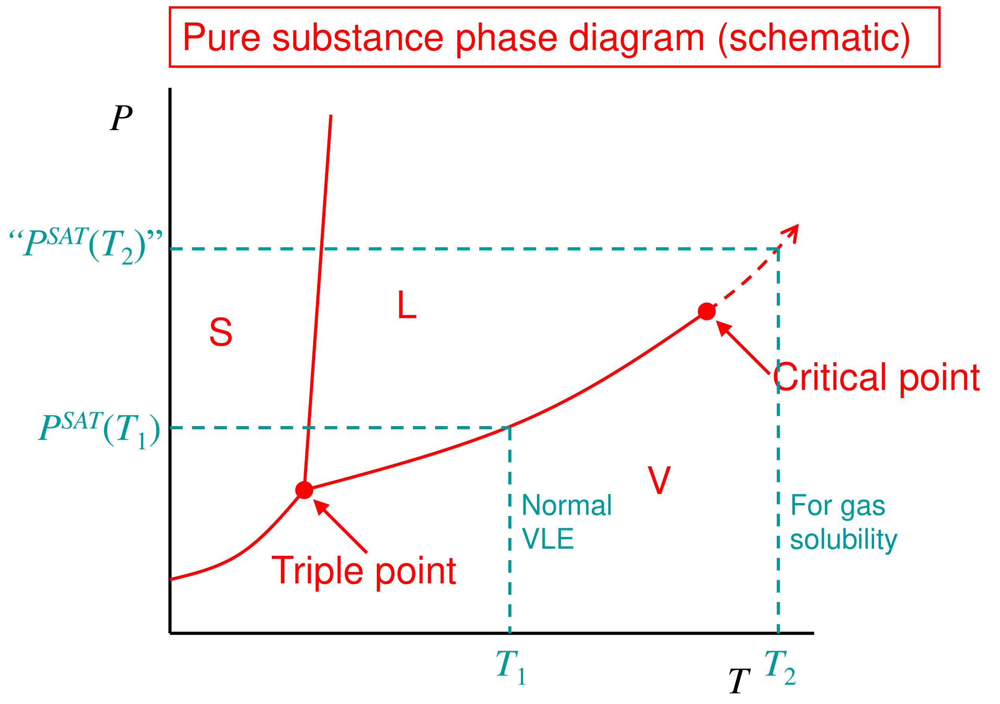

# Solubility of gases in liquids — reading 08.1

[Previous](07-03-vapour-liquid-equilibrium-of-real-mixtures.md) · [Subject index](README.md) · [Next](08-02-solubility-of-gases-in-liquids.md)

<!-- reading-content:start -->
## Overview

A gas above its critical temperature has no pure liquid to serve as the activity-coefficient reference. One fix extrapolates the vapour-pressure curve to a hypothetical liquid fugacity, best read from a corresponding-states chart, giving a solvent-independent ideal solubility (Section 29). For methane in three solvents this gives activity coefficients of 2–3 from measured solubilities (Section 30). The other fix uses Henry's constant as the reference: the dilute-limit slope of fugacity against mole fraction, with its own activity coefficient $`\gamma^{*}`$ (Section 31).

*Assumed throughout:* the γ–φ formulation (Section 26); infinite-dilution activity coefficients (Section 14); corresponding states.

## Section 29: Gas solubility, the hypothetical liquid and ideal solubility

### Intuition

Above $`T_c`$ there is no vapour-pressure curve to read $`P^{\mathrm{SAT}}`$ from. But the curve does not stop abruptly in any physical sense; it just ends at the critical point. Continue it smoothly past $`T_c`$ and read off a "vapour pressure" at the temperature of interest. That value describes a liquid that cannot exist on its own, but it is a perfectly good *reference number*, as long as every calculation uses it consistently.

Ideal solubility then asks: if the dissolved gas mixed ideally with the solvent ($`\gamma = 1`$), how much would dissolve? The answer depends only on the gas, not on the solvent, which makes it a useful yardstick.

### Derivation

**Step 1: the equilibrium condition.**


**Equation (139)**

```math
\gamma_ix_if_i^{\,l}(T,P) = \bar f_i^{\,v} \approx y_iP
```


The vapour approximation holds at modest pressure; for a gas well above $`T_c`$ at a fraction of $`P_c`$, $`\phi\approx 1`$.

**Step 2: the reference fugacity.** For $`T < T_c`$, $`f_i^{\,l}\approx P_i^{\mathrm{SAT}}`$ (neglecting $`\phi^{\mathrm{SAT}}`$ and the Poynting factor). For $`T > T_c`$ this is undefined, so extrapolate the saturation line beyond the critical point to define a hypothetical "$`P_i^{\mathrm{SAT}}(T)`$" and hence $`f_i^{\,l}`$.



**Step 3: a corresponding-states chart.** Simple extrapolation (e.g. Clausius–Clapeyron) becomes unreliable far above $`T_c`$. Prausnitz and Shair instead back-calculated $`f_i^{\,l}`$ from solubility data for many gases. They found that $`f_i^{\,l}/P_c`$ falls on a single curve when plotted against the reduced temperature $`T_r = T/T_c`$ (corresponding states). One chart then serves for all simple gases.

**Step 4: ideal solubility.** Set $`\gamma_i = 1`$ in (139):


**Equation (140)**

```math
x_i^{\mathrm{ideal}} = \frac{\bar f_i^{\,v}}{f_i^{\,l}} \approx \frac{y_iP}{f_i^{\,l}}
```


**Step 5: activity coefficient from measured solubility.** Comparing (139) and (140):


**Equation (141)**

```math
\gamma_i = \frac{\bar f_i^{\,v}}{x_if_i^{\,l}} = \frac{x_i^{\mathrm{ideal}}}{x_i}
```


So the ratio of ideal to measured solubility *is* the activity coefficient of the dissolved gas.

### Motivation and explanation

**Why solvent-independent.** Equation (140) contains only properties of the gas ($`f_i^{\,l}`$) and of the vapour ($`y_iP`$). Every solvent would dissolve the same amount if mixing were ideal. Real solvents differ through $`\gamma_i`$, which by (141) is read straight from measurements.

**Trends.**
- Gases with low $`T_c`$ (He, H₂, N₂) are far above $`T_c`$, so $`f^{\,l}`$ is large and solubility is low.
- Gases closer to $`T_c`$ (CO₂, ethane) have a smaller hypothetical vapour pressure and are more soluble.
- Solubility is proportional to the gas partial pressure (at fixed $`f^{\,l}`$), the root of Henry's law (Section 31).

**Limits.** The hypothetical liquid is a convention, so $`\gamma`$'s computed with it depend on that convention. The chart is for non-polar gases at modest pressure. Polar or reacting gases (NH₃, SO₂, CO₂ in water) need other treatments.

### Link to other topics

Gas solubility governs absorption columns (CO₂ capture, acid-gas removal), bioreactor aeration, and gas–liquid reactors. Section 30 works through ideal and real solubilities for methane in three solvents.

### Summary

For a supercritical solute the pure-liquid reference is hypothetical, and its fugacity is obtained by extrapolating the saturation curve, best done with a corresponding-states chart of $`f^{\,l}/P_c`$ against $`T/T_c`$. The ideal solubility $`x^{\mathrm{ideal}} = y_iP/f_i^{\,l}`$ is solvent-independent, and the ratio $`x^{\mathrm{ideal}}/x`$ is the gas's activity coefficient in a given solvent.

## Section 30: Worked example, solubility of methane

### Intuition

Methane at 25 °C is far above its critical temperature (−82.6 °C), so its hypothetical liquid is extremely "volatile". Even ideally, it dissolves only at the parts-per-thousand level at 10 bar. The solvents are all non-polar, so methane should be modestly unhappy in each ($`\gamma > 1`$), most so in the solvent least like itself.

### Derivation

**Problem.** At $`T = 25`$ °C and $`P = 10.13`$ bar, a gas of $`y_{\mathrm{CH_4}} = 0.1`$ (rest nitrogen) is in equilibrium with each solvent. Measured methane mole fractions: benzene $`2.07\times10^{-3}`$, CCl₄ $`2.86\times10^{-3}`$, cyclohexane $`2.83\times10^{-3}`$. Critical constants: CH₄ $`T_c = 190.6`$ K, $`P_c = 46.0`$ bar; N₂ $`T_c = 126.2`$ K, $`P_c = 33.9`$ bar.

**Step 1: vapour fugacity.** Both gases have $`T\gg T_c`$ and $`P\ll P_c`$, so treat the vapour as an ideal-gas mixture:

```math
\bar f^{\,v}_{\mathrm{CH_4}} = y_{\mathrm{CH_4}}P = 1.013\ \text{bar}.
```

Nitrogen is assumed not to affect methane's solubility (each gas dissolves independently at these dilutions).

**Step 2: hypothetical liquid fugacity.** $`T_r = 298.2/190.6 = 1.56`$. The chart gives $`f^{\,l}/P_c\approx 3.65`$, so $`f^{\,l}_{\mathrm{CH_4}}\approx 3.65\times46.0 = 168`$ bar. This is a value read from a graph.


**Step 3: ideal solubility.**

```math
x^{\mathrm{ideal}}_{\mathrm{CH_4}} = \frac{1.013}{167.9} = 6.03\times10^{-3}
```


**Step 4: activity coefficients and Henry's constants.** $`\gamma = x^{\mathrm{ideal}}/x`$, and $`\bar f^{\,v}/x`$ is the apparent Henry's constant (Section 31):

| Solvent | $`x_{\mathrm{CH_4}}`$ | $`\gamma_{\mathrm{CH_4}}`$ | $`\bar f^{\,v}/x`$ (bar) |
|---|---|---|---|
| benzene | $`2.07\times10^{-3}`$ | 2.91 | 489 |
| CCl₄ | $`2.86\times10^{-3}`$ | 2.11 | 354 |
| cyclohexane | $`2.83\times10^{-3}`$ | 2.13 | 358 |

### Motivation and explanation

**All $`\gamma > 1`$.** Methane is less soluble in every solvent than an ideal mixture would allow. As small, weakly attracting molecules, methane pays to break the stronger solvent–solvent attractions in order to fit in.

**Why benzene is the worst solvent.** In regular-solution terms, $`\ln\gamma\propto(\delta_{\mathrm{CH_4}} - \delta_{\mathrm{solvent}})^2`$. Methane's (hypothetical-liquid) solubility parameter is low. Benzene has the highest $`\delta`$ of the three (18.7 MPa^½ against 16.8 for cyclohexane, Section 17), so it is the most unlike methane and dissolves it least. Cyclohexane and CCl₄ have similar, lower $`\delta`$'s and almost equal $`\gamma`$'s.

**Accuracy.** $`f^{\,l}`$ comes from a correlation read off a log-scale chart, so the absolute $`\gamma`$'s carry several percent uncertainty. The *ratios* between solvents do not depend on $`f^{\,l}`$ at all, since they come straight from the measured $`x`$'s. The ranking is therefore robust.

**Assumptions to check.**
- Ideal-gas vapour: at 10 bar and $`T_r = 1.56`$, methane's fugacity coefficient is 0.983, within 2 % of 1.
- No nitrogen effect: reasonable at mole fractions of $`10^{-3}`$.
- Solvent vapour in the gas phase: neglected. Benzene's vapour pressure at 25 °C is about 0.13 bar, small compared with 10 bar.

### Link to other topics

The same calculation sizes absorbers for natural-gas processing. The apparent Henry's constants in the table are what designers usually tabulate, which is the motivation for the Henry's-law standard state in the next section.

### Summary

At 25 °C and 1.01 bar partial pressure, methane's hypothetical liquid fugacity of about 168 bar gives an ideal solubility of $`6.0\times10^{-3}`$. Measured solubilities are 2–3 times lower, giving $`\gamma_{\mathrm{CH_4}}`$ = 2.1–2.9, with benzene the least favourable solvent because its cohesive energy differs most from methane's.
<!-- reading-content:end -->

[Previous](07-03-vapour-liquid-equilibrium-of-real-mixtures.md) · [Subject index](README.md) · [Next](08-02-solubility-of-gases-in-liquids.md)
