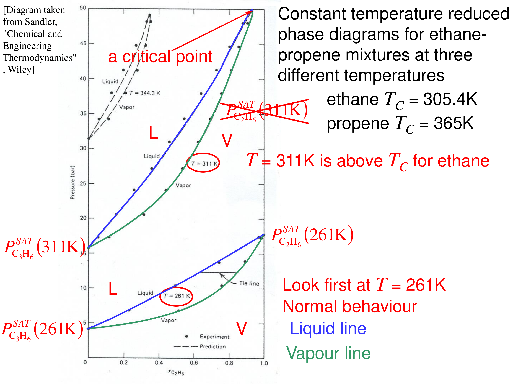
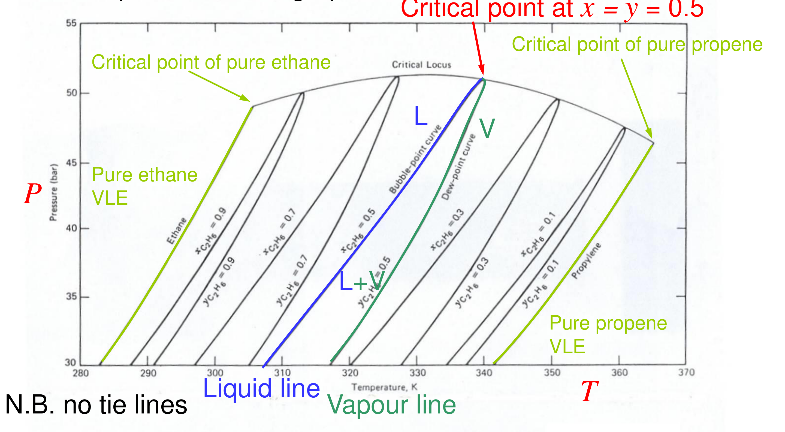

# High-pressure vapour–liquid equilibrium — reading 09.1

[Previous](08-02-solubility-of-gases-in-liquids.md) · [Subject index](README.md) · [Next](09-02-high-pressure-vapour-liquid-equilibrium.md)

<!-- reading-content:start -->
## Overview

Near critical points the liquid and vapour must be described by one equation of state so that their fugacities merge continuously. A binary then has a critical locus joining the pure critical points, constant-$`T`$ lenses close at mixture critical points, and constant-composition diagrams become closed bubble–dew loops (Section 32). On such loops the critical point, the maximum two-phase pressure and the maximum two-phase temperature differ, which allows retrograde behaviour: cooling can evaporate liquid and decompression can condense it (Section 33).

*Assumed throughout:* equal fugacities and fugacity coefficients from an equation of state (Sections 07–09); the binary VLE surface (Section 25).

## Section 32: Vapour–liquid equilibrium near critical points

### Intuition

A pure substance's vapour-pressure curve ends at its critical point. Beyond it there is only one fluid phase. A binary mixture has a whole *line* of critical points (the critical locus), running in the 3D $`P`$–$`T`$–composition space from the critical point of one pure component to that of the other.

Between the two pure critical temperatures, the lighter component cannot be liquid on its own. A mixture rich enough in the heavier component can still split into liquid and vapour, but only up to some maximum pressure. At that pressure the liquid and vapour compositions merge at a mixture critical point. A two-phase lens that used to stretch across the whole composition range is now cut off before it reaches the light-component axis.

The γ–φ approach treats the two phases with *different* models, an activity-coefficient model for the liquid and an EOS for the vapour. Two different models cannot both converge on the same fluid at the critical point. One EOS for both phases makes the liquid and vapour fugacities meet smoothly there.

### Derivation

**Step 1: the equilibrium condition with one EOS.** Write both phases with fugacity coefficients from the same mixture EOS:


```math
y_i\,\bar\phi_i^{\,v}(T,P,\mathbf{y}) = x_i\,\bar\phi_i^{\,l}(T,P,\mathbf{x}) \tag{146}
```


$`\bar\phi_i`$ is computed from the general integral of Section 08, with the partial molar volume from the EOS, e.g. Peng–Robinson with mixing rules for $`a`$ and $`b`$. On a given isotherm the cubic has two relevant roots: the small one is used for the liquid, the large one for the vapour.

**Step 2: what happens at a mixture critical point.** As the critical point is approached along an isotherm, $`\mathbf{x}\to\mathbf{y}`$, the two roots merge, and (146) is satisfied trivially, so the tie line shrinks to zero length. Beyond it, (146) has only the trivial solution: one phase.

**Step 3: the phase rule along the critical locus.** At a binary critical point the two coexisting phases become identical, which adds one condition ($`\mathbf{x} = \mathbf{y}`$), so $`F = 2 - 2 + 2 - 1 = 1`$, a line in $`P`$–$`T`$–$`x`$ space: the critical locus. Fixing $`T`$ fixes the critical pressure and composition.

### Motivation and explanation

**Constant-$`T`$ diagrams for ethane (146)–propene (2).** Pure critical temperatures are ethane 305.3 K and propene 364.2 K.
- At 261 K, below both, the lens spans the whole composition range: from propene's vapour pressure (4.0 bar) to ethane's (17.6 bar).
- At 311 K, above ethane's $`T_c`$, pure ethane cannot be liquid. The lens starts at propene's vapour pressure (15.7 bar) and closes at a **mixture critical point** at about 49 bar and $`x_{\mathrm{C_2H_6}}\approx 0.93`$, never reaching the ethane axis.
- At 344.3 K the lens is short and closes at much lower ethane content.



**Constant-composition diagrams.** Slicing the 3D surface at fixed overall composition gives, for each composition, a closed loop: bubble curve on one side, dew curve on the other, meeting at that composition's critical point on the critical locus. These diagrams have **no tie lines**, because the coexisting phases have different compositions and lie on other loops.



**Why the critical locus can rise above both pure critical pressures.** For ethane–propene the locus bulges to about 51 bar, above both pure $`P_c`$ values (48.7 and 45.5 bar). The mixture has to be squeezed harder than either pure component before its liquid and vapour merge. In more asymmetric mixtures (ethane–heptane, next section) the bulge is much larger.

**Limits.** Cubic EOS work well for hydrocarbons and light inorganic gases (N₂, CO₂, H₂S). They work poorly for strongly polar or hydrogen-bonding liquids, for which activity-coefficient models remain necessary at low pressure. Very close to a critical point, all classical EOS miss the true (non-analytic) critical behaviour, but this rarely matters in design.

### Worked example

**Problem.** Use pure-component data to explain the end points of the three ethane–propene isotherms and decide which isotherms can reach $`x_{\mathrm{C_2H_6}} = 1`$.

| | Ethane | Propene |
|---|---|---|
| $`T_c`$ (K) | 305.3 | 364.2 |
| $`P_c`$ (bar) | 48.7 | 45.5 |
| $`P^{\mathrm{SAT}}`$ at 261 K (bar) | 17.6 | 4.0 |
| $`P^{\mathrm{SAT}}`$ at 311 K (bar) | — (above $`T_c`$) | 15.7 |

**261 K.** Below both critical temperatures. The lens runs from 4.0 bar to 17.6 bar, matching the end points read from the diagram (≈4 and ≈17.5 bar), and reaches both axes.

**311 K.** Ethane is supercritical, so there is no ethane end point. The lens starts at propene's 15.7 bar and must close at a mixture critical point. The diagram shows this at ≈49 bar near $`x_{\mathrm{C_2H_6}}\approx 0.93`$, just above ethane's own $`P_c`$.

**344.3 K.** Even closer to propene's $`T_c`$. The two-phase region is confined to a narrow band of low ethane content, closing at ≈49 bar.

**Interpretation.** Above the light component's critical temperature, a liquid can still exist, but only with enough of the heavy component dissolved, and only below the critical locus. This is how light hydrocarbons are held in liquid form in high-pressure processes, and why accurate high-pressure separations (e.g. demethanisers) use EOS-based VLE throughout.

### Link to other topics

Process simulators use EOS-based VLE (Peng–Robinson, Soave–Redlich–Kwong) for gas processing and refinery light ends, and γ–φ models for polar chemicals. Choosing between them is one of the first decisions in setting up a flowsheet. Section 33 explores the counter-intuitive behaviour inside the two-phase region near the critical locus: retrograde condensation and evaporation.

### Summary

Near critical points, liquid and vapour must be described by one equation of state, so that their fugacities converge as the phases merge. For a binary, the pure critical points are joined by a critical locus. Between the pure critical temperatures, constant-$`T`$ lenses close at mixture critical points, and constant-composition diagrams become closed bubble–dew loops without tie lines.
<!-- reading-content:end -->

[Previous](08-02-solubility-of-gases-in-liquids.md) · [Subject index](README.md) · [Next](09-02-high-pressure-vapour-liquid-equilibrium.md)
