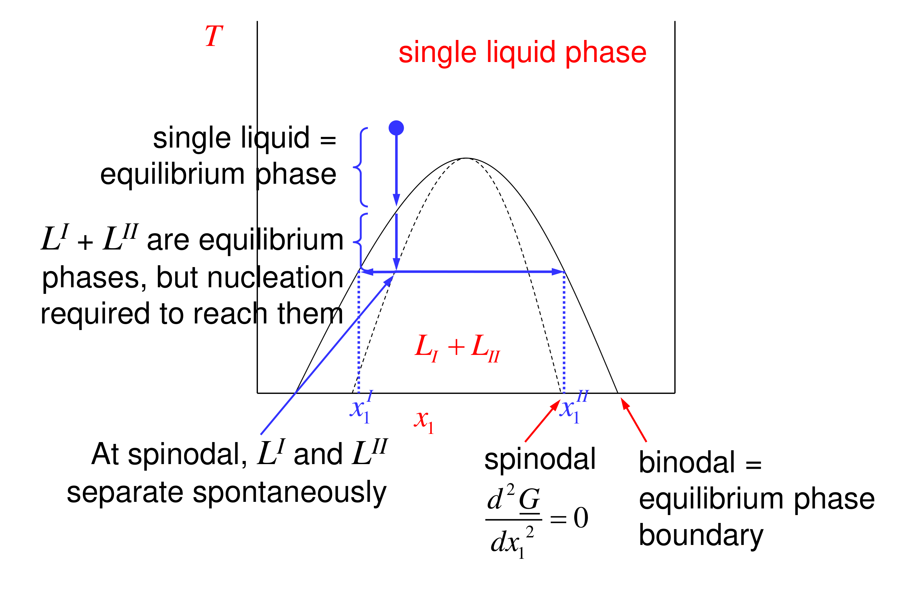

# Liquid–liquid equilibrium and diffusion — reading 11.3

[Previous](11-02-liquid-liquid-equilibrium-and-diffusion.md) · [Subject index](README.md) · [Next](11-04-liquid-liquid-equilibrium-and-diffusion.md)

<!-- reading-content:start -->
## Section 39: Binodal, spinodal and the stability of a single liquid

### Intuition

Normally, adding more of component 1 to a region raises $`\mu_1`$ there. So any local excess of component 1 pushes it away, and concentration fluctuations die out: the mixture is stable.

Inside the spinodal the opposite holds: adding component 1 *lowers* $`\mu_1`$. A region that happens to gain a little component 1 now attracts more, the fluctuation grows, and the liquid tears itself into two phases everywhere at once. No nucleation is needed.

Between binodal and spinodal, small fluctuations still die out, but a large enough fluctuation (a nucleus of the other phase) can grow. That is the same situation as a supersaturated vapour (Section 23).

### Derivation

**Step 1: chemical potentials from the $`\underline{G}`$ curve.** From $`\underline{G} = x_1\mu_1 + x_2\mu_2`$ and $`d\underline{G}/dx_1 = \mu_1 - \mu_2`$:


```math
\mu_1 = \underline{G} + x_2\frac{d\underline{G}}{dx_1}, \qquad \mu_2 = \underline{G} - x_1\frac{d\underline{G}}{dx_1} \tag{157}
```


These are the tangent intercepts.

**Step 2: derivatives.** Differentiate (157); the $`d\underline{G}/dx_1`$ terms cancel:


```math
\frac{\partial\mu_1}{\partial x_1} = x_2\frac{\partial^2\underline{G}}{\partial x_1^2}, \qquad \frac{\partial\mu_2}{\partial x_1} = -x_1\frac{\partial^2\underline{G}}{\partial x_1^2} \tag{158}
```


**Step 3: stability criterion.** Both $`\partial\mu_1/\partial x_1`$ and $`\partial\mu_2/\partial x_2`$ have the sign of $`\partial^2\underline{G}/\partial x_1^2`$:
- positive curvature: each component's chemical potential rises with its own concentration, so diffusion flattens composition differences (**stable**);
- zero curvature: the **spinodal**, where $`\partial\mu_1/\partial x_1 = \partial\mu_2/\partial x_1 = 0`$;
- negative curvature: each component moves *up* its own concentration gradient (**unstable**).

**Step 4: limiting values.** As $`x_2\to 0`$, $`\mu_1\to\underline{G}_1`$ and $`\mu_2\to -\infty`$, and vice versa. At a stationary point of $`\underline{G}`$, $`\mu_1 = \mu_2 = \underline{G}`$. Plotting $`\mu_1`$ and $`\mu_2`$ against $`x_1`$ therefore shows two S-shaped curves. At the binodal compositions each $`\mu_i`$ takes the same value (the horizontal lines), and between the spinodals each runs backwards.


### Motivation and explanation

**Cooling a single liquid into the gap (UCST system).**
1. Above the binodal: a single liquid is the equilibrium state.
2. Between binodal and spinodal: two liquids are the equilibrium, but the single liquid persists until a nucleus forms (on impurities, walls or stirring). The result is typically droplets of one phase growing in the other.
3. On crossing the spinodal: spontaneous separation everywhere, giving a very fine, interconnected dispersion of the two phases.



**Practical consequences.** Spinodal decomposition produces fine, co-continuous structures, the basis of porous glasses, phase-separation membranes and some alloy and polymer-blend microstructures. Metastability explains why a quickly cooled mixture can stay cloudy-free (single-phase) for a while before suddenly separating.

### Worked example

**Problem.** For the regular solution with $`A/RT = 2.5`$ (Section 36), classify the states at $`x_1 = 0.10`$, 0.20 and 0.40, and give the sign of $`\partial\mu_1/\partial x_1`$ at each.

**Boundaries.** Binodal $`x = 0.145/0.855`$; spinodal $`x = 0.276/0.724`$.

**Curvature.** $`\frac{1}{RT}\frac{\partial^2\underline{G}}{\partial x^2} = \frac{1}{x(1-x)} - 5`$:

| $`x_1`$ | $`1/[x(1-x)] - 5`$ | Region | Behaviour |
|---|---|---|---|
| 0.10 | +6.11 | outside binodal | stable single liquid |
| 0.20 | +1.25 | between binodal and spinodal | metastable; splits only after nucleation |
| 0.40 | −0.83 | inside spinodal | unstable; spinodal decomposition |

By (158), $`\partial\mu_1/\partial x_1 = x_2\,\partial^2\underline{G}/\partial x_1^2`$ has the same sign as the curvature: positive at 0.10 and 0.20, negative at 0.40.

**Interpretation.** A 20 % liquid quenched quickly to this temperature can stay homogeneous until nucleated. A 40 % liquid cannot: it separates immediately into a fine dispersion. Both end up as the same two equilibrium phases (14.5 % and 85.5 %). The routes, and the resulting structures, differ.

### Link to other topics

The sign of $`\partial\mu_1/\partial x_1`$ is exactly what controls diffusion. Section 40 shows that the ordinary Fickian diffusion coefficient is proportional to it, so it vanishes at the spinodal and turns negative inside.

### Summary

Single-phase stability requires each chemical potential to increase with that component's own concentration, i.e. $`\partial^2\underline{G}/\partial x_1^2 > 0`$. The spinodal ($`\partial^2\underline{G}/\partial x_1^2 = 0`$) separates metastable states, which need nucleation, from unstable ones, which decompose spontaneously. The binodal marks where two liquids become the equilibrium.

## Section 40: Diffusion is driven by chemical potential, not concentration

*Notation:* $`N_1`$ is the molar flux of 1 (mol m⁻² s⁻¹), $`c`$ the total molar concentration, $`z`$ position, and $`D`$ a diffusion coefficient.

### Intuition

Molecules do not "know" concentration; they respond to differences in free energy. In an ideal mixture the two coincide, since $`\mu_1`$ rises smoothly with $`x_1`$, so Fick's law works. In a strongly non-ideal mixture, $`\mu_1`$ may barely change, or even fall, as $`x_1`$ rises. Then a large concentration difference may give little or negative driving force.

At an equilibrium interface between two liquids, $`\mu_1`$ is equal on both sides, so there is no net flux despite the jump in composition.

### Derivation

**Step 1: ideal mixture.** $`\mu_1 = \underline{G}_1 + RT\ln x_1`$, so $`\partial\mu_1/\partial x_1 = RT/x_1`$. Change the variable in Fick's law:


```math
N_1 = -Dc\frac{dx_1}{dz} = -Dc\left(\frac{\partial x_1}{\partial\mu_1}\right)\frac{d\mu_1}{dz} = -\frac{Dcx_1}{RT}\frac{d\mu_1}{dz} \tag{159}
```


The two forms are identical for an ideal mixture.

**Step 2: real mixture, taking (159) as fundamental.** Postulate that the chemical-potential form holds with a well-behaved coefficient $`D`$, and convert back using $`\partial\mu_1/\partial x_1 = RT(1/x_1 + \partial\ln\gamma_1/\partial x_1)`$:


```math
N_1 = -\frac{Dcx_1}{RT}\frac{\partial\mu_1}{\partial x_1}\frac{dx_1}{dz} = -Dc\left(1 + \frac{\partial\ln\gamma_1}{\partial\ln x_1}\right)\frac{dx_1}{dz} \tag{160}
```


The measured (Fickian) coefficient is therefore


```math
D_{12} = D\,\Gamma, \qquad \Gamma = 1 + \frac{\partial\ln\gamma_1}{\partial\ln x_1} = \frac{x_1x_2}{RT}\frac{\partial^2\underline{G}}{\partial x_1^2} \tag{161}
```


(the last form from (154) of Section 36).

**Step 3: consequences.**
- *Ideal mixture:* $`\Gamma = 1`$.
- *At the spinodal:* $`\Gamma = 0`$, so $`D_{12} = 0`$, whatever the molecular mobility.
- *Inside the spinodal:* $`\Gamma < 0`$, so the flux runs *up* the concentration gradient.
- *At an equilibrium interface:* $`\mu_1`$ and $`\mu_2`$ are continuous, so $`d\mu_i/dz = 0`$ across it and there is no flux, despite the composition jump.

**Step 4: regular solution.** For one-constant Margules, $`\ln\gamma_1 = (A/RT)x_2^2`$, so $`\partial\ln\gamma_1/\partial\ln x_1 = x_1\cdot(A/RT)\cdot2x_2\cdot(-1)`$, and


```math
\Gamma = 1 - 2\frac{A}{RT}x_1x_2 \tag{162}
```


### Motivation and explanation

**Why this matters.** Diffusion coefficients in strongly non-ideal liquids (near phase separation, or in associating mixtures) vary greatly with composition. Much of that variation is thermodynamic ($`\Gamma`$), not molecular ($`D`$). Correlations that separate the two, $`D_{12} = D\Gamma`$, extrapolate far better. This is the binary case of the Maxwell–Stefan approach to multicomponent diffusion.

**Limits.** Equation (160) assumes $`D`$ itself is a constant or smooth property. Very close to a consolute point, concentration fluctuations make that inadequate (next section).

### Worked example

**Problem.** For the regular solution with $`A/RT = 2.5`$, compute $`\Gamma`$ and the ratio $`D_{12}/D`$ at $`x_1 = 0.145`$ (binodal), 0.40 and 0.50.

**Equation (162)**, $`\Gamma = 1 - 5x_1x_2`$:

| $`x_1`$ | $`\Gamma = D_{12}/D`$ | Meaning |
|---|---|---|
| 0.145 (binodal) | +0.38 | diffusion slowed to 38 % of the "ideal" value |
| 0.276 (spinodal) | 0 | no diffusive smoothing |
| 0.40 | −0.20 | uphill diffusion |
| 0.50 | −0.25 | uphill diffusion |

**Interpretation.** Even on the equilibrium phase boundary, thermodynamics alone slows diffusion by a factor of almost 3 compared with an ideal mixture of the same mobility. Inside the spinodal the effective coefficient is negative, which is the mechanism of spinodal decomposition: diffusion *creates* composition differences rather than destroying them.

### Link to other topics

The thermodynamic factor appears in mass-transfer correlations for extraction and in membrane transport. Section 41 tests (160) against measurements on nitrobenzene–hexane near its consolute point.

### Summary

Material moves down chemical-potential gradients. Rewriting Fick's law that way shows that the measured diffusion coefficient is a mobility times the thermodynamic factor $`\Gamma = 1 + \partial\ln\gamma_1/\partial\ln x_1`$. $`\Gamma`$ is 1 for an ideal mixture, zero at the spinodal and negative inside it. This explains zero flux across an equilibrium interface, and uphill diffusion during phase separation.
<!-- reading-content:end -->

[Previous](11-02-liquid-liquid-equilibrium-and-diffusion.md) · [Subject index](README.md) · [Next](11-04-liquid-liquid-equilibrium-and-diffusion.md)
