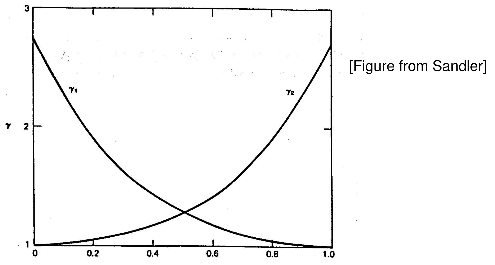
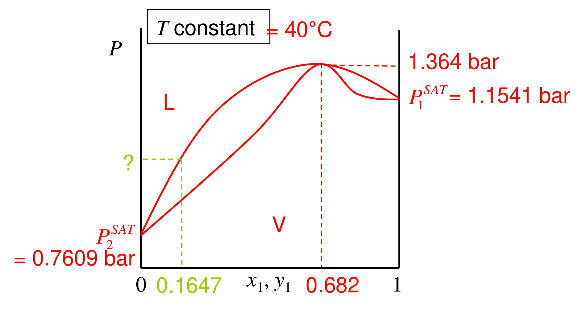
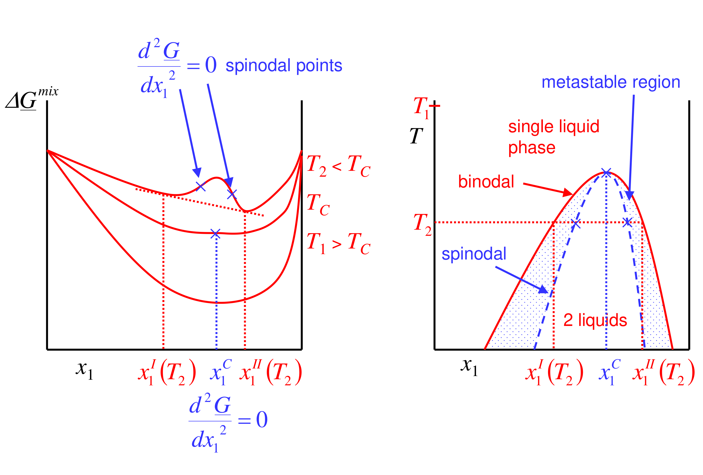
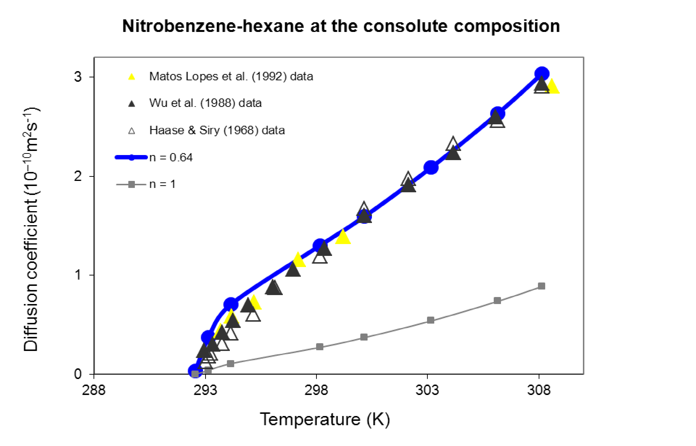
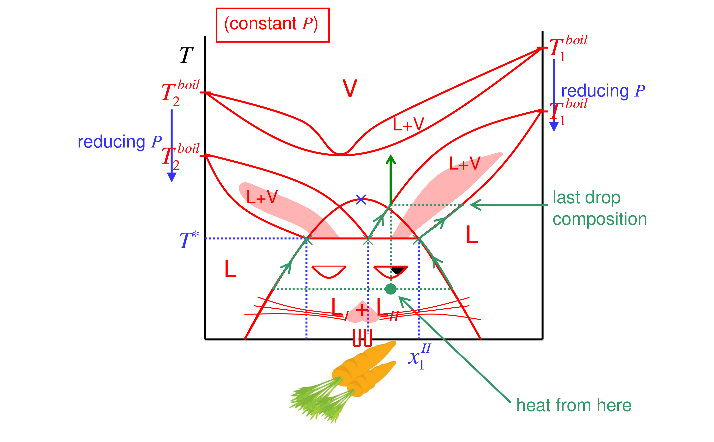

# Equilibrium Thermodynamics — complete Obsidian edition

All teaching units in order. Equation numbers run continuously through this subject. For GitHub, use the [linked reading sections](README.md).

## 01. Foundations: equilibrium, equations of state and the chemical potential

### Overview

This part sets up everything the rest of the course uses. Equilibrium at fixed temperature and pressure is the minimum of the Gibbs energy, which means equal chemical potential of every component in every phase, with material moving from high to low $\mu_i$ (Section 01). An equation of state supplies the numbers, with each property computed as an ideal-gas value plus a departure integrated from zero pressure (Section 02). In mixtures the relevant quantities are partial molar properties: each component's share of a mixture property, which sum exactly to the total but differ from pure-component values when mixing is non-ideal, as the 3 % volume contraction of whiskey shows (Section 03). The chemical potential is the partial molar Gibbs energy; at fixed $T$ and $P$ the chemical potentials of a mixture are tied together by the Gibbs–Duhem equation (Section 04). Finally, $\mu_i$ is built up for ideal gases, ideal-gas mixtures, ideal mixtures and real fluids, the last needing a correction integral from an equation of state (Section 05).

*Assumed throughout:* first and second laws; $G = H - TS$; Maxwell relations; the van der Waals and Peng–Robinson equations from earlier years.

### Section 01: The criterion for phase equilibrium

*Notation (used throughout):* a plain symbol is a total (extensive) property, e.g. $G$, $V$. An underline is a molar property, e.g. $\underline{G} = G/n$; this course writes $\underline{V}$ where many texts write $V_m$. A subscript $i$ on an underlined symbol means pure $i$, e.g. $\underline{G}_i$. Superscripts $L$, $V$, $S$ label liquid, vapour and solid.

#### Intuition

At constant $T$ and $P$ the system exchanges heat and work with surroundings that hold $T$ and $P$ fixed. The Gibbs energy is the quantity that accounts for the entropy change of *both* the system and those surroundings. So "the universe's entropy goes up" becomes "the system's $G$ goes down".

Chemical potential is how much $G$ changes when one more mole of a component is added to a phase. If moving a molecule from phase L to phase V lowers $G$, it will move. It stops moving when the transfer no longer changes $G$, i.e. when the chemical potentials are equal.

*Analogy: water levels in connected tanks.* Water flows from the higher level to the lower until the levels match, and $\mu_i$ plays the role of the level. The analogy breaks down because each component has its own "level", and the levels can differ between components. Also, $\mu_i$ is not a fixed property of a phase: it changes as the phase's composition changes, which a tank's water level does not do in the same way.

#### Derivation

**Step 1: $G$ is minimised at constant $T$, $P$.** For a closed system exchanging heat with surroundings at $T$, the surroundings receive $-dH$ as heat at constant $P$, so $dS_{\mathrm{surr}} = -dH/T$. The second law requires $dS + dS_{\mathrm{surr}} \ge 0$. Multiply by $-T$:

$$dG = dH - T\,dS \le 0 \qquad (\text{constant } T, P) \tag{1}$$

*Reason:* at constant $T$, $dG = dH - T\,dS$. So every spontaneous change at fixed $T$ and $P$ lowers $G$, and equilibrium is the minimum.

**Step 2: the fundamental relation.** For a closed, homogeneous phase,

$$dG = -S\,dT + V\,dP \tag{2}$$

This combines the first law, $dU = \delta Q + \delta W$, with $\delta Q_{\mathrm{rev}} = T\,dS$ and the definition of $G$. It holds for any change between equilibrium states. If the phase is *open*, its amounts can also change, and each mole of $i$ added changes $G$ by $\mu_i$:

$$dG = -S\,dT + V\,dP + \sum_i \mu_i\,dn_i, \qquad \mu_i \equiv \left(\frac{\partial G}{\partial n_i}\right)_{T,P,n_{j\neq i}} \tag{3}$$

**Step 3: two phases in contact.** Take a closed system with phases L and V at the same $T$ and $P$. Move $dn$ moles of component $i$ from L to V, so $dn_i^V = +dn$ and $dn_i^L = -dn$. Apply (3) to each phase (each is open, but the whole is closed) at constant $T$, $P$:

$$dG = dG^L + dG^V = \left(\mu_i^V - \mu_i^L\right)dn \tag{4}$$

**Step 4: equilibrium and direction.** At the minimum of $G$, (4) must vanish for any small transfer, so

$$\mu_i^L = \mu_i^V \quad \text{for every component } i \tag{5}$$

Away from equilibrium, (1) requires $dG < 0$. If $\mu_i^L > \mu_i^V$, then $dn > 0$: component $i$ moves from the phase where its chemical potential is higher to where it is lower.

**Step 5: pure substance.** For pure $i$, $G = n\underline{G}_i(T,P)$, so $\mu_i = \partial G/\partial n = \underline{G}_i$. Equation (5) becomes

$$\underline{G}^L = \underline{G}^V \tag{6}$$

#### Motivation and explanation

**Why $\mu_i$ and not concentration.** Material does not, in general, move down a concentration gradient. Water and oil sit side by side with very different water concentrations and nothing flows. What equalises is $\mu_i$, which includes the energetic preference of each molecule for its surroundings.

**What is held constant.** Equation (1) needs fixed $T$ and $P$. Equation (5) also assumes:
- thermal equilibrium (same $T$ in both phases);
- mechanical equilibrium (same $P$, which is true across a flat interface);
- that component $i$ can actually cross between the phases.

Later sections relax these one at a time. Across a curved interface (droplets and bubbles) the pressures differ. Across a semipermeable membrane only some components can cross (osmosis). Each case changes which equalities hold, and that is exactly how those problems are solved.

**Sanity check.** At the normal melting point, ice and water coexist, so (6) holds at 0 °C and 1 atm. Below that temperature (6) fails and the phase with the lower $\underline{G}$ wins. The example below quantifies this.

#### Worked example

**Problem.** Water is supercooled to −10 °C at 1 atm. Which phase is stable, and what is the driving force for freezing? The enthalpy of fusion is 333.55 J g⁻¹ (so $\Delta\underline{H}_{\mathrm{fus}} = 6009$ J mol⁻¹), and the melting point is $T_f = 273.15$ K.

**Temperature dependence of $\underline{G}$.** From (2) at constant $P$, $(\partial\underline{G}/\partial T)_P = -\underline{S}$. Applying this to each phase and subtracting:

$$\frac{d}{dT}\left(\underline{G}^L - \underline{G}^S\right) = -\left(\underline{S}^L - \underline{S}^S\right) = -\Delta\underline{S}_{\mathrm{fus}}$$

**Anchor at $T_f$.** At the melting point $\underline{G}^L = \underline{G}^S$, which also gives $\Delta\underline{S}_{\mathrm{fus}} = \Delta\underline{H}_{\mathrm{fus}}/T_f = 22.0$ J mol⁻¹ K⁻¹. Assuming $\Delta\underline{S}_{\mathrm{fus}}$ is constant over 10 K and integrating from $T_f$ to $T$:

$$\underline{G}^L - \underline{G}^S \approx \Delta\underline{S}_{\mathrm{fus}}\,(T_f - T) = 22.0 \times 10 = 220\ \text{J mol}^{-1}$$

**Answer.** The liquid's molar Gibbs energy is about 220 J mol⁻¹ higher than the solid's, so ice is stable and the water will freeze given a nucleation site. At −5 °C the driving force is half as large, about 110 J mol⁻¹. *Physically:* the liquid's higher entropy lets it win above $T_f$; below $T_f$ the $-T\underline{S}$ term no longer compensates for its higher enthalpy.

#### Link to other topics

The same calculation, with the liquid's chemical potential lowered by a dissolved solute, gives freezing-point depression later in the course. The chemical potential defined in (3) is the partial molar Gibbs energy, the subject of the partial-molar-property sections that follow.

#### Summary

At constant $T$ and $P$, equilibrium is the minimum of $G$. Between phases this means equal molar Gibbs energy for a pure substance and equal chemical potential of every component for a mixture, with material flowing from high to low $\mu_i$. Everything else is about computing $\mu_i$.

### Section 02: Equations of state and departure functions

#### Intuition

An ideal gas is the easy reference: its properties are known exactly from $P\underline{V} = RT$ and heat-capacity data. A real fluid differs because its molecules attract one another at moderate separations and repel at short ones. At zero pressure the molecules are infinitely far apart, so every real fluid *is* an ideal gas there.

So the plan is: start at $P = 0$ (ideal), follow the real isotherm up to the pressure of interest, and add up how the real fluid's property changes compared with the ideal gas along the way. The EOS tells us $\underline{V}$ along that path, and the Maxwell relations turn $\underline{V}$ into everything else.

#### Derivation

**Step 1: the EOS.** The ideal-gas law $P\underline{V} = RT$ cannot produce a liquid. The van der Waals equation,

$$\left(P + \frac{a}{\underline{V}^2}\right)\left(\underline{V} - b\right) = RT \tag{7}$$

adds two corrections: $b$, the volume excluded by finite molecular size, and $a/\underline{V}^2$, the reduction in wall pressure caused by attractions. It is cubic in $\underline{V}$. Below the critical temperature it has three roots, which is how it predicts a liquid and a vapour. Modern cubic EOS (Peng–Robinson and others) keep this structure with better-tuned $a(T)$ and $b$.

**Step 2: how $\underline{H}$ depends on pressure.** From $d\underline{H} = T\,d\underline{S} + \underline{V}\,dP$, at constant $T$:

$$\left(\frac{\partial \underline{H}}{\partial P}\right)_T = T\left(\frac{\partial \underline{S}}{\partial P}\right)_T + \underline{V}$$

**Step 3: remove the entropy.** From $d\underline{G} = -\underline{S}\,dT + \underline{V}\,dP$, equality of the mixed second derivatives gives the Maxwell relation $(\partial\underline{S}/\partial P)_T = -(\partial\underline{V}/\partial T)_P$. Hence

$$\left(\frac{\partial \underline{H}}{\partial P}\right)_T = \underline{V} - T\left(\frac{\partial \underline{V}}{\partial T}\right)_P \tag{8}$$

*Reason:* the right side contains only $P$–$\underline{V}$–$T$ quantities, which the EOS provides.

**Step 4: integrate from the ideal-gas limit.** At $P \to 0$ the fluid is ideal, so $\underline{H}(T, 0) = \underline{H}^{\mathrm{IG}}(T)$. Integrating (8) along the isotherm:

$$\underline{H}(T,P) - \underline{H}^{\mathrm{IG}}(T) = \int_{0}^{P}\left[\underline{V} - T\left(\frac{\partial \underline{V}}{\partial T}\right)_P\right]dP \tag{9}$$

For an ideal gas the integrand is $RT/P - T(R/P) = 0$, so the departure is zero, as it must be.

**Step 5: low-pressure van der Waals.** At low density, (7) expands to $\underline{V} \approx RT/P + b - a/RT$, i.e. a second virial coefficient $B = b - a/RT$. Then $T(\partial\underline{V}/\partial T)_P = RT/P + a/RT$, and the integrand of (9) is constant:

$$\underline{H} - \underline{H}^{\mathrm{IG}} \approx \left(b - \frac{2a}{RT}\right)P \tag{10}$$

#### Motivation and explanation

**Sign and meaning.** In (10), attractions ($a$) lower the enthalpy below the ideal-gas value, because the molecules sit in each other's potential wells. Repulsions ($b$) raise it. At ordinary temperatures attractions win for most gases. Equation (8) is then negative, so a gas throttled at constant $H$ to lower pressure cools (the Joule–Thomson effect). The sign changes at $T = 2a/(Rb)$, the van der Waals estimate of the inversion temperature.

**Why departures, not absolutes.** Equation (9) only gives *differences* from a reference that is known separately. Ideal-gas heat capacities fix $\underline{H}^{\mathrm{IG}}(T)$; the EOS fixes the departure. Process simulators compute every property this way. The same route applied to $\underline{G}$ is what defines fugacity later in the course.

**When it fails.**
- The low-pressure form (10) is only the first term of an expansion in density.
- A cubic EOS is reasonable for non-polar fluids but poor for strongly polar or hydrogen-bonding liquids.
- For mixtures the EOS needs mixing rules for $a$ and $b$, which work for "easy" mixtures (similar molecules) but not for, say, ethanol–water.

#### Worked example

**Problem.** Estimate the enthalpy departure of nitrogen at 300 K and 1, 10 and 100 bar from the van der Waals EOS, with $a = 1.370$ L² bar mol⁻² $= 0.1370$ Pa m⁶ mol⁻² and $b = 0.0387$ L mol⁻¹ $= 3.87\times10^{-5}$ m³ mol⁻¹.

**Low-pressure formula (10).** $b - 2a/RT = 3.87\times10^{-5} - 2(0.1370)/(8.314\times300) = -7.11\times10^{-5}$ m³ mol⁻¹. Multiply by $P$:

| $P$ (bar) | (10) low-pressure (J mol⁻¹) | (9) integrated numerically with full vdW (J mol⁻¹) |
|---|---|---|
| 1 | −7.1 | −7.1 |
| 10 | −71.1 | −71.0 |
| 100 | −711 | −661 |

**Interpretation.** At 1–10 bar the linear formula is exact to the precision shown. At 100 bar it overestimates the departure by about 8 % (−711 against −661 J mol⁻¹), because higher-order density terms (repulsions becoming more important) start to matter. For comparison, heating nitrogen by 1 K raises its ideal-gas enthalpy by $\underline{C}_P \approx 7R/2 = 29.1$ J mol⁻¹. So at 100 bar the non-ideal correction equals about 23 K of heating, which is not negligible in a compressor or throttle energy balance. The negative sign means nitrogen at 300 K cools on throttling, since $300\ \text{K} < 2a/(Rb) = 852$ K, the van der Waals inversion temperature.

#### Link to other topics

The Gibbs-energy departure uses the ideal-gas subtraction, $\underline{G}-\underline{G}^{\mathrm{IG}}=\int_0^P[\underline{V}-RT/P]\,dP$, rather than the enthalpy integrand in (9). That is the basis of chemical potentials from an EOS and of fugacity coefficients later in the course. Mixture EOS need partial molar volumes, introduced in the next two sections.

#### Summary

An EOS turns the general theory into numbers. Any property is computed as an ideal-gas value plus a departure, integrated along the isotherm from $P = 0$, where every fluid is ideal.

### Section 03: Partial molar properties

*Notation:* $V$ is the total volume. $\underline{V}$ is the molar volume of the system (pure or mixture). $\underline{V}_i$ is the molar volume of pure $i$. $\bar V_i$ is the partial molar volume of $i$ in a mixture. $x_i = n_i/n$ is the mole fraction, where $n$ is the total amount.

#### Intuition

Add one mole of water to a swimming pool of pure water and the volume rises by 18 cm³, the molar volume of water. Add the same mole of water to a swimming pool of pure ethanol and the volume rises by only about 14 cm³. The water molecules are the same; what differs is their surroundings. Hydrogen bonding with ethanol and different packing let them occupy less space.

The partial molar volume is that increase: the volume a component *effectively* occupies in a particular mixture. It is a property of the component **in that environment**, so it changes with composition. The swimming pool is large so that adding one mole does not change the composition.

*Analogy:* pouring sand into a jar of marbles. The sand fills the gaps, so the total rises by less than the sand's own volume. This breaks down for molecules. Water–ethanol contraction comes from intermolecular forces (hydrogen bonding) as well as shape, so the "gaps" depend on energetics and temperature, not just geometry.

#### Derivation

**Step 1: definition.** For any extensive property, using volume as the example,

$$\bar V_i \equiv \left(\frac{\partial V}{\partial n_i}\right)_{T,P,n_{j\neq i}} \tag{11}$$

*Reason:* this is the change in total volume per mole of $i$ added, with $T$, $P$ and all other amounts fixed. That is the swimming-pool experiment taken to the limit of an infinitesimal addition.

**Step 2: scaling property.** At fixed $T$ and $P$, doubling every amount doubles the volume. In general, for any factor $\lambda$:

$$V(T,P,\lambda n_1,\dots,\lambda n_N) = \lambda\,V(T,P,n_1,\dots,n_N) \tag{12}$$

*Reason:* $V$ is extensive. Mathematically, it is homogeneous of degree one in the amounts.

**Step 3: differentiate (12) with respect to $\lambda$.** Using the chain rule on the left side:

$$\sum_i \frac{\partial V}{\partial(\lambda n_i)}\,n_i = V$$

**Step 4: set $\lambda = 1$.** The derivatives become the partial molar volumes (11):

$$V = \sum_i n_i\,\bar V_i \qquad\Longleftrightarrow\qquad \underline{V} = \sum_i x_i\,\bar V_i \tag{13}$$

*Reason:* dividing by $n$ gives the molar form. This is Euler's theorem for homogeneous functions. It says the partial molar volumes are the right "shares" of the total: they add up exactly to the mixture volume.

**Step 5: pure-component limit.** For pure $i$, $V = n_i\underline{V}_i$, so $\bar V_i = \underline{V}_i$.

The same steps apply to $U$, $H$, $S$, $A$ and $G$. Each has partial molar properties that sum like (13).

#### Motivation and explanation

**Why not just use pure volumes?** If mixing changed nothing, $\bar V_i$ would equal $\underline{V}_i$ and the mixture volume would be $\sum n_i\underline{V}_i$. Any difference between the two is a measure of non-ideal mixing, the subject of most of this course. Volume is the easiest place to see it because it can be measured with a measuring cylinder.

**What is held constant.** Equation (11) holds $T$, $P$ and all other $n_j$ fixed. It is not a derivative with respect to mole fraction, because adding $i$ changes all the mole fractions at once.

**Graphical meaning.** Partial molar volumes in a binary are found from plots of $\underline{V}$ against $x$ (the tangent construction), or plotted directly as below. They are intensive: they depend on composition, $T$ and $P$, not on how much mixture there is.

The curves move in opposite directions. Where ethanol's partial molar volume rises, water's falls. This is not a coincidence: it is the Gibbs–Duhem equation, derived in the next section.

#### Worked example

**Problem.** A 700 cm³ bottle contains a whiskey-like ethanol–water mixture prepared from pure-liquid volumes in the ratio 40:60. Here 40 % means ethanol volume divided by the sum of the two pure-liquid volumes before mixing; it is not the usual alcohol-by-volume (ABV) label, which uses the final drink volume. How much ethanol and water does it contain, and what volume would the two pure liquids have occupied before mixing? Pure molar volumes: $\underline{V}_{\mathrm{EtOH}} = 58$ cm³ mol⁻¹, $\underline{V}_{\mathrm{H_2O}} = 18$ cm³ mol⁻¹.

**Mole fraction.** For this explicitly defined pre-mixing recipe, take 100 cm³ of separate pure liquids: $40/58 = 0.690$ mol ethanol and $60/18 = 3.333$ mol water, so $x_{\mathrm{EtOH}} = 0.171$, about 17 mol %. Use $x_{\mathrm{EtOH}} \approx 0.17$ for the graph estimates below.

**Partial molar volumes at $x_{\mathrm{EtOH}} = 0.17$** (read from the graph, so ≈): $\bar V_{\mathrm{EtOH}} \approx 54.7$ cm³ mol⁻¹, $\bar V_{\mathrm{H_2O}} \approx 17.8$ cm³ mol⁻¹. Both are below their pure values.

**Total amount from (13).** With $V = n\,(x_{\mathrm{EtOH}}\bar V_{\mathrm{EtOH}} + x_{\mathrm{H_2O}}\bar V_{\mathrm{H_2O}})$:

$$700 = n\,(0.17\times54.7 + 0.83\times17.8) \;\Rightarrow\; n = 29.08\ \text{mol}$$

so $n_{\mathrm{EtOH}} = 4.94$ mol and $n_{\mathrm{H_2O}} = 24.13$ mol.

**Volumes before mixing.** Ethanol: $4.94\times58 = 287$ cm³. Water: $24.13\times18 = 434$ cm³. Together that is **721 cm³ of pure liquids, which make 700 cm³ of whiskey**: a contraction of 21 cm³, or 2.9 %.

**Interpretation.** Adding pure-component volumes would overfill the bottle by 3 %. Ethanol–water is a non-ideal mixture, and a model that assumes ideal mixing gets even the volume wrong. Because the volume differs from the ideal value, the Gibbs energy and chemical potentials must differ too.

#### Link to other topics

The chemical potential is the partial molar property of $G$, so (13) becomes $G = \sum n_i\mu_i$: the identity that underlies the Gibbs–Duhem equation and every later model of mixture non-ideality. Excess volumes such as the 21 cm³ here are the volumetric counterpart of the excess Gibbs energy used to build activity-coefficient models.

#### Summary

A partial molar property is a component's contribution to a mixture property in its actual environment. The contributions sum exactly to the total, but they differ from pure-component values whenever mixing is non-ideal, as the 3 % contraction of whiskey shows.

### Section 04: Chemical potential and the Gibbs–Duhem equation

#### Intuition

Section 03 showed that partial molar volumes are shares of a total and that the shares depend on the environment. If one component's share grows as the composition changes, the other's must shrink to keep the books balanced. The Gibbs–Duhem equation states this exactly.

For the Gibbs energy it has a sharp physical meaning. In a binary at fixed $T$ and $P$, you cannot raise the escaping tendency of both components at once by changing the composition. Whatever makes component 1 "happier" in the mixture must make component 2 less so, in proportion to how much of each is present.

*Analogy: a seesaw with the fulcrum at the composition.* The mole fractions are the lever arms. A small change in $\mu_1$ on the long arm must be balanced by a larger change in $\mu_2$ on the short arm. The analogy breaks down because a seesaw balances forces at one instant, while Gibbs–Duhem is a relation between *changes*, $d\mu_i$, along a path of compositions. It says nothing about the absolute values of $\mu_i$.

#### Derivation

**Step 1: chemical potential as a partial molar property.** By definition

$$\mu_i = \left(\frac{\partial G}{\partial n_i}\right)_{T,P,n_{j\neq i}} \equiv \bar G_i \tag{14}$$

so Euler's theorem (Section 03, applied to $G$ at fixed $T$, $P$) gives

$$G = \sum_i n_i\,\mu_i, \qquad \underline{G} = \sum_i x_i\,\mu_i \tag{15}$$

**Step 2: differentiate (15).** By the product rule, for any change:

$$dG = \sum_i n_i\,d\mu_i + \sum_i \mu_i\,dn_i$$

**Step 3: compare with the fundamental relation.** For an open phase, $dG = -S\,dT + V\,dP + \sum_i\mu_i\,dn_i$. Subtracting from Step 2, the $\mu_i\,dn_i$ terms cancel:

$$\sum_i n_i\,d\mu_i = -S\,dT + V\,dP \tag{16}$$

**Step 4: constant $T$ and $P$.**

$$\sum_i n_i\,d\mu_i = 0 \qquad\Longleftrightarrow\qquad \sum_i x_i\,d\mu_i = 0 \qquad (\text{constant } T, P) \tag{17}$$

This is the Gibbs–Duhem equation. Dividing by $n$ gives the mole-fraction form.

**Step 5: the same holds for any partial molar property.** Repeat Steps 2–4 with $V$. Since $(\partial V/\partial n_i)$ already defines $\bar V_i$, and at constant $T$, $P$ we have $dV = \sum\bar V_i\,dn_i$:

$$\sum_i x_i\,d\bar V_i = 0 \qquad (\text{constant } T, P) \tag{18}$$

**Step 6: binary form.** With $x_2 = 1 - x_1$, divide (18) by $dx_1$:

$$x_1\,\frac{d\bar V_1}{dx_1} + x_2\,\frac{d\bar V_2}{dx_1} = 0 \tag{19}$$

The two slopes have opposite signs, and their magnitudes are in the inverse ratio of the mole fractions.

#### Motivation and explanation

**Why it matters.** Equation (15) says the mixture Gibbs energy is fully determined by the chemical potentials. So the whole problem of phase equilibrium reduces to finding the $\mu_i$. Equation (17) says those $\mu_i$ are not independent.
- In a binary, measuring or modelling one component's $\mu$ against composition gives the other's by integration.
- Experimental data for both components can be checked for consistency with (17); data that violate it contain errors.
- Any model for $\mu_i$ must satisfy it. Later sections build models from a single function, the excess Gibbs energy, precisely so that this is automatic.

**Reading the graph in Section 03.** In dilute ethanol ($x_{\mathrm{EtOH}}$ small), (19) says water's partial molar volume barely changes, because its slope is multiplied by the small $x_{\mathrm{EtOH}}/x_{\mathrm{H_2O}}$. Meanwhile ethanol's changes steeply. Both features are visible on the curves near $x_{\mathrm{EtOH}} = 0$: water's curve is flat and ethanol's is steep.

**What is held constant.** Equations (17)–(19) require constant $T$ and $P$. If $T$ or $P$ vary, the full form (16) applies.

#### Worked example

**Problem.** Use a one-parameter model for the ethanol (1)–water (2) partial molar volumes,
$$\bar V_1 = \underline{V}_1 + A\,x_2^2, \qquad \bar V_2 = \underline{V}_2 + A\,x_1^2,$$
with $\underline{V}_1 = 58$ and $\underline{V}_2 = 18$ cm³ mol⁻¹. (a) Show that it obeys Gibbs–Duhem. (b) Fit $A$ to $\bar V_1 \approx 54.7$ cm³ mol⁻¹ at $x_1 = 0.17$, predict $\bar V_2$ there, and compare with the graph value of ≈17.8 cm³ mol⁻¹. (c) Test the model at the two ends of the composition range.

**(a) Consistency.** $d\bar V_1/dx_1 = -2Ax_2$ and $d\bar V_2/dx_1 = 2Ax_1$. Substitute into (19):
$$x_1(-2Ax_2) + x_2(2Ax_1) = 0$$
so it is satisfied at every composition. This model corresponds to an excess volume $\underline{V}^E = Ax_1x_2$, i.e. $\underline{V} = x_1\underline{V}_1 + x_2\underline{V}_2 + Ax_1x_2$. Differentiating that, as in Section 03, returns the expressions above.

**(b) Fit and predict.** $A = (54.7 - 58)/0.83^2 = -4.79$ cm³ mol⁻¹. Then
$$\bar V_2 = 18 + (-4.79)(0.17)^2 = 17.86\ \text{cm}^3\,\text{mol}^{-1},$$
against ≈17.8 read from the graph. Gibbs–Duhem has predicted water's partial molar volume from ethanol's alone. As a cross-check, the model's excess volume at $x_1 = 0.17$ is $Ax_1x_2 = -0.68$ cm³ mol⁻¹. For the 29.08 mol in the whiskey bottle that is a contraction of 19.7 cm³, close to the 21 cm³ found in Section 03.

**(c) Limits.**

| Quantity | Model | Graph |
|---|---|---|
| Ethanol at infinite dilution in water, $\underline{V}_1 + A$ | 53.2 | ≈52.6 |
| Water at infinite dilution in ethanol, $\underline{V}_2 + A$ | 13.2 | ≈14.3 |

A single symmetric parameter cannot reproduce both ends, because the real curves are asymmetric. A two-parameter (asymmetric) model would fix this. The same issue, and the same remedy, comes up with activity-coefficient models.

#### Link to other topics

The binary Gibbs–Duhem equation applied to $\mu_i = \mu_i^{\mathrm{ideal}} + RT\ln\gamma_i$ becomes $x_1\,d\ln\gamma_1 + x_2\,d\ln\gamma_2 = 0$. That is the constraint behind the Margules and van Laar models and behind consistency tests of vapour–liquid equilibrium data. Equation (16) with the composition terms removed is also the basis of the Gibbs phase rule, which counts how many intensive variables are free.

#### Summary

The chemical potential is the partial molar Gibbs energy. The mixture's Gibbs energy is the mole-fraction-weighted sum of the chemical potentials, and at fixed $T$ and $P$ their changes are tied together by Gibbs–Duhem. In a binary, knowing one gives the other, as the ethanol–water volumes show.

### Section 05: Calculating the chemical potential

*Notation:* $P^{\circ}$ is a reference pressure. $\underline{G}_i^{\circ}(T)$ is the molar Gibbs energy of pure $i$ **as an ideal gas** at $T$ and $P^{\circ}$. $\underline{G}_i(T,P)$ is that of real pure $i$ at $T$, $P$ in the phase of interest. $x_i$ is the mole fraction in whichever phase is being described.

#### Intuition

For an ideal gas the only thing that changes $\mu$ is how crowded the molecules are, i.e. the pressure, entering through $RT\ln P$. In a mixture of ideal gases the molecules ignore each other, so each component behaves as if it were alone at its own partial pressure. Mixing then only adds entropy, through the $RT\ln x_i$ term.

An **ideal mixture** of liquids takes that entropy term and nothing else: the molecules are assumed to interact with each other exactly as they do with their own kind. So mixing changes neither volume nor enthalpy. Any real deviation, such as the 3 % contraction of whiskey, means unlike molecules interact differently, and $\mu_i$ needs a correction.

#### Derivation

**Step 1: pure ideal gas.** At constant $T$, $d\underline{G} = \underline{V}\,dP = (RT/P)\,dP$. Integrating from $P^{\circ}$:

$$\mu_i = \underline{G}_i = \underline{G}_i^{\circ}(T) + RT\ln\frac{P}{P^{\circ}} \tag{20}$$

**Step 2: ideal-gas mixture.** Ideal-gas molecules do not interact, so component $i$ has the same $\mu_i$ as if it occupied the volume alone at its partial pressure $P_i = x_iP$:

$$\mu_i = \underline{G}_i^{\circ}(T) + RT\ln\frac{x_iP}{P^{\circ}} = \underline{G}_i^{\mathrm{IG}}(T,P) + RT\ln x_i \tag{21}$$

where $\underline{G}_i^{\mathrm{IG}}(T,P)$ is pure ideal-gas $i$ at the mixture's $T$ and $P$, from (20). Summing with $\underline{G} = \sum x_i\mu_i$:

$$\underline{G} = \sum_i x_i\,\underline{G}_i^{\mathrm{IG}}(T,P) + RT\sum_i x_i\ln x_i \tag{22}$$

The second term is the Gibbs energy of mixing. It is always negative because every $x_i < 1$, and it does not depend on $P$.

**Step 3: ideal mixture (definition).** Define an ideal mixture (IM) as any mixture, liquid or gas, whose *mixing* behaviour copies (21) and (22), but with **real pure-component** Gibbs energies:

$$\mu_i^{\mathrm{IM}} = \underline{G}_i(T,P) + RT\ln x_i, \qquad \underline{G}^{\mathrm{IM}} = \sum_i x_i\underline{G}_i + RT\sum_i x_i\ln x_i \tag{23}$$

**Step 4: consequences for volume (cross-derivative).** The partial molar volume follows from $\mu_i$ through mixed second derivatives of $G$:

$$\left(\frac{\partial\mu_i}{\partial P}\right)_{T,n} = \frac{\partial}{\partial P}\left(\frac{\partial G}{\partial n_i}\right) = \frac{\partial}{\partial n_i}\left(\frac{\partial G}{\partial P}\right) = \left(\frac{\partial V}{\partial n_i}\right)_{T,P,n_{j\neq i}} = \bar V_i \tag{24}$$

*Reason:* the order of differentiation does not matter for a smooth function, and $(\partial G/\partial P)_{T,n} = V$.

Apply (24) to (23). At fixed composition, $RT\ln x_i$ does not depend on $P$, so $\bar V_i^{\mathrm{IM}} = (\partial\underline{G}_i/\partial P)_T = \underline{V}_i$. An ideal mixture therefore has **no volume change on mixing**. In the same way, the Gibbs–Helmholtz relation gives $\bar H_i^{\mathrm{IM}} = \underline{H}_i$, so there is no heat of mixing either.

**Step 5: real pure substance from an EOS.** Integrate $d\underline{G}_i = \underline{V}_i\,dP$ along the real isotherm:

$$\mu_i = \underline{G}_i(T,P) = \underline{G}_i(T,P^{\circ}) + \int_{P^{\circ}}^{P}\underline{V}_i\,dP \tag{25}$$

This still needs $\underline{G}_i(T,P^{\circ})$ for the *real* fluid. To tie it to the tabulated ideal-gas value, extend the integral down to $P\to 0$, where the fluid becomes ideal (Step 7).

**Step 6: real mixture from an EOS.** Integrate (24) along the isotherm at fixed composition:

$$\mu_i(T,P) = \mu_i(T,P^{\ast}) + \int_{P^{\ast}}^{P}\bar V_i\,dP \tag{26}$$

Here $\bar V_i$ comes from a mixture EOS as a function of $T$, $P$ and composition.

**Step 7: anchor at zero pressure (the real-fluid correction).** Write (26) for the real mixture, and the same equation for the ideal-gas mixture of the same composition, for which $\bar V_i = RT/P$. Subtract the two. As $P^{\ast}\to 0$ the real mixture becomes an ideal-gas mixture, so $\mu_i - \mu_i^{\mathrm{IG}}\to 0$ at the lower limit. Then add (21):

$$\mu_i(T,P) = \underline{G}_i^{\circ}(T) + RT\ln\frac{x_iP}{P^{\circ}} + \int_{0}^{P}\left(\bar V_i - \frac{RT}{P}\right)dP \tag{27}$$

The first two terms are the ideal-gas-mixture value. The integral is the real-fluid correction. It is finite because $\bar V_i - RT/P$ stays bounded as $P\to 0$.

#### Motivation and explanation

**Why $RT\ln x_i$ survives at zero pressure.** Taking the real mixture down to $P = 0$ removes the *interactions*, but it does not unmix the components. The $RT\ln x_i$ term in (27) is the ideal entropy of mixing, which is present even for ideal gases. Section 02's pure-fluid departures had no such term. Forgetting it is a common error.

**Limiting cases.**
- (27) with $\bar V_i = RT/P$: the integral vanishes and (21) is recovered.
- (23) with $x_i = 1$: $\mu_i = \underline{G}_i$, the pure-component value.
- (21) and (23) as $x_i\to 0$: $\mu_i\to-\infty$. This is the logarithmic behaviour that later motivates working with fugacity instead of $\mu$.

**When each approach fails.**
- Equation (27) is exact, but only as good as the mixture EOS that supplies $\bar V_i$. Cubic EOS with simple mixing rules work for "easy" mixtures: gases, homologous series (e.g. alkanes) and isomers.
- They fail for liquid mixtures of chemically different molecules (polar, hydrogen-bonding or associating), where the EOS cannot capture the specific interactions.
- The ideal mixture (23) fails whenever unlike interactions differ from like ones. Real liquid mixtures are therefore handled by writing $\mu_i = \mu_i^{\mathrm{IM}} + $ (a correction), the activity-coefficient approach developed later.

#### Worked example

**Problem.** (a) Find the ideal Gibbs energy of mixing for the whiskey of Sections 03–04 ($x_{\mathrm{EtOH}} = 0.17$, 29.08 mol in total) at 20 °C. (b) Use Step 4 to test whether ethanol–water is an ideal mixture.

**(a) Ideal Gibbs energy of mixing.** From (23), per mole of mixture:

$$\Delta\underline{G}_{\mathrm{mix}}^{\mathrm{IM}} = RT\left[x_1\ln x_1 + x_2\ln x_2\right] = 8.314\times293.15\times\left[0.17\ln0.17 + 0.83\ln0.83\right] = -1111\ \text{J mol}^{-1}$$

For the 29.08 mol in the bottle, that is −32.3 kJ. Mixing is strongly spontaneous even with no energetic preference at all, purely from entropy.

**(b) Ideality test.** If the mixture were ideal, Step 4 says $\bar V_i = \underline{V}_i$, so the bottle's contents would occupy $\sum n_i\underline{V}_i = 721$ cm³. They actually occupy 700 cm³, so the volume of mixing is −21 cm³ in total, or −0.73 cm³ per mole of mixture. Since $\Delta\underline{V}_{\mathrm{mix}} \neq 0$, the partial molar volumes differ from the pure ones. By (24), $\mu_i$ must then have a pressure-dependent part beyond (23). **Ethanol–water is not an ideal mixture.** Its real Gibbs energy of mixing differs from −1111 J mol⁻¹, and finding by how much is the job of activity-coefficient models.

#### Link to other topics

The correction integral in (27) reappears as the fugacity coefficient: dividing by $RT$, the integral is $\ln\bar\phi_i$, which turns the chemical potential into a "corrected partial pressure". The ideal mixture (23), combined with an ideal-gas vapour, gives Raoult's law, and deviations from it are measured by activity coefficients.

#### Summary

The chemical potential follows from (20) for a pure ideal gas, (21) for an ideal-gas mixture and (23) for an ideal mixture. Real fluids add the correction integral of (27), which needs partial molar volumes from a mixture EOS. That works only for simple mixtures, so the course next recasts $\mu$ in a more convenient variable, fugacity, starting with the simplest real case: a pure liquid under an inert gas.

### Conclusion

Phase equilibrium reduces to computing chemical potentials. They are partial molar Gibbs energies, they sum to the mixture Gibbs energy, and Gibbs–Duhem ties their changes together. For ideal gases and ideal mixtures they have simple logarithmic forms; for real fluids an equation of state adds a correction integral that only works for simple mixtures. The next part recasts $\mu$ as a corrected pressure, the fugacity, which is the convenient variable for every equilibrium calculation that follows.

## 02. Fugacity

### Overview

Fugacity is the chemical potential expressed as a corrected pressure. The part starts from the simplest real case: a liquid under an inert gas has a vapour pressure slightly above its saturated value, the Poynting correction (Section 06). Generalising that idea defines fugacity for any phase and mixture, with phase equilibrium becoming equality of fugacities (Section 07). Integrating the departure of the molar volume from ideal-gas behaviour gives the fugacity coefficient $\phi = f/P$ from any PVT data or equation of state (Section 08), applied to steam at 400 °C at 20 and 500 bar (Section 09).

*Assumed throughout:* the chemical potential and its ideal-gas and ideal-mixture forms (Sections 01–05); $d\underline{G} = -\underline{S}\,dT + \underline{V}\,dP$.

### Section 06: The Poynting correction (vapour pressure under an inert gas)

*Notation:* an underline denotes a molar property of a pure substance (e.g. $\underline{V}^{l}$, the molar volume of the pure liquid); superscripts $l$ and $v$ label the liquid and vapour phases.

#### Intuition

Pressing on a liquid does work on it. Each mole of liquid that is squeezed from $P^{\mathrm{SAT}}$ up to $P$ gains Gibbs energy $\int \underline{V}^{l}\,dP$. A higher Gibbs energy means a greater tendency to escape into another phase. So the liquid "pushes" more molecules into the gas, and the gas must hold slightly more water vapour before the two phases balance again.

*The inert gas works like a piston that the vapour can pass through.* It presses on the liquid surface and raises the liquid's pressure, but it does not stop water molecules leaving. The analogy breaks down in two ways. A real gas also interacts with the water molecules in the vapour, and it can dissolve in the liquid. Both effects are ignored below and discussed at the end.

#### Derivation

**System.** Pure liquid water at total pressure $P$ (e.g. 1 atm), in contact with a gas phase made of air plus water vapour. $P^{\mathrm{VAP}}$ denotes the partial pressure of water in that gas, which is the vapour pressure we want.

**Assumptions.**
1. Constant $T$ throughout (thermal equilibrium).
2. The air is insoluble in the liquid, so the liquid stays pure water.
3. The air does not change the liquid's equation of state. The liquid simply feels the total pressure $P$ (mechanical equilibrium at a flat interface).
4. The gas phase is an ideal-gas mixture, which is reasonable because $P^{\mathrm{VAP}}$ is small.
5. The liquid is incompressible: $\underline{V}^{l}$ is constant.

**Step 1: reference state.** With no air present, liquid and vapour coexist at $P^{\mathrm{SAT}}(T)$:

$$\underline{G}^{l}(T,P^{\mathrm{SAT}}) = \underline{G}^{v}(T,P^{\mathrm{SAT}}) \tag{28}$$

*Reason:* this is the definition of the saturation pressure. Equation (28) is the anchor that both phases are measured from.

**Step 2: raise the liquid to $P$.** At constant $T$, $d\underline{G}^{l} = \underline{V}^{l}\,dP$. Integrating from $P^{\mathrm{SAT}}$ to $P$ with $\underline{V}^{l}$ constant gives

$$\underline{G}^{l}(T,P) = \underline{G}^{l}(T,P^{\mathrm{SAT}}) + \underline{V}^{l}\,(P-P^{\mathrm{SAT}}) \tag{29}$$

*Reason:* the liquid is pure (assumption 2), so its chemical potential is its molar Gibbs energy, evaluated at the pressure it actually feels (assumption 3).

**Step 3: chemical potential of water in the gas.** In an ideal-gas mixture each component behaves as if it were alone at its own partial pressure. Water's chemical potential therefore depends only on $P^{\mathrm{VAP}}$, not on how much air is present. For a pure ideal gas at constant $T$, $d\underline{G} = (RT/P)\,dP$. Integrating from $P^{\mathrm{SAT}}$ to $P^{\mathrm{VAP}}$ gives

$$\mu^{v}(T,P^{\mathrm{VAP}}) = \underline{G}^{v}(T,P^{\mathrm{SAT}}) + RT\ln\frac{P^{\mathrm{VAP}}}{P^{\mathrm{SAT}}} \tag{30}$$

*Reason:* assumption 4. The vapour at $P^{\mathrm{SAT}}$ is treated as an ideal gas too, so the same reference state as in (28) can be used.

**Step 4: equate chemical potentials.** At equilibrium $\underline{G}^{l}(T,P) = \mu^{v}(T,P^{\mathrm{VAP}})$. Substitute (29) and (30), then cancel the two reference terms using (28):

$$\underline{V}^{l}\,(P-P^{\mathrm{SAT}}) = RT\ln\frac{P^{\mathrm{VAP}}}{P^{\mathrm{SAT}}} \tag{31}$$

**Step 5: solve for the vapour pressure.**

$$\boxed{P^{\mathrm{VAP}} = P^{\mathrm{SAT}}\exp\!\left[\frac{\underline{V}^{l}\,(P-P^{\mathrm{SAT}})}{RT}\right]} \tag{32}$$

The exponential is the **Poynting correction** (or Poynting factor). Without assumption 5 the exponent is $\frac{1}{RT}\int_{P^{\mathrm{SAT}}}^{P}\underline{V}^{l}\,dP$.

**Graphical form.** Both sides of (31) are areas $\int\underline{V}\,dP$ under the same isotherm. With no air, Maxwell's equal-area construction fixes $P^{\mathrm{SAT}}$: the net $\int_{\text{liq}}^{\text{vap}}\underline{V}\,dP = 0$. With air present, the liquid branch is pushed up to $P^{\mathrm{TOTAL}}$. This adds a tall, thin area on the liquid side ("extra area 1", $\underline{V}^{l}\Delta P$), which must be balanced by a short, wide area on the vapour side ("extra area 2", $RT\ln(P^{\mathrm{VAP}}/P^{\mathrm{SAT}})$). The vapour line therefore sits slightly above $P^{\mathrm{SAT}}$.

#### Motivation and explanation

**Why the correction is small.** Rewrite the exponent as $(P-P^{\mathrm{SAT}})/(RT/\underline{V}^{l})$. The quantity $RT/\underline{V}^{l}$ is a characteristic pressure: the pressure an ideal gas would have at the liquid's density. For water at 20 °C it is about 1350 bar. The correction is significant only when the applied pressure is a sizeable fraction of this. *Physically:* compressing a dense liquid needs very little work per mole, while changing the vapour's chemical potential by the same amount needs a large relative change in its pressure. The liquid's $\underline{V}\,dP$ is small, so the vapour has to move only a little to match it.

**Limiting cases.**
- $P \to P^{\mathrm{SAT}}$ (no inert gas): the factor tends to 1 and $P^{\mathrm{VAP}} = P^{\mathrm{SAT}}$, as it should.
- Small exponent: $P^{\mathrm{VAP}}/P^{\mathrm{SAT}} \approx 1 + \underline{V}^{l}(P-P^{\mathrm{SAT}})/RT$, which is linear in the applied pressure.
- $\underline{V}^{l}\to 0$ (perfectly dense phase): no correction. The effect exists only because the condensed phase has a finite volume to do work on.

**When it fails.** Equation (32) captures only the effect of pressure on the *liquid*. In a real system two other effects compete:
1. *Vapour–gas interactions.* The water vapour is not an ideal mixture with air. This is corrected by fugacity coefficients: in general the enhancement is $(\phi^{\mathrm{SAT}}/\phi)\exp\!\big[\int\underline{V}^{l}dP/RT\big]$, where $\phi$ is water's fugacity coefficient in the gas. For water in air at 20 °C and about 1 atm, the measured enhancement factor is about 1.004, several times larger than the Poynting factor of 1.0007. At ordinary pressures, gas-phase non-ideality matters more than the Poynting term.
2. *Gas solubility.* If the "inert" gas dissolves (CO₂ in water, for example), the liquid is no longer pure. The water mole fraction falls, which *lowers* its vapour pressure (Raoult-type behaviour). This can cancel or reverse the Poynting rise.

At high pressure, the incompressibility assumption also weakens, and the ideal-gas mixture assumption fails for the vapour.

#### Worked example

**Problem.** Water at 20 °C has $P^{\mathrm{SAT}} = 0.02339$ bar and liquid specific volume $1.002\times10^{-3}$ m³ kg⁻¹. Find its vapour pressure under air at 1, 10 and 100 atm total pressure. At what total pressure does the correction reach 1 %?

**Molar volume.** $\underline{V}^{l} = 1.002\times10^{-3}\ \mathrm{m^3\,kg^{-1}} \times 0.018015\ \mathrm{kg\,mol^{-1}} = 1.805\times10^{-5}\ \mathrm{m^3\,mol^{-1}}$.

**Apply (32)** with $RT = 8.314\times293.15$ J mol⁻¹:

| Total pressure | Exponent $\underline{V}^{l}(P-P^{\mathrm{SAT}})/RT$ | $P^{\mathrm{VAP}}/P^{\mathrm{SAT}}$ | $P^{\mathrm{VAP}}$ (bar) |
|---|---|---|---|
| 1 atm | $7.33\times10^{-4}$ | 1.0007 | 0.02341 |
| 10 atm | $7.49\times10^{-3}$ | 1.0075 | 0.02357 |
| 100 atm | $7.50\times10^{-2}$ | 1.078 | 0.02521 |

**1 % threshold.** Setting the factor to 1.01 in (32) gives $P - P^{\mathrm{SAT}} = RT\ln(1.01)/\underline{V}^{l}$, so $P \approx 13.5$ bar.

**Interpretation.** For water in a beaker in the lab, the steam-table value is correct to better than 0.1 % as far as the Poynting effect goes. The larger real-world correction at 1 atm comes from vapour-phase non-ideality, as explained above. In high-pressure equipment (e.g. 100 bar), the vapour content of the gas is about 8 % higher than $P^{\mathrm{SAT}}$ would suggest, and at such pressures the non-ideal gas terms must be added as well.

#### Link to other topics

The same balance (extra pressure on a condensed phase raises its escaping tendency) gives the Kelvin equation for small droplets, where the extra pressure comes from surface tension rather than an inert gas. It also generalises: the quantity $P^{\mathrm{SAT}}\exp[\underline{V}^{l}(P-P^{\mathrm{SAT}})/RT]$ is the liquid's fugacity, which appears in every vapour–liquid equilibrium calculation with activity coefficients.

#### Summary

A liquid under an insoluble gas has a vapour pressure slightly above its saturated value, because the gas compresses the liquid and raises its molar Gibbs energy by $\underline{V}^{l}(P-P^{\mathrm{SAT}})$. The vapour must match this by a rise of $RT\ln(P^{\mathrm{VAP}}/P^{\mathrm{SAT}})$. The vapour pressure obtained this way is effectively the partial pressure of an ideal gas that would be in equilibrium with the liquid.

### Section 07: Fugacity, definition and meaning

*Notation:* $\underline{G}_i$ is the molar Gibbs energy of pure $i$. $\mu_i$ is the chemical potential of $i$ in a mixture. $P^{\circ}$ is a reference pressure (e.g. 1 bar). $\underline{G}_i^{\circ}(T,P^{\circ})$ is the molar Gibbs energy of pure $i$ **as an ideal gas** at $T$ and $P^{\circ}$. $f_i$ is the fugacity of pure $i$, and $\bar{f}_i$ is the fugacity of $i$ in a mixture. Many textbooks write $\hat{f}_i$ for the mixture fugacity. The overbar here does **not** mean a partial molar property: fugacity is not one (see below).

#### Intuition

The word comes from the Latin *fugere*, to flee: fugacity is a substance's **escaping tendency**. Think of the partial pressure that a component "would like" to exert. The previous note found that a compressed liquid behaves, as far as its vapour is concerned, as if it had a pressure $P^{\mathrm{SAT}}\exp[\underline{V}^{l}(P-P^{\mathrm{SAT}})/RT]$. That is not a pressure anyone can measure on a gauge, but it is the partial pressure an ideal gas would need in order to sit in equilibrium with the liquid. That quantity is the liquid's fugacity.

*Analogy: fugacity is to mass transfer what temperature is to heat transfer.* Heat flows from high $T$ to low $T$ and stops when the temperatures are equal. A component moves from the phase where its fugacity is high to where it is low, and stops when the fugacities are equal. The analogy breaks down in two places. Each component has its own fugacity, and two components can move in opposite directions at the same time. And fugacities can only be compared at the same temperature.

There is no new thermodynamics here. Fugacity is a change of variable, $\mu \leftrightarrow RT\ln f$, chosen because it behaves better than $\mu$: $\mu_i \to -\infty$ as $P\to 0$ or $x_i\to 0$, whereas $\bar f_i \to 0$.

#### Derivation

**Step 1: definition for a pure substance.** At fixed $T$, define $f_i$ by

$$\underline{G}_i(T,P) = \underline{G}_i^{\circ}(T,P^{\circ}) + RT\ln\frac{f_i}{P^{\circ}} \tag{33}$$

*Reason:* this has exactly the ideal-gas form, but with the real molar Gibbs energy on the left. All the non-ideality is pushed into $f_i$. The reference state is always the hypothetical pure ideal gas at $(T,P^{\circ})$, whatever the actual phase of $i$.

**Step 2: ideal-gas check.** For an ideal gas, $\underline{G}_i = \underline{G}_i^{\circ} + RT\ln(P/P^{\circ})$. Comparing with (33):

$$f_i^{\mathrm{IG}} = P \tag{34}$$

Every real gas becomes ideal as $P\to 0$, so $f_i/P \to 1$ in that limit. Many textbooks take this limit, together with (35), as the definition. The two definitions are equivalent.

**Step 3: pressure dependence.** At constant $T$, $d\underline{G}_i = \underline{V}_i\,dP$. Differentiate (33), noting that the reference term is fixed:

$$RT\,d\ln f_i = \underline{V}_i\,dP \qquad (\text{constant } T) \tag{35}$$

*Reason:* this is the working equation for computing $f_i$ from volumetric data or an equation of state. Integrating it is the subject of Section 08. For an ideal gas, $\underline{V}_i = RT/P$ and (35) gives $d\ln f_i = d\ln P$, which is consistent with (34).

**Step 4: equilibrium criterion, pure substance.** Two phases $\alpha$, $\beta$ of pure $i$ at the same $T$ are in equilibrium when $\underline{G}_i^{\alpha} = \underline{G}_i^{\beta}$. Write both using (33). They share the same reference term (same $T$, same ideal-gas state), so

$$f_i^{\alpha} = f_i^{\beta} \tag{36}$$

**Step 5: liquid fugacity.** A saturated liquid is in equilibrium with its saturated vapour. If that vapour is an ideal gas, (36) and (34) give

$$f_i^{l,\mathrm{sat}} = P_i^{\mathrm{SAT}} \tag{37}$$

Integrating (35) for an incompressible liquid from $P_i^{\mathrm{SAT}}$ to $P$ then gives the compressed-liquid fugacity. This is the Poynting result in fugacity language:

$$f_i^{l}(T,P) = P_i^{\mathrm{SAT}}\exp\!\left[\frac{\underline{V}_i^{l}\,(P-P_i^{\mathrm{SAT}})}{RT}\right] \tag{38}$$

**Step 6: component in a mixture.** Define $\bar f_i$ in the same way, using the chemical potential:

$$\mu_i = \mu_i^{\circ} + RT\ln\frac{\bar f_i}{P^{\circ}}, \qquad \mu_i^{\circ} = \underline{G}_i^{\circ}(T,P^{\circ}) \tag{39}$$

*Reason:* the reference is still the *pure* ideal gas, so $\mu_i^{\circ}$ is the same quantity as in (33). As in Step 4, equal chemical potentials in two phases then mean

$$\bar f_i^{\alpha} = \bar f_i^{\beta} \quad \text{for every component } i \tag{40}$$

**Step 7: limiting cases in a mixture.**

*Ideal-gas mixture.* Here $\mu_i = \underline{G}_i^{\circ} + RT\ln(y_iP/P^{\circ})$, where $y_i$ is the vapour mole fraction. Comparing with (39):

$$\bar f_i^{\mathrm{IG}} = y_i P \tag{41}$$

So the fugacity is the partial pressure, as the definition intends.

*Ideal mixture.* Here $\mu_i = \underline{G}_i + RT\ln x_i$, where $\underline{G}_i$ is pure $i$ at the same $T$, $P$ and phase. Subtract (33) from (39); the reference terms cancel:

$$RT\ln\frac{\bar f_i}{f_i} = RT\ln x_i \;\;\Rightarrow\;\; \bar f_i = x_i f_i \tag{42}$$

This is the **Lewis–Randall rule**: in an ideal mixture, each component's fugacity is its mole fraction times its pure-component fugacity at the same $T$ and $P$. With (37), it becomes Raoult's law for an ideal liquid in contact with an ideal-gas vapour.

**Step 8: fugacity is not a partial molar quantity.** The molar Gibbs energy of a mixture is $\underline{G} = \sum_i x_i\mu_i$. Using (39):

$$\underline{G} = \sum_i x_i\,\mu_i^{\circ} + RT\sum_i x_i\ln\frac{\bar f_i}{P^{\circ}} \tag{43}$$

The mole-fraction-weighted sum acts on $\ln\bar f_i$, not on $\bar f_i$. So $\sum_i x_i\bar f_i$ is not "the fugacity of the mixture", and has no thermodynamic meaning in this course.

#### Motivation and explanation

**Why this form.** Equation (33) inverts to $f_i = P^{\circ}\exp[(\underline{G}_i - \underline{G}_i^{\circ})/RT]$. Fugacity is therefore the exponential of the Gibbs energy measured from the ideal-gas state. A difference of $RT\ln 2$ in Gibbs energy is a factor of 2 in fugacity. This is why fugacity always has units of pressure and is always positive, while $\mu$ has no absolute zero.

**Why it is useful.**
1. *Equilibrium becomes simple.* Equations (36) and (40) replace "equal chemical potentials" with "equal corrected pressures". For a gas mixture in contact with a liquid, the left side is close to $y_iP$ and the right side close to $x_iP_i^{\mathrm{SAT}}$. The non-idealities then appear as correction factors: a fugacity coefficient for the gas (Section 08) and an activity coefficient for the liquid (a later note).
2. *Good behaviour at the limits.* As $x_i\to 0$, $\mu_i\to-\infty$, but $\bar f_i\to 0$ smoothly. This matters for dilute solutes and trace components.

**Sanity checks.**
- Ideal gas: $f = P$.
- Ideal-gas mixture: $\bar f_i = y_iP$.
- Pure component in an ideal mixture ($x_i = 1$): $\bar f_i = f_i$.
- Saturated liquid with an ideal-gas vapour: $f = P^{\mathrm{SAT}}$.

**Where the simple forms fail.** Equations (37), (38), (41) and (42) each rest on an ideality assumption. Real gases at high pressure have $f\neq P$, so (37) becomes $f^{l,\mathrm{sat}} = \phi^{\mathrm{sat}}P^{\mathrm{SAT}}$, where $\phi$ is a fugacity coefficient. Real liquid mixtures break (42), which is where activity coefficients come in. The definitions (33) and (39), and the criteria (36) and (40), are exact and never fail.

#### Worked example

**Problem.** A glass of water stands in room air at 20 °C and 1 atm, at 60 % relative humidity. Use fugacities to decide whether water evaporates or condenses, find the driving force, and find the humidity at which the water and air would be in equilibrium. Data: $P^{\mathrm{SAT}} = 0.02339$ bar, $\underline{V}^{l} = 1.805\times10^{-5}$ m³ mol⁻¹. Treat the air–water vapour as an ideal-gas mixture and air as insoluble.

**Liquid fugacity.** From (38) at $P = 1.01325$ bar: $f^{l} = 0.023407$ bar, the Poynting factor of 1.0007 from the previous note.

**Vapour fugacity.** Relative humidity is $p_w/P^{\mathrm{SAT}}$, and by (41) $\bar f_w^{v} = p_w$. So $\bar f_w^{v} = 0.6\times0.02339 = 0.014034$ bar.

**Direction.** $f^{l} > \bar f_w^{v}$, so water leaves the liquid: it evaporates.

**Driving force.** The chemical-potential difference is $\mu^{l}-\mu^{v} = RT\ln(f^{l}/\bar f_w^{v}) \approx 1247$ J mol⁻¹. This is positive, so water moves from liquid to vapour.

**Equilibrium.** Equation (40) requires $\bar f_w^{v} = f^{l}$, i.e. $p_w = 0.023407$ bar. That is a relative humidity of 100.07 %, or a water mole fraction in the air of $y_w = 0.0231$. Even air at exactly 100 % RH (measured against $P^{\mathrm{SAT}}$) is very slightly unsaturated with respect to liquid under 1 atm of air: the driving force is only 1.8 J mol⁻¹, and it comes entirely from the Poynting factor.

#### Link to other topics

Equation (40) is the starting point for vapour–liquid equilibrium. In later sections it becomes $y_i\bar\phi_iP = x_i\gamma_if_i$, with a fugacity coefficient correcting the vapour and an activity coefficient correcting the liquid. Reaction equilibrium uses the same idea: the equilibrium constant is written in terms of fugacity ratios (activities) rather than partial pressures.

#### Summary

Fugacity is the molar Gibbs energy (or chemical potential) expressed as a corrected pressure, measured from the ideal-gas state. It equals pressure for an ideal gas, partial pressure for an ideal-gas mixture, and $x_if_i$ in an ideal mixture. In every case, phase equilibrium means equal fugacities of each component.

### Section 08: Fugacity from volumetric data and the fugacity coefficient

*Notation:* $\phi_i = f_i/P$ is the fugacity coefficient of pure $i$. $\bar\phi_i = \bar f_i/P_i$ is the fugacity coefficient of $i$ in a mixture, where $P_i = y_iP$ is its partial pressure. $\underline{V}_i$ is the molar volume of pure $i$. $\bar V_i$ is the partial molar volume of $i$ in a mixture.

#### Intuition

The obvious route is to start where the substance is surely ideal ($P = 0$) and integrate $\underline{V}\,dP$ up to the pressure of interest. At $P\to 0$, though, $\underline{V}\to\infty$ and $\ln f\to-\infty$, so the integral is infinite. That infinity is not caused by non-ideality: an ideal gas has it too. It is just the logarithmic dependence of $\underline{G}$ on $P$ for any gas.

So subtract what an ideal gas would do over the same path. The infinite parts cancel, and only the (finite) **gap** between the real isotherm and the ideal-gas isotherm is left. *This is like measuring the height of a building from its own ground floor rather than from the centre of the Earth.* The reference (the ideal gas) is chosen so that the large shared part drops out. The analogy breaks down because here the shared part is not just large but infinite, so the subtraction is needed for the integral to exist at all, not merely convenient.

#### Derivation

**Step 1: the direct route fails at zero pressure.** For pure $i$ at constant $T$, integrate $RT\,d\ln f_i = \underline{V}_i\,dP$ from a finite lower pressure $P_0>0$:

$$RT\ln\frac{f_i(P)}{f_i(P_0)} = \int_{P_0}^P \underline{V}_i\,dP \qquad (P_0>0) \tag{44}$$

As $P_0\to0$, the gas approaches ideal behaviour and $f_i(P_0)\to0$: both sides of (44) diverge. Equation (44) is valid for $P_0>0$, but setting $P_0=0$ would leave an undefined logarithm. Subtract the ideal-gas differential before taking that limit.

**Step 2: write the same equation for an ideal gas.** For an ideal gas $\underline{V}^{\mathrm{IG}} = RT/P$ and $f^{\mathrm{IG}} = P$, so along the same isotherm

$$RT\,d\ln P = \frac{RT}{P}\,dP \tag{45}$$

**Step 3: subtract (45) from the differential form of (44) and integrate from 0 to $P$.**

$$RT\,d\ln\frac{f_i}{P} = \left(\underline{V}_i - \frac{RT}{P}\right)dP \;\;\Rightarrow\;\; RT\ln\frac{f_i}{P}\bigg|_P - RT\ln\frac{f_i}{P}\bigg|_{0} = \int_0^P\left(\underline{V}_i - \frac{RT}{P}\right)dP$$

*Reason:* at the lower limit the real gas is ideal, so $f_i/P\to 1$ and that term vanishes. Both divergences have cancelled.

**Step 4: define the fugacity coefficient.**

$$\phi_i \equiv \frac{f_i}{P}, \qquad RT\ln\phi_i = \int_0^P\left(\underline{V}_i - \frac{RT}{P}\right)dP \qquad (\text{constant } T) \tag{46}$$

The integrand stays finite as $P\to 0$. In the low-pressure limit it tends to the second virial coefficient $B$ (Step 6).

**Step 5: compressibility-factor form.** Write $\underline{V}_i = Z_iRT/P$. Then $\underline{V}_i - RT/P = (Z_i - 1)RT/P$, and (46) becomes

$$\ln\phi_i = \int_0^P\frac{Z_i - 1}{P}\,dP \tag{47}$$

This is the form used with EOS and generalised $Z$ charts.

**Step 6: virial gas.** Use the pressure-explicit virial equation, $Z = 1 + B'P + C'P^2 + \dots$, where $B' = B/RT$ and $C' = (C - B^2)/(RT)^2$. These follow from matching it term by term with the volume form $Z = 1 + B/\underline{V} + C/\underline{V}^2$. Then $(Z-1)/P = B' + C'P$, and (47) integrates at once:

$$\ln\phi = B'P + \tfrac{1}{2}C'P^2 \;\approx\; \frac{BP}{RT} \quad (\text{low } P) \tag{48}$$

**Step 7: physical meaning, the residual Gibbs energy.** Write the definition of fugacity for the real fluid and for an ideal gas at the *same* $T$ and $P$, then subtract. The reference terms cancel:

$$\underline{G}_i(T,P) - \underline{G}_i^{\mathrm{IG}}(T,P) = RT\ln\frac{f_i}{P} = RT\ln\phi_i \tag{49}$$

So $RT\ln\phi_i$ is the **residual Gibbs energy**: how much lower (or higher) the molar Gibbs energy of the real fluid is than that of an ideal gas at the same conditions.

**Step 8: component in a mixture.** Define $\bar\phi_i = \bar f_i/(y_iP)$. At constant $T$ and composition, $(\partial\mu_i/\partial P)_{T,n} = \bar V_i$, while for the same mixture as an ideal gas $(\partial\mu_i^{\mathrm{IG}}/\partial P)_{T,n} = RT/P$. Subtract the two and integrate from $P = 0$, where every mixture is an ideal-gas mixture and $\bar\phi_i = 1$:

$$RT\ln\bar\phi_i = \int_0^P\left(\bar V_i - \frac{RT}{P}\right)dP \qquad (\text{constant } T,\ \text{composition}) \tag{50}$$

This has the same structure as (46), with the partial molar volume in place of the pure molar volume. It needs a mixture EOS (with mixing rules), because $\bar V_i$ depends on composition.

#### Motivation and explanation

**What $\phi$ measures.** By (49), $\phi$ is the residual Gibbs energy expressed as a factor on pressure. Its sign relative to 1 reflects the accumulated volume departure along the isotherm, not just the volume at the final pressure.
- $\phi < 1$: the integrated volume departure is negative. Attractions often dominate over much of the path, lowering the Gibbs energy and escaping tendency. This is typical of gases at modest pressures below their Boyle temperature, and of vapours.
- $\phi > 1$: the integrated volume departure is positive, often because repulsions dominate much of the path. Locally, the slope $d\ln\phi/dP=(\underline{V}-RT/P)/(RT)$ tells whether the volume is above or below the ideal-gas value.

In the figure, the integral (46) is the thin hatched area between the real isotherm and the ideal-gas isotherm. It is finite because the two curves converge as $P\to 0$, whereas the area under the real isotherm alone is unbounded.

**Limiting cases.**
- Ideal gas: $\underline{V} = RT/P$, so the integrand is zero and $\phi = 1$.
- Low pressure: $\phi \approx 1 + BP/RT$, linear in $P$ with slope set by the second virial coefficient, which is negative below the Boyle temperature.
- $P\to 0$: $\phi\to 1$ for every substance and every mixture. This is what makes the ideal-gas reference work.

**Below the critical temperature.** If $T < T_c$, the integration path from $P = 0$ reaches the saturation pressure, where the substance condenses. To get a *liquid* fugacity:
1. integrate (46) through the vapour from 0 to $P^{\mathrm{SAT}}$, giving $\phi^{\mathrm{sat}}$;
2. cross the phase boundary, where $\underline{G}$ (and hence $f$) does not change, because liquid and vapour are in equilibrium;
3. continue up the liquid branch with the Poynting factor.

The result is $f^{l} = \phi^{\mathrm{sat}}P^{\mathrm{SAT}}\exp[\underline{V}^{l}(P-P^{\mathrm{SAT}})/RT]$. This reduces to the earlier form when the saturated vapour is ideal ($\phi^{\mathrm{sat}} = 1$). Integrating straight through the van der Waals loop would be wrong, because the loop is not a physical path.

**When the formulas fail.** Equations (46), (47) and (50) are exact. The approximations come only from the PVT information used:
- the truncated virial form (48) is good to moderate density but fails near the critical point and in liquids;
- tabulated data must reach low enough pressure for the integrand to be extrapolated to $P = 0$.

#### Worked example

**Problem.** Estimate the fugacity coefficient and fugacity of nitrogen at 0 °C and 100 atm from virial coefficients, and compare with the accepted value $\phi = 0.9703$. Data, interpolated linearly to 273.15 K from recommended values at 260 K and 280 K: $B = -10.30$ cm³ mol⁻¹ and $C = 1430$ cm⁶ mol⁻².

**Second virial coefficient only.** From (48), $\ln\phi \approx BP/RT$. With $P = 1.01325\times10^{7}$ Pa and $RT = 2271$ J mol⁻¹:

$$\ln\phi = -0.0460,\qquad \phi = 0.955,\qquad f = 95.5\ \text{atm}$$

**Including the third virial coefficient.** With $B' = B/RT$ and $C' = (C - B^2)/(RT)^2$:

$$\ln\phi = B'P + \tfrac12 C'P^2 = -0.0328,\qquad \phi = 0.968,\qquad f = 96.8\ \text{atm}$$

**Comparison.** The accepted value is $\phi = 0.9703$, i.e. $f = 97.03$ atm. The $B$-only estimate overstates the non-ideality: it predicts a 4.5 % reduction against the true 3 %. Adding $C$ brings it within 0.3 %. *Physically:* at 100 atm nitrogen is dense enough that three-body (and repulsive) contributions, carried by the positive $C$, partly cancel the two-body attraction carried by the negative $B$. The real gas is "less attractive" than the low-pressure slope suggests. The sign of $\phi - 1$ matches $B < 0$: at 0 °C nitrogen is below its Boyle temperature, so attractions win and $\phi < 1$.

#### Link to other topics

Equation (46) is the gas-phase counterpart of the liquid-phase activity coefficient that comes later. Both are correction factors on an ideal reference, and together they give the general vapour–liquid equilibrium relation $y_i\bar\phi_iP = x_i\gamma_if_i^{l}$. The residual-property idea in (49) is the same one used for departure enthalpies and entropies in process simulators.

#### Summary

Integrating $\underline{V}\,dP$ from zero pressure diverges, but integrating the departure $\underline{V} - RT/P$ does not. The result is the fugacity coefficient, $RT\ln\phi = \int_0^P(\underline{V} - RT/P)\,dP$, which is the residual Gibbs energy expressed as a factor on pressure. It needs only PVT data.

### Section 09: Worked example, fugacity of steam at 400 °C

#### Intuition

At 400 °C water is above its critical temperature (373.9 °C). So the isotherm from $P = 0$ upward never crosses a phase boundary, and a single integral covers the whole path. This is pure water, not water under an inert gas, so the Poynting correction plays no part.

At 20 bar the molecules are far apart, and the attractions between them make only a small dent in the Gibbs energy. At 500 bar the fluid is compressed to liquid-like density, where hydrogen-bonding attractions are strong. Each molecule is held much more tightly than in an ideal gas, so its escaping tendency is far below what the pressure alone suggests.

#### Derivation

**Method.**
1. Tabulate $\underline{V}$ at 673.15 K over $0 \le P \le P_{\mathrm{final}}$.
2. Form the integrand $\underline{V} - RT/P$.
3. Extrapolate it to $P = 0$. It tends to the second virial coefficient $B$, not to zero, because $\underline{V} = RT/P + B + O(P)$.
4. Integrate numerically (trapezoidal rule), then $\phi = \exp(I/RT)$ and $f = \phi P$, where $I$ is the integral.

**Why the integrand is delicate.** At low $P$, $\underline{V}$ and $RT/P$ are both large and nearly equal, and the integrand is their small difference. Volumes given to four significant figures leave the difference uncertain by several percent. For example, at 2 bar, $\underline{V} = 27.89\times10^{-3}$ m³ mol⁻¹ known to $\pm0.005\times10^{-3}$, while the difference itself is only about $0.08\times10^{-3}$. Errors from step size and from rounding dominate the result. They are not physics.

**Peng–Robinson route.** Substituting the PR equation into the $Z$-form integral, changing variable from $P$ to $\underline{V}$ and integrating analytically gives a standard closed form. The algebra is long and is not reproduced here:

$$\ln\phi = Z - 1 - \ln(Z - B^{*}) - \frac{A^{*}}{2\sqrt{2}\,B^{*}}\ln\frac{Z + (1+\sqrt2)B^{*}}{Z + (1-\sqrt2)B^{*}} \tag{51}$$

with
$$A^{*} = \frac{a\alpha P}{(RT)^2}, \qquad B^{*} = \frac{bP}{RT}, \qquad a = 0.45724\frac{R^2T_c^2}{P_c}, \qquad b = 0.07780\frac{RT_c}{P_c},$$
$$\alpha = \left[1+\kappa\left(1-\sqrt{T/T_c}\right)\right]^2, \qquad \kappa = 0.37464 + 1.54226\,\omega - 0.26992\,\omega^2.$$

Here $Z$ is the largest real root of the PR cubic, $A^{*}$ and $B^{*}$ are the dimensionless PR parameters (not the virial $B$), and $\omega$ is the acentric factor. The idea is the same as Section 08: the attraction term ($a$) lowers $\phi$ through the last term, and the repulsion term ($b$) raises it through $-\ln(Z - B^{*})$. Evaluating the integral numerically with PR volumes gives the same $\phi$ as (51) to four figures, which confirms the formula.

**Water constants.** $T_c = 647.096$ K, $P_c = 220.64$ bar. The acentric factor follows from its definition, $\omega = -\log_{10}(P^{\mathrm{SAT}}/P_c) - 1$ at $T/T_c = 0.7$. Water's saturation pressure there (452.97 K) is 9.986 bar, giving $\omega = 0.344$. Then $\kappa = 0.873$ and $\alpha(673.15\ \mathrm{K}) = 0.965$.

#### Worked example

**(a) 400 °C, 20 bar, from steam-table volumes.** Units: $10^{-3}$ m³ mol⁻¹.

| $P$ (bar) | 0 | 2 | 4 | 6 | 8 | 10 | 12 | 14 | 16 | 18 | 20 |
|---|---|---|---|---|---|---|---|---|---|---|---|
| $\underline{V}$ | ∞ | 27.89 | 13.91 | 9.247 | 6.917 | 5.519 | 4.586 | 3.920 | 3.421 | 3.032 | 2.722 |
| $\underline{V} - RT/P$ | → $B$ | −0.09 | −0.08 | −0.081 | −0.079 | −0.078 | −0.078 | −0.078 | −0.077 | −0.077 | −0.076 |

The integrand is almost constant, as the virial picture predicts ($\underline{V} - RT/P \approx B$ at low density). Applying the trapezoidal rule with 2 bar steps:
- taking the integrand as 0 at $P = 0$ gives $I = -151$ J mol⁻¹;
- taking its physical limit, $B \approx -0.078\times10^{-3}$ m³ mol⁻¹, gives $I = -159$ J mol⁻¹.

With $RT = 5597$ J mol⁻¹, these give $\phi = 0.973$ and $0.972$. So **$f \approx 19.4$–$19.5$ bar**.

| Method, 20 bar | $\phi$ | $f$ (bar) |
|---|---|---|
| Steam-table trapezoid | 0.973 | 19.5 |
| IAPWS-95 reference equation (integrated finely) | 0.974 | 19.5 |
| Peng–Robinson, eq. (51) | 0.970 | 19.4 |

All three agree within 0.4 %. At 20 bar, steam at 400 °C is close to ideal: its Gibbs energy is only about 150 J mol⁻¹ below the ideal-gas value.

**(b) 400 °C, 500 bar.** The same method needs volumes up to 500 bar. Values below are from the IAPWS-95 formulation, in $10^{-3}$ m³ mol⁻¹:

| $P$ (bar) | 50 | 100 | 150 | 200 | 250 | 300 | 350 | 400 | 450 | 500 |
|---|---|---|---|---|---|---|---|---|---|---|
| $\underline{V}$ | 1.042 | 0.476 | 0.282 | 0.179 | 0.108 | 0.0504 | 0.0379 | 0.0344 | 0.0325 | 0.0312 |
| $\underline{V} - RT/P$ | −0.077 | −0.083 | −0.091 | −0.101 | −0.116 | −0.136 | −0.122 | −0.106 | −0.092 | −0.081 |

The integrand is no longer constant. It dips sharply between 250 and 350 bar, where the volume collapses from gas-like to liquid-like values (the dense, near-critical region). The integral is dominated by this region.
- Trapezoidal rule with 50 bar steps, using the printed volumes and $B\approx-0.078\times10^{-3}$ m³ mol⁻¹ at zero pressure: $I \approx -5018$ J mol⁻¹, so $\phi \approx 0.408$.
- Integrating finely (0.125 bar steps): $I = -5004$ J mol⁻¹, so $\phi = 0.409$, $f = 204.5$ bar. This matches the Gibbs-energy difference computed directly from IAPWS-95, $\phi = 0.4091$.

| Method, 500 bar | $\phi$ | $f$ (bar) | $Z$ |
|---|---|---|---|
| Coarse trapezoid (50 bar steps) | 0.408 | 204 | — |
| IAPWS-95 (fine integration) | 0.409 | 204.5 | 0.279 |
| Peng–Robinson, eq. (51) | 0.421 | 210.5 | 0.375 |

#### Motivation and explanation

**Physical reading.** At 500 bar, $RT\ln\phi \approx -5.0$ kJ mol⁻¹. Strong attractions in the dense fluid lower the molar Gibbs energy by about 5 kJ mol⁻¹ below the ideal-gas value. As a result, the fluid's tendency to escape (into a vapour, a solvent, or a reaction) corresponds to an ideal gas at only about 205 bar, not 500. Any phase- or reaction-equilibrium calculation that used $P$ in place of $f$ would be off by a factor of about 2.4.

**Why PR gets $\phi$ right but $Z$ wrong.** At 500 bar PR overestimates the molar volume by about a third ($Z = 0.375$ against 0.279). Yet it is within 3 % on $\phi$. Two reasons:
- $\phi$ is an *integral* over the whole path from $P = 0$, much of which lies in the gas-like region where PR is accurate.
- PR's $\alpha(T)$ is fitted to vapour pressures through $\omega$, and vapour pressures are equal-fugacity conditions. So the EOS is effectively tuned to give fugacities (Gibbs energies) right, not liquid densities.

That is why process simulators use cubic EOS for phase equilibria but often switch to other correlations for liquid densities.

**Numerical lessons.**
1. The integrand tends to the virial coefficient $B$, not zero, at $P = 0$.
2. Differencing four-figure volumes at low pressure gives a noisy integrand.
3. Where the integrand has a sharp feature, step size matters. Here, the 50 bar trapezoid from the printed table gives $\phi \approx 0.408$, about 0.3 % below the fine reference value. Its close agreement does not remove the need to check convergence on a finer grid.

#### Link to other topics

Fugacities of compressed fluids like this enter supercritical extraction and high-pressure reactor equilibria, such as the equilibrium constant for steam reforming written in fugacities. The same PR expression, with mixing rules, gives the vapour-phase fugacity coefficients used in vapour–liquid equilibrium at high pressure.

#### Summary

At 400 °C and 20 bar, steam's fugacity is 19.5 bar, close to ideal. At 500 bar it is about 205 bar, so $\phi \approx 0.41$, because the fluid is compressed to liquid-like density, where attractions are strong. A cubic EOS reproduces this to within a few percent. Evaluating the integral from tables needs care at both ends: the low-pressure limit, and any steep region. This completes fugacity for pure fluids.

### Conclusion

Fugacity turns "equal chemical potentials" into "equal corrected pressures". For a pure fluid it follows from volumetric data through $RT\ln\phi = \int_0^P(\underline{V} - RT/P)\,dP$; for a compressed liquid it is the saturation fugacity times the Poynting factor. Gas-phase non-ideality is now in hand. The next part treats the non-ideality of liquid mixtures, through the activity coefficient.

## 03. Activity coefficients and excess Gibbs energy

### Overview

Real liquid mixtures are described relative to the ideal mixture, with one correction factor per component, the activity coefficient $\gamma_i$, collected into the excess Gibbs energy $\underline{G}^{ex} = RT\sum x_i\ln\gamma_i$ (Section 10). Gibbs–Duhem constrains the $\gamma$'s, and deriving them all from a single $\underline{G}^{ex}$ function satisfies that constraint automatically; the simplest choice is the one-constant Margules model (Section 11). A second constant makes the model asymmetric, parameters are fitted to measured excess Gibbs energies, and binary parameters combine pairwise for multicomponent mixtures (Section 12). A complete calculation for liquid oxygen–argon takes one model constant through to a predicted vapour pressure and derives modified Raoult's law (Section 13).

*Assumed throughout:* ideal-mixture chemical potential (Section 05); fugacity and the Lewis–Randall rule (Section 07); Gibbs–Duhem (Section 04).

### Section 10: The activity coefficient and excess Gibbs energy

*Notation:* superscript "IM" means ideal mixture. Superscript "ex" means excess, i.e. real minus ideal-mixture value at the same $T$, $P$ and composition. $\underline{G}_i$ is pure $i$ at the mixture's $T$, $P$ and phase.

#### Intuition

In an ideal mixture each molecule feels the same forces whether its neighbours are its own kind or the other kind. Mixing then only adds entropy: no heat, no volume change. Real liquids are rarely like that.

The figure shows how far from ideal real mixtures are. The volume change on mixing can be positive or negative. Within one family of similar compounds (benzene with C₆F₅Y), the enthalpy of mixing ranges from slightly positive (Y = H) to about −1100 J mol⁻¹ (Y = I). Small chemical changes produce large, hard-to-predict differences.

The activity coefficient packages all this into one number per component. It says how much more ($\gamma_i > 1$) or less ($\gamma_i < 1$) a molecule "wants to leave" the mixture than it would in an ideal mixture of the same composition.

*Analogy: a guest at a party.* If the guest likes the other guests less than their own friends ($\gamma > 1$), they are keener to leave than an "indifferent" guest would be. If they like them more ($\gamma < 1$), they stay. The analogy breaks down because $\gamma$ is not about one pair of molecules but the average over all neighbours, and it includes entropic effects (molecular size and orientation), not just "liking".

#### Derivation

**Step 1: define $\gamma_i$.** Write the real chemical potential as the ideal-mixture value plus a correction:

$$\mu_i = \underline{G}_i + RT\ln x_i + RT\ln\gamma_i \tag{52}$$

The correction is the **excess chemical potential**:

$$\mu_i^{ex} \equiv \mu_i - \mu_i^{\mathrm{IM}} = RT\ln\gamma_i \tag{53}$$

**Step 2: excess Gibbs energy.** Use $\underline{G} = \sum x_i\mu_i$ for both the real mixture and the ideal mixture, and subtract:

$$\underline{G}^{ex} \equiv \underline{G} - \underline{G}^{\mathrm{IM}} = \sum_i x_i\mu_i^{ex} = RT\sum_i x_i\ln\gamma_i \tag{54}$$

*Reason:* $\mu_i^{ex}$ is the partial molar property of $G^{ex}$, just as $\mu_i$ is of $G$. So, by Euler's theorem (Section 03), the excess Gibbs energy is the mole-fraction-weighted sum. Conversely, $\gamma_i$ follows from $\underline{G}^{ex}$ by differentiation:

$$RT\ln\gamma_i = \left(\frac{\partial (n\underline{G}^{ex})}{\partial n_i}\right)_{T,P,n_{j\neq i}} \tag{55}$$

**Step 3: mixing functions.** Subtract the pure-component terms:

$$\Delta\underline{G}_{\mathrm{mix}} = \underbrace{RT\sum_i x_i\ln x_i}_{\Delta\underline{G}^{\mathrm{IM}}_{\mathrm{mix}}} + \underline{G}^{ex} \tag{56}$$

For the ideal mixture, $\Delta\underline{H}^{\mathrm{IM}}_{\mathrm{mix}} = \Delta\underline{V}^{\mathrm{IM}}_{\mathrm{mix}} = 0$ and $\Delta\underline{S}^{\mathrm{IM}}_{\mathrm{mix}} = -R\sum x_i\ln x_i$. Every non-zero $\Delta\underline{H}_{\mathrm{mix}}$ or $\Delta\underline{V}_{\mathrm{mix}}$, like those in the figure, is therefore an excess property.

**Step 4: link to fugacity.** From the definition of fugacity, $\mu_i - \underline{G}_i = RT\ln(\bar f_i/f_i)$, where both terms use the same ideal-gas reference. Equating this with (52):

$$\gamma_i = \frac{\bar f_i}{x_if_i} \qquad\Longleftrightarrow\qquad \bar f_i = \gamma_i\,x_i\,f_i \tag{57}$$

So $\gamma_i$ is the ratio of the actual fugacity to the Lewis–Randall (ideal-mixture) fugacity. The product $a_i = x_i\gamma_i$ is called the **activity**.

**Step 5: pressure dependence.** Differentiate (52) with respect to $P$ at fixed $T$ and composition, using $(\partial\mu_i/\partial P) = \bar V_i$ and $(\partial\underline{G}_i/\partial P) = \underline{V}_i$:

$$\left(\frac{\partial\ln\gamma_i}{\partial P}\right)_{T,x} = \frac{\bar V_i - \underline{V}_i}{RT} = \frac{\bar V_i^{ex}}{RT} \tag{58}$$

#### Motivation and explanation

**Sign of $\gamma_i$.**
- $\gamma_i > 1$: $\mu_i > \mu_i^{\mathrm{IM}}$, so the escaping tendency is higher than ideal. Unlike molecules attract each other less strongly than like ones. This is a **positive deviation** from ideality, and it makes the component more volatile than Raoult's law predicts.
- $\gamma_i < 1$: unlike molecules attract more strongly (e.g. through hydrogen bonding between the two species). This is a **negative deviation**, and the component is held in the liquid.

**Limits.**
- $x_i\to 1$: the molecule is surrounded by its own kind, so $\mu_i\to\underline{G}_i$ and $\gamma_i\to 1$. This is the pure-component reference state of this convention.
- $x_i\to 0$: the molecule is surrounded entirely by unlike neighbours, so the deviation is largest. $\gamma_i$ tends to its **infinite-dilution** value $\gamma_i^{\infty}$.

The Gibbs–Duhem equation requires that $\gamma_i$ approach 1 with zero slope near the pure component (next section).

**Why the pressure dependence can be dropped.** Equation (58) says $\ln\gamma_i$ changes with pressure only through the excess partial molar volume. For liquids this is tiny, typically a few cm³ mol⁻¹ (see the example). Activity-coefficient models are therefore functions of $T$ and composition only, and that is a deliberate approximation.

**Limits of the approach.** $\gamma_i$ is defined relative to the pure liquid at the same $T$ and $P$. If pure $i$ cannot exist as a liquid at those conditions (a dissolved gas above its critical temperature, or a dissolved solid), this reference is hypothetical, and other conventions (Henry's law, molality) are used later.

#### Worked example

**Problem.** In the whiskey of Sections 03–04 ($x_{\mathrm{EtOH}} = 0.17$, 20 °C), ethanol's partial molar volume is ≈54.7 cm³ mol⁻¹ against 58 cm³ mol⁻¹ pure. (a) By how much does $\gamma_{\mathrm{EtOH}}$ change when the pressure rises by 9 bar (1 → 10 bar) and by 90 bar (10 → 100 bar)? (b) How large is the pressure effect on $\underline{G}^{ex}$, given the whiskey's excess volume of −0.73 cm³ mol⁻¹?

**(a) Use (58).** $\bar V^{ex}_{\mathrm{EtOH}} \approx 54.7 - 58 = -3.3$ cm³ mol⁻¹, and $RT = 2437$ J mol⁻¹.
- 9 bar: $\Delta\ln\gamma = (-3.3\times10^{-6})(9\times10^{5})/2437 = -1.2\times10^{-3}$, so $\gamma$ changes by 0.12 %.
- 90 bar: $\Delta\ln\gamma = -1.2\times10^{-2}$, so $\gamma$ changes by 1.2 %.

**(b) Excess Gibbs energy.** $(\partial\underline{G}^{ex}/\partial P)_{T,x} = \underline{V}^{ex}$, so over 100 bar $\Delta\underline{G}^{ex} \approx (-0.73\times10^{-6})(10^{7}) = -7.3$ J mol⁻¹. Typical values of $\underline{G}^{ex}$ are hundreds of J mol⁻¹ (see the data in Section 12).

**Interpretation.** Even a strongly non-ideal liquid mixture changes its activity coefficients by about 1 % per 100 bar. Ordinary pressure variations in a column or reactor are negligible, so models written as $\gamma_i(T,x)$ are justified. The approximation would need checking only at very high pressure, or near a critical point where excess volumes become large.

#### Link to other topics

Equation (57), $\bar f_i = \gamma_ix_if_i$, is the liquid side of the vapour–liquid equilibrium relation used throughout the rest of the course. The fugacity coefficient corrects the vapour; the activity coefficient corrects the liquid. The excess Gibbs energy also controls whether liquids mix at all, which leads to liquid–liquid equilibrium later.

#### Summary

The activity coefficient measures, for each component, the departure of its chemical potential from ideal-mixture behaviour, and $\underline{G}^{ex} = RT\sum x_i\ln\gamma_i$ collects these into one mixture property. $\gamma_i > 1$ means unlike molecules attract less than like ones, and $\gamma_i\to 1$ for the pure component. For liquids, $\gamma_i$ is effectively independent of pressure.

### Section 11: Thermodynamic consistency and the one-constant Margules model

#### Intuition

Gibbs–Duhem says that, at fixed $T$ and $P$, the chemical potentials of a binary cannot all rise together as the composition changes. If adding component 1 makes component 1's environment less ideal, it must make component 2's environment more ideal, weighted by the amounts present.

So you cannot pick $\gamma_1(x)$ and $\gamma_2(x)$ independently. The way round this is to model the one mixture-level quantity, $\underline{G}^{ex}(x)$, and obtain both $\gamma$'s from it by differentiation, as partial molar quantities. Then they automatically fit together.

The simplest physically sensible $\underline{G}^{ex}$ is proportional to $x_1x_2$. In a randomly mixed liquid, the fraction of neighbour contacts that are between unlike molecules is proportional to $x_1x_2$. If each unlike contact costs (or gains) a fixed amount of energy, the excess Gibbs energy follows that product. This picture ignores non-random arrangement and size differences; later models (Wilson, NRTL, UNIQUAC) add them.

#### Derivation

**Step 1: Gibbs–Duhem in terms of $\gamma$.** At constant $T$, $P$ in a binary, $n_1\,d\mu_1 + n_2\,d\mu_2 = 0$. Substitute $d\mu_i = RT\,d\ln x_i + RT\,d\ln\gamma_i$ ($\underline{G}_i$ is constant at fixed $T$, $P$), and divide by $nRT$:

$$x_1\,d\ln x_1 + x_2\,d\ln x_2 + x_1\,d\ln\gamma_1 + x_2\,d\ln\gamma_2 = 0$$

**Step 2: the ideal terms cancel.** $x_i\,d\ln x_i = dx_i$, and $dx_1 + dx_2 = 0$ because the mole fractions sum to 1. Hence

$$x_1\,d\ln\gamma_1 + x_2\,d\ln\gamma_2 = 0 \qquad (\text{constant } T, P) \tag{59}$$

A model must also give $\underline{G}^{ex} = 0$ for each pure component:

$$\underline{G}^{ex}(x_1 = 0) = \underline{G}^{ex}(x_1 = 1) = 0 \tag{60}$$

**Step 3: activity coefficients from any $\underline{G}^{ex}(x_1)$.** Write $n\underline{G}^{ex} = n\,g(x_1)$ with $x_1 = n_1/n$. At fixed $n_2$, $\partial n/\partial n_1 = 1$ and $\partial x_1/\partial n_1 = x_2/n$. Differentiate:

$$RT\ln\gamma_1 = g + x_2\,\frac{dg}{dx_1}, \qquad RT\ln\gamma_2 = g - x_1\,\frac{dg}{dx_1} \tag{61}$$

(the second by symmetry, since $\partial x_1/\partial n_2 = -x_1/n$). Geometrically, these are the intercepts at $x_1 = 1$ and $x_1 = 0$ of the tangent to the $\underline{G}^{ex}$ curve: the tangent construction for partial molar quantities.

**Step 4: any such model satisfies (59).** Differentiate (61): $d(RT\ln\gamma_1)/dx_1 = g' - g' + x_2g'' = x_2g''$ and $d(RT\ln\gamma_2)/dx_1 = -x_1g''$. Then

$$x_1(x_2g'') + x_2(-x_1g'') = 0$$

for every function $g$. This is why models are always built from $\underline{G}^{ex}$: consistency comes for free.

**Step 5: one-constant Margules.** Choose

$$\underline{G}^{ex} = A\,x_1x_2 \tag{62}$$

where $A$ is a function of $T$ only, fitted to data. It satisfies (60). With $g = Ax_1(1-x_1)$, $g' = A(1-2x_1)$, and (61) gives

$$RT\ln\gamma_1 = A\,x_2^2, \qquad RT\ln\gamma_2 = A\,x_1^2 \tag{63}$$

*Check:* $Ax_1x_2 + x_2A(1-2x_1) = Ax_2(x_1 + 1 - 2x_1) = Ax_2^2$. ✓

**Step 6: infinite dilution.** Setting $x_1\to 0$ in (63):

$$\gamma_1^{\infty} = \gamma_2^{\infty} = \exp\!\left(\frac{A}{RT}\right) \tag{64}$$

#### Motivation and explanation

**Symmetry.** Swapping $x_1$ and $x_2$ leaves (62) unchanged, so the two $\gamma$ curves are mirror images that cross at $x_1 = 0.5$. That is fine for molecules of similar size and shape (e.g. oxygen and argon). It is wrong whenever the two infinite-dilution behaviours differ, which is the usual case.

**Gibbs–Duhem near a pure component.** From (59), $d\ln\gamma_1 = -(x_2/x_1)\,d\ln\gamma_2$. As $x_1\to 1$ the factor $x_2/x_1\to 0$, so $\gamma_1$ approaches 1 with zero slope. A nearly pure component obeys Raoult's law almost exactly, while the dilute one deviates most. Model (63) shows this: $\ln\gamma_1 \propto x_2^2$ is flat at $x_2 = 0$.

**Meaning of $A$.**
- $A > 0$: positive deviation, $\gamma > 1$ (unlike contacts unfavourable).
- $A < 0$: negative deviation.
- The size of $A/RT$ sets how non-ideal the mixture is.

Later sections show that a large positive $A/RT$ makes $\Delta\underline{G}_{\mathrm{mix}}$ non-convex, so the liquid splits into two phases. Because $A$ depends on $T$, the same mixture can be miscible at one temperature and split at another.

**Limits of validity.** Consistent does not mean accurate. The one-constant model has one parameter, is symmetric, and is reliable only for simple, similar molecules.

#### Worked example

**Problem.** For a binary with $A/RT = 1$, find $\gamma_1$ and $\gamma_2$ across the composition range, and check Gibbs–Duhem at $x_1 = 0.5$.

**Values from (63).**

| $x_1$ | 0 | 0.2 | 0.5 | 0.8 | 1 |
|---|---|---|---|---|---|
| $\gamma_1 = e^{x_2^2}$ | 2.718 | 1.896 | 1.284 | 1.041 | 1 |
| $\gamma_2 = e^{x_1^2}$ | 1 | 1.041 | 1.284 | 1.896 | 2.718 |

**Gibbs–Duhem check at $x_1 = 0.5$.** $d\ln\gamma_1/dx_1 = -2(A/RT)x_2 = -1$ and $d\ln\gamma_2/dx_1 = 2(A/RT)x_1 = +1$. Then $0.5(-1) + 0.5(+1) = 0$. ✓

**Interpretation.** Each component is 2.7 times "more eager to escape" when infinitely dilute than in an ideal mixture, but only 4 % more at $x = 0.8$. In a distillation, this means the dilute component is much more volatile than Raoult's law predicts, which matters most at the ends of a column, where products are nearly pure.

#### Link to other topics

Equation (61) and the requirement to start from $\underline{G}^{ex}$ underpin every activity-coefficient model in the course, from van Laar to UNIQUAC. The same Gibbs–Duhem relation (59) is used later as a consistency test on measured vapour–liquid equilibrium data.

#### Summary

Gibbs–Duhem forces $x_1\,d\ln\gamma_1 + x_2\,d\ln\gamma_2 = 0$, and any model that obtains both $\gamma$'s by differentiating a single $\underline{G}^{ex}(x)$ satisfies it automatically. The simplest choice, $\underline{G}^{ex} = Ax_1x_2$, gives $RT\ln\gamma_i = Ax_j^2$: consistent and easy to use, but symmetric.

### Section 12: Asymmetric models, parameters from data, and multicomponent mixtures

#### Intuition

Asymmetry is the normal case. A small polar molecule dissolved in a large non-polar one is surrounded by neighbours it barely interacts with. The reverse situation is quite different. A single symmetric constant forces the two infinite-dilution activity coefficients to be equal; a second constant lets them differ.

The parameters are not predicted from first principles here. They are fitted to $\underline{G}^{ex}$ obtained from experiments. Vapour-pressure (VLE), freezing-point and osmotic-pressure measurements all give fugacities or chemical potentials, and hence $\gamma_i$ and $\underline{G}^{ex}$. The model is then a smooth, thermodynamically consistent interpolation of those data. It is not a theory of the mixture.

#### Derivation

**Step 1: two-constant Margules.** Add an antisymmetric term:

$$\underline{G}^{ex} = x_1x_2\left[A + B(x_1 - x_2)\right] \tag{65}$$

$A$ and $B$ depend on $T$ only. Swapping the labels 1 ↔ 2 changes the sign of $B$, so $B \neq 0$ makes the model asymmetric. It still vanishes for both pure components.

**Step 2: activity coefficients.** Apply Section 11's formulas with $g = x_1(1-x_1)\left[A + B(2x_1 - 1)\right]$. After collecting powers of the other component's mole fraction:

$$RT\ln\gamma_1 = (A + 3B)\,x_2^2 - 4B\,x_2^3, \qquad RT\ln\gamma_2 = (A - 3B)\,x_1^2 + 4B\,x_1^3 \tag{66}$$

**Step 3: consistency check.** Differentiate (66) with respect to $x_1$:
- $d(RT\ln\gamma_1)/dx_1 = -2(A+3B)x_2 + 12Bx_2^2$
- $d(RT\ln\gamma_2)/dx_1 = 2(A-3B)x_1 + 12Bx_1^2$

Then

$$x_1\left[-2(A+3B)x_2 + 12Bx_2^2\right] + x_2\left[2(A-3B)x_1 + 12Bx_1^2\right] = x_1x_2\left[-12B + 12B(x_1 + x_2)\right] = 0$$

using $x_1 + x_2 = 1$. This is guaranteed by the general proof in Section 11, since (66) came from a single $\underline{G}^{ex}$.

**Step 4: infinite dilution.** Set $x_2 = 1$ in the first of (66) and $x_1 = 1$ in the second:

$$RT\ln\gamma_1^{\infty} = A - B, \qquad RT\ln\gamma_2^{\infty} = A + B \tag{67}$$

So the two constants map directly onto the two infinite-dilution activity coefficients, and $B$ measures the asymmetry. With $B = 0$, (66) reduces to the one-constant model.

**Step 5: multicomponent mixtures.** Sum over each *pair* of components once:

$$\underline{G}^{ex} = \sum_{i<j} A_{ij}\,x_ix_j \tag{68}$$

where $A_{ij}$ is the one-constant parameter fitted to the $i$–$j$ binary. To differentiate, write $n\underline{G}^{ex} = \sum_{i<j}A_{ij}n_in_j/n$. Differentiating with respect to $n_k$ gives

$$RT\ln\gamma_k = \sum_{j\neq k} A_{kj}\,x_j - \underline{G}^{ex} \tag{69}$$

*Check:* for a binary, $Ax_2 - Ax_1x_2 = Ax_2(1 - x_1) = Ax_2^2$, matching Section 11. ✓

#### Motivation and explanation

**Where $\underline{G}^{ex}$ comes from.** In practice one measures something that gives a fugacity. For example, in vapour–liquid equilibrium with an ideal-gas vapour, $\gamma_i = y_iP/(x_iP_i^{\mathrm{SAT}})$, a result derived in Section 13. That gives $\underline{G}^{ex} = RT\sum x_i\ln\gamma_i$ point by point, and the model constants are fitted to the resulting curve. Freezing-point depression and osmotic pressure give the solvent's chemical potential in the same way; both appear later in the course.

**Reading the data.** The figure shows measured $\underline{G}^{ex}$ for four binaries.
- Curves 1–3 are positive: hydrocarbons with benzene or CCl₄, and methane–propane. Unlike contacts are unfavourable.
- Curve 4, water–hydrogen peroxide, is strongly negative and clearly skewed, with its minimum near $x_1 \approx 0.57$, not 0.5. Water and H₂O₂ hydrogen-bond to each other more strongly than to themselves, and the skew is exactly what $B$ is for.

**Why binary data are enough.** Equation (68) assumes the excess Gibbs energy is a sum of pair contributions. This is the same idea as mixing rules for an EOS. It is usually adequate, and it means a ten-component flowsheet needs only binary data, the 45 pairs, not ten-component experiments. Process simulators store binary parameters as functions of $T$ for exactly this reason. The approximation fails when three-body effects matter, e.g. a third component that strongly changes the hydrogen-bonding between the other two.

**Pressure.** As shown in Section 10, the pressure dependence of $\underline{G}^{ex}$ for liquids is a few J mol⁻¹ per 100 bar, so the parameters are taken as functions of $T$ alone.

#### Worked example

**Problem.** For water (1) and hydrogen peroxide (2) at 75 °C, the measured $\underline{G}^{ex}$ curve has a minimum of ≈ −710 J mol⁻¹ at $x_1 \approx 0.57$ (read from the figure). (a) Fit the two-constant Margules model to these two features. (b) Compare with a one-constant fit. (c) Predict the infinite-dilution activity coefficients.

**(a) Two-constant fit.** Require $\underline{G}^{ex}(0.57) = -710$ J mol⁻¹ and $d\underline{G}^{ex}/dx_1 = 0$ at $x_1 = 0.57$. Solving the two equations in $A$ and $B$ numerically gives $A = -2781$ J mol⁻¹ and $B = -827$ J mol⁻¹. The fitted curve gives $\underline{G}^{ex}(0.5) = -695$ J mol⁻¹, slightly above the minimum, as the skewed data require.

**(b) One-constant fit.** A symmetric model has its minimum at $x_1 = 0.5$ with value $A/4$. Matching the depth gives $A = -2840$ J mol⁻¹, but it cannot put the minimum in the right place.

**(c) Infinite dilution**, from (67) with $RT = 8.314\times348.15 = 2895$ J mol⁻¹:

| Model | $\gamma_1^{\infty}$ (water dilute in H₂O₂) | $\gamma_2^{\infty}$ (H₂O₂ dilute in water) |
|---|---|---|
| Two-constant Margules | 0.51 | 0.29 |
| One-constant Margules | 0.37 | 0.37 |

**Interpretation.** Both activity coefficients are well below 1, so each component is held strongly by the other: a negative deviation, so the mixture is less volatile than Raoult's law predicts. The two-constant fit says the effect is much stronger for H₂O₂ dilute in water than the reverse. The symmetric model averages this away, misjudging $\gamma^{\infty}$ by about 30 % at each end. Since the curve minimum is read by eye, all values are estimates. The asymmetry, though, is clearly real.

#### Link to other topics

The infinite-dilution activity coefficients in (67) are what ebulliometry measures directly (Section 14). They also set relative volatility at the ends of a distillation column. The pairwise construction (68)–(69) carries over to all the activity-coefficient models surveyed later (Redlich–Kister, van Laar, Wilson, NRTL, UNIQUAC).

#### Summary

Adding $B(x_1 - x_2)$ to the Margules model breaks the symmetry while keeping it consistent. $A$ and $B$ correspond directly to the two infinite-dilution activity coefficients. Model constants come from fitting $\underline{G}^{ex}$ inferred from measured fugacities, and binary parameters combine pairwise to describe multicomponent mixtures.

### Section 13: Worked example, liquid oxygen–argon

*Components:* liquid oxygen (1), argon (2).

#### Intuition

Oxygen and argon are small, nearly spherical, non-polar molecules of similar size. Their mixture should be close to ideal. A small positive $A$ says they attract each other slightly less than they attract their own kind. So we expect $\Delta\underline{G}_{\mathrm{mix}}$ to be dominated by the ideal entropy term, with $\gamma$'s a little above 1 and partial pressures slightly above Raoult's law. The calculation confirms this and gives the size of the effect.

#### Derivation

**(a) Gibbs energy of mixing.** Combine the ideal term and the model:

$$\Delta\underline{G}_{\mathrm{mix}} = RT\left(x_1\ln x_1 + x_2\ln x_2\right) + Ax_1x_2 \tag{70}$$

**(b) Chemical potentials.** From (52) of Section 10 with the Margules $\gamma$'s:

$$\mu_1 = \underline{G}_1 + RT\ln x_1 + Ax_2^2, \qquad \mu_2 = \underline{G}_2 + RT\ln x_2 + Ax_1^2 \tag{71}$$

Here $\underline{G}_i$ is pure liquid $i$ at the same $T$ and $P$. It can be evaluated from $d\underline{G}_i = -\underline{S}_i\,dT + \underline{V}_i\,dP$ and tabulated data, but it cancels in the equilibrium calculation below.

**(c) Vapour–liquid equilibrium for oxygen.** Require $\mu_1^{L} = \mu_1^{V}$.

*Liquid side:* (71), $\mu_1^{L} = \underline{G}_1^{L}(T,P) + RT\ln x_1 + RT\ln\gamma_1$.

*Vapour side:* assume an ideal-gas mixture, so $\mu_1^{V} = \underline{G}_1^{\circ}(T) + RT\ln(y_1P/P^{\circ})$, with $\underline{G}_1^{\circ}$ the pure ideal gas at $T$, $P^{\circ}$.

Choose $P^{\circ} = P_1^{\mathrm{SAT}}(T)$. At this pressure pure liquid oxygen coexists with its (ideal) vapour, so $\underline{G}_1^{L}(T,P_1^{\mathrm{SAT}}) = \underline{G}_1^{\circ}(T)$ when the reference is taken at $P^{\circ} = P_1^{\mathrm{SAT}}$.

*Neglect the liquid's pressure dependence:* $\underline{G}_1^{L}(T,P)\approx\underline{G}_1^{L}(T,P_1^{\mathrm{SAT}})$, i.e. ignore the Poynting factor (Section 06).

The pure-component terms then cancel, leaving

$$RT\ln x_1 + RT\ln\gamma_1 = RT\ln\frac{y_1P}{P_1^{\mathrm{SAT}}} \;\;\Rightarrow\;\; \boxed{x_1\gamma_1P_1^{\mathrm{SAT}} = y_1P} \tag{72}$$

This is modified Raoult's law. In fugacity language it is $\bar f_1^{L} = \gamma_1x_1f_1^{L}$ with $f_1^{L} = P_1^{\mathrm{SAT}}$, set equal to $\bar f_1^{V} = y_1P$. That is why fugacity is the convenient variable: equilibrium becomes a one-line equality.

**Saturation pressure.** Integrating Clausius–Clapeyron with constant $\Delta\underline{H}^{\mathrm{vap}}$ from the normal boiling point $T_b$, where $P^{\mathrm{SAT}} = 1$ atm:

$$\ln\frac{P^{\mathrm{SAT}}(T)}{P^{\mathrm{SAT}}(T_b)} = -\frac{\Delta\underline{H}^{\mathrm{vap}}}{R}\left(\frac{1}{T} - \frac{1}{T_b}\right) \tag{73}$$

#### Worked example

**Data.** $T = 83.8$ K, so $RT = 696.8$ J mol⁻¹. $A = 148$ J mol⁻¹. Oxygen: $T_b = 90.188$ K, $\Delta\underline{H}^{\mathrm{vap}} = 6819$ J mol⁻¹. Liquid composition $x_1 = 0.3$.

**(a) Gibbs energy of mixing at $x_1 = 0.5$.** The ideal term is $RT\ln 0.5 = -483$ J mol⁻¹, the excess term is $A/4 = +37$ J mol⁻¹, and the total is $\Delta\underline{G}_{\mathrm{mix}} = -446$ J mol⁻¹. The excess is about 8 % of the ideal term, so the mixture is mildly non-ideal. Since $A/RT = 0.21$, the curve stays convex everywhere. The two liquids mix in all proportions, with the minimum at $x_1 = 0.5$ by symmetry.

**(b) Chemical potentials at $x_1 = 0.3$.** From (71):

$$\mu_1 - \underline{G}_1 = 696.8\ln0.3 + 148(0.7)^2 = -766\ \text{J mol}^{-1}$$
$$\mu_2 - \underline{G}_2 = 696.8\ln0.7 + 148(0.3)^2 = -235\ \text{J mol}^{-1}$$

Both are negative, so each component is more stable in the mixture than pure: mixing is spontaneous. The dilute component (oxygen) gains more, because $RT\ln x$ is steepest at small $x$.

**(c) Oxygen partial pressure.**
- Activity coefficient: $\gamma_1 = \exp(148\times0.49/696.8) = 1.110$.
- Saturation pressure from (73): $P_1^{\mathrm{SAT}}(83.8\ \mathrm{K}) = 1.01325\exp\!\left[-\frac{6819}{8.314}\left(\frac{1}{83.8} - \frac{1}{90.188}\right)\right] = 0.507$ bar.
- From (72): $y_1P = 0.3\times1.110\times0.507 = 0.169$ bar.

Raoult's law ($\gamma_1 = 1$) would give 0.152 bar. The positive deviation raises oxygen's partial pressure by 11 %.

*Accuracy check.* An accurate equation of state for oxygen gives $P_1^{\mathrm{SAT}}(83.8\ \mathrm{K}) = 0.492$ bar. Clausius–Clapeyron with a constant $\Delta\underline{H}^{\mathrm{vap}}$ overestimates it by 3 %, so a better estimate is $y_1P = 0.164$ bar. The vapour-pressure data, not the activity coefficient, limit the precision here.

**(d) Extension: bubble pressure and vapour composition.** 83.8 K is argon's triple-point temperature (83.81 K), where its vapour pressure is 0.689 bar. Then $\gamma_2 = \exp(148\times0.09/696.8) = 1.019$, and applying (72) to argon:
$$y_2P = 0.7\times1.019\times0.689 = 0.491\ \text{bar}$$
Adding the two partial pressures:

| | $P$ (bar) | $y_1$ |
|---|---|---|
| Margules, with Clausius–Clapeyron $P_1^{\mathrm{SAT}}$ | 0.660 | 0.255 |
| Raoult's law, same data | 0.634 | 0.240 |

The liquid boils at a 4 % higher pressure than an ideal mixture would. Its vapour is slightly richer in oxygen than Raoult's law predicts, because oxygen, the more dilute component, has the larger $\gamma$.

#### Motivation and explanation

**What each assumption costs.**
- Ideal-gas vapour: good below 1 bar.
- Neglecting the Poynting factor: under 0.1 % at these pressures (Section 06).
- Constant $\Delta\underline{H}^{\mathrm{vap}}$: 3 % error in $P^{\mathrm{SAT}}$ over 6 K.
- One-constant Margules: adequate for two similar small molecules.

The non-ideal correction (11 % on oxygen's partial pressure) is larger than all the other approximations. So the activity coefficient is worth including even for this nearly ideal mixture. For an air-separation column, which separates O₂, Ar and N₂ with small relative volatilities, it is essential.

**Limiting cases.** As $x_1\to 1$, $\gamma_1\to 1$ and (72) gives $y_1P\to P_1^{\mathrm{SAT}}$, the pure vapour pressure. As $x_1\to 0$, $\gamma_1\to\exp(A/RT) = 1.24$, so oxygen's partial pressure approaches $1.24\,x_1P_1^{\mathrm{SAT}}$. That is linear in $x_1$ with a modified slope: Henry's law behaviour, discussed later.

#### Link to other topics

Equation (72), $x_i\gamma_iP_i^{\mathrm{SAT}} = y_iP$, is the workhorse of low-pressure vapour–liquid equilibrium. Bubble- and dew-point calculations, azeotropes and the design of distillation columns in Separations all start from it. Turned around, measured $x$, $y$, $P$ data give $\gamma_i$ directly, which is how activity-coefficient parameters are obtained.

#### Summary

Starting from a single model constant, $A = 148$ J mol⁻¹, we obtained the Gibbs energy of mixing, the chemical potentials, and, through modified Raoult's law, the oxygen partial pressure (≈0.17 bar) and the bubble pressure (≈0.66 bar) of a 30 % oxygen liquid at 83.8 K. Positive deviation raises them by 11 % and 4 % above Raoult's law.

### Conclusion

The activity coefficient measures, component by component, how far a liquid mixture departs from ideal mixing; $\gamma > 1$ means unlike molecules attract less than like ones. Models are built from $\underline{G}^{ex}$ so that they are thermodynamically consistent, and with them modified Raoult's law $x_i\gamma_iP_i^{\mathrm{SAT}} = y_iP$ predicts vapour–liquid equilibrium. The next part asks where the model constants come from: measurements of activity coefficients, including from freezing points.

## 04. Measuring activity coefficients and freezing-point depression

### Overview

Model constants come from experiments that measure a fugacity. Ebulliometry gives infinite-dilution activity coefficients from boiling pressures alone, through Gibbs–Duhem; dynamic and static stills give data over the whole composition range (Section 14). Freezing-point depression gives the solvent's activity even for involatile mixtures, and in the dilute limit reduces to the cryoscopic law $\Delta T = K_fm$ (Section 15). Applied to both components of ethylene glycol–water it builds the freezing curves and eutectic, and real data reveal a negative deviation from ideality (Section 16).

*Assumed throughout:* activity coefficients and modified Raoult's law (Sections 10–13); two-constant Margules (Section 12); $(\partial\underline{G}/\partial T)_P = -\underline{S}$.

### Section 14: Measuring activity coefficients

#### Intuition

A model with $k$ constants needs, in principle, only $k$ good data points. The most informative points are at the two ends of the composition range: there each component is infinitely dilute, its $\gamma$ is furthest from 1, and the two values $\gamma_1^{\infty}$ and $\gamma_2^{\infty}$ pin down a two-constant model directly.

Ebulliometry exploits a neat feature of the dilute limit. Add a trace of component 1 to boiling pure component 2 at fixed $T$, and the pressure changes in proportion to how "eager to escape" component 1 is, i.e. to $\gamma_1^{\infty}$. Gibbs–Duhem guarantees that the solvent's own $\gamma$ does not change to first order, so the pressure slope reflects the solute alone.

#### Derivation

**Step 1: total pressure of a binary.** Sum modified Raoult's law over both components ($y_1 + y_2 = 1$):

$$P = x_1\gamma_1P_1^{\mathrm{SAT}} + x_2\gamma_2P_2^{\mathrm{SAT}} \tag{74}$$

**Step 2: differentiate at constant $T$.** The $P_i^{\mathrm{SAT}}$ are fixed, and only the composition (and hence the $\gamma_i$) varies:

$$dP = \sum_i \gamma_iP_i^{\mathrm{SAT}}\left(dx_i + x_i\,\frac{d\gamma_i}{\gamma_i}\right)$$

**Step 3: binary, with $dx_2 = -dx_1$.**

$$dP = \gamma_1P_1^{\mathrm{SAT}}\left(dx_1 + x_1\,d\ln\gamma_1\right) + \gamma_2P_2^{\mathrm{SAT}}\left(x_2\,d\ln\gamma_2 - dx_1\right)$$

**Step 4: eliminate $d\ln\gamma_1$ with Gibbs–Duhem.** Substitute $x_1\,d\ln\gamma_1 = -x_2\,d\ln\gamma_2$:

$$dP = \left(\gamma_1P_1^{\mathrm{SAT}} - \gamma_2P_2^{\mathrm{SAT}}\right)\left(dx_1 - x_2\,d\ln\gamma_2\right) \tag{75}$$

**Step 5: the limit $x_1\to 0$.**
- Pure 2: $\gamma_2 = 1$ and $\gamma_1 = \gamma_1^{\infty}$.
- Gibbs–Duhem gives $x_2\,d\ln\gamma_2 = -x_1\,d\ln\gamma_1 \to 0$, so the solvent's $\gamma$ is flat there.

Dividing (75) by $dx_1$:

$$\left(\frac{\partial P}{\partial x_1}\right)_T\bigg|_{x_1=0} = \gamma_1^{\infty}P_1^{\mathrm{SAT}} - P_2^{\mathrm{SAT}} \;\;\Rightarrow\;\; \gamma_1^{\infty} = \frac{P_2^{\mathrm{SAT}} + \left(\partial P/\partial x_1\right)_T\big|_{x_1=0}}{P_1^{\mathrm{SAT}}} \tag{76}$$

The same argument at the other end ($x_2\to 0$) gives $\gamma_2^{\infty}$. Experimentally, the slope is estimated as $\Delta P/\Delta x_1$ after adding a weighed small amount of 1. The liquid composition is known from the amounts added, and no vapour analysis is needed.

**Step 6: fixing the model.** With $\gamma_1^{\infty}$ and $\gamma_2^{\infty}$ measured, the two-constant Margules constants follow from Section 12:

$$A = \frac{RT}{2}\left(\ln\gamma_1^{\infty} + \ln\gamma_2^{\infty}\right), \qquad B = \frac{RT}{2}\left(\ln\gamma_2^{\infty} - \ln\gamma_1^{\infty}\right) \tag{77}$$

The van Laar model can be fixed from the same pair.

**Other routes.**
- *Dynamic still:* boil, separate the liquid and vapour at equilibrium, analyse both, and get each $\gamma_i = y_iP/(x_iP_i^{\mathrm{SAT}})$ directly. This gives many points over $T$ and $x$, but analysing both phases is laborious.
- *Static still:* measure only $P$ against $x$ at fixed $T$ in a sealed, degassed cell. The data are fitted to (74) with a model for both $\gamma$'s. The measurements are easier and more accurate, but the fit is non-linear because both $\gamma$'s appear in one equation. Historically this has been the most important method.
- *Freezing point and osmotic pressure* give the solvent's activity when vapour pressures are too low to measure (next section and later).
- *Azeotropes* give both $\gamma$'s at one composition without any composition analysis (later).

#### Motivation and explanation

**Why Gibbs–Duhem is the key step.** Without it, the slope (75) would depend on how both $\gamma$'s change, and one measurement could not separate them. Near pure 2, the solvent's activity coefficient is stationary, so all the change in $P$ comes from adding a component with escaping tendency $\gamma_1^{\infty}P_1^{\mathrm{SAT}}$ while diluting one with $P_2^{\mathrm{SAT}}$.

**Sign of the slope.** By (76), the slope is positive if $\gamma_1^{\infty}P_1^{\mathrm{SAT}} > P_2^{\mathrm{SAT}}$. So adding a trace of a less volatile solute can still *raise* the pressure, if its activity coefficient is large enough.

**Assumptions and limits.**
- Ideal-gas vapour and negligible Poynting factors (modified Raoult's law).
- Constant $T$.
- A truly limiting slope. Finite additions measure a chord, not a tangent, and the error grows with $\Delta x$.
- Pressure differences are small, so the method needs very good pressure (or, in constant-pressure ebulliometers, temperature) resolution.

#### Worked example

**Problem.** Use the oxygen (1)–argon (2) model of Section 13 ($A = 148$ J mol⁻¹ at 83.8 K, so $\gamma^{\infty} = e^{A/RT} = 1.237$) to simulate an ebulliometry experiment, with $P_1^{\mathrm{SAT}} = 0.4917$ bar and $P_2^{\mathrm{SAT}} = 0.6892$ bar. (a) What pressure change follows adding 1 mol % oxygen to boiling argon? (b) What $\gamma_1^{\infty}$ would be inferred from (76), and how sensitive is it to pressure error?

**(a) Expected slope** from (76): $\gamma_1^{\infty}P_1^{\mathrm{SAT}} - P_2^{\mathrm{SAT}} = 1.237\times0.4917 - 0.6892 = -0.0812$ bar per unit $x_1$. Evaluating (74) exactly at $x_1 = 0.01$ gives $\Delta P = -82$ Pa; at $x_1 = 0.001$, $\Delta P = -8.1$ Pa. Oxygen is less volatile than argon here, so even with $\gamma > 1$ the pressure falls.

**(b) Back-calculation.**

| Addition $\Delta x_1$ | Chord slope (bar) | Inferred $\gamma_1^{\infty}$ | True value |
|---|---|---|---|
| 0.01 | −0.0823 | 1.234 | 1.237 |
| 0.001 | −0.0813 | 1.236 | 1.237 |

The same analysis at the argon-dilute end gives $\gamma_2^{\infty} = 1.233$ (for $\Delta x = 0.01$). Feeding both into (77) recovers $A = 146$ J mol⁻¹ and $B = -0.4$ J mol⁻¹ (essentially zero), i.e. the original symmetric model.

**Sensitivity.** With $\Delta x_1 = 0.01$, a 1 Pa error in $\Delta P$ shifts the slope by $10^{-3}$ bar and $\gamma_1^{\infty}$ by $10^{-3}/0.4917 = 0.002$. So pascal-level pressure resolution is needed for three-figure $\gamma^{\infty}$, which is why dedicated ebulliometers are precision instruments.

#### Link to other topics

Infinite-dilution activity coefficients are the most useful single numbers for separation design. They set the relative volatility of trace components at column ends, and they are the input to predictive group-contribution methods. Freezing-point depression, the next route, uses the same equal-chemical-potential logic but with a solid phase in place of the vapour.

#### Summary

Activity coefficients come from experiments that measure a fugacity. Ebulliometry is the most elegant: by Gibbs–Duhem, the limiting slope of pressure against composition at fixed $T$ gives $\gamma^{\infty}$ directly via (76), without analysing any phase, and the two limiting values fix a two-constant model. Dynamic and static stills give data over the whole composition range.

### Section 15: Freezing-point depression

*Notation:* component 1 is the solvent that freezes out (e.g. water); component 2 is the solute that stays in the liquid. $T_f$ is the freezing point of pure 1 at the system pressure. $\Delta\underline{H}_1^{\mathrm{fus}}$, $\Delta\underline{S}_1^{\mathrm{fus}}$ and $\Delta\underline{G}_1^{\mathrm{fus}}$ are the molar changes on melting pure 1 (liquid minus solid).

#### Intuition

Dissolving a solute lowers the solvent's chemical potential in the liquid, through the $RT\ln x_1$ mixing term (and $\gamma_1$). The pure solid is unaffected, because the solute does not enter it. The liquid is therefore stabilised relative to the solid, and the temperature must fall further before the solid's $\underline{G}$ drops below the liquid's.

*Physically:* the liquid has an entropic advantage (mixing) that the solid cannot share, so the solid can only win once the temperature has fallen enough for its lower enthalpy to dominate.

#### Derivation

**Step 1: equilibrium condition.** With pure solid 1 in contact with the liquid mixture at $(T, P)$:

$$\mu_1^{S} = \mu_1^{L} \tag{78}$$

**Step 2: the two sides.** The solid is pure, so $\mu_1^S = \underline{G}_1^S(T,P)$. The liquid side is (Section 10):

$$\mu_1^L = \underline{G}_1^L(T,P) + RT\ln(\gamma_1x_1)$$

where $\underline{G}_1^L$ is *pure liquid* 1 at the same $T$, $P$. Below $T_f$ this is a supercooled liquid: a well-defined hypothetical state.

**Step 3: combine.** Write $\underline{G}_1^S = \underline{G}_1^L - \Delta\underline{G}_1^{\mathrm{fus}}$ and substitute into (78):

$$RT\ln(\gamma_1x_1) = -\Delta\underline{G}_1^{\mathrm{fus}}(T) \tag{79}$$

The pressure dependence of $\Delta\underline{G}^{\mathrm{fus}}$ is dropped, because condensed-phase volumes are small (Section 06).

**Step 4: temperature dependence of $\Delta\underline{G}^{\mathrm{fus}}$.** At $T_f$ the pure solid and liquid coexist, so $\Delta\underline{G}_1^{\mathrm{fus}}(T_f) = 0$ and $\Delta\underline{S}_1^{\mathrm{fus}} = \Delta\underline{H}_1^{\mathrm{fus}}/T_f$. From $(\partial\Delta\underline{G}/\partial T)_P = -\Delta\underline{S}$, with $\Delta\underline{S}^{\mathrm{fus}}$ taken as constant between $T$ and $T_f$:

$$\Delta\underline{G}_1^{\mathrm{fus}}(T) = -\Delta\underline{S}_1^{\mathrm{fus}}(T - T_f) = \frac{\Delta\underline{H}_1^{\mathrm{fus}}}{T_f}(T_f - T) \tag{80}$$

**Step 5: the freezing-point equation.** Substitute (80) into (79) and divide by $RT$:

$$\boxed{\ln(\gamma_1x_1) = \frac{\Delta\underline{H}_1^{\mathrm{fus}}}{R}\left(\frac{1}{T_f} - \frac{1}{T}\right)} \tag{81}$$

Since $\Delta\underline{H}^{\mathrm{fus}} > 0$ and $\gamma_1x_1 < 1$ for an ideal or near-ideal mixture, $T < T_f$: the freezing point is depressed.

**Step 6: small depression.** Let $\Delta T = T_f - T \ll T_f$. Then $1/T_f - 1/T = -\Delta T/(TT_f) \approx -\Delta T/T_f^2$:

$$\ln(\gamma_1x_1) \approx -\frac{\Delta\underline{H}_1^{\mathrm{fus}}}{RT_f^2}\,\Delta T \tag{82}$$

**Step 7: dilute ideal limit.** For dilute solute, $\gamma_1\to 1$ (Gibbs–Duhem, Section 11) and $-\ln x_1 = -\ln(1-x_2)\approx x_2$. With molality $m$ (mol solute per kg solvent) and solvent molar mass $M_1$, $x_2\approx M_1m$. Hence

$$\Delta T \approx \frac{RT_f^2M_1}{\Delta\underline{H}_1^{\mathrm{fus}}}\,m = K_f\,m \tag{83}$$

#### Motivation and explanation

**A colligative property.** Equation (83) contains nothing about the solute's identity, only how many solute particles there are. If the solute dissociates (NaCl gives Na⁺ and Cl⁻), $x_2$ counts the particles, roughly doubling the effect. In concentrated solutions the solute affects the result only through $\gamma_1$, which is exactly why (81) can be used to *measure* $\gamma_1$.

**Measuring activity coefficients.** Measure $T$ at known $x_1$. Then (81) gives $\gamma_1x_1$, hence $\gamma_1$, with no vapour-pressure measurement. This is essential for involatile mixtures (salts, polymers, sugars). Gibbs–Duhem then gives the solute's $\gamma_2$.

**What is assumed, and when it fails.**
1. *Only pure solid 1 freezes out.* This fails for solid solutions, and for hydrates or water of crystallisation.
2. Negligible $\Delta\underline{C}_P$ between liquid and solid, so both $\Delta\underline{S}^{\mathrm{fus}}$ and $\Delta\underline{H}^{\mathrm{fus}}$ can be treated as constant. Over tens of kelvin, the heat-capacity difference between liquid and solid changes $\Delta\underline{H}^{\mathrm{fus}}$ noticeably (see the next section).
3. Small $\Delta T$ for (82)–(83). Large depressions, e.g. alloys such as solders, need (81).
4. *Pressure effects neglected.* This is fine at ordinary pressures.

#### Worked example

**Problem.** (a) Compute water's cryoscopic constant from $\Delta\underline{H}^{\mathrm{fus}} = 333.55$ J g⁻¹, i.e. 6009 J mol⁻¹. (b) Find the freezing point of an ideal 1 mol kg⁻¹ aqueous solution of a non-electrolyte using (81) and (83). (c) Estimate the freezing point of sea water, with 35 g kg⁻¹ of salt, about 0.6 mol kg⁻¹ NaCl.

**(a)** $K_f = RT_f^2M_1/\Delta\underline{H}^{\mathrm{fus}} = 8.314\times273.15^2\times0.018015/6009 = 1.860$ K kg mol⁻¹. This matches the textbook value of 1.86, derived here entirely from the thermodynamics of the pure solvent.

**(b)** $x_2 = 0.018015/(1 + 0.018015) = 0.01770$, so $-\ln x_1 = 0.01785$.
- Equation (81) with $\gamma_1 = 1$: $\Delta T = 1.83$ K.
- Equation (83): $\Delta T = 1.86$ K.

The linear law overestimates by 1.6 % even at 1 mol kg⁻¹, because it linearises both $\ln(1-x_2)$ and $1/T$.

**(c)** NaCl dissociates fully into two particles, so treat sea water as about 1.2 mol kg⁻¹ of ideal solute particles. Equation (81) gives $\Delta T \approx 2.2$ K, against observed sea water at about −2 °C. Agreement is fair. The remaining difference reflects the approximate composition and the non-ideality of a concentrated electrolyte ($\gamma_1\neq 1$), which ionic-solution theory addresses later in the course.

#### Link to other topics

The same derivation, with the vapour in place of the solid, gives boiling-point elevation. With a semipermeable membrane in place of the phase boundary, it gives osmotic pressure. All three are colligative properties and all three measure solvent activity. Equation (81) applied to each component in turn gives the full solid–liquid phase diagram, with its eutectic, in the next section.

#### Summary

Freezing equilibrium between a pure solid and a liquid mixture gives $\ln(\gamma_1x_1) = (\Delta\underline{H}_1^{\mathrm{fus}}/R)(1/T_f - 1/T)$. In the dilute limit this becomes the cryoscopic law $\Delta T = K_fm$, with $K_f = RT_f^2M_1/\Delta\underline{H}^{\mathrm{fus}}$ (1.86 K kg mol⁻¹ for water). In concentrated mixtures it is a way to measure the solvent's activity coefficient.

### Section 16: Worked example, ethylene glycol–water freezing and the eutectic

*Components:* water (1), ethylene glycol (2).

#### Intuition

Start from pure water and add glycol: the ice-freezing temperature falls. Start from pure glycol and add water: the glycol-freezing temperature falls too. The two curves run downward towards each other and must meet. At the meeting point (the eutectic) the liquid is in equilibrium with *both* solids at once.

Cool any liquid mixture and one solid crystallises first, depending on which side of the eutectic composition the liquid lies. The remaining liquid moves along that freezing curve towards the eutectic. At the eutectic the rest freezes together as a fine intergrowth of the two pure solids: the "eutectic solid". On a molecular scale each solid phase is still pure.

#### Derivation

**Step 1: water (ice) freezing curve.** Pure ice is in equilibrium with the liquid:

$$\ln(\gamma_1x_1) = \frac{\Delta\underline{H}_1^{\mathrm{fus}}}{R}\left(\frac{1}{T_{f,1}} - \frac{1}{T}\right) \tag{84}$$

**Step 2: glycol freezing curve.** Pure solid glycol is in equilibrium with the liquid:

$$\ln(\gamma_2x_2) = \frac{\Delta\underline{H}_2^{\mathrm{fus}}}{R}\left(\frac{1}{T_{f,2}} - \frac{1}{T}\right) \tag{85}$$

**Step 3: eutectic.** Both conditions hold at once, with $x_1 + x_2 = 1$. For an ideal mixture ($\gamma_i = 1$), invert each equation for $x_i(T)$ and require

$$x_1(T_e) + x_2(T_e) = 1 \tag{86}$$

then solve for $T_e$ numerically.

**Step 4: activity coefficient from a measured freezing point.** If the measured freezing temperature on the ice branch is $T$ at known $x_1$, (84) gives

$$\gamma_1 = \frac{1}{x_1}\exp\!\left[\frac{\Delta\underline{H}_1^{\mathrm{fus}}}{R}\left(\frac{1}{T_{f,1}} - \frac{1}{T}\right)\right] \tag{87}$$

**Step 5: heat-capacity correction for large depressions.** If $\Delta\underline{C}_P = \underline{C}_P^{L} - \underline{C}_P^{S}$ is constant, integrating $d\Delta\underline{H} = \Delta\underline{C}_P\,dT$ and $d\Delta\underline{S} = (\Delta\underline{C}_P/T)\,dT$ from $T_f$ gives
$$\Delta\underline{H}(T) = \Delta\underline{H}^{\mathrm{fus}} + \Delta\underline{C}_P(T - T_f), \qquad \Delta\underline{S}(T) = \frac{\Delta\underline{H}^{\mathrm{fus}}}{T_f} + \Delta\underline{C}_P\ln\frac{T}{T_f},$$
and

$$\ln(\gamma_1x_1) = -\frac{\Delta\underline{H}(T) - T\,\Delta\underline{S}(T)}{RT} \tag{88}$$

This reduces to (84) when $\Delta\underline{C}_P = 0$.

#### Worked example

**Data.**
- Water: $T_{f,1} = 273.15$ K, $\Delta\underline{H}_1^{\mathrm{fus}} = 6009$ J mol⁻¹; $\underline{C}_P^{L} = 75.34$ and $\underline{C}_P^{S} = 38.09$ J mol⁻¹ K⁻¹, so $\Delta\underline{C}_P = 37.25$ J mol⁻¹ K⁻¹.
- Ethylene glycol: $M = 62.07$ g mol⁻¹, $T_{f,2} = 260.25$ K (−12.9 °C), $\Delta\underline{H}_2^{\mathrm{fus}} = 9.958$ kJ mol⁻¹ (another measurement gives 11.6 kJ mol⁻¹).
- Observation: a 60 wt % glycol / 40 wt % water mixture freezes at about −45 °C.

**(a) Ideal eutectic.** Solving (86) gives $T_e = 222.2$ K (−51 °C) at $x_1 = 0.545$, i.e. 74 wt % glycol. The two pure components melt at 0 °C and −13 °C, yet the mixture stays liquid down to about −51 °C, purely from the entropy of mixing. The schematic diagram above is qualitative; its eutectic position is illustrative only.

**(b) The 60 wt % mixture.** Mole fractions: $n_2 = 60/62.07 = 0.967$ and $n_1 = 40/18.015 = 2.220$ per 100 g, so $x_2 = 0.303$ and $x_1 = 0.697$.
- Ice branch, ideal, from (84): $T = 240.3$ K (−33 °C). With the heat-capacity correction (88): −37 °C.
- Glycol branch, ideal, from (85): −66 °C, below the ice branch. So ice is the first solid to appear at this composition.

The real mixture freezes at about −45 °C, 8–12 K **lower** than the ideal prediction.

**(c) Water's activity coefficient** from (87) or (88) at $T = 228.15$ K:

| Treatment | $\gamma_1x_1$ | $\gamma_1$ |
|---|---|---|
| Constant $\Delta\underline{H}^{\mathrm{fus}}$, (87) | 0.593 | 0.85 |
| With $\Delta\underline{C}_P$, (88) | 0.641 | 0.92 |

**Interpretation.** $\gamma_1 < 1$: water is held more strongly in the glycol mixture than an ideal mixture would hold it. This is a negative deviation, consistent with strong water–glycol hydrogen bonding between the –OH groups. It lowers water's chemical potential further and so deepens the freezing-point depression beyond the ideal value. That is good for antifreeze.

The heat-capacity correction shifts $\gamma_1$ from 0.85 to 0.92. For a 45 K depression the constant-$\Delta\underline{H}$ assumption is no longer negligible, and the inferred $\gamma$ is only as good as the thermal data. The freezing temperature and the glycol $\Delta\underline{H}^{\mathrm{fus}}$ are also approximate, so these are estimates.

#### Motivation and explanation

**Why a eutectic exists.** Each pure solid excludes the other component, so mixing always stabilises the liquid relative to either solid. Both freezing curves therefore slope downward from the pure-component melting points, and they must intersect. Below $T_e$ no liquid can exist at any composition.

**What is assumed.**
- Pure solids only. Some systems form compounds or hydrates (water of crystallisation), which add extra branches and peaks to the diagram.
- Equilibrium. Glycol–water mixtures readily supercool and can form glasses at low temperature, so real cooling may not follow the diagram.

**Engineering consequence.** The lowest protection is reached near the eutectic composition, not with pure glycol. More glycol beyond that point *raises* the freezing temperature again, because the liquid then sits on the glycol branch. Practical antifreeze mixtures stay on the water-rich side.

#### Link to other topics

The same two-branch construction gives the phase diagrams of alloys, such as tin–lead solders, and of pharmaceutical co-crystals. Non-ideal $\gamma$'s from an activity-coefficient model can be inserted directly into (84)–(85) to predict the curves, and the models that would do that are surveyed in the next unit.

#### Summary

Applying the freezing-point equation to each component gives two freezing curves that meet at a eutectic. For ideal glycol–water this is about −51 °C at 74 wt % glycol. The real 60 wt % mixture freezes about 10 K below the ideal prediction, revealing a negative deviation ($\gamma_{\mathrm{water}} \approx 0.85$–$0.92$) caused by hydrogen bonding.

### Conclusion

Activity coefficients are inferred from measurements of something in equilibrium with the mixture: boiling pressures, vapour compositions or freezing temperatures. Freezing-point depression is both a measurement method and a design tool, giving freezing curves, eutectics and the cryoscopic constant. The next part surveys the activity-coefficient models these measurements are fitted to.

## 05. Activity-coefficient models

### Overview

This part surveys the models in common use. Random-mixing models put all non-ideality into energy: the flexible Redlich–Kister polynomial, van Laar (derived from the van der Waals equation) and regular solution theory, which predicts $\gamma$'s from pure-component solubility parameters (Section 17). Flory–Huggins theory handles molecules of very different size, writing the entropy in volume fractions (Section 18). Local-composition models (Wilson, NRTL) let each molecule's neighbourhood differ from the bulk; only NRTL can predict two liquid phases (Section 19). UNIQUAC splits size-and-shape from energy, UNIFAC estimates both from functional groups, and the part ends with how to choose a model (Section 20). Margules, regular solution theory and van Laar are the models to be able to use by hand.

*Assumed throughout:* $RT\ln\gamma_i = \partial(n\underline{G}^{ex})/\partial n_i$ and the consistency results of Sections 11–12.

### Section 17: Random-mixing models (Redlich–Kister, van Laar, regular solution theory)

#### Intuition

If molecules mix at random, the entropy of mixing is the ideal value, and all non-ideality is energetic: the cost (or gain) of replacing like–like contacts with like–unlike ones. For non-polar molecules held together by dispersion forces, a good rule of thumb is that the unlike attraction is the geometric mean of the two like attractions. That makes the energy of mixing proportional to the *square of the difference* in "stickiness" of the two liquids. The result is always a positive deviation, larger the more different the liquids are: "like dissolves like".

The solubility parameter $\delta$ is a measure of that stickiness per unit volume. It comes from the energy needed to vaporise the liquid.

*Analogy: magnets of different strengths.* Mixing strong and weak magnets loses some of the strong–strong attraction, and the weak–strong pairs never fully make it up. The analogy breaks down for hydrogen bonding and charge transfer, where unlike pairs can attract *more* strongly than either like pair. RST cannot describe those negative deviations.

#### Derivation

**Step 1: Redlich–Kister.** Expand $\underline{G}^{ex}$ as a polynomial in $(x_1 - x_2)$ multiplied by $x_1x_2$, which guarantees $\underline{G}^{ex} = 0$ for each pure component:

$$\underline{G}^{ex} = x_1x_2\left[A + B(x_1 - x_2) + C(x_1 - x_2)^2 + \dots\right] \tag{89}$$

One term gives one-constant Margules; two terms give two-constant Margules (Section 12). Activity coefficients follow from Section 11's formulas, and consistency is automatic. The constants are fitting parameters with no physical meaning, so extrapolating beyond the fitted $T$ and composition range is unsafe.

**Step 2: van Laar, from the van der Waals equation.** Assume random mixing ($\underline{S}^{ex} = 0$) and no volume change ($\underline{V}^{ex} = 0$, so $\underline{H}^{ex} = \underline{U}^{ex}$). For a vdW liquid with $\underline{V}\approx b$, the energy relative to the ideal gas is $\underline{U} - \underline{U}^{\mathrm{IG}} = -a/b$. Apply this to each pure liquid and to the mixture, using the vdW mixing rules $a = (x_1\sqrt{a_1} + x_2\sqrt{a_2})^2$ and $b = x_1b_1 + x_2b_2$. The ideal-gas energies cancel (no excess for ideal gases), leaving

$$\underline{G}^{ex} = \underline{U}^{ex} = -\frac{a}{b} + x_1\frac{a_1}{b_1} + x_2\frac{a_2}{b_2} = \frac{x_1x_2b_1b_2}{x_1b_1 + x_2b_2}\left(\frac{\sqrt{a_1}}{b_1} - \frac{\sqrt{a_2}}{b_2}\right)^2 \tag{90}$$

(the last step is algebra, checked symbolically).

**Step 3: van Laar activity coefficients.** Define

$$\alpha = \frac{b_1}{RT}\left(\frac{\sqrt{a_1}}{b_1} - \frac{\sqrt{a_2}}{b_2}\right)^2, \qquad \beta = \frac{b_2}{b_1}\,\alpha .$$

Then (90) becomes $\underline{G}^{ex}/RT = \alpha\beta x_1x_2/(\alpha x_1 + \beta x_2)$, and differentiating gives

$$\ln\gamma_1 = \frac{\alpha}{\left(1 + \dfrac{\alpha x_1}{\beta x_2}\right)^2}, \qquad \ln\gamma_2 = \frac{\beta}{\left(1 + \dfrac{\beta x_2}{\alpha x_1}\right)^2} \tag{91}$$

At infinite dilution, $\ln\gamma_1^{\infty} = \alpha$ and $\ln\gamma_2^{\infty} = \beta$. In practice $\alpha$ and $\beta$ are fitted to data, e.g. two $\gamma^{\infty}$ values from ebulliometry, rather than computed from vdW constants, which predict poorly.

**Step 4: regular solution theory.** Keep van Laar's structure, but replace the vdW quantities with measured ones:
- $b_i \to \underline{V}_i$, the liquid molar volume;
- $\sqrt{a_i}/b_i \to \delta_i$, since $a_i/b_i^2$ is the energy per unit volume needed to pull the liquid apart.

That energy is the **cohesive energy density**, measured by vaporisation:

$$\delta_i = \sqrt{\frac{\Delta\underline{H}_i^{\mathrm{vap}} - RT}{\underline{V}_i}} \tag{92}$$

($\Delta\underline{U}^{\mathrm{vap}} = \Delta\underline{H}^{\mathrm{vap}} - RT$ for an ideal-gas vapour.) With volume fractions $\Phi_i = x_i\underline{V}_i/\sum_jx_j\underline{V}_j$, (90) becomes

$$\underline{G}^{ex} = \underline{H}^{ex} = (x_1\underline{V}_1 + x_2\underline{V}_2)\,\Phi_1\Phi_2\,(\delta_1 - \delta_2)^2 \tag{93}$$

and differentiating with respect to $n_1$ gives

$$\ln\gamma_1 = \frac{\underline{V}_1}{RT}\,\Phi_2^2\,(\delta_1 - \delta_2)^2, \qquad \ln\gamma_2 = \frac{\underline{V}_2}{RT}\,\Phi_1^2\,(\delta_1 - \delta_2)^2 \tag{94}$$

A refinement replaces $(\delta_1 - \delta_2)^2$ with $(\delta_1 - \delta_2)^2 + 2l_{12}\delta_1\delta_2$, where the binary correction $l_{12}$ allows for departures from the geometric-mean rule. It is usually set to zero, which keeps RST fully predictive.

#### Motivation and explanation

**Why the square.** The geometric-mean rule $a_{12} = \sqrt{a_1a_2}$ gives an unlike interaction that is never stronger than the average of the like ones. The energy lost on mixing is then a perfect square, so RST and vdW-based van Laar always give $\gamma > 1$.

**Ranking the three.**
- *Redlich–Kister:* the most flexible fit, but with no physics and no extrapolation. It is the best choice for your own calculations when you have good data.
- *Van Laar:* two physically motivated parameters equal to $\ln\gamma^{\infty}$, but $\ln\gamma$ is monotonic and the model cannot show extrema.
- *RST:* no mixture data needed, good for non-polar mixtures, and ideal for back-of-envelope estimates. It fails for polar and hydrogen-bonding systems and cannot give negative deviations.

**Excess entropy.** The regular-solution derivation and the vdW-based van Laar derivation here take $\underline{S}^{ex}\approx0$. Redlich–Kister is a general fit to $\underline{G}^{ex}(T,x)$ and imposes no such restriction: $\underline{S}^{ex}=-(\partial\underline{G}^{ex}/\partial T)_{P,x}$ follows from its fitted temperature dependence. Size differences and oriented interactions can give significant excess entropy, motivating Flory–Huggins and local-composition models.

#### Worked example

**Problem.** Use RST to predict the activity coefficients of (a) n-hexane (1)–benzene (2) and (b) cyclohexane (1)–benzene (2) at 25 °C.

**Pure-component data** (from vaporisation enthalpies and liquid densities at 298.15 K, via (92)):

| Liquid | $\underline{V}$ (cm³ mol⁻¹) | $\delta$ (MPa^½) |
|---|---|---|
| n-hexane | 131.6 | 14.86 |
| cyclohexane | 108.7 | 16.76 |
| benzene | 89.4 | 18.73 |

The n-hexane value matches the tabulated 14.9 MPa^½. Note that 1 MPa = 1 J cm⁻³, so $\underline{V}(\delta_1 - \delta_2)^2$ comes out directly in J mol⁻¹.

**Predictions from (93)–(94)** with $RT = 2479$ J mol⁻¹:

| Mixture | $\gamma_1^{\infty}$ | $\gamma_2^{\infty}$ | $\gamma_1$, $\gamma_2$ at $x_1 = 0.5$ | $\underline{G}^{ex}(0.5)$ (J mol⁻¹) |
|---|---|---|---|---|
| hexane–benzene | 2.21 | 1.72 | 1.14, 1.21 | 399 |
| cyclohexane–benzene | 1.19 | 1.15 | 1.04, 1.04 | 95 |

**Interpretation.**
- Hexane and benzene differ by 3.9 MPa^½ in $\delta$, so RST predicts strong positive deviation, with dilute hexane more than twice as volatile as Raoult's law suggests.
- Cyclohexane, closer in $\delta$, gives a mixture only slightly non-ideal.
- The asymmetry ($\gamma_1^{\infty}\neq\gamma_2^{\infty}$) comes purely from the different molar volumes.

These are predictions with no mixture data. They are good enough to tell whether a separation will be easy or hard, but should be checked against measured $\gamma$'s before design. Benzene's $\pi$-electrons interact specifically with other molecules, which pure dispersion theory ignores.

#### Link to other topics

Solubility parameters are used directly to choose solvents for extraction and polymer processing, and they feed the Flory–Huggins $\chi$ parameter in Section 18. Van Laar constants are what an azeotrope measurement gives directly later in the course, through the two $\gamma$'s at the azeotropic composition.

#### Summary

Redlich–Kister is a flexible fitting polynomial that can describe either sign of deviation and nonzero excess entropy through its temperature-dependent coefficients. Van Laar derives the $x_1x_2/(\alpha x_1+\beta x_2)$ form from the van der Waals equation, while RST replaces the vdW constants with solubility parameters to predict $\gamma$ from pure-component data, as $\ln\gamma_1=\underline{V}_1\Phi_2^2(\delta_1-\delta_2)^2/RT$. The particular geometric-mean derivations of van Laar and RST used here assume zero excess entropy and give positive deviations; empirical van Laar parameters can also fit negative deviations.

### Section 18: Flory–Huggins theory for size-asymmetric mixtures

*Notation:* solvent 1, polymer 2. $m = \underline{V}_2/\underline{V}_1$ is the number of lattice sites (solvent-sized segments) per chain. Volume fractions: $\phi_1 = x_1/(x_1 + mx_2)$, $\phi_2 = mx_2/(x_1 + mx_2)$.

#### Intuition

Picture a lattice in which each site holds one solvent molecule or one chain segment. A dissolved polymer of $m$ segments occupies $m$ connected sites. There are far fewer ways to place one connected chain than $m$ separate small molecules, so the entropy gained on mixing is much smaller per segment than for small molecules. It is, however, much larger *per mole of polymer* than the ideal $-R\ln x$ suggests, because each polymer molecule spreads over many sites.

The volume fraction is the natural "how much space does it fill" variable, and entropy comes out as $\ln\phi$ instead of $\ln x$. *The lattice picture breaks down* for real chains, which are flexible and can cluster in dilute solution. The mean-field assumption that segments are spread uniformly then fails.

#### Derivation

**Step 1: entropy of mixing (lattice counting result).**

$$\Delta\underline{S}^{\mathrm{mix}} = -R\left(x_1\ln\phi_1 + x_2\ln\phi_2\right) \tag{95}$$

This reduces to the ideal $-R\sum x_i\ln x_i$ when $m = 1$, since then $\phi_i = x_i$.

**Step 2: enthalpy of mixing.** Random contacts between solvent and segments, as in Margules, but counted per lattice site. There are $(x_1 + mx_2)$ sites per mole of molecules:

$$\Delta\underline{H}^{\mathrm{mix}} = \underline{H}^{ex} = \chi RT\,(x_1 + mx_2)\,\phi_1\phi_2 \tag{96}$$

Here $\chi$ is the dimensionless interaction energy per contact, in units of $RT$. It can be estimated as $\chi \approx \underline{V}_1(\delta_1 - \delta_2)^2/RT$, as in RST.

**Step 3: excess Gibbs energy.** Subtract the ideal mixing terms from $\Delta\underline{G}^{\mathrm{mix}} = \Delta\underline{H}^{\mathrm{mix}} - T\Delta\underline{S}^{\mathrm{mix}}$:

$$\frac{\underline{G}^{ex}}{RT} = \underbrace{x_1\ln\frac{\phi_1}{x_1} + x_2\ln\frac{\phi_2}{x_2}}_{-\underline{S}^{ex}/R} + \underbrace{\chi(x_1 + mx_2)\phi_1\phi_2}_{\underline{H}^{ex}/RT} \tag{97}$$

Unlike RST, $\underline{S}^{ex}\neq 0$ whenever $m\neq 1$. The energetic term has the one-constant Margules structure, written in volume fractions.

**Step 4: solvent activity.** Differentiate $n\Delta\underline{G}^{\mathrm{mix}}/RT = n_1\ln\phi_1 + n_2\ln\phi_2 + \chi n_1\phi_2$ with respect to $n_1$:

$$\ln a_1 = \ln(\gamma_1x_1) = \ln\phi_1 + \left(1 - \frac{1}{m}\right)\phi_2 + \chi\phi_2^2 \tag{98}$$

This is the quantity measured by vapour-pressure lowering, freezing point or osmotic pressure of polymer solutions.

**Step 5: when does the solution split?** Per lattice site, $\Delta G^{\mathrm{mix}}/RT = (1-\phi)\ln(1-\phi) + (\phi/m)\ln\phi + \chi\phi(1-\phi)$, with $\phi = \phi_2$. A homogeneous solution is unstable where the curvature is negative:

$$\frac{\partial^2}{\partial\phi^2} = \frac{1}{1-\phi} + \frac{1}{m\phi} - 2\chi < 0$$

The smallest $\chi$ for which this can happen is the minimum over $\phi$ of $\tfrac12[1/(1-\phi) + 1/(m\phi)]$. Setting its derivative to zero gives $\phi_c = 1/(1+\sqrt m)$ and

$$\chi_c = \frac{1}{2}\left(1 + \frac{1}{\sqrt m}\right)^2 \;\xrightarrow{m\to\infty}\; \frac12 \tag{99}$$

#### Motivation and explanation

**Why volume fractions.** Each segment, not each molecule, takes up a site. Mole fraction badly understates how much of the space the polymer fills: 1 mol % of a 1000-segment chain occupies about 91 % of the volume.

**Meaning of $\chi$.**
- $\chi < \chi_c$: miscible at all compositions (a "good" solvent when $\chi$ is small).
- $\chi > \chi_c$: phase separation.

For long chains $\chi_c\to 0.5$, so a very small energetic penalty is enough to make a polymer insoluble. The entropic gain is tiny per segment, so it cannot pay for much unfavourable energy. This is why most pairs of polymers do not mix.

**Limits.**
- Mean-field lattice theory is poor in dilute solution.
- In practice $\chi$ depends on composition and temperature.
- A constant-$\chi$ model does not describe temperature-driven miscibility changes. A suitable $\chi(T,x)$ can represent a lower critical solution temperature, but specific interactions must then enter through that parameter or a richer model.

#### Worked example

**Problem.** A polymer with $m = 1000$ dissolves in a solvent with an assumed $\chi = 0.4$ (illustrative value). Find the solvent activity at polymer volume fractions $\phi_2 = 0.1$ and $0.5$, compare with Raoult's law ($a_1 = x_1$), and check whether the solution is stable.

**Mole fractions.** From $\phi_2/\phi_1 = mx_2/x_1$:
- at $\phi_2 = 0.1$, $x_1 = 0.99989$;
- at $\phi_2 = 0.5$, $x_1 = 0.99900$.

The solution is nearly pure solvent by mole fraction.

**Activities from (98).**

| $\phi_2$ | $a_1$ (FH, $\chi = 0.4$) | $a_1$ (athermal, $\chi = 0$) | Raoult $x_1$ | $\gamma_1 = a_1/x_1$ |
|---|---|---|---|---|
| 0.1 | 0.9985 | 0.9946 | 0.9999 | 0.9987 |
| 0.5 | 0.911 | 0.824 | 0.999 | 0.912 |

**Interpretation.** At half volume fraction the solvent's activity is 9 % below Raoult's prediction ($\gamma_1 = 0.91$), even though the mixture is 99.9 mol % solvent. With $\chi = 0$ (no energetic effect at all) the activity drops further, to 0.82. So the deviation is mainly *entropic*, from the size difference. The positive $\chi$ partly offsets it.

**Stability.** From (99), $\chi_c = \tfrac12(1 + 1/\sqrt{1000})^2 = 0.532$ at $\phi_c = 0.031$. Since $0.4 < 0.532$, the solution is stable at all compositions. Raising $\chi$ above 0.53, e.g. by cooling, would make it split into a dilute and a concentrated polymer phase. The critical point lies at only 3 % polymer.

#### Link to other topics

The curvature condition used in Step 5 is the general test for liquid–liquid phase separation, developed fully later for small-molecule mixtures (binodal and spinodal). The combinatorial (size-and-shape) entropy of Flory–Huggins reappears as the combinatorial term of UNIQUAC.

#### Summary

Flory–Huggins theory writes the entropy of mixing in volume fractions and adds one Margules-like energy parameter $\chi$. For a large solute it predicts strong, mainly entropic, negative deviations of the solvent activity from Raoult's law. It also predicts phase separation when $\chi$ exceeds $\tfrac12(1 + m^{-1/2})^2$, close to ½ for long chains.

### Section 19: Local-composition models (Wilson and NRTL)

#### Intuition

Take an equimolar mixture. Around a molecule of type 1 you might find four other 1's and three 2's among seven neighbours. Around a molecule of 2, three 1's and four 2's. The bulk is 50:50, but each species locally "sees" more of its own kind if like interactions are stronger. The local mole fractions $x_{ji}$ (the fraction of $j$ around a central $i$) differ from the bulk $x_j$.

The model weights each possible neighbour by $\exp(-\text{interaction energy}/RT)$, so the local composition shifts towards energetically favoured neighbours. It shifts less as temperature rises, since thermal motion randomises the arrangement.

*Analogy: people at a party clustering with friends.* The overall guest list is 50:50, but each group looks more homogeneous from the inside. The analogy breaks down because molecules have no fixed "friends": the preference is a Boltzmann-weighted average over fluctuating neighbours. And the model's two-body energy parameters are still effective, fitted quantities, not true pair potentials.

#### Derivation

**Step 1: local compositions (Wilson).** Around a central molecule 1, the ratio of 2-neighbours to 1-neighbours is the bulk ratio, weighted by Boltzmann factors of the interaction energies $\lambda_{21}$ (2–1) and $\lambda_{11}$ (1–1):

$$\frac{x_{21}}{x_{11}} = \frac{x_2}{x_1}\exp\!\left(-\frac{\lambda_{21} - \lambda_{11}}{RT}\right), \qquad \frac{x_{12}}{x_{22}} = \frac{x_1}{x_2}\exp\!\left(-\frac{\lambda_{12} - \lambda_{22}}{RT}\right) \tag{100}$$

**Step 2: Wilson's excess Gibbs energy.** Wilson used local volume fractions in a Flory–Huggins-type entropy expression. The result is

$$\frac{\underline{G}^{ex}}{RT} = -x_1\ln(x_1 + \Lambda_{12}x_2) - x_2\ln(x_2 + \Lambda_{21}x_1) \tag{101}$$

with

$$\Lambda_{12} = \frac{\underline{V}_2}{\underline{V}_1}\exp\!\left(-\frac{\lambda_{12} - \lambda_{11}}{RT}\right), \qquad \Lambda_{21} = \frac{\underline{V}_1}{\underline{V}_2}\exp\!\left(-\frac{\lambda_{21} - \lambda_{22}}{RT}\right).$$

Here the Wilson pair energy is symmetric, $\lambda_{12}=\lambda_{21}$, so the unlike-energy labels in the local-composition ratios and in the $\Lambda$ definitions are equivalent. The fitted parameters are the two unlike-minus-like energy differences. Their Boltzmann factors supply a physical temperature dependence, although extrapolation still depends on the parameter fit.

**Step 3: Wilson activity coefficients.** Differentiating (101):

$$\ln\gamma_1 = -\ln(x_1 + \Lambda_{12}x_2) + x_2\left(\frac{\Lambda_{12}}{x_1 + \Lambda_{12}x_2} - \frac{\Lambda_{21}}{x_2 + \Lambda_{21}x_1}\right) \tag{102}$$

with $\ln\gamma_2$ obtained by swapping 1 ↔ 2. At infinite dilution:

$$\ln\gamma_1^{\infty} = 1 - \ln\Lambda_{12} - \Lambda_{21}, \qquad \ln\gamma_2^{\infty} = 1 - \ln\Lambda_{21} - \Lambda_{12} \tag{103}$$

**Step 4: NRTL.** Renon and Prausnitz introduced a non-randomness factor $\alpha$ into the Boltzmann weighting. Define

$$\tau_{21} = \frac{g_{21} - g_{11}}{RT}, \qquad \tau_{12} = \frac{g_{12} - g_{22}}{RT}, \qquad G_{ij} = \exp(-\alpha\tau_{ij}),$$

so that $x_{21}/x_{11} = (x_2/x_1)G_{21}$. Then

$$\frac{\underline{G}^{ex}}{RT} = x_1x_2\left(\frac{\tau_{21}G_{21}}{x_1 + x_2G_{21}} + \frac{\tau_{12}G_{12}}{x_2 + x_1G_{12}}\right) \tag{104}$$

$$\ln\gamma_1 = x_2^2\left[\tau_{21}\left(\frac{G_{21}}{x_1 + x_2G_{21}}\right)^2 + \frac{\tau_{12}G_{12}}{(x_2 + x_1G_{12})^2}\right], \qquad \ln\gamma_1^{\infty} = \tau_{21} + \tau_{12}G_{12} \tag{105}$$

The third parameter $\alpha$ is usually fixed rather than fitted: about 0.2–0.3 for general liquids, 0.2 for liquid–liquid equilibria, and higher for aqueous systems.

#### Motivation and explanation

**Why local composition helps.** Using energy differences divided by $RT$ captures, with two parameters, how non-ideality changes with temperature. The parameters describe pairs, so binary data alone build multicomponent models with good accuracy (pairwise additivity is built in).

**Wilson cannot split.** For any positive $\Lambda$'s, Wilson's $\Delta\underline{G}_{\mathrm{mix}}$ stays convex in composition. So it can never predict two liquid phases, however large the activity coefficients. NRTL's extra parameter removes this restriction. That is the main practical reason for choosing it.

**Limits.** Both models remain empirical, and the "energies" are fitted quantities. Wilson also cannot show extrema in $\ln\gamma$, as with van Laar.

#### Worked example

**Problem.**
(a) Fit Wilson to the water (1)–hydrogen peroxide (2) infinite-dilution values from Section 12 ($\gamma_1^{\infty} = 0.509$, $\gamma_2^{\infty} = 0.288$ at 75 °C), and compare $\underline{G}^{ex}$ with the two-constant Margules fit.
(b) For a strongly positive system with $\gamma_1^{\infty} = \gamma_2^{\infty} = e^3 = 20.1$, test whether Margules, Wilson and NRTL ($\alpha = 0.3$) predict a phase split.

**(a)** Solving (103) for the stated rounded dilute-limit values gives $\Lambda_{12} = 2.544$ and $\Lambda_{21} = 0.742$.

| $x_1$ | Wilson $\underline{G}^{ex}$ (J mol⁻¹) | Margules $\underline{G}^{ex}$ (J mol⁻¹) |
|---|---|---|
| 0.2 | −343 | −366 |
| 0.5 | −628 | −695 |
| 0.8 | −489 | −524 |

The two models share the same end points but differ by up to 10 % in the middle. The measured minimum (≈ −710 J mol⁻¹) favours Margules here, because that fit used the minimum itself. Two-point fits pin the ends; they do not guarantee the middle. Fit to data across the range when you have it.

**(b)** Each model is matched to $\ln\gamma^{\infty} = 3$ at both ends:
- Margules: $A/RT = 3$.
- Wilson: $\Lambda_{12} = \Lambda_{21} = 0.120$.
- NRTL ($\alpha = 0.3$): $\tau_{12} = \tau_{21} = 1.92$.

Evaluate the minimum curvature of $\Delta\underline{G}_{\mathrm{mix}}/RT$ over $0 < x_1 < 1$:

| Model | Min $\partial^2(\Delta\underline{G}_{\mathrm{mix}}/RT)/\partial x_1^2$ | Phase split? |
|---|---|---|
| Margules | −2.0 | yes |
| Wilson | +0.18 | no |
| NRTL | −1.09 | yes |

With identical dilute-limit behaviour, Wilson insists the liquids mix, while Margules and NRTL correctly allow splitting. If immiscibility is possible, Wilson is the wrong model.

#### Link to other topics

NRTL is the standard model for liquid–liquid extraction and for heterogeneous azeotropic distillation. The curvature test used in (b) is developed into binodal and spinodal curves in the liquid–liquid equilibrium sections later.

#### Summary

Local-composition models weight neighbours by Boltzmann factors of unlike-minus-like interaction energies. Wilson gives accurate, well-extrapolating fits for miscible mixtures but can never predict a phase split. NRTL adds a non-randomness parameter $\alpha$ and handles partial miscibility.

### Section 20: UNIQUAC, UNIFAC and choosing a model

*Notation:* $r_i$ is a volume parameter and $q_i$ a surface-area parameter for molecule $i$, relative to a standard segment. $\phi_i = x_ir_i/\sum_jx_jr_j$ is the segment (volume) fraction and $\theta_i = x_iq_i/\sum_jx_jq_j$ the area fraction. $z = 10$ is the lattice coordination number.

#### Intuition

Molecules interact through their *surfaces*: a long chain exposes more contact area per unit volume than a compact sphere. UNIQUAC therefore counts arrangements with volumes (as Flory–Huggins does), corrects them for surface area (shape), and counts interactions through surface-area fractions.

UNIFAC adds a powerful idea. A CH₂ group behaves much the same whether it sits in hexane or in a fatty acid. So the mixture can be modelled as a soup of groups whose interactions were fitted once, across many systems. *The analogy breaks down* when neighbouring groups influence each other strongly, for example an OH next to a C=O. That is the main source of UNIFAC errors, and why its predictions must be checked.

#### Derivation

**Step 1: UNIQUAC structure.**

$$\frac{\underline{G}^{ex}}{RT} = \frac{\underline{G}^{ex}_{\mathrm{comb}}}{RT} + \frac{\underline{G}^{ex}_{\mathrm{res}}}{RT} \tag{106}$$

**Step 2: combinatorial (size and shape) part.**

$$\frac{\underline{G}^{ex}_{\mathrm{comb}}}{RT} = \sum_i x_i\ln\frac{\phi_i}{x_i} + \frac{z}{2}\sum_i q_ix_i\ln\frac{\theta_i}{\phi_i} \tag{107}$$

The first sum is the Flory–Huggins entropy; the second corrects for shape (area relative to volume). Differentiating gives, at infinite dilution of $i$ in $j$ (with $V = r_i/r_j$, $F = q_i/q_j$):

$$\ln\gamma_i^{C,\infty} = 1 - V + \ln V - \frac{z}{2}q_i\left(1 - \frac{V}{F} + \ln\frac{V}{F}\right) \tag{108}$$

**Step 3: residual (energy) part.**

$$\frac{\underline{G}^{ex}_{\mathrm{res}}}{RT} = -\sum_i q_ix_i\ln\left(\sum_j\theta_j\tau_{ji}\right), \qquad \tau_{ji} = \exp\!\left(-\frac{u_{ji} - u_{ii}}{RT}\right) \tag{109}$$

Two parameters per binary, $u_{12} - u_{22}$ and $u_{21} - u_{11}$, are fitted to data as in Wilson. With $\tau_{ij} = 1$ (no energetic difference), the residual term vanishes.

**Step 4: getting $r_i$ and $q_i$ by group contribution.** Sum tabulated group values: $r_i = \sum_k\nu_k^{(i)}R_k$ and $q_i = \sum_k\nu_k^{(i)}Q_k$, where $\nu_k^{(i)}$ is the number of groups of type $k$ in molecule $i$. UNIFAC does the same for the residual term, using tabulated group–group interaction parameters in place of fitted molecular ones.

#### Motivation and explanation

**Why split size from energy.** The combinatorial part is fixed by molecular structure and needs no data. Only the energetic part needs fitting, so the fitted parameters are fewer and depend less on temperature. This makes UNIQUAC the default in process simulators when no better-tested model exists for a system.

**Why UNIFAC is both useful and dangerous.** It gives activity coefficients for systems never measured, which is useful at the screening stage. But the residual (energy) part from groups is much less accurate than the combinatorial part. Treat UNIFAC numbers as first estimates, and verify them before designing equipment.

**Choosing a model.**
1. *Moderately non-ideal mixtures:* all models perform well. Use what the data and software support.
2. *Quick hand estimates:* RST, or one-constant Margules.
3. *Very different species* (polar/non-polar, hydrogen bonding): Wilson, NRTL or UNIQUAC are more reliable. Multi-term Redlich–Kister also fits well but extrapolates poorly in temperature.
4. *If liquid–liquid splitting is possible:* not Wilson. Use NRTL, UNIQUAC or Redlich–Kister.
5. *In a process simulator, by default:* UNIQUAC. For your own calculations: Redlich–Kister fitted to data.
6. *No data:* measure binary VLE (or have it measured); otherwise estimate with UNIFAC and treat the result with suspicion.

Every model is a fit. Its reliability depends as much on the data behind the parameters (range of $T$ and composition, quality) as on the model. A sophisticated model fitted to sparse data is no better than a simple one.

#### Worked example

**Problem.** Using UNIFAC group parameters, find the UNIQUAC combinatorial (size–shape) contribution to $\gamma^{\infty}$ for (a) n-hexadecane dilute in n-hexane and the reverse, and (b) ethanol dilute in water and the reverse.

**Group values.**

| Group | $R_k$ | $Q_k$ |
|---|---|---|
| CH₃ | 0.9011 | 0.848 |
| CH₂ | 0.6744 | 0.540 |
| OH | 1.0000 | 1.200 |
| H₂O | 0.9200 | 1.400 |

**Molecules.**

| Molecule | Groups | $r$ | $q$ |
|---|---|---|---|
| n-hexane | 2 CH₃ + 4 CH₂ | 4.500 | 3.856 |
| n-hexadecane | 2 CH₃ + 14 CH₂ | 11.244 | 9.256 |
| ethanol | CH₃ + CH₂ + OH | 2.576 | 2.588 |
| water | H₂O | 0.920 | 1.400 |

**From (108).**

| Solute (dilute) in solvent | $\gamma^{C,\infty}$ |
|---|---|
| hexadecane in hexane | 0.58 |
| hexane in hexadecane | 0.74 |
| ethanol in water | 1.68 |
| water in ethanol | 1.15 |

**Interpretation.**
- *Alkanes:* the two have nearly identical chemistry, so the residual term is close to zero and these combinatorial values are essentially the whole prediction. Both $\gamma$'s are below 1: size differences alone produce *negative* deviations from Raoult's law, as Flory–Huggins showed. A long chain dissolved in short ones gains entropy.
- *Ethanol–water:* the combinatorial part is modest. The large and temperature-dependent non-ideality of this system comes from the residual (hydrogen-bonding) term, which needs fitted or group-interaction parameters.

So the combinatorial term matters most for size asymmetry, and the residual term matters most for chemical difference.

#### Link to other topics

These models supply the $\gamma_i$ in $y_iP = x_i\gamma_iP_i^{\mathrm{SAT}}$ for the vapour–liquid equilibrium, azeotrope and liquid–liquid equilibrium sections that follow, and in distillation and extraction design.

#### Summary

UNIQUAC splits $\underline{G}^{ex}$ into a combinatorial size–shape term, computed from volume and area parameters, and a residual energy term with two fitted parameters. UNIFAC estimates both from functional groups when no data exist. All activity-coefficient models are consistent fits whose reliability depends on the data behind them. Choose the simplest model the system allows, avoid Wilson when liquids may split, and verify group-contribution estimates.

### Conclusion

Every activity-coefficient model is a thermodynamically consistent fit whose reliability depends on the data behind it. Random-mixing models are simple and good for non-polar mixtures; Flory–Huggins handles size asymmetry; local-composition models extrapolate better and (except Wilson) can describe liquid splitting; UNIFAC gives first estimates without data. The next part returns to equilibrium itself, starting with the phase rule and equilibria where pressure is not uniform.

## 06. Phase rule, osmosis, droplets and bubbles

### Overview

The Gibbs phase rule $F = C - P + 2$ counts the independent intensive variables of a system at equilibrium, assuming equal pressures and that every component can reach every phase (Section 21). Relaxing those assumptions gives three familiar effects. A semipermeable membrane frees the pressure on the solution side, giving osmotic pressure, about 27 bar for sea water (Section 22). Surface tension raises the pressure inside a droplet, so small droplets have a higher vapour pressure: the Kelvin equation, which explains supersaturated vapour and cloud nucleation (Section 23). Inside a bubble the curvature is reversed, so liquids must be superheated to boil, and a dissolved solute raises the boiling point (Section 24).

*Assumed throughout:* equal $T$, $P$ and $\mu_i$ at equilibrium (Section 01); $\mu_1 = \underline{G}_1 + RT\ln(\gamma_1x_1)$ (Section 10); the Poynting correction (Section 06); freezing-point depression (Section 15).

### Section 21: The Gibbs phase rule

*Notation:* $C$ is the number of components, $P$ the number of phases, $F$ the number of degrees of freedom (independent intensive variables). Here $P$ is a count, not a pressure.

#### Intuition

Intensive variables (temperature, pressure, compositions) describe the *state* of each phase, not how much of it there is. They come in pairs with the extensive quantity that flows when they differ:
- temperature with entropy (heat flows);
- pressure with volume (boundaries move);
- chemical potential with amount (matter moves).

Equilibrium means nothing flows. Each pair of phases must therefore agree on each driving force, and every such agreement removes one freedom.

#### Derivation

**Step 1: variables.** A single phase with $C$ components needs $T$, $P$ and $C - 1$ independent mole fractions (they sum to 1): $C + 1$ intensive variables. For $P$ separate phases with no connection between them:

$$\text{variables} = P\,(C - 1 + 2) \tag{110}$$

**Step 2: constraints from equilibrium.** Between $P$ phases there are $P - 1$ independent equalities for each equilibrium condition:
- thermal: $T^{\mathrm{I}} = T^{\mathrm{II}} = \dots$, giving $P - 1$ equations;
- mechanical: $P^{\mathrm{I}} = P^{\mathrm{II}} = \dots$, giving $P - 1$ equations (true for flat interfaces);
- chemical: $\mu_i^{\mathrm{I}} = \mu_i^{\mathrm{II}} = \dots$ for each of the $C$ components, giving $C(P - 1)$ equations.

$$\text{constraints} = (P - 1)(2 + C) \tag{111}$$

**Step 3: degrees of freedom.** Subtract (111) from (110):

$$F = P(C + 1) - (P - 1)(C + 2) = C - P + 2 \tag{112}$$

This counts intensive variables only. How much of each phase is present is extra, extensive information (fixed later by mass balances, e.g. the lever rule).

**Step 4: when the count changes.** Each constraint in Step 2 assumes something physical:
- equal pressures need a flat, free interface;
- equal $\mu_i$ needs component $i$ to be able to cross every interface and be present in every phase;
- a chemical reaction adds a constraint (an equilibrium constant) and reduces $F$.

Whenever one of these fails, the count must be redone from Steps 1–2 rather than by applying (112) blindly.

#### Motivation and explanation

**What $F$ means physically.**
- $F = 2$: an area on a phase diagram. A single-phase pure fluid can have any $T$ and $P$.
- $F = 1$: a line. Liquid and vapour of a pure substance coexist only along the vapour-pressure curve; choose $T$ and $P$ is fixed.
- $F = 0$: a point. The triple point is fixed by nature, which is why it is used to define temperature scales.

**For mixtures.** A binary in vapour–liquid equilibrium has $F = 2 - 2 + 2 = 2$. Fix $T$ and the liquid composition, and the pressure and vapour composition follow. That is exactly what was done for oxygen–argon (Section 13): $T = 83.8$ K and $x_1 = 0.3$ gave $P$ and $y_1$.

**A common slip.** Air dissolved in or above water adds components, so "water boiling at 100 °C under 1 atm of air" is not a one-component system. With an insoluble inert gas present, the liquid–vapour equilibrium of water is no longer tied to its pure vapour-pressure curve (Section 06).

#### Worked example

**Problem.** Find $F$ and say what must be specified for:
(a) pure liquid water + steam, no air;
(b) water + steam + ice;
(c) a binary liquid in equilibrium with its vapour;
(d) a binary with two liquid phases and a vapour;
(e) a ternary liquid–vapour mixture.

| System | $C$ | $P$ | $F = C - P + 2$ | Specify |
|---|---|---|---|---|
| (a) water + steam | 1 | 2 | 1 | $T$ (or $P$): e.g. 100 °C fixes 1.013 bar |
| (b) water + steam + ice | 1 | 3 | 0 | nothing: 273.16 K, 611.65 Pa |
| (c) binary L + V | 2 | 2 | 2 | e.g. $T$ and $x_1$ |
| (d) binary L + L + V | 2 | 3 | 1 | e.g. $P$; then $T$ and all three compositions are fixed |
| (e) ternary L + V | 3 | 2 | 3 | e.g. $T$, $x_1$, $x_2$ |

**Interpretation.**
- Case (b) explains why the triple point of water (273.16 K, 611.65 Pa) is a reproducible reference.
- Case (d) explains why a heterogeneous (two-liquid) azeotrope boils at a single temperature at fixed pressure, whatever the overall feed composition. The feed composition only changes the amounts of the phases. This is the basis of steam distillation later in the course.
- The critical point is not a third phase. It is where the liquid and vapour become identical, adding the extra conditions that end the coexistence line.

#### Link to other topics

The phase rule fixes the number of specifications in every flash, bubble-point and dew-point calculation in process simulators. Sections 22–24 apply the same counting to cases where one equilibrium condition does not hold: a membrane that blocks one component, or a curved interface with unequal pressures.

#### Summary

Counting intensive variables, $P(C + 1)$, minus equilibrium constraints, $(P - 1)(C + 2)$, gives $F = C - P + 2$: areas, lines and points on phase diagrams. The rule is only as good as its assumptions: equal pressures, and every component able to reach every phase.

### Section 22: Osmotic equilibrium

*Notation:* component 1 is the solvent (passes the membrane); component 2 is the solute (blocked). Phase I is pure solvent at pressure $P^{\mathrm{I}}$; phase II is the solution at $P^{\mathrm{II}}$. The osmotic pressure is $\Delta P = P^{\mathrm{II}} - P^{\mathrm{I}}$.

#### Intuition

Dissolving solute lowers the solvent's chemical potential (the $RT\ln x_1$ term). Solvent therefore flows from the pure side into the solution, down its chemical-potential gradient. Raising the pressure on the solution side pushes the solvent's chemical potential back up, by $\underline{V}_1\,\Delta P$. Flow stops when the two effects cancel.

In the classic set-up, the extra pressure is provided by a column of liquid that rises in a tube above the solution (the osmometer in the figure). In plants, the same pressure keeps cells turgid.

*Analogy:* the solute side "pulls" solvent like a sponge, and the pressure is the force needed to wring it back out. The analogy breaks down because nothing pulls mechanically. The solvent moves because random molecular motion carries more solvent across from the side where its chemical potential is higher. The membrane matters only because it stops the solute from equalising too.

#### Derivation

**Step 1: why the phase-rule count changes.** If both sides can contain independently specified amounts of the two components, there are six phase variables: two temperatures, two pressures and two compositions. Thermal equilibrium and equality of solvent chemical potential impose two constraints, giving $F=4$. In the setup here, phase I is stipulated to be pure solvent, so its composition is already fixed and $F=3$: specify $T$, $P^{\mathrm{I}}$ and the solution composition. The osmotic pressure then follows. The membrane supports unequal pressures and blocks transfer of solute.

**Step 2: the remaining condition.** Only the solvent equilibrates:

$$\mu_1^{\mathrm{I}} = \mu_1^{\mathrm{II}} \tag{113}$$

**Step 3: each side.** The pure side is pure 1 at $P^{\mathrm{I}}$; the solution side is pure 1 at $P^{\mathrm{II}}$ plus the mixing terms:

$$\mu_1^{\mathrm{I}} = \underline{G}_1(T,P^{\mathrm{I}}), \qquad \mu_1^{\mathrm{II}} = \underline{G}_1(T,P^{\mathrm{II}}) + RT\ln(\gamma_1x_1)$$

**Step 4: relate the two pure-solvent terms.** Integrate $d\underline{G}_1 = \underline{V}_1\,dP$ with the liquid incompressible:

$$\underline{G}_1(T,P^{\mathrm{II}}) = \underline{G}_1(T,P^{\mathrm{I}}) + \underline{V}_1(P^{\mathrm{II}} - P^{\mathrm{I}})$$

**Step 5: combine with (113).**

$$\boxed{-RT\ln(\gamma_1x_1) = \underline{V}_1\,\Delta P} \tag{114}$$

Since $\gamma_1x_1 < 1$ for a normal solution, $\Delta P > 0$: the solution side is at the higher pressure.

**Step 6: dilute ideal limit.** With $\gamma_1\to 1$ and $-\ln x_1 = -\ln(1 - x_2)\approx x_2$:

$$\Delta P \approx \frac{RT\,x_2}{\underline{V}_1} \approx c_2RT \tag{115}$$

since $x_2/\underline{V}_1$ is approximately the solute concentration $c_2$ (mol m⁻³). This is van 't Hoff's law. It is *formally* the ideal-gas law: the dilute solute behaves like a gas of particles in the solvent's volume.

**Step 7: link to freezing point.** Section 15 gives $\ln(\gamma_1x_1)\approx -\Delta\underline{H}^{\mathrm{fus}}\Delta T_f/(RT_f^2)$. Substituting into (114):

$$\Delta P \approx \frac{\Delta\underline{H}^{\mathrm{fus}}\,\Delta T_f}{T_f^2}\cdot\frac{T}{\underline{V}_1} \tag{116}$$

In the dilute colligative limit, or when the temperature dependence of solvent activity is negligible, a freezing-point measurement therefore estimates osmotic pressure at temperature $T$. More generally, the solvent activity must be evaluated at the osmotic experiment’s temperature and pressure.

#### Motivation and explanation

**Colligative.** Equation (115) depends only on the number of solute particles. An ionising solute (NaCl gives Na⁺ + Cl⁻) roughly doubles it. The solute's identity enters only through $\gamma_1$. So measuring $\Delta P$ against $x_1$ gives $\gamma_1(x_1)$ directly, which is very useful for polymers and proteins, whose vapour-pressure effects are tiny. It is also how polymer molar masses are measured.

**Size of the effect.** $RT/\underline{V}_1$ for water at 25 °C is about 1370 bar, so even $x_2 = 0.01$ gives about 14 bar. Osmotic pressures are large compared with other colligative effects, which is why they matter for cells, membranes and desalination.

**Assumptions.** A perfect membrane (no solute leakage); an incompressible liquid; equal temperature on both sides. Real membranes leak slightly. The effective pressure difference is then reduced by a "reflection coefficient", a transport rather than an equilibrium concept.

#### Worked example

**Problem.** Estimate the osmotic pressure of sea water at 25 °C, the minimum pressure a reverse-osmosis plant must apply to produce fresh water. Approximate sea water as about 0.6 mol NaCl per kg water, fully dissociated. Check the answer against sea water's freezing point of about −2 °C, and against the commonly quoted ≈27 bar.

**Dissolved particles.** 1.2 mol per kg of water, so $x_2 = 1.2\times0.018015/(1 + 1.2\times0.018015) = 0.0212$. Water's molar volume at 25 °C is $\underline{V}_1 = 1.807\times10^{-5}$ m³ mol⁻¹.

**Ideal estimate.**
- From (114) with $\gamma_1 = 1$: $\Delta P = -RT\ln(1 - x_2)/\underline{V}_1 = 29.3$ bar.
- From (115): 29.0 bar.

**Freezing-point route.** From (116) with $\Delta T_f\approx 2$ K: $\ln a_1 = -0.0194$, $a_1 = 0.981$, and $\Delta P \approx 26.6$ bar at 25 °C. Equivalently, each kelvin of freezing-point depression corresponds to about 13.3 bar of osmotic pressure at 25 °C.

**Interpretation.** The freezing-point route (≈27 bar) agrees with the quoted value. The ideal particle count overestimates slightly (29 bar), because concentrated NaCl solution is non-ideal: the effective number of particles is less than 2 per formula unit. A reverse-osmosis plant must exceed about 27 bar just to stop osmosis, and higher still to drive a useful flux. As brine concentrates along the membrane, its osmotic pressure rises too, which is why seawater RO plants operate at several tens of bar. 27 bar is the pressure at the foot of a water column about 276 m high.

#### Link to other topics

Reverse osmosis and other membrane separations are designed around (114), with the osmotic pressure of the concentrated retentate setting the minimum work of separation. In biotechnology, osmotic balance governs cell lysis by osmotic shock and the design of buffers.

#### Summary

When a membrane blocks the solute, only the solvent's chemical potential equalises. That frees the pressure and gives $-RT\ln(\gamma_1x_1) = \underline{V}_1\Delta P$, which reduces to van 't Hoff's $\Delta P = c_2RT$ for dilute solutions. For sea water it is about 27 bar, consistent with its freezing point.

### Section 23: Droplets and the Kelvin equation

*Notation:* $\sigma$ is the surface tension (N m⁻¹), $r$ the droplet radius, $P^{L}$ the pressure inside the droplet, $P^{V}$ the surrounding vapour pressure, and $P^{\mathrm{SAT}}(T)$ the vapour pressure over a flat surface. Pure substance throughout.

#### Intuition

Surface tension acts like a stretched skin around the droplet, pressing inwards. The smaller the droplet, the more sharply curved the skin and the harder it presses. Liquid inside is therefore compressed, and compressed liquid has a higher escaping tendency (Section 06). So a small droplet evaporates into vapour that would be exactly saturated over a flat surface.

Equilibrium with a droplet of radius $r$ needs a *supersaturated* vapour, and the equilibrium is unstable:
- a droplet slightly smaller than that $r$ has an even higher vapour pressure, so it evaporates further;
- a droplet slightly larger grows.

#### Derivation

**Step 1: the phase-rule count.** One component, two phases: naively $F = 1$, one boiling point per pressure. But $P^{L}\neq P^{V}$ across a curved interface, which removes one constraint. So $F = 2$: for example the pressure *and* the droplet radius.

**Step 2: mechanical equilibrium (Young–Laplace).** Cut the droplet through its centre. The pressure excess acting on the cross-section, $(P^{L} - P^{V})\pi r^2$, is balanced by surface tension acting round the rim, $2\pi r\sigma$:

$$P^{L} - P^{V} = \frac{2\sigma}{r} \tag{117}$$

**Step 3: chemical potentials.** Reference both phases to the flat-interface saturation state, where $\underline{G}^{L} = \underline{G}^{V} = \underline{G}^{\mathrm{SAT}}(T)$ at $P^{\mathrm{SAT}}$.
- Incompressible liquid: $\mu^{L} = \underline{G}^{\mathrm{SAT}} + \underline{V}^{L}(P^{L} - P^{\mathrm{SAT}})$.
- Ideal-gas vapour: $\mu^{V} = \underline{G}^{\mathrm{SAT}} + RT\ln(P^{V}/P^{\mathrm{SAT}})$.

**Step 4: equate.** $\mu^{L} = \mu^{V}$ gives the same equation as the Poynting correction,

$$\underline{V}^{L}(P^{L} - P^{\mathrm{SAT}}) = RT\ln\frac{P^{V}}{P^{\mathrm{SAT}}}$$

but now $P^{L}$ is set by (117): $P^{L} = P^{V} + 2\sigma/r$.

**Step 5: the Kelvin equation.** Substitute:

$$\underline{V}^{L}\left(\frac{2\sigma}{r} + P^{V} - P^{\mathrm{SAT}}\right) = RT\ln\frac{P^{V}}{P^{\mathrm{SAT}}} \tag{118}$$

For droplets larger than a few nanometres, $P^{V} - P^{\mathrm{SAT}}$ is negligible compared with $2\sigma/r$, so

$$\ln\frac{P^{V}}{P^{\mathrm{SAT}}} \approx \frac{2\sigma\underline{V}^{L}}{rRT} \tag{119}$$

**Graphical form.** On the isotherm, the flat-interface case is Maxwell's equal-area construction at $P^{\mathrm{SAT}}$. For a droplet, the liquid branch is pushed up to $P^{L}$. The extra liquid-side area must be balanced by raising the vapour line slightly, to $P^{V} > P^{\mathrm{SAT}}$.

#### Motivation and explanation

**Same physics as Poynting.** In Section 06 the extra pressure on the liquid came from an inert gas. Here it comes from curvature. Either way, compressing the liquid by $\Delta P$ multiplies its fugacity by $\exp(\underline{V}^{L}\Delta P/RT)$.

**Unstable equilibrium and nucleation.** In vapour at a given supersaturation $S = P^{V}/P^{\mathrm{SAT}}$, (119) defines a critical radius $r^{*} = 2\sigma\underline{V}^{L}/(RT\ln S)$. Smaller droplets evaporate; larger ones grow. Forming a droplet from scratch means passing through tiny, highly unstable sizes. So pure vapour can stay supersaturated (metastable) for a long time. Real clouds form on dust, salt or ions, which provide surfaces large enough to skip that stage. The same effect makes small crystals more soluble than large ones, which drives Ostwald ripening in crystallisers.

**Limits.**
- At radii of a few nanometres, a droplet contains only hundreds of molecules, and a bulk surface tension is no longer meaningful.
- The ideal-gas vapour assumption fails near the critical point.
- Solutes on the droplet (e.g. dissolved salt in cloud droplets) lower its vapour pressure (Raoult) and compete with the Kelvin effect.

#### Worked example

**Problem.** For pure water droplets at 20 °C, find the vapour pressure enhancement $P^{V}/P^{\mathrm{SAT}}$ for radii 1 µm, 100 nm, 10 nm and 1 nm, and the critical radius at supersaturations of 0.1 %, 1 % and 10 %. Data: $\sigma = 72.7$ mN m⁻¹, $\underline{V}^{L} = 1.805\times10^{-5}$ m³ mol⁻¹, $P^{\mathrm{SAT}} = 2339$ Pa.

**Enhancement from (119)**, with $2\sigma\underline{V}^{L}/RT = 1.077$ nm:

| $r$ | $2\sigma/r$ (bar) | $P^{V}/P^{\mathrm{SAT}}$ (119) | Full (118) |
|---|---|---|---|
| 1 µm | 1.45 | 1.0011 | 1.0011 |
| 100 nm | 14.5 | 1.011 | 1.011 |
| 10 nm | 145 | 1.114 | 1.114 |
| 1 nm | 1455 | 2.94 | 2.94 |

The neglected term in (118) changes nothing to four figures, because $P^{V} - P^{\mathrm{SAT}}$ is at most kilopascals, while $2\sigma/r$ is bars to kilobars.

**Critical radii.**

| Supersaturation $S$ | 1.001 | 1.01 | 1.1 |
|---|---|---|---|
| $r^{*}$ | 1.08 µm | 108 nm | 11 nm |

**Interpretation.** Air in a real cloud is typically only slightly supersaturated (well under a few percent). There, a droplet must already be about 0.1 µm across to grow. Random clustering of water molecules cannot reach that size, so clouds form on aerosol particles of about that size or larger. Without them, vapour would need several-fold supersaturation (the 1 nm row) to condense spontaneously.

#### Link to other topics

The same equation controls capillary condensation in porous adsorbents (concave menisci *lower* the vapour pressure), cavitation, and crystal size distributions in crystallisers. Section 24 applies the same mechanical-plus-chemical equilibrium to bubbles, where the curvature is reversed.

#### Summary

Surface tension raises the pressure inside a droplet by $2\sigma/r$. By the Poynting argument, this raises its equilibrium vapour pressure, giving the Kelvin equation $\ln(P^{V}/P^{\mathrm{SAT}}) = 2\sigma\underline{V}^{L}/(rRT)$. The effect is negligible above a micrometre but dominant at nanometres. This makes droplet nucleation hard and supersaturated vapours metastable.

### Section 24: Bubbles, superheating and boiling

#### Intuition

Boiling means forming vapour *inside* the liquid. A newborn bubble is tiny, so surface tension squeezes it hard. It needs internal vapour pressure equal to the atmosphere plus $2\sigma/r$, and at the normal boiling point the liquid only supplies 1 atm. So a small bubble collapses unless the liquid is hotter.

In a clean, smooth pot, the liquid can sit above 100 °C with nothing happening until a bubble finally nucleates, then it boils violently ("bumping"). Scratches, dissolved gas, boiling chips or a handful of salt provide ready-made nuclei, and boiling starts close to the true boiling point.

*Physically:* the boiling point is where the vapour pressure equals the external pressure. That is a thermodynamic condition. Whether bubbles actually appear is a kinetic question about nucleation.

#### Derivation

**Step 1: degrees of freedom.** As for droplets, the curved interface frees the pressure: $F = 2$, e.g. external pressure and bubble radius.

**Step 2: mechanical equilibrium.** The liquid is at atmospheric pressure (shallow pool), and the vapour inside is higher by the Laplace pressure:

$$P^{V} = P^{L} + \frac{2\sigma}{r} = P^{\mathrm{ATM}} + \frac{2\sigma}{r} \tag{120}$$

**Step 3: chemical equilibrium.** Ideal-gas vapour: $\mu^{V} = \underline{G}^{\mathrm{SAT}}(T) + RT\ln(P^{V}/P^{\mathrm{SAT}})$. The liquid is only at about 1 atm, so its Poynting term is negligible: $\mu^{L}\approx\underline{G}^{\mathrm{SAT}}(T)$. (This is the difference from droplets, where the liquid was the compressed phase.) Equating gives $P^{V} = P^{\mathrm{SAT}}(T)$, so

$$P^{\mathrm{SAT}}(T) = P^{\mathrm{ATM}} + \frac{2\sigma}{r} \tag{121}$$

The liquid must be hot enough that its *flat-surface* vapour pressure equals the pressure inside the bubble.

**Step 4: the required temperature.** At the normal boiling point $T_b$, $P^{\mathrm{SAT}}(T_b) = P^{\mathrm{ATM}}$. Integrating Clausius–Clapeyron with constant $\Delta\underline{H}^{\mathrm{vap}}$:

$$\ln\frac{P^{\mathrm{SAT}}(T)}{P^{\mathrm{ATM}}} = \frac{\Delta\underline{H}^{\mathrm{vap}}}{R}\left(\frac{1}{T_b} - \frac{1}{T}\right) \tag{122}$$

Combining (121) and (122) gives the temperature at which a bubble of radius $r$ is just in equilibrium. Smaller bubbles need more superheat.

**Step 5: boiling-point elevation by an involatile solute.** Now take a flat surface and a liquid containing an involatile solute (salt or sugar), with the vapour pure solvent. Equilibrium for the solvent at pressure $P$:

$$\underline{G}_1^{L}(T,P) + RT\ln(\gamma_1x_1) = \underline{G}_1^{V}(T,P)$$

so $RT\ln(\gamma_1x_1) = \Delta\underline{G}^{\mathrm{vap}}(T)$. As in Section 15, $\Delta\underline{G}^{\mathrm{vap}}(T)\approx\Delta\underline{H}^{\mathrm{vap}}(T_b - T)/T_b$, giving

$$\ln(\gamma_1x_1) = \frac{\Delta\underline{H}^{\mathrm{vap}}}{R}\left(\frac{1}{T} - \frac{1}{T_b}\right) \;\;\Rightarrow\;\; \Delta T_b \approx \frac{RT_b^2M_1}{\Delta\underline{H}^{\mathrm{vap}}}\,m = K_b\,m \tag{123}$$

in the dilute ideal limit ($-\ln x_1\approx x_2\approx M_1m$, with $m$ the solute molality). Since $\gamma_1x_1 < 1$, $T > T_b$: the boiling point rises.

#### Motivation and explanation

**Graphical view.** Plot $\mu_1$ (molar $\underline{G}$) against $T$ at constant $P$. Each phase gives a line of slope $-\underline{S}$: steepest for vapour, shallowest for solid. Melting and boiling points are where the lines cross. A solute lowers *only the liquid line*, by $RT\ln(\gamma_1x_1)$, because the solid and vapour are pure. The liquid's crossing with the solid moves to lower $T$ (freezing-point depression), and its crossing with the vapour moves to higher $T$ (boiling-point elevation). The vapour line is steeper than the solid line, so the same downward shift moves the boiling point less than the freezing point: $K_b < K_f$.

**Pressure dependence.** $(\partial\underline{G}/\partial P)_T = \underline{V}$ and $\underline{V}^{V}\gg\underline{V}^{L},\underline{V}^{S}$. So changing the pressure mainly moves the vapour line. That is why boiling points depend strongly on pressure (altitude, pressure cookers) while melting points barely do.

**Limits.**
- Equation (121) treats the bubble as pure vapour. Dissolved gases add to the pressure inside it and reduce the superheat needed, which is one reason degassed water superheats more easily.
- At very small $r$ (nanometres), bulk $\sigma$ fails.
- Constant $\Delta\underline{H}^{\mathrm{vap}}$ in (122) is approximate for large superheats.

#### Worked example

**Problem.** (a) For water at 1 atm, find the temperature at which a vapour bubble of radius 10 µm, 1 µm or 0.1 µm is in equilibrium. Data: $\sigma(100\,°\mathrm{C}) = 58.9$ mN m⁻¹, $\Delta\underline{H}^{\mathrm{vap}} = 40.65$ kJ mol⁻¹, $T_b = 373.12$ K. (b) Find water's ebullioscopic constant, and the boiling-point rise from 10 g of NaCl per kg of water (pasta water).

**(a)** From (121), then (122), holding $\sigma$ at its 100 °C value for this illustrative estimate; IAPWS steam tables convert the same required pressures to temperatures for comparison. Actual surface tension falls as temperature rises, so a self-consistent prediction at large superheat must also update $\sigma(T)$:

| $r$ | $P^{\mathrm{SAT}}$ required (bar) | $T$ from (122) | $T$ from steam tables |
|---|---|---|---|
| 10 µm | 1.131 | 103.1 °C | 103.1 °C |
| 1 µm | 2.19 | 123.3 °C | 123.1 °C |
| 0.1 µm | 12.8 | 189.5 °C | 190.9 °C |

**(b)** $K_b = RT_b^2M_1/\Delta\underline{H}^{\mathrm{vap}} = 8.314\times373.12^2\times0.018015/40650 = 0.513$ K kg mol⁻¹ (tabulated: 0.512). 10 g of NaCl is 0.171 mol, about 0.342 mol of ions per kg, so $\Delta T_b\approx 0.18$ K.

**Interpretation.**
- *Superheat:* a liquid with only micrometre-scale nuclei must be superheated by about 20 K before bubbles can grow. That is why smooth glassware bumps, and why boiling surfaces in evaporators and reboilers are engineered with nucleation sites.
- *Salt:* the boiling-point rise is under 0.2 K, irrelevant for cooking. The sudden fizz when salt is thrown into nearly boiling water is not thermodynamic. The crystals provide nucleation sites that release the superheat already stored in the liquid.

#### Link to other topics

Nucleate boiling and its superheat govern heat-transfer coefficients in reboilers and evaporators. Boiling-point elevation sets the extra driving force needed in multiple-effect evaporators concentrating salt or sugar solutions. Cavitation in pumps is the same bubble equilibrium, reached by lowering the pressure rather than raising the temperature.

#### Summary

A bubble needs its vapour pressure to exceed the surrounding pressure by $2\sigma/r$. Small nuclei therefore need substantial superheat, about 20 K for a 1 µm bubble in water, and clean liquids can be superheated until nucleation intervenes. Separately, an involatile solute lowers the liquid's chemical potential and raises the boiling point by $K_bm$, with $K_b = 0.513$ K kg mol⁻¹ for water. With equilibria at curved interfaces and membranes done, the course turns to the main event: vapour–liquid equilibrium of real binary mixtures.

### Conclusion

Each effect in this part follows from equal chemical potentials once the right mechanical condition is used: a membrane or a curved interface lets the pressures differ, and the compressed phase gains $\underline{V}\,\Delta P$ of chemical potential. Osmotic pressure, freezing-point depression and boiling-point elevation are all colligative measures of solvent activity. The next part turns to the central topic: vapour–liquid equilibrium of real binary mixtures.

## 07. Vapour–liquid equilibrium of real mixtures

### Overview

Vapour–liquid equilibrium of a binary is fixed by equal fugacities plus mass balances and drawn as constant-$T$ and constant-$P$ slices of a 3D surface, with bubble and dew curves joined by tie lines (Section 25). Writing each fugacity in measurable terms gives the γ–φ equation, which reduces at low pressure to modified Raoult's law and, for ideal liquids, Raoult's law (Section 26). Strong deviations bend the bubble curve until it turns over: an azeotrope, where vapour and liquid have the same composition and ordinary distillation stops (Section 27). Turned round, a measured azeotrope gives both activity coefficients and a complete van Laar model (Section 28).

*Assumed throughout:* fugacity and fugacity coefficients (Sections 07–08); activity coefficients and Gibbs–Duhem (Sections 10–11); the phase rule (Section 21); the models of Sections 17–20.

### Section 25: Binary vapour–liquid equilibrium and its phase diagrams

*Notation:* $x_i$ is the liquid mole fraction, $y_i$ the vapour mole fraction, and $z_i$ the overall (feed) mole fraction. $L$ and $V$ are the fractions of the total moles in the liquid and vapour.

#### Intuition

When a liquid mixture partly boils, the vapour is richer in the more volatile component. That difference between $y$ and $x$ is what distillation exploits, stage after stage.

The phase rule says a binary in VLE has two degrees of freedom. Fix the temperature and you may still choose *either* the pressure *or* the liquid composition, but not both. Two compositions coexist at each pressure: the liquid on one curve, the vapour on another. Joining them gives a horizontal **tie line**.

#### Derivation

**Step 1: the equations.** For each component $i = 1,\dots,C$:

$$T^{l} = T^{v}, \qquad P^{l} = P^{v}\ (\text{flat interface}), \qquad \bar f_i^{\,l} = \bar f_i^{\,v} \tag{124}$$

**Step 2: mass balances.** Per mole of feed of composition $z_i$:

$$Lx_i + Vy_i = z_i, \qquad \sum_i x_i = \sum_i y_i = 1, \qquad L + V = 1 \tag{125}$$

Equations (124)–(125) are the entire framework. What changes between problems is only how $\bar f_i$ is written: activity coefficients for the liquid and fugacity coefficients for the vapour (next section).

**Step 3: the lever rule.** For a binary, (125) gives

$$\frac{L}{V} = \frac{y_1 - z_1}{z_1 - x_1} \tag{126}$$

The feed point splits the tie line in inverse proportion to the amounts of the two phases. A feed close to the liquid curve is mostly liquid.

**Step 4: reduced phase diagrams.** The equilibrium states of a binary fill a 3D space ($P$, $T$, composition). The liquid and vapour surfaces bound a lens-shaped two-phase region, which ends at the critical locus joining the two pure-component critical points. Slicing it gives:
- Constant $T$ ($P$–$x$–$y$): the upper curve is the bubble-point (liquid) line, the lower the dew-point (vapour) line, running from $P_2^{\mathrm{SAT}}$ to $P_1^{\mathrm{SAT}}$.
- Constant $P$ ($T$–$x$–$y$): the curves are inverted. The liquid (bubble) line is now lower, running from $T_1^{\mathrm{SAT}}$ (the more volatile component boils first) to $T_2^{\mathrm{SAT}}$.

#### Motivation and explanation

**Reading a $T$–$x$–$y$ diagram.** Heat a subcooled liquid of composition $z_1$ at constant $P$ (the vertical arrow).
1. It first boils where it meets the liquid line: the **bubble point**. The first bubble has the vapour composition on the same tie line, enriched in component 1.
2. On further heating, the liquid becomes poorer in 1 and both compositions slide along their curves.
3. The last drop disappears at the **dew point**, where the vapour has the feed composition.

Between the two, the lever rule (126) gives how much has vaporised.

**Why pressure-composition and temperature-composition curves differ.** At constant $T$, more volatile material raises the pressure. At constant $P$, it lowers the boiling temperature. So the diagrams are near mirror images, curved because vapour pressure depends exponentially on temperature.

**Limits.** These pictures assume a flat interface and that only two phases are present. Liquid immiscibility (a third phase) and near-critical behaviour change the topology; both are treated later.

#### Worked example

**Problem.** A 50:50 benzene (1)–toluene (2) liquid is heated at 1 atm. Using Raoult's law with accurate vapour pressures, find (a) the bubble and dew temperatures, and (b) the phase compositions and fraction vaporised at 95 °C.

**(a)** The bubble point is where $\sum_i z_iP_i^{\mathrm{SAT}}(T) = P$. The dew point is where $\sum_i z_i/P_i^{\mathrm{SAT}}(T) = 1/P$. Solving numerically:
- bubble point 92.1 °C;
- dew point 98.7 °C.

Pure benzene boils at 80.1 °C and pure toluene at 110.6 °C.

**(b)** At 95 °C the equilibrium ratios are $K_i = P_i^{\mathrm{SAT}}/P$: $K_1 = 1.550$ and $K_2 = 0.628$. For a binary, $x_1 = (1 - K_2)/(K_1 - K_2) = 0.404$ and $y_1 = K_1x_1 = 0.625$. From (126), $V = (z_1 - x_1)/(y_1 - x_1) = 0.43$.

**Interpretation.** Partially vaporising the mixture at 95 °C gives a vapour of 62.5 % benzene from a 50 % feed, and the liquid that remains is 40 % benzene. Each such equilibrium stage enriches the vapour. The ratio $K_1/K_2 = 2.47$ (the relative volatility) measures how easily the pair separates, and it is what sets the number of stages in a column.

#### Link to other topics

Equations (124)–(126) are exactly the "flash" calculation done by every process simulator, and the $T$–$x$–$y$ diagram is the starting point of McCabe–Thiele and other distillation design methods. Section 26 shows how the fugacities in (124) are written in practice, reducing to Raoult's law in the ideal limit.

#### Summary

VLE of a binary is fixed by equal fugacities plus mass balances. Graphically it is a 3D surface whose constant-$T$ and constant-$P$ slices show bubble and dew curves joined by tie lines. The lever rule then gives the phase amounts, and the gap between vapour and liquid compositions is what makes distillation work.

### Section 26: The γ–φ formulation and Raoult's law

#### Intuition

Each side of the equality is an "escaping tendency".
- *Liquid side:* the pure liquid's escaping tendency (its vapour pressure, slightly corrected), scaled by how much of it there is ($x_i$) and how unhappy it is in the mixture ($\gamma_i$).
- *Vapour side:* the partial pressure, corrected for non-ideal gas behaviour.

At low pressure the gas corrections are tiny and the liquid term is all that matters. That is why one non-ideality, $\gamma_i$, dominates ordinary distillation.

#### Derivation

**Step 1: vapour side.** Assume the vapour is an ideal *mixture* (Lewis–Randall) but not necessarily an ideal *gas*:

$$\bar f_i^{\,v} = y_if_i^{\,v}(T,P) = y_i\phi_i^{v}P \tag{127}$$

where $\phi_i^{v}$ is the fugacity coefficient of pure $i$ vapour at $T$, $P$. A full mixture equation of state could replace this, at the cost of much more algebra.

**Step 2: liquid side.** By the definition of $\gamma_i$, $\bar f_i^{\,l} = \gamma_ix_if_i^{\,l}(T,P)$, with $f_i^{\,l}$ the pure liquid at the mixture's $T$ and $P$.

**Step 3: pure-liquid fugacity.** Start from saturation, where liquid and vapour fugacities are equal ($f_i^{\mathrm{SAT}} = \phi_i^{\mathrm{SAT}}P_i^{\mathrm{SAT}}$). Then compress the incompressible liquid to $P$ (the Poynting factor):

$$f_i^{\,l}(T,P) = \phi_i^{\mathrm{SAT}}P_i^{\mathrm{SAT}}\exp\!\left[\frac{\underline{V}_i^{l}(P - P_i^{\mathrm{SAT}})}{RT}\right] \tag{128}$$

**Step 4: equate.**

$$\gamma_ix_i\,\phi_i^{\mathrm{SAT}}P_i^{\mathrm{SAT}}\exp\!\left[\frac{\underline{V}_i^{l}(P - P_i^{\mathrm{SAT}})}{RT}\right] = y_i\phi_i^{v}P \tag{129}$$

**Step 5: low pressure.** Set $\phi_i^{\mathrm{SAT}}\approx\phi_i^{v}\approx 1$ and drop the Poynting factor. This gives **modified Raoult's law**:

$$\gamma_ix_iP_i^{\mathrm{SAT}} = y_iP \tag{130}$$

**Step 6: ideal liquid mixture.** Setting $\gamma_i = 1$ gives **Raoult's law**. Summing over components, with $\sum y_i = 1$, gives the bubble pressure:

$$x_iP_i^{\mathrm{SAT}} = y_iP, \qquad P = \sum_i x_iP_i^{\mathrm{SAT}} \tag{131}$$

On a $P$–$x$–$y$ diagram at constant $T$, the bubble line is then straight: the sum of the two straight partial-pressure lines $x_1P_1^{\mathrm{SAT}}$ and $x_2P_2^{\mathrm{SAT}}$. The dew line, $1/P = \sum y_i/P_i^{\mathrm{SAT}}$, is curved.

#### Motivation and explanation

**Hierarchy of approximations.**

| Equation | Neglects | Valid when |
|---|---|---|
| (129) | vapour-mixture non-ideality (Lewis–Randall) | up to moderate pressure, chemically similar vapours |
| (130) | gas non-ideality and the Poynting factor | $P$ ≲ a few bar |
| (131) | liquid non-ideality | chemically similar liquids (isomers, homologues) |

**Why $\phi^{\mathrm{SAT}}$ and $\phi^{v}$ partly cancel.** At the same $T$ and similar pressures, the two vapour-phase fugacity coefficients in (129) are similar. Their ratio is closer to 1 than either is alone. So (130) is often better than the individual corrections suggest.

**Deviations from Raoult.**
- $\gamma_i > 1$: total pressure above the straight Raoult line (positive deviation).
- $\gamma_i < 1$: below it (negative deviation).

These are the curved bubble lines of real mixtures (next section).

#### Worked example

**Problem.** For an equimolar benzene (1)–toluene (2) liquid at 90 °C, find the Raoult's-law bubble pressure and vapour composition, and the size of each correction in (129). Data: $P_1^{\mathrm{SAT}} = 1.362$ bar, $P_2^{\mathrm{SAT}} = 0.543$ bar; $\underline{V}_1^{l} = 97.4$ and $\underline{V}_2^{l} = 115.2$ cm³ mol⁻¹; $\phi_1^{\mathrm{SAT}} = 0.960$, $\phi_2^{\mathrm{SAT}} = 0.975$.

**Raoult's law (131).** $P = 0.5(1.362) + 0.5(0.543) = 0.953$ bar, and $y_1 = 0.5\times1.362/0.953 = 0.715$.

**Corrections.**
- *Poynting factor at 0.953 bar:* benzene 0.9987, toluene 1.0016. Both differ from 1 by under 0.2 %, with opposite signs, because benzene's liquid is *below* and toluene's *above* its own saturation pressure.
- *Saturation fugacity coefficients:* 4 % and 2.5 % below 1, but they are largely cancelled by $\phi_i^{v}$ at a similar pressure in (129).

**Interpretation.** For similar, non-polar liquids near atmospheric pressure, every correction in (129) is at the percent level or below, so Raoult's law is a good first estimate. For chemically different liquids, $\gamma_i$ easily reaches 2–20, an order of magnitude larger than all the other corrections. Getting $\gamma$ right is what matters.

#### Link to other topics

Equation (130) is the default VLE model in distillation design, combined with any of the activity-coefficient models in Sections 17–20. At high pressure or near critical points, the γ–φ approach is replaced by a single equation of state for both phases, discussed later.

#### Summary

Equating fugacities gives the γ–φ equation (129). At low pressure it reduces to modified Raoult's law, $\gamma_ix_iP_i^{\mathrm{SAT}} = y_iP$, and for ideal liquids to Raoult's law with a straight bubble line. Gas-phase and Poynting corrections are usually small, and the activity coefficient carries the important non-ideality.

### Section 27: Deviations from Raoult's law and azeotropes

#### Intuition

With positive deviation, each component "wants out" of the liquid more than Raoult predicts, so the mixture's vapour pressure exceeds the straight line. If the two pure vapour pressures are close, this bulge can rise above *both* end points. Then the curve must have a maximum somewhere in between.

At that maximum, adding a little of either component lowers the pressure. The vapour therefore cannot be richer in either component than the liquid: it has the same composition. Distilling such a mixture drives the products towards the azeotrope, not towards the pure components.

*Molecular picture.*
- A *maximum-pressure* (minimum-boiling) azeotrope comes from unlike molecules disrupting each other's attractions, e.g. toluene breaking up ethanol's hydrogen-bond network.
- A *minimum-pressure* (maximum-boiling) azeotrope comes from unlike molecules attracting strongly, e.g. the hydrogen bond between chloroform's C–H and tetrahydrofuran's oxygen.

#### Derivation

**Step 1: pressure–composition slope.** For a binary at constant $T$, (130) of Section 26 summed over components gives $P = x_1\gamma_1P_1^{\mathrm{SAT}} + x_2\gamma_2P_2^{\mathrm{SAT}}$. Differentiate with respect to $x_1$, using $dx_2 = -dx_1$:

$$\frac{dP}{dx_1} = \gamma_1P_1^{\mathrm{SAT}}\left(1 + x_1\frac{d\ln\gamma_1}{dx_1}\right) + \gamma_2P_2^{\mathrm{SAT}}\left(-1 + x_2\frac{d\ln\gamma_2}{dx_1}\right)$$

**Step 2: Gibbs–Duhem.** Substitute $x_2\,d\ln\gamma_2/dx_1 = -x_1\,d\ln\gamma_1/dx_1$:

$$\frac{dP}{dx_1} = \left(\gamma_1P_1^{\mathrm{SAT}} - \gamma_2P_2^{\mathrm{SAT}}\right)\left(1 + x_1\frac{d\ln\gamma_1}{dx_1}\right) \tag{132}$$

**Step 3: turning points.** $dP/dx_1 = 0$ requires one of two conditions.
- (a) $\gamma_1P_1^{\mathrm{SAT}} = \gamma_2P_2^{\mathrm{SAT}}$: an **azeotrope**.
- (b) $1 + x_1\,d\ln\gamma_1/dx_1 = 0$, i.e. $d\ln(\gamma_1x_1)/dx_1 = 0$. The activity of component 1 stops increasing with its own mole fraction. This marks the spinodal, the limit of local liquid stability. Equilibrium splitting begins at the binodal; between binodal and spinodal the homogeneous liquid is metastable (later sections).

**Step 4: $x = y$ at an azeotrope.** From modified Raoult's law, $y_1P = x_1\gamma_1P_1^{\mathrm{SAT}}$ and $P = x_1\gamma_1P_1^{\mathrm{SAT}} + x_2\gamma_2P_2^{\mathrm{SAT}}$. With condition (a), $P = \gamma_1P_1^{\mathrm{SAT}}(x_1 + x_2) = \gamma_1P_1^{\mathrm{SAT}}$, so

$$y_1 = x_1 \tag{133}$$

**Step 5: phase-rule consequence.** Equation (133) is an extra constraint. An azeotropic binary therefore has only $F = 2 - 2 + 2 - 1 = 1$ degree of freedom: at a given pressure the azeotrope has one temperature and one composition, like a pure substance.

**Step 6: will an azeotrope form? (one-constant Margules).** With $RT\ln\gamma_1 = Ax_2^2$ and $RT\ln\gamma_2 = Ax_1^2$, condition (a) becomes $A(x_2^2 - x_1^2) = RT\ln(P_2^{\mathrm{SAT}}/P_1^{\mathrm{SAT}})$. Since $x_2^2 - x_1^2 = 1 - 2x_1$:

$$x_1^{\mathrm{az}} = \frac12\left[1 - \frac{RT}{A}\ln\frac{P_2^{\mathrm{SAT}}}{P_1^{\mathrm{SAT}}}\right] \tag{134}$$

A candidate homogeneous azeotrope exists if $0 < x_1^{\mathrm{az}} < 1$, i.e. if $|A|/RT > |\ln(P_1^{\mathrm{SAT}}/P_2^{\mathrm{SAT}})|$; the liquid at that composition must also be stable against liquid–liquid splitting. Strong non-ideality, or *close* vapour pressures, makes azeotropes likely.

#### Motivation and explanation

**The four behaviours, at 30–65 °C.**
1. **Mild negative deviation** (tetrahydrofuran–CCl₄): the curves sag slightly below Raoult's line and lie close together. Distillation is possible but difficult.
2. **Strong negative deviation** (chloroform–THF): a minimum-pressure, maximum-boiling azeotrope near $x_1 = 0.5$, matching the 1:1 hydrogen bond.
3. **Mild positive deviation** (furan–CCl₄): the curves lie above Raoult's line and wide apart. Distillation is easy.
4. **Strong positive deviation** (ethanol–toluene): a maximum-pressure, minimum-boiling azeotrope.

**Distillation and azeotropes.** On a $T$–$x$–$y$ diagram, a minimum-boiling azeotrope is a low point. Feeds on either side distil towards it overhead; only one pure component can be recovered as bottoms from each side. Past the azeotrope the vapour is *richer* in the less volatile component.

**Breaking an azeotrope** needs an extra degree of freedom:
- *Change the pressure* (pressure-swing distillation): the azeotropic composition shifts with $P$.
- *Add a component:* an entrainer forming a ternary heterogeneous azeotrope (e.g. benzene or cyclohexane for ethanol–water), or a heavy solvent that changes the $\gamma$'s (extractive distillation).

#### Worked example

**Problem.** Benzene (1) and cyclohexane (2) boil at 80.1 °C and 80.7 °C. Use regular solution theory (Section 17) and (134) to decide whether they form an azeotrope at 1 atm, and estimate its temperature and composition.

**Model.** RST at 25 °C gave $\ln\gamma^{\infty}$ = 0.171 and 0.140 for this pair. Average them into a one-constant Margules parameter:

$$A = \tfrac12 RT(0.171 + 0.140) = 385\ \text{J mol}^{-1}$$

This is treated as independent of temperature, as a regular solution assumes.

**At 78 °C.** $P_1^{\mathrm{SAT}} = 0.944$ bar and $P_2^{\mathrm{SAT}} = 0.927$ bar, so $|\ln(P_1^{\mathrm{SAT}}/P_2^{\mathrm{SAT}})| = 0.018 \ll A/RT = 0.132$. An azeotrope must exist. Equation (134) gives $x_1^{\mathrm{az}}\approx 0.57$.

**At 1 atm.** Solving (134) together with $P = \gamma_1P_1^{\mathrm{SAT}} = 1.01325$ bar for $T$ gives a minimum-boiling azeotrope at about **79.3 °C** and $x_{\mathrm{benzene}}\approx 0.57$. The tabulated value is 77.8 °C.

**Interpretation.** Starting from pure-component data only (heats of vaporisation and densities), we correctly predict that two liquids boiling 0.6 K apart form a minimum-boiling azeotrope about 1–2 K below both. RST underestimates the non-ideality here, so the predicted azeotrope is not deep enough. The discrepancy shows the limits of a random-mixing model based on a single cohesive-energy parameter; identifying its detailed molecular cause would require additional evidence. The lesson is general. Close-boiling pairs with even modest non-ideality almost always azeotrope.

#### Link to other topics

Azeotropes set the feasible products of distillation columns and are central to separation-sequence design (residue curve maps, entrainer selection). The second factor in (132) reappears in the liquid–liquid equilibrium sections as the stability condition.

#### Summary

Positive and negative deviations from Raoult's law bend the bubble curve. If the bend exceeds the difference in pure-component volatilities, $\gamma_1P_1^{\mathrm{SAT}} = \gamma_2P_2^{\mathrm{SAT}}$ somewhere: an azeotrope, with $x = y$ and one fewer degree of freedom, which ordinary distillation cannot cross.

### Section 28: Worked example, van Laar parameters from an azeotrope

*Components:* n-pentane (1), propanal (2).

#### Intuition

At an azeotrope, modified Raoult's law collapses. The $y_i$ and $x_i$ cancel, leaving $\gamma_i = P/P_i^{\mathrm{SAT}}$: one measured pressure gives both activity coefficients. Two numbers fix two model constants. Everything else on the curve is then a *prediction*, and its accuracy depends on how well the model's shape matches the real mixture away from the single point used.

#### Derivation

**Step 1: $\gamma$'s at the azeotrope.** From $\gamma_ix_iP_i^{\mathrm{SAT}} = y_iP$ with $x_i = y_i$:

$$\gamma_1^{\mathrm{az}} = \frac{P^{\mathrm{az}}}{P_1^{\mathrm{SAT}}}, \qquad \gamma_2^{\mathrm{az}} = \frac{P^{\mathrm{az}}}{P_2^{\mathrm{SAT}}} \tag{135}$$

**Step 2: van Laar.**

$$\ln\gamma_1 = \frac{\alpha}{\left(1 + \dfrac{\alpha x_1}{\beta x_2}\right)^2}, \qquad \ln\gamma_2 = \frac{\beta}{\left(1 + \dfrac{\beta x_2}{\alpha x_1}\right)^2} \tag{136}$$

**Step 3: invert for the constants.** Let $u = \alpha x_1/(\beta x_2)$. Then (136) reads $\ln\gamma_1 = \alpha/(1+u)^2$ and $\ln\gamma_2 = \beta u^2/(1+u)^2$. Dividing the second by the first gives $\ln\gamma_2/\ln\gamma_1 = (\beta/\alpha)u^2 = u\,x_1/x_2$, so $u = x_2\ln\gamma_2/(x_1\ln\gamma_1)$. Substituting back into the two expressions:

$$\alpha = \ln\gamma_1\left(1 + \frac{x_2\ln\gamma_2}{x_1\ln\gamma_1}\right)^2, \qquad \beta = \ln\gamma_2\left(1 + \frac{x_1\ln\gamma_1}{x_2\ln\gamma_2}\right)^2 \tag{137}$$

*Check:* substituting (137) back into (136) reproduces the input $\gamma$'s. The fitted model's $P$–$x$ curve also has zero slope at $x_1^{\mathrm{az}}$, as it must; both were verified numerically.

**Step 4: predict.** At any other $x_1$, compute $\gamma_1$ and $\gamma_2$ from (136), then the bubble pressure

$$P = x_1\gamma_1P_1^{\mathrm{SAT}} + x_2\gamma_2P_2^{\mathrm{SAT}}, \qquad y_1 = \frac{x_1\gamma_1P_1^{\mathrm{SAT}}}{P} \tag{138}$$

#### Worked example

**Data (40 °C).** $P_1^{\mathrm{SAT}} = 1.1541$ bar (n-pentane), $P_2^{\mathrm{SAT}} = 0.7609$ bar (propanal). Azeotrope at $x_1 = 0.682$, $P = 1.364$ bar. Measured bubble pressure at $x_1 = 0.1647$: 1.1622 bar.

**(135) Azeotropic $\gamma$'s.** $\gamma_1 = 1.364/1.1541 = 1.182$ and $\gamma_2 = 1.364/0.7609 = 1.793$.

**(137) Constants.** $\alpha = 1.155$, $\beta = 1.520$, so $\gamma_1^{\infty} = 3.17$ and $\gamma_2^{\infty} = 4.57$. This is a strongly positive deviation: polar propanal and non-polar pentane dislike each other.

**(138) Prediction at $x_1 = 0.1647$.** $\gamma_1 = 2.395$, $\gamma_2 = 1.026$, so

$$P = 0.1647(2.395)(1.1541) + 0.8353(1.026)(0.7609) = 1.107\ \text{bar}, \qquad y_1 = 0.41$$

**Comparison.** Measured 1.1622 bar, so the prediction is 4.7 % low. As a fraction of the pressure range of the diagram ($P^{\mathrm{az}} - P_2^{\mathrm{SAT}} = 0.603$ bar), the error is 9 %.

**Cross-check with a different model.** A two-constant Margules model fitted to the same azeotrope gives 1.102 bar (5.2 % low). Both models, fitted to the same single point, err in the same direction.

#### Motivation and explanation

**Why the error?**
1. *One data point.* Both constants come from the azeotrope at $x_1 = 0.68$; the prediction is far away at $x_1 = 0.16$. Any model fitted at one point is only an interpolation scheme with an assumed shape. Two different shapes (van Laar, Margules) both under-predict, so the real $\gamma_1$ in the propanal-rich region must be larger than either shape allows.
2. *Polar component.* Propanal's dipole gives specific interactions with orientational (non-random) structure. Van Laar's random-mixing, van der Waals origin is poorly suited to that. A local-composition model (Wilson, NRTL) fitted to several points would do better.
3. *Small effects.* At about 1 bar, the vapour-phase and Poynting corrections are around 1 %. They are not the main cause.

**How to do better.** Fit to data spread across the composition range, or add infinite-dilution values (ebulliometry, Section 14) at both ends.

**Strength of the method.** Despite its limits, one azeotrope measurement gave a model correct to about 5 % in pressure, with no composition analysis of the vapour at all. That is useful for screening.

#### Link to other topics

The same calculation (activity coefficients from measured $P$–$x$ data, then a fitted model) is how binary interaction parameters in process simulators are generated. Predicting $y_1$ (0.41 here, against a liquid of 0.16) gives the relative volatility needed for distillation design.

#### Summary

At an azeotrope, $\gamma_i = P/P_i^{\mathrm{SAT}}$, which fixes both van Laar constants from a single measurement ($\alpha = 1.155$, $\beta = 1.520$ for pentane–propanal at 40 °C). The resulting model predicts the bubble pressure elsewhere to about 5 %. The residual error reflects fitting a two-parameter shape at one point to a polar mixture, not the low-pressure approximations.

### Conclusion

At low pressure, vapour–liquid equilibrium is $y_iP = x_i\gamma_iP_i^{\mathrm{SAT}}$, and the activity coefficient carries the important non-ideality. Large enough deviations produce azeotropes, which limit distillation but also provide a cheap measurement of $\gamma$. The next part deals with components that cannot exist as pure liquids at the conditions of interest: supercritical gases dissolved in liquids.

## 08. Solubility of gases in liquids

### Overview

A gas above its critical temperature has no pure liquid to serve as the activity-coefficient reference. One fix extrapolates the vapour-pressure curve to a hypothetical liquid fugacity, best read from a corresponding-states chart, giving a solvent-independent ideal solubility (Section 29). For methane in three solvents this gives activity coefficients of 2–3 from measured solubilities (Section 30). The other fix uses Henry's constant as the reference: the dilute-limit slope of fugacity against mole fraction, with its own activity coefficient $\gamma^{*}$ (Section 31).

*Assumed throughout:* the γ–φ formulation (Section 26); infinite-dilution activity coefficients (Section 14); corresponding states.

### Section 29: Gas solubility, the hypothetical liquid and ideal solubility

#### Intuition

Above $T_c$ there is no vapour-pressure curve to read $P^{\mathrm{SAT}}$ from. But the curve does not stop abruptly in any physical sense; it just ends at the critical point. Continue it smoothly past $T_c$ and read off a "vapour pressure" at the temperature of interest. That value describes a liquid that cannot exist on its own, but it is a perfectly good *reference number*, as long as every calculation uses it consistently.

Ideal solubility then asks: if the dissolved gas mixed ideally with the solvent ($\gamma = 1$), how much would dissolve? The answer depends only on the gas, not on the solvent, which makes it a useful yardstick.

#### Derivation

**Step 1: the equilibrium condition.**

$$\gamma_ix_if_i^{\,l}(T,P) = \bar f_i^{\,v} \approx y_iP \tag{139}$$

The vapour approximation holds at modest pressure; for a gas well above $T_c$ at a fraction of $P_c$, $\phi\approx 1$.

**Step 2: the reference fugacity.** For $T < T_c$, $f_i^{\,l}\approx P_i^{\mathrm{SAT}}$ (neglecting $\phi^{\mathrm{SAT}}$ and the Poynting factor). For $T > T_c$ this is undefined, so extrapolate the saturation line beyond the critical point to define a hypothetical "$P_i^{\mathrm{SAT}}(T)$" and hence $f_i^{\,l}$.

**Step 3: a corresponding-states chart.** Simple extrapolation (e.g. Clausius–Clapeyron) becomes unreliable far above $T_c$. Prausnitz and Shair instead back-calculated $f_i^{\,l}$ from solubility data for many gases. They found that $f_i^{\,l}/P_c$ falls on a single curve when plotted against the reduced temperature $T_r = T/T_c$ (corresponding states). One chart then serves for all simple gases.

**Step 4: ideal solubility.** Set $\gamma_i = 1$ in (139):

$$x_i^{\mathrm{ideal}} = \frac{\bar f_i^{\,v}}{f_i^{\,l}} \approx \frac{y_iP}{f_i^{\,l}} \tag{140}$$

**Step 5: activity coefficient from measured solubility.** Comparing (139) and (140):

$$\gamma_i = \frac{\bar f_i^{\,v}}{x_if_i^{\,l}} = \frac{x_i^{\mathrm{ideal}}}{x_i} \tag{141}$$

So the ratio of ideal to measured solubility *is* the activity coefficient of the dissolved gas.

#### Motivation and explanation

**Why solvent-independent.** Equation (140) contains only properties of the gas ($f_i^{\,l}$) and of the vapour ($y_iP$). Every solvent would dissolve the same amount if mixing were ideal. Real solvents differ through $\gamma_i$, which by (141) is read straight from measurements.

**Trends.**
- Gases with low $T_c$ (He, H₂, N₂) are far above $T_c$, so $f^{\,l}$ is large and solubility is low.
- Gases closer to $T_c$ (CO₂, ethane) have a smaller hypothetical vapour pressure and are more soluble.
- Solubility is proportional to the gas partial pressure (at fixed $f^{\,l}$), the root of Henry's law (Section 31).

**Limits.** The hypothetical liquid is a convention, so $\gamma$'s computed with it depend on that convention. The chart is for non-polar gases at modest pressure. Polar or reacting gases (NH₃, SO₂, CO₂ in water) need other treatments.

#### Link to other topics

Gas solubility governs absorption columns (CO₂ capture, acid-gas removal), bioreactor aeration, and gas–liquid reactors. Section 30 works through ideal and real solubilities for methane in three solvents.

#### Summary

For a supercritical solute the pure-liquid reference is hypothetical, and its fugacity is obtained by extrapolating the saturation curve, best done with a corresponding-states chart of $f^{\,l}/P_c$ against $T/T_c$. The ideal solubility $x^{\mathrm{ideal}} = y_iP/f_i^{\,l}$ is solvent-independent, and the ratio $x^{\mathrm{ideal}}/x$ is the gas's activity coefficient in a given solvent.

### Section 30: Worked example, solubility of methane

#### Intuition

Methane at 25 °C is far above its critical temperature (−82.6 °C), so its hypothetical liquid is extremely "volatile". Even ideally, it dissolves only at the parts-per-thousand level at 10 bar. The solvents are all non-polar, so methane should be modestly unhappy in each ($\gamma > 1$), most so in the solvent least like itself.

#### Derivation

**Problem.** At $T = 25$ °C and $P = 10.13$ bar, a gas of $y_{\mathrm{CH_4}} = 0.1$ (rest nitrogen) is in equilibrium with each solvent. Measured methane mole fractions: benzene $2.07\times10^{-3}$, CCl₄ $2.86\times10^{-3}$, cyclohexane $2.83\times10^{-3}$. Critical constants: CH₄ $T_c = 190.6$ K, $P_c = 46.0$ bar; N₂ $T_c = 126.2$ K, $P_c = 33.9$ bar.

**Step 1: vapour fugacity.** Both gases have $T\gg T_c$ and $P\ll P_c$, so treat the vapour as an ideal-gas mixture:
$$\bar f^{\,v}_{\mathrm{CH_4}} = y_{\mathrm{CH_4}}P = 1.013\ \text{bar}.$$
Nitrogen is assumed not to affect methane's solubility (each gas dissolves independently at these dilutions).

**Step 2: hypothetical liquid fugacity.** $T_r = 298.2/190.6 = 1.56$. The chart gives $f^{\,l}/P_c\approx 3.65$, so $f^{\,l}_{\mathrm{CH_4}}\approx 3.65\times46.0 = 168$ bar. This is a value read from a graph.

**Step 3: ideal solubility.**
$$x^{\mathrm{ideal}}_{\mathrm{CH_4}} = \frac{1.013}{167.9} = 6.03\times10^{-3}$$

**Step 4: activity coefficients and Henry's constants.** $\gamma = x^{\mathrm{ideal}}/x$, and $\bar f^{\,v}/x$ is the apparent Henry's constant (Section 31):

| Solvent | $x_{\mathrm{CH_4}}$ | $\gamma_{\mathrm{CH_4}}$ | $\bar f^{\,v}/x$ (bar) |
|---|---|---|---|
| benzene | $2.07\times10^{-3}$ | 2.91 | 489 |
| CCl₄ | $2.86\times10^{-3}$ | 2.11 | 354 |
| cyclohexane | $2.83\times10^{-3}$ | 2.13 | 358 |

#### Motivation and explanation

**All $\gamma > 1$.** Methane is less soluble in every solvent than an ideal mixture would allow. As small, weakly attracting molecules, methane pays to break the stronger solvent–solvent attractions in order to fit in.

**Why benzene is the worst solvent.** In regular-solution terms, $\ln\gamma\propto(\delta_{\mathrm{CH_4}} - \delta_{\mathrm{solvent}})^2$. Methane's (hypothetical-liquid) solubility parameter is low. Benzene has the highest $\delta$ of the three (18.7 MPa^½ against 16.8 for cyclohexane, Section 17), so it is the most unlike methane and dissolves it least. Cyclohexane and CCl₄ have similar, lower $\delta$'s and almost equal $\gamma$'s.

**Accuracy.** $f^{\,l}$ comes from a correlation read off a log-scale chart, so the absolute $\gamma$'s carry several percent uncertainty. The *ratios* between solvents do not depend on $f^{\,l}$ at all, since they come straight from the measured $x$'s. The ranking is therefore robust.

**Assumptions to check.**
- Ideal-gas vapour: at 10 bar and $T_r = 1.56$, a representative pure-methane fugacity coefficient is about 0.98, suggesting a correction of a few percent. The methane fugacity coefficient in the nitrogen-rich mixture requires a mixture EOS.
- No nitrogen effect: reasonable at mole fractions of $10^{-3}$.
- Solvent vapour in the gas phase: neglected. Benzene's vapour pressure at 25 °C is about 0.13 bar, small compared with 10 bar.

#### Link to other topics

The same calculation sizes absorbers for natural-gas processing. The apparent Henry's constants in the table are what designers usually tabulate, which is the motivation for the Henry's-law standard state in the next section.

#### Summary

At 25 °C and 1.01 bar partial pressure, methane's hypothetical liquid fugacity of about 168 bar gives an ideal solubility of $6.0\times10^{-3}$. Measured solubilities are 2–3 times lower, giving $\gamma_{\mathrm{CH_4}}$ = 2.1–2.9, with benzene the least favourable solvent because its cohesive energy differs most from methane's.

### Section 31: Henry's law and the Henry standard state

#### Intuition

A dilute solute molecule is surrounded entirely by solvent. Adding a few more solute molecules does not change that environment, so each behaves the same, and the escaping tendency is simply proportional to how many there are. The proportionality constant reflects how comfortable one solute molecule is among solvent molecules. That is exactly the infinite-dilution activity coefficient times the pure-liquid fugacity.

Raoult's law is the opposite limit: the *solvent*, nearly pure, behaves as if it were alone. Every dilute binary obeys Raoult for the solvent and Henry for the solute at the same time, and Gibbs–Duhem guarantees the two are consistent.

#### Derivation

**Step 1: dilute limit.** As $x_i\to 0$, $\gamma_i\to\gamma_i^{\infty}$, a constant at fixed $T$ (and pressure, to a good approximation). Then

$$\bar f_i = \gamma_ix_if_i^{\,l}\;\to\;x_i\,\gamma_i^{\infty}f_i^{\,l}\equiv x_iH_i(T) \tag{142}$$

$$H_i = \gamma_i^{\infty}f_i^{\,l} \tag{143}$$

$H_i$ has units of pressure and depends on $T$ and on both the solute and the solvent. It can be measured directly as $\lim_{x_i\to0}\bar f_i/x_i$, without ever constructing $f_i^{\,l}$.

**Step 2: a new standard state.** The conventional activity uses the pure liquid as reference, $a_i = x_i\gamma_i = \bar f_i/f_i^{\,l}$, so $a_i = 1$ for pure $i$. Instead, use $H_i$ as the reference fugacity:

$$a_i^{*} = x_i\gamma_i^{*} = \frac{\bar f_i}{H_i} \qquad\Rightarrow\qquad \bar f_i = \gamma_i^{*}x_iH_i \tag{144}$$

**Step 3: how the two activity coefficients relate.** Dividing (144) by $\bar f_i = \gamma_ix_if_i^{\,l}$ and using (143):

$$\gamma_i^{*} = \frac{\gamma_i}{\gamma_i^{\infty}} \tag{145}$$

So $\gamma_i^{*}\to 1$ as $x_i\to 0$, while $\gamma_i\to 1$ as $x_i\to 1$. The two conventions are normalised at opposite ends.

**Step 4: graphical meaning.** On a plot of $\bar f_i$ against $x_i$:
- Henry's law is the tangent at $x_i = 0$, reaching $H_i$ at $x_i = 1$;
- Raoult's law (ideal mixture) is the straight line to $f_i^{\,l}$.

At any composition A, with the real curve at D, the Henry line at C and the Raoult line at B: $\gamma_i^{*} = AD/AC$ and $\gamma_i = AD/AB$.

#### Motivation and explanation

**Why switch reference.** For a supercritical gas, $f_i^{\,l}$ is hypothetical and must come from an extrapolation or correlation (Section 29). $H_i$ is measured directly in the dilute region where the gas actually lives, and then $\gamma_i^{*}\approx 1$. Any standard state is allowed, as long as it is used consistently.

**Temperature dependence.** $\ln H_i$ usually varies with $1/T$ through the enthalpy of solution (a van 't Hoff form). For permanent gases in water near room temperature, dissolution is exothermic, so $H$ falls and solubility rises as temperature falls. That is why cold water holds more oxygen.

**Limits.** Henry's law is a limiting law. It fails as $x_i$ grows (then $\gamma_i^{*}\neq 1$) and for gases that react or ionise in the solvent: CO₂, NH₃ and SO₂ in water dissolve far beyond the Henry value because of the chemistry. At high pressure, the gas-phase fugacity and the pressure dependence of $H$ (through the partial molar volume of the solute) must be included.

#### Worked example

**Problem.** Henry's constants in water at 25 °C are $4.3\times10^4$ atm for O₂ and $9.1\times10^4$ atm for N₂. (a) How much oxygen and nitrogen dissolves in water in equilibrium with air at 1 atm? (b) How much more oxygen dissolves at 5 °C, given $-\Delta_{\mathrm{sol}}H/R = 1700$ K for O₂?

**(a)** With an ideal-gas vapour, $\bar f_i = y_iP$:
- $x_{\mathrm{O_2}} = 0.21/4.3\times10^4 = 4.9\times10^{-6}$, about 8.7 mg L⁻¹ (taking 55.5 mol of water per litre);
- $x_{\mathrm{N_2}} = 0.78/9.1\times10^4 = 8.6\times10^{-6}$, about 13 mg L⁻¹.

**(b)** $H(T) = H(298.15)\exp[-1700(1/T - 1/298.15)]$, which at 278.15 K gives $H = 2.9\times10^4$ atm. Solubility is inversely proportional to $H$, so 1.5 times more oxygen dissolves at 5 °C than at 25 °C.

**Interpretation.** The oxygen value (~8.7 mg L⁻¹) matches the familiar saturation level of fresh water at 25 °C. Such low solubility is why aerobic bioreactors are often limited by oxygen transfer: the liquid can never hold more than a few milligrams per litre, so oxygen must be supplied continuously. The 50 % gain on cooling is part of why cold waters support more aquatic life. In Henry's terms, N₂ and O₂ are "ideal" here: $\gamma^{*} = 1$ by construction at these tiny mole fractions.

#### Link to other topics

Henry's constants are the standard input for absorber and stripper design and for gas–liquid mass transfer in bioreactors, where the oxygen saturation concentration sets the transfer driving force. The infinite-dilution activity coefficient in (143) links back to ebulliometry (Section 14), which measures it for condensable solutes.

#### Summary

In the dilute limit the solute fugacity is linear in mole fraction, $\bar f_i = x_iH_i$, with $H_i = \gamma_i^{\infty}f_i^{\,l}$. Using $H_i$ as the standard state removes the need for a hypothetical liquid and gives an activity coefficient $\gamma_i^{*}$ that is 1 at infinite dilution. Applied to air and water, it predicts the familiar ~9 mg L⁻¹ of dissolved oxygen and its rise on cooling.

### Conclusion

Gas solubility is ordinary phase equilibrium with an awkward reference state. The hypothetical liquid gives an ideal solubility and activity coefficients; Henry's constant avoids the hypothetical state and is the standard design input, predicting for example about 9 mg L⁻¹ of dissolved oxygen in water at 25 °C. The next part moves to high pressure, where vapour and liquid approach each other near critical points.

## 09. High-pressure vapour–liquid equilibrium

### Overview

Near critical points the liquid and vapour must be described by one equation of state so that their fugacities merge continuously. A binary then has a critical locus joining the pure critical points, constant-$T$ lenses close at mixture critical points, and constant-composition diagrams become closed bubble–dew loops (Section 32). On such loops the critical point, the maximum two-phase pressure and the maximum two-phase temperature differ, which allows retrograde behaviour: cooling can evaporate liquid and decompression can condense it (Section 33).

*Assumed throughout:* equal fugacities and fugacity coefficients from an equation of state (Sections 07–09); the binary VLE surface (Section 25).

### Section 32: Vapour–liquid equilibrium near critical points

#### Intuition

A pure substance's vapour-pressure curve ends at its critical point. Beyond it there is only one fluid phase. The simple binary systems considered here have a *line* of critical points (the critical locus) joining the two pure-component critical points in $P$–$T$–composition space. More complex binaries can have disconnected critical branches and additional liquid–liquid equilibria.

Between the two pure critical temperatures, the lighter component cannot be liquid on its own. A mixture rich enough in the heavier component can still split into liquid and vapour, but only up to some maximum pressure. At that pressure the liquid and vapour compositions merge at a mixture critical point. A two-phase lens that used to stretch across the whole composition range is now cut off before it reaches the light-component axis.

The γ–φ approach treats the two phases with *different* models, an activity-coefficient model for the liquid and an EOS for the vapour. Two different models cannot both converge on the same fluid at the critical point. One EOS for both phases makes the liquid and vapour fugacities meet smoothly there.

#### Derivation

**Step 1: the equilibrium condition with one EOS.** Write both phases with fugacity coefficients from the same mixture EOS:

$$y_i\,\bar\phi_i^{\,v}(T,P,\mathbf{y}) = x_i\,\bar\phi_i^{\,l}(T,P,\mathbf{x}) \tag{146}$$

$\bar\phi_i$ is computed from the general integral of Section 08, with the partial molar volume from the EOS, e.g. Peng–Robinson with mixing rules for $a$ and $b$. On a given isotherm the cubic has two relevant roots: the small one is used for the liquid, the large one for the vapour.

**Step 2: what happens at a mixture critical point.** Along a coexistence path towards the critical point, the phase compositions and densities both converge: $\mathbf{x}\to\mathbf{y}$ and $\underline{V}^{l}\to\underline{V}^{v}$. The tie line shrinks to zero. For a cubic EOS, the liquid and vapour roots then coalesce. Equal fugacities alone do not locate a critical point, because (146) also has a trivial equal-composition, equal-root solution at every homogeneous state; a critical calculation additionally checks loss of stability.

**Step 3: dimension of the critical locus.** A binary fluid has three intensive state variables, $T$, $P$ and composition. At a critical point the Gibbs-energy curvature in one fluctuation direction vanishes, and the third derivative in that direction also vanishes (with a stabilising higher-order term). These two independent conditions leave one degree of freedom, so critical states generically form a line. On a simple branch, fixing $T$ determines the critical pressure and composition. Composition equality alone is insufficient: at an azeotrope $\mathbf{x}=\mathbf{y}$ while the liquid and vapour densities remain different.

#### Motivation and explanation

**Constant-$T$ diagrams for ethane (1)–propene (2).** Pure critical temperatures are ethane 305.3 K and propene 364.2 K.
- At 261 K, below both, the lens spans the whole composition range: from propene's vapour pressure (4.0 bar) to ethane's (17.6 bar).
- At 311 K, above ethane's $T_c$, pure ethane cannot be liquid. The lens starts at propene's vapour pressure (15.7 bar) and closes at a **mixture critical point** at about 49 bar and $x_{\mathrm{C_2H_6}}\approx 0.93$, never reaching the ethane axis.
- At 344.3 K the lens is short and closes at much lower ethane content.

**Constant-composition diagrams.** Slicing the 3D surface at fixed overall composition gives, for each composition, a closed loop: bubble curve on one side, dew curve on the other, meeting at that composition's critical point on the critical locus. These diagrams have **no tie lines**, because the coexisting phases have different compositions and lie on other loops.

**Why the critical locus can rise above both pure critical pressures.** For ethane–propene the locus bulges to about 51 bar, above both pure $P_c$ values (48.7 and 45.5 bar). The mixture has to be squeezed harder than either pure component before its liquid and vapour merge. In more asymmetric mixtures (ethane–heptane, next section) the bulge is much larger.

**Limits.** Cubic EOS work well for hydrocarbons and light inorganic gases (N₂, CO₂, H₂S). They work poorly for strongly polar or hydrogen-bonding liquids, for which activity-coefficient models remain necessary at low pressure. Very close to a critical point, all classical EOS miss the true (non-analytic) critical behaviour, but this rarely matters in design.

#### Worked example

**Problem.** Use pure-component data to explain the end points of the three ethane–propene isotherms and decide which isotherms can reach $x_{\mathrm{C_2H_6}} = 1$.

| | Ethane | Propene |
|---|---|---|
| $T_c$ (K) | 305.3 | 364.2 |
| $P_c$ (bar) | 48.7 | 45.5 |
| $P^{\mathrm{SAT}}$ at 261 K (bar) | 17.6 | 4.0 |
| $P^{\mathrm{SAT}}$ at 311 K (bar) | — (above $T_c$) | 15.7 |

**261 K.** Below both critical temperatures. The lens runs from 4.0 bar to 17.6 bar, matching the end points read from the diagram (≈4 and ≈17.5 bar), and reaches both axes.

**311 K.** Ethane is supercritical, so there is no ethane end point. The lens starts at propene's 15.7 bar and must close at a mixture critical point. The diagram shows this at ≈49 bar near $x_{\mathrm{C_2H_6}}\approx 0.93$, just above ethane's own $P_c$.

**344.3 K.** Even closer to propene's $T_c$. The two-phase region is confined to a narrow band of low ethane content, closing at ≈49 bar.

**Interpretation.** Above the light component's critical temperature, a liquid can still exist, but only with enough of the heavy component dissolved, and only below the critical locus. This is how light hydrocarbons are held in liquid form in high-pressure processes, and why accurate high-pressure separations (e.g. demethanisers) use EOS-based VLE throughout.

#### Link to other topics

Process simulators use EOS-based VLE (Peng–Robinson, Soave–Redlich–Kwong) for gas processing and refinery light ends, and γ–φ models for polar chemicals. Choosing between them is one of the first decisions in setting up a flowsheet. Section 33 explores the counter-intuitive behaviour inside the two-phase region near the critical locus: retrograde condensation and evaporation.

#### Summary

Near critical points, liquid and vapour must be described by one equation of state, so that their fugacities converge as the phases merge. For a binary, the pure critical points are joined by a critical locus. Between the pure critical temperatures, constant-$T$ lenses close at mixture critical points, and constant-composition diagrams become closed bubble–dew loops without tie lines.

### Section 33: Retrograde condensation and evaporation

#### Intuition

For a pure substance, the critical point is the top of the vapour-pressure curve, so it is both the highest temperature and the highest pressure at which two phases coexist. For a mixture, the envelope is a loop whose bubble and dew branches meet at the critical point. That meeting point is generally *not* at the top or the right-hand edge of the loop. The loop bulges beyond it: upward on the bubble side, rightward on the dew side.

Near those bulges, the lines of constant liquid fraction ("quality lines") all converge on the critical point. A path that runs past the critical point therefore crosses those lines in an unusual order. The amount of liquid first rises, then falls, as you move in what is normally the "less liquid" direction.

*Analogy: walking around a hill rather than over it.* The quality lines fan out from the critical point like contours. If you pass beside the critical point, rather than through the middle of the envelope, you go up and back down the same contours. The analogy breaks down because the "height" (liquid fraction) is fixed by the lever rule on tie lines in other planes, not by a single surface.

#### Derivation

The behaviour follows from the shape of the envelope, read from a measured or EOS-computed diagram. For ethane–heptane at 58.71 mol % ethane, the values below are read from the graph and are therefore approximate:
- critical point ≈ 76 bar, ≈ 460 K;
- cricondenbar $P_{\max}$ ≈ 79 bar, ≈ 445 K, on the bubble side of the critical point;
- cricondentherm $T_{\max}$ ≈ 485 K, ≈ 55 bar, on the dew side.

**Path (i): cool at ~70 bar from point a** (just on the dew side, right of the critical point). The vapour crosses the dew curve, liquid appears and grows, and the system leaves through the bubble curve as all liquid. Normal behaviour: vapour → vapour + liquid → liquid.

**Path (ii): cool at ~78 bar from point b** (between the critical point and the cricondenbar, on the bubble side). The fluid starts as liquid-like. Cooling crosses the bubble curve, so vapour appears, then the path leaves through the bubble curve again near $P_{\max}$ and the system is all liquid once more. **Retrograde evaporation:** liquid → liquid + vapour → liquid, on cooling.

**Path (iii): reduce pressure at ~473 K from point a** (between the critical temperature and the cricondentherm). Lowering the pressure crosses the upper part of the dew curve, so liquid condenses. Further reduction brings the path out through the lower dew curve, and the liquid re-evaporates. **Retrograde condensation:** vapour → vapour + liquid → vapour, on *decompression*.

The liquid fraction along (iii) rises from zero, peaks, and falls back to zero, all while the system is being decompressed.

#### Motivation and explanation

**Why it can happen at all.** The phase rule allows it. With $C = 2$ and $P = 2$, there are two degrees of freedom, so the dew curve at fixed composition need not be monotonic in $T$ or $P$. For a pure substance ($F = 1$) the coexistence curve is a single line ending at $T_c$, and no retrograde region exists.

**Where it happens.**
- Retrograde condensation: only between the critical temperature and the cricondentherm.
- Retrograde evaporation: only between the critical pressure and the cricondenbar.

The more asymmetric the mixture (light + heavy components), the larger these regions, which is why ethane–heptane shows them clearly.

**Engineering consequences.**
- *Gas-condensate reservoirs.* Reservoir fluid often sits at path (iii)-type conditions, above the dew curve as a single phase. As the reservoir is produced and its pressure falls, liquid condenses in the rock, where it is largely trapped. The heavy components are the most valuable part of the fluid. Reservoirs are therefore often kept above the dew pressure by re-injecting gas.
- *Pipelines and pressure let-down.* Lowering the pressure of a rich gas can drop out liquid unexpectedly, which causes slugging in pipelines. Gas is "conditioned" (heavy components removed) so that its cricondentherm lies below the lowest pipeline temperature.
- *Design.* Simulators must compute the full envelope with an EOS. Interpolating between pure-component behaviours misses these effects entirely.

**Limits.** The exact positions of the critical point, cricondenbar and cricondentherm are sensitive to composition and to the EOS mixing-rule parameters. Read-off values here are approximate.

#### Worked example

**Problem.** A natural-gas condensate behaves like the 58.71 % ethane–heptane mixture above. It sits in a reservoir at about 473 K and 75 bar, and is produced by lowering the pressure to 20 bar at constant temperature. Describe what happens, using the envelope.

**Answer, reading from the diagram (approximate).**
1. *75 bar, 473 K:* above the dew curve at this temperature, so single-phase, gas-like.
2. *About 70 bar:* the path meets the upper dew curve. The dew point is reached and liquid starts to condense, although the pressure is *falling*.
3. *Between ≈ 70 and ≈ 30 bar:* inside the envelope. The liquid fraction rises, peaks at intermediate pressure, then falls.
4. *About 30 bar:* the path meets the lower dew curve. The last liquid re-evaporates, and below this the fluid is again all vapour.

**Interpretation.** In a reservoir, the re-evaporation in step 4 rarely recovers the liquid. The liquid that condensed in steps 2–3 wets the rock and stays behind, and the gas that reaches the well has lost its heavy fraction. Operators therefore aim to keep the reservoir pressure above the upper dew point, around 70 bar here, for as long as possible.

#### Link to other topics

Phase-envelope calculations underpin gas processing, enhanced oil recovery and supercritical-fluid extraction. Retrograde behaviour is one of the clearest demonstrations that mixture phase equilibria cannot be pieced together from pure-component diagrams. Section 34 returns to the liquid phase and to solutes that are not volatile at all: dissolved solids and ions.

#### Summary

For a mixture, the critical point, the maximum two-phase pressure (cricondenbar) and the maximum two-phase temperature (cricondentherm) are different points on the envelope. Between them, cooling can evaporate liquid and decompression can condense it. These retrograde effects are allowed by the extra degree of freedom of a binary, are strongest in asymmetric mixtures, and matter in practice for gas-condensate reservoirs and gas pipelines.

### Conclusion

Mixture phase envelopes near critical points cannot be pieced together from pure-component behaviour: they need an equation of state for both phases, and they show retrograde effects that matter for gas-condensate reservoirs and gas pipelines. The next part returns to the liquid phase and to solutes that are not volatile at all: dissolved solids and ions.

## 10. Solutes and electrolytes

### Overview

Dissolved solids have no pure-liquid state at the solution temperature, so their activity is referred to a hypothetical ideal-dilute solution at 1 mol kg⁻¹, with $\gamma^{\#}\to 1$ at infinite dilution; the key rule is to know which of the three conventions ($\gamma$, $\gamma^{*}$, $\gamma^{\#}$) is in use (Section 34). Salts dissociate into ions whose individual activities cannot be measured, so they are described by a mean ionic activity coefficient, lowered by the ionic atmosphere according to the Debye–Hückel law (Section 35).

*Assumed throughout:* activity coefficients and Henry's convention (Sections 10 and 31); Coulomb's law.

### Section 34: Dissolved solids and the molality standard state

*Notation:* $m_i$ is the molality of solute $i$ (mol per kg of solvent), $m^{\circ}=1$ mol kg⁻¹ is the standard molality, and $M_s$ is the solvent molar mass in kg mol⁻¹. $\gamma_i^{\#}$ is the molality-scale activity coefficient and $a_i^{\#}=\gamma_i^{\#}m_i/m^{\circ}$ the dimensionless molality-scale activity. $\mu_i^{\circ}$ is the standard chemical potential on this scale.

#### Intuition

For a solute, the natural "ideal" behaviour is the dilute one: each molecule is surrounded only by solvent, so its escaping tendency is proportional to its concentration (Henry-like). Molality is used rather than mole fraction because it is easy to make up by weighing, and it does not change with temperature (unlike molarity, which changes as the solution expands).

The standard state is then: *the solute at 1 mol kg⁻¹, but behaving as if it were still infinitely dilute.* It is reached by extending the dilute straight line to $m = 1$, so it is hypothetical. A real 1 mol kg⁻¹ solution is generally not ideal.

#### Derivation

**Step 1: the definition.**

$$\mu_i = \mu_i^{\circ} + RT\ln\left(\gamma_i^{\#}\,\frac{m_i}{m^{\circ}}\right), \qquad \gamma_i^{\#}\to 1 \text{ as } m_i\to 0 \tag{147}$$

with $m^{\circ} = 1$ mol kg⁻¹, so the logarithm's argument is dimensionless. $\mu_i^{\circ}$ is the chemical potential the solute would have at unit molality if it stayed ideally dilute.

**Step 2: link to mole fraction.** For solvent of molar mass $M_s$, $x_i = m_iM_s/(1 + \sum_jm_jM_s)$, so in the dilute limit $x_i\approx M_sm_i$. Dilute ideality in molality is therefore the same physics as Henry's law: $\bar f_i\propto x_i\propto m_i$.

**Step 3: relation between conventions.** Equal chemical potentials require $\mu_i^{\circ}=\mu_i^{*}+RT\ln(M_sm^{\circ})$ and $\gamma_i^{\#}=\gamma_i^{*}x_i/(M_sm_i)=\gamma_i^{*}/(1+M_s\sum_jm_j)$. The activity coefficients approach 1 together at infinite dilution, but at a finite molality the same solution cannot have both coefficients exactly 1. The pure-liquid $\gamma_i$ is normalised at the opposite end:

| Symbol | Standard state | $\to 1$ when |
|---|---|---|
| $\gamma_i$ | pure liquid $i$ at $T$, $P$ | $x_i\to 1$ |
| $\gamma_i^{*}$ | Henry's constant (extrapolated from $x_i\to 0$ to $x_i = 1$) | $x_i\to 0$ |
| $\gamma_i^{\#}$ | ideal dilute solute at 1 mol kg⁻¹ | $m_i\to 0$ |

#### Motivation and explanation

**Why change standard state again?** Only convenience, but it is decisive. A pure-liquid reference for sucrose or NaCl at 25 °C would need properties of a supercooled melt, far from anything measurable. The dilute reference uses only measurements on solutions. Equilibrium constants for reactions in solution (acid dissociation, solubility products) are tabulated on this scale.

**Getting answers right.** Chemical potentials and fugacities are physical, so they do not depend on the convention. The *numbers* $\gamma$, $a$ and $\mu^{\circ}$ do depend on it, and must not be mixed: an equilibrium constant defined with molality activities must be used with $\gamma^{\#}$, not $\gamma$.

**Limits.** At high concentrations the dilute reference is far from the real state, and $\gamma^{\#}$ can depart greatly from 1. For electrolytes the dilute region itself is very narrow, because charged ions interact over long distances. That is the subject of the next section.

#### Worked example

**Problem.** For a 0.5 mol kg⁻¹ aqueous solution of a non-electrolyte that is ideal on the mole-fraction scale at 25 °C ($\gamma^{*}=1$), find the solute mole fraction and compare its Henry and molality activities. Then express the solvent activity on the pure-liquid scale.

**Mole fraction.** $x_i = 0.5\times0.018015/(1 + 0.5\times0.018015) = 8.93\times10^{-3}$, against the dilute approximation $M_sm_i = 9.01\times10^{-3}$. The two differ by 0.9 %, the factor $1/(1 + m_iM_s)$.

**Solute.** On the Henry mole-fraction scale, $a^{*}=x_i=8.93\times10^{-3}$ and $\gamma^{*}=1$. The exact conversion gives $\gamma^{\#}=1/(1+M_sm_i)=0.9911$ and $a^{\#}=\gamma^{\#}m_i/m^{\circ}=0.4955$. Thus $a^{\#}/a^{*}=1/(M_sm^{\circ})=55.51$, a dimensionless constant absorbed into the different standard chemical potentials. The chemical potential itself is unchanged. Setting $\gamma^{\#}=1$ instead would define a different ideal model at this finite concentration.

**Solvent.** Water stays on the pure-liquid scale: $a_{\mathrm{w}} = x_{\mathrm{w}} = 0.9911$ (ideal). This is the quantity that sets freezing-point depression and osmotic pressure (Sections 15 and 22).

**Interpretation.** In a solution, solvent and solute naturally use *different* conventions (pure liquid for the solvent, dilute solute for the solute), and both are consistent through Gibbs–Duhem. The size of "activity" depends entirely on the scale chosen. That is why the standard state must always be stated.

#### Link to other topics

The molality scale is used for all aqueous chemistry: pH, buffer design, solubility products in crystallisation, and the protein-solubility (salting-out) behaviour met in bioprocessing. Next, ionic solutes introduce mean activity coefficients and Debye–Hückel theory.

#### Summary

Dissolved solids are referred to a hypothetical ideal-dilute solution at 1 mol kg⁻¹, giving $\mu_i = \mu_i^{\circ} + RT\ln(\gamma_i^{\#}m_i/m^{\circ})$ with $\gamma_i^{\#}\to 1$ at infinite dilution. This is essentially Henry's convention on a molality scale. Three conventions ($\gamma$, $\gamma^{*}$, $\gamma^{\#}$) are now in use, and correct calculations depend only on applying each one consistently with its own standard state.

### Section 35: Ionic solutions, mean activity coefficients and Debye–Hückel theory

*Notation:* for a salt $\mathrm{M}_p\mathrm{A}_q\to p\mathrm{M}^{z_+} + q\mathrm{A}^{z_-}$, $m$ is the salt molality, $z_\pm$ are the ion charge numbers, and $I = \tfrac12\sum_i z_i^2m_i$ is the ionic strength. All $\gamma$'s here are on the molality scale; the superscript # is dropped.

#### Intuition

Around each positive ion, negative ions are slightly more likely to be found than positive ones, and vice versa. Every ion therefore sits in a diffuse cloud of net opposite charge, its **ionic atmosphere**. The attraction between an ion and its atmosphere lowers the ion's energy, and so its chemical potential, below the ideal value: $\gamma_{\pm} < 1$.

The atmosphere's thickness, the Debye length, shrinks as more ions are added. Denser screening means a closer, stronger stabilising cloud. The effect scales with the square root of concentration, which is why even millimolar salt solutions are measurably non-ideal.

*Analogy: a celebrity in a crowd.* A celebrity draws admirers close, and the crowd's attention lowers their "escaping tendency". The analogy breaks down because the atmosphere is a time-averaged statistical excess of charge, not a fixed group. Every ion is simultaneously the centre of its own cloud and a member of others.

#### Derivation

**Step 1: chemical potential of the dissolved salt.** For NaCl,

$$\mu_{\mathrm{NaCl}} = \mu_{\mathrm{Na^+}} + \mu_{\mathrm{Cl^-}} = \mu^{\circ}_{\mathrm{Na^+}} + \mu^{\circ}_{\mathrm{Cl^-}} + RT\ln\left(\gamma_{\mathrm{Na^+}}m_{\mathrm{Na^+}}/m^{\circ}\right) + RT\ln\left(\gamma_{\mathrm{Cl^-}}m_{\mathrm{Cl^-}}/m^{\circ}\right)$$

Adding a single ion type would violate neutrality, so only this *sum* is physically defined.

**Step 2: mean ionic activity coefficient.** With $m_{\mathrm{Na^+}} = m_{\mathrm{Cl^-}} = m$, define the geometric mean $\gamma_{\pm} = (\gamma_{\mathrm{Na^+}}\gamma_{\mathrm{Cl^-}})^{1/2}$. Then

$$\mu_{\mathrm{NaCl}} = \mu^{\circ}_{\mathrm{NaCl}} + RT\ln a_{\mathrm{NaCl}}, \qquad a_{\mathrm{NaCl}} = (\gamma_{\pm}m/m^{\circ})^2 \tag{148}$$

The square reflects two particles per formula unit. Plotted against $m^2$, the ideal-dilute line has unit slope.

**Step 3: general salt.** For $\mathrm{M}_p\mathrm{A}_q$, with $m_+ = pm$ and $m_- = qm$:

$$a_{\mathrm{M}_p\mathrm{A}_q} = a_+^{\,p}a_-^{\,q}, \qquad \gamma_{\pm}^{\,p+q} = \gamma_+^{\,p}\gamma_-^{\,q} \tag{149}$$

**Step 4: Debye–Hückel limiting law.** Treat the ions as point charges in a continuous dielectric. Then:
- solve Poisson's equation for the potential around a central ion, with the surrounding ion densities following Boltzmann distributions;
- linearise for weak potentials;
- compute the electrical work of charging the ion in its atmosphere.

The full derivation is beyond this course. The result is

$$\ln\gamma_{\pm} = -\alpha\,|z_+z_-|\sqrt{I} \tag{150}$$

where $\alpha$ depends only on the solvent's permittivity and the temperature. For water at 25 °C, $\alpha = 1.171$ kg^½ mol^-½. This is often written as $\log_{10}\gamma_{\pm} = -0.509|z_+z_-|\sqrt{I}$.

**Step 5: extended Debye–Hückel.** Giving the ions a finite size $a$, the distance of closest approach, caps how close the atmosphere can get:

$$\ln\gamma_{\pm} = -\frac{\alpha|z_+z_-|\sqrt{I}}{1 + \beta a\sqrt{I}} + \delta I \tag{151}$$

With $\beta = 0.3281$ Å⁻¹ kg^½ mol^-½ in water at 25 °C, and a typical $a$ of a few ångströms. An empirical linear term $\delta I$ is added at higher strengths.

#### Motivation and explanation

**Why $\sqrt{I}$ and not $I$.** The atmosphere's size, the Debye length $\kappa^{-1}$, scales as $I^{-1/2}$. The ion–atmosphere energy goes as $1/\kappa^{-1}\propto\sqrt{I}$. This square-root law is a hallmark of long-range forces. Short-range (neutral-molecule) non-idealities start linearly in concentration.

**Why ionic strength.** Screening depends on all ions present, weighted by charge squared. In the dilute Debye–Hückel regime, adding another salt therefore lowers $\gamma_{\pm}$. Screening helps explain salting-in of proteins at low ionic strength. Salting-out at higher salt concentrations also involves hydration and other specific interactions and is beyond the Debye–Hückel limiting law.

**Limits.**
- The limiting law is exact as $I\to 0$ but accurate only below about $I\approx 0.01$ mol kg⁻¹.
- The extended form works to roughly $I\approx 0.1$.
- At higher strengths, real $\gamma_{\pm}$ curves pass through a minimum and rise again (ion hydration, ion pairing), which needs empirical models such as Pitzer's.

#### Worked example

**Problem.** At 25 °C, compute $\gamma_{\pm}$ from the limiting law (150) and the extended law (151) (without the $\delta$ term, $a = 3$ Å) for NaCl (1:1) and CaCl₂ (2:1) at $m = 0.001$, 0.01, 0.1 and 0.5 mol kg⁻¹. For CaCl₂, $I = \tfrac12(4m + 2m) = 3m$ and $|z_+z_-| = 2$. Also find the Debye length at $I = 0.001$ and 0.1.

| $m$ (mol kg⁻¹) | NaCl $I$ | NaCl limiting | NaCl extended | CaCl₂ $I$ | CaCl₂ limiting | CaCl₂ extended |
|---|---|---|---|---|---|---|
| 0.001 | 0.001 | 0.964 | 0.965 | 0.003 | 0.880 | 0.885 |
| 0.01 | 0.01 | 0.889 | 0.899 | 0.03 | 0.667 | 0.707 |
| 0.1 | 0.1 | 0.691 | 0.754 | 0.3 | 0.277 | 0.435 |
| 0.5 | 0.5 | 0.437 | 0.614 | 1.5 | 0.057 | 0.272 |

Debye length (water, 25 °C, relative permittivity 78.4): 9.6 nm at $I = 0.001$, 0.96 nm at $I = 0.1$.

**Interpretation.**
- At 0.001 mol kg⁻¹ the two laws agree. Even then, NaCl's activity is 3.6 % below ideal, a non-ideality that a neutral solute would only show at much higher concentration.
- The two laws diverge from about 0.01 mol kg⁻¹ for 1:1 salts. Above 0.1 the limiting law is far too low, and finite ion size, captured by the extended law, matters.
- The doubly charged calcium ion makes CaCl₂ much more non-ideal at the same molality (factor $|z_+z_-| = 2$ and three times the ionic strength).
- At 0.1 mol kg⁻¹ the screening length (≈1 nm) is only a few ion diameters. This is why point-charge theory fails there.

#### Link to other topics

Mean activity coefficients are needed for any equilibrium involving ions: solubility of salts in crystallisers, pH and buffer calculations, electrochemical cells, and protein precipitation by salting out in downstream bioprocessing, where ionic strength controls protein solubility.

#### Summary

Individual ion activities are not measurable, so salts are described by a mean activity coefficient $\gamma_{\pm}$ with $a_{\mathrm{M}_p\mathrm{A}_q} = (\gamma_{\pm}m_{\pm}/m^{\circ})^{p+q}$, where $m_{\pm}=(m_+^p m_-^q)^{1/(p+q)}$. The ionic atmosphere lowers $\gamma_{\pm}$ in proportion to $|z_+z_-|\sqrt{I}$ (Debye–Hückel). This is exact as $I\to 0$, needs a size correction above about 0.01 mol kg⁻¹, and becomes empirical beyond about 0.1.

### Conclusion

Solutes use a molality-scale, infinitely-dilute standard state, and electrolytes add a mean ionic activity coefficient that falls as $\sqrt{I}$ in dilute solution. Debye–Hückel is exact as the ionic strength tends to zero, needs a size correction above about 0.01 mol kg⁻¹ and becomes empirical beyond about 0.1. The next part returns to non-electrolytes whose deviations are so strong that the liquids refuse to mix.

## 11. Liquid–liquid equilibrium and diffusion

### Overview

Liquids split into two phases when the molar Gibbs energy curve bulges above a chord; the coexisting compositions are found by a common tangent (Section 36). Miscibility gaps open and close with temperature, giving upper and lower consolute points, with an analogy to the vapour–liquid critical point (Section 37). A full numerical example for isobutane–furfural locates the coexisting liquids and the spinodal (Section 38). Between binodal and spinodal a single liquid is metastable; inside the spinodal it decomposes spontaneously (Section 39). The same curvature controls diffusion: the Fickian coefficient contains a thermodynamic factor that vanishes at the spinodal and goes negative inside (Section 40), checked against measurements near the nitrobenzene–hexane consolute point (Section 41).

*Assumed throughout:* $\underline{G} = \sum x_i\underline{G}_i + RT\sum x_i\ln x_i + \underline{G}^{ex}$ (Section 10); Gibbs–Duhem (Section 04); activity-coefficient models (Sections 17–20); Fick's law.

### Section 36: Why liquids separate, the curvature of the Gibbs energy of mixing

#### Intuition

Mixing always gains entropy. In an ideal mixture that is the whole story, $\Delta\underline{G}_{\mathrm{mix}} = RT\sum x_i\ln x_i < 0$, and the curve of $\underline{G}$ against $x_1$ bows downward everywhere. Any homogeneous mixture then has a lower $\underline{G}$ than any pair of phases it could split into, so it stays mixed.

If unlike molecules dislike each other strongly ($\underline{G}^{ex}$ large and positive), the energy penalty can locally beat the entropy gain. The curve develops a hump. A mixture under the hump can lower its average $\underline{G}$ by splitting into two liquids whose compositions lie on either side. It moves *down* onto a straight line (the chord) joining the two phases.

*Analogy: a bridge sagging between two hills.* The lever-rule average of two phases lies on the straight line joining them. If the curve sits above that line, splitting is downhill. The analogy breaks down because the "line" is not arbitrary: equilibrium picks the unique line that touches the curve tangentially at both phase compositions.

#### Derivation

**Step 1: Gibbs energy of a split system.** If a feed of composition $x_1$ splits into phases I and II, with mole fractions $x_1^{\mathrm{I}}$, $x_1^{\mathrm{II}}$ and amounts in the ratio given by the lever rule, the average molar Gibbs energy is the point at $x_1$ on the straight line joining $(x_1^{\mathrm{I}}, \underline{G}^{\mathrm{I}})$ and $(x_1^{\mathrm{II}}, \underline{G}^{\mathrm{II}})$. Splitting is favoured whenever

$$\underline{G}(x_1) > \lambda^{\mathrm{I}}\underline{G}(x_1^{\mathrm{I}}) + (1 - \lambda^{\mathrm{I}})\underline{G}(x_1^{\mathrm{II}}) \tag{152}$$

where $\lambda^{\mathrm{I}}$ is the fraction of moles in phase I. That is, whenever the curve lies above the chord.

**Step 2: slope of the $\underline{G}$ curve.** Differentiate $\underline{G} = x_1\mu_1 + x_2\mu_2$ with respect to $x_1$. The terms $x_1\,d\mu_1 + x_2\,d\mu_2$ vanish by Gibbs–Duhem, leaving

$$\frac{d\underline{G}}{dx_1} = \mu_1 - \mu_2 \tag{153}$$

The tangent at $x_1$ meets the axis $x_1 = 1$ at $\mu_1$ and the axis $x_1 = 0$ at $\mu_2$.

**Step 3: equilibrium is a common tangent.** Two-phase equilibrium requires $\mu_1^{\mathrm{I}} = \mu_1^{\mathrm{II}}$ and $\mu_2^{\mathrm{I}} = \mu_2^{\mathrm{II}}$. By (153), the tangents at the two phase compositions have the same slope and the same intercepts: they are one line touching the curve at both points. The coexisting compositions are *not* the minima of the curve, but the tangent points.

**Step 4: curvature.** Differentiate (153). Gibbs–Duhem gives $d\mu_2/dx_1 = -(x_1/x_2)\,d\mu_1/dx_1$, so

$$\frac{d^2\underline{G}}{dx_1^2} = \frac{1}{x_2}\frac{d\mu_1}{dx_1} = \frac{RT}{x_1x_2}\left(1 + x_1\frac{d\ln\gamma_1}{dx_1}\right) \tag{154}$$

using $\mu_1 = \underline{G}_1 + RT\ln x_1 + RT\ln\gamma_1$. For an ideal mixture the bracket is 1 and the curvature is always positive. A "wiggle" (a hump between two dips) needs the bracket to change sign, with two points where $d^2\underline{G}/dx_1^2 = 0$.

**Step 5: link to azeotropes.** The bracket in (154) is the same factor that appeared in $dP/dx_1$ in Section 27. Where it vanishes, the pressure–composition curve also has a turning point. That was the "other" root, and it signals the onset of liquid–liquid splitting.

#### Motivation and explanation

**Entropy against energy.** $\Delta\underline{G}_{\mathrm{mix}} = \Delta\underline{H}_{\mathrm{mix}} - T\Delta\underline{S}_{\mathrm{mix}}$. The ideal entropy term is steepest near the pure components, since $d(x\ln x)/dx\to -\infty$. So even very immiscible liquids dissolve each other slightly: the convex dips near $x = 0$ and $x = 1$ always exist. Splitting happens in the middle, where a positive excess enthalpy can win.

**Why it matters.** Immiscibility is a nuisance in some equipment (two liquid phases on distillation trays) but useful in others:
- liquid–liquid extraction (e.g. furfural to refine lubricating oils);
- steam distillation of essential oils;
- dispersions and emulsions for polymerisation and microencapsulation.

#### Worked example

**Problem.** A binary obeys one-constant Margules with $A/RT = 2.5$. Find the coexisting compositions and the Gibbs energy gained by an equimolar mixture when it splits.

**Model.** $\Delta\underline{G}_{\mathrm{mix}}/RT = x\ln x + (1-x)\ln(1-x) + 2.5\,x(1-x)$. The curve is symmetric about $x = 0.5$, so the common tangent is horizontal and touches the curve at its two minima. (For an asymmetric model the tangent is tilted and the tangent points are not the minima; see Section 38.)

**Binodal.** Setting the slope to zero gives $\ln[x/(1-x)] = 2.5(2x - 1)$, so $x^{\mathrm{I}} = 0.145$ and $x^{\mathrm{II}} = 0.855$.

**Gibbs energy gain.** $\Delta\underline{G}_{\mathrm{mix}}/RT$ is −0.068 for the homogeneous equimolar liquid, and −0.104 at the tangent points. Splitting lowers the Gibbs energy by $0.036RT$ per mole, about 90 J mol⁻¹ at 300 K. The mixture separates into two equal amounts (by symmetry) of 14.5 % and 85.5 % liquid.

#### Link to other topics

The common tangent is the liquid–liquid counterpart of the equal-area construction for vapour–liquid coexistence of a pure fluid. Solvent extraction design starts from these coexisting compositions, extended to ternaries as tie lines on triangular diagrams.

#### Summary

Liquids split when the curve of $\underline{G}$ against $x_1$ bulges above a chord. Equilibrium compositions lie at the points of a common tangent, because equal slopes and intercepts mean equal chemical potentials. A wiggle needs $1 + x_1\,d\ln\gamma_1/dx_1$ to change sign: strong enough positive deviations from ideality.

### Section 37: Temperature dependence, consolute points and the vapour–liquid analogy

#### Intuition

$\Delta\underline{G}_{\mathrm{mix}} = \underline{H}^{ex} - T\left(\Delta\underline{S}^{\mathrm{IM}}_{\mathrm{mix}} + \underline{S}^{ex}\right)$, with $\Delta\underline{S}^{\mathrm{IM}}_{\mathrm{mix}} = -R\sum x_i\ln x_i > 0$.
- *UCST (normal):* unlike contacts cost energy ($\underline{H}^{ex} > 0$). The entropic reward for mixing grows with $T$, so it eventually wins and the liquids mix.
- *LCST:* unlike molecules hydrogen-bond specifically ($\underline{H}^{ex} < 0$), but that forces them into ordered arrangements ($\underline{S}^{ex} < 0$). At low $T$ the favourable energy wins and they mix. At high $T$ the $-T\underline{S}^{ex}$ penalty grows and they separate. Triethylamine–water is the classic example.
- *Closed loops* (both an LCST and a UCST) occur when these effects overlap.

#### Derivation

**Step 1: regular solution.** Take one-constant Margules with $A$ independent of $T$ (pure energy, no excess entropy):

$$\frac{\Delta\underline{G}_{\mathrm{mix}}}{RT} = x\ln x + (1-x)\ln(1-x) + \frac{A}{RT}x(1-x)$$

**Step 2: curvature.**

$$\frac{1}{RT}\frac{d^2\Delta\underline{G}_{\mathrm{mix}}}{dx^2} = \frac{1}{x(1-x)} - \frac{2A}{RT}$$

The first term is smallest at $x = \tfrac12$, where it equals 4.

**Step 3: consolute point.** The curve first loses convexity (at $x = \tfrac12$) when $2A/RT = 4$:

$$T_c = \frac{A}{2R}, \qquad x_c = \tfrac12 \tag{155}$$

At a consolute point both $d^2\underline{G}/dx^2 = 0$ and $d^3\underline{G}/dx^3 = 0$: the two spinodal points merge.

**Step 4: below $T_c$.**
- *Binodal* (coexistence) compositions from the common tangent. By symmetry, $\ln[x/(1-x)] = (A/RT)(2x - 1)$.
- *Spinodal* compositions where the curvature vanishes: $x(1-x) = RT/(2A)$.

**Step 5: analogy with pure-fluid VLE.**

| Pure fluid, $P$–$\underline{V}$ isotherms | Binary liquid, $\underline{G}$–$x_1$ isotherms |
|---|---|
| Van der Waals loop below $T_c$ | Wiggle below $T_c$ |
| Equal areas → coexisting $\underline{V}^l$, $\underline{V}^v$ | Common tangent → coexisting $x_1^{\mathrm{I}}$, $x_1^{\mathrm{II}}$ |
| $dP/d\underline{V} = 0$: limit of metastability | $d^2\underline{G}/dx_1^2 = 0$: spinodal |
| Critical point: $dP/d\underline{V} = d^2P/d\underline{V}^2 = 0$ | Consolute point: $d^2\underline{G}/dx^2 = d^3\underline{G}/dx^3 = 0$ |

*Where the analogy breaks down:* at a consolute point the two coexisting *liquids* become identical in composition, but the system is still liquid and is not a gas–liquid critical point. Its pressure dependence is weak, and the "order parameter" is composition, not density.

#### Motivation and explanation

**Phase rule.** In the two-liquid region, $F = 2 - 2 + 2 = 2$. Fix $T$ and $P$ and both compositions are fixed; the feed composition only sets the amounts (lever rule). At the consolute point the extra condition $x^{\mathrm{I}} = x^{\mathrm{II}}$ leaves $F = 1$: at fixed pressure it is a single point.

**Real systems are asymmetric.** Consolute compositions are rarely 0.5 (hexane–nitrobenzene: $x_c\approx 0.42$ nitrobenzene). Asymmetric models (van Laar, NRTL) are needed to place them correctly. $A$ also usually varies with $T$, so a real $\underline{S}^{ex}\neq 0$.

#### Worked example

**Problem.** Hexane–nitrobenzene has a UCST at about 19.4 °C (292.55 K). Treat it as a symmetric regular solution and estimate (a) the interaction parameter $A$, and (b) the coexisting and spinodal compositions at 15, 10, 0 and −10 °C.

**(a)** From (155), $A = 2RT_c = 2\times8.314\times292.55 = 4865$ J mol⁻¹.

**(b)** $A/RT = 2T_c/T$:

| $T$ (°C) | $A/RT$ | Binodal $x$ | Spinodal $x$ |
|---|---|---|---|
| 15 | 2.031 | 0.394 / 0.606 | 0.439 / 0.561 |
| 10 | 2.066 | 0.347 / 0.653 | 0.410 / 0.590 |
| 0 | 2.142 | 0.283 / 0.717 | 0.371 / 0.629 |
| −10 | 2.223 | 0.237 / 0.763 | 0.341 / 0.659 |

**Interpretation.** The two-phase region widens rapidly just below $T_c$ (the binodal opens roughly as $\sqrt{T_c - T}$), then more slowly. A 5 K drop below the UCST already gives phases differing by 0.2 in mole fraction. The symmetric model puts the consolute point at $x = 0.5$, whereas the real system's is at 0.42. Use these numbers for trends, not design.

#### Link to other topics

Temperature-swing extraction exploits the opening and closing of the miscibility gap. Polymer solutions with an LCST (e.g. thermoresponsive hydrogels) are used in drug delivery and bioseparations. The vapour–liquid analogy returns when vapour and two liquids coexist (VLLE) in the final sections.

#### Summary

Miscibility gaps open and close with temperature through the balance of $\underline{H}^{ex}$ and $T\underline{S}$. A regular solution has a UCST at $T_c = A/2R$, while LCSTs need favourable but ordering interactions. At a consolute point the spinodal and binodal meet, analogous to (but not the same as) a vapour–liquid critical point.

### Section 38: Worked example, isobutane–furfural liquid–liquid equilibrium

*Components:* isobutane (1), furfural (2).

#### Intuition

Furfural is polar (an aldehyde on a furan ring); isobutane is a small, non-polar alkane. Large van Laar constants ($\gamma^{\infty} = e^{2.62}\approx 14$ and $e^{3.02}\approx 20$) say each strongly dislikes the other. We expect two nearly pure phases, each holding only a little of the other component. That is the situation exploited when furfural extracts aromatics from hydrocarbon oils.

#### Derivation

**Step 1: equilibrium equations.** With the same pure-liquid reference in both phases, $\mu_i^{\mathrm{I}} = \mu_i^{\mathrm{II}}$ becomes equal activities:

$$x_1^{\mathrm{I}}\gamma_1^{\mathrm{I}} = x_1^{\mathrm{II}}\gamma_1^{\mathrm{II}}, \qquad x_2^{\mathrm{I}}\gamma_2^{\mathrm{I}} = x_2^{\mathrm{II}}\gamma_2^{\mathrm{II}} \tag{156}$$

with van Laar $\ln\gamma_1 = \alpha/[1 + \alpha x_1/(\beta x_2)]^2$ and $\ln\gamma_2 = \beta/[1 + \beta x_2/(\alpha x_1)]^2$.

**Step 2: solve.** At 37.8 °C use $\alpha=2.62$ and $\beta=3.02$ (dimensionless). Solve the two non-linear equations for two distinct compositions, $x_1^{\mathrm{I}}<x_1^{\mathrm{II}}$; the trivial equal-composition root is not a phase split. Equivalently, find the common tangent to
$$\frac{\Delta\underline{G}_{\mathrm{mix}}}{RT} = \sum_i x_i\ln x_i + \sum_i x_i\ln\gamma_i.$$

**Step 3: spinodals.** Where $d^2(\Delta\underline{G}_{\mathrm{mix}}/RT)/dx_1^2 = 0$, located numerically.

#### Worked example

**Results.**

| | Phase I (furfural-rich) | Phase II (isobutane-rich) |
|---|---|---|
| $x_1$ | 0.1128 | 0.9284 |
| $x_2$ | 0.8872 | 0.0716 |
| $\gamma_1$ | 8.375 | 1.018 |
| $\gamma_2$ | 1.030 | 12.77 |
| $a_1 = x_1\gamma_1$ | 0.9448 | 0.9448 |
| $a_2 = x_2\gamma_2$ | 0.9140 | 0.9140 |

The equal activities confirm (156). Further:
- spinodals at $x_1 = 0.270$ and 0.805;
- the minima of $\Delta\underline{G}_{\mathrm{mix}}/RT$ lie at $x_1 = 0.107$ and 0.924, close to but not the same as the phase compositions;
- an equimolar feed splits into 52.5 % phase I and 47.5 % phase II (lever rule).

#### Motivation and explanation

**Why the tangent points are not the minima.** The model is asymmetric ($\beta > \alpha$), so the common tangent is tilted. A tilted line touches each dip slightly off its lowest point. Only for a symmetric curve is the tangent horizontal, with tangent points at the minima.

**Reading the activity coefficients.**
- The dilute component in each phase has a large $\gamma$ (8.4 for isobutane in furfural, 12.8 for furfural in isobutane), while the major component has $\gamma\approx 1$. This is the Gibbs–Duhem behaviour of Section 11 seen in practice.
- *A quick estimate.* From (156), $\gamma_1^{\mathrm{I}}\approx x_1^{\mathrm{II}}/x_1^{\mathrm{I}}$ when $\gamma_1^{\mathrm{II}}\approx 1$: $0.9284/0.1128 = 8.23$, against the exact 8.375. The solubility of a component in the "wrong" phase is roughly $1/\gamma$ in that phase.

**Assumptions.** The van Laar constants are taken as valid at 37.8 °C (they depend on $T$). Pressure (5 bar, to keep isobutane liquid) has negligible effect on liquid-phase activities (Section 10).

#### Link to other topics

Equation (156) with a solute added is the basis of distribution coefficients in liquid–liquid extraction. A solute's partition between two solvents equals the ratio of its activity coefficients in them.

#### Summary

Solving equal-activity conditions with van Laar gives coexisting liquids at $x_1 = 0.1128$ and 0.9284, with spinodals at 0.270 and 0.805. The minor component in each phase has a large activity coefficient, approximately the ratio of its mole fractions in the two phases.

### Section 39: Binodal, spinodal and the stability of a single liquid

#### Intuition

Normally, adding more of component 1 to a region raises $\mu_1$ there. So any local excess of component 1 pushes it away, and concentration fluctuations die out: the mixture is stable.

Inside the spinodal the opposite holds: adding component 1 *lowers* $\mu_1$. A region that happens to gain a little component 1 now attracts more, the fluctuation grows, and the liquid tears itself into two phases everywhere at once. No nucleation is needed.

Between binodal and spinodal, small fluctuations still die out, but a large enough fluctuation (a nucleus of the other phase) can grow. That is the same situation as a supersaturated vapour (Section 23).

#### Derivation

**Step 1: chemical potentials from the $\underline{G}$ curve.** From $\underline{G} = x_1\mu_1 + x_2\mu_2$ and $d\underline{G}/dx_1 = \mu_1 - \mu_2$:

$$\mu_1 = \underline{G} + x_2\frac{d\underline{G}}{dx_1}, \qquad \mu_2 = \underline{G} - x_1\frac{d\underline{G}}{dx_1} \tag{157}$$

These are the tangent intercepts.

**Step 2: derivatives.** Differentiate (157); the $d\underline{G}/dx_1$ terms cancel:

$$\frac{\partial\mu_1}{\partial x_1} = x_2\frac{\partial^2\underline{G}}{\partial x_1^2}, \qquad \frac{\partial\mu_2}{\partial x_1} = -x_1\frac{\partial^2\underline{G}}{\partial x_1^2} \tag{158}$$

**Step 3: stability criterion.** Both $\partial\mu_1/\partial x_1$ and $\partial\mu_2/\partial x_2$ have the sign of $\partial^2\underline{G}/\partial x_1^2$:
- positive curvature: each component's chemical potential rises with its own concentration, so small fluctuations decay (**locally stable**). Inside the binodal such a state can still be metastable;
- zero curvature: the **spinodal**, where $\partial\mu_1/\partial x_1 = \partial\mu_2/\partial x_1 = 0$;
- negative curvature: each component moves *up* its own concentration gradient (**unstable**).

**Step 4: limiting values.** As $x_2\to 0$, $\mu_1\to\underline{G}_1$ and $\mu_2\to -\infty$, and vice versa. At a stationary point of $\underline{G}$, $\mu_1 = \mu_2 = \underline{G}$. Plotting $\mu_1$ and $\mu_2$ against $x_1$ therefore shows two S-shaped curves. At the binodal compositions each $\mu_i$ takes the same value (the horizontal lines), and between the spinodals each runs backwards.

#### Motivation and explanation

**Cooling a single liquid into the gap (UCST system).**
1. Above the binodal: a single liquid is the equilibrium state.
2. Between binodal and spinodal: two liquids are the equilibrium, but the single liquid persists until a nucleus forms (on impurities, walls or stirring). The result is typically droplets of one phase growing in the other.
3. On crossing the spinodal: spontaneous separation everywhere, giving a very fine, interconnected dispersion of the two phases.

**Practical consequences.** Spinodal decomposition produces fine, co-continuous structures, the basis of porous glasses, phase-separation membranes and some alloy and polymer-blend microstructures. Metastability explains why a quickly cooled mixture can stay cloudy-free (single-phase) for a while before suddenly separating.

#### Worked example

**Problem.** For the regular solution with $A/RT = 2.5$ (Section 36), classify the states at $x_1 = 0.10$, 0.20 and 0.40, and give the sign of $\partial\mu_1/\partial x_1$ at each.

**Boundaries.** Binodal $x = 0.145/0.855$; spinodal $x = 0.276/0.724$.

**Curvature.** $\frac{1}{RT}\frac{\partial^2\underline{G}}{\partial x^2} = \frac{1}{x(1-x)} - 5$:

| $x_1$ | $1/[x(1-x)] - 5$ | Region | Behaviour |
|---|---|---|---|
| 0.10 | +6.11 | outside binodal | stable single liquid |
| 0.20 | +1.25 | between binodal and spinodal | metastable; splits only after nucleation |
| 0.40 | −0.83 | inside spinodal | unstable; spinodal decomposition |

By (158), $\partial\mu_1/\partial x_1 = x_2\,\partial^2\underline{G}/\partial x_1^2$ has the same sign as the curvature: positive at 0.10 and 0.20, negative at 0.40.

**Interpretation.** A 20 % liquid quenched quickly to this temperature can stay homogeneous until nucleated. A 40 % liquid cannot: it separates immediately into a fine dispersion. Both end up as the same two equilibrium phases (14.5 % and 85.5 %). The routes, and the resulting structures, differ.

#### Link to other topics

The sign of $\partial\mu_1/\partial x_1$ is exactly what controls diffusion. Section 40 shows that the ordinary Fickian diffusion coefficient is proportional to it, so it vanishes at the spinodal and turns negative inside.

#### Summary

Single-phase stability requires each chemical potential to increase with that component's own concentration, i.e. $\partial^2\underline{G}/\partial x_1^2 > 0$. The spinodal ($\partial^2\underline{G}/\partial x_1^2 = 0$) separates metastable states, which need nucleation, from unstable ones, which decompose spontaneously. The binodal marks where two liquids become the equilibrium.

### Section 40: Diffusion is driven by chemical potential, not concentration

*Notation:* $N_1$ is the molar flux of 1 (mol m⁻² s⁻¹), $c$ the total molar concentration, $z$ position, and $D$ a diffusion coefficient.

#### Intuition

Molecules do not "know" concentration; they respond to differences in free energy. In an ideal mixture the two coincide, since $\mu_1$ rises smoothly with $x_1$, so Fick's law works. In a strongly non-ideal mixture, $\mu_1$ may barely change, or even fall, as $x_1$ rises. Then a large concentration difference may give little or negative driving force.

At an equilibrium interface between two liquids, $\mu_1$ is equal on both sides, so there is no net flux despite the jump in composition.

#### Derivation

**Step 1: ideal mixture.** $\mu_1 = \underline{G}_1 + RT\ln x_1$, so $\partial\mu_1/\partial x_1 = RT/x_1$. Change the variable in Fick's law:

$$N_1 = -Dc\frac{dx_1}{dz} = -Dc\left(\frac{\partial x_1}{\partial\mu_1}\right)\frac{d\mu_1}{dz} = -\frac{Dcx_1}{RT}\frac{d\mu_1}{dz} \tag{159}$$

The two forms are identical for an ideal mixture.

**Step 2: real mixture, taking (159) as fundamental.** Postulate that the chemical-potential form holds with a well-behaved coefficient $D$, and convert back using $\partial\mu_1/\partial x_1 = RT(1/x_1 + \partial\ln\gamma_1/\partial x_1)$:

$$N_1 = -\frac{Dcx_1}{RT}\frac{\partial\mu_1}{\partial x_1}\frac{dx_1}{dz} = -Dc\left(1 + \frac{\partial\ln\gamma_1}{\partial\ln x_1}\right)\frac{dx_1}{dz} \tag{160}$$

The measured (Fickian) coefficient is therefore

$$D_{12} = D\,\Gamma, \qquad \Gamma = 1 + \frac{\partial\ln\gamma_1}{\partial\ln x_1} = \frac{x_1x_2}{RT}\frac{\partial^2\underline{G}}{\partial x_1^2} \tag{161}$$

(the last form from (154) of Section 36).

**Step 3: consequences.**
- *Ideal mixture:* $\Gamma = 1$.
- *At the spinodal:* $\Gamma = 0$, so $D_{12} = 0$, whatever the molecular mobility.
- *Inside the spinodal:* $\Gamma < 0$, so the flux runs *up* the concentration gradient.
- *At an equilibrium interface:* the bulk chemical potentials are equal in the two phases, so there is no net transfer despite the composition jump. Across a diffuse interface, gradient contributions to the free energy must be included in the chemical potential; the homogeneous-liquid formula alone does not describe the interface.

**Step 4: regular solution.** For one-constant Margules, $\ln\gamma_1 = (A/RT)x_2^2$, so $\partial\ln\gamma_1/\partial\ln x_1 = x_1\cdot(A/RT)\cdot2x_2\cdot(-1)$, and

$$\Gamma = 1 - 2\frac{A}{RT}x_1x_2 \tag{162}$$

#### Motivation and explanation

**Why this matters.** Diffusion coefficients in strongly non-ideal liquids (near phase separation, or in associating mixtures) vary greatly with composition. Much of that variation is thermodynamic ($\Gamma$), not molecular ($D$). Correlations that separate the two, $D_{12} = D\Gamma$, extrapolate far better. This is the binary case of the Maxwell–Stefan approach to multicomponent diffusion.

**Limits.** Equation (160) assumes $D$ itself is a constant or smooth property. Very close to a consolute point, concentration fluctuations make that inadequate (next section).

#### Worked example

**Problem.** For the regular solution with $A/RT = 2.5$, compute $\Gamma$ and the ratio $D_{12}/D$ at $x_1 = 0.145$ (binodal), 0.40 and 0.50.

**Equation (162)**, $\Gamma = 1 - 5x_1x_2$:

| $x_1$ | $\Gamma = D_{12}/D$ | Meaning |
|---|---|---|
| 0.145 (binodal) | +0.38 | diffusion slowed to 38 % of the "ideal" value |
| 0.276 (spinodal) | 0 | no diffusive smoothing |
| 0.40 | −0.20 | uphill diffusion |
| 0.50 | −0.25 | uphill diffusion |

**Interpretation.** Even on the equilibrium phase boundary, thermodynamics alone slows diffusion by a factor of almost 3 compared with an ideal mixture of the same mobility. Inside the spinodal the effective coefficient is negative, which is the mechanism of spinodal decomposition: diffusion *creates* composition differences rather than destroying them.

#### Link to other topics

The thermodynamic factor appears in mass-transfer correlations for extraction and in membrane transport. Section 41 tests (160) against measurements on nitrobenzene–hexane near its consolute point.

#### Summary

Material moves down chemical-potential gradients. Rewriting Fick's law that way shows that the measured diffusion coefficient is a mobility times the thermodynamic factor $\Gamma = 1 + \partial\ln\gamma_1/\partial\ln x_1$. $\Gamma$ is 1 for an ideal mixture, zero at the spinodal and negative inside it. This explains zero flux across an equilibrium interface, and uphill diffusion during phase separation.

### Section 41: Example, diffusion near the nitrobenzene–hexane consolute point

*Components:* nitrobenzene (1), hexane (2).

#### Intuition

At the consolute point the curvature of $\underline{G}$ vanishes, so $\Gamma=0$ and long-wavelength mutual diffusion becomes arbitrarily slow; molecular self-diffusion remains finite. Near that point, long-lived composition fluctuations couple to fluid motion and change the effective molecular mobility. A smooth-mobility approximation $D_{12}=D\Gamma$ therefore predicts a steeper slowdown than observed. Replacing $\Gamma$ by $\Gamma^n$, with $n<1$, captures the gentler measured decrease empirically; it is not derived merely by averaging $\Gamma$ over local compositions.

#### Derivation

**Step 1: thermodynamic factor from data.** $\Gamma$ was computed from a four-constant Redlich–Kister model fitted to measured total-pressure ($P$–$x_1$) data at 21, 25 and 35 °C. The fit used the full γ–φ equation, including Poynting and second-virial vapour corrections:

$$P = \sum_i x_i\gamma_iP_i^{\mathrm{SAT}}\exp\!\left[\frac{(\underline{V}_i^{L} - B_{ii})(P - P_i^{\mathrm{SAT}})}{RT}\right]$$

The fitted model reproduces the flat, nearly constant pressure across the middle of the composition range. A flat $P$–$x$ curve is the signature of a system close to liquid–liquid splitting, by (132) of Section 27.

**Step 2: diffusion law.**

$$N_1 = -Dc\,\Gamma^{\,n}\,\frac{dx_1}{dz} \tag{163}$$

with $D$ taken as a smooth function of temperature and $n$ fitted.

#### Worked example

**(a) Illustration with a regular-solution model.** Treating the system as a symmetric regular solution with $T_c = 292.55$ K (so $A = 2RT_c$), at the consolute composition (162) of Section 40 gives $\Gamma = 1 - T_c/T$:

| $T$ (K) | $\Gamma$ | $\Gamma^{0.64}$ |
|---|---|---|
| 293.15 | 0.0020 | 0.019 |
| 295.15 | 0.0088 | 0.048 |
| 298.15 | 0.0188 | 0.079 |
| 303.15 | 0.0350 | 0.117 |
| 308.15 | 0.0506 | 0.148 |

Within 15 K of the consolute point, $\Gamma$ itself is only 0.2–5 %. The exponent raises the effective factor by a factor of 3–10 near $T_c$, and changes how steeply diffusion collapses. These numbers come from a deliberately crude model; the published comparison used the Redlich–Kister fit.

**(b) Comparison with measurements.** Measured diffusion coefficients at the consolute composition, from three independent data sets, fall from about $3\times10^{-10}$ m² s⁻¹ at 308 K towards zero at about 292.5 K. With the Redlich–Kister $\Gamma$:
- $n = 1$ predicts values several times too low over the whole range;
- $n = 0.64$ fits all three data sets closely.

#### Motivation and explanation

**Why $n\neq 1$.** Near a critical point, composition fluctuations have a growing correlation length and couple to hydrodynamic motion. The transport mobility is therefore not a smooth background coefficient. Critical-phenomena and mode-coupling theories describe these coupled fluctuations; their full derivation is beyond this course. The power $\Gamma^n$ represents the resulting transport enhancement relative to the simple $D\Gamma$ model. Thinking of diffusion as sampling fluctuating compositions is useful intuition, but simple averaging of $\Gamma$ is not a derivation of the fitted exponent. Values near 0.6 work for several systems.

**What is robust.** The qualitative prediction (diffusion slows to zero at the consolute point, through thermodynamics rather than viscosity) is confirmed. The quantitative form needs the empirical exponent.

**Limits.** The fitted $n$ depends on the activity-coefficient model used for $\Gamma$; a poor $\gamma$ model would be absorbed into $n$. Far from the consolute point, fluctuations are small and $n\to 1$ is expected to suffice.

#### Link to other topics

Critical slowing-down of diffusion matters in extraction and crystallisation operated near miscibility limits, and in supercritical-fluid processes. The same thermodynamic-factor correction applies to multicomponent diffusion in non-ideal mixtures.

#### Summary

Near the nitrobenzene–hexane consolute point (≈19.4 °C), the measured diffusion coefficient collapses towards zero, as the thermodynamic factor predicts. Within this empirical model, raising $\Gamma$ to a power of about 0.64 fits the data, representing the effect of critical composition fluctuations on transport. The final unit adds a vapour to two liquid phases: vapour–liquid–liquid equilibrium and steam distillation.

### Conclusion

Liquid–liquid equilibrium is governed by the curvature of the Gibbs energy of mixing: the common tangent gives the equilibrium phases, the spinodal the limit of stability, and the consolute point where they meet. Because the true driving force for diffusion is the chemical-potential gradient, the same curvature makes diffusion slow to zero at the spinodal and run uphill inside it. The final part combines liquid–liquid and vapour–liquid equilibrium.

## 12. Vapour–liquid–liquid equilibrium and steam distillation

### Overview

Partially miscible liquids have large activity coefficients, so their vapour–liquid curves have a minimum-boiling azeotrope. Lowering the pressure drives those curves into the miscibility gap, creating a three-phase line where one vapour coexists with two liquids at a single temperature (Section 42). In the fully immiscible limit each liquid exerts its own vapour pressure, so the mixture boils where the two pure vapour pressures sum to the applied pressure: steam distillation (Section 43).

*Assumed throughout:* minimum-boiling azeotropes (Section 27); liquid–liquid equilibrium and consolute points (Sections 36–37); the phase rule (Section 21).

### Section 42: Vapour–liquid–liquid equilibrium

#### Intuition

Two independent things happen as the pressure changes.
- *Boiling temperatures* respond strongly to pressure. Clausius–Clapeyron makes $T^{\mathrm{SAT}}$ fall steeply as $P$ falls.
- *The liquid–liquid gap* barely moves, because $d\mu_i = \bar V_i\,dP$ and liquid volumes are small.

So at high pressure the bubble curve lies above the top of the miscibility gap, and the two regions are separate. At lower pressure the bubble curve drops until its minimum hits the gap. Then a liquid in the gap boils at a single temperature, producing one vapour in equilibrium with both liquids.

#### Derivation

**Step 1: phase rule for three phases.** Binary, $C = 2$, three phases (V, L$_{\mathrm{I}}$, L$_{\mathrm{II}}$):

$$F = C - P + 2 = 2 - 3 + 2 = 1 \tag{164}$$

At fixed pressure, the three-phase temperature $T^{*}$ and the three compositions ($x_1^{\mathrm{I}}$, $y_1$, $x_1^{\mathrm{II}}$) are all fixed.

**Step 2: equilibrium conditions.** Each component has one fugacity common to all three phases:

$$\gamma_i^{\mathrm{I}}x_i^{\mathrm{I}}P_i^{\mathrm{SAT}} = \gamma_i^{\mathrm{II}}x_i^{\mathrm{II}}P_i^{\mathrm{SAT}} = y_iP, \qquad i = 1, 2 \tag{165}$$

(modified Raoult's law, low pressure). The liquid–liquid part is the equal-activity condition of Section 38; the vapour sets the common value of the activities.

**Step 3: reading the diagram (constant $P$).**
- Above the three-phase line, two vapour–liquid lenses run from each pure boiling point down to the three-phase temperature $T^{*}$.
- At $T^{*}$, a horizontal line joins $x_1^{\mathrm{I}}$, $y_1$ and $x_1^{\mathrm{II}}$.
- Below $T^{*}$, the two-liquid region (the binodal) is cut off at the top by the line.
- The vapour composition $y_1$ lies *between* the two liquid compositions.

#### Motivation and explanation

**Heating a two-liquid mixture at constant $P$** (the green path in the figure below; the decorative drawing on the diagram is not part of the physics):
1. Below $T^{*}$, two liquids at the binodal compositions.
2. At $T^{*}$, vapour of composition $y_1$ appears. The temperature stays at $T^{*}$, because $F = 0$ at fixed $P$, until one liquid phase is used up.
3. For an overall composition different from $y_1$, one liquid remains after the other is exhausted; above $T^{*}$ it coexists with vapour along the bubble and dew curves until the last drop evaporates. If the overall composition equals $y_1$, both liquids can be exhausted together at $T^{*}$, leaving only vapour.

Any feed between $x_1^{\mathrm{I}}$ and $x_1^{\mathrm{II}}$ starts boiling at the same $T^{*}$, the lowest boiling temperature of the system.

**Why it is useful.** The vapour from a heterogeneous azeotrope condenses into two liquid layers, which separate by simply decanting. This lets a distillation cross the azeotrope:
- dehydrating ethanol with an entrainer (benzene, cyclohexane);
- the decanter on top of a water-stripping column;
- steam distillation (next section).

**Limits.** If the components are extremely immiscible ($x^{\mathrm{I}}\approx 0$, $x^{\mathrm{II}}\approx 1$), the diagram simplifies: each liquid behaves as nearly pure, which is the basis of the steam-distillation formula. If they are only moderately immiscible, an activity-coefficient model that can predict LLE (NRTL, UNIQUAC, not Wilson) is needed to solve (165).

#### Worked example

**Problem.** Count the degrees of freedom and say what is fixed for a water (1)–toluene (2) mixture at 1 atm when (a) only two liquids are present, (b) two liquids and vapour coexist, (c) one liquid and vapour coexist.

| State | Phases | $F$ | At fixed $P$, what is still free? |
|---|---|---|---|
| (a) L$_{\mathrm{I}}$ + L$_{\mathrm{II}}$ | 2 | 2 | $T$; then both liquid compositions are fixed |
| (b) V + L$_{\mathrm{I}}$ + L$_{\mathrm{II}}$ | 3 | 1 | nothing: $T^{*}$ and all compositions fixed |
| (c) V + L | 2 | 2 | $T$ (or one composition) |

**Interpretation.** In state (b) a water–toluene mixture boils at one fixed temperature (≈84 °C, computed in Section 43) whatever the proportions of the two liquid layers. Adding more of either liquid changes only how long boiling takes before one layer disappears, not the temperature or vapour composition.

#### Link to other topics

Heterogeneous azeotropic distillation and decanter design in Separations use exactly this diagram, extended to ternary residue-curve maps. Section 43 takes the immiscible limit and derives steam distillation.

#### Summary

Lowering the pressure drives the vapour–liquid curves of a partially miscible system down into its miscibility gap. This produces a three-phase line where a vapour coexists with two liquids at a single temperature $T^{*}$ (one degree of freedom, fixed by pressure). Any two-liquid feed boils there, and its condensed vapour splits into two layers. The final section exploits this to distil heat-sensitive organics with steam.

### Section 43: Steam distillation

#### Intuition

Each nearly pure liquid layer exerts its own full vapour pressure, regardless of the other layer. Unlike a single mixed liquid, neither dilutes the other. The vapour pressures simply add, so the total reaches 1 atm at a lower temperature than either liquid alone needs. The organic leaves at that low temperature, carried along by the steam. After condensation the two liquids separate again by decanting.

#### Derivation

**Step 1: equilibrium in both liquids.** From (165) of Section 42:

$$y_1P = \gamma_1x_1P_1^{\mathrm{SAT}}, \qquad y_2P = \gamma_2x_2P_2^{\mathrm{SAT}}$$

holding for *both* liquid phases, since there is only one vapour.

**Step 2: the immiscible limit.** Let phase I be nearly pure 2, so $x_2^{\mathrm{I}}\approx 1$ and $\gamma_2^{\mathrm{I}}\approx 1$. Let phase II be nearly pure 1, so $x_1^{\mathrm{II}}\approx 1$ and $\gamma_1^{\mathrm{II}}\approx 1$. Then

$$y_2P\approx P_2^{\mathrm{SAT}}, \qquad y_1P\approx P_1^{\mathrm{SAT}} \tag{166}$$

The same partial pressures must hold in the *other* phase, where each component is dilute. This gives $\gamma_1^{\mathrm{I}}\approx 1/x_1^{\mathrm{I}}$ and $\gamma_2^{\mathrm{II}}\approx 1/x_2^{\mathrm{II}}$: the tiny mutual solubilities are the reciprocals of the large dilute-phase activity coefficients.

**Step 3: total pressure and boiling temperature.** Adding the two parts of (166):

$$P = P_1^{\mathrm{SAT}}(T^{*}) + P_2^{\mathrm{SAT}}(T^{*}) \tag{167}$$

$T^{*}$ is the temperature where the pure vapour pressures sum to the applied pressure. It is below *both* pure boiling points, since each $P_i^{\mathrm{SAT}}(T^{*}) < P$.

**Step 4: vapour composition and steam requirement.**

$$y_{\mathrm{org}} = \frac{P_{\mathrm{org}}^{\mathrm{SAT}}(T^{*})}{P}, \qquad \frac{m_{\mathrm{water}}}{m_{\mathrm{org}}} = \frac{P_{\mathrm{w}}^{\mathrm{SAT}}M_{\mathrm{w}}}{P_{\mathrm{org}}^{\mathrm{SAT}}M_{\mathrm{org}}} \tag{168}$$

The second form follows from the ratio of moles in the vapour times the molar masses.

#### Motivation and explanation

**Why it is valuable.** Natural fragrance and flavour compounds (terpenes such as limonene, boiling at 176 °C) decompose or oxidise near their boiling points. Steam distillation takes them overhead below 100 °C at atmospheric pressure, without vacuum equipment, and the condensate separates into oil and water layers.

**The cost.** By (168), the steam needed per kilogram of product is large when the organic's vapour pressure at $T^{*}$ is small (high-boiling organics). Heavy oils need a lot of steam, which is why vacuum or superheated steam is sometimes combined with the method.

**Limits.**
- Requires real immiscibility. If the organic dissolves appreciably in water, $\gamma$'s depart from the limits in Step 2 and the full equations of Section 42 must be solved.
- Assumes an ideal-gas vapour at low pressure.
- In practice the organic is often trapped in plant material, so mass transfer, not equilibrium, can limit the rate.

#### Worked example

**Problem.** At 1 atm, estimate the steam-distillation temperature, vapour composition and steam requirement for (a) toluene and (b) n-decane, as a model high-boiling oil. Compare (a) with the tabulated water–toluene heterogeneous azeotrope (84.1 °C, 79.8 wt % toluene). Vapour pressures are evaluated with Antoine correlations tabulated by NIST, with temperature in kelvin and pressure in bar: water $(A,B,C)=(5.08354,1663.125,-45.622)$, toluene $(4.07827,1343.943,-53.773)$ and n-decane $(4.07857,1501.268,-78.67)$, using $\log_{10}P^{\mathrm{SAT}}=A-B/(T+C)$.

**Solving (167) and (168):**

| Organic | Pure boiling point | $T^{*}$ | $y_{\mathrm{org}}$ (mol) | kg water per kg organic |
|---|---|---|---|---|
| Toluene | 110.6 °C | 84.3 °C | 0.444 | 0.24 |
| n-Decane | 174.1 °C | 97.5 °C | 0.085 | 1.36 |

**Check against data.** For toluene, the predicted 84.3 °C and 80.3 wt % toluene in the vapour (from 0.24 kg water per kg toluene) match the measured 84.1 °C and 79.8 wt % to within 0.2 K and 0.5 %. The immiscible-limit model is excellent here, because the mutual solubilities are small enough for each liquid layer to have activities close to those of its pure major component.

**Interpretation.** Decane, which boils at 174 °C on its own, distils with steam at 97.5 °C, 77 K lower, but needs about 1.4 kg of steam per kg of product because its vapour pressure is still small at that temperature. Even though decane makes up only 8.5 mol % of the vapour, it is over 40 % by mass, because its molar mass (142) is almost eight times water's. The heavy molecule rides out on the steam.

#### Link to other topics

Steam stripping in refineries, deodorisation of edible oils and recovery of solvents from wastewater all use the same principle. It is also the simplest example of the heterogeneous-azeotrope designs used in Separations.

#### Summary

For two immiscible liquids, each layer exerts its own pure vapour pressure, so the mixture boils where $P_1^{\mathrm{SAT}} + P_2^{\mathrm{SAT}} = P$, below both pure boiling points. This lets heat-sensitive, high-boiling organics be distilled with steam below 100 °C, at a steam cost set by the organic's vapour pressure at that temperature. For water–toluene the simple model reproduces the measured heterogeneous azeotrope to within 0.2 K. This completes equilibrium thermodynamics: from the criterion of equal chemical potentials, through fugacity and activity, to vapour–liquid, liquid–liquid and three-phase equilibria.

### Conclusion

When a vapour coexists with two liquids, the binary has one degree of freedom, so at fixed pressure it boils at one temperature whatever the proportions of the liquid layers. In the immiscible limit that temperature is set by $P_1^{\mathrm{SAT}} + P_2^{\mathrm{SAT}} = P$, which lets heat-sensitive organics be distilled with steam below 100 °C. This completes equilibrium thermodynamics: from the criterion of equal chemical potentials, through fugacity and activity, to vapour–liquid, liquid–liquid and three-phase equilibria.
