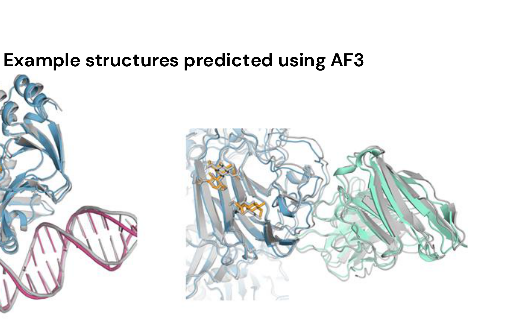

[Previous](<AB-25 - Cryo-electron microscopy and NMR.md>) · [Subject index](../README.md) · [Topic overview](README.md) · [Complete section](<Complete section.md>)

<!-- note-content:start -->
# Section 26: AlphaFold and computational structure prediction

## Intuition

Anfinsen's dogma says the 3D structure of most natural proteins is determined only by their amino acid sequence. That makes prediction well posed, and it is why the field persisted for fifty years without success.

The breakthrough did not come from simulating physics. It came from a different source of information: **evolution has already run the experiment**. For almost any protein there are thousands of homologues across species, all with the same fold and different sequences. Those differences are not random.

If two residues touch in the folded structure, a mutation at one that disrupts the contact is tolerated only if a compensating mutation occurs at the other. Over evolutionary time, **residues in contact mutate together** — they *co-evolve*. The converse holds too: independently varying positions are probably far apart.

A multiple sequence alignment therefore carries a noisy picture of the *contact map*, and a contact map plus chain connectivity largely determines the fold. The sequence database is a record of a search already completed.

*Analogy:* inferring which parts of a machine touch by examining thousands of variants and noting which pairs of parts always change together. The analogy breaks down because co-evolution also arises indirectly — A couples to B and B to C, making A and C appear correlated — and disentangling direct from indirect coupling is much of the difficulty.

## Mechanism

**CASP.** The Critical Assessment of Structure Prediction is a biennial blind test: predictors are given sequences whose structures have been solved but not released. DeepMind's earlier AlphaFold won CASP13 (2018) but by a small margin, and the predictions were not accurate enough for the problem to be considered solved. **AlphaFold 2 at CASP14 (2020)** reached accuracy comparable to experiment, and the problem was declared largely solved.

**The AlphaFold 2 pipeline:**

**1. Inputs.** The target sequence is used to search:
- a **genetic database**, producing a **multiple sequence alignment (MSA)** of homologues — the primary input, carrying the co-evolution signal;
- a **structure database**, producing **templates** of any known similar structures.

These become two representations:
- the **MSA representation** $(s, r, c)$, indexed by sequence and residue;
- the **pair representation** $(r, r, c)$, indexed by *pairs* of residues — effectively a running hypothesis about which residues are in contact.

**2. Evoformer (48 blocks).** The core of the network. It updates both representations repeatedly, and the essential feature is the **continuous flow of information between them**: evidence of co-evolution in the MSA updates the pair representation, and geometric constraints in the pair representation inform how the MSA is read. Because the pair representation is geometric, the network can enforce consistency — if A is near B and B near C, then A and C are constrained — which is how indirect correlations are separated from direct contacts.

**3. Structure module (8 blocks).** Converts the refined representations into explicit **3D atomic coordinates**, rather than a contact map to be folded afterwards. It also outputs a **per-residue confidence score**, which is as important as the structure itself.

**4. Recycling (three times).** The outputs are fed back as inputs and the whole network is run again, each pass refining the previous hypothesis.

**AlphaFold 3** extends this beyond single proteins to **proteins, DNA, RNA, small molecules, ions, modified residues and glycosylation** in one model. Architecturally it replaces the structure module with a **diffusion module**, trained to take *noised* atomic coordinates and recover the correct ones, then applied iteratively from noise. This makes AF3 a generative model predicting raw atom coordinates directly.

## Motivation and explanation

**Why confidence scores matter.** AlphaFold2 reports several complementary measures. **pLDDT** (predicted local distance difference test) assesses local structure around each residue on a 0–100 scale, with larger values indicating greater confidence. **PAE** (predicted aligned error) estimates positional uncertainty in ångströms for one region when alignment is fixed on another; smaller values mean more confident relative placement. Two domains can each have high pLDDT while their orientation relative to one another has high PAE. **pTM** (predicted template-modelling score) summarises confidence in the overall arrangement on a 0–1 scale, with larger values indicating greater confidence. For multichain predictions, **ipTM** (interface predicted TM-score) assesses confidence in the relative placement of interacting chains on a 0–1 scale, with larger values indicating greater confidence; it complements the overall pTM score. Low confidence can be consistent with disorder or flexibility, but can also reflect insufficient information or model error. These are model confidence measures, not direct measurements or proof of a unique functional conformation.

Consider two domains joined by a flexible linker. Each domain can have a confidently predicted internal fold while their relative orientation remains uncertain. Aligning on the first domain then leaves the second poorly localised, which appears as high interdomain PAE even when both domains have high local confidence. This matters for engineering: an apparent contact between the domains is a weaker design premise than a contact within a confidently folded domain.

**The effect on crystallography.** AlphaFold models are good enough to serve as search models for **molecular replacement** (Section 24), which needs a model within about 1–1.5 Å RMSD over at least 30 % of atoms. Prediction has therefore not replaced experiment; it has removed the phase problem's dependence on finding a pre-existing homologue. The two methods now feed each other.

**What AlphaFold 2 does and does not do.**

| Predicts well | Struggles | Does not predict |
|---|---|---|
| Single protein chains | Multiple conformations of one sequence | Protein–DNA and protein–RNA complexes |
| Protein multimers | Effects of point mutations | Ligand and ion binding |
| Multisubunit complexes | Nucleic acid structures | Post-translational modifications |
| | Antigen–antibody interactions | Membrane plane for transmembrane domains |

**The pattern in that table is worth seeing.** AlphaFold 2 predicts the single most likely structure of a *polypeptide in isolation*. It struggles or fails wherever the answer depends on something not in the sequence or its evolutionary record:
- *Multiple conformations* — the output is one structure, but many proteins function by switching between several.
- *Point mutations* — a single substitution barely changes the MSA, so the prediction barely changes, even when the real protein unfolds. Given the 20–40 kJ/mol marginal stability of Section 23, this is unsurprising: the model has learned which fold the sequence family adopts, not the energetics that make it marginal.
- *Ligands, ions, modifications and membranes* — context the sequence does not contain.

**The deeper limitation.** AlphaFold predicts structure, not function or mechanism, and its reliance on the MSA means it is weakest on sequences with few homologues — designed proteins, rapidly evolving ones, antibody loops. It has not solved the folding *process*: it does not say how a chain reaches its native state, only where it ends up. The Levinthal paradox of Section 23 is bypassed, not explained.

## Link to other topics

Reading structure from correlated variation across a database, rather than from a physical model, is the same inference used in any empirical correlation: a sufficiently large body of observations substitutes for a theory of the mechanism. The usual caveat applies — such models extrapolate badly outside the data they were fitted to, which here means sequences with few relatives.

## Wider pathway

Reliable structures for essentially every known protein change what is routine: enzyme engineering, binder design and drug discovery can start from a model rather than a multi-year structural project. Section 27 begins protein engineering, where knowing the structure is the precondition for deciding what to change.

## Summary

AlphaFold 2 solved prediction not by simulating folding but by extracting contacts from the co-evolutionary record in multiple sequence alignments, cycling that information against a geometric pair representation and emitting coordinates with calibrated confidence. It predicts an isolated chain's single most likely fold, and fails where the answer depends on conformational change, energetics or molecular context — gaps that AlphaFold 3 begins to close by modelling nucleic acids, ligands and modifications together.

## Conclusion

Experimental determination and computational prediction answer related structural questions, and each requires validation against its own limitations. The next unit develops protein engineering.
<!-- note-content:end -->

[Previous](<AB-25 - Cryo-electron microscopy and NMR.md>) · [Subject index](../README.md) · [Topic overview](README.md) · [Complete section](<Complete section.md>)
