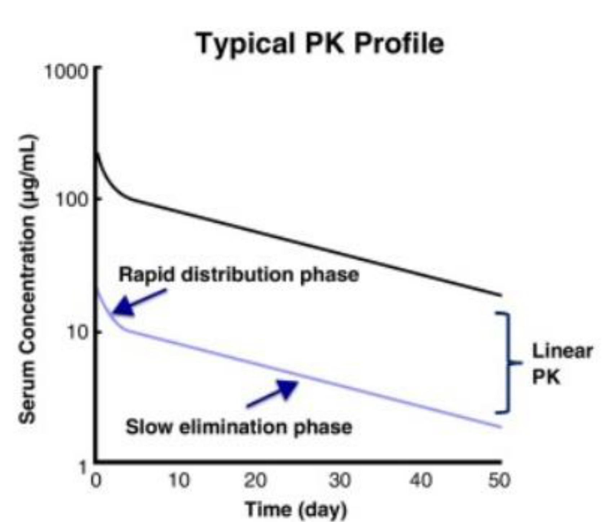
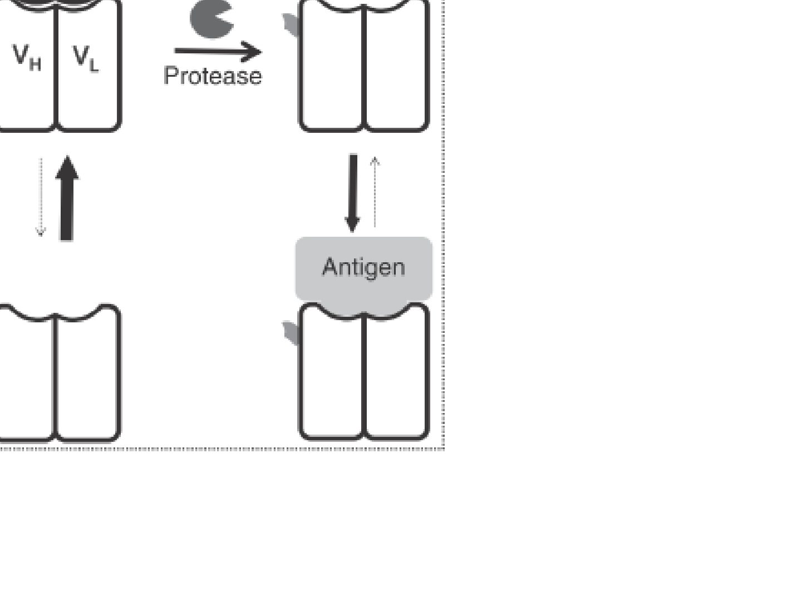
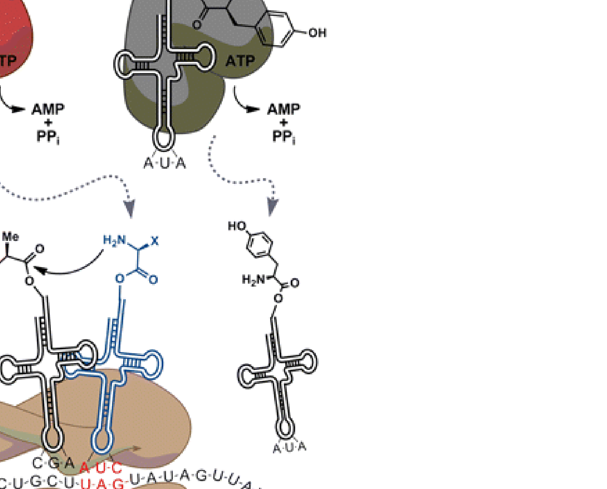

[Subject index](../README.md) · [Topic overview](README.md) · [Complete section](<Complete section.md>)

<!-- note-content:start -->
# Protein engineering

## Overview

Protein engineering changes function, stability or behaviour in the body by altering sequence, architecture and chemical modifications. Mutagenesis and non-canonical amino acids supply the changes, while antibody-generation and screening methods identify useful variants.

*Assumed throughout:* protein structure, genetic coding and molecular recognition.

## Section 27: What to engineer about a protein

### Intuition

A natural protein is optimised by evolution for *its own* purpose in *its own* context. A therapeutic or reagent is used for a different purpose in a different context, so the properties evolution settled on are rarely the ones wanted. Engineering is the business of changing one property without destroying the others.

Antibodies make the point well. Evolution shaped them to find almost any target with high specificity, which is exactly what a drug needs. But they are also large, slow to clear, unable to enter cells, and carry effector functions that may be unwanted. Almost all antibody engineering is an attempt to keep the binding and change everything else.

*Analogy:* a general-purpose vehicle adapted for a specific job — the engine is what you want, so the body is cut down or extended around it. The analogy breaks down because a protein's parts are not modular in the way a vehicle's are: Section 23's marginal stability means a change intended to affect one property frequently destabilises the whole fold.

### Mechanism

**Antibody architecture.** An IgG is roughly 150 kDa, built from two heavy and two light chains:
- the two **Fab** arms bind antigen;
- the **Fc** stem carries the functional interactions — FcγR binding (antibody-dependent cell-mediated cytotoxicity, ADCC), C1q binding (complement-dependent cytotoxicity, CDC) and FcRn binding (half-life, Section 28).

Crucially, **variation is limited to three loops at the tip of each chain**, the complementarity-determining regions (CDRs). The rest of the molecule is a near-constant scaffold. This separation is why antibodies are so engineerable: the binding site is a small, variable, structurally isolated part of a fixed framework.

#### Size

Cutting the antibody down gives a series of fragments:

| Format | Mass |
|---|---|
| IgG | 150 kDa |
| (Fab′)₂ | 110 kDa |
| Fab | 55 kDa |
| scFv (single-chain variable fragment) | 25 kDa |
| Peptide | <1 kDa |

Size controls three things at once: **clearance from blood**, **penetration into tumours** and **resistance to misfolding and proteolysis**. Smaller fragments penetrate tissue better but are cleared faster (Section 28), so the choice of format is a trade-off rather than an optimisation.

**Why the CDR loops cannot simply be used as peptides.** An obvious idea is to synthesise the binding loops alone. It fails because an isolated peptide is **too flexible**. Binding requires the loops to be held in a defined conformation; free in solution they sample many conformations, and the entropy lost on binding cancels the enthalpy gained. The framework is not inert packaging — it pays the conformational entropy cost in advance.

#### Fusions

Joining the antibody to something else gives function the antibody does not have.

**(i) To other proteins.** A **bispecific T-cell engager (BiTE)** is two single-chain antibodies joined: one binds CD3 on a cytotoxic T cell, the other a tumour-associated antigen. The construct physically forces a synapse between T cell and tumour cell, redirecting the T cell to kill a target it would otherwise ignore. The engineered molecule supplies not binding but **proximity**.

**(ii) To other biomolecules.** Linking DNA to an antibody allows the binding event to be amplified by PCR (immuno-PCR) or by rolling-circle amplification, so a single binding event becomes an exponentially amplified signal. This gives far greater sensitivity than reading a fluorophore, and the DNA sequence also acts as a barcode for multiplexed detection.

**(iii) To non-biological molecules.** Dyes or particles for lateral-flow assays; chelated radionuclides for PET imaging; and drugs.

**Antibody–drug conjugates (ADCs)** combine antibody specificity with a cytotoxic payload. Design involves four linked choices: **which drug** to deliver, **where it attaches**, **how many copies** attach per antibody, and **how the linker releases** it. The payload must act effectively after delivery, while conjugation and release should preserve targeting and limit damage away from the intended cells. The suitable combination depends on the antigen, uptake, intracellular processing and drug mechanism.

### Motivation and explanation

**Why antibodies rather than small molecules.** Small molecules are cheaper to manufacture, simpler to administer (usually oral), and can reach intracellular targets. Antibodies are limited to surface-exposed targets and must be injected. But they are **stable, well expressed, highly specific and multi-functional**, and crucially they can be raised against almost any target, whereas a small-molecule binder may not exist. In practice antibodies have a more reliable development pipeline and a higher success rate in trials.

**What makes a binder good enough.** For therapy, a dissociation constant of 1 µM is workable and 100 pM is excellent. That is a factor of $10^4$ in $K_d$, which from $\Delta G^0 = RT\ln K_d$ is only **5.7 kcal/mol at 37 °C** — a handful of hydrogen bonds. Affinity maturation is a matter of small energetic changes, which is why it is tractable but also why it is easily lost when something else is altered.

Affinity is not the whole requirement: the binder must be **tight *and* specific**, and these are improved by different means. Selecting harder for affinity does not improve specificity (Section 19).

Binding measured for an intact two-armed IgG can also benefit from avidity. If both arms engage nearby surface antigens, release of one arm leaves the other attached, allowing local rebinding before the whole antibody escapes. A monovalent fragment loses that geometric advantage even when its individual binding site is unchanged. Comparing formats therefore requires separating intrinsic site affinity from the apparent retention produced by multivalent engagement.

### Link to other topics

The size trade-off — penetration against residence time — is a transport problem of the same kind as catalyst particle sizing: smaller particles give better internal diffusion but are harder to retain in the reactor.

### Summary

Antibodies are engineerable because binding is confined to six variable loops on an otherwise constant framework, which can be truncated for penetration or extended by fusion to add proximity, amplification or cytotoxicity. The loops cannot be used alone, because the framework pays their conformational entropy.

## Section 28: Antibody pharmacokinetics, glycosylation and switchable function

### Intuition

Most injected proteins disappear quickly. Small ones are filtered by the kidney; larger ones are taken up by cells and digested in lysosomes. An IgG escapes both, and persists for weeks. The reason is a dedicated **recycling receptor** that rescues IgG from the degradation pathway and returns it to the surface. Long antibody half-life is not a passive property of being large and stable: it is an active salvage mechanism, and because it depends on the Fc region, it can be transferred to other proteins by fusing them to Fc.

Glycosylation raises a different issue. The sugar is added by the producing cell, not encoded in the sequence, so it varies with cell line and culture conditions. It also changes effector function. A manufacturer therefore cannot fully specify the product from its gene — a problem with no analogue in small-molecule manufacture.

*Analogy for FcRn:* a parcel sorting office where most items go to the incinerator, but parcels with the right label are picked out and returned to the sender. The analogy breaks down because the sorting signal is pH-dependent rather than fixed — which is precisely what makes it work.

### Mechanism

#### Pharmacokinetics

After intravenous delivery, serum concentration falls in **two phases** (note the log axis, so a straight line is exponential decay):

1. **Distribution** — rapid, as antibody moves from blood into the tissue interstitial space. This is redistribution, not loss.
2. **Elimination** — slow, by lysosomal degradation after cellular uptake. Log-linear, so first order.

**There is no renal clearance.** The kidney filters below about 20 kDa; IgG is 150 kDa. This is the first reason for the long half-life, and it explains the size trade-off of Section 27 directly: an scFv at 25 kDa sits near the filtration cut-off and is cleared in hours instead of weeks.

Clearance is increased by:
- **anti-drug antibodies** — the patient's immune system recognising the therapeutic, which is why immunogenicity matters;
- **target-mediated clearance** — antibody removed along with the antigen it is bound to, so the dose is consumed by the target itself.

**The salvage pathway.** Cells continuously take up extracellular fluid by endocytosis. The endosome acidifies, and most contents pass to the lysosome and are degraded.

**FcRn** (the neonatal Fc receptor) binds IgG **at endosomal pH but not at physiological pH**. So:
- in the acidified endosome, FcRn captures IgG;
- the FcRn–IgG complex is sorted into the recycling pathway, away from the lysosome;
- at the cell surface, neutral pH releases the IgG back into circulation.

The pH dependence is what makes this a cycle rather than a one-way trap: binding must be strong where rescue is needed and weak where release is needed.

Stronger FcRn binding is useful only if it preserves this switch. Tight binding in an acidic endosome can improve rescue, but binding that remains too strong at the cell surface can impair release back to the blood. The design target is therefore the difference between binding under the two conditions, rather than maximum affinity at either pH considered alone. This is the mechanistic reason to measure the complete recycling pathway instead of an isolated binding constant.

**This is transferable.** Fusing any protein to IgG Fc confers the same salvage and extends its half-life. **Etanercept** is the extracellular domain of the TNF receptor fused to Fc, used for rheumatoid arthritis: the TNFR domain neutralises TNF, and the Fc keeps it in circulation. The engineered molecule combines a binding function from one protein with a pharmacokinetic function from another.

#### Glycosylation

IgG carries a glycan on **each C_H2 domain** of the Fc. Its structure varies, and it depends on:
- the protein sequence,
- the **cell line**,
- the **growth conditions**.

For a drug one needs to know exactly what is being delivered and to deliver the same thing each time. Glycosylation makes this difficult, because the same gene in a different bioreactor gives a different product. Glycans are characterised by mass spectrometry, and glycan profile becomes a release specification.

**Glycans are not cosmetic — they switch effector function.** Different glycan structures give: no effector function; enhanced CDC and anti-inflammatory behaviour; enhanced ADCC; reduced circulation with inflammatory behaviour; or anti-inflammatory behaviour with sialic acid. **Removing a single fucose markedly increases ADCC**, which is exploited deliberately in afucosylated therapeutic antibodies. So the same polypeptide can be a cell-killing drug or an anti-inflammatory one depending on a sugar the cell line happened to add.

#### Switchable function

Many cancer targets are also expressed on normal tissue, so toxicity limits the dose rather than efficacy. The idea is a **logic gate**: an antibody that binds only if the target antigen is present **AND** a cancer-associated protease is present.

A **pro-antibody** carries a peptide mask over its binding site, tethered by a linker. The masked antibody cannot bind. Tumours over-express certain proteases; these cleave the linker, the mask is released, and the antibody becomes active — only in the tumour environment. Specificity now requires two independent conditions rather than one, which is the same strategy as the probe-plus-primers design in Section 18.

### Motivation and explanation

**Reading the half-life from the graph.** From the elimination phase, concentration falls from about 100 to 20 µg/mL between days 5 and 50 (values read from a graph, so ≈). For first-order decay,
$$k = \frac{\ln(100/20)}{45} = 0.036\ \text{day}^{-1}, \qquad t_{1/2} = \frac{\ln 2}{k} \approx 19\ \text{days}.$$
That is consistent with the three-week dosing intervals typical of therapeutic antibodies, and it is roughly 100 times longer than a protein of similar size without FcRn binding.

**What "linear PK" means.** Dose-proportional pharmacokinetics means concentration scales with dose, with approximately dose-independent clearance; a straight elimination segment on a log plot alone does not establish dose proportionality. For antibodies with target-mediated clearance, nonlinearity is often strongest at low or intermediate concentrations. At sufficiently high concentrations, target binding and uptake saturate, so nonspecific first-order clearance can dominate and PK can approach linearity. The simple half-life estimate applies only over the approximately exponential segment used here.

**The common thread.** All three sections are about the Fc, not the binding site. Half-life, effector function and manufacturing consistency are properties of the constant region, while specificity lives in the CDRs (Section 27). This is why the two can be engineered almost independently — and why Fc engineering is a field in itself.

### Link to other topics

The FcRn cycle is a pH-swing separation: bind the product at one pH, release it at another, and run the two conditions at different points in a loop. It is the same principle as pH elution in affinity chromatography (Section 45), operating here inside a cell.

### Summary

Antibodies persist for weeks because they are too large to filter and because FcRn actively rescues them from lysosomal degradation by pH-dependent binding — a property transferable to any protein by Fc fusion. Glycosylation, added by the cell rather than encoded, varies with manufacturing and switches effector function.

## Section 29: Site-directed mutagenesis and non-canonical amino acids

### Intuition

To change a protein you change its gene, and the cell does the rest. A mutagenic primer carries the desired change and is incorporated into a new copy of the plasmid, so the mutation is introduced during amplification rather than by editing an existing molecule.

The harder problem is deciding *which* residue to change. There are far too many options to test exhaustively (Section 30), so changes must be chosen rationally — which requires a structure, and is why Sections 24–26 come first.

Expanding the genetic code is a different kind of move. The twenty natural amino acids provide a limited chemical palette: no azides, no ketones, no photoreactive groups. Rather than work around this, one can reassign a codon the cell does not otherwise need and install a new amino acid at that position.

*Analogy:* mutagenesis is replacing one component with another from the same catalogue; code expansion is adding a new entry to the catalogue. The analogy breaks down because the new entry needs its own dedicated supply chain — a tRNA and a synthetase that no other machinery in the cell will touch.

### Mechanism

#### Site-directed mutagenesis

The aim is to replace one amino acid by another to explore function or mechanism.

**The QuikChange method**, three steps:
1. **Mutant strand synthesis.** Denature the plasmid and anneal a pair of complementary primers carrying the desired mutation at their centre, flanked by matching sequence on both sides so they still hybridise. A high-fidelity polymerase extends around the whole plasmid.
2. **DpnI digestion.** The template came from *E. coli* and is therefore **methylated**; the newly synthesised strands are not. **DpnI cuts only methylated DNA**, so it destroys the parental plasmid and leaves the mutated copies. This is the clever step: it solves the problem of separating product from a template that is otherwise nearly identical.
3. **Transformation.** The nicked circular product is transformed into competent cells, which repair the nicks.

It is fast and exceeds 90 % success, but makes one change at a time and can only insert or delete a few residues.

**Which residue to change?** Five rational strategies:
1. From a **structure** with ligand bound, by X-ray or cryo-EM.
2. From an **AlphaFold prediction** of the structure or complex (Section 26) when no experimental structure exists.
3. **Conserved residues**, identified from a sequence alignment — conservation across species implies functional importance, the same co-evolutionary logic AlphaFold exploits.
4. **Alanine scanning**: replace each candidate residue in turn with alanine. Alanine removes the side chain beyond the β-carbon, so it deletes the functional group *without* adding bulk and without the flexibility of glycine. Loss of activity implicates that side chain.
5. **Stop codons** to truncate the chain or remove a domain.

Loss of activity does not by itself prove direct participation in catalysis or binding. The substitution may lower expression, destabilise the fold or prevent assembly, leaving fewer functional molecules in the assay. Comparing protein amount and folded state alongside activity separates those routes. A residue is a convincing mechanistic candidate when the mutation changes the proposed function while the relevant structural and production controls remain intact.

**Point mutants can be products in themselves.** Subtilisin, the protease in biological laundry detergent, is inactivated by bleach, which oxidises a key methionine. Replacing that methionine with alanine gives a bleach-resistant enzyme. The same enzymes have also been improved by **directed evolution** (Section 30) for activity at low temperature — the two approaches are complementary, rational design where the mechanism is understood and evolution where it is not.

#### Non-canonical amino acids

The goal is to go beyond the natural twenty and install new chemical functionality — photocrosslinkers, photocaged side chains, click-chemistry handles — as a subtle change to a single side chain.

**The mechanism requires three parts working together:**

1. **A spare codon.** The **amber stop codon UAG** is reassigned. It is the rarest stop codon in *E. coli*, so taking it over disrupts least.
2. **A suppressor tRNA** with an anticodon complementary to UAG. Where the ribosome would normally terminate, this tRNA delivers an amino acid instead and translation continues.
3. **An engineered aminoacyl-tRNA synthetase (aaRS)** that charges the suppressor tRNA with the non-canonical amino acid **and nothing else**.

**The orthogonality requirement is the crux.** The new pair must not cross-react with the host's machinery: the engineered synthetase must not charge any natural tRNA, and no natural synthetase may charge the suppressor tRNA. Otherwise the non-canonical amino acid appears at random positions, or a natural amino acid is inserted at the UAG site, and the product is heterogeneous. The pair is usually borrowed from a distantly related organism, precisely so that it does not recognise the host's components.

The non-canonical amino acid must also be supplied in the medium and taken up by the cell, since the cell cannot synthesise it.

This works by *in vitro* translation, in *E. coli* (most common) and, more recently, in yeast and mammalian systems.

### Motivation and explanation

**Why alanine, specifically.** The ideal probe deletes a side chain's chemistry while perturbing the backbone as little as possible. Glycine would remove the side chain entirely, but it also makes the backbone far more flexible and can disrupt the fold. Alanine keeps a methyl group, so the backbone conformational preferences are largely retained. Replacing a residue with a *smaller* one also avoids introducing steric clashes — a larger substitution might abolish activity simply by not fitting.

**Why rational design has limits.** Section 23 showed that folding stability is only 20–40 kJ/mol. A mutation intended to improve binding frequently destabilises the fold instead, and the two effects cannot be separated by inspection. Predicting the effect of a point mutation is also precisely what AlphaFold does *not* do well (Section 26), because a single substitution barely changes the sequence alignment the prediction rests on. This is why rational design is usually combined with, or replaced by, the selection methods of Section 30.

**Why code expansion is worth the trouble.** A click-chemistry handle at one defined position allows a protein to be conjugated **site-specifically** — to a drug, a surface or a fluorophore — rather than at whichever surface lysine happens to react. For an ADC (Section 27), where drug position and copy number are optimised parameters, this converts a heterogeneous mixture into a defined molecule.

### Link to other topics

The DpnI step is a selection based on a marker that distinguishes product from feed — methylation — rather than on any difference in the product itself. The same logic recurs wherever a reaction leaves starting material nearly identical to product: tag the feed instead of purifying the product.

### Summary

Site-directed mutagenesis introduces a defined change through a mutagenic primer, with DpnI digestion removing the methylated parental template; choosing the residue relies on structure, conservation or alanine scanning. Genetic code expansion goes further, reassigning the amber codon through an orthogonal tRNA–synthetase pair to install chemistry outside the natural twenty.

## Section 30: Generating antibodies, from animals to algorithms

### Intuition

Section 19 established the principle for nucleic acids: make a huge library, select, amplify, repeat. Proteins cannot do this, because **a protein cannot copy itself**. Any protein selection method must therefore physically tie each protein to the gene encoding it, so that selecting the protein also recovers its sequence.

Every method below is a different solution to that one problem:
- a **cell** keeps protein and gene together naturally;
- a **phage** displays the protein on its coat while carrying the gene inside;
- a **droplet** confines both in one compartment;
- **computation** sidesteps it, since the sequence is known by construction.

*Analogy:* judging a baking competition where you must also know the recipe. You can watch each baker (cell), label each cake with its recipe (phage), keep each in its own numbered box (droplet), or compute from the recipe what the cake will be like (design). The analogy breaks down for the last one — a computed prediction is a hypothesis, not a measurement, so it still needs testing.

### Derivation

**Why libraries, not design.** With 20 amino acids, a modest 200-residue protein has
$$20^{200} = 1.6\times10^{260} \tag{42}$$
possible sequences — against roughly $10^{80}$ atoms in the universe. Even a phage library of $10^{9}$ covers $10^{-251}$ of this.

Two conclusions follow, and they shape the whole field:
- exhaustive search is impossible by any physical means, so the library must be **designed to sample a useful region**, not sample uniformly;
- antibody libraries work because they vary only the **six CDR loops** on a fixed framework (Section 27), so the search is restricted to the part that determines binding.

### Mechanism

**1. Polyclonal antibodies** — antiserum from an immunised animal, or human plasma. A mixture recognising many epitopes, cheap but undefined and finite.

**2. Hybridoma (monoclonal).** Immunise a mouse, collect B cells from the spleen, and fuse them with immortal lymphoma cells. **HAT medium** selects the fusions: unfused lymphoma cells die in the selection, unfused B cells die of their own accord, so only hybrids survive. Each hybridoma is cloned, giving an immortal line secreting a single antibody against **one epitope only**. Here the cell links genotype to phenotype.

**3. Humanisation.** Mouse antibodies fail as human therapeutics: patients raise anti-mouse antibodies that block repeated dosing (the anti-drug antibodies of Section 28), and mouse Fc engages human effector machinery poorly. The fix is to replace mouse sequence progressively:
- **chimaeric** — mouse variable domains on human constant regions;
- **humanised** — only the mouse CDRs grafted onto a human framework;
- **human** — no mouse sequence at all.

This is only possible because of the modularity in Section 27: binding is confined to the CDRs, so everything else can be swapped.

**4. Phage display.** Selection can be performed without immunising an animal and can bypass the animal’s tolerance to self-antigens. This broadens the accessible target range, but does not demonstrate that a selected antibody lacks cross-reactivity or would be safe in a patient.

A library of human scFv sequences is fused to a coat protein (p3) of filamentous M13 phage. Each phage **displays the antibody fragment on its surface while carrying its gene inside** — genotype linked to phenotype in one particle.

1. **Pan** a library of at least $10^{9}$ phage against immobilised target.
2. **Wash hard** and recover the good binders.
3. **Amplify** the recovered phage in *E. coli*. Repeat 3–4 cycles.
4. **Sequence** to identify good scFv.
5. **Reformat as IgG**, since the therapeutic format is a full antibody, not a fragment.

This is Section 19's cycle exactly — select, amplify, repeat — with the phage particle supplying the link that nucleic acids get for free.

**5. In vitro compartmentalisation (IVC).** Display methods select for **binding**. Selecting for **catalysis** is harder, because the product of an enzymatic reaction diffuses away and is not attached to the gene that made it.

IVC solves this with a water-in-oil emulsion:
- **(a)** droplets contain **0 or 1 gene** each;
- **(b)** *in vitro* transcription and translation inside the droplet;
- **(c)** the enzyme turns over a **fluorogenic substrate**, so an active enzyme makes its own droplet fluoresce;
- **(d)** **FACS** sorts the brightest droplets;
- **(e)** the recovered genes are expressed at scale or re-mutated for another round.

The droplet is an artificial cell: it keeps gene, enzyme and product together so that the product reports on the gene.

Compartment isolation is what preserves causation. If two different genes enter one droplet, an inactive variant can share the fluorescent product made by an active neighbour and be recovered with it. If product leaks between droplets, the same problem occurs across compartments. Dilute gene loading and retention of the reaction signal are therefore part of the selection mechanism, rather than merely practical details of making an emulsion.

**6. Transgenic mice.** Mice with the mouse immunoglobulin locus replaced by human antibody germline sequence. Conventional immunisation then produces fully human antibodies, with the animal's own affinity maturation doing the optimisation. The platform is extremely valuable commercially.

**7. Direct from people.** Isolate B cells from humans with strong immune responses and recover the sequences — no immunisation, and the antibodies are already human and already affinity-matured *in vivo*. Screening unusually resilient individuals ("élite controllers") can reveal unexpected targets and self-protein mechanisms.

**8. Computational design.** Generative models such as RFdiffusion use structural training data to propose binders. Reported demonstrations include an influenza-target example with roughly 1% binding designs and moderate affinity, illustrating why designed sequences need experimental testing. Computational antibody work has three distinct tasks: **affinity maturation**, improving CDRs of an existing binder; **rank prediction**, ordering candidates such as NGS-derived sequences by expected affinity; and **out-of-library design**, proposing new sequences informed by existing sequence-and-affinity data. Prediction and generation supply candidates; binding, specificity and function must still be measured.

### Motivation and explanation

**The trade-off across methods.** Animal methods provide affinity maturation but can be slow, restricted by tolerance to conserved self-antigens, and difficult when the target is toxic or poorly immunogenic. Toxic targets are a challenge, not an absolute exclusion: antitoxin antibodies can be generated through appropriate immunisation strategies. Mouse-derived sequences may need humanisation, whereas human-repertoire animals provide human sequences. *In vitro* selection allows targets and stringency to be controlled without animal tolerance, but useful candidates still need affinity, specificity and functional validation.

**Where design sits.** *De novo* design needs no existing binder and no bait, applies to difficult targets such as membrane-bound or toxic proteins, and the "library size" has no experimental limit — over $10^{18}$ sequences can be evaluated with publicly available software. Against that, it needs substantial computer time, still requires wet-lab optimisation, and struggles when substantial conformational change is involved. Accuracy requirements are severe: **1 or 2 Å out can abolish binding**, consistent with the 5.7 kcal/mol that separates a mediocre binder from an excellent one (Section 27).

**The pattern across all eight.** Each either exploits a natural compartment (cell, phage, mouse), builds an artificial one (droplet), or dispenses with physical selection entirely (computation). The trend is away from animals and towards *in vitro* and *in silico* methods — faster, more controllable, and not limited by what an immune system will tolerate.

### Link to other topics

IVC is compartmentalisation used as a separation: confining a reaction so its product stays with its catalyst, exactly as a cell does. The same principle, in bulk, is what emulsion polymerisation uses to keep growing chains isolated.

### Summary

Protein sequence space, $20^{200}$, cannot be searched, so every method restricts the library and links each protein to its gene — by cell, phage particle or droplet. Display selects binding, IVC selects catalysis, animals supply affinity maturation at the cost of speed and self-tolerance, and computational design is beginning to bypass selection at a current hit rate near 1 %.

## Conclusion

Sequence changes and screening connect molecular recognition to useful biological performance. The next unit develops bioprocessing overview and filtration.
<!-- note-content:end -->

[Subject index](../README.md) · [Topic overview](README.md) · [Complete section](<Complete section.md>)
