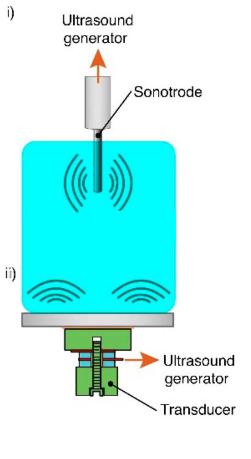
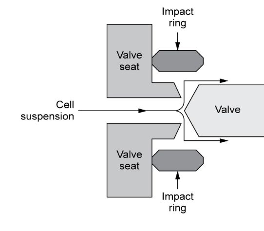

[Previous](<AB-38 - Why cells must be disrupted, and what resists it.md>) · [Subject index](../README.md) · [Topic overview](README.md) · [Complete section](<Complete section.md>) · [Next](<AB-40 - Worked example — fitting and using homogeniser kinetics.md>)

<!-- note-content:start -->
# Section 39: Mechanical cell disruption and release kinetics

## Intuition

Every mechanical method does the same thing: impose a stress on each cell large enough to rupture its wall. They differ only in how the stress is generated — grinding between beads, collapsing bubbles, or acceleration through a narrow gap.

The key to the kinetics is that **each cell is broken independently**. A pass through the equipment gives every intact cell the same probability of rupture, regardless of how many have already broken. The number of intact cells therefore falls by a constant *fraction* per pass, which is a first-order process. Release of product is the mirror image: it approaches its maximum exponentially.

In the fixed-fraction model, one pass leaves some unreleased material. A single pass can still meet a practical recovery target; the model approaches complete release only asymptotically. Real rupture probabilities and product losses can change that behaviour.

*Analogy:* radioactive decay, where each nucleus has a fixed probability of decaying per unit time independent of the others. The analogy breaks down because cells are not identical: a population has a distribution of wall strengths, so the weakest break first and the surviving population becomes progressively tougher, making the real decay slightly slower than exponential.

## Mechanism

All mechanical methods **produce substantial heat** that can damage the product, so all of them **need cooling**.

**Bead mill.** A chamber filled with beads — typically glass, 0.2–1.0 mm diameter — packed to up to 80 % of the free volume, with impellers rotating at 1500–2250 rpm. Cells at 30–60 % volume wet solids are ground between the rolling beads. Cooling is through a jacket. Scales to industrial use.

**Ultrasonication.** Ultrasonic vibrations at about 20 kHz are produced by an immersion probe. The high-energy pressure waves create **cavitation bubbles**, whose collapse disrupts the cells — the damage is done by the implosion, not by the sound itself. Bacteria are disrupted in 30–60 s, yeast in 2–10 minutes. It works well at small and laboratory scale but is **difficult to scale up**, because of the high energy demand and safety concerns about exposure to ultrasound.

**High-pressure homogeniser.** The standard industrial method.
- Cells are put under **high pressure, 1500–2500 bar**.
- The pressure is **suddenly released** by a valve opening, forcing the cells to flow at high speed through a small gap.
- The cells then collide with an **impact ring**, causing disruption.
- Semi-continuous, usable at laboratory and industrial scale.
- **Multiple passes** are usually required. This can be done with a multi-tank arrangement, feeding from one tank, homogenising and collecting into the other. Tough cells such as *L. lactis* (ovoid, Gram-positive) need several passes.

**French press.** A simpler version of the same principle, suitable for **laboratory scale only**. Pressure is applied and the cells forced through a small hole at high speed, hitting an impact plate. Its extraction efficiency is described by the **same equation** as the high-pressure homogeniser.

## Derivation

Notation: $R$ is the protein released (kg per kg biomass), $R_{\max}$ the maximum achievable release, $N$ the number of passes, $t$ processing time, $p$ the operating pressure.

**Step 1: first-order release.** Each pass ruptures a fixed fraction of the cells that remain intact. The *unreleased* protein $(R_{\max}-R)$ therefore decays by a constant factor per pass:
$$\frac{d(R_{\max}-R)}{dN} = -k'(R_{\max}-R) \tag{69}$$

**Step 2: integrate** from $R = 0$ at $N = 0$:
$$\ln\!\left(\frac{R_{\max}}{R_{\max}-R}\right) = k'N \tag{70}$$

For a **bead mill**, where the variable is processing time rather than discrete passes, the same argument in continuous time gives
$$\ln\!\left(\frac{R_{\max}}{R_{\max}-R}\right) = kt \tag{71}$$
with $k$ a constant depending on bead size, bead packing density, rotation speed and temperature.

**Step 3: the pressure dependence.** For a homogeniser, $k'$ is not a constant: raising the pressure increases the stress on each cell and so the fraction broken per pass. Empirically the dependence is a power law, $k' = kp^{\,a}$, giving
$$\boxed{\;\ln\!\left(\frac{R_{\max}}{R_{\max}-R}\right) = kNp^{\,a}\;}\tag{72}$$
where $k$ is a constant depending on cell type and temperature, $p$ the applied pressure, and $a$ an **exponent depending on cell toughness**, ranging from about 0.9 to 2.9.

**Rearranged for release:**
$$\frac{R}{R_{\max}} = 1 - e^{-kNp^{\,a}} \tag{73}$$

**Checks.** At $N = 0$, $R = 0$. As $N\to\infty$, $R\to R_{\max}$: complete release needs infinite passes, as the intuition predicted. Release is **linear in $N$ only at small $N$**, where $e^{-x}\approx 1-x$.

## Motivation and explanation

**What the exponent measures.** The exponent $a$ describes pressure sensitivity within the fitted range; it does not rank toughness on its own, because $k$, the release target and the envelope all matter. Since the model exponent is $kNp^a$, for $a>1$ a given proportional pressure increase changes predicted release more than the same proportional increase in passes. That mathematical comparison does not determine the best energy or product-stability trade-off.

**Why multiple passes rather than one hard pass.** Equation (72) suggests either route works, but there are limits: the equipment has a maximum rated pressure, and higher pressure means more heat, so the product suffers. Multiple passes allow cooling between treatments, which can reduce peak temperature. The total dissipated energy is not automatically the same: it depends on pressure, processed volume and pass count.

**Where the model fails.**
- $R_{\max}$ is itself an assumption: some protein is never released, remaining bound to debris.
- A real population has a **distribution of wall strengths**, so the weakest cells break first and the survivors are tougher. Observed curves therefore fall slightly below the exponential at high $N$.
- Prolonged treatment degrades the released protein, so measured $R$ can *fall* at very high $N$ — the model has no term for this.
- $k$ depends on temperature, so a run without adequate cooling does not have a single $k$.

## Link to other topics

Equation (70) has the same exponential-survival structure as a cascade with a fixed fractional removal per stage, or the log-survival law in sterilisation: a fixed fractional reduction per unit of effort gives a logarithm of the residual, and the quantity that scales linearly is $\ln$ of what is left.

## Summary

Mechanical methods all impose stress to rupture walls, and all generate heat that must be removed. Because each cell breaks independently with a fixed probability, release follows first-order kinetics, equation (72), with pressure entering as $p^{\,a}$ and $a$ between 0.9 and 2.9 depending on cell toughness.
<!-- note-content:end -->

[Previous](<AB-38 - Why cells must be disrupted, and what resists it.md>) · [Subject index](../README.md) · [Topic overview](README.md) · [Complete section](<Complete section.md>) · [Next](<AB-40 - Worked example — fitting and using homogeniser kinetics.md>)
