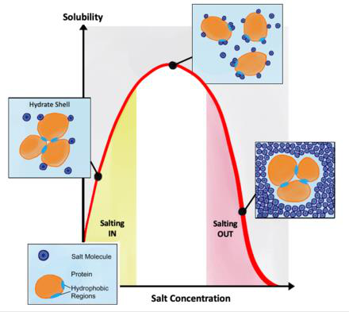

[Previous](<AB-42 - Primary isolation by solvent and aqueous two-phase extraction.md>) · [Subject index](../README.md) · [Topic overview](README.md) · [Complete section](<Complete section.md>) · [Next](<AB-44 - Isoelectric, polymer- and solvent-induced precipitation.md>)

<!-- note-content:start -->
# Section 43: Precipitation by salting out and the Cohn equation

## Intuition

Protein solubility reflects the balance of protein–water, ion–protein and protein–protein interactions. Hydration of charged and polar surface groups contributes to favourable interactions with the solvent, while electrostatic and hydrophobic interactions influence association.

At sufficiently high concentration, suitable salts make dissolved protein less thermodynamically favourable relative to a protein-rich phase. Ion-specific interactions and preferential exclusion from protein surfaces can favour association while preserving the folded structure. This is not literal stripping of the hydration shell.

**Salting out reduces protein solubility through salt-dependent solvent and protein interactions; precipitation does not require protein unfolding.**

*Analogy:* people may cluster when their surroundings become less favourable for staying apart. The analogy does not represent literal removal of hydration water. Low salt can instead increase solubility through changes in electrostatic interactions; the balance is protein- and ion-dependent.

## Mechanism

**The general principle.** Precipitation is induced by a **decrease in the solubility** of the compound on addition of **salts, solvents or polymers**, or in response to changes in **pH**. These additives, or changes in surface chemistry, make interactions with water less favourable, causing aggregation.

**Four methods** are used in bioprocessing, primarily to recover proteins:
- a) salting out (this note);
- b) isoelectric precipitation;
- c) polymer precipitation;
- d) organic solvent precipitation (Section 44).

Precipitation is often used for proteins, can **remove large amounts of water**, and the precipitate can be extracted by further filtration or centrifugation. However, only **partial purification** is achieved, since proteins of similar characteristics precipitate together — consistent with its role as a non-selective primary isolation step (Section 32).

### Salting out

The solubility of molecules with hydrophobic regions — proteins in particular — depends on salt concentration in a non-monotonic way:
- **low at low salt concentration**;
- rising to a **peak at intermediate concentration**;
- **dropping again at high concentration**.

The rise is called **salting in**; the fall is **salting out**, and it is the regime used for protein precipitation.

**Why solubility can fall.** Ion-specific interactions change protein solvation and protein–protein association. Preferential exclusion of suitable salts from protein surfaces can favour association and the compact native state. Ammonium sulfate precipitation need not denature the protein. Other salts or unsuitable conditions can destabilise it, so precipitation and unfolding must be distinguished.

**Not all salts are equal.** Different anions have different effectiveness at inducing salting out, ranked in the **Hofmeister series**, discovered by Franz Hofmeister:
$$\mathrm{F^-} \sim \mathrm{SO_4^{2-}} > \mathrm{HPO_4^{2-}} > \mathrm{CH_3COO^-} > \mathrm{Cl^-} > \mathrm{Br^-} > \mathrm{NO_3^-} > \mathrm{ClO_3^-} > \mathrm{I^-} > \mathrm{ClO_4^-} > \mathrm{SCN^-}$$
Ions on the left are most effective at precipitating; those on the right can even increase solubility. The origin of these differences is still a matter of research. Ammonium sulfate is the standard choice in practice, because sulfate sits near the strong end and the salt is cheap and highly soluble.

Different proteins salt out at different concentrations depending on their hydrophobicity, which is what makes the method partially selective: raising the salt in steps precipitates different fractions.

## Derivation

**The Cohn equation** describes the solubility $S$ of a protein in the salting-out regime. In the logarithms below, $S$ means the numerical concentration relative to a fixed reference, here $1\ \mathrm{\mu g\,mL^{-1}}$; equivalently use $\ln(S/S_{\mathrm{ref}})$. The fitted intercept depends on that reference:
$$\ln S = \beta_s - K_sC_s \tag{78}$$
where $C_s$ is the salt concentration, and $\beta_s$ and $K_s$ are constants that depend on the protein and the salt. $\beta_s$ is also a function of temperature and pH.

The form says that **$\ln S$ falls linearly with salt concentration** — solubility decays exponentially. With $K_s$ of order 2 M⁻¹, each additional 0.5 M of salt divides the solubility by about $e$, and about 1.1 M divides it by ten. This steepness is what makes the method practical with modest amounts of salt.

**Fitting the constants.** Two measurements of solubility at two salt concentrations suffice. Writing (78) at $(S_1,C_{s,1})$ and $(S_2,C_{s,2})$ and subtracting eliminates $\beta_s$:
$$\ln\frac{S_1}{S_2} = K_sC_{s,2}-K_sC_{s,1} \quad\Longrightarrow\quad K_s = \frac{\ln(S_1/S_2)}{C_{s,2}-C_{s,1}} \tag{79}$$
Then $\beta_s$ follows by substituting back into (78):
$$\beta_s = \ln S_1 + K_sC_{s,1} \tag{80}$$

Two equations in two unknowns, solved by elimination — the same structure as fitting any two-parameter law to two data points.

### A solubility prediction must close a material balance

Let $M_0$ be target mass present, $V$ the final liquid volume and $S$ its equilibrium solubility at the chosen salt concentration. The dissolved mass cannot exceed either $M_0$ or $SV$, so the equilibrium precipitated mass is $M_{\mathrm{ppt}}=\max(0,M_0-SV)$. This prevents a negative recovery when the solution is unsaturated. Salt addition can change $V$, so the final mixture volume must be used.

For a target recovery $Y$, the required solubility is $S=(1-Y)M_0/V$. Substituting into the Cohn relation shows why the final increments in recovery become expensive: the required salt concentration rises as $-\ln(1-Y)$. Before relying on that extrapolation, compare it with salt saturation and the fitted protein-solubility range. Adding salt beyond its own solubility cannot create the arbitrarily high dissolved-salt concentration implied by extrapolating the protein model.

## Link to other topics

The Cohn equation resembles a Setschenow relation: an empirical logarithmic solubility change is proportional to salt concentration over a fitted range. Both describe salt-dependent solute chemical potentials; the similarity does not establish literal removal of hydration water as a universal mechanism.

## Summary

Salting out lowers protein solubility through ion-specific changes in solvation and association, and need not unfold the protein. The fitted Cohn equation predicts about 55 % precipitation for this IgA example at 2.5 M ammonium sulfate.
<!-- note-content:end -->

[Previous](<AB-42 - Primary isolation by solvent and aqueous two-phase extraction.md>) · [Subject index](../README.md) · [Topic overview](README.md) · [Complete section](<Complete section.md>) · [Next](<AB-44 - Isoelectric, polymer- and solvent-induced precipitation.md>)
