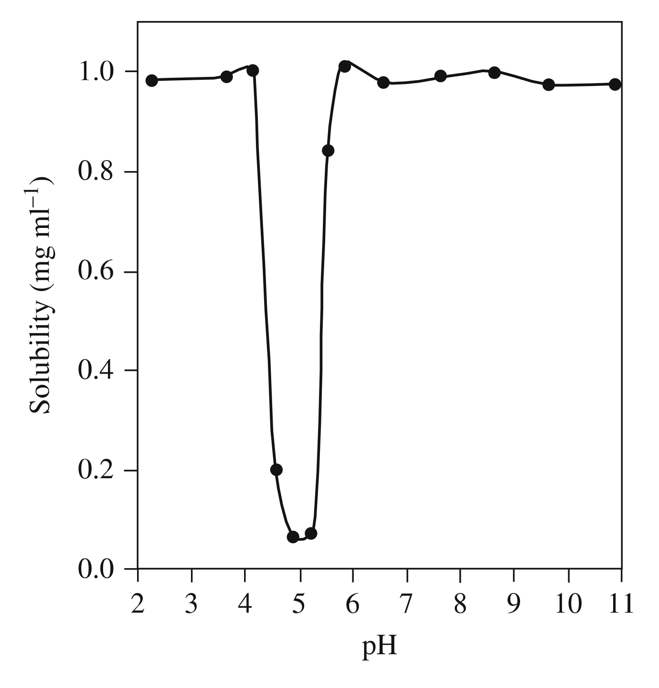
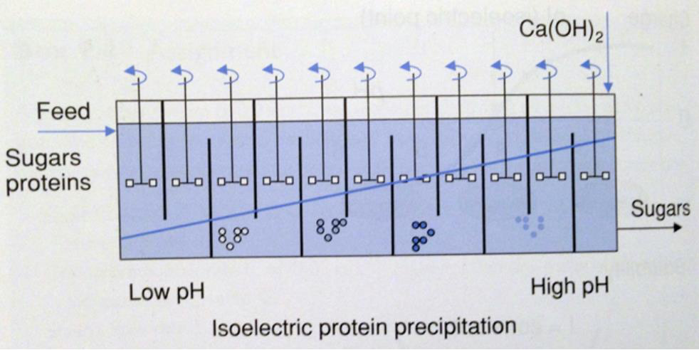
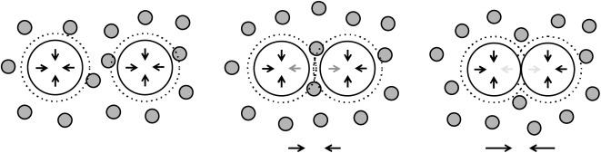

[Subject index](../README.md) · [Topic overview](README.md) · [Complete section](<Complete section.md>)

<!-- note-content:start -->
# Primary isolation

## Overview

Primary isolation separates a product from the clarified broth using partitioning, precipitation or adsorption. Equilibrium relations and material balances connect the molecular mechanism to recovery, product concentration and the cost of pursuing very high yield.

*Assumed throughout:* phase equilibria, protein structure and material balances.

## Section 42: Primary isolation by solvent and aqueous two-phase extraction

### Intuition

After cell removal and disruption, the feed is either a liquor with the organisms removed or a cell homogenate. The target — a protein, peptide or small molecule such as an antibiotic — sits in solution alongside a great many unwanted components.

Extraction exploits the fact that different molecules distribute differently between two immiscible liquids. Shake the feed with a second liquid in which the product is much more soluble than the impurities are, let the phases separate, and the product moves across while most contaminants stay behind.

The limitation is that one equilibration can never be complete. The product distributes according to a fixed ratio, so some always remains in the original phase. The design question is therefore not "does it partition?" but "**how much do I recover, and at what phase ratio?**" — which the derivation below answers.

*Analogy:* washing a stain with a solvent in which it dissolves better than water does. The analogy breaks down in the way that matters for proteins: an organic solvent that dissolves a protein well usually also denatures it, which is exactly why the aqueous variant exists.

### Mechanism

#### Solvent extraction

- The aqueous feed contains a target organic compound A.
- It is mixed with an **organic solvent, immiscible with the aqueous feed**, within which A preferentially partitions.
- The system is agitated to allow transfer of A to the solvent, then left to settle.
- The two phases are separated, and A is recovered from the solvent, for example by evaporation.

The solvent is chosen so that **A partitions strongly within it, but undesirable compounds in the feed (such as cell debris) do not**. Selectivity comes entirely from that choice.

Penicillin is the standard example: extracted from aqueous broths using butyl or amyl acetate.

**At plant scale** the operation is continuous rather than batch. A **countercurrent centrifuge** is used: the heavy phase (typically the feed) is mixed with the light phase (typically the solvent) by agitators at the bottom, enabling transfer of the target compound from one phase to the other, and a centrifuge then separates and recovers the two phases. Countercurrent contact maintains a favourable concentration driving force. Multistage equipment or a train of centrifugal contactors can give several effective stages; a single mixing-and-separation contactor does not automatically provide many equilibrium stages.

#### Aqueous two-phase extraction

Similar in principle to solvent extraction, but the liquid–liquid phase separation is between **two aqueous phases** rather than organic phases. Both phases are mostly water, so a protein is not exposed to an organic solvent at any point.

- Phase separation is induced by adding solutes such as **polymers of different chemistry**, and salts.
- Solutions containing **polyethylene glycol (PEG) and salts** separate into salt-rich and PEG-rich phases (PEG on top).
- Solutions of **PEG and dextran** separate into PEG-rich and dextran-rich phases (dextran-rich at the bottom).
- Target compounds partition into one or the other phase depending on their physical and chemical characteristics.
- The degree of partitioning can be **finely tuned** by changing the system composition — adding salts, changing the polymer molecular weight.
- It is **easily scalable**.

It is often used in pharmaceutical processing, for example for monoclonal antibodies, growth factors and hormones.

### Derivation

Notation: $C_{A,u}$ and $C_{A,l}$ are the equilibrium concentrations of A in the upper and lower phase; $V_u$, $V_l$ the phase volumes; $V_0 = V_u + V_l$ the total volume; $C_{A,0}$ the average concentration of A in the system.

**Step 1: the partition coefficient.** At equilibrium, A distributes between the phases in a fixed ratio:
$$K = \frac{C_{A,u}}{C_{A,l}} \tag{75}$$
This applies both to aqueous–solvent and to aqueous–aqueous systems. $K$ is set by the relative affinity of A for the two phases — in thermodynamic terms, by the ratio of its activity coefficients.

**Step 2: define the yield.** The yield in the upper phase is the fraction of all A that ends up there:
$$Y_{A,u} = \frac{V_uC_{A,u}}{V_0C_{A,0}} = \frac{V_uC_{A,u}}{V_uC_{A,u}+V_lC_{A,l}} \tag{76}$$
using a mass balance on A, since all of it is in one phase or the other.

**Step 3: eliminate $C_{A,l}$** using (75), writing $C_{A,l} = C_{A,u}/K$:
$$Y_{A,u} = \frac{V_uC_{A,u}}{V_uC_{A,u}+V_lC_{A,u}/K}$$
Cancelling $C_{A,u}$ throughout and dividing top and bottom by $V_l$:
$$\boxed{\;Y_{A,u} = \frac{\dfrac{V_u}{V_l}}{\dfrac{V_u}{V_l}+\dfrac{1}{K}}\;}\tag{77}$$

**The yield depends on only two quantities:** the **phase-volume ratio** $V_u/V_l$ and the **partition coefficient** $K$. The concentration drops out entirely.

It drops out because the assumed partition coefficient is independent of concentration and the mass balance is linear. Finite contact time is a separate issue: a well-chosen equilibrium distribution still gives poor recovery if transfer between phases is too slow. Mixing supplies interfacial area for that transfer, while settling must subsequently separate the phases. Strong agitation therefore helps approach equilibrium but can make disengagement harder.

**Checks.**
- $K\to\infty$ (A has no affinity for the lower phase): $Y\to1$, complete recovery.
- $V_u/V_l\to\infty$: $Y\to1$ — a large enough extracting phase recovers everything, whatever $K$.
- $V_u/V_l\to0$: $Y\to0$.

A similar expression can be written for the lower phase.

### Motivation and explanation

**What (77) says about design.** A very large or very small $K$ is desirable for good separation, but if $K$ is fixed by chemistry, the **phase volume ratio can still be tuned**. The yield can be increased simply by using more of the extracting phase.

But this is a trade with concentration. Recovering into a large upper phase gives high yield and a *dilute* product, and the downstream train must then handle that volume (Section 32: every unit is sized for the flow reaching it). Recovering into a small phase concentrates the product but leaves much of it behind. The concentration balance below makes the basis of this trade explicit.

**Why ATPE is often preferred for proteins.** Many organic-solvent conditions damage protein activity or structure. Aqueous phases can provide a milder environment, but stability still depends on composition, pH and the protein. Phase-forming agents — PEG, dextran or salts — may need removal later, and dextran can be expensive.

**Where extraction sits in the train.** It is a primary isolation method, so it is **not very selective**: it removes components with substantially different properties and is expected to take the product from roughly 1 % to 10 % purity (Section 32). Fine separation from similar impurities is left to chromatography.

#### Recovery and concentration require separate balances

Let $r=V_u/V_l$ be the upper-to-lower phase-volume ratio and $K=C_{A,u}/C_{A,l}$ the equilibrium partition coefficient. If $C_{A,0}$ denotes target mass divided by the final total two-phase volume, conservation gives $C_{A,0}(V_u+V_l)=C_{A,l}(KV_u+V_l)$. Solving for the upper concentration yields

$$\frac{C_{A,u}}{C_{A,0}}=\frac{K(1+r)}{1+Kr}.$$

At $K=4.2$, increasing $r$ from 0.5 to 5 raises recovery from $67.7\%$ to $95.5\%$, but lowers this concentration ratio from 2.032 to 1.145. The basis holds the final average concentration fixed. Holding feed mass and one phase volume fixed would give a different concentration comparison. A phase ratio alone cannot determine dilution relative to the original feed before phase-forming additives.

### Link to other topics

Equation (75) is the distribution coefficient of liquid–liquid extraction, and from Equilibrium Thermodynamics it is the ratio of activity coefficients of the solute in the two phases. The countercurrent arrangement is the standard device for turning a modest single-stage separation factor into a high overall recovery.

### Summary

Extraction moves the product into a second liquid phase in which it preferentially partitions, with yield set by only $K$ and the phase-volume ratio, equation (77). Aqueous two-phase systems use two aqueous phases that can preserve protein activity under suitable conditions, at the cost of phase-forming agents that may need removal.

## Section 43: Precipitation by salting out and the Cohn equation

### Intuition

Protein solubility reflects the balance of protein–water, ion–protein and protein–protein interactions. Hydration of charged and polar surface groups contributes to favourable interactions with the solvent, while electrostatic and hydrophobic interactions influence association.

At sufficiently high concentration, suitable salts make dissolved protein less thermodynamically favourable relative to a protein-rich phase. Ion-specific interactions and preferential exclusion from protein surfaces can favour association while preserving the folded structure. This is not literal stripping of the hydration shell.

**Salting out reduces protein solubility through salt-dependent solvent and protein interactions; precipitation does not require protein unfolding.**

*Analogy:* people may cluster when their surroundings become less favourable for staying apart. The analogy does not represent literal removal of hydration water. Low salt can instead increase solubility through changes in electrostatic interactions; the balance is protein- and ion-dependent.

### Mechanism

**The general principle.** Precipitation is induced by a **decrease in the solubility** of the compound on addition of **salts, solvents or polymers**, or in response to changes in **pH**. These additives, or changes in surface chemistry, make interactions with water less favourable, causing aggregation.

**Four methods** are used in bioprocessing, primarily to recover proteins:
- a) salting out (this note);
- b) isoelectric precipitation;
- c) polymer precipitation;
- d) organic solvent precipitation (Section 44).

Precipitation is often used for proteins, can **remove large amounts of water**, and the precipitate can be extracted by further filtration or centrifugation. However, only **partial purification** is achieved, since proteins of similar characteristics precipitate together — consistent with its role as a non-selective primary isolation step (Section 32).

#### Salting out

The solubility of molecules with hydrophobic regions — proteins in particular — depends on salt concentration in a non-monotonic way:
- **low at low salt concentration**;
- rising to a **peak at intermediate concentration**;
- **dropping again at high concentration**.

The rise is called **salting in**; the fall is **salting out**, and it is the regime used for protein precipitation.

**Why solubility can fall.** Ion-specific interactions change protein solvation and protein–protein association. Preferential exclusion of suitable salts from protein surfaces can favour association and the compact native state. Ammonium sulfate precipitation need not denature the protein. Other salts or unsuitable conditions can destabilise it, so precipitation and unfolding must be distinguished.

**Not all salts are equal.** Different anions have different effectiveness at inducing salting out, ranked in the **Hofmeister series**, discovered by Franz Hofmeister:
$$\mathrm{F^-} \sim \mathrm{SO_4^{2-}} > \mathrm{HPO_4^{2-}} > \mathrm{CH_3COO^-} > \mathrm{Cl^-} > \mathrm{Br^-} > \mathrm{NO_3^-} > \mathrm{ClO_3^-} > \mathrm{I^-} > \mathrm{ClO_4^-} > \mathrm{SCN^-}$$
Ions on the left are most effective at precipitating; those on the right can even increase solubility. The origin of these differences is still a matter of research. Ammonium sulfate is the standard choice in practice, because sulfate sits near the strong end and the salt is cheap and highly soluble.

Different proteins salt out at different concentrations depending on their hydrophobicity, which is what makes the method partially selective: raising the salt in steps precipitates different fractions.

### Derivation

**The Cohn equation** describes the solubility $S$ of a protein in the salting-out regime. In the logarithms below, $S$ means the numerical concentration relative to a fixed reference, here $1\ \mathrm{\mu g\,mL^{-1}}$; equivalently use $\ln(S/S_{\mathrm{ref}})$. The fitted intercept depends on that reference:
$$\ln S = \beta_s - K_sC_s \tag{78}$$
where $C_s$ is the salt concentration, and $\beta_s$ and $K_s$ are constants that depend on the protein and the salt. $\beta_s$ is also a function of temperature and pH.

The form says that **$\ln S$ falls linearly with salt concentration** — solubility decays exponentially. With $K_s$ of order 2 M⁻¹, each additional 0.5 M of salt divides the solubility by about $e$, and about 1.1 M divides it by ten. This steepness is what makes the method practical with modest amounts of salt.

**Fitting the constants.** Two measurements of solubility at two salt concentrations suffice. Writing (78) at $(S_1,C_{s,1})$ and $(S_2,C_{s,2})$ and subtracting eliminates $\beta_s$:
$$\ln\frac{S_1}{S_2} = K_sC_{s,2}-K_sC_{s,1} \quad\Longrightarrow\quad K_s = \frac{\ln(S_1/S_2)}{C_{s,2}-C_{s,1}} \tag{79}$$
Then $\beta_s$ follows by substituting back into (78):
$$\beta_s = \ln S_1 + K_sC_{s,1} \tag{80}$$

Two equations in two unknowns, solved by elimination — the same structure as fitting any two-parameter law to two data points.

#### A solubility prediction must close a material balance

Let $M_0$ be target mass present, $V$ the final liquid volume and $S$ its equilibrium solubility at the chosen salt concentration. The dissolved mass cannot exceed either $M_0$ or $SV$, so the equilibrium precipitated mass is $M_{\mathrm{ppt}}=\max(0,M_0-SV)$. This prevents a negative recovery when the solution is unsaturated. Salt addition can change $V$, so the final mixture volume must be used.

For a target recovery $Y$, the required solubility is $S=(1-Y)M_0/V$. Substituting into the Cohn relation shows why the final increments in recovery become expensive: the required salt concentration rises as $-\ln(1-Y)$. Before relying on that extrapolation, compare it with salt saturation and the fitted protein-solubility range. Adding salt beyond its own solubility cannot create the arbitrarily high dissolved-salt concentration implied by extrapolating the protein model.

### Link to other topics

The Cohn equation resembles a Setschenow relation: an empirical logarithmic solubility change is proportional to salt concentration over a fitted range. Both describe salt-dependent solute chemical potentials; the similarity does not establish literal removal of hydration water as a universal mechanism.

### Summary

Salting out lowers protein solubility through ion-specific changes in solvation and association, and need not unfold the protein. The fitted Cohn equation predicts about 55 % precipitation for this IgA example at 2.5 M ammonium sulfate.

## Section 44: Isoelectric, polymer- and solvent-induced precipitation

### Intuition

A protein remains dissolved when solvent interactions and the free energy of mixing favour dispersed molecules over a protein-rich phase. Hydration and electrostatic interactions contribute, but reducing net charge or changing the solvent does not guarantee precipitation for every protein.

The alternatives change different contributions:
- **Isoelectric** — reduce net charge near the pI; charged surface groups can remain.
- **Polymer** — preferential exclusion and, under appropriate size conditions, depletion attraction favour association.
- **Solvent** — change dielectric properties and protein–solvent interactions by mixing in an organic solvent.

All four converge on the same end state, so the choice is governed by what the product tolerates and what must be removed afterwards.

*Analogy:* keeping magnets apart with both a repelling field and a layer of packing. You can remove the packing, switch off the field, or squeeze from outside. The analogy breaks down for the polymer case, where nothing is removed and nothing switched off — the aggregation is driven by the *entropy of the polymer*, not by a force between the proteins at all.

### Mechanism

#### Isoelectric precipitation

Proteins most often carry a **net electric charge**, or are **zwitterionic** (net charge zero, but parts of the protein positively or negatively charged).

- **Charge stabilises proteins against aggregation**, through Coulomb repulsion that counteracts hydrophobic interactions.
- **Charge is pH dependent**, through (de)protonation of charged amino acids. At low pH a protein is more likely to be positively charged; at high pH, negatively charged.
- The **isoelectric point (pI)** is the pH at which the protein has **zero net charge**; positively and negatively charged groups can still be present.

Reduced net electrostatic repulsion often gives a **solubility minimum near the pI**, although this is not universal. The vicilin curve shows this sharply: solubility falls by about an order of magnitude within one pH unit either side of pH 5.

A protein's pI depends on the ionisable groups in its sequence and their environment. Values span a wide range, so precipitation conditions must be chosen for the actual protein.

**Operation.** Precipitation is achieved by changing — typically reducing — the pH of the feed until the protein of interest reaches its minimum solubility and precipitates.

- **Potential advantage over salting out:** less added salt may be needed. Acid/base adjustment still introduces counterions, and subsequent buffer exchange depends on product requirements.
- **Drawback:** low solubility can cause irreversible aggregation; extreme pH can also denature the protein. Zero net charge alone does not imply an unfolded state.

**Conceptual example: staged pH-controlled precipitation.** If a mixture contains proteins with different solubility minima, successive compartments can adjust pH and remove precipitated fractions. Actual recovery also depends on residence time, mixing and overlapping solubility curves. Commercial beet-juice clarification uses lime treatment and removal of impurities; the schematic should not be taken as evidence that a particular sugar factory fractionates proteins one by one at their pI.

The schematic illustrates how pH-dependent solubility can guide equipment design. It does not guarantee individual protein fractions: proteins can have overlapping precipitation ranges.

#### Polymer-induced precipitation

Neutral polymers such as **PEG and dextran** can reduce protein solubility through preferential exclusion and changes in solvent interactions. They need not strip hydration water from the protein; excluded-volume effects can favour a protein-rich phase.

In addition, PEG causes aggregation of **large globular proteins** by inducing **depletion forces**, first explained by Asakura and Oosawa:
- The polymer coils are **excluded from the small gap between two adjacent large particles** (the proteins), because they do not fit.
- There is therefore a **larger osmotic pressure from the polymer outside the gap than inside it**.
- The imbalance produces a net **attractive force** pushing the proteins together.

When the exclusion layers around two proteins overlap, more volume becomes available for the free polymer coils elsewhere in the solution. That increases the number of polymer configurations and lowers the mixture's free energy. The osmotic-pressure picture and this entropy picture describe the same attraction. The ideal depletion argument assumes non-adsorbing polymer; polymer binding or bridging introduces a different mechanism.

This is a purely **entropic** effect — nothing binds to the protein. It depends on the size ratio between polymer coil and protein, which is why it works for large globular proteins and why polymer molecular weight is a design variable.

**Not to be confused with aqueous two-phase extraction** (Section 42), which also uses PEG and dextran but separates proteins *between* two liquid phases rather than precipitating them out of one.

#### Solvent-induced precipitation

The feed is mixed with a **miscible solvent**, for example ethanol or methanol.

**This is distinct from solvent extraction** (Section 42), which uses **immiscible** solvents to create a second liquid phase. Here the solvent dissolves fully and changes the properties of the single phase.

Mechanism:
- Adding sufficient organic solvent changes protein–solvent interactions and can reduce protein solubility. Preferential solvation and conformational effects depend on the protein and mixture.
- Ethanol or methanol lowers the **dielectric constant of the mixture**. This changes electrostatic interactions, including both attractions and repulsions; reduced dielectric constant alone is not a complete precipitation mechanism.

It is often used for primary isolation of **antibodies**.

### Motivation and explanation

**Comparing the four methods.**

| Method | Main change | Removal needed afterwards | Main risk |
|---|---|---|---|
| Salting out | salt-dependent solubility | salt removal as required | aggregation or loss of activity; native structure can also be stabilised |
| Isoelectric | reduced net charge near pI | pH readjustment; counterion removal if required | irreversible aggregation or pH damage |
| Polymer | solvent interactions and depletion attraction | polymer removal as required | product-dependent stability and residual polymer |
| Solvent | mixed-solvent properties, including dielectric constant | solvent removal | denaturation; often requires cooling |

The third column matters for downstream integration. Isoelectric precipitation can require less added salt, but acid and base introduce counterions. Readjusting pH restores protonation conditions without removing those ions; buffer exchange or desalting may still be needed.

**Why solvent precipitation is done cold.** Organic solvents denature proteins, and the rate of denaturation rises steeply with temperature. Industrial ethanol fractionation of blood plasma is run near 0 °C for exactly this reason. The same logic as the 5 °C homogenisation in Section 40: where the method itself threatens the product, temperature is the lever that buys tolerance.

**Why none of these is very selective.** All four exploit bulk physical properties — hydrophobicity, pI, size, solvation — that many proteins share. Two proteins of similar pI precipitate together. This is why precipitation sits in **primary isolation** (Section 32), taking purity from roughly 1 % to 10 %, with the real purification left to chromatography.

**Why precipitation is used at all, given that.** It removes **large amounts of water**, so it concentrates the product substantially while also purifying it a little. Compare extraction (Section 42), where improving recovery means diluting into a larger phase. Precipitation moves *both* concentration and purity in the right direction, which is why it so often follows extraction in a real train.

### Link to other topics

The depletion force is the same mechanism that flocculates colloids with free polymer, used deliberately in water treatment and arising as an unwanted instability in formulated products. In all cases the driving force is the entropy of the excluded species, not an interaction between the particles themselves.

### Summary

The three non-salt routes change different contributions to solubility: isoelectric precipitation reduces net charge near the pI, polymers alter solvent interactions and can produce depletion attraction, and miscible solvents change the solvent environment. A pH gradient can fractionate proteins, but acid/base counterions may require removal afterwards.

## Section 45: Primary isolation by adsorption

### Intuition

Extraction and precipitation (Sections 42–44) move the *product* into a new phase. Adsorption instead holds the product still on a solid while everything else is washed away, then releases it on demand.

That ordering is what makes it selective. Binding, washing and elution are three separate opportunities to discriminate: a molecule must bind in the first step, survive the wash in the second, and be released in the third. Methods based on a single equilibrium have only one.

The practical behaviour follows from the bed being finite. Feed entering a fresh column meets unsaturated adsorbent and is stripped completely, so the outlet is clean. As the top of the bed fills, the region doing the work — the **adsorption zone** — moves downwards. Once it reaches the bottom, unadsorbed product starts appearing in the effluent: **breakthrough**. The operation is therefore inherently cyclic, not steady.

*Analogy:* a sponge wiping a spill, saturating from one end. The analogy breaks down because the adsorbent is *selective* — it is a sponge that takes up one liquid and leaves others behind — and because it can be wrung out and reused.

### Mechanism

**Adsorption** is a surface process where components of a gas or liquid bind to solid surfaces via physical or chemical interactions (van der Waals, electrostatic). The compound that binds is the **adsorbate**; the material to which it binds is the **adsorbent**.

Adsorption is often used as a primary isolation method, particularly in **separation of proteins, amino acids, antibodies and enzymes**, and in **treatment of waste waters**.

The adsorbent is normally **porous particles** with very high surface area, packed in a column. Materials include **activated charcoal** and **resins** made from styrene, divinylbenzene or acrylamide polymers. Porosity is the point: the usable surface is almost entirely internal.

#### The four stages

1. **Binding** — the sample is contacted with the adsorbent, and the adsorbate binds.
2. **Washing** — the adsorbent is washed to remove unbound and weakly bound compounds.
3. **Elution** — the adsorbate is made to unbind so it can be recovered, normally by flowing a different solvent that **reverses the interactions that led to adsorption** in the first place.
4. **Regeneration** — the adsorbent is brought back to its original conditions so it can be re-used, for instance by replacing the elution solvent with the original binding solvent.

#### Breakthrough

An **adsorption zone** propagates downwards at a rate much slower than the liquid flow. In this zone, adsorption is occurring and the resin is not yet saturated. Above this zone the resin is saturated. Feed comes out from the other side of the column (the **effluent**) with a time-dependent concentration $C_A$.

- **At early times**, the adsorption zone has not yet reached the bottom of the column, and $C_A$ in the effluent is low.
- **At late times**, the adsorption and saturation zones reach the bottom of the column. The column becomes saturated and $C_A$ starts increasing.
- The point at which $C_A$ starts increasing is the **breakpoint**.
- The process is **usually terminated at this stage, to avoid wasting target compound in the effluent**.

The breakthrough curve is therefore the operating signature of the column, and the breakpoint — not full saturation — sets the cycle time.

A broadened adsorption zone means some resin near the outlet is still incompletely loaded when the permitted effluent concentration is reached. Loading faster can leave less time for diffusion into porous beads and broaden this unused region. Dynamic capacity at breakthrough can therefore fall even though the equilibrium isotherm is unchanged. The batch example establishes equilibrium uptake; a packed-bed design also needs transport and a defined breakthrough criterion.

#### Isotherms

An **adsorption isotherm** describes adsorption in terms of the **fraction of adsorbate bound to the adsorbent** as a function of the **bulk concentration of adsorbate**, at constant temperature.

**The Langmuir isotherm**, developed by Irving Langmuir (Nobel laureate in chemistry, 1932), is the simplest form:
$$C_{AS}^* = \frac{C_{ASm}K_AC_A^*}{1+K_AC_A^*} \tag{81}$$

where $C_{AS}^*$ is the equilibrium concentration of A bound onto the adsorbent (mass or moles of adsorbate per mass or volume of solid), $C_{ASm}$ is the maximum attainable value of $C_{AS}^*$ — the **saturation level**, so that $C_{AS}^*/C_{ASm}$ is the fraction of binding sites occupied — $C_A^*$ is the equilibrium concentration of A in the fluid phase, and $K_A$ is a constant.

**Limiting cases.**
- *Low concentration*, $K_AC_A^*\ll1$: $C_{AS}^*\to C_{ASm}K_AC_A^*$, linear in $C_A^*$. The surface is nearly empty, so uptake is proportional to what is offered.
- *High concentration*, $K_AC_A^*\gg1$: $C_{AS}^*\to C_{ASm}$, the plateau. Every site is occupied.

**The Langmuir isotherm is only valid if** adsorbed molecules form a **monolayer**, **all binding sites on the surface are equivalent**, and **interactions between adsorbed molecules are negligible**. These assumptions are **often not verified in real-life scenarios** — in complex adsorption media, binding sites are rarely all equivalent.

**The Freundlich isotherm** is an empirical alternative of particular interest in liquid/solid adsorption, which works well for isolation of antibiotics, hormones and steroids:
$$C_{AS}^* = K_fC_A^{*1/n} \tag{82}$$
with $n$ a constant where $n>1$, and $K_f$ a constant whose units depend on the units used for $C_{AS}^*$ and $C_A^*$.

**Note that different from the Langmuir isotherm, the Freundlich isotherm does not reach saturation.** Since $1/n<1$ the curve rises ever more slowly but without bound, which is physically impossible at very high concentration but a good description over the working range — and it accommodates a *distribution* of site energies rather than Langmuir's single type.

#### Equilibrium loading controls the resin requirement

For a single batch of liquid volume $V$ and initial target concentration $C_0$, recovery $Y$ leaves equilibrium liquid concentration $C^*=(1-Y)C_0$, assuming the liquid volume is unchanged. Initially unloaded resin must take up $YC_0V$. If its equilibrium loading per unit resin volume is $q(C^*)$, conservation gives

$$V_{\mathrm{res}}=\frac{YC_0V}{q((1-Y)C_0)}.$$

For a Freundlich isotherm $q=K_F(C^*)^{1/n}$ with positive parameters $K_F,n$, this scales as $Y/(1-Y)^{1/n}$ at fixed feed. Higher recovery both increases mass to adsorb and lowers the equilibrium loading of each unit of resin. This is why the last fraction of product costs disproportionately more adsorbent. Unit conventions must match those used to fit $K_F$. A flowing packed bed instead requires dynamic capacity at a specified breakthrough criterion; a batch equilibrium balance is not a validated column design.

### Link to other topics

Equation (81) is formally identical to Michaelis–Menten kinetics and to Langmuir–Hinshelwood surface catalysis, because binding to a finite site population can generate the same saturating algebra. Michaelis–Menten normally uses a kinetic steady-state balance; it is not generally an equilibrium adsorption model. The breakthrough curve is the same moving-front behaviour as a fixed-bed ion exchanger or a chromatographic column, which is the subject of Section 46.

### Summary

Adsorption binds the product to a solid and recovers it by elution, with binding, washing and elution each contributing selectivity — more than any other primary isolation method. The finite bed means operation is cyclic, terminated at the breakpoint when the adsorption zone reaches the outlet.

## Conclusion

Partitioning, solubility and binding equilibria set recovery, while material balances expose the concentration and capacity trade-offs. The next unit develops chromatography and final isolation.
<!-- note-content:end -->

[Subject index](../README.md) · [Topic overview](README.md) · [Complete section](<Complete section.md>)
