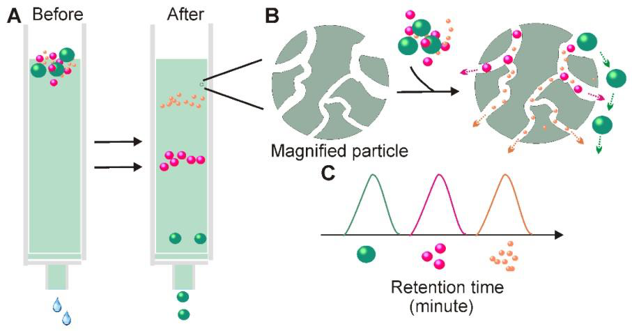
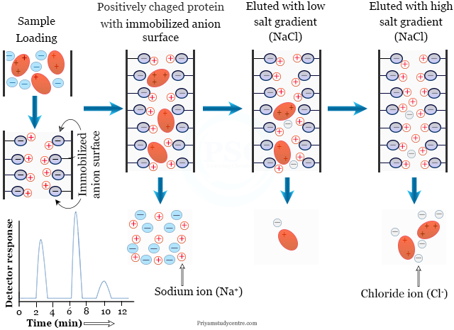
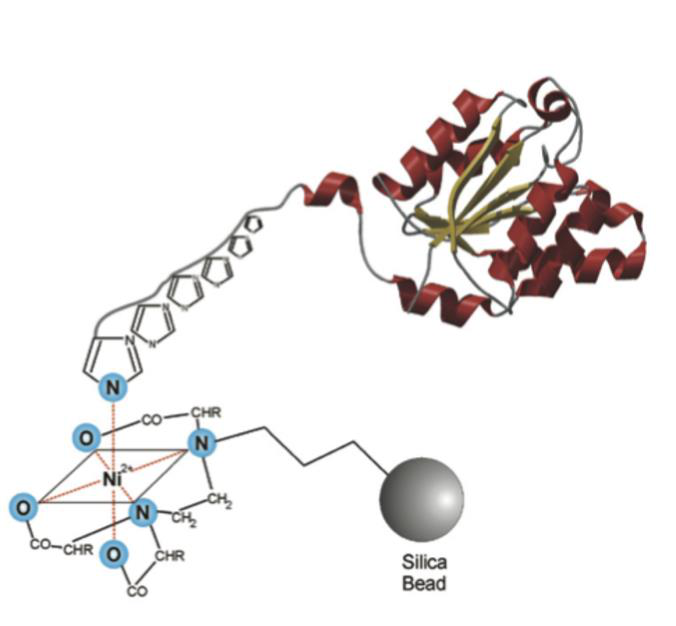

[Subject index](../README.md) · [Topic overview](README.md) · [Complete section](<Complete section.md>) · [Next](<AB-47 - Quantifying differential migration, and final isolation.md>)

<!-- note-content:start -->
# Section 46: Types of liquid chromatography

## Intuition

Section 45 bound the product to a solid and then released it. Chromatography does the same thing, but *continuously and repeatedly* as the sample travels down a column.

Each solute binds and unbinds many times on its way through. A solute that binds strongly spends more of its time stationary and so moves slowly; one that binds weakly moves quickly. After a long enough column, the difference in average speed separates components that differ only slightly in affinity.

That is the key to why chromatography achieves what a single equilibrium cannot: **a small difference in affinity, applied thousands of times in series, becomes a large difference in position.** Primary isolation methods (Sections 42–45) each give one equilibration and therefore one separation factor. A column gives the same factor repeatedly.

*Analogy:* two walkers of almost equal speed on a long road — indistinguishable over 10 m, far apart over 10 km. The analogy breaks down because the solutes do not move at steady speeds; they alternate between stopped and moving at the eluent's speed, and it is the *fraction of time stopped* that differs.

## Mechanism

**Differential migration.** Chromatography resolves mixtures into individual components by:

1. flowing a sample through a **column packed with resin**, using an **eluent**;
2. different components moving through the resin at **different rates**;
3. components emerging at different **elution times** on the other side, enabling separation.

The graph of concentration of the components in the effluent against elution time is the **chromatogram**. The resin is the **stationary phase**; the liquid carrying the solutes is the **mobile phase**.

The mobile phase can also be a gas, as in gas chromatography, but **liquid chromatography** is the form relevant to bioprocessing. It achieves high purity and is therefore used for enrichment of bioproducts in the pharmaceutical industry — antibodies, recombinant proteins and nucleic acids used as therapeutics.

### The five types

Each differs only in **what physical property drives the differential migration**.

**1. Adsorption chromatography** — uses **non-specific adsorption** of compounds against the stationary phase. The phase is typically crystals or particles of **silica gel, alumina, diatomaceous earth** or **charcoal**. Biological molecules adsorb on these materials driven mainly by **electrostatic forces**, and the order of elution depends primarily on **molecular polarity**. The polarity of the eluent (mobile phase) is also important in determining the degree of separation.

*Note:* although the principle is the same, adsorption chromatography is **different from the fixed-bed adsorption of Section 45**, which is a primary isolation method. There the aim is to capture the product and release it in bulk; here it is to resolve similar species by differential migration.

**2. Partition chromatography** — migration is driven by differential **partitioning between two "liquid" phases**. One liquid phase is immobilised onto a support such as silica, making it the stationary phase. A common stationary phase is **hydrocarbon with 8 or 18 carbons** bonded to silica gel: these are the **C8 and C18 packings**. The second liquid phase is the mobile phase, and common mobile phases are aqueous.

This is the same partition coefficient as Section 42, applied repeatedly rather than once.

**3. Gel chromatography** — also called **molecular-sieve, exclusion, gel filtration** or **gel-permeation chromatography**. The stationary phase is **hydrogel beads of defined pore size**, made of crosslinked **dextran, agarose** or **polyacrylamide**.

Migration rate depends on the **size** of the molecules. Small molecules enter the pores of the gel beads and migrate down the column slowly; large molecules flow past the beads and **leave the column fastest**. This inverts the usual expectation and is the basis of the quantitative treatment in Section 47.

**4. Ion-exchange chromatography** — differential migration is caused by **electrostatic interactions** between the stationary phase and the target molecules. For proteins, **pH needs to be kept away from the pI**, so that the proteins are charged.

If the stationary phase is negatively charged and the analyte positively charged, it is **cation-exchange chromatography**:
$$S^-C^+ + A^+B^- \rightarrow S^-A^+ + C^+ + B^- \tag{83}$$
where $S^-$ are the anionic groups on the stationary phase, $A^+$ the target analyte, and $C^+$ and $B^-$ are counterions. The target *swaps places* with the exchangeable cation $C^+$.

If the stationary phase is positively charged and the analyte negatively charged, it is **anion-exchange chromatography**:
$$S^+C^- + A^-B^+ \rightarrow S^+A^- + C^- + B^+ \tag{84}$$

**Elution is accelerated by increasing the salt concentration**, which raises the concentration of competing counterions and displaces the analyte. Ion exchange is used commercially for enrichment of proteins and antibiotics.

**5. Affinity chromatography** — the principle is **specific binding** between the target compound and the stationary phase. Ligands are chemically connected to the stationary phase and specifically bind recombinant proteins, enzymes, antibodies, hormones, nucleic acids and vitamins. It is **highly specific and often used for high-added-value products**.

*Ni-NTA.* A very common approach uses **nitrilotriacetic acid (NTA)** as ligand. NTA forms a complex with **Ni²⁺**, and the Ni-NTA complex binds strongly to **histidine residues**. Target recombinant proteins are purposefully modified to have a **6×His tag** at one end, so that they can be specifically captured by the Ni-NTA complex.

This is why the His₆ tag of Section 24's purification workflow exists: the tag is added at the gene level precisely so that one generic resin can purify any protein.

*Protein A.* Another common ligand, used for separation of immunoglobulins G. Protein A occurs naturally on the surface of *Staphylococcus aureus*, where it binds IgG from a **conserved region of the heavy chain that is not involved in antigen recognition** — the bacterium uses this to bind IgG the wrong way round, disrupting the immune response. Fc binding makes capture largely independent of antigen specificity, but affinity depends on species and IgG subclass; human IgG3 is a common weak/non-binding exception. The ligand and operating conditions must therefore be checked for the actual antibody.

## Motivation and explanation

**Why combine types.** Each exploits a different molecular property — polarity, partition, size, charge or specific binding — so impurities that resemble the product in one property may differ in another. Antibody purification commonly uses Protein A capture followed by one or more polishing steps such as ion exchange. Size exclusion can remove aggregates, especially at laboratory scale, but its loading and dilution limits mean it is not a universal final step in manufacturing.

**The capacity/selectivity trade.** Affinity can provide strong selectivity at high resin cost. Capacity depends on ligand density, accessible pores and operating conditions; it is not necessarily low. High-resolution size exclusion has a small sample-volume limit, making it useful for polishing suitable partly purified samples. Resin cost and lifetime, loading, resolution and recovery must be compared for the actual process.

**Why gel chromatography differs.** Ideal size exclusion separates by pore access rather than binding. The sample elutes in the running buffer, without a separate change of conditions to desorb it. It generally dilutes the sample and has a bounded ideal elution window. Departures from ideal exclusion require checking for matrix interactions.

## Link to other topics

Repeated equilibration down a column to amplify a small single-stage separation factor is precisely the logic of a distillation column's stages, and the same argument underlies the staged selection of Section 19: one weak discrimination applied many times becomes a strong one.

## Summary

Chromatography separates by differential migration — solutes that bind more spend more time stationary and move more slowly, so a small affinity difference applied repeatedly becomes a large separation in space. The five types differ only in the property exploited: polarity, partition, size, charge or specific binding, with affinity ligands such as Ni-NTA and Protein A giving the highest selectivity.
<!-- note-content:end -->

[Subject index](../README.md) · [Topic overview](README.md) · [Complete section](<Complete section.md>) · [Next](<AB-47 - Quantifying differential migration, and final isolation.md>)
