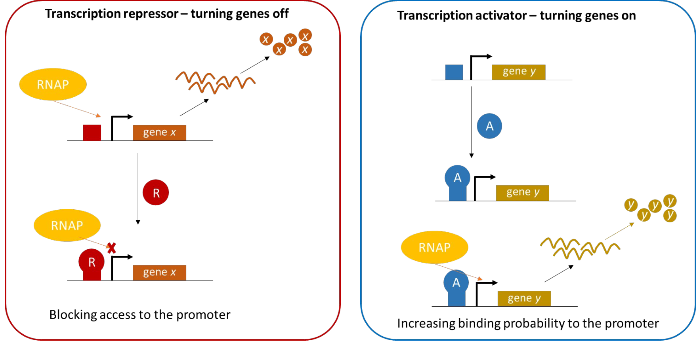

[Previous](<AB-48 - Kinetics of gene expression and steady state.md>) · [Subject index](../README.md) · [Topic overview](README.md) · [Complete section](<Complete section.md>) · [Next](<AB-50 - Network motifs and autoregulation.md>)

<!-- note-content:start -->
# Section 49: Transcriptional regulation and the lac operon

## Intuition

A **promoter** is a DNA region at which RNA polymerase (RNAP) initiates transcription. An **operator** is a DNA binding site for a regulatory protein; it may overlap the promoter or lie nearby. The promoter and operator are sequences, whereas the proteins that read them can change in abundance or activity.

*Analogy:* sigma factors provide RNAP with an address guide, repressors close selected doors and activators help it enter. The analogy fails because binding is reversible and probabilistic: promoters usually have graded initiation rates, not perfectly binary gates. Regulators can also affect DNA opening and promoter escape, rather than simply permitting physical access.

The pathway is **environmental signal → regulator activity → productive transcription → mRNA → protein → cellular function**. Regulation saves biosynthetic resources, supports adaptation and coordinates developmental changes where those occur. Regulatory proteins are themselves gene products, so one regulator can control the production of another and create a network.

## Derivation

### From DNA recognition to transcription rate

**First, assemble a promoter-recognising enzyme.** A sigma factor $\sigma$ binds the core RNAP to make the holoenzyme. For many promoters recognised by the principal bacterial factor $\sigma^{70}$, the important elements are centred near positions $-35$ and $-10$, measured upstream from the transcription start at $+1$. The consensus sequences TTGACA and TATAAT are reference patterns, not compulsory exact sequences at every promoter. Sigma contacts these elements and helps establish an open DNA complex from which RNA synthesis can begin.

**Next, select a programme.** Changing the available sigma factors changes the set of promoters efficiently recognised by RNAP. In *E. coli*, $\sigma^{70}$ supports much routine growth expression, $\sigma^{32}$ the cytoplasmic heat-shock response, and $\sigma^S$ much stationary-phase and stress expression. Such programmes overlap; a sigma factor does not guarantee expression of every compatible gene.

**Then, tune specific promoters.** A repressor bound at an operator can interfere with productive initiation. An activator bound nearby can recruit RNAP or facilitate initiation. Binding-site placement and protein interactions determine the mechanism. The ribosome-binding site (RBS) lies in the message and controls translation initiation; it is distinct from the promoter and from the start codon that defines the protein reading frame.

Let $k_1$ denote the mean transcription rate per effective gene copy in messages $\mathrm{min}^{-1}$. For a minimal two-state promoter, let $f$ be the fraction of time in a transcription-permissive state, $k_{\mathrm{on}}$ its productive transcription rate in that state, and $k_{\mathrm{off}}$ the rate in the other state. The state fractions sum to one, so averaging the rates gives

$$k_1=fk_{\mathrm{on}}+(1-f)k_{\mathrm{off}}. \tag{99}$$

With negligible residual transcription, set $k_{\mathrm{off}}\simeq0$ to obtain $k_1\simeq fk_{\mathrm{on}}$. Regulators change $f$, and can also change the state-specific rates. Equation (99) is an illustrative average, not a complete quantitative model of a real promoter with multiple binding sites.

The same mean transcription rate can arise from frequent short active intervals or rare long ones. Equation (99) averages over those intervals and therefore cannot distinguish their timing. In this equation, $k_{\mathrm{on}}$ and $k_{\mathrm{off}}$ denote transcription rates in the two states; they are not the rates of switching between states used in a stochastic promoter model. An occupancy average predicts mean output, while switching kinetics are needed to predict bursts and noise.

### The sign of control and the sign of the signal

A transcriptional **repressor** lowers output when its active form binds DNA: its regulatory edge is drawn with a blunt end. An **activator** raises output when bound: its edge is drawn with an arrowhead. These signs describe the regulator's effect, not necessarily the effect of a signal on the gene.

**Allostery** means that binding a signal at one site changes a protein's conformational preferences and its activity at another site. A signal that weakens a repressor increases transcription by removing inhibition; a signal that activates an activator also increases transcription. Both implement an inducing response despite opposite signs of DNA-level control. Conversely, a signal can strengthen a repressor or disable an activator and thereby reduce transcription.

## Motivation and explanation

**Why retain both positive and negative control?** The same signal–output relationship can be built with either an activator or a repressor. The **demand rule** is an evolutionary tendency: genes needed near their high expression level for much of the natural environment tend towards positive control; rarely needed genes tend towards negative control.

One proposed explanation assumes that an unoccupied regulatory site is more vulnerable to inappropriate binding than a site occupied by its intended regulator. High demand favours an activator occupying its site while output is high; low demand favours a repressor occupying its site while output is low. This protects the state most often required. It is a conditional explanation, not a universal design law: costs, binding specificity, history and multiple regulators can change the choice. In engineering, desired basal expression, response range and host compatibility matter alongside demand.

Removing a repressor therefore permits transcription without necessarily producing maximal transcription. A suitable sigma factor, accessible promoter and any required activator must still be present. Regulatory occupancy changes rapidly, but protein abundance responds with the synthesis and loss timescales of the expression balances.

## Link to other topics

Promoter and RBS design connect DNA assembly to controlled protein production. Linking regulated promoters to genes encoding further regulators creates feedback, switches and oscillators, whose dynamics depend on both regulatory interactions and molecular lifetimes.

## Summary

Sigma factors establish promoter recognition, specific transcription factors tune productive initiation, and signals change the active state of those factors. The lac operon combines relief of repression with activation to connect resource availability to enzyme production; those same components can be recombined into synthetic circuits.
<!-- note-content:end -->

[Previous](<AB-48 - Kinetics of gene expression and steady state.md>) · [Subject index](../README.md) · [Topic overview](README.md) · [Complete section](<Complete section.md>) · [Next](<AB-50 - Network motifs and autoregulation.md>)
