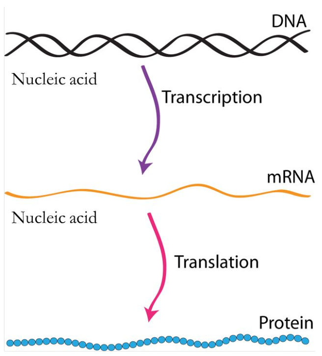
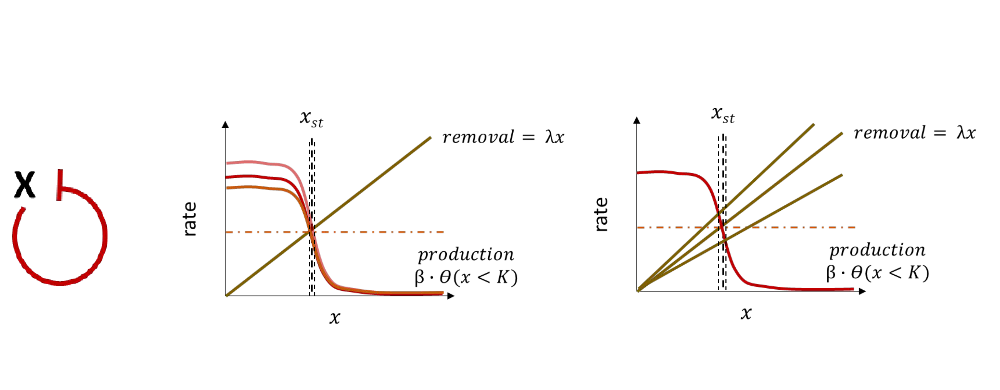
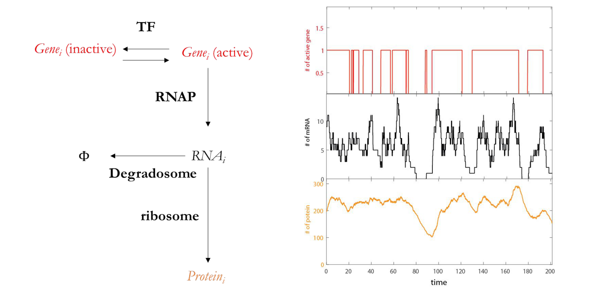

[Subject index](../README.md) · [Topic overview](README.md) · [Complete section](<Complete section.md>)

<!-- note-content:start -->
# Gene regulation and synthetic circuits

## Overview

Gene expression couples transcription and translation to degradation and dilution. Regulatory proteins change synthesis rates; feedback motifs shape steady states and response times, stochastic events generate noise, and delayed cyclic repression can produce oscillations.

*Assumed throughout:* mass-action kinetics, first-order balances and DNA-to-RNA-to-protein information flow.

## Section 48: Kinetics of gene expression and steady state

### Intuition

RNA polymerase (RNAP) repeatedly makes messenger RNA (mRNA) from a gene. Ribosomes repeatedly translate each message: translation does not consume the mRNA. Ribonucleases destroy messages, while proteins can disappear through proteolysis or become distributed among an increasing number of cells as the population grows.

*Analogy:* a workshop copies instructions, and each copy supports repeated manufacture until discarded. Keeping more copies increases production. The analogy fails at dilution: an intact protein can become less abundant per cell without being destroyed, because the workshop population grows and divides.

A steady abundance is therefore a **dynamic balance**, with continual synthesis replacing losses. It is not chemical equilibrium. Cells express different subsets of their genes because unnecessary transcription and translation consume resources; the active subset depends on the environment, not on a fixed universal fraction.

### Derivation

#### Production and loss

Let $t$ be time in minutes, $m$ the mean number of messages for one gene per cell, and $p$ the mean number of its protein molecules per cell. Take one effective gene copy per cell, constant growth conditions, unsaturated machinery and negligible synthesis delays. Let $k_1$ be the transcription rate in messages $\mathrm{cell}^{-1}$ $\mathrm{min}^{-1}$, and $k_2$ the translation rate in proteins $\mathrm{message}^{-1}$ $\mathrm{min}^{-1}$. For one gene copy, $k_1$ is numerically the rate per gene. Let $\lambda_1$ and $\lambda_2$ be the effective message and protein loss constants, both in $\mathrm{min}^{-1}$.

Over a short interval $dt$, synthesis adds $k_1dt$ messages and first-order loss removes $\lambda_1m\,dt$. Subtracting loss from production and dividing by $dt$ gives

$$\frac{dm}{dt}=k_1-\lambda_1m. \tag{93}$$

Each of the $m$ messages produces proteins at rate $k_2$, so total protein production is $k_2m$. Applying the same balance gives

$$\frac{dp}{dt}=k_2m-\lambda_2p. \tag{94}$$

The factor $m$ is essential: $k_2$ alone is a rate **per message**, not a rate per cell. Every term in (94) has units of proteins $\mathrm{cell}^{-1}$ $\mathrm{min}^{-1}$.

#### Why dilution enters a loss constant

Let $N$ be the number of cells, $P$ the total number of the protein molecules in the population, $\mu$ the exponential population growth constant, and $\delta_p$ the intrinsic protein degradation constant. Then $dN/dt=\mu N$. Production by all cells is $Nk_2m$, so $dP/dt=Nk_2m-\delta_pP$. Since $p=P/N$, the quotient rule gives

$$\frac{dp}{dt}=\frac{1}{N}\frac{dP}{dt}-\frac{P}{N^2}\frac{dN}{dt}
=k_2m-\delta_pp-\mu p
=k_2m-(\delta_p+\mu)p. \tag{95}$$

Thus $\lambda_2=\delta_p+\mu$: the last term appears because the denominator grows. Applying the identical population balance to messages gives $\lambda_1=\delta_m+\mu$, where $\delta_m$ is their intrinsic degradation constant. This is a population mean approximation; molecule numbers in a single lineage jump at division rather than undergoing smooth dilution.

#### Half-life and steady state

For a species of abundance $n$ after its production has stopped, $dn/dt=-\lambda n$. Separating variables gives $dn/n=-\lambda\,dt$. Integrating from initial abundance $n_0$ at $t=0$ yields $\ln(n/n_0)=-\lambda t$, hence $n=n_0e^{-\lambda t}$. At the half-life $t_{1/2}$, substitute $n/n_0=1/2$ and take natural logarithms:

$$-\ln2=-\lambda t_{1/2}
\quad\Rightarrow\quad \lambda=\frac{\ln2}{t_{1/2}}. \tag{96}$$

For a stable protein, $\delta_p\simeq0$, so its effective dilution half-life equals the population doubling time $T_d$: $\mu=\ln2/T_d$. This does not mean the protein is chemically degraded within that time.

At steady state, indicated by a superscript $*$, set the left-hand side of (93) to zero. Moving the loss term to the other side and dividing by $\lambda_1$ gives $m^*=k_1/\lambda_1$. Do the same in (94), then substitute this message abundance:

$$m^*=\frac{k_1}{\lambda_1},\qquad
p^*=\frac{k_2m^*}{\lambda_2}
=\frac{k_1k_2}{\lambda_1\lambda_2}. \tag{97}$$

To see how messages approach the balance, subtract $m^*$ from (93). For $u=m-m^*$, $du/dt=-\lambda_1u$, whose exponential solution above gives

$$m(t)=m^*+[m(0)-m^*]e^{-\lambda_1t}. \tag{98}$$

Starting from zero, $m(t)=m^*(1-e^{-\lambda_1t})$. At $t_{1/2}$ it has reached half its eventual value. Protein production still depends on this changing message pool, so protein accumulation is generally not a single exponential from switch-on.

Starting with no messages and no protein, transcription can begin immediately while protein production initially remains zero because there are no templates for translation yet. Protein production increases as messages accumulate. This produces a rounded start in the protein curve even though the model contains no explicit waiting-time delay. An inherited message pool would change that initial slope, so the initial condition matters as well as the two loss constants.

### Motivation and explanation

Longer message survival allows more templates to accumulate; longer protein survival allows more products to accumulate. This explains why the two loss constants multiply in the denominator of (97). With fixed losses, doubling transcription doubles both abundances, while changing translation affects protein abundance directly.

If production stops, abundance decays to zero when the corresponding loss constant is positive. If a species has no loss and positive production, it accumulates rather than reaching a finite steady state. The deterministic means also hide fluctuations, especially when message counts are small. Resource limitation, changing gene dosage, growth-dependent synthesis rates and feedback invalidate the constant-parameter approximation.

**Elongation speed is not initiation frequency.** A coding sequence of approximately 1,000 nucleotides takes about 33.3 s to transcribe at 30 nt $\mathrm{s}^{-1}$; ignoring the stop codon, translation of its approximately 333 amino acids at 10 amino acids $\mathrm{s}^{-1}$ also takes about 33.3 s. These transit times do not establish $k_1$ or $k_2$: several polymerases can occupy one gene and several ribosomes can occupy one message. Promoter initiation and the ribosome-binding site control the effective production rates.

#### Effective loss and intrinsic degradation must be distinguished

The steady ratio $p^*/m^*=k_2/\lambda_2$ compares standing protein and message abundances. The expected proteins translated during one message's mean lifetime instead involve $k_2/\lambda_1$. Confusing these ratios mixes protein persistence with message lifetime.

If a stated message half-life already includes dilution, using $\lambda_1=\ln2/t_{1/2}$ includes that effect. If it denotes intrinsic degradation, add the growth-dilution rate once. For an intrinsic five-minute degradation half-life and a twenty-minute doubling time, $\lambda_1=\ln2/5+\ln2/20$ gives an effective four-minute half-life. Adding dilution to an already effective half-life would double-count a loss mechanism.

### Link to other topics

These balances connect gene expression to the production and removal equations used in bioprocessing. Transcriptional regulation makes $k_1$ depend on signals and regulatory proteins, turning a constant-rate model into a gene regulatory network.

### Summary

An expression level records both production and survival. Keeping transcription per gene, translation per message, intrinsic degradation and growth dilution distinct provides the basis for understanding how regulatory proteins change gene output.

## Section 49: Transcriptional regulation and the lac operon

### Intuition

A **promoter** is a DNA region at which RNA polymerase (RNAP) initiates transcription. An **operator** is a DNA binding site for a regulatory protein; it may overlap the promoter or lie nearby. The promoter and operator are sequences, whereas the proteins that read them can change in abundance or activity.

*Analogy:* sigma factors provide RNAP with an address guide, repressors close selected doors and activators help it enter. The analogy fails because binding is reversible and probabilistic: promoters usually have graded initiation rates, not perfectly binary gates. Regulators can also affect DNA opening and promoter escape, rather than simply permitting physical access.

The pathway is **environmental signal → regulator activity → productive transcription → mRNA → protein → cellular function**. Regulation saves biosynthetic resources, supports adaptation and coordinates developmental changes where those occur. Regulatory proteins are themselves gene products, so one regulator can control the production of another and create a network.

### Derivation

#### From DNA recognition to transcription rate

**First, assemble a promoter-recognising enzyme.** A sigma factor $\sigma$ binds the core RNAP to make the holoenzyme. For many promoters recognised by the principal bacterial factor $\sigma^{70}$, the important elements are centred near positions $-35$ and $-10$, measured upstream from the transcription start at $+1$. The consensus sequences TTGACA and TATAAT are reference patterns, not compulsory exact sequences at every promoter. Sigma contacts these elements and helps establish an open DNA complex from which RNA synthesis can begin.

**Next, select a programme.** Changing the available sigma factors changes the set of promoters efficiently recognised by RNAP. In *E. coli*, $\sigma^{70}$ supports much routine growth expression, $\sigma^{32}$ the cytoplasmic heat-shock response, and $\sigma^S$ much stationary-phase and stress expression. Such programmes overlap; a sigma factor does not guarantee expression of every compatible gene.

**Then, tune specific promoters.** A repressor bound at an operator can interfere with productive initiation. An activator bound nearby can recruit RNAP or facilitate initiation. Binding-site placement and protein interactions determine the mechanism. The ribosome-binding site (RBS) lies in the message and controls translation initiation; it is distinct from the promoter and from the start codon that defines the protein reading frame.

Let $k_1$ denote the mean transcription rate per effective gene copy in messages $\mathrm{min}^{-1}$. For a minimal two-state promoter, let $f$ be the fraction of time in a transcription-permissive state, $k_{\mathrm{on}}$ its productive transcription rate in that state, and $k_{\mathrm{off}}$ the rate in the other state. The state fractions sum to one, so averaging the rates gives

$$k_1=fk_{\mathrm{on}}+(1-f)k_{\mathrm{off}}. \tag{99}$$

With negligible residual transcription, set $k_{\mathrm{off}}\simeq0$ to obtain $k_1\simeq fk_{\mathrm{on}}$. Regulators change $f$, and can also change the state-specific rates. Equation (99) is an illustrative average, not a complete quantitative model of a real promoter with multiple binding sites.

The same mean transcription rate can arise from frequent short active intervals or rare long ones. Equation (99) averages over those intervals and therefore cannot distinguish their timing. In this equation, $k_{\mathrm{on}}$ and $k_{\mathrm{off}}$ denote transcription rates in the two states; they are not the rates of switching between states used in a stochastic promoter model. An occupancy average predicts mean output, while switching kinetics are needed to predict bursts and noise.

#### The sign of control and the sign of the signal

A transcriptional **repressor** lowers output when its active form binds DNA: its regulatory edge is drawn with a blunt end. An **activator** raises output when bound: its edge is drawn with an arrowhead. These signs describe the regulator's effect, not necessarily the effect of a signal on the gene.

**Allostery** means that binding a signal at one site changes a protein's conformational preferences and its activity at another site. A signal that weakens a repressor increases transcription by removing inhibition; a signal that activates an activator also increases transcription. Both implement an inducing response despite opposite signs of DNA-level control. Conversely, a signal can strengthen a repressor or disable an activator and thereby reduce transcription.

### Motivation and explanation

**Why retain both positive and negative control?** The same signal–output relationship can be built with either an activator or a repressor. The **demand rule** is an evolutionary tendency: genes needed near their high expression level for much of the natural environment tend towards positive control; rarely needed genes tend towards negative control.

One proposed explanation assumes that an unoccupied regulatory site is more vulnerable to inappropriate binding than a site occupied by its intended regulator. High demand favours an activator occupying its site while output is high; low demand favours a repressor occupying its site while output is low. This protects the state most often required. It is a conditional explanation, not a universal design law: costs, binding specificity, history and multiple regulators can change the choice. In engineering, desired basal expression, response range and host compatibility matter alongside demand.

Removing a repressor therefore permits transcription without necessarily producing maximal transcription. A suitable sigma factor, accessible promoter and any required activator must still be present. Regulatory occupancy changes rapidly, but protein abundance responds with the synthesis and loss timescales of the expression balances.

#### How lactose induces the lac operon

The **lac operon** is a bacterial transcription unit producing a message with several protein coding regions: **lacZ** encodes $\beta$-galactosidase, **lacY** a lactose permease, and **lacA** a thiogalactoside acetyltransferase associated with detoxification of some non-metabolised galactosides. The **lacI** gene has its own promoter and supplies the LacI repressor.

**Without lactose**, LacI binds the lac operator region and strongly represses transcription. Its ability to bind additional operators and loop DNA strengthens repression. Repression is incomplete, leaving low basal production of LacY and LacZ.

**When lactose is available**, basal LacY imports it, and LacZ both hydrolyses lactose and converts some into **allolactose**. Allolactose binds LacI away from its DNA-binding surface and reduces operator affinity through allostery. Operator occupancy falls and transcription becomes easier. The new LacY and LacZ support further uptake and processing; induction does not require a chemically impossible first step with absolutely no permease or enzyme present.

**The carbon-source context also matters.** The activator CAP, also called CRP (cAMP receptor protein), responds to cyclic AMP (cAMP). In the usual simplified glucose–lactose comparison, low glucose supports greater cAMP–CAP activation. Bound CAP helps productive initiation at the lac promoter. Thus lactose relieves negative control, while low glucose supports positive control.

| Lactose available | Glucose available | LacI repression | cAMP–CAP activation | Qualitative lac output |
|---|---|---|---|---|
| No | Yes | Strong | Weak | Very low |
| No | No | Strong | Strong | Low: activation does not remove repression |
| Yes | Yes | Relieved if intracellular inducer accumulates | Weak | Limited |
| Yes | No | Relieved | Strong | High |

The high-output response resembles “lactose present AND glucose scarce”. It is an approximate logic description: intracellular inducer, DNA looping and interactions between CAP and LacI affect the graded response. Glucose can also restrict lactose uptake through inducer exclusion, so external lactose alone does not guarantee induction.

**A conceptual perturbation.** Deleting lacI removes the lactose-sensitive brake, but the native lac promoter still responds to CAP and carbon-source conditions. Deleting crp removes CAP activation; relieving LacI alone then cannot restore the normal high-output state. The two controls answer different questions: is lactose available, and should the cell invest strongly in using it?

Signals can also reach transcription factors by phosphorylation rather than direct ligand binding. For example, extracellular glucose-6-phosphate is sensed through the Uhp membrane signalling system, activating the response regulator UhpA and transcription of the transporter gene uhpT. The same environmental-input-to-transcription logic can therefore use different molecular mechanisms.

### Link to other topics

Promoter and RBS design connect DNA assembly to controlled protein production. Linking regulated promoters to genes encoding further regulators creates feedback, switches and oscillators, whose dynamics depend on both regulatory interactions and molecular lifetimes.

### Summary

Sigma factors establish promoter recognition, specific transcription factors tune productive initiation, and signals change the active state of those factors. The lac operon combines relief of repression with activation to connect resource availability to enzyme production; those same components can be recombined into synthetic circuits.

## Section 50: Network motifs and autoregulation

### Intuition

A self-repressor initially leaves its promoter free, allowing rapid production. As it accumulates, it occupies the operator and reduces further transcription. A self-activator does the reverse: initial expression is weak, but accumulated activator recruits more RNA polymerase.

*Analogy:* NAR resembles a thermostatic heater that reduces power as the room warms; PAR resembles a microphone feeding its own amplified sound back into the input. The analogy ends at the molecular mechanism: proteins arrive at DNA randomly, production takes time, and the cell shares finite resources with other genes.

A **network motif** is a small wiring pattern enriched relative to a specified random-network model. Frequency alone does not establish either enrichment or biological function. For example, in a network snapshot with 424 nodes, 519 arrows and 40 self-arrows, uniformly choosing directed connections gives self-arrow probability $1/424$ and expected count $519/424=1.224$. The observed count is 32.68 times this expectation. This simple null ignores which nodes are transcription factors and their unequal degrees; a stronger test preserves those constraints. The snapshot contains 34 negative and six positive self-arrows.

### Derivation

**Promoter occupancy → Hill response.** Suppose an effective cooperative binding event has bound-to-free promoter probability ratio $(R/K)^n$, where $R$ is active regulator concentration, $K$ the half-occupancy concentration, and $n$ the Hill exponent. Normalising the free-state weight 1 and bound-state weight $(R/K)^n$ gives

$$P_{\mathrm{free}}=\frac{1}{1+(R/K)^n},\qquad P_{\mathrm{bound}}=\frac{(R/K)^n}{1+(R/K)^n}.\tag{100}$$

*Reason:* mutually exclusive state probabilities sum to one. For a literal all-or-none binding reaction, mass action supplies the ratio; otherwise $n$ is an effective fitted exponent, not necessarily a count of binding sites.

Let $\beta$ be the additional production rate when the promoter is fully active and $b$ its basal production rate, both in concentration/time. Production then has the forms

$$f_{\mathrm{NAR}}(x)=b+\frac{\beta}{1+(x/K)^n},\qquad f_{\mathrm{PAR}}(x)=b+\frac{\beta(x/K)^n}{1+(x/K)^n}.\tag{101}$$

*Reason:* repression permits transcription in the free state; activation permits the additional transcription in the bound state. Set $R=x$ only when concentration is proportional to active regulator abundance. Promoter equilibration and mRNA relaxation must be fast compared with changes in $x$.

For large $n$, repression approaches an ON/OFF rule: $\beta$ below $K$, zero above $K$, plus any basal rate. The finite Hill curve still has half activity at $K$; the discontinuous approximation does not specify a unique value there. It is useful for Boolean logic, but unreliable for calculating a derivative at the threshold. Two inputs that can each initiate production implement OR; allowing either input to make a common repressor gives a downstream NOR output, subject to threshold and leak limitations.

**Rate plots → stability and response.** Production minus removal gives

$$\frac{dx}{dt}=f(x)-\lambda x,\qquad f(x_{\mathrm{st}})=\lambda x_{\mathrm{st}}.\tag{102}$$

The vertical gap between the curves is the rate of movement along the concentration axis.

To read stability, place the concentration slightly on either side of an intersection. Where production exceeds removal, concentration moves right; where removal exceeds production, it moves left. An intersection is restoring only when these arrows point towards it from both sides. The slope calculation below makes this graphical test quantitative: it measures how quickly the vertical imbalance grows when concentration is displaced from the intersection.

Put $x=x_{\mathrm{st}}+\delta x$. Taylor expansion gives $f(x)=f(x_{\mathrm{st}})+f'(x_{\mathrm{st}})\delta x+O(\delta x^2)$. Subtract the steady balance to cancel the constant terms:

$$\frac{d\delta x}{dt}\simeq-[\lambda-f'(x_{\mathrm{st}})]\delta x,
\quad \delta x(t)=\delta x(0)e^{-t/\tau_{\mathrm{eff}}},
\quad \tau_{\mathrm{eff}}=\frac{1}{\lambda-f'(x_{\mathrm{st}})}.\tag{103}$$

*Reason:* the local production slope changes how strongly a displacement restores the balance. Stability requires $f'<\lambda$. NAR has $f'<0$, giving faster local relaxation. Stable PAR with $0<f'<\lambda$ relaxes more slowly; $f'>\lambda$ makes the intersection unstable. A sufficiently sigmoid PAR curve can have two stable intersections separated by an unstable one, enabling memory and hysteresis. PAR alone does not guarantee bistability.

For constant production $k$ and $x(0)=0$, multiply $\dot x+\lambda x=k$ by $e^{\lambda t}$ and integrate:

$$e^{\lambda t}x=\frac{k}{\lambda}(e^{\lambda t}-1),\qquad
x=\frac{k}{\lambda}(1-e^{-\lambda t}),\qquad t_{1/2}=\frac{\ln2}{\lambda}.\tag{104}$$

*Reason:* the integrating factor turns the left side into one derivative; setting $x$ to half $k/\lambda$ then gives the rise-time. For dilution alone, $\lambda=\ln2/T_d$, where $T_d$ is doubling time, so this half-rise takes one generation. Comparisons of feedback circuits must match the final concentration; simply strengthening a constitutive promoter changes its endpoint.

**Rate plots → sensitivity.** Allow production to depend on a parameter $u$. Differentiate $f(x_{\mathrm{st}},u)=\lambda x_{\mathrm{st}}$ at fixed $\lambda$:

$$f_x\frac{dx_{\mathrm{st}}}{du}+f_u=\lambda\frac{dx_{\mathrm{st}}}{du},\qquad
\frac{dx_{\mathrm{st}}}{du}=\frac{f_u}{\lambda-f_x}.\tag{105}$$

*Reason:* the parameter both moves the production curve and changes the concentration at which it is evaluated. Subscripts indicate partial derivatives evaluated at the steady state. For no leak, $f=\beta h(x)$, define the dimensionless feedback strength $L=-f_x/\lambda$. Since $f_\beta=f/\beta=\lambda x_{\mathrm{st}}/\beta$,

$$\frac{d\ln x_{\mathrm{st}}}{d\ln\beta}=\frac{1}{1+L},\qquad
\frac{d\ln x_{\mathrm{st}}}{d\ln\lambda}=-\frac{1}{1+L}.\tag{106}$$

*Reason:* divide (105) by $x_{\mathrm{st}}/\beta$; for the second result differentiate the steady balance with respect to $\lambda$ instead. For no-leak NAR, differentiating (101) and using (102) gives $L=n(x_{\mathrm{st}}/K)^n/[1+(x_{\mathrm{st}}/K)^n]$.

### Motivation and explanation

A falling production curve makes shifts in production capacity or removal rate move the intersection less. Equations (105)–(106) concern small, slow perturbations; they do not prove suppression of all intrinsic noise or rapidly fluctuating inputs. Noise in the threshold $K$, strong expression burden, saturation and delayed repression can defeat this protection. A smooth one-variable autonomous balance can relax monotonically but cannot sustain an oscillation: molecular intermediates or delayed feedback must supply additional dynamics.

#### Finite switching and local relaxation

Local relaxation near a stable expression level depends on the slope of net production there. A full rise from zero can be faster than that local estimate because a negatively autoregulated promoter starts relatively unrepressed. Comparing half-rise and half-relaxation times therefore requires specifying both initial condition and reference endpoint.

For no-leak positive autoregulation with Hill exponent two, the balance is $\dot x=\beta x^2/(K^2+x^2)-\lambda x$. Besides $x=0$, steady states satisfy $\lambda x^2-\beta x+\lambda K^2=0$. Thus two positive roots exist when $\beta>2\lambda K$:

$$x_{\pm}=\frac{\beta\pm\sqrt{\beta^2-4\lambda^2K^2}}{2\lambda}.$$

The lower positive root is an unstable threshold and the upper is stable; the zero state is also stable. With exactly zero protein and zero leak, the deterministic system stays OFF until a perturbation crosses the threshold. Basal transcription changes the balance, can initiate expression and may remove bistability. Strong positive feedback alone is therefore insufficient evidence of a switch.

### Link to other topics

The Hill response extends promoter binding into a dynamical gene-expression model. Rate-plot slopes are the biological counterpart of local feedback gains in process control, while intrinsic expression fluctuations require a discrete reaction model.

### Summary

NAR creates a restoring production slope; PAR creates a reinforcing one. The slope at a steady balance determines local speed and sensitivity, and the shape of the full production curve determines whether switching is possible.

## Section 51: Stochastic gene expression and noise

### Intuition

A low-copy transcription factor finds an operator by diffusion and stochastic binding. One promoter therefore switches between inactive and active states even under fixed conditions. During an active interval, several transcripts can be made; each transcript can yield several proteins before being degraded. Long-lived proteins integrate these upstream events and smooth fast fluctuations.

Around a steady expression level, a promoter fluctuation short compared with protein lifetime has little time to change protein abundance relative to its sustained effect: it produces some messages, but the long-lived protein pool changes only a little during that pulse. Repeated rapid pulses are therefore averaged together before much protein is lost. A slow change in promoter activity persists long enough to move the whole protein pool and is transmitted much more strongly. Smoothing thus depends on the ratio of lifetimes to fluctuation timescales; it does not erase every upstream source of variation.

*Analogy:* two printers sharing a power supply can both speed up or slow down together, but their individual paper-feed events differ. Two genetic reporters similarly share cellular resources while undergoing separate expression events. The limit is that reporters can themselves compete for those resources, breaking the assumed independence.

**Intrinsic noise** is variation remaining when the relevant shared cellular state is fixed. **Extrinsic noise** is variation transmitted from that shared state, such as polymerase abundance, growth, regulator concentration or gene dosage. These labels depend on the system boundary: stochastic promoter switching is intrinsic to a complete expression model, but is an upstream fluctuating input when analysing only mRNA birth and death.

### Derivation

**1. Birth and death set a baseline.** Let mRNA be made at constant rate $k_m$ (copies/min) and each molecule disappear at rate $\lambda_m$ (per min). A birth changes $m$ by $+1$ and a death by $-1$, with total death rate $\lambda_m m$. Taking expected changes gives

$$\frac{d\langle m\rangle}{dt}=k_m-\lambda_m\langle m\rangle,
\qquad \overline m=\frac{k_m}{\lambda_m}.\tag{107}$$

A bar denotes a stationary mean. For the second moment, the changes in $m^2$ are $(m+1)^2-m^2=2m+1$ and $(m-1)^2-m^2=-2m+1$. Multiply each by its event rate and average:

$$\frac{d\langle m^2\rangle}{dt}=k_m(2\langle m\rangle+1)
+\lambda_m[-2\langle m^2\rangle+\langle m\rangle].\tag{108}$$

At stationarity substitute $k_m=\lambda_m\overline m$, set (108) to zero, and divide by $2\lambda_m$. This gives $\langle m^2\rangle=\overline m^2+\overline m$, hence

$$V_m=\overline m,\qquad \mathrm{CV}_m^2=\frac{V_m}{\overline m^2}=\frac{1}{\overline m}.\tag{109}$$

Here $V_m$ is variance, and coefficient of variation $\mathrm{CV}=\sigma/\mu$ divides standard deviation $\sigma$ by mean $\mu$. The full stationary birth–death distribution is Poisson. This baseline requires independent single-molecule births and first-order deaths; bursts and fluctuating rates add variance.

**2. Add a switching promoter.** One promoter has $g=0$ (OFF) or $g=1$ (ON), with switching rates $k_{\mathrm{on}}$ and $k_{\mathrm{off}}$. Define $a=k_{\mathrm{on}}+k_{\mathrm{off}}$ and correlation time $\tau_g=1/a$. The mean obeys $d\langle g\rangle/dt=k_{\mathrm{on}}-a\langle g\rangle$, so

$$q\equiv P_{\mathrm{on}}=\overline g=\frac{k_{\mathrm{on}}}{a},\qquad
V_g=q(1-q),\qquad \frac{V_g}{\overline g^2}=\frac{1-q}{q}.\tag{110}$$

*Reason:* $g^2=g$ for a binary variable. For $N_g$ independent identical promoters, $\overline g=N_gq$ and $V_g=N_gq(1-q)$, giving relative variance $(1-q)/\overline g$.

Let transcription occur at rate $k_mg$ and define $\tau_m=1/\lambda_m$. Equation (107) becomes $\overline m=k_mq/\lambda_m$. Write $C_{gm}=\operatorname{Cov}(g,m)$. Promoter switching changes $gm$ through changes in $g$, and transcription changes it through changes in $m$. Specifically,

$$\frac{d\langle gm\rangle}{dt}=k_{\mathrm{on}}\langle m\rangle
-(a+\lambda_m)\langle gm\rangle+k_m\langle g^2\rangle.\tag{111}$$

*Reason:* switching contributes $k_{\mathrm{on}}\langle(1-g)m\rangle-k_{\mathrm{off}}\langle gm\rangle$; transcription contributes $k_m\langle g^2\rangle$; death contributes $-\lambda_m\langle gm\rangle$. At stationarity subtract the product of the means, use $k_{\mathrm{on}}=aq$, and obtain $C_{gm}=k_mV_g/(a+\lambda_m)$.

Applying the squared-jump calculation (108) with production $k_mg$ gives $V_m=\overline m+k_mC_{gm}/\lambda_m$. Divide by $\overline m^2$, substitute $C_{gm}$ and $\overline m$, and cancel the production rates:

$$\mathrm{CV}_m^2=\frac{1}{\overline m}
+\frac{1-q}{q}\frac{\tau_g}{\tau_g+\tau_m}.\tag{112}$$

*Reason:* $\lambda_m/(a+\lambda_m)=\tau_g/(\tau_g+\tau_m)$. The first term is transcript birth–death noise; the second is propagated promoter noise. Fast switching, $\tau_g\ll\tau_m$, is averaged away; slow switching is transmitted almost completely. For independent multiple promoters replace $(1-q)/q$ by $(1-q)/\overline g$.

**3. Add translation.** Let protein births occur at rate $k_pm$, where $k_p$ is proteins per transcript per min, and protein loss at rate $\lambda_pp$. Define $\tau_p=1/\lambda_p$, $\overline p=k_p\overline m/\lambda_p$, $C_{gp}=\operatorname{Cov}(g,p)$ and $C_{mp}=\operatorname{Cov}(m,p)$. The same event bookkeeping, after subtracting products of stationary means, gives

$$C_{gp}=\frac{k_pC_{gm}}{a+\lambda_p},\qquad
C_{mp}=\frac{k_mC_{gp}+k_pV_m}{\lambda_m+\lambda_p},\qquad
V_p=\overline p+\frac{k_pC_{mp}}{\lambda_p}.\tag{113}$$

*Reason:* promoter switching and protein loss remove $gp$ covariance, while translation supplies $k_pC_{gm}$. Transcript and protein losses remove $mp$ covariance, while transcription and translation supply $k_mC_{gp}$ and $k_pV_m$. Protein births and deaths contribute the Poisson baseline $\overline p$ to its variance. No reaction changes both $m$ and $p$ at once: translation does not consume the transcript.

Insert $V_m=\overline m+k_mC_{gm}/\lambda_m$ into (113), and divide $V_p$ by $\overline p^2$. Before changing to lifetimes the result is

$$\mathrm{CV}_p^2=\frac{1}{\overline p}
+\frac{\lambda_p}{\overline m(\lambda_m+\lambda_p)}
+\frac{1-q}{q}\frac{\lambda_m\lambda_p}{(a+\lambda_m)(\lambda_m+\lambda_p)}
\left(1+\frac{\lambda_m}{a+\lambda_p}\right).\tag{114}$$

*Reason:* the three contributions arise from protein births, transcript variance at fixed promoter input, and promoter variance. Substitute each $\lambda=1/\tau$ and $a=1/\tau_g$; combining the terms in parentheses gives the equivalent filtering form

$$\mathrm{CV}_p^2=\frac{1}{\overline p}
+\frac{1}{\overline m}\frac{\tau_m}{\tau_m+\tau_p}
+\frac{1-q}{q}\frac{\tau_m}{\tau_m+\tau_p}
\frac{\tau_g}{\tau_g+\tau_p}
\frac{\tau_g+\tau_p+\tau_g\tau_p/\tau_m}{\tau_g+\tau_m}.\tag{115}$$

All ratios are dimensionless. With a fixed ON promoter the last term vanishes. With $\tau_p\to0$ at fixed means, the transcript and promoter contributions approach those in (112); with $\tau_p\to\infty$ fast upstream fluctuations are averaged away. These limiting comparisons hold means fixed by adjusting production; changing a lifetime alone also changes the mean.

**4. Two reporters distinguish common and independent fluctuations.** Let $R$ and $G$ be background-corrected reporter signals and $\mu_R=\langle R\rangle$, $\mu_G=\langle G\rangle$ their positive means. Normalise $r=R/\mu_R$ and $s=G/\mu_G$. If $Z$ represents the shared cellular state, assume both reporters have the same conditional mean $h(Z)$ and are independent conditional on $Z$. Write $r=h+\epsilon_r$ and $s=h+\epsilon_s$, with conditional zero-mean residuals of equal average variance $v$.

Taking variances and covariance gives $\operatorname{Var}(r)=\operatorname{Var}(h)+v$ and $\operatorname{Cov}(r,s)=\operatorname{Var}(h)$. Subtraction cancels $h$, and conditional independence gives $\langle(r-s)^2\rangle=2v$. Therefore

$$\eta_{\mathrm{int}}^2=\frac{\langle(r-s)^2\rangle}{2},\qquad
\eta_{\mathrm{ext}}^2=\langle rs\rangle-1,\qquad
\eta_{\mathrm{tot}}^2=\frac{\operatorname{Var}(r)+\operatorname{Var}(s)}{2}
=\eta_{\mathrm{int}}^2+\eta_{\mathrm{ext}}^2.\tag{116}$$

Here $\eta$ denotes a dimensionless noise amplitude, equivalent to CV for a single matched reporter. For equal means $\mu$, intrinsic noise becomes $\langle(R-G)^2\rangle/(2\mu^2)$ and extrinsic noise $\operatorname{Cov}(R,G)/\mu^2$. Add **squared** amplitudes, not amplitudes.

### Motivation and explanation

Shared inputs elongate a reporter scatter cloud along the equal-signal diagonal; independent events widen it perpendicular to that line. Parallel width contains intrinsic variation too, so it cannot all be assigned to extrinsic noise: the covariance or subtraction in (116) is needed.

Stationarity alone does not imply ergodicity. Time averages agree with ensemble averages only if the process samples the relevant states, records are long enough, and population/lineage sampling is appropriate. Slow switching, changing environments, selection of fast growers and ageing can break that equivalence. Fluorescence additionally depends on maturation, bleaching, segmentation and measurement noise. Independent measurement noise inflates the intrinsic estimate; unequal reporter dynamics and competition violate the matched-independent-reporter model.

#### Reading matched-reporter scatter

The axes report the two matched signals; negative coordinates in a centred plot are deviations from the means, rather than negative molecule counts. Shared variation shifts both reporters together and elongates the cloud along the diagonal. Independent variation spreads it away from that diagonal. The mean-square difference obeys $\langle(X-Y)^2\rangle=\operatorname{Var}(X)+\operatorname{Var}(Y)-2\operatorname{Cov}(X,Y)$ when the means are equal, showing why covariance removes the shared part from the difference.

Promoter switching in a mechanistic cascade can be intrinsic stochasticity that propagates downstream. Its propagated contribution is not automatically the extrinsic component inferred from a dual-reporter experiment: that classification depends on which fluctuations are shared between the reporters. The diagram suggests shared variation but supplies no precise variance estimate.

### Link to other topics

Promoter occupancy becomes a probability distribution when binding events are resolved individually. The same production–loss mechanism gives both mean expression and variance, while feedback changes how these fluctuations propagate into downstream circuits.

### Summary

Low copy numbers make reaction timing consequential. A two-reporter experiment separates shared and independent variation only under explicit matching and independence assumptions; lifetime ratios determine which upstream fluctuations survive into protein abundance.

## Section 52: Feedback, delay and the repressilator

### Intuition

If a promoter keeps responding to an earlier low repressor level, production continues after the present level is already high. Later, repression persists after the repressor has fallen. The result can be an overshoot, a damped oscillation, or sustained cycling if loop strength and delay destabilise the steady state.

*Analogy:* adjusting shower temperature using water that left the mixer several seconds ago can cause repeated overcorrection. The analogy has limits: gene-expression delays are distributions of molecular waiting times, and regulators are discrete molecules with noisy synthesis and loss.

The **repressilator** uses the sequence LacI represses TetR → TetR represses λ CI → λ CI represses LacI. Three inhibitions yield a negative loop; each intervening expression step adds response time. If LacI is high, TetR falls, CI rises, and CI eventually represses LacI. CI then falls after TetR recovers, allowing the cycle to restart. A TetR-controlled fluorescent reporter observes the circuit and is not one of its three core repressors.

### Derivation

**1. Make delay explicit.** A simplified fixed delay $T$ replaces current concentration in the production term by earlier concentration:

$$\frac{dx(t)}{dt}=f[x(t-T)]-\lambda x(t).\tag{117}$$

*Reason:* loss acts on the protein present now, while newly arriving active protein reflects the promoter state earlier. A delay equation requires an initial history over $-T\leq t\leq0$, not just one initial value. It is an approximation to several finite-duration biochemical steps.

At the steady balance $f(x_{\mathrm{st}})=\lambda x_{\mathrm{st}}$, write $x=x_{\mathrm{st}}+y$ and define $a=-f'(x_{\mathrm{st}})>0$. Taylor-expand production and cancel the steady terms:

$$\dot y(t)=-\lambda y(t)-a\,y(t-T).\tag{118}$$

*Reason:* $a$ is the local restoring production slope, with units inverse time. Try $y=e^{st}$, where $s$ is a possibly complex growth rate, and divide by $e^{st}$:

$$s+\lambda+a e^{-sT}=0.\tag{119}$$

Without delay this has $s=-(\lambda+a)$ and decays. To locate the first oscillatory instability, set $s=i\omega$, where $i^2=-1$ and $\omega>0$ is angular frequency. Expand $e^{-i\omega T}=\cos(\omega T)-i\sin(\omega T)$ and equate real and imaginary parts:

$$\lambda+a\cos(\omega T)=0,\qquad
\omega-a\sin(\omega T)=0.\tag{120}$$

Square both equalities and add. Using $\sin^2+\cos^2=1$ gives $\omega^2+\lambda^2=a^2$. The first positive crossing is therefore

$$\omega_c=\sqrt{a^2-\lambda^2},\qquad
T_c=\frac{\arccos(-\lambda/a)}{\sqrt{a^2-\lambda^2}},\qquad a>\lambda.\tag{121}$$

*Reason:* the first phase angle satisfying both signs lies between $\pi/2$ and $\pi$. The linear steady state is stable below this first crossing. If $a<\lambda$, a root with $\operatorname{Re}s\geq0$ would require $|s+\lambda|=a e^{-T\operatorname{Re}s}\leq a<\lambda$, while $|s+\lambda|\geq\lambda$: a contradiction. At $a=\lambda$ equality would force $s=0$, which fails (119), so no finite-delay instability occurs there either. Strong delay alone is insufficient. Crossing (121) predicts local instability; a stable finite-amplitude limit cycle still depends on the nonlinear production response.

**2. Represent intermediate steps instead of a fixed delay.** For each of the three repressors, let $m_i$ and $p_i$ be its mRNA and protein concentrations, with the preceding protein $p_j$ repressing its promoter. Let $b_m$ and $\beta_m$ be basal and additional transcription rates, $k_p$ the translation constant, $\lambda_m$ and $\lambda_p$ the removal constants, $K$ the repression threshold, and $n$ the Hill exponent. A symmetric model is

$$\dot m_i=b_m+\frac{\beta_m}{1+(p_j/K)^n}-\lambda_m m_i,
\qquad \dot p_i=k_p m_i-\lambda_p p_i.\tag{122}$$

*Reason:* mRNA production depends on the upstream repressor, while protein production depends on the transcript pool. For $i=(\mathrm{LacI},\mathrm{TetR},\mathrm{CI})$, $j=(\mathrm{CI},\mathrm{LacI},\mathrm{TetR})$. The six state variables supply distributed response times even without an explicit $T$.

A sudden decrease in an upstream repressor first changes transcription of the next gene. Its messages must accumulate before its protein rises substantially, and that protein must then influence the following promoter. Each intermediate begins responding gradually, so their combined lag is spread over time. Replacing this chain by a fixed delay is a modelling choice: the fixed-delay model postpones all feedback by the same interval, whereas the explicit intermediates give a distribution of response times.

To see the roles of promoter strength and lifetime, let $u=\lambda_m t$, $P_i=p_i/K$ and $M_i=k_pm_i/(\lambda_pK)$. Divide the two balances by their concentration scales and by $\lambda_m$:

$$\frac{dM_i}{du}=\alpha_0+\frac{\alpha}{1+P_j^n}-M_i,
\qquad \frac{dP_i}{du}=B(M_i-P_i),\tag{123}$$

where $\alpha_0=k_pb_m/(\lambda_pK\lambda_m)$, $\alpha=k_p\beta_m/(\lambda_pK\lambda_m)$ and $B=\lambda_p/\lambda_m$. Each is dimensionless. At a symmetric steady state $M_i=P_i=P_*$, so $P_*=\alpha_0+\alpha/(1+P_*^n)$. Repression slope, leak and both lifetimes jointly determine whether this equilibrium is stable. An odd repression ring provides the sign of feedback, but does not guarantee sustained oscillations. Eliminating mRNA as instantaneously equilibrated removes part of the delay and can change that prediction.

### Motivation and explanation

An alternative oscillator combines an AraC activation arm with a LacI repression arm: activation builds expression rapidly and the slower inhibitory response switches it off. Positive feedback can sharpen switching, but is not required in the three-repressor ring.

A molecular clock must be both oscillatory and reproducible. A small number of repressors near the derepression threshold can make the next transition depend on a few random loss events. Reporter plasmid fluctuations also change observed amplitude, and tagged reporter proteins can perturb the circuit through shared proteolysis. A reporter is therefore a biochemical load, not a perfectly passive measuring device.

Moving the reporter onto the circuit plasmid reduces independent copy-number variation. Removing degradation tags allows repressors to accumulate and makes dilution dominate their decline. Extra TetR-binding sites act as a titration sponge: they sequester repressor so that a larger total pool is required to sustain repression, avoiding transitions controlled by extremely few molecules. Raising peak abundance alone may leave the final low-copy threshold crossing noisy.

A mother-machine device traps cells in narrow channels while fresh medium removes newborn descendants, allowing long lineage records under steady conditions. Optical tweezers can transfer selected cells between growth and observation environments. These platforms distinguish circuit variation from changing culture conditions, but reporter maturation, phototoxicity and cell selection still affect measurement.

#### Dilution as a generation counter

During a strongly repressed decay phase, suppose synthesis and intrinsic degradation are negligible. Growth alone gives $\dot x=-\lambda x$, with $\lambda=\ln2/T_d$ for doubling time $T_d$. Integrating gives $x=x_0e^{-\lambda t}=x_0 2^{-G}$, where $x_0$ is initial concentration and $G=t/T_d$ is elapsed generations. Setting the derepression threshold to $K$ and taking logarithms gives

$$G_{\mathrm{switch}}=\frac{\ln(x_0/K)}{\ln2}=\log_2(x_0/K).\tag{124}$$

Each generation halves concentration, so doubling the initial peak adds one generation before the threshold is reached. The peak influences timing logarithmically. This describes one decay segment, rather than the full oscillator period, and low-threshold stochasticity can still dominate timing.

A calibrated dilution-dominated oscillator can therefore report elapsed generations. Its phase is measured modulo a cycle, so adequate sampling or cycle counting is required to recover longer elapsed intervals. It is not a universal clock in minutes because the growth rate changes with environment.

### Link to other topics

The same feedback that stabilises a steady expression level can destabilise it when biochemical steps postpone the correction. Expression noise becomes phase drift in oscillators, connecting molecular event statistics to the reliability of engineered cellular timers.

### Summary

An oscillation needs dynamical feedback with sufficient strength and response time. Designing a useful timer additionally requires control of reporter load, molecular abundance and threshold noise, together with a clear choice of whether it measures minutes or generations.

## Conclusion

Feedback controls average behaviour, while fluctuations and delays determine how reliably a circuit achieves it. The next unit develops cell-free systems and synthetic cells.
<!-- note-content:end -->

[Subject index](../README.md) · [Topic overview](README.md) · [Complete section](<Complete section.md>)
