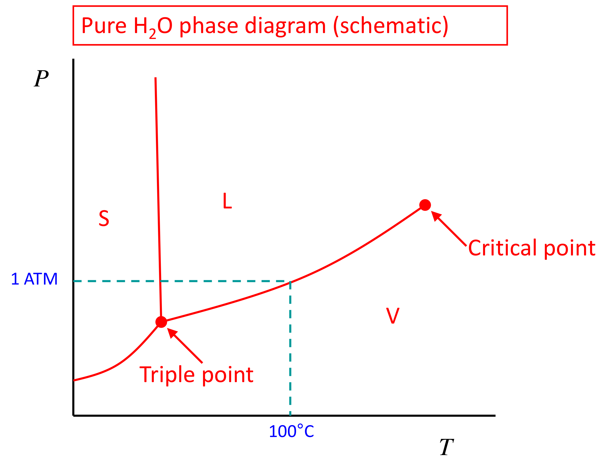

[Subject index](../README.md) · [Topic overview](README.md) · [Complete section](<Complete section.md>) · [Next](<ET-22 - Osmotic equilibrium.md>)

<!-- note-content:start -->
# Section 21: The Gibbs phase rule

*Notation:* $C$ is the number of components, $P$ the number of phases, $F$ the number of degrees of freedom (independent intensive variables). Here $P$ is a count, not a pressure.

## Intuition

Intensive variables (temperature, pressure, compositions) describe the *state* of each phase, not how much of it there is. They come in pairs with the extensive quantity that flows when they differ:
- temperature with entropy (heat flows);
- pressure with volume (boundaries move);
- chemical potential with amount (matter moves).

Equilibrium means nothing flows. Each pair of phases must therefore agree on each driving force, and every such agreement removes one freedom.

## Derivation

**Step 1: variables.** A single phase with $C$ components needs $T$, $P$ and $C - 1$ independent mole fractions (they sum to 1): $C + 1$ intensive variables. For $P$ separate phases with no connection between them:

$$\text{variables} = P\,(C - 1 + 2) \tag{110}$$

**Step 2: constraints from equilibrium.** Between $P$ phases there are $P - 1$ independent equalities for each equilibrium condition:
- thermal: $T^{\mathrm{I}} = T^{\mathrm{II}} = \dots$, giving $P - 1$ equations;
- mechanical: $P^{\mathrm{I}} = P^{\mathrm{II}} = \dots$, giving $P - 1$ equations (true for flat interfaces);
- chemical: $\mu_i^{\mathrm{I}} = \mu_i^{\mathrm{II}} = \dots$ for each of the $C$ components, giving $C(P - 1)$ equations.

Choose one phase as a reference and equate each of the others to it. That gives $P-1$ independent equalities for a given intensive quantity. Equating every possible pair would count some conditions twice: once two phases both match the reference, they already match each other. This is the reason for the factor $P-1$, rather than the number of phase pairs.

Changing a phase amount does not necessarily change any intensive state variable. Water can evaporate into steam at a fixed coexistence temperature and pressure while their amounts change. The phase rule counts which coexistence states are possible; conservation balances and any specified total volume or enthalpy determine how much of each phase occupies that state.

$$\text{constraints} = (P - 1)(2 + C) \tag{111}$$

**Step 3: degrees of freedom.** Subtract (111) from (110):

$$F = P(C + 1) - (P - 1)(C + 2) = C - P + 2 \tag{112}$$

This counts intensive variables only. How much of each phase is present is extra, extensive information (fixed later by mass balances, e.g. the lever rule).

**Step 4: when the count changes.** Each constraint in Step 2 assumes something physical:
- equal pressures need a flat, free interface;
- equal $\mu_i$ needs component $i$ to be able to cross every interface and be present in every phase;
- a chemical reaction adds a constraint (an equilibrium constant) and reduces $F$.

Whenever one of these fails, the count must be redone from Steps 1–2 rather than by applying (112) blindly.

## Motivation and explanation

**What $F$ means physically.**
- $F = 2$: an area on a phase diagram. A single-phase pure fluid can have any $T$ and $P$.
- $F = 1$: a line. Liquid and vapour of a pure substance coexist only along the vapour-pressure curve; choose $T$ and $P$ is fixed.
- $F = 0$: a point. The triple point is fixed by nature, which is why it is used to define temperature scales.

**For mixtures.** A binary in vapour–liquid equilibrium has $F = 2 - 2 + 2 = 2$. Fix $T$ and the liquid composition, and the pressure and vapour composition follow. That is exactly what was done for oxygen–argon (Section 13): $T = 83.8$ K and $x_1 = 0.3$ gave $P$ and $y_1$.

**A common slip.** Air dissolved in or above water adds components, so "water boiling at 100 °C under 1 atm of air" is not a one-component system. With an insoluble inert gas present, the liquid–vapour equilibrium of water is no longer tied to its pure vapour-pressure curve (Section 06).

## Worked example

**Problem.** Find $F$ and say what must be specified for:
(a) pure liquid water + steam, no air;
(b) water + steam + ice;
(c) a binary liquid in equilibrium with its vapour;
(d) a binary with two liquid phases and a vapour;
(e) a ternary liquid–vapour mixture.

| System | $C$ | $P$ | $F = C - P + 2$ | Specify |
|---|---|---|---|---|
| (a) water + steam | 1 | 2 | 1 | $T$ (or $P$): e.g. 100 °C fixes 1.013 bar |
| (b) water + steam + ice | 1 | 3 | 0 | nothing: 273.16 K, 611.65 Pa |
| (c) binary L + V | 2 | 2 | 2 | e.g. $T$ and $x_1$ |
| (d) binary L + L + V | 2 | 3 | 1 | e.g. $P$; then $T$ and all three compositions are fixed |
| (e) ternary L + V | 3 | 2 | 3 | e.g. $T$, $x_1$, $x_2$ |

**Interpretation.**
- Case (b) explains why the triple point of water (273.16 K, 611.65 Pa) is a reproducible reference.
- Case (d) explains why a heterogeneous (two-liquid) azeotrope boils at a single temperature at fixed pressure, whatever the overall feed composition. The feed composition only changes the amounts of the phases. This is the basis of steam distillation later in the course.
- The critical point is not a third phase. It is where the liquid and vapour become identical, adding the extra conditions that end the coexistence line.

## Link to other topics

The phase rule fixes the number of specifications in every flash, bubble-point and dew-point calculation in process simulators. Sections 22–24 apply the same counting to cases where one equilibrium condition does not hold: a membrane that blocks one component, or a curved interface with unequal pressures.

## Summary

Counting intensive variables, $P(C + 1)$, minus equilibrium constraints, $(P - 1)(C + 2)$, gives $F = C - P + 2$: areas, lines and points on phase diagrams. The rule is only as good as its assumptions: equal pressures, and every component able to reach every phase.
<!-- note-content:end -->

[Subject index](../README.md) · [Topic overview](README.md) · [Complete section](<Complete section.md>) · [Next](<ET-22 - Osmotic equilibrium.md>)
