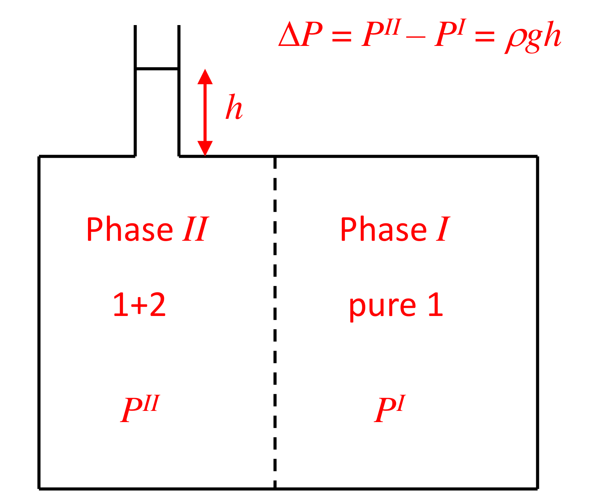

[Previous](<ET-21 - The Gibbs phase rule.md>) · [Subject index](../README.md) · [Topic overview](README.md) · [Complete section](<Complete section.md>) · [Next](<ET-23 - Droplets and the Kelvin equation.md>)

<!-- note-content:start -->
# Section 22: Osmotic equilibrium

*Notation:* component 1 is the solvent (passes the membrane); component 2 is the solute (blocked). Phase I is pure solvent at pressure $P^{\mathrm{I}}$; phase II is the solution at $P^{\mathrm{II}}$. The osmotic pressure is $\Delta P = P^{\mathrm{II}} - P^{\mathrm{I}}$.

## Intuition

Dissolving solute lowers the solvent's chemical potential (the $RT\ln x_1$ term). Solvent therefore flows from the pure side into the solution, down its chemical-potential gradient. Raising the pressure on the solution side pushes the solvent's chemical potential back up, by $\underline{V}_1\,\Delta P$. Flow stops when the two effects cancel.

In the classic set-up, the extra pressure is provided by a column of liquid that rises in a tube above the solution (the osmometer in the figure). In plants, the same pressure keeps cells turgid.

*Analogy:* the solute side "pulls" solvent like a sponge, and the pressure is the force needed to wring it back out. The analogy breaks down because nothing pulls mechanically. The solvent moves because random molecular motion carries more solvent across from the side where its chemical potential is higher. The membrane matters only because it stops the solute from equalising too.

## Derivation

**Step 1: why the phase-rule count changes.** If both sides can contain independently specified amounts of the two components, there are six phase variables: two temperatures, two pressures and two compositions. Thermal equilibrium and equality of solvent chemical potential impose two constraints, giving $F=4$. In the setup here, phase I is stipulated to be pure solvent, so its composition is already fixed and $F=3$: specify $T$, $P^{\mathrm{I}}$ and the solution composition. The osmotic pressure then follows. The membrane supports unequal pressures and blocks transfer of solute.

**Step 2: the remaining condition.** Only the solvent equilibrates:

$$\mu_1^{\mathrm{I}} = \mu_1^{\mathrm{II}} \tag{113}$$

**Step 3: each side.** The pure side is pure 1 at $P^{\mathrm{I}}$; the solution side is pure 1 at $P^{\mathrm{II}}$ plus the mixing terms:

$$\mu_1^{\mathrm{I}} = \underline{G}_1(T,P^{\mathrm{I}}), \qquad \mu_1^{\mathrm{II}} = \underline{G}_1(T,P^{\mathrm{II}}) + RT\ln(\gamma_1x_1)$$

**Step 4: relate the two pure-solvent terms.** Integrate $d\underline{G}_1 = \underline{V}_1\,dP$ with the liquid incompressible:

$$\underline{G}_1(T,P^{\mathrm{II}}) = \underline{G}_1(T,P^{\mathrm{I}}) + \underline{V}_1(P^{\mathrm{II}} - P^{\mathrm{I}})$$

**Step 5: combine with (113).**

The pure-solvent reference is written at each side's actual pressure so that the pressure difference appears explicitly before the common reference is cancelled. The two remaining terms oppose one another: mixing lowers the solvent's chemical potential in the solution, and additional pressure raises it. Dividing their balance by the solvent molar volume converts an energy deficit per mole into the pressure required to cancel it.

At this pressure difference the net solvent flux is zero. Raising solution-side pressure further reverses the chemical-potential difference and drives solvent towards the pure side. During real reverse osmosis, removal of solvent concentrates the retained solute, so the opposing osmotic pressure rises. The quoted seawater threshold is therefore an initial equilibrium requirement rather than a single pressure that guarantees the same driving force throughout concentration.

$$\boxed{-RT\ln(\gamma_1x_1) = \underline{V}_1\,\Delta P} \tag{114}$$

Since $\gamma_1x_1 < 1$ for a normal solution, $\Delta P > 0$: the solution side is at the higher pressure.

**Step 6: dilute ideal limit.** With $\gamma_1\to 1$ and $-\ln x_1 = -\ln(1 - x_2)\approx x_2$:

$$\Delta P \approx \frac{RT\,x_2}{\underline{V}_1} \approx c_2RT \tag{115}$$

since $x_2/\underline{V}_1$ is approximately the solute concentration $c_2$ (mol m⁻³). This is van 't Hoff's law. It is *formally* the ideal-gas law: the dilute solute behaves like a gas of particles in the solvent's volume.

**Step 7: link to freezing point.** Section 15 gives $\ln(\gamma_1x_1)\approx -\Delta\underline{H}^{\mathrm{fus}}\Delta T_f/(RT_f^2)$. Substituting into (114):

$$\Delta P \approx \frac{\Delta\underline{H}^{\mathrm{fus}}\,\Delta T_f}{T_f^2}\cdot\frac{T}{\underline{V}_1} \tag{116}$$

In the dilute colligative limit, or when the temperature dependence of solvent activity is negligible, a freezing-point measurement therefore estimates osmotic pressure at temperature $T$. More generally, the solvent activity must be evaluated at the osmotic experiment’s temperature and pressure.

## Motivation and explanation

**Connecting solvent activity to reverse osmosis.** An idealised seawater particle count of 0.6 mol NaCl per kilogram of water, fully dissociated, gives 1.2 mol of solute particles and an ideal osmotic pressure near 29 bar at 298.15 K. A more informative route is measured freezing-point depression: it determines the solvent activity without assuming an ideal particle count. Using a depression of approximately 2 K in the constant-fusion-enthalpy relation gives an osmotic pressure near 27 bar at 298.15 K.
This is the pressure difference needed to balance the chemical-potential effect of dissolved solute. Reverse osmosis needs a larger applied difference to drive a finite solvent flux, and the required pressure rises as the retained brine concentrates. The difference between the ideal particle estimate and an activity-based estimate represents solution non-ideality; it need not mean incomplete dissociation.

**Colligative.** Equation (115) depends only on the number of solute particles. An ionising solute (NaCl gives Na⁺ + Cl⁻) roughly doubles it. The solute's identity enters only through $\gamma_1$. So measuring $\Delta P$ against $x_1$ gives $\gamma_1(x_1)$ directly, which is very useful for polymers and proteins, whose vapour-pressure effects are tiny. It is also how polymer molar masses are measured.

**Size of the effect.** $RT/\underline{V}_1$ for water at 25 °C is about 1370 bar, so even $x_2 = 0.01$ gives about 14 bar. Osmotic pressures are large compared with other colligative effects, which is why they matter for cells, membranes and desalination.

**Assumptions.** A perfect membrane (no solute leakage); an incompressible liquid; equal temperature on both sides. Real membranes leak slightly. The effective pressure difference is then reduced by a "reflection coefficient", a transport rather than an equilibrium concept.

## Link to other topics

Reverse osmosis and other membrane separations are designed around (114), with the osmotic pressure of the concentrated retentate setting the minimum work of separation. In biotechnology, osmotic balance governs cell lysis by osmotic shock and the design of buffers.

## Summary

When a membrane blocks the solute, only the solvent's chemical potential equalises. That frees the pressure and gives $-RT\ln(\gamma_1x_1) = \underline{V}_1\Delta P$, which reduces to van 't Hoff's $\Delta P = c_2RT$ for dilute solutions. For sea water it is about 27 bar, consistent with its freezing point.
<!-- note-content:end -->

[Previous](<ET-21 - The Gibbs phase rule.md>) · [Subject index](../README.md) · [Topic overview](README.md) · [Complete section](<Complete section.md>) · [Next](<ET-23 - Droplets and the Kelvin equation.md>)
