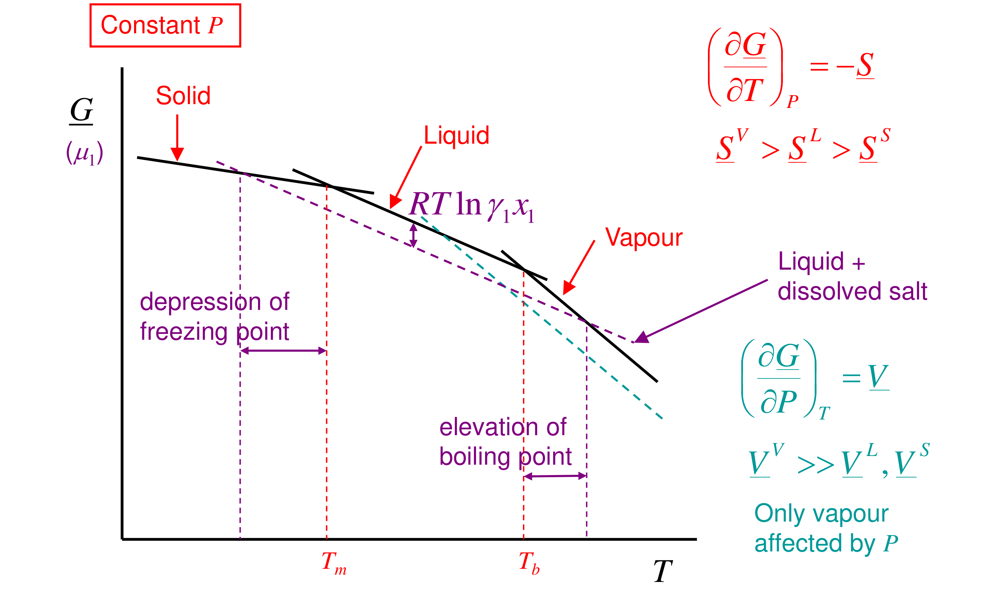

[Previous](<ET-23 - Droplets and the Kelvin equation.md>) · [Subject index](../README.md) · [Topic overview](README.md) · [Complete section](<Complete section.md>)

<!-- note-content:start -->
# Section 24: Bubbles, superheating and boiling

## Intuition

Boiling means forming vapour *inside* the liquid. A newborn bubble is tiny, so surface tension squeezes it hard. It needs internal vapour pressure equal to the atmosphere plus $2\sigma/r$, and at the normal boiling point the liquid only supplies 1 atm. So a small bubble collapses unless the liquid is hotter.

In a clean, smooth pot, the liquid can sit above 100 °C with nothing happening until a bubble finally nucleates, then it boils violently ("bumping"). Scratches, dissolved gas, boiling chips or a handful of salt provide ready-made nuclei, and boiling starts close to the true boiling point.

*Physically:* the boiling point is where the vapour pressure equals the external pressure. That is a thermodynamic condition. Whether bubbles actually appear is a kinetic question about nucleation.

## Derivation

**Step 1: degrees of freedom.** As for droplets, the curved interface frees the pressure: $F = 2$, e.g. external pressure and bubble radius.

**Step 2: mechanical equilibrium.** The liquid is at atmospheric pressure (shallow pool), and the vapour inside is higher by the Laplace pressure:

$$P^{V} = P^{L} + \frac{2\sigma}{r} = P^{\mathrm{ATM}} + \frac{2\sigma}{r} \tag{120}$$

**Step 3: chemical equilibrium.** Ideal-gas vapour: $\mu^{V} = \underline{G}^{\mathrm{SAT}}(T) + RT\ln(P^{V}/P^{\mathrm{SAT}})$. The liquid is only at about 1 atm, so its Poynting term is negligible: $\mu^{L}\approx\underline{G}^{\mathrm{SAT}}(T)$. (This is the difference from droplets, where the liquid was the compressed phase.) Equating gives $P^{V} = P^{\mathrm{SAT}}(T)$, so

$$P^{\mathrm{SAT}}(T) = P^{\mathrm{ATM}} + \frac{2\sigma}{r} \tag{121}$$

The liquid must be hot enough that its *flat-surface* vapour pressure equals the pressure inside the bubble.

For a droplet, the compressed phase is liquid and the surrounding vapour changes only slightly. For a bubble, the compressed phase is vapour itself: the gas must supply the entire Laplace pressure. Raising temperature increases its saturation pressure until this mechanical requirement and chemical equilibrium can both hold. As the bubble grows, the required pressure excess falls, making further growth easier.

The salt calculation addresses a separate cause of a higher boiling temperature. Solute changes the bulk liquid's chemical potential even for a flat interface; small-radius superheat arises because forming the curved interface requires extra pressure. A nucleation site can reduce the latter while leaving the solvent-activity effect intact, which explains why the appearance of bubbles on adding salt is not a measure of the equilibrium boiling-point elevation.

**Step 4: the required temperature.** At the normal boiling point $T_b$, $P^{\mathrm{SAT}}(T_b) = P^{\mathrm{ATM}}$. Integrating Clausius–Clapeyron with constant $\Delta\underline{H}^{\mathrm{vap}}$:

$$\ln\frac{P^{\mathrm{SAT}}(T)}{P^{\mathrm{ATM}}} = \frac{\Delta\underline{H}^{\mathrm{vap}}}{R}\left(\frac{1}{T_b} - \frac{1}{T}\right) \tag{122}$$

Combining (121) and (122) gives the temperature at which a bubble of radius $r$ is just in equilibrium. Smaller bubbles need more superheat.

**Step 5: boiling-point elevation by an involatile solute.** Now take a flat surface and a liquid containing an involatile solute (salt or sugar), with the vapour pure solvent. Equilibrium for the solvent at pressure $P$:

$$\underline{G}_1^{L}(T,P) + RT\ln(\gamma_1x_1) = \underline{G}_1^{V}(T,P)$$

so $RT\ln(\gamma_1x_1) = \Delta\underline{G}^{\mathrm{vap}}(T)$. As in Section 15, $\Delta\underline{G}^{\mathrm{vap}}(T)\approx\Delta\underline{H}^{\mathrm{vap}}(T_b - T)/T_b$, giving

$$\ln(\gamma_1x_1) = \frac{\Delta\underline{H}^{\mathrm{vap}}}{R}\left(\frac{1}{T} - \frac{1}{T_b}\right) \;\;\Rightarrow\;\; \Delta T_b \approx \frac{RT_b^2M_1}{\Delta\underline{H}^{\mathrm{vap}}}\,m = K_b\,m \tag{123}$$

in the dilute ideal limit ($-\ln x_1\approx x_2\approx M_1m$, with $m$ the solute molality). Since $\gamma_1x_1 < 1$, $T > T_b$: the boiling point rises.

## Motivation and explanation

**Graphical view.** Plot $\mu_1$ (molar $\underline{G}$) against $T$ at constant $P$. Each phase gives a line of slope $-\underline{S}$: steepest for vapour, shallowest for solid. Melting and boiling points are where the lines cross. A solute lowers *only the liquid line*, by $RT\ln(\gamma_1x_1)$, because the solid and vapour are pure. The liquid's crossing with the solid moves to lower $T$ (freezing-point depression), and its crossing with the vapour moves to higher $T$ (boiling-point elevation). The vapour line is steeper than the solid line, so the same downward shift moves the boiling point less than the freezing point: $K_b < K_f$.

**Pressure dependence.** $(\partial\underline{G}/\partial P)_T = \underline{V}$ and $\underline{V}^{V}\gg\underline{V}^{L},\underline{V}^{S}$. So changing the pressure mainly moves the vapour line. That is why boiling points depend strongly on pressure (altitude, pressure cookers) while melting points barely do.

**Limits.**
- Equation (121) treats the bubble as pure vapour. Dissolved gases add to the pressure inside it and reduce the superheat needed, which is one reason degassed water superheats more easily.
- At very small $r$ (nanometres), bulk $\sigma$ fails.
- Constant $\Delta\underline{H}^{\mathrm{vap}}$ in (122) is approximate for large superheats.

## Worked example

**Problem.** (a) For water at 1 atm, find the temperature at which a vapour bubble of radius 10 µm, 1 µm or 0.1 µm is in equilibrium. Data: $\sigma(100\,°\mathrm{C}) = 58.9$ mN m⁻¹, $\Delta\underline{H}^{\mathrm{vap}} = 40.65$ kJ mol⁻¹, $T_b = 373.12$ K. (b) Find water's ebullioscopic constant, and the boiling-point rise from 10 g of NaCl per kg of water (pasta water).

**(a)** From (121), then (122), holding $\sigma$ at its 100 °C value for this illustrative estimate; IAPWS steam tables convert the same required pressures to temperatures for comparison. Actual surface tension falls as temperature rises, so a self-consistent prediction at large superheat must also update $\sigma(T)$:

| $r$ | $P^{\mathrm{SAT}}$ required (bar) | $T$ from (122) | $T$ from steam tables |
|---|---|---|---|
| 10 µm | 1.131 | 103.1 °C | 103.1 °C |
| 1 µm | 2.19 | 123.3 °C | 123.1 °C |
| 0.1 µm | 12.8 | 189.5 °C | 190.9 °C |

**(b)** $K_b = RT_b^2M_1/\Delta\underline{H}^{\mathrm{vap}} = 8.314\times373.12^2\times0.018015/40650 = 0.513$ K kg mol⁻¹ (tabulated: 0.512). 10 g of NaCl is 0.171 mol, about 0.342 mol of ions per kg, so $\Delta T_b\approx 0.18$ K.

**Interpretation.**
- *Superheat:* a liquid with only micrometre-scale nuclei must be superheated by about 20 K before bubbles can grow. That is why smooth glassware bumps, and why boiling surfaces in evaporators and reboilers are engineered with nucleation sites.
- *Salt:* the boiling-point rise is under 0.2 K, irrelevant for cooking. The sudden fizz when salt is thrown into nearly boiling water is not thermodynamic. The crystals provide nucleation sites that release the superheat already stored in the liquid.

## Link to other topics

Nucleate boiling and its superheat govern heat-transfer coefficients in reboilers and evaporators. Boiling-point elevation sets the extra driving force needed in multiple-effect evaporators concentrating salt or sugar solutions. Cavitation in pumps is the same bubble equilibrium, reached by lowering the pressure rather than raising the temperature.

## Summary

A bubble needs its vapour pressure to exceed the surrounding pressure by $2\sigma/r$. Small nuclei therefore need substantial superheat, about 20 K for a 1 µm bubble in water, and clean liquids can be superheated until nucleation intervenes. Separately, an involatile solute lowers the liquid's chemical potential and raises the boiling point by $K_bm$, with $K_b = 0.513$ K kg mol⁻¹ for water. With equilibria at curved interfaces and membranes done, the course turns to the main event: vapour–liquid equilibrium of real binary mixtures.

## Conclusion

Each effect in this part follows from equal chemical potentials once the right mechanical condition is used: a membrane or a curved interface lets the pressures differ, and the compressed phase gains $\underline{V}\,\Delta P$ of chemical potential. Osmotic pressure, freezing-point depression and boiling-point elevation are all colligative measures of solvent activity. The next part turns to the central topic: vapour–liquid equilibrium of real binary mixtures.
<!-- note-content:end -->

[Previous](<ET-23 - Droplets and the Kelvin equation.md>) · [Subject index](../README.md) · [Topic overview](README.md) · [Complete section](<Complete section.md>)
