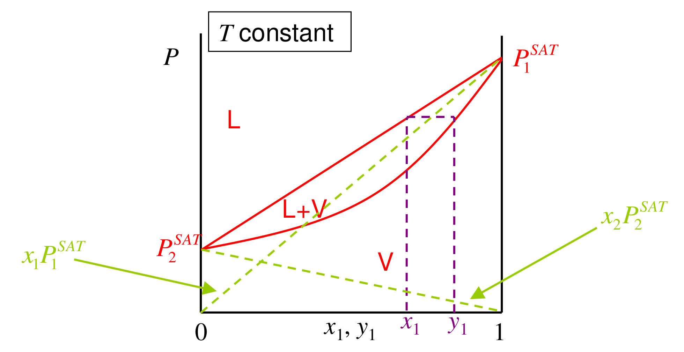

[Previous](<ET-25 - Binary vapour–liquid equilibrium and its phase diagrams.md>) · [Subject index](../README.md) · [Topic overview](README.md) · [Complete section](<Complete section.md>) · [Next](<ET-27 - Deviations from Raoult's law and azeotropes.md>)

<!-- note-content:start -->
# Section 26: The γ–φ formulation and Raoult's law

## Intuition

Each side of the equality is an "escaping tendency".
- *Liquid side:* the pure liquid's escaping tendency (its vapour pressure, slightly corrected), scaled by how much of it there is ($x_i$) and how unhappy it is in the mixture ($\gamma_i$).
- *Vapour side:* the partial pressure, corrected for non-ideal gas behaviour.

At low pressure the gas corrections are tiny and the liquid term is all that matters. That is why one non-ideality, $\gamma_i$, dominates ordinary distillation.

## Derivation

**Step 1: vapour side.** Assume the vapour is an ideal *mixture* (Lewis–Randall) but not necessarily an ideal *gas*:

$$\bar f_i^{\,v} = y_if_i^{\,v}(T,P) = y_i\phi_i^{v}P \tag{127}$$

where $\phi_i^{v}$ is the fugacity coefficient of pure $i$ vapour at $T$, $P$. A full mixture equation of state could replace this, at the cost of much more algebra.

**Step 2: liquid side.** By the definition of $\gamma_i$, $\bar f_i^{\,l} = \gamma_ix_if_i^{\,l}(T,P)$, with $f_i^{\,l}$ the pure liquid at the mixture's $T$ and $P$.

**Step 3: pure-liquid fugacity.** Start from saturation, where liquid and vapour fugacities are equal ($f_i^{\mathrm{SAT}} = \phi_i^{\mathrm{SAT}}P_i^{\mathrm{SAT}}$). Then compress the incompressible liquid to $P$ (the Poynting factor):

$$f_i^{\,l}(T,P) = \phi_i^{\mathrm{SAT}}P_i^{\mathrm{SAT}}\exp\!\left[\frac{\underline{V}_i^{l}(P - P_i^{\mathrm{SAT}})}{RT}\right] \tag{128}$$

**Step 4: equate.**

$$\gamma_ix_i\,\phi_i^{\mathrm{SAT}}P_i^{\mathrm{SAT}}\exp\!\left[\frac{\underline{V}_i^{l}(P - P_i^{\mathrm{SAT}})}{RT}\right] = y_i\phi_i^{v}P \tag{129}$$

**Step 5: low pressure.** Set $\phi_i^{\mathrm{SAT}}\approx\phi_i^{v}\approx 1$ and drop the Poynting factor. This gives **modified Raoult's law**:

$$\gamma_ix_iP_i^{\mathrm{SAT}} = y_iP \tag{130}$$

**Step 6: ideal liquid mixture.** Setting $\gamma_i = 1$ gives **Raoult's law**. Summing over components, with $\sum y_i = 1$, gives the bubble pressure:

$$x_iP_i^{\mathrm{SAT}} = y_iP, \qquad P = \sum_i x_iP_i^{\mathrm{SAT}} \tag{131}$$

On a $P$–$x$–$y$ diagram at constant $T$, the bubble line is then straight: the sum of the two straight partial-pressure lines $x_1P_1^{\mathrm{SAT}}$ and $x_2P_2^{\mathrm{SAT}}$. The dew line, $1/P = \sum y_i/P_i^{\mathrm{SAT}}$, is curved.

A bubble calculation starts with liquid composition and sums the predicted vapour fractions to unity. A dew calculation starts with vapour composition, writes $x_i=y_iP/P_i^{\mathrm{SAT}}$, and instead sums the liquid fractions to unity. This change of which phase is known produces the reciprocal-pressure dew equation; it is not an independent equilibrium law.

The use of pure-vapour $\phi_i^{v}$ in (127) is also a modelling step. A full vapour-mixture coefficient depends on the composition of that vapour because unlike gas molecules interact. At sufficiently low density those interactions disappear and both versions approach unity. Low pressure simplifies the vapour description without requiring ideal mixing in the dense liquid.

## Motivation and explanation

**Hierarchy of approximations.**

| Equation | Neglects | Valid when |
|---|---|---|
| (129) | vapour-mixture non-ideality (Lewis–Randall) | up to moderate pressure, chemically similar vapours |
| (130) | gas non-ideality and the Poynting factor | $P$ ≲ a few bar |
| (131) | liquid non-ideality | chemically similar liquids (isomers, homologues) |

**Why $\phi^{\mathrm{SAT}}$ and $\phi^{v}$ partly cancel.** At the same $T$ and similar pressures, the two vapour-phase fugacity coefficients in (129) are similar. Their ratio is closer to 1 than either is alone. So (130) is often better than the individual corrections suggest.

**Deviations from Raoult.**
- $\gamma_i > 1$: total pressure above the straight Raoult line (positive deviation).
- $\gamma_i < 1$: below it (negative deviation).

These are the curved bubble lines of real mixtures (next section).

## Link to other topics

Equation (130) is the default VLE model in distillation design, combined with any of the activity-coefficient models in Sections 17–20. At high pressure or near critical points, the γ–φ approach is replaced by a single equation of state for both phases, discussed later.

## Summary

Equating fugacities gives the γ–φ equation (129). At low pressure it reduces to modified Raoult's law, $\gamma_ix_iP_i^{\mathrm{SAT}} = y_iP$, and for ideal liquids to Raoult's law with a straight bubble line. Gas-phase and Poynting corrections are usually small, and the activity coefficient carries the important non-ideality.
<!-- note-content:end -->

[Previous](<ET-25 - Binary vapour–liquid equilibrium and its phase diagrams.md>) · [Subject index](../README.md) · [Topic overview](README.md) · [Complete section](<Complete section.md>) · [Next](<ET-27 - Deviations from Raoult's law and azeotropes.md>)
