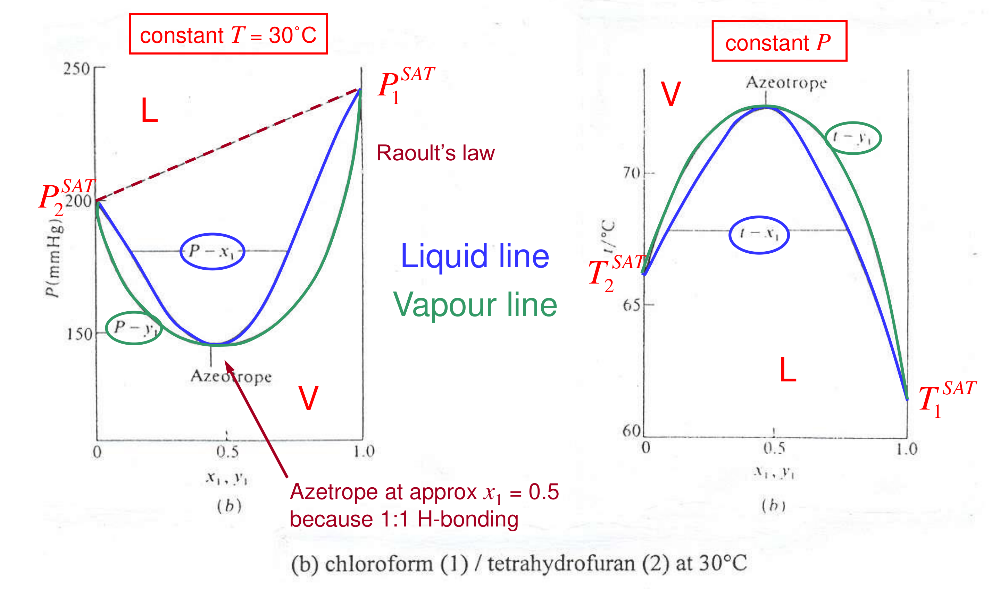

[Previous](<ET-26 - The γ–φ formulation and Raoult's law.md>) · [Subject index](../README.md) · [Topic overview](README.md) · [Complete section](<Complete section.md>) · [Next](<ET-28 - van Laar parameters from an azeotrope.md>)

<!-- note-content:start -->
# Section 27: Deviations from Raoult's law and azeotropes

## Intuition

With positive deviation, each component "wants out" of the liquid more than Raoult predicts, so the mixture's vapour pressure exceeds the straight line. If the two pure vapour pressures are close, this bulge can rise above *both* end points. Then the curve must have a maximum somewhere in between.

At that maximum, adding a little of either component lowers the pressure. The vapour therefore cannot be richer in either component than the liquid: it has the same composition. Distilling such a mixture drives the products towards the azeotrope, not towards the pure components.

*Molecular picture.*
- A *maximum-pressure* (minimum-boiling) azeotrope comes from unlike molecules disrupting each other's attractions, e.g. toluene breaking up ethanol's hydrogen-bond network.
- A *minimum-pressure* (maximum-boiling) azeotrope comes from unlike molecules attracting strongly, e.g. the hydrogen bond between chloroform's C–H and tetrahydrofuran's oxygen.

## Derivation

**Step 1: pressure–composition slope.** For a binary at constant $T$, (130) of Section 26 summed over components gives $P = x_1\gamma_1P_1^{\mathrm{SAT}} + x_2\gamma_2P_2^{\mathrm{SAT}}$. Differentiate with respect to $x_1$, using $dx_2 = -dx_1$:

$$\frac{dP}{dx_1} = \gamma_1P_1^{\mathrm{SAT}}\left(1 + x_1\frac{d\ln\gamma_1}{dx_1}\right) + \gamma_2P_2^{\mathrm{SAT}}\left(-1 + x_2\frac{d\ln\gamma_2}{dx_1}\right)$$

**Step 2: Gibbs–Duhem.** Substitute $x_2\,d\ln\gamma_2/dx_1 = -x_1\,d\ln\gamma_1/dx_1$:

$$\frac{dP}{dx_1} = \left(\gamma_1P_1^{\mathrm{SAT}} - \gamma_2P_2^{\mathrm{SAT}}\right)\left(1 + x_1\frac{d\ln\gamma_1}{dx_1}\right) \tag{132}$$

**Step 3: turning points.** $dP/dx_1 = 0$ requires one of two conditions.
- (a) $\gamma_1P_1^{\mathrm{SAT}} = \gamma_2P_2^{\mathrm{SAT}}$: an **azeotrope**.
- (b) $1 + x_1\,d\ln\gamma_1/dx_1 = 0$, i.e. $d\ln(\gamma_1x_1)/dx_1 = 0$. The activity of component 1 stops increasing with its own mole fraction. This marks the spinodal, the limit of local liquid stability. Equilibrium splitting begins at the binodal; between binodal and spinodal the homogeneous liquid is metastable (later sections).

The second factor in (132) is the thermodynamic factor: it measures whether increasing a component's concentration raises its chemical potential. For a locally stable homogeneous liquid it is positive. A pressure maximum or minimum on that stable branch must therefore come from equality of the two corrected volatilities, the first factor. Setting the second factor to zero instead reaches the limit of local stability and cannot by itself identify an ordinary homogeneous azeotrope.

At an azeotrope the liquid and vapour are still distinct phases, but transferring an equilibrium increment into the vapour does not change its composition relative to the liquid. The enrichment that drives ordinary distillation vanishes. The close-boiling example needs only a modest correction to make the two corrected volatilities equal because their uncorrected saturation pressures were already close.

**Step 4: $x = y$ at an azeotrope.** From modified Raoult's law, $y_1P = x_1\gamma_1P_1^{\mathrm{SAT}}$ and $P = x_1\gamma_1P_1^{\mathrm{SAT}} + x_2\gamma_2P_2^{\mathrm{SAT}}$. With condition (a), $P = \gamma_1P_1^{\mathrm{SAT}}(x_1 + x_2) = \gamma_1P_1^{\mathrm{SAT}}$, so

$$y_1 = x_1 \tag{133}$$

**Step 5: phase-rule consequence.** Equation (133) is an extra constraint. An azeotropic binary therefore has only $F = 2 - 2 + 2 - 1 = 1$ degree of freedom: at a given pressure the azeotrope has one temperature and one composition, like a pure substance.

**Step 6: will an azeotrope form? (one-constant Margules).** With $RT\ln\gamma_1 = Ax_2^2$ and $RT\ln\gamma_2 = Ax_1^2$, condition (a) becomes $A(x_2^2 - x_1^2) = RT\ln(P_2^{\mathrm{SAT}}/P_1^{\mathrm{SAT}})$. Since $x_2^2 - x_1^2 = 1 - 2x_1$:

$$x_1^{\mathrm{az}} = \frac12\left[1 - \frac{RT}{A}\ln\frac{P_2^{\mathrm{SAT}}}{P_1^{\mathrm{SAT}}}\right] \tag{134}$$

A candidate homogeneous azeotrope exists if $0 < x_1^{\mathrm{az}} < 1$, i.e. if $|A|/RT > |\ln(P_1^{\mathrm{SAT}}/P_2^{\mathrm{SAT}})|$; the liquid at that composition must also be stable against liquid–liquid splitting. Strong non-ideality, or *close* vapour pressures, makes azeotropes likely.

## Motivation and explanation

**Why close-boiling pairs are sensitive to modest non-ideality.** The azeotrope condition compares the activity-coefficient ratio with the pure-component vapour-pressure ratio. When the latter is already near unity, a small activity correction may be enough to make both effective volatilities equal. Regular-solution estimates for benzene–cyclohexane consequently predict a minimum-boiling azeotrope even though the departure is modest. A prediction of the existence of an azeotrope is less demanding than an accurate prediction of its temperature and composition. Disagreement in its depth tests the random-mixing model and its parameterisation; assigning a detailed molecular cause requires further evidence. Close boiling increases susceptibility to azeotropy, but does not guarantee it.

**The four behaviours, at 30–65 °C.**
1. **Mild negative deviation** (tetrahydrofuran–CCl₄): the curves sag slightly below Raoult's line and lie close together. Distillation is possible but difficult.
2. **Strong negative deviation** (chloroform–THF): a minimum-pressure, maximum-boiling azeotrope near $x_1 = 0.5$, matching the 1:1 hydrogen bond.
3. **Mild positive deviation** (furan–CCl₄): the curves lie above Raoult's line and wide apart. Distillation is easy.
4. **Strong positive deviation** (ethanol–toluene): a maximum-pressure, minimum-boiling azeotrope.

**Distillation and azeotropes.** On a $T$–$x$–$y$ diagram, a minimum-boiling azeotrope is a low point. Feeds on either side distil towards it overhead; only one pure component can be recovered as bottoms from each side. Past the azeotrope the vapour is *richer* in the less volatile component.

**Breaking an azeotrope** needs an extra degree of freedom:
- *Change the pressure* (pressure-swing distillation): the azeotropic composition shifts with $P$.
- *Add a component:* an entrainer forming a ternary heterogeneous azeotrope (e.g. benzene or cyclohexane for ethanol–water), or a heavy solvent that changes the $\gamma$'s (extractive distillation).

## Link to other topics

Azeotropes set the feasible products of distillation columns and are central to separation-sequence design (residue curve maps, entrainer selection). The second factor in (132) reappears in the liquid–liquid equilibrium sections as the stability condition.

## Summary

Positive and negative deviations from Raoult's law bend the bubble curve. If the bend exceeds the difference in pure-component volatilities, $\gamma_1P_1^{\mathrm{SAT}} = \gamma_2P_2^{\mathrm{SAT}}$ somewhere: an azeotrope, with $x = y$ and one fewer degree of freedom, which ordinary distillation cannot cross.
<!-- note-content:end -->

[Previous](<ET-26 - The γ–φ formulation and Raoult's law.md>) · [Subject index](../README.md) · [Topic overview](README.md) · [Complete section](<Complete section.md>) · [Next](<ET-28 - van Laar parameters from an azeotrope.md>)
