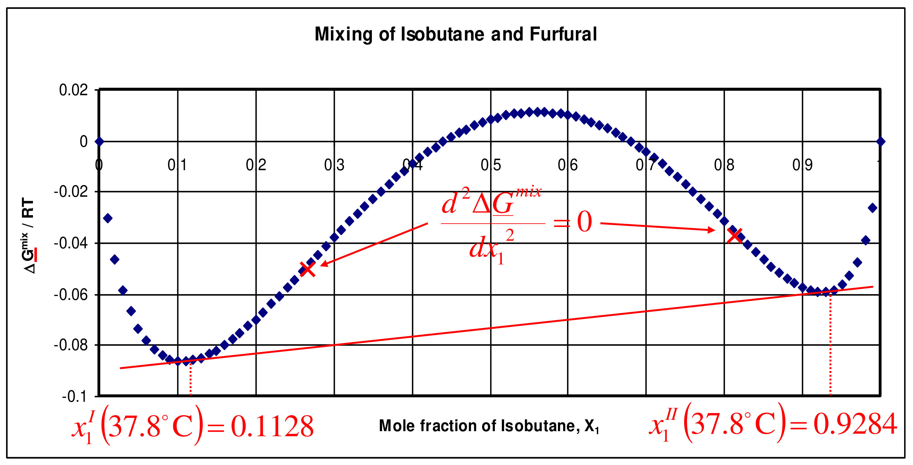

[Subject index](../README.md) · [Topic overview](README.md) · [Complete section](<Complete section.md>)

<!-- note-content:start -->
# Liquid–liquid equilibrium and diffusion

## Overview

Liquids split into two phases when the molar Gibbs energy curve bulges above a chord; the coexisting compositions are found by a common tangent (Section 36). Miscibility gaps open and close with temperature, giving upper and lower consolute points, with an analogy to the vapour–liquid critical point (Section 37). A full numerical example for isobutane–furfural locates the coexisting liquids and the spinodal (Section 38). Between binodal and spinodal a single liquid is metastable; inside the spinodal it decomposes spontaneously (Section 39). The same curvature controls diffusion: the Fickian coefficient contains a thermodynamic factor that vanishes at the spinodal and goes negative inside (Section 40), checked against measurements near the nitrobenzene–hexane consolute point (Section 41).

*Assumed throughout:* $\underline{G} = \sum x_i\underline{G}_i + RT\sum x_i\ln x_i + \underline{G}^{ex}$ (Section 10); Gibbs–Duhem (Section 04); activity-coefficient models (Sections 17–20); Fick's law.

## Section 36: Why liquids separate, the curvature of the Gibbs energy of mixing

### Intuition

Mixing always gains entropy. In an ideal mixture that is the whole story, $\Delta\underline{G}_{\mathrm{mix}} = RT\sum x_i\ln x_i < 0$, and the curve of $\underline{G}$ against $x_1$ bows downward everywhere. Any homogeneous mixture then has a lower $\underline{G}$ than any pair of phases it could split into, so it stays mixed.

If unlike molecules dislike each other strongly ($\underline{G}^{ex}$ large and positive), the energy penalty can locally beat the entropy gain. The curve develops a hump. A mixture under the hump can lower its average $\underline{G}$ by splitting into two liquids whose compositions lie on either side. It moves *down* onto a straight line (the chord) joining the two phases.

*Analogy: a bridge sagging between two hills.* The lever-rule average of two phases lies on the straight line joining them. If the curve sits above that line, splitting is downhill. The analogy breaks down because the "line" is not arbitrary: equilibrium picks the unique line that touches the curve tangentially at both phase compositions.

### Derivation

**Step 1: Gibbs energy of a split system.** If a feed of composition $x_1$ splits into phases I and II, with mole fractions $x_1^{\mathrm{I}}$, $x_1^{\mathrm{II}}$ and amounts in the ratio given by the lever rule, the average molar Gibbs energy is the point at $x_1$ on the straight line joining $(x_1^{\mathrm{I}}, \underline{G}^{\mathrm{I}})$ and $(x_1^{\mathrm{II}}, \underline{G}^{\mathrm{II}})$. Splitting is favoured whenever

$$\underline{G}(x_1) > \lambda^{\mathrm{I}}\underline{G}(x_1^{\mathrm{I}}) + (1 - \lambda^{\mathrm{I}})\underline{G}(x_1^{\mathrm{II}}) \tag{152}$$

where $\lambda^{\mathrm{I}}$ is the fraction of moles in phase I. That is, whenever the curve lies above the chord.

**Step 2: slope of the $\underline{G}$ curve.** Differentiate $\underline{G} = x_1\mu_1 + x_2\mu_2$ with respect to $x_1$. The terms $x_1\,d\mu_1 + x_2\,d\mu_2$ vanish by Gibbs–Duhem, leaving

$$\frac{d\underline{G}}{dx_1} = \mu_1 - \mu_2 \tag{153}$$

The tangent at $x_1$ meets the axis $x_1 = 1$ at $\mu_1$ and the axis $x_1 = 0$ at $\mu_2$.

**Step 3: equilibrium is a common tangent.** Two-phase equilibrium requires $\mu_1^{\mathrm{I}} = \mu_1^{\mathrm{II}}$ and $\mu_2^{\mathrm{I}} = \mu_2^{\mathrm{II}}$. By (153), the tangents at the two phase compositions have the same slope and the same intercepts: they are one line touching the curve at both points. The coexisting compositions are *not* the minima of the curve, but the tangent points.

**Step 4: curvature.** Differentiate (153). Gibbs–Duhem gives $d\mu_2/dx_1 = -(x_1/x_2)\,d\mu_1/dx_1$, so

$$\frac{d^2\underline{G}}{dx_1^2} = \frac{1}{x_2}\frac{d\mu_1}{dx_1} = \frac{RT}{x_1x_2}\left(1 + x_1\frac{d\ln\gamma_1}{dx_1}\right) \tag{154}$$

using $\mu_1 = \underline{G}_1 + RT\ln x_1 + RT\ln\gamma_1$. For an ideal mixture the bracket is 1 and the curvature is always positive. A "wiggle" (a hump between two dips) needs the bracket to change sign, with two points where $d^2\underline{G}/dx_1^2 = 0$.

**Step 5: link to azeotropes.** The bracket in (154) is the same factor that appeared in $dP/dx_1$ in Section 27. Where it vanishes, the pressure–composition curve also has a turning point. That was the "other" root: it marks the spinodal, the loss of local stability of the homogeneous liquid. Equilibrium two-liquid coexistence begins at the binodal, found by the common tangent, rather than at this local-curvature boundary.

### Motivation and explanation

**Negative mixing energy does not prove one liquid is stable.** For a symmetric Margules model with $A/(RT)=2.5$, define $g(x)=\Delta\underline G_{\mathrm{mix}}/(RT)=x\ln x+(1-x)\ln(1-x)+2.5x(1-x)$. Symmetry makes the coexistence tangent horizontal, so its nontrivial endpoints solve $\ln[x/(1-x)]=2.5(2x-1)$: approximately 0.145 and 0.855. At equimolar composition $g\approx-0.068$, whereas the two-phase combination has $g\approx-0.104$. Splitting lowers the energy by about $90\ \mathrm{J\,mol^{-1}}$ at 300 K even though both alternatives already lie below the unmixed pure liquids.
The relevant comparison is therefore with every composition-conserving phase combination, represented by chords. Only symmetry permits choosing the minima as endpoints; an asymmetric system requires the actual common tangent. The phase-weighted comparison tests global stability rather than merely resistance to infinitesimal fluctuations.

**Entropy against energy.** $\Delta\underline{G}_{\mathrm{mix}} = \Delta\underline{H}_{\mathrm{mix}} - T\Delta\underline{S}_{\mathrm{mix}}$. The ideal entropy term is steepest near the pure components, since $d(x\ln x)/dx\to -\infty$. So even very immiscible liquids dissolve each other slightly: the convex dips near $x = 0$ and $x = 1$ always exist. Splitting happens in the middle, where a positive excess enthalpy can win.

**Why it matters.** Immiscibility is a nuisance in some equipment (two liquid phases on distillation trays) but useful in others:
- liquid–liquid extraction (e.g. furfural to refine lubricating oils);
- steam distillation of essential oils;
- dispersions and emulsions for polymerisation and microencapsulation.

### Link to other topics

The common tangent is the liquid–liquid counterpart of the equal-area construction for vapour–liquid coexistence of a pure fluid. Solvent extraction design starts from these coexisting compositions, extended to ternaries as tie lines on triangular diagrams.

### Summary

Liquids split when the curve of $\underline{G}$ against $x_1$ bulges above a chord. Equilibrium compositions lie at the points of a common tangent, because equal slopes and intercepts mean equal chemical potentials. A wiggle needs $1 + x_1\,d\ln\gamma_1/dx_1$ to change sign: strong enough positive deviations from ideality.

## Section 37: Temperature dependence, consolute points and the vapour–liquid analogy

### Intuition

$\Delta\underline{G}_{\mathrm{mix}} = \underline{H}^{ex} - T\left(\Delta\underline{S}^{\mathrm{IM}}_{\mathrm{mix}} + \underline{S}^{ex}\right)$, with $\Delta\underline{S}^{\mathrm{IM}}_{\mathrm{mix}} = -R\sum x_i\ln x_i > 0$.
- *UCST (normal):* unlike contacts cost energy ($\underline{H}^{ex} > 0$). The entropic reward for mixing grows with $T$, so it eventually wins and the liquids mix.
- *LCST:* unlike molecules hydrogen-bond specifically ($\underline{H}^{ex} < 0$), but that forces them into ordered arrangements ($\underline{S}^{ex} < 0$). At low $T$ the favourable energy wins and they mix. At high $T$ the $-T\underline{S}^{ex}$ penalty grows and they separate. Triethylamine–water is the classic example.
- *Closed loops* (both an LCST and a UCST) occur when these effects overlap.

### Derivation

**Step 1: regular solution.** Take one-constant Margules with $A$ independent of $T$ (pure energy, no excess entropy):

$$\frac{\Delta\underline{G}_{\mathrm{mix}}}{RT} = x\ln x + (1-x)\ln(1-x) + \frac{A}{RT}x(1-x)$$

**Step 2: curvature.**

Holding $A$ fixed holds the energetic cost of unlike contacts fixed. Heating still reduces $A/RT$: thermal mixing entropy becomes more competitive even though the contact energy has not changed. The critical temperature is where the strongest tendency to lose convexity, at the symmetric composition, is just balanced by the ideal-entropy curvature.

This assumption can produce a UCST but cannot produce an LCST. In the latter case heating must increase the effective penalty for mixing, for example by removing favourable ordered interactions. A temperature-dependent fitted parameter then represents changing enthalpic and entropic contributions, rather than simply the same fixed contact penalty divided by a larger $RT$.

$$\frac{1}{RT}\frac{d^2\Delta\underline{G}_{\mathrm{mix}}}{dx^2} = \frac{1}{x(1-x)} - \frac{2A}{RT}$$

The first term is smallest at $x = \tfrac12$, where it equals 4.

**Step 3: consolute point.** The curve first loses convexity (at $x = \tfrac12$) when $2A/RT = 4$:

$$T_c = \frac{A}{2R}, \qquad x_c = \tfrac12 \tag{155}$$

At a consolute point both $d^2\underline{G}/dx^2 = 0$ and $d^3\underline{G}/dx^3 = 0$: the two spinodal points merge.

**Step 4: below $T_c$.**
- *Binodal* (coexistence) compositions from the common tangent. By symmetry, $\ln[x/(1-x)] = (A/RT)(2x - 1)$.
- *Spinodal* compositions where the curvature vanishes: $x(1-x) = RT/(2A)$.

**Step 5: analogy with pure-fluid VLE.**

| Pure fluid, $P$–$\underline{V}$ isotherms | Binary liquid, $\underline{G}$–$x_1$ isotherms |
|---|---|
| Van der Waals loop below $T_c$ | Wiggle below $T_c$ |
| Equal areas → coexisting $\underline{V}^l$, $\underline{V}^v$ | Common tangent → coexisting $x_1^{\mathrm{I}}$, $x_1^{\mathrm{II}}$ |
| $dP/d\underline{V} = 0$: limit of metastability | $d^2\underline{G}/dx_1^2 = 0$: spinodal |
| Critical point: $dP/d\underline{V} = d^2P/d\underline{V}^2 = 0$ | Consolute point: $d^2\underline{G}/dx^2 = d^3\underline{G}/dx^3 = 0$ |

*Where the analogy breaks down:* at a consolute point the two coexisting *liquids* become identical in composition, but the system is still liquid and is not a gas–liquid critical point. Its pressure dependence is weak, and the "order parameter" is composition, not density.

### Motivation and explanation

**Opening a miscibility gap near its critical point.** In a symmetric regular solution with temperature-independent $A$, $A/(RT)=2T_c/T$. Cooling below $T_c$ increases the mixing penalty relative to entropy and separates both binodal and spinodal branches. Expanding $\ln[x/(1-x)]$ about $x=1/2$ shows that the first nonzero composition displacement scales as $\sqrt{T_c-T}$ close to the critical point. The gap therefore opens steeply just below $T_c$. A symmetric approximation necessarily puts the critical composition at one half; fitting an experimental critical temperature does not correct an experimentally off-centre critical composition. Its temperatures and trends should not be mistaken for an accurate asymmetric phase diagram.

**Phase rule.** In the two-liquid region, $F = 2 - 2 + 2 = 2$. Fix $T$ and $P$ and both compositions are fixed; the feed composition only sets the amounts (lever rule). At the consolute point the extra condition $x^{\mathrm{I}} = x^{\mathrm{II}}$ leaves $F = 1$: at fixed pressure it is a single point.

**Real systems are asymmetric.** Consolute compositions are rarely 0.5 (hexane–nitrobenzene: $x_c\approx 0.42$ nitrobenzene). Asymmetric models (van Laar, NRTL) are needed to place them correctly. $A$ also usually varies with $T$, so a real $\underline{S}^{ex}\neq 0$.

### Link to other topics

Temperature-swing extraction exploits the opening and closing of the miscibility gap. Polymer solutions with an LCST (e.g. thermoresponsive hydrogels) are used in drug delivery and bioseparations. The vapour–liquid analogy returns when vapour and two liquids coexist (VLLE) in the final sections.

### Summary

Miscibility gaps open and close with temperature through the balance of $\underline{H}^{ex}$ and $T\underline{S}$. A regular solution has a UCST at $T_c = A/2R$, while LCSTs need favourable but ordering interactions. At a consolute point the spinodal and binodal meet, analogous to (but not the same as) a vapour–liquid critical point.

## Section 38: isobutane–furfural liquid–liquid equilibrium

*Components:* isobutane (1), furfural (2).

### Intuition

Furfural is polar (an aldehyde on a furan ring); isobutane is a small, non-polar alkane. Large van Laar constants ($\gamma^{\infty} = e^{2.62}\approx 14$ and $e^{3.02}\approx 20$) say each strongly dislikes the other. We expect two nearly pure phases, each holding only a little of the other component. That is the situation exploited when furfural extracts aromatics from hydrocarbon oils.

### Derivation

**Step 1: equilibrium equations.** With the same pure-liquid reference in both phases, $\mu_i^{\mathrm{I}} = \mu_i^{\mathrm{II}}$ becomes equal activities:

$$x_1^{\mathrm{I}}\gamma_1^{\mathrm{I}} = x_1^{\mathrm{II}}\gamma_1^{\mathrm{II}}, \qquad x_2^{\mathrm{I}}\gamma_2^{\mathrm{I}} = x_2^{\mathrm{II}}\gamma_2^{\mathrm{II}} \tag{156}$$

with van Laar $\ln\gamma_1 = \alpha/[1 + \alpha x_1/(\beta x_2)]^2$ and $\ln\gamma_2 = \beta/[1 + \beta x_2/(\alpha x_1)]^2$.

**Step 2: solve.** At 37.8 °C use $\alpha=2.62$ and $\beta=3.02$ (dimensionless). Solve the two non-linear equations for two distinct compositions, $x_1^{\mathrm{I}}<x_1^{\mathrm{II}}$; the trivial equal-composition root is not a phase split. Equivalently, find the common tangent to
$$\frac{\Delta\underline{G}_{\mathrm{mix}}}{RT} = \sum_i x_i\ln x_i + \sum_i x_i\ln\gamma_i.$$

**Step 3: spinodals.** Where $d^2(\Delta\underline{G}_{\mathrm{mix}}/RT)/dx_1^2 = 0$, located numerically.

### Motivation and explanation

**Equal activities through compensation.** Solving the stated van Laar model gives a furfural-rich liquid at $x_1\approx0.1128$ and an isobutane-rich liquid at $x_1\approx0.9284$. Isobutane's activity coefficients are about 8.375 and 1.018, respectively. Their products $x_1\gamma_1$ are equal to about 0.945: the large dilute-phase coefficient compensates for its small mole fraction. Furfural satisfies the same compensation. Equal chemical potentials therefore coexist with very unequal concentrations.
The equimolar feed splits into approximately 52.5 % furfural-rich and 47.5 % isobutane-rich liquid by the lever rule. At fixed temperature and pressure, moving the overall composition within the gap changes these fractions, not the two equilibrium endpoints. The spinodals near 0.270 and 0.805 and the minima near 0.107 and 0.924 are distinct from those endpoints; this asymmetric curve needs a tilted common tangent.

**Why the tangent points are not the minima.** The model is asymmetric ($\beta > \alpha$), so the common tangent is tilted. A tilted line touches each dip slightly off its lowest point. Only for a symmetric curve is the tangent horizontal, with tangent points at the minima.

**Reading the activity coefficients.**
- The dilute component in each phase has a large $\gamma$ (8.4 for isobutane in furfural, 12.8 for furfural in isobutane), while the major component has $\gamma\approx 1$. This is the Gibbs–Duhem behaviour of Section 11 seen in practice.
- *A quick estimate.* From (156), $\gamma_1^{\mathrm{I}}\approx x_1^{\mathrm{II}}/x_1^{\mathrm{I}}$ when $\gamma_1^{\mathrm{II}}\approx 1$: $0.9284/0.1128 = 8.23$, against the exact 8.375. The solubility of a component in the "wrong" phase is roughly $1/\gamma$ in that phase.

**Assumptions.** The van Laar constants are taken as valid at 37.8 °C (they depend on $T$). Pressure (5 bar, to keep isobutane liquid) has negligible effect on liquid-phase activities (Section 10).

### Link to other topics

Equation (156) with a solute added is the basis of distribution coefficients in liquid–liquid extraction. A solute's partition between two solvents equals the ratio of its activity coefficients in them.

### Summary

Solving equal-activity conditions with van Laar gives coexisting liquids at $x_1 = 0.1128$ and 0.9284, with spinodals at 0.270 and 0.805. The minor component in each phase has a large activity coefficient, approximately the ratio of its mole fractions in the two phases.

## Section 39: Binodal, spinodal and the stability of a single liquid

### Intuition

Normally, adding more of component 1 to a region raises $\mu_1$ there. So any local excess of component 1 pushes it away, and concentration fluctuations die out: the mixture is stable.

Inside the spinodal the opposite holds: adding component 1 *lowers* $\mu_1$. A region that happens to gain a little component 1 now attracts more, the fluctuation grows, and the liquid tears itself into two phases everywhere at once. No nucleation is needed.

Between binodal and spinodal, small fluctuations still die out, but a large enough fluctuation (a nucleus of the other phase) can grow. That is the same situation as a supersaturated vapour (Section 23).

### Derivation

**Step 1: chemical potentials from the $\underline{G}$ curve.** From $\underline{G} = x_1\mu_1 + x_2\mu_2$ and $d\underline{G}/dx_1 = \mu_1 - \mu_2$:

$$\mu_1 = \underline{G} + x_2\frac{d\underline{G}}{dx_1}, \qquad \mu_2 = \underline{G} - x_1\frac{d\underline{G}}{dx_1} \tag{157}$$

These are the tangent intercepts.

**Step 2: derivatives.** Differentiate (157); the $d\underline{G}/dx_1$ terms cancel:

$$\frac{\partial\mu_1}{\partial x_1} = x_2\frac{\partial^2\underline{G}}{\partial x_1^2}, \qquad \frac{\partial\mu_2}{\partial x_1} = -x_1\frac{\partial^2\underline{G}}{\partial x_1^2} \tag{158}$$

**Step 3: stability criterion.** Both $\partial\mu_1/\partial x_1$ and $\partial\mu_2/\partial x_2$ have the sign of $\partial^2\underline{G}/\partial x_1^2$:
- positive curvature: each component's chemical potential rises with its own concentration, so small fluctuations decay (**locally stable**). Inside the binodal such a state can still be metastable;
- zero curvature: the **spinodal**, where $\partial\mu_1/\partial x_1 = \partial\mu_2/\partial x_1 = 0$;
- negative curvature: each component moves *up* its own concentration gradient (**unstable**).

Consider dividing a homogeneous sample into equal amounts at compositions just above and below the original one. Their first-order Gibbs-energy changes cancel because the overall composition is conserved; the leading remaining change has the sign of the curvature. Positive curvature makes this small fluctuation costly, while negative curvature makes it favourable. This is why curvature tests local stability.

It does not compare the original liquid with a pair of *distant* compositions. Between binodal and spinodal, the small fluctuation costs energy even though a sufficiently developed two-phase state has lower bulk $G$. Creating an interface and reaching that distant state produces a nucleation barrier. The metastable and unstable liquids therefore share equilibrium endpoint compositions but follow different routes to them.

**Step 4: limiting values.** As $x_2\to 0$, $\mu_1\to\underline{G}_1$ and $\mu_2\to -\infty$, and vice versa. At a stationary point of $\underline{G}$, $\mu_1 = \mu_2 = \underline{G}$. Plotting $\mu_1$ and $\mu_2$ against $x_1$ therefore shows two S-shaped curves. At the binodal compositions each $\mu_i$ takes the same value (the horizontal lines), and between the spinodals each runs backwards.

### Motivation and explanation

**The same equilibrium endpoints can be reached by different routes.** In the $A/(RT)=2.5$ model, the binodal is approximately 0.145/0.855 and the spinodal 0.276/0.724. The dimensionless curvature $1/[x(1-x)]-5$ is positive at $x=0.10$ and 0.20, but negative at 0.40. The 0.10 state is globally stable; 0.20 resists small fluctuations yet can lower its energy by a sufficiently developed phase split; 0.40 amplifies small composition fluctuations.
The latter two states ultimately share the same coexistence compositions but different phase amounts. Their routes differ: nucleation is required in the metastable region, whereas spinodal growth has no bulk nucleation barrier. Growth still takes a finite transport time and its length scale involves interfacial physics; negative curvature does not imply instantaneous separation.

**Cooling a single liquid into the gap (UCST system).**
1. Above the binodal: a single liquid is the equilibrium state.
2. Between binodal and spinodal: two liquids are the equilibrium, but the single liquid persists until a nucleus forms (on impurities, walls or stirring). The result is typically droplets of one phase growing in the other.
3. On crossing the spinodal: spontaneous separation everywhere, giving a very fine, interconnected dispersion of the two phases.

**Practical consequences.** Spinodal decomposition produces fine, co-continuous structures, the basis of porous glasses, phase-separation membranes and some alloy and polymer-blend microstructures. Metastability explains why a quickly cooled mixture can stay cloudy-free (single-phase) for a while before suddenly separating.

### Link to other topics

The sign of $\partial\mu_1/\partial x_1$ is exactly what controls diffusion. Section 40 shows that the ordinary Fickian diffusion coefficient is proportional to it, so it vanishes at the spinodal and turns negative inside.

### Summary

Single-phase stability requires each chemical potential to increase with that component's own concentration, i.e. $\partial^2\underline{G}/\partial x_1^2 > 0$. The spinodal ($\partial^2\underline{G}/\partial x_1^2 = 0$) separates metastable states, which need nucleation, from unstable ones, which decompose spontaneously. The binodal marks where two liquids become the equilibrium.

## Section 40: Diffusion is driven by chemical potential, not concentration

*Notation:* $N_1$ is the molar flux of 1 (mol m⁻² s⁻¹), $c$ the total molar concentration, $z$ position, and $D$ a diffusion coefficient.

### Intuition

Molecules do not "know" concentration; they respond to differences in free energy. In an ideal mixture the two coincide, since $\mu_1$ rises smoothly with $x_1$, so Fick's law works. In a strongly non-ideal mixture, $\mu_1$ may barely change, or even fall, as $x_1$ rises. Then a large concentration difference may give little or negative driving force.

At an equilibrium interface between two liquids, $\mu_1$ is equal on both sides, so there is no net flux despite the jump in composition.

### Derivation

**Step 1: ideal mixture.** $\mu_1 = \underline{G}_1 + RT\ln x_1$, so $\partial\mu_1/\partial x_1 = RT/x_1$. Change the variable in Fick's law:

$$N_1 = -Dc\frac{dx_1}{dz} = -Dc\left(\frac{\partial x_1}{\partial\mu_1}\right)\frac{d\mu_1}{dz} = -\frac{Dcx_1}{RT}\frac{d\mu_1}{dz} \tag{159}$$

The two forms are identical for an ideal mixture.

**Step 2: real mixture, taking (159) as fundamental.** Postulate that the chemical-potential form holds with a well-behaved coefficient $D$, and convert back using $\partial\mu_1/\partial x_1 = RT(1/x_1 + \partial\ln\gamma_1/\partial x_1)$:

$$N_1 = -\frac{Dcx_1}{RT}\frac{\partial\mu_1}{\partial x_1}\frac{dx_1}{dz} = -Dc\left(1 + \frac{\partial\ln\gamma_1}{\partial\ln x_1}\right)\frac{dx_1}{dz} \tag{160}$$

The measured (Fickian) coefficient is therefore

The conversion separates two questions. The mobility coefficient describes how readily molecules respond to a given chemical-potential gradient. The thermodynamic factor describes how much chemical-potential gradient a given composition gradient creates. Diffusion can therefore slow because the restoring force weakens even when molecules remain mobile.

Inside the spinodal the factor changes sign, but the mobility need not become negative: material still moves towards lower chemical potential. It runs uphill in concentration because, there, increasing concentration lowers chemical potential. Using a negative Fickian coefficient alone at arbitrarily short length scales would not describe the developing interface; the omitted gradient free energy supplies the additional physics needed for a spatial phase-separation model.

$$D_{12} = D\,\Gamma, \qquad \Gamma = 1 + \frac{\partial\ln\gamma_1}{\partial\ln x_1} = \frac{x_1x_2}{RT}\frac{\partial^2\underline{G}}{\partial x_1^2} \tag{161}$$

(the last form from (154) of Section 36).

**Step 3: consequences.**
- *Ideal mixture:* $\Gamma = 1$.
- *At the spinodal:* $\Gamma = 0$, so $D_{12} = 0$, whatever the molecular mobility.
- *Inside the spinodal:* $\Gamma < 0$, so the flux runs *up* the concentration gradient.
- *At an equilibrium interface:* the bulk chemical potentials are equal in the two phases, so there is no net transfer despite the composition jump. Across a diffuse interface, gradient contributions to the free energy must be included in the chemical potential; the homogeneous-liquid formula alone does not describe the interface.

**Step 4: regular solution.** For one-constant Margules, $\ln\gamma_1 = (A/RT)x_2^2$, so $\partial\ln\gamma_1/\partial\ln x_1 = x_1\cdot(A/RT)\cdot2x_2\cdot(-1)$, and

$$\Gamma = 1 - 2\frac{A}{RT}x_1x_2 \tag{162}$$

### Motivation and explanation

**Comparing transport at fixed mobility.** For $A/(RT)=2.5$, $\Gamma=1-5x_1(1-x_1)$ is about 0.38 at the binodal composition 0.145, zero at the spinodal near 0.276, and negative at 0.40 ($-0.20$) and 0.50 ($-0.25$). Holding the background coefficient $D$ fixed, ordinary mutual diffusion is already slowed strongly at the binodal, before any local instability occurs. Inside the spinodal the sign change makes composition differences grow rather than smooth away. Vanishing $D\Gamma$ refers to this long-wavelength composition-restoring term; it does not mean molecular motion stops or eliminate gradient-energy contributions.

**Why this matters.** Diffusion coefficients in strongly non-ideal liquids (near phase separation, or in associating mixtures) vary greatly with composition. Much of that variation is thermodynamic ($\Gamma$), not molecular ($D$). Correlations that separate the two, $D_{12} = D\Gamma$, extrapolate far better. This is the binary case of the Maxwell–Stefan approach to multicomponent diffusion.

**Limits.** Equation (160) assumes $D$ itself is a constant or smooth property. Very close to a consolute point, concentration fluctuations make that inadequate (next section).

### Link to other topics

The thermodynamic factor appears in mass-transfer correlations for extraction and in membrane transport. Section 41 tests (160) against measurements on nitrobenzene–hexane near its consolute point.

### Summary

Material moves down chemical-potential gradients. Rewriting Fick's law that way shows that the measured diffusion coefficient is a mobility times the thermodynamic factor $\Gamma = 1 + \partial\ln\gamma_1/\partial\ln x_1$. $\Gamma$ is 1 for an ideal mixture, zero at the spinodal and negative inside it. This explains zero flux across an equilibrium interface, and uphill diffusion during phase separation.

## Section 41: Example, diffusion near the nitrobenzene–hexane consolute point

*Components:* nitrobenzene (1), hexane (2).

### Intuition

At the consolute point the curvature of $\underline{G}$ vanishes, so $\Gamma=0$ and long-wavelength mutual diffusion becomes arbitrarily slow; molecular self-diffusion remains finite. Near that point, long-lived composition fluctuations couple to fluid motion and change the effective molecular mobility. A smooth-mobility approximation $D_{12}=D\Gamma$ therefore predicts a steeper slowdown than observed. Replacing $\Gamma$ by $\Gamma^n$, with $n<1$, captures the gentler measured decrease empirically; it is not derived merely by averaging $\Gamma$ over local compositions.

### Derivation

**Step 1: thermodynamic factor from data.** $\Gamma$ was computed from a four-constant Redlich–Kister model fitted to measured total-pressure ($P$–$x_1$) data at 21, 25 and 35 °C. The fit used the full γ–φ equation, including Poynting and second-virial vapour corrections:

$$P = \sum_i x_i\gamma_iP_i^{\mathrm{SAT}}\exp\!\left[\frac{(\underline{V}_i^{L} - B_{ii})(P - P_i^{\mathrm{SAT}})}{RT}\right]$$

The fitted model reproduces the flat, nearly constant pressure across the middle of the composition range. A flat $P$–$x$ curve is the signature of a system close to liquid–liquid splitting, by (132) of Section 27.

**Step 2: diffusion law.**

$$N_1 = -Dc\,\Gamma^{\,n}\,\frac{dx_1}{dz} \tag{163}$$

with $D$ taken as a smooth function of temperature and $n$ fitted.

### Motivation and explanation

**What the fractional exponent changes.** In the illustrative symmetric regular-solution approximation, $\Gamma=1-T_c/T$ at the critical composition. For $T>T_c$, $0<\Gamma<1$, so $\Gamma^{0.64}>\Gamma$: at fixed temperature and background coefficient the fractional-power law predicts faster mutual diffusion than the linear-factor law. Both still vanish as $T\to T_c^+$; the exponent changes how sharply collective relaxation slows, rather than eliminating critical slowing or stopping individual molecular motion.
This simple thermodynamic illustration is not a fit to nitrobenzene–hexane measurements. The experimental comparison uses a Redlich–Kister thermodynamic factor: the fitted exponent 0.64 follows the measured trend more closely than 1. The horizontal axis is temperature and the vertical axis mutual diffusion coefficient; the approach towards zero near the consolute temperature is the collective slowing being tested.

**Why $n\neq 1$.** Near a critical point, composition fluctuations have a growing correlation length and couple to hydrodynamic motion. The transport mobility is therefore not a smooth background coefficient. Critical-phenomena and mode-coupling theories describe these coupled fluctuations; their full derivation is beyond this course. The power $\Gamma^n$ represents the resulting transport enhancement relative to the simple $D\Gamma$ model. Thinking of diffusion as sampling fluctuating compositions is useful intuition, but simple averaging of $\Gamma$ is not a derivation of the fitted exponent. Values near 0.6 work for several systems.

**What is robust.** The qualitative prediction (diffusion slows to zero at the consolute point, through thermodynamics rather than viscosity) is confirmed. The quantitative form needs the empirical exponent.

**Limits.** The fitted $n$ depends on the activity-coefficient model used for $\Gamma$; a poor $\gamma$ model would be absorbed into $n$. Far from the consolute point, fluctuations are small and $n\to 1$ is expected to suffice.

### Link to other topics

Critical slowing-down of diffusion matters in extraction and crystallisation operated near miscibility limits, and in supercritical-fluid processes. The same thermodynamic-factor correction applies to multicomponent diffusion in non-ideal mixtures.

### Summary

Near the nitrobenzene–hexane consolute point (≈19.4 °C), the measured diffusion coefficient collapses towards zero, as the thermodynamic factor predicts. Within this empirical model, raising $\Gamma$ to a power of about 0.64 fits the data, representing the effect of critical composition fluctuations on transport. The final unit adds a vapour to two liquid phases: vapour–liquid–liquid equilibrium and steam distillation.

## Conclusion

Liquid–liquid equilibrium is governed by the curvature of the Gibbs energy of mixing: the common tangent gives the equilibrium phases, the spinodal the limit of stability, and the consolute point where they meet. Because the true driving force for diffusion is the chemical-potential gradient, the same curvature makes diffusion slow to zero at the spinodal and run uphill inside it. The final part combines liquid–liquid and vapour–liquid equilibrium.
<!-- note-content:end -->

[Subject index](../README.md) · [Topic overview](README.md) · [Complete section](<Complete section.md>)
