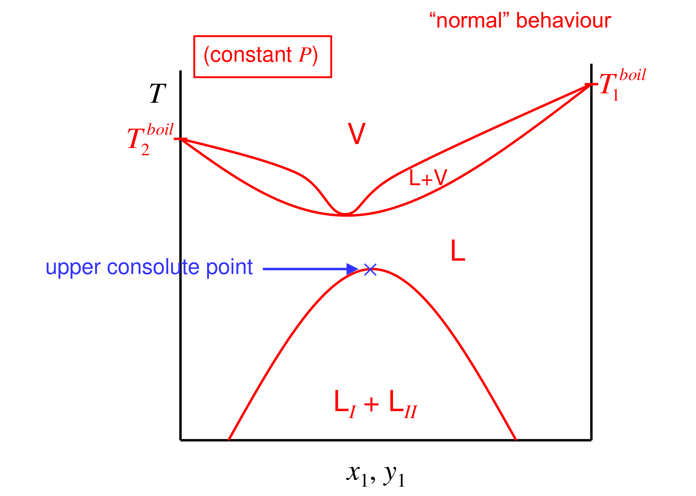

[Subject index](../README.md) · [Topic overview](README.md) · [Complete section](<Complete section.md>) · [Next](<ET-43 - Steam distillation.md>)

<!-- note-content:start -->
# Section 42: Vapour–liquid–liquid equilibrium

## Intuition

Two independent things happen as the pressure changes.
- *Boiling temperatures* respond strongly to pressure. Clausius–Clapeyron makes $T^{\mathrm{SAT}}$ fall steeply as $P$ falls.
- *The liquid–liquid gap* barely moves, because $d\mu_i = \bar V_i\,dP$ and liquid volumes are small.

So at high pressure the bubble curve lies above the top of the miscibility gap, and the two regions are separate. At lower pressure the bubble curve drops until its minimum hits the gap. Then a liquid in the gap boils at a single temperature, producing one vapour in equilibrium with both liquids.

## Derivation

**Step 1: phase rule for three phases.** Binary, $C = 2$, three phases (V, $\mathrm{L}_{\mathrm{I}}$, $\mathrm{L}_{\mathrm{II}}$):

$$F = C - P + 2 = 2 - 3 + 2 = 1 \tag{164}$$

At fixed pressure, the three-phase temperature $T^{*}$ and the three compositions ($x_1^{\mathrm{I}}$, $y_1$, $x_1^{\mathrm{II}}$) are all fixed.

**Step 2: equilibrium conditions.** Each component has one fugacity common to all three phases:

$$\gamma_i^{\mathrm{I}}x_i^{\mathrm{I}}P_i^{\mathrm{SAT}} = \gamma_i^{\mathrm{II}}x_i^{\mathrm{II}}P_i^{\mathrm{SAT}} = y_iP, \qquad i = 1, 2 \tag{165}$$

(modified Raoult's law, low pressure). The liquid–liquid part is the equal-activity condition of Section 38; the vapour sets the common value of the activities.

**Step 3: reading the diagram (constant $P$).**
- Above the three-phase line, two vapour–liquid lenses run from each pure boiling point down to the three-phase temperature $T^{*}$.
- At $T^{*}$, a horizontal line joins $x_1^{\mathrm{I}}$, $y_1$ and $x_1^{\mathrm{II}}$.
- Below $T^{*}$, the two-liquid region (the binodal) is cut off at the top by the line.
- The vapour composition $y_1$ lies *between* the two liquid compositions.

## Motivation and explanation

**What changes when a liquid layer disappears.** For a binary with two liquids but no vapour, fixing pressure leaves temperature free; choosing it then fixes the two equilibrium liquid compositions. Adding vapour reduces the remaining freedom to zero at fixed pressure, so boiling temperature and all three compositions are fixed while all phases persist. Changing the proportions of the layers alters the available inventory and how long this state lasts. Once one liquid layer is exhausted, one equilibrium constraint disappears: temperature and vapour composition can change with the remaining liquid. The invariant boiling state is conditional on the phase inventory.

**Heating a two-liquid mixture at constant $P$** (the green path in the figure below; the decorative drawing on the diagram is not part of the physics):
1. Below $T^{*}$, two liquids at the binodal compositions.
2. At $T^{*}$, vapour of composition $y_1$ appears. The temperature stays at $T^{*}$, because $F = 0$ at fixed $P$, until one liquid phase is used up.
3. For an overall composition different from $y_1$, one liquid remains after the other is exhausted; above $T^{*}$ it coexists with vapour along the bubble and dew curves until the last drop evaporates. If the overall composition equals $y_1$, both liquids can be exhausted together at $T^{*}$, leaving only vapour.

Any feed between $x_1^{\mathrm{I}}$ and $x_1^{\mathrm{II}}$ starts boiling at the same $T^{*}$, the lowest boiling temperature of the system.

The three-phase line fixes the compositions of the phases, not their amounts. Heat can convert some liquid into vapour while the amounts of the two liquid layers adjust to conserve both components. As long as both layers remain, they supply the same common activities and the same equilibrium vapour, so temperature need not rise.

Once a layer is exhausted, its equilibrium condition no longer constrains the system. There are only two phases, so an intensive freedom reappears at fixed pressure and the boiling temperature can change. The special overall composition equal to the three-phase vapour composition permits both layers to disappear together; otherwise the remaining layer carries the excess of one component into the subsequent two-phase stage.

**Why it is useful.** The vapour from a heterogeneous azeotrope condenses into two liquid layers, which separate by simply decanting. This lets a distillation cross the azeotrope:
- dehydrating ethanol with an entrainer (benzene, cyclohexane);
- the decanter on top of a water-stripping column;
- steam distillation (next section).

**Limits.** If the components are extremely immiscible ($x^{\mathrm{I}}\approx 0$, $x^{\mathrm{II}}\approx 1$), the diagram simplifies: each liquid behaves as nearly pure, which is the basis of the steam-distillation formula. If they are only moderately immiscible, an activity-coefficient model that can predict LLE (NRTL, UNIQUAC, not Wilson) is needed to solve (165).

## Link to other topics

Heterogeneous azeotropic distillation and decanter design in Separations use exactly this diagram, extended to ternary residue-curve maps. Section 43 takes the immiscible limit and derives steam distillation.

## Summary

Lowering the pressure drives the vapour–liquid curves of a partially miscible system down into its miscibility gap. This produces a three-phase line where a vapour coexists with two liquids at a single temperature $T^{*}$ (one degree of freedom, fixed by pressure). Any two-liquid feed boils there, and its condensed vapour splits into two layers. The final section exploits this to distil heat-sensitive organics with steam.
<!-- note-content:end -->

[Subject index](../README.md) · [Topic overview](README.md) · [Complete section](<Complete section.md>) · [Next](<ET-43 - Steam distillation.md>)
