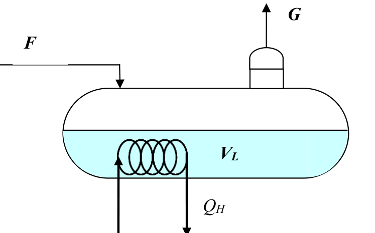

[Previous](<PDC-15 - Transfer-function matrices and coupled CSTR concentrations.md>) · [Subject index](../README.md) · [Topic overview](README.md) · [Next](<../07 - Poles, zeros, stability and steady-state gain/PDC-17 - Poles, repeated modes and stability.md>)

<!-- note-content:start -->
# PDC-16: Boiler mass–energy balance and integrating inventory

## Overview

Assumed: saturated-phase properties, a rigid control volume and simultaneous linear equations.

For a boiler held at fixed pressure, mass and energy balances determine liquid-inventory dynamics and steam production together. This idealised model contains an integrator for inventory and algebraic feed/heat effects on steam flow.

## Intuition

Extra heat evaporates stored liquid unless the feed rises to replace it. Extra subcooled feed can temporarily reduce steam output because some heat must warm that feed. Pressure is assumed already maintained; its dynamic control is outside this reduced model.

## Derivation

**Step 1: define properties and storage.** Let $F$ be liquid-feed mass flow, $G$ steam mass flow, $Q_H$ heat input, $V_L,V_G$ liquid/vapour volumes, and $V_T=V_L+V_G$ fixed vessel volume. Hold pressure at $8$ bar absolute, so saturation temperature is $170.4$ °C and phase properties remain constant. Densities are $\rho_L,\rho_G$; specific internal energies are $\hat U_L,\hat U_G$; feed and steam specific enthalpies are $\hat H_F,\hat H_G$. Ignore heat loss and other work.

Mass is $M=\rho_LV_L+\rho_G(V_T-V_L)$. Internal energy is $U=\rho_L\hat U_LV_L+\rho_G\hat U_G(V_T-V_L)$. Differentiate at fixed properties:

$$(\rho_L-\rho_G)\dot V_L=F-G,\qquad
(\rho_L\hat U_L-\rho_G\hat U_G)\dot V_L
=F\hat H_F-G\hat H_G+Q_H.\tag{51}$$

*Reason:* total vessel volume is constant, so increasing liquid volume displaces vapour volume. Enthalpy accounts for energy carried by streams; internal energy describes storage.

**Step 2: eliminate steam flow.** Define $D_\rho=\rho_L-\rho_G$ and $D_U=\rho_L\hat U_L-\rho_G\hat U_G$. From mass, $G=F-D_\rho\dot V_L$. Substitute into energy:

$$D_U\dot V_L=F(\hat H_F-\hat H_G)+D_\rho\hat H_G\dot V_L+Q_H.
$$

*Reason:* use one balance to close the unknown flow in the other. Define

$$B=D_\rho\hat H_G-D_U
=\rho_L(\hat H_G-\hat U_L)-\rho_G(\hat H_G-\hat U_G).
$$

Then

$$\dot V_L=aF+bQ_H,\quad G=cF+dQ_H,
\quad a=\frac{\hat H_G-\hat H_F}{B},\ b=-\frac1B,
\ c=1-D_\rho a,\ d=\frac{D_\rho}{B}.\tag{52}$$

*Reason:* isolate $\dot V_L$, then recover $G$ from mass. At fixed pressure and feed temperature every property in these coefficients is constant and no term multiplies two variables, so $a,b,c,d$ are constants and each is an exact partial derivative, for example $a=\partial\dot V_L/\partial F$ at fixed $Q_H$. They hold for any size of change, not only near an operating point. With zero initial deviation, subtract the steady balances and transform:

$$\begin{bmatrix}\bar V_L\\\bar G\end{bmatrix}
=\begin{bmatrix}a/s&b/s\\c&d\end{bmatrix}
\begin{bmatrix}\bar F\\\bar Q_H\end{bmatrix}.\tag{53}$$

*Reason:* liquid volume is the integral of its rate; steam flow is algebraic in this reduced model.

The signs follow the energy pathways. At fixed feed, extra heat evaporates liquid, so the heat-to-liquid-volume coefficient $b$ is negative and the heat-to-steam coefficient $d$ is positive. At fixed heat, extra subcooled feed requires warming, so it accumulates as liquid and can reduce steam production. A feed-to-steam coefficient slightly below zero is therefore compatible with mass conservation: the changed inventory absorbs more mass than the feed increase alone.

There is no $V_L$ term on the right of $\dot V_L=aF+bQ_H$. Consequently, a persistent nonzero $aF'+bQ_H'$ cannot be removed merely by reaching a different level. The integrator represents that continuing accumulation. Steam flow has no separate stored state in this fixed-pressure approximation; the algebraic balance assigns it an immediate change. Real pressure and heat-transfer dynamics would resolve that idealisation into additional dynamics.

## Motivation and explanation

The inventory pole is at zero: at fixed $F,Q_H$ the model provides no level-dependent restoring effect. A persistent mismatch drains or fills the boiler until the assumed phase inventory no longer exists. The algebraic steam-flow row represents direct feedthrough, not a lag with an extremely short measured time constant.

At steady state $G_s=F_s$ and $Q_{Hs}=F_s(\hat H_G-\hat H_F)$. The model deliberately omits pressure dynamics, finite evaporation kinetics and heat storage in equipment. It is valid only while saturated liquid and vapour coexist and the fixed-pressure approximation is adequate.

### Matching the feed and heat commands

To increase feed by a constant $\Delta F$ without inventory drift, the steady balances require $\Delta G=\Delta F$ and $\Delta Q_H=(\hat H_G-\hat H_F)\Delta F$. Extra heat must bring the incoming feed to the outgoing steam state; using saturated-liquid latent heat alone omits warming a subcooled feed. The heat-column coefficients must use the same power units as the input: converting kilowatts to watts divides those numerical coefficients by $1000$.

## Link to other topics

Inventory control restores a stable level when a process naturally integrates. The boiler also shows why proper transfer functions can contain direct input-to-output terms.

## Conclusion

Mass and energy jointly determine steam flow and inventory. The integrating liquid-volume row identifies the need for inventory regulation; the algebraic row reflects the fixed-pressure idealisation.
<!-- note-content:end -->

[Previous](<PDC-15 - Transfer-function matrices and coupled CSTR concentrations.md>) · [Subject index](../README.md) · [Topic overview](README.md) · [Next](<../07 - Poles, zeros, stability and steady-state gain/PDC-17 - Poles, repeated modes and stability.md>)
