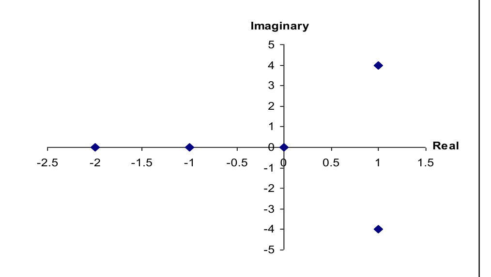

[Previous](<../06 - Multiple-input multiple-output models/PDC-16 - Boiler mass–energy balance and integrating inventory.md>) · [Subject index](../README.md) · [Topic overview](README.md) · [Next](<PDC-18 - Zeros, direct feedthrough and inverse response.md>)

<!-- note-content:start -->
# PDC-17: Poles, repeated modes and stability

## Overview

Assumed: partial fractions and complex exponentials.

Poles describe the free dynamic modes visible in an input–output model. Repeated poles add polynomial factors; complex conjugate poles combine into real oscillations. Stability must be defined carefully at poles on the imaginary axis.

## Intuition

After a pulse is over, each dynamic mode retains a memory of the perturbation. A negative real part makes that memory fade. A positive real part amplifies it. Zero real part does not supply decay, even when a particular free response stays bounded.

## Derivation

**Step 1: identify process poles.** For a rational SISO model $G(s)=N(s)/D(s)$ in reduced form, poles are roots of $D(s)$ and zeros are roots of $N(s)$. In $\bar y=G(s)\bar x$, extra roots supplied by $\bar x$ are input-signal poles, not additional process states.

**Step 2: invert elementary pole terms.** For a pole $p$ and integer $j\geq1$,

$$\mathcal L^{-1}\left[\frac{C_j}{(s-p)^j}\right]
=C_j\frac{t^{j-1}}{(j-1)!}e^{pt}.\tag{54}$$

*Reason:* $\mathcal L[e^{pt}]=1/(s-p)$ and successive powers of $t$ arise by differentiating with respect to $s$. Repeated poles therefore require all powers from $1/(s-p)$ through $1/(s-p)^j$ in the partial fraction expansion.

**Step 3: combine a complex pair.** Let $p=a+ib$, residue $C=\alpha+i\beta$, and conjugate terms $p^*,C^*$, where $i^2=-1$. Euler's formula gives

$$Ce^{pt}+C^*e^{p^*t}
=2e^{at}[\alpha\cos(bt)-\beta\sin(bt)].\tag{55}$$

*Reason:* imaginary terms cancel because a real physical model has conjugate poles and residues. The envelope is controlled by $a$, and frequency by $|b|$.

**Step 4: relate modes to stability.** For a finite-dimensional proper rational model with no unstable hidden modes, strictly negative real parts imply asymptotic decay and BIBO stability. A right-half-plane pole gives instability. Simple imaginary-axis poles give nondecaying free modes but fail BIBO stability; bounded resonant forcing can accumulate indefinitely. Repeated imaginary-axis poles can grow even without forcing.

*Reason:* multiplying a decaying exponential by any finite-degree polynomial still tends to zero; without exponential decay that guarantee disappears.

For a simple real pole, moving farther left increases the decay rate because $e^{pt}$ falls more quickly. A complex pair adds repeated sign changes while its real part still controls the envelope. Repeating a negative pole adds a factor such as $t$, so a mode can initially grow in magnitude before decaying; the exponential ultimately wins. A repeated pole at zero instead gives powers of time with no decaying exponential to suppress them.

Among observable stable modes with nonzero weights, poles nearest the imaginary axis usually govern the late tail. Their weights still matter: a slow mode with a very small coefficient may be barely visible over the time interval of interest. Pole locations predict possible rates and frequencies, while the particular input, output and numerator determine how much each mode appears.

## Motivation and explanation

Cancellation can hide a mode from one input–output transfer function. An exact unstable pole–zero cancellation is not evidence of internal stability: an initial condition or another input/output path may expose the hidden growing state. Use the full state model when making that claim.

For physical rational models, properness requires numerator degree no larger than denominator degree. Equal degrees allow direct feedthrough. Strictly proper models have lower numerator degree. Pure transport delay is causal but non-rational, so the polynomial-degree test does not describe it.

### Reading several modes in one impulse response

With time measured in seconds, consider

$$G(s)=\frac{1}{s(s+1)^2(s+2)[(s-1)^2+16]}.$$

Its poles are $0$, $-1$ twice, $-2$ and $1\pm4i$, in $\mathrm{s^{-1}}$. The denominator expands to $s^6+2s^5+14s^4+60s^3+81s^2+34s$. For a unit-area impulse, partial fractions and the elementary inverse transforms give

$$y'(t)=\frac1{34}-\frac{e^{-2t}}{50}-\frac{e^{-t}}{100}-\frac{te^{-t}}{20}+\frac{e^t[\cos(4t)-0.25\sin(4t)]}{1700},\qquad t\ge0.$$

The constant comes from a process integrator because the specified input is an impulse. The factor $te^{-t}$ exposes the repeated negative pole. The growing oscillation can initially have a small amplitude, but its $e^t$ envelope eventually dominates: a quiet short observation cannot overturn the positive-real-part pole test. In a stable lag's step experiment, a constant would instead come from the input pole, so the forcing must always be specified.

## Link to other topics

Pole locations determine whether the final-value theorem can be used. Zeros influence the weighting of these modes and can cause an initial response opposite to the final change.

## Conclusion

Interpret each pole as a mode with a decay rate and, when complex, an oscillation frequency. Distinguish visible input–output stability from stability of all internal states.
<!-- note-content:end -->

[Previous](<../06 - Multiple-input multiple-output models/PDC-16 - Boiler mass–energy balance and integrating inventory.md>) · [Subject index](../README.md) · [Topic overview](README.md) · [Next](<PDC-18 - Zeros, direct feedthrough and inverse response.md>)
