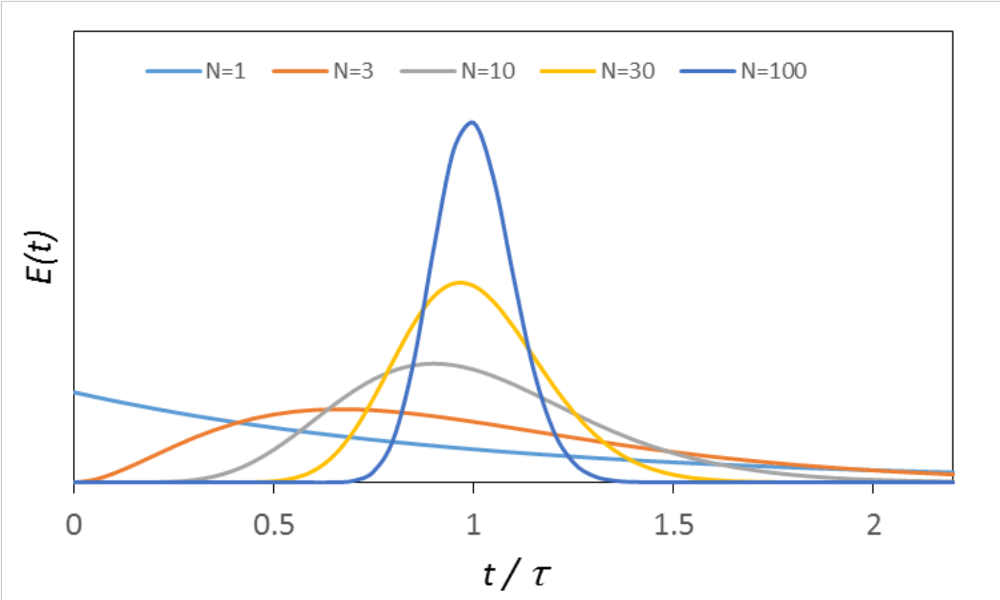

[Previous](<RE-04 - Coupled mass and energy balances.md>) · [Subject index](../README.md) · [Topic overview](README.md) · [Next](<RE-06 - Mixing and conversion.md>)

<!-- note-content:start -->
# RE-05: Residence-time distributions and tanks in series

## Overview

Assumed: probability density, exponential decay and ideal CSTR/PFR models.

Assume steady flow, constant volumetric flow $Q$, and a passive tracer that follows the relevant fluid phase without reacting, adsorbing or changing its motion. The residence-time distribution (RTD) describes the distribution of times spent between inlet and outlet. Tanks in series provide a simple model of its spread.

## Intuition

A mean residence time does not tell us whether some fluid leaves almost immediately. In plug flow, every element spends the same time in the reactor. In a mixed tank, material can leave shortly after entering or stay much longer than the mean. In a gas–liquid bed, different phases can have different RTDs; a tracer must follow the phase whose behaviour is being modelled.

## Derivation

**Step 1: define and measure the distribution.** Let $t$ be elapsed time after an inlet pulse. The probability of a residence time between $t$ and $t+dt$ is $E(t)dt$, so $E$ has units s$^{-1}$. If $c_T(t)$ is outlet tracer concentration after subtraction of its background, normalise the recovered tracer:

$$
E(t)=\frac{c_T(t)}{\int_0^\infty c_T(s)\,ds},\qquad
\int_0^\infty E(t)\,dt=1.
\tag{13}
$$

*Reason:* the tracer amount leaving in $dt$ is $Qc_T(t)dt$, and constant $Q$ cancels on division by total recovered amount. The inlet pulse should be short compared with the residence times; a broad pulse requires accounting for the input history. Check recovery: normalising a signal does not prove that lost or adsorbed tracer represented the fluid correctly.

Define cumulative fraction $F(t)$, mean $\bar t$, and variance $\sigma^2$ by

$$
F(t)=\int_0^tE(s)\,ds,\qquad
\bar t=\int_0^\infty tE(t)\,dt,\qquad
\sigma^2=\int_0^\infty(t-\bar t)^2E(t)\,dt.
\tag{14}
$$

*Reason:* integrate the probability density to obtain the exiting fraction, its average time and its squared spread.

**Step 2: ideal plug flow.** For accessible reactor volume $V$ and constant $Q$, every element has residence time $\tau=V/Q$. Its RTD is

$$
E_{\mathrm{PFR}}(t)=\delta(t-\tau).
\tag{15}
$$

Here $\delta$ is the Dirac delta distribution: it has unit area concentrated at $\tau$, not a finite-height peak. Thus $\bar t=\tau$ and $\sigma^2=0$.

**Step 3: ideal mixed tank.** After an instantaneous tracer addition, let $n_T(t)$ be tracer remaining. Uniform concentration is $n_T/V$, so its outlet loss is $Qn_T/V$. Separation and integration give

$$
\frac{dn_T}{dt}=-\frac{n_T}{\tau},\qquad
n_T(t)=n_T(0)e^{-t/\tau},\qquad
E_{\mathrm{CSTR}}(t)=\frac{1}{\tau}e^{-t/\tau}\quad(t\geq0).
\tag{16}
$$

*Reason:* the fraction leaving per unit time is always $1/\tau$ of what remains. Integrating gives $\bar t=\tau$ and second moment $2\tau^2$, hence $\sigma^2=\tau^2$.

**Step 4: cascade identical tanks.** Let $N$ be the number of ideal equal-volume tanks, each with mean time $\tau_i=\tau/N$, where $\tau$ now denotes the total mean. Assume the serial tracer response is the convolution of the individual responses. For $m$ tanks, suppose $E_m(t)=t^{m-1}e^{-t/\tau_i}/[(m-1)!\tau_i^m]$. Adding the next tank gives

$$
E_{m+1}(t)=\int_0^t E_m(s)\frac{e^{-(t-s)/\tau_i}}{\tau_i}\,ds
=\frac{e^{-t/\tau_i}}{(m-1)!\tau_i^{m+1}}\int_0^t s^{m-1}\,ds
=\frac{t^m e^{-t/\tau_i}}{m!\tau_i^{m+1}}.
$$

*Reason:* serial residence times add, and the exponential factors combine. Starting from the single-tank result proves by induction that

$$
E_N(t)=\frac{t^{N-1}e^{-t/\tau_i}}{(N-1)!\tau_i^N},\qquad
\bar t=N\tau_i=\tau,\qquad
\sigma^2=N\tau_i^2=\frac{\tau^2}{N}.
\tag{17}
$$

*Reason:* means and variances of independent serial waiting times add. The factorial expression describes integer $N$ physical tanks; a fitted noninteger effective $N$ requires a gamma-function extension or an interpretation as a spread parameter.

## Motivation and explanation

Serial convolution counts all ways a molecule can spend part of its total transit time in the first tanks and the remainder in the next. It is not an average of outlet curves: the downstream tank receives a spread-out input and adds its own waiting time. Dividing a fixed total volume among more mixed stages prevents a molecule reaching the final outlet directly from the original feed, although no finite cascade imposes a strictly positive minimum transit time.

The narrowing comparison keeps total mean time fixed, so each additional tank is smaller and has a shorter individual mean. Merely adding tanks of unchanged size would also increase the total mean and answer a different question. In the worked fit, the measured spread determines the effective tank count; the mean fixes the overall time scale. Matching both still leaves higher moments and bypass structure untested.

The plot compares different $N$ at the same total mean $\tau$. Increasing $N$ removes much of the very short and very long residence-time tail. Its horizontal axis is $t/\tau$; the vertical label is $E(t)$, with a common time scale implicit in the comparison. As $N$ tends to infinity at fixed $\tau$, the variance tends to zero and the distribution approaches ideal plug flow.

Matching measured mean and variance gives an effective $N=\bar t^2/\sigma^2$. This is a model fit, not proof that the vessel consists of tanks. Bypass or multiple peaks may require a different structure even if two moments match. The nominal $V/Q$ need not equal measured $\bar t$ if part of the quoted volume is inaccessible.

## Worked example

A tracer experiment gives $\bar t=100$ s and $\sigma^2=2500$ s$^2$. The equal-tanks fit has $N=4$ and $\tau_i=25.0$ s. Its standard deviation is $50.0$ s. For comparison, a single ideal tank with the same mean has standard deviation $100$ s, while ideal plug flow has zero spread.

For that single mixed tank, the fraction leaving before the mean is $F(\tau)=1-e^{-1}=0.632121$. Thus the mean is not a minimum residence time. A long tail balances the many elements that leave early.

## Link to other topics

The RTD helps distinguish transport behaviour from intrinsic chemistry when conversion is poorer than expected. Predicting conversion for nonlinear kinetics also needs information about how fluid elements mix at the molecular scale.

## Conclusion

An RTD quantifies time distribution and supports simple flow models. It does not, by itself, determine how reactant concentrations are mixed during those times.
<!-- note-content:end -->

[Previous](<RE-04 - Coupled mass and energy balances.md>) · [Subject index](../README.md) · [Topic overview](README.md) · [Next](<RE-06 - Mixing and conversion.md>)
