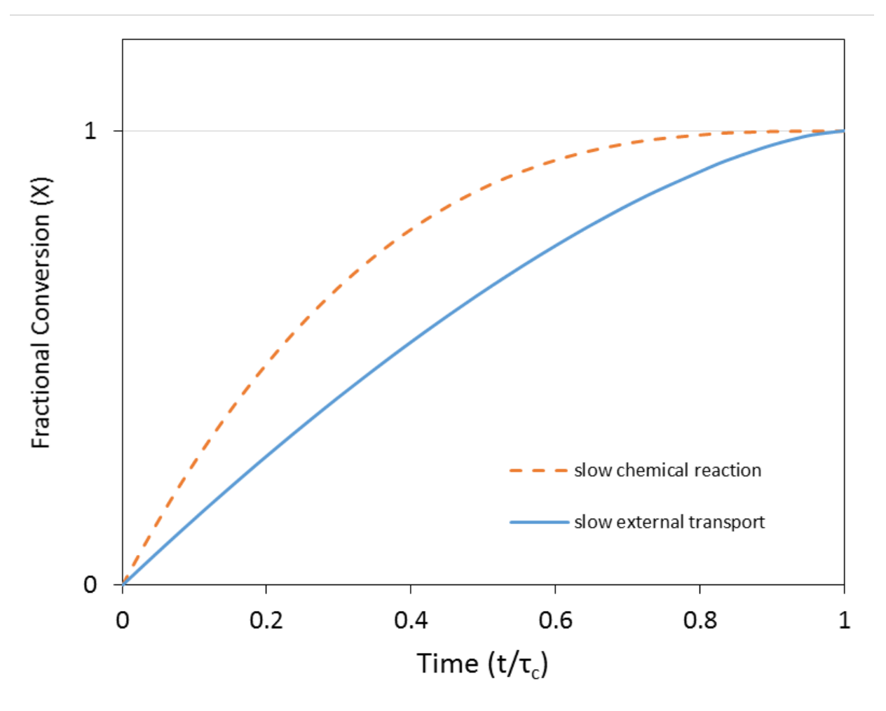

[Previous](<RE-07 - Shrinking particles under film control.md>) · [Subject index](../README.md) · [Topic overview](README.md) · [Next](<RE-09 - Shrinking core with product-layer diffusion.md>)

<!-- note-content:start -->
# RE-08: Reaction-controlled shrinking particles

## Overview

Assumed: the quasi-steady shrinking-particle balance and first-order surface kinetics.

When the surface chemistry is slow and film supply is fast, the fluid concentration at the surface equals the bulk value. The surface then recedes at a constant speed, giving $r/R=1-t/\tau_c$, $X=1-(1-t/\tau_c)^3$ and a complete-reaction time proportional to $R$. Combining film and surface resistances shows that the two limiting times simply add, and that a shrinking particle tends to move from film control to reaction control as it gets smaller.

## Intuition

If the surface reaction is the bottleneck, the gas film can deliver more reagent than the surface can use, so reagent builds up at the surface to the bulk concentration. Every exposed surface site then reacts at the same rate, whatever the size of the particle. The solid is eaten away layer by layer at a fixed speed, like a block of ice dissolving at a fixed rate per unit area.

A large particle loses most of its mass in its first few outer layers, because the outer shell of a sphere holds a large fraction of its volume. Conversion therefore rises quickly at first and slowly at the end, even though the radius falls linearly.

## Derivation

Use the reaction $\nu_A\mathrm{A(s)}+\nu_B\mathrm{B(g)}\to$ products(g) with positive stoichiometric numbers, initial radius $R$, current radius $r$ and solid molar density $\rho_m$.

**Step 1: write the surface rate.** Assume a reaction first order in B, with rate constant $k_{SA}$ per unit surface area of solid, in $\mathrm{m\,s^{-1}}$. The extent rate per area is $k_{SA}C_{\mathrm{B,surface}}$, so B is consumed at $\nu_B4\pi r^2k_{SA}C_{\mathrm{B,surface}}$ and A at $\nu_A4\pi r^2k_{SA}C_{\mathrm{B,surface}}$.

*Reason:* $k_{SA}$ multiplies the extent rate, so each species is consumed at its stoichiometric number times that rate.

**Step 2: impose fast external transport.** If the film can supply far more than the surface consumes, $C_{\mathrm{B,surface}}\approx C_{\mathrm{B,bulk}}$.

**Step 3: balance the solid.** Equating the rate of loss of $\tfrac43\pi r^3\rho_m$ to the consumption of A,

$$
-4\pi r^2\rho_m\frac{dr}{dt}=\nu_A4\pi r^2k_{SA}C_{\mathrm{B,bulk}}
\quad\Longrightarrow\quad
\frac{dr}{dt}=-\nu_A\frac{k_{SA}C_{\mathrm{B,bulk}}}{\rho_m}.
\tag{25}
$$

*Reason:* as with film control, the exterior area appears on both sides and cancels. Here nothing else depends on $r$, so the receding speed is constant.

**Step 4: integrate.** If $k_{SA}$ is constant in time, which requires constant temperature, integrating from $r=R$ at $t=0$ gives $R-r=\nu_Ak_{SA}C_{\mathrm{B,bulk}}t/\rho_m$. Setting $r=0$,

$$
\tau_c=\frac{\rho_mR}{\nu_Ak_{SA}C_{\mathrm{B,bulk}}},\qquad
\frac rR=1-\frac t{\tau_c},\qquad
X=1-\left(\frac rR\right)^3=1-\left(1-\frac t{\tau_c}\right)^3.
\tag{26}
$$

**Step 5: combine film and reaction in series.** When neither step is negligible, the surface concentration adjusts until supply equals consumption: $4\pi r^2k_g(C_{\mathrm{B,bulk}}-C_{\mathrm{B,surface}})=\nu_B4\pi r^2k_{SA}C_{\mathrm{B,surface}}$. Eliminating $C_{\mathrm{B,surface}}$,

$$
\dot n_B=\frac{4\pi r^2C_{\mathrm{B,bulk}}}{1/k_g+1/(\nu_Bk_{SA})}.
$$

*Reason:* both steps are linear in concentration, so their resistances per unit area add like resistances in series. In the stagnant-film case $k_g=D/r$. Substituting in the solid balance gives $-dr/dt=(\nu_A/\nu_B)C_{\mathrm{B,bulk}}/[\rho_m(r/D+1/(\nu_Bk_{SA}))]$. Separating and integrating from $R$ to $r$ gives

$$
t=\tau_{c,\mathrm{film}}\left[1-\left(\frac rR\right)^2\right]+\tau_{c,\mathrm{rxn}}\left[1-\frac rR\right],
\tag{27}
$$

where $\tau_{c,\mathrm{film}}$ is the stagnant-film burn-out time (23) and $\tau_{c,\mathrm{rxn}}$ the reaction-controlled time (26). The total time for complete reaction is $\tau_{c,\mathrm{film}}+\tau_{c,\mathrm{rxn}}$.

## Motivation and explanation

The linear dependence $\tau_c\propto R$ comes from a constant receding speed: a particle twice as large has twice as far to recede. Film control gave $\tau_c\propto R^2$ because its supply per area also fell as the particle grew. Size dependence therefore separates the two regimes.

Both curves start at zero and reach full conversion at $t/\tau_c=1$, because time on each is scaled by its own $\tau_c$. The plot compares *shapes*, not absolute speed: which particle actually finishes first depends on the separate values of $\tau_c$. At $t/\tau_c=0.5$, reaction control has reached $X=0.875$, whereas film control has reached $X\approx0.646$. The reaction-controlled curve rises faster initially against its own normalised time because a constant receding speed removes the large outer shell first. The initial dimensionless slopes $dX/d(t/\tau_c)$ are 3 for reaction control and 1.5 for film control. The dimensional slopes are $3/\tau_{c,\mathrm{rxn}}$ and $1.5/\tau_{c,\mathrm{film}}$, so their ratio also depends on the separate completion times.

The ratio of film to reaction resistance in (27) is $(r/D)/(1/(\nu_Bk_{SA}))=\nu_Bk_{SA}r/D$, a Damköhler number comparing surface reaction with diffusive supply. A large particle tends towards film control; as it shrinks, this ratio falls, so even a particle that starts under film control finishes under reaction control. Using one limiting formula for the whole lifetime is an approximation whose quality depends on how this ratio changes.

Temperature gives a second diagnostic. $k_{SA}$ typically follows Arrhenius kinetics and is strongly temperature-dependent, whereas $D$ and $k_g$ vary weakly. A large increase in rate with temperature, and little response to gas velocity, indicates reaction control. Strong temperature sensitivity also means a reacting particle that heats itself can change regime during reaction, so constant $k_{SA}$ in Step 4 is itself an isothermal assumption.

First-order kinetics give the constant speed in (25). Other orders still give a constant speed if $C_{\mathrm{B,surface}}$ is fixed, because the rate per area does not depend on $r$; only the form of $\tau_c$ changes.

## Link to other topics

The series-resistance step has the same structure as the combination of external film and internal effectiveness for a catalyst pellet. The Damköhler-number reasoning recurs whenever transport and chemistry compete.

## Conclusion

Reaction control makes the surface recede at a constant speed, so $\tau_c\propto R$ and conversion rises steeply at first. Next, a solid product layer is allowed to remain around the reacting core.
<!-- note-content:end -->

[Previous](<RE-07 - Shrinking particles under film control.md>) · [Subject index](../README.md) · [Topic overview](README.md) · [Next](<RE-09 - Shrinking core with product-layer diffusion.md>)
