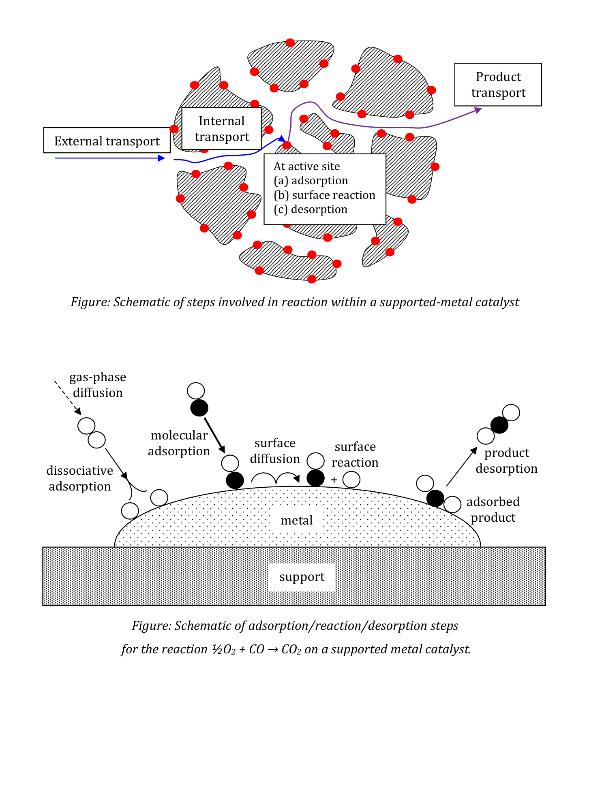

[Subject index](../README.md) · [Topic overview](README.md)

<!-- note-content:start -->
# Industrial catalysts and the transport pathway

## Overview

Assume catalyst materials, selectivity and reactor heat balances. Ethylene oxide, methanol and nitric acid illustrate how catalyst preparation and geometry solve different combinations of reaction and transport problems.

## Intuition

The best catalyst is not necessarily the one with the greatest area. A selective partial oxidation may need carefully controlled surface structure, while an extremely fast reaction may need almost no internal diffusion path. The same feed can produce different products when surface chemistry and operating conditions select different routes.

## Mechanism and examples

**Ethylene oxide.** The desired reaction is

$$\mathrm{C_2H_4}+\tfrac12\mathrm{O_2}\longrightarrow\mathrm{C_2H_4O}.
\tag{35}$$

Competing combustion of ethylene or ethylene oxide gives carbon dioxide and water and reduces selectivity. Supported Ag on alumina is a useful catalyst. Impregnation with an Ag precursor followed by drying, decomposition and activation produces dispersed active silver. The precise reduction route depends on the precursor: heating an oxide or complex can decompose it, and steam alone should not be described as a universal reducing agent for metal ions.

Larger, cleaner Ag crystallites can improve selectivity, but excessive size reduces exposed metal area. Alumina is robust, yet acid sites can promote ethylene oxide isomerisation to acetaldehyde, which is more readily oxidised. Basic promoters can suppress support acidity and stabilise catalyst; chlorine-containing modifiers suppress undesired chemistry. Sulfur poisoning must be prevented. Thus support and additives help choose between partial and complete oxidation, rather than merely increasing total rate. Ethylene oxide is an intermediate for glycols, surfactants, glycol ethers and ethanolamines; glycol links it to antifreeze and polyester production.

**Methanol.** A simplified synthesis reaction is

$$\mathrm{CO}+2\mathrm{H_2}\rightleftharpoons\mathrm{CH_3OH}.
\tag{36}$$

Co-precipitated Cu/ZnO/alumina combines dispersed copper with an interacting oxide phase and structural support. The Cu–ZnO interaction is important; treating ZnO as an inert diluent misses its promotional role. Sulfur and chlorine contamination cause deactivation. The exothermic reversible synthesis benefits from controlling temperature along the conversion path; staged adiabatic beds with interstage cooling are one arrangement. Methanol is a platform for formaldehyde, acetic acid and other products.

**Ammonia oxidation.** The desired first step of the Ostwald process is

$$4\mathrm{NH_3}+5\mathrm{O_2}\longrightarrow4\mathrm{NO}+6\mathrm{H_2O}.
\tag{37}$$

The competing route $4\mathrm{NH_3}+3\mathrm{O_2}\to2\mathrm{N_2}+6\mathrm{H_2O}$ is thermodynamically favoured, so useful NO production depends on kinetic selectivity. Pt–Rh gauzes operating at high temperature expose catalyst directly to the flowing gas. Millisecond-scale contact limits undesired secondary chemistry; porous pellets would add residence and diffusion paths. Wires are typically tens of micrometres in diameter: commercial woven gauze includes 0.076 mm wire. Rh helps selectivity and gauze durability. Contaminants and high-temperature volatilisation or corrosion cause precious-metal loss; downstream capture can recover part of it. Initial roughening may increase activity before longer-term deterioration reduces it. NO subsequently oxidises and is absorbed to make nitric acid; the catalytic primary product is NO, not NO₂.

Representative hot-gauze operation is around 750–850 °C, with NO selectivity around 94–98%; suitable Pt–Rh formulations can approach 99%. Rh contents in the approximate 6–15% range illustrate the balance between selectivity and durability. These are operating examples, not guaranteed performance independently of pressure, feed composition and catalyst condition. Acetylene, sulfur, arsenic, chlorine, silicon and iron contamination can damage the gauze. Precious-metal losses are monitored per mass of nitric acid produced.

## Derivation

At steady state the catalyst must return to its initial state after a complete cycle. Adding elementary steps therefore cancels adsorbed intermediates and restored sites, leaving the net reaction. This provides a useful check on proposed mechanisms: a solid consumed without a restoring step is acting as reagent, not as a sustained catalyst.

## Motivation and explanation

At steady state, reactant arrival, net chemical consumption and product departure must be compatible: material cannot keep accumulating at an intermediate step. A slow supply step lowers the concentration available to chemistry, while slow product escape can raise product coverage and promote inhibition or secondary reaction. The pathway diagram therefore represents coupled concentrations and coverages, rather than seven independently selectable rates.

Shortening a transport path is useful only in relation to the desired chemistry. Direct exposure of hot gauze reduces the time needed to reach and leave active metal, helping a rapidly formed product escape further reaction. A porous support instead supplies area and stabilises particles, but adds transport and residence. The contrasting industrial examples show why maximum area, maximum instantaneous activity and maximum desired-product yield are separate design objectives.

In a porous supported catalyst the physical sequence is external transport of reagent to the pellet, internal transport through pores, adsorption on an active site, surface reaction, product desorption, internal product transport back to the exterior, and external removal. Molecular or dissociative adsorption and surface migration may be involved. Calling one step rate limiting is an approximation; several resistances may be comparable.

Syngas, principally CO and hydrogen, illustrates pathway selection. Ni favours methanation or steam reforming depending on conditions; Fe/Co catalysts can form hydrocarbon chains; Cu/ZnO favours methanol; subsequent catalysts convert methanol to olefins or gasoline-range products. Water–gas shift supplies hydrogen-rich gas, enabling ammonia synthesis after nitrogen addition. Catalyst choice changes accessible kinetics; conditions and equilibrium still constrain the outcome.

## Link to other topics

Surface coverage determines whether the active sites are available for useful chemistry. Pellet diffusion and external films determine whether the fluid can reach and leave those sites fast enough.

## Conclusion

Industrial catalyst geometry expresses the competition between useful reaction, side reactions and transport. It must be designed with the complete reaction cycle in mind.
<!-- note-content:end -->

[Subject index](../README.md) · [Topic overview](README.md)
