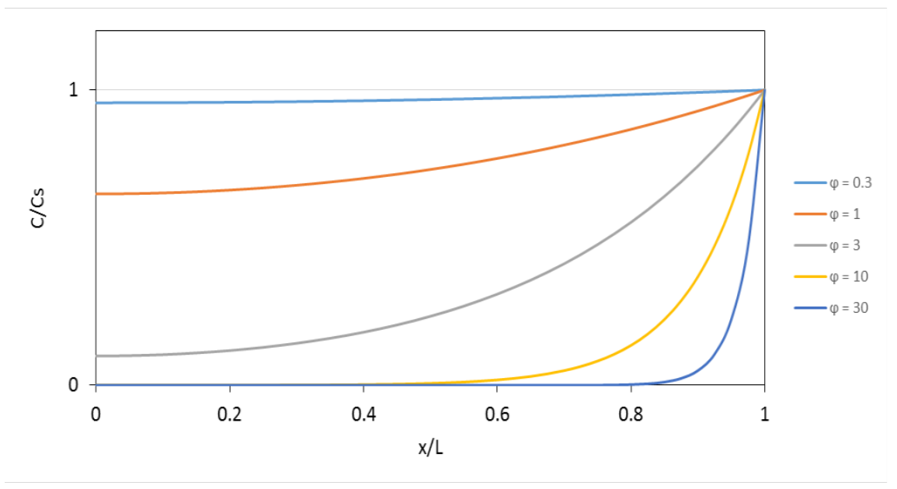

[Subject index](../README.md) · [Topic overview](README.md) · [Next](<RE-26 - Disguised kinetics and external films.md>)

<!-- note-content:start -->
# RE-25: Isothermal pellet profiles and effectiveness

## Overview

Assume steady Fickian diffusion and first-order reaction. A pellet balance quantifies how internal depletion reduces the useful catalyst volume. The Thiele modulus compares reaction and diffusion timescales; effectiveness averages the actual rate relative to surface conditions.

## Intuition

When reaction is slow, reagent reaches the centre before being consumed. When reaction is fast, only a thin outer shell contributes. Making a pellet larger then adds poorly supplied catalyst while usually helping bed hydraulics.

## Derivation for a slab

Take a slab of thickness $2L$ with centre at $x=0$ and identical face concentrations $C_s$ at $x=\pm L$. Assume uniform temperature, constant effective diffusivity $D_e$ and disappearance rate $k_VC$ per total pellet volume, with $k_V$ in $\mathrm{s^{-1}}$. A differential balance on cross-section $A$ and thickness $dx$ gives inflow minus outflow minus consumption equal to zero. Using $J=-D_eC'$,

$$-\frac{dJ}{dx}-k_VC=0\quad\Longrightarrow\quad D_e\frac{d^2C}{dx^2}-k_VC=0.
\tag{86}$$

Define $a=\sqrt{k_V/D_e}$ and solve as $C=B\cosh(ax)+D\sinh(ax)$. Symmetry $C'(0)=0$ makes $D=0$; $C(L)=C_s$ gives $B=C_s/\cosh(aL)$. With $\phi_L=L\sqrt{k_V/D_e}$,

$$\frac C{C_s}=\frac{\cosh(\phi_Lx/L)}{\cosh\phi_L}.
\tag{87}$$

The dimensionless $\phi_L^2$ is the diffusion time $L^2/D_e$ divided by reaction time $1/k_V$. Define internal effectiveness

$$\eta=\frac{\int_V k_VC\,dV}{k_VC_sV}.
\tag{88}$$

For the slab $V=2AL$, symmetry reduces this to $\eta=(LC_s)^{-1}\int_0^LC\,dx$. Integrating $\cosh(ax)$ as $\sinh(ax)/a$ gives

$$\eta_{\mathrm{slab}}=\frac{\tanh\phi_L}{\phi_L}.
\tag{89}$$

For $\phi_L\ll1$, expansion $\tanh\phi_L=\phi_L-\phi_L^3/3+\cdots$ gives $\eta\approx1-\phi_L^2/3$. For $\phi_L\gg1$, $\tanh\phi_L\to1$ and $\eta\approx1/\phi_L$.

## Derivation for a sphere

For sphere radius $R_p$ and radial coordinate $r$, a shell receives inward diffusive transport through different inner and outer areas. The steady balance becomes

$$D_e\frac1{r^2}\frac d{dr}\left(r^2\frac{dC}{dr}\right)-k_VC=0.
\tag{90}$$

Use $u=rC$. Since $C'=u'/r-u/r^2$, then $(r^2C')'=ru''$, so the equation reduces to $u''-a^2u=0$. The solution is $u=B\sinh(ar)+D\cosh(ar)$. Finite $C$ at $r=0$ requires $u(0)=0$, hence $D=0$. At the surface $u(R_p)=R_pC_s$, giving $B=R_pC_s/\sinh(aR_p)$. With $\phi_R=R_p\sqrt{k_V/D_e}$,

$$\frac C{C_s}=\frac{\sinh(\phi_Rr/R_p)}{(r/R_p)\sinh\phi_R}.
\tag{91}$$

At the centre use $\sinh z/z\to1$, obtaining $C(0)/C_s=\phi_R/\sinh\phi_R$ and a zero centre gradient. Never evaluate the displayed quotient by direct division at $r=0$.

At steady state total consumption equals inward flux at the surface, $\dot n_A=4\pi R_p^2D_eC'(R_p)$. Differentiating the profile gives $C'(R_p)=C_s[\phi_R\coth\phi_R-1]/R_p$. Divide by the hypothetical fully supplied rate $k_VC_s(4\pi R_p^3/3)$ to find

$$\eta_{\mathrm{sphere}}=\frac3{\phi_R^2}(\phi_R\coth\phi_R-1)
=\frac3{\phi_R}\left(\coth\phi_R-\frac1{\phi_R}\right).
\tag{92}$$

Small-$\phi_R$ expansion gives $\eta\approx1-\phi_R^2/15$, while large $\phi_R$ gives $\eta\approx3/\phi_R$. In numerical code use small-argument series to avoid cancellation in $\phi_R\coth\phi_R-1$.

## Motivation and explanation

Scaling concentration by $C_s$ and distance by pellet size removes the arbitrary concentration and length units from the profile. The remaining modulus asks whether diffusion can replenish consumption across that size: a large value means that reagent reacts before penetrating far. Holding $k_V$, $D_e$ and $C_s$ fixed while making the pellet larger therefore lowers internal utilisation, even though the total amount of catalyst has increased.

Using surface flux to calculate spherical effectiveness is a conservation shortcut. Every mole consumed inside must cross the exterior at steady state, so the boundary gradient contains the same total-rate information as a volume integral. The gradient is zero at the centre by symmetry, not because central reaction must vanish: diffusion arriving from all directions can still supply local consumption. The plotted flattening or depletion must be read relative to each curve's prescribed surface concentration.

Define a common geometric length $\ell=V/A_{\mathrm{ext}}$, where $A_{\mathrm{ext}}$ is exterior pellet area. For a broad slab $\ell=L$; for a sphere $\ell=R_p/3$. The generalised first-order modulus $\phi_{1,\mathrm{gen}}=\ell\sqrt{k_V/D_e}$ makes the strong-diffusion limit approximately $\eta\sim1/\phi_{1,\mathrm{gen}}$ for different shapes. Use $\phi_R=3\phi_{1,\mathrm{gen}}$ in the exact spherical expression. A long cylinder has $\ell=R_p/2$ when end faces are negligible. Shape curves approach a common large-modulus trend, but they do not become identical at intermediate modulus.

For an isothermal, irreversible consuming reaction, $0\le C\le C_s$ implies $0\le\eta\le1$. This bound uses surface concentration and temperature as reference. Exothermic internal heating can invalidate it. The reactor rate per catalyst volume is $\eta k_VC_s$; to express it per bed volume, additionally multiply by catalyst-volume fraction.

## Link to other topics

External films determine $C_s$, while internal heat generation determines whether the isothermal profiles remain valid. Those effects must be added without changing the reference used for effectiveness.

## Conclusion

A pellet balance supplies both concentration profile and total rate. Keep the chosen length, volume basis and surface reference consistent.
<!-- note-content:end -->

[Subject index](../README.md) · [Topic overview](README.md) · [Next](<RE-26 - Disguised kinetics and external films.md>)
