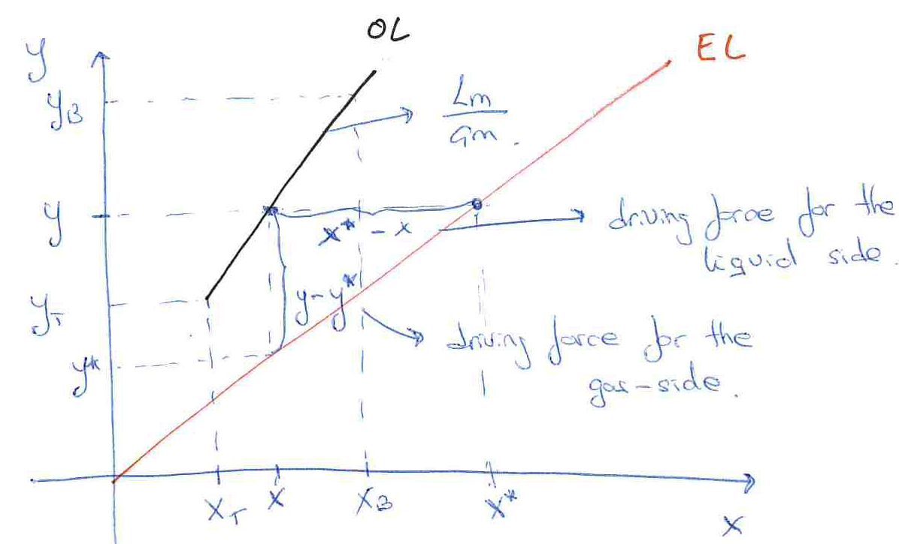
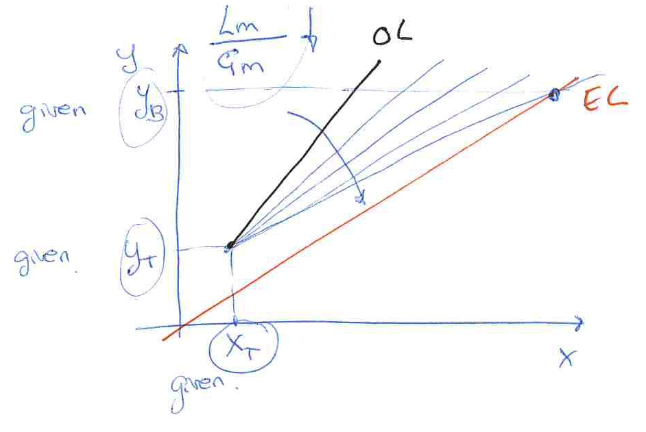

[Previous](<SEP-03 - Gas–liquid equilibrium conventions.md>) · [Subject index](../README.md) · [Topic overview](README.md) · [Next](<SEP-05 - Two-film resistances and overall coefficients.md>)

<!-- note-content:start -->
# SEP-04: Operating lines and pinch limits

## Overview

Assumed background: dilute gas–liquid equilibrium. A countercurrent-column balance gives the operating line. Comparing that line with equilibrium establishes whether transfer has the required direction and sets the minimum solvent or stripping-gas flow before any height calculation.

## Intuition

Clean solvent enters beside the cleanest gas, while progressively richer solvent encounters progressively richer gas down the column. This preserves a driving force throughout the tower. Reducing solvent flow makes the liquid become richer more quickly; eventually it can no longer accept solute at one location. That zero driving force is a pinch.

## Derivation

Assume steady, isothermal, dilute operation with approximately constant gas and liquid molar flows $G_m$ and $L_m$ in $\mathrm{kmol\,s^{-1}}$. Subscripts $T$ and $B$ denote top and bottom. Gas enters at $y_B$ and leaves at $y_T$; liquid enters at $x_T$ and leaves at $x_B$. A solute balance on the whole tower gives

$$
G_my_B+L_mx_T=G_my_T+L_mx_B. \tag{7}
$$

Subtract the outgoing gas and incoming liquid terms to identify the transfer rate $Q_m$:

$$
Q_m=G_m(y_B-y_T)=L_m(x_B-x_T). \tag{8}
$$

Balance the part of the tower above any cross-section, where passing gas and liquid have mole fractions $y$ and $x$. The same conservation argument gives $G_m(y-y_T)=L_m(x-x_T)$. Solve for $y$ because we want a line on a $y$–$x$ plot:

$$
y=y_T+\frac{L_m}{G_m}(x-x_T). \tag{9}
$$

The slope is the molar-flow ratio and the line passes through $(x_T,y_T)$ and $(x_B,y_B)$. It is a balance relationship, not an equilibrium relationship.

Let equilibrium be $y^*=f(x)$. For absorption, $y>y^*$ is required everywhere. For linear equilibrium $y^*=H_mx$, the liquid-side equilibrium counterpart is $x^*=y/H_m$, so $x^*>x$ too.

Draw the equilibrium curve first because it establishes partitioning. Mark the fixed top point because the entering solvent and required gas outlet fix that endpoint. Draw operating lines through it at different slopes because changing solvent flow changes $L_m/G_m$ without moving that point. Decrease the slope until the line first touches equilibrium: this finds the smallest flow with non-negative driving force.

For a bottom pinch, $x_B^*=f^{-1}(y_B)$. Insert that limiting outlet composition into equation (8):

$$
(L_m)_{\min}=G_m\frac{y_B-y_T}{x_B^*-x_T}. \tag{10}
$$

Actual $L_m$ must exceed this limiting value for finite height. For a curved equilibrium relationship, the first contact may instead be an interior tangent. Check the entire operating interval; testing the bottom alone is insufficient.

For stripping the transfer reverses: $x_T>x_B$ and $y_T>y_B$. Equation (7) still holds, but the positive removal rate is $L_m(x_T-x_B)=G_m(y_T-y_B)$. The operating line must lie below equilibrium. With fixed liquid flow and a top pinch, $y_T^*=f(x_T)$ gives

$$
(G_m)_{\min}=L_m\frac{x_T-x_B}{y_T^*-y_B}. \tag{11}
$$

This is a **maximum** allowable $L_m/G_m$ at the limiting stripping condition, because reducing gas flow increases that ratio. The relevant minimum is the gas flow.

The liquid flow changes how quickly solvent becomes loaded as solute is removed from the gas. For fixed gas removal, more solvent shares the transferred solute over more liquid, lowering its outlet concentration. The equilibrium gas concentration over that liquid is then lower, preserving a larger absorption driving force. This is why solvent flow affects height even though the total solute-removal duty is already fixed by the gas specifications.

At minimum flow the balance can still be satisfied algebraically, but a location has no remaining disequilibrium to drive transfer. The minimum is therefore a feasibility boundary approached by increasingly large equipment, not an economical operating point obtained merely by solving the overall balance.

## Motivation and explanation

A pinch needs infinite contact area in the ideal rate model because the flux vanishes where equilibrium is reached. Choosing extra solvent trades lower required height against greater pumping and regeneration costs. A multiplier such as $1.1$–$1.4$ times minimum solvent can be an initial estimate for particular services; it is not a thermodynamic requirement or a universal economic optimum.

If solute transfer changes total flows appreciably, use solute-free mole ratios $Y=y/(1-y)$ and $X=x/(1-x)$ with constant carrier and solvent flows. The balance remains straight in $Y$–$X$, but generally not in $y$–$x$.

For an illustrative absorber, $G_m=1\ \mathrm{kmol\,s^{-1}}$, $y_B=0.020$, $y_T=0.002$, $x_T=0$, and $H_m=2$. Equilibrium at the bottom pinch gives $x_B^*=0.010$; equation (10) gives $(L_m)_{\min}=1.8\ \mathrm{kmol\,s^{-1}}$. Choose $L_m=2.34\ \mathrm{kmol\,s^{-1}}$. The actual balance gives $x_B=0.00769231$, safely below the pinch concentration. The bottom gas driving force is positive because $H_mx_B<y_B$.

For an illustrative stripper with $L_m=1\ \mathrm{kmol\,s^{-1}}$, $x_T=0.020$, $x_B=0.002$, $y_B=0$ and the same $H_m$, equation (11) gives $(G_m)_{\min}=0.45\ \mathrm{kmol\,s^{-1}}$. Its limiting $L_m/G_m$ is $2.22222$; more stripping gas lowers that ratio and moves the line further below equilibrium.

## Link to other topics

The operating line supplies the composition profile used in a transfer-unit integral. Its separation from equilibrium also governs the equilibrium-stage staircase and the divergence of equipment size near a pinch.

## Conclusion

Establish feasible flow rates graphically and by balances before sizing height. Absorption requires sufficient solvent; stripping requires sufficient gas, and curved equilibrium can move the pinch into the column interior.
<!-- note-content:end -->

[Previous](<SEP-03 - Gas–liquid equilibrium conventions.md>) · [Subject index](../README.md) · [Topic overview](README.md) · [Next](<SEP-05 - Two-film resistances and overall coefficients.md>)
