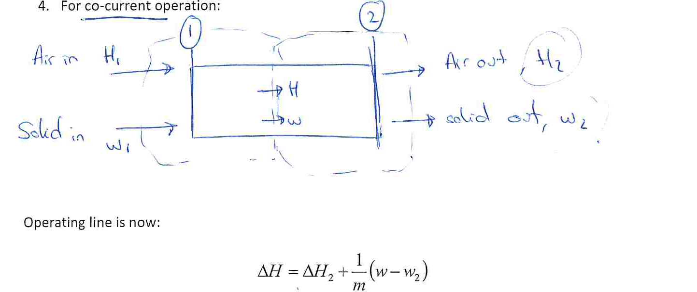

[Previous](<SEP-19 - Analytical drying times across two regimes.md>) · [Subject index](../README.md) · [Topic overview](README.md) · [Next](<SEP-21 - Graphical calculation of drying time.md>)

<!-- note-content:start -->
# SEP-20: Cocurrent drying and flow arrangement

## Overview

In cocurrent drying, fresh gas meets the wettest solid, and gas becomes more humid as the material dries. Reversing the operating-line slope changes the rate history and may move the regime transition outside the required moisture range.

Assumptions: the same steady dry-gas/dry-solid accounting and approximate constant-wet-bulb air/water path used for countercurrent drying.

## Intuition

The wettest solid receives the strongest gas-side driving force. At the product end both gas and solid have cooled, but the gas is now humid. Countercurrent flow instead exposes the driest material to the freshest, hottest gas; product temperature and internal drying resistance both matter when choosing between them.

## Derivation

Let end 1 now contain both inlets and end 2 both outlets. Define $w_1,w_2$ as inlet/outlet solid moisture and $H_1,H_2$ as inlet/outlet gas humidity. Let $m$ be kg dry gas/kg dry solid. The overall water balance still gives

$$
m(H_2-H_1)=w_1-w_2.
\tag{86}
$$

For a control region from the inlets to a local section, the gas has gained the water the solid has lost:

$$
m(H-H_1)=w_1-w.
\tag{87}
$$

With fixed surface saturation humidity $H^W$, define inlet driving force $\Delta H_1=H^W-H_1$. Subtract (2) from $H^W$:

$$
\Delta H=\Delta H_1-\frac{w_1-w}{m}.
\tag{88}
$$

Alternatively anchor the line at the outlet pair, using $\Delta H_2=H^W-H_2$:

$$
\Delta H=\Delta H_2+\frac{w-w_2}{m}.
\tag{89}
$$

The slope in a plot of $\Delta H$ against $w$ is positive. As the moving material dries, it follows this line toward a smaller driving force.

To calculate time, insert (3) into the local rate law and integrate $t=\int_{w_2}^{w_1}dw/r(w)$. Check whether a transition $r_{\mathrm{wet}}=r_{\mathrm{fall}}$ lies inside the interval; an algebraic crossing outside it does not create an extra regime.

In the specified cocurrent case the external rate stays below the fitted internal-supply rate throughout the target interval, so a wet surface can be maintained down to the chosen endpoint. Countercurrent operation assigns different gas conditions to the same solid moisture and therefore crosses the two rates at a different point. The change in calculated regimes follows from matching local demand to local supply, not from a change in the material coefficients.

Equal ideal wet-regime times for some terminal states do not imply identical temperature histories. The hottest gas meets wet material in one arrangement and drier material in the other. Product overheating and damage therefore require the material-energy calculation even when the simplified moisture-time integrals happen to coincide.

## Motivation and explanation

Use endpoint numbers consistently: $H_1$ is inlet humidity in this arrangement, whereas it labelled outlet humidity in the countercurrent arrangement. Naming the physical streams before writing a balance avoids a sign error.

If the solid remains fully wet throughout, $r=\beta\Delta H$ with constant $\beta$, and both arrangements share the same terminal gas states, changing the integration variable from $w$ to $\Delta H$ gives

$$
t=\frac{m}{\beta}
\ln\!\left(\frac{\Delta H_{\mathrm{in}}}{\Delta H_{\mathrm{out}}}\right).
\tag{90}
$$

Thus their ideal fully wet times can coincide. Their local driving forces still vary and are paired with opposite solid endpoints. Falling-rate transport, coefficient changes, solid sensible heating or different gas distribution remove this simple equivalence. Cross-flow requires its actual gas distribution and cannot inherit (3) automatically.

Compare a specified cocurrent model with $w_1=0.9,w_2=0.1$, $m=80$, incoming $H_1=0.0036$ and $H^W=0.0156$ kg/kg. The balance gives outgoing $H_2=0.0136$ and

$$
\Delta H=0.012-\frac{0.9-w}{80}
=0.00075+0.0125w.
$$

Use branches $r_{\mathrm{wet}}=10\Delta H$ and $r_{\mathrm{fall}}=0.5w$, time in hours. Equating the branches gives $w_c=0.020$, below the target $w_2=0.1$. The material stays on the wet-surface branch over the entire required range; equation (90) gives approximately 14.33 h.

The corresponding countercurrent calculation crossed at $w_c=0.212$ and gave approximately 14.84 h. This numerical comparison belongs to these empirical branches and assumptions; it is not a general ranking of flow arrangements.

## Link to other topics

The operating-line sign change resembles the distinction between cocurrent and countercurrent mass-transfer contactors. Heat-sensitive product design also requires the solid temperature history, beyond the water balance.

## Conclusion

Changing flow direction changes the gas–solid pairing, the operating line and sometimes the number of regimes traversed. Measured rate curves can replace analytical branches when the material response is more complicated.
<!-- note-content:end -->

[Previous](<SEP-19 - Analytical drying times across two regimes.md>) · [Subject index](../README.md) · [Topic overview](README.md) · [Next](<SEP-21 - Graphical calculation of drying time.md>)
