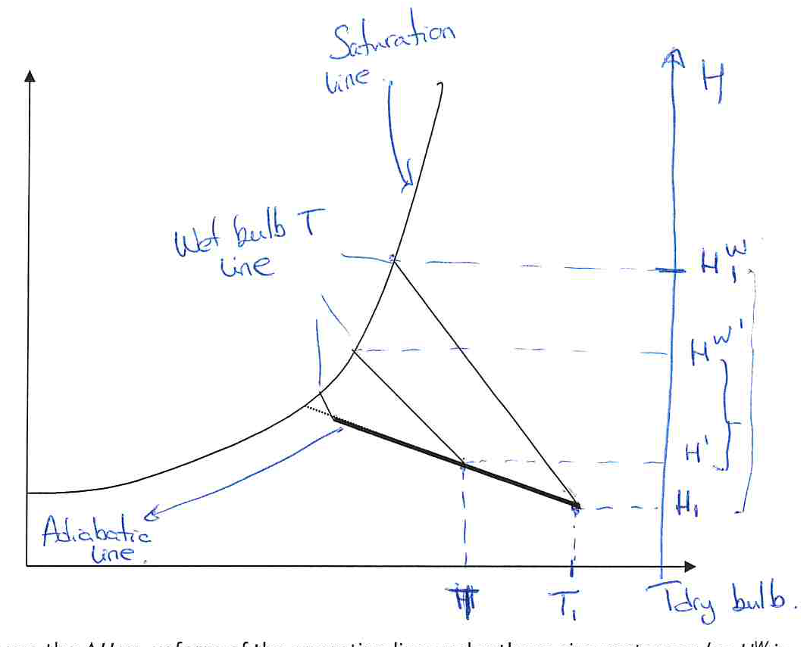

[Previous](<SEP-21 - Graphical calculation of drying time.md>) · [Subject index](../README.md) · [Topic overview](README.md) · [Next](<../03 - Membrane separations/SEP-23 - Membrane mechanisms and structure.md>)

<!-- note-content:start -->
# SEP-22: Other solvents and nonadiabatic drying

## Overview

The simple straight operating line in humidity driving force relies on nearly constant wet bulb for air/water. Other solvents may lack that property. External heating introduces a further change: surface temperature must follow a coupled heat/mass balance rather than the unheated wet-bulb condition.

Assumed background: dry-basis mass balances, humid-gas enthalpy and the wet-surface flux law.

## Intuition

The water balance survives a change of solvent, but the saturation state used as the local reference may move. Adding external heat can make a wet surface warmer than an ordinary wet bulb, increasing its saturation pressure and evaporation rate.

## Derivation

For a steady countercurrent dryer, let $w$ be kg solvent/kg dry solid, $H$ kg solvent vapour/kg dry gas, $m$ kg dry gas/kg dry solid, and end 2 the solid outlet/gas inlet. Conservation remains

$$
H(w)=H_2+\frac{w-w_2}{m}.
\tag{95}
$$

If the gas follows an approximately constant-enthalpy path, with solid sensible heating and wall heat negligible, use

$$
h_g(T,H)=h_{g,\mathrm{in}}
\tag{96}
$$

to determine local bulk temperature $T$. For each local $(T,H)$, find wet bulb $T^W$ from the appropriate heat/mass-transfer balance and set

$$
H^W(w)=H^*(T^W(w),P),
\qquad
\Delta H(w)=H^W(w)-H(w).
\tag{97}
$$

Since $H^W$ varies, subtracting a single constant from the mass balance no longer gives a straight $\Delta H$–$w$ line. Instead evaluate the empirical rate $r=f(w,\Delta H)$ locally and integrate

$$
t=\int_{w_2}^{w_1}\frac{dw}{f(w,\Delta H(w))}.
\tag{98}
$$

For a wet surface receiving external heat flux $q''_{\mathrm{ext}}$, let $T_s$ be its actual temperature. A steady surface balance, neglecting storage and conduction into the interior, is

$$
U(T-T_s)+q''_{\mathrm{ext}}
=\lambda(T_s)N_w,
\qquad
N_w\approx k^\dagger[H^*(T_s,P)-H].
\tag{99}
$$

Solve the two relations together for $T_s$ and $N_w$; assuming $T_s=T^W$ beforehand would discard the additional heat source.

If sensible heating of the material matters, a simple lumped extension is

$$
(C_{p,s}+wC_{p,l})\frac{dT_s}{dt}
=a_w\{U(T-T_s)+q''_{\mathrm{ext}}\}
-\lambda r,
\qquad
\frac{dw}{dt}=-r.
\tag{100}
$$

Here $C_{p,s},C_{p,l}$ are solid/liquid heat capacities per kg of each component, $a_w$ is area/kg dry solid and $r$ is kg solvent/(kg dry solid s). Equation (100) assumes spatially uniform material temperature, no other losses and a latent heat consistent with the evaporating solvent at $T_s$; thick solids can require spatial temperature and moisture balances instead.

Adding surface heat changes both sides of the local balance. Some additional energy supports faster evaporation; some is offset by a reduced gas-to-surface temperature difference as the surface warms. Assigning all added power to extra latent heat would incorrectly hold the surface temperature and saturation humidity fixed. Assigning it all to warming would incorrectly hold evaporation fixed.

For another solvent, conservation still gives the actual bulk humidity, but its equilibrium surface counterpart must be recalculated using the local surface temperature and the appropriate saturation properties. A straight water-balance line does not guarantee a straight driving-force line when that reference itself moves.

## Motivation and explanation

For other solvents, tabulate $w,H,T,T^W,H^W,\Delta H,r,1/r$. Obtain $H$ from conservation, $T$ from the gas energy path, and $H^W$ from the local wet-bulb/saturation construction. The last columns provide the reciprocal-rate area. Do not assume the sign of the wet-bulb change is universal: it depends on the solvent's transport properties and energy path.

For nonadiabatic drying, add the external duty and material energy balance before evaluating surface saturation. In falling-rate conditions the surface may not behave as pure liquid: its activity, wet fraction and internal transport can limit flux even if heating increases the gas-side capacity. A gas mass balance remains necessary in a swept indirect dryer; a system without carrier gas instead needs a vapour-pressure/removal model.

## Worked example

Take a wet surface at its unheated wet-bulb state. Add $q''_{\mathrm{ext}}=200$ W/m² with $U=40$ W/(m² K). If evaporation flux were artificially held fixed, equation (99) would require a surface temperature rise

$$
\Delta T_s=\frac{q''_{\mathrm{ext}}}{U}=5.0\ \mathrm{K}.
$$

In reality, warming increases saturation humidity and therefore flux. With fixed bulk conditions, a monotonically increasing saturation curve and the same coefficients, the coupled steady temperature rise is positive but smaller than this fixed-flux estimate. Its actual value requires $k^\dagger$, saturation data and latent heat; no numerical flux can be inferred from the external duty alone.

## Link to other topics

This extension connects dryer design to coupled transport balances and non-isothermal solid models. Surface activity also links the evaporation driving force to equilibrium thermodynamics and adsorption.

## Conclusion

Retain the conserved-basis mass balance, but recompute the surface reference from the appropriate local energy and equilibrium conditions. Dryer time remains a reciprocal-rate integral; the work lies in obtaining a physically consistent local rate.
<!-- note-content:end -->

[Previous](<SEP-21 - Graphical calculation of drying time.md>) · [Subject index](../README.md) · [Topic overview](README.md) · [Next](<../03 - Membrane separations/SEP-23 - Membrane mechanisms and structure.md>)
