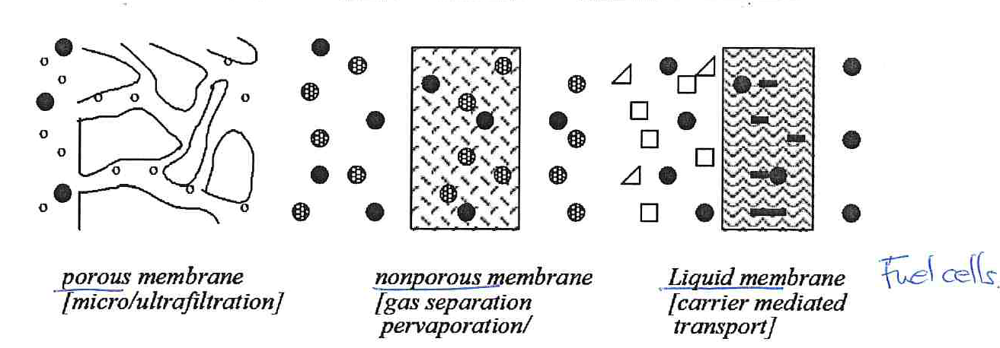

[Previous](<../02 - Drying of solids/SEP-22 - Other solvents and nonadiabatic drying.md>) · [Subject index](../README.md) · [Topic overview](README.md) · [Next](<SEP-24 - Membrane modules and operating modes.md>)

<!-- note-content:start -->
# SEP-23: Membrane mechanisms and structure

## Overview

Assumed knowledge: diffusion, chemical potential and the distinction between rate and equilibrium calculations.

A membrane divides a feed into a **permeate**, which crosses the barrier, and a **retentate**, which continues along its original side. Separation depends on different transport rates through the barrier. This note connects the transport mechanism to membrane structure and explains why a thin selective layer needs a strong support.

## Intuition

A porous membrane can act like a sieve: solvent and sufficiently small species enter the pores, while larger particles are retained. This analogy fails for dense membranes. Gas molecules can dissolve into a polymer and diffuse through it even when there are no connected pores. A molecule that dissolves readily need not diffuse quickly, so neither size nor solubility alone determines the separation.

A carrier-mediated liquid membrane adds another mechanism: a carrier binds a species on the feed side, transports it and releases it on the opposite side. Selectivity then involves chemical affinity and release as well as mobility.

## Derivation

Consider steady one-dimensional diffusion of component $j$ through a dense layer of thickness $\ell$. Let $D_j$ be its diffusivity in the membrane, $c_{m,j}$ its dissolved concentration and $z$ the distance across the layer. Assume constant $D_j$ and negligible external film resistance.

Fick's law gives

$$
N_j=-D_j\frac{dc_{m,j}}{dz},
$$

where $N_j$ is molar flux in $\mathrm{mol\,m^{-2}\,s^{-1}}$. The minus sign makes diffusion run down the concentration gradient.

At steady state the same flux passes every plane. Integrating from $z=0$ to $\ell$ therefore gives

$$
N_j\ell=D_j(c_{m,j,f}-c_{m,j,p}).
$$

For a gas obeying linear sorption, write $c_{m,j}=H_jp_j$, where $H_j$ is the membrane sorption coefficient and $p_j$ is gas partial pressure. Substitution gives

$$
N_j=\frac{D_jH_j}{\ell}(p_{j,f}-p_{j,p})
=K_{m,j}(p_{j,f}-p_{j,p}). \tag{101}
$$

Here $K_{m,j}=D_jH_j/\ell$ includes thickness: it is a **permeance**, although it is often called a membrane permeability in process calculations. The intrinsic permeability is $D_jH_j$. The distinction matters when comparing materials with different selective-layer thicknesses.

The product $D_jH_j$ combines two successive requirements: the species must enter the material and then move through it. Strong sorption increases the amount available inside the membrane to establish a gradient; high diffusivity converts that gradient into rapid transport. Comparing only molecular size misses the sorption contribution, while comparing only affinity misses mobility.

Making an ideal selective layer thinner multiplies both species' permeances by the same thickness factor, leaving their ideal selectivity unchanged. It improves throughput without automatically improving composition discrimination. Defects and support resistance can break this ideal scaling, which is why a thin material film still needs module-level verification.

## Motivation and explanation

Equation (101) explains why the ideal selective layer is thin: reducing its thickness lowers resistance. It must also remain continuous and withstand the imposed pressure. A pinhole provides an easy bypass that can destroy selectivity even if its contribution to total flow is small.

An asymmetric membrane has a thin selective skin and a thicker porous region of the same material; a composite membrane uses distinct materials for the selective layer and support. Representative selective skins are about $0.1$–$1\,\mu\mathrm m$ thick, supported by porous layers about $50$–$200\,\mu\mathrm m$ thick. The support bears load while offering comparatively little transport resistance.

| Process | Main driving force | Typical separation |
|---|---|---|
| Microfiltration | Pressure difference | Cells and suspended solids from liquid |
| Ultrafiltration | Pressure difference | Macromolecules from smaller solutes and solvent |
| Reverse osmosis, also called hyperfiltration | Pressure exceeding osmotic opposition | Dissolved salts from water |
| Gas permeation | Component partial-pressure differences | Gas mixtures such as hydrogen recovery or oxygen enrichment |
| Dialysis | Concentration differences | Small solutes between liquid streams |
| Pervaporation | Chemical-potential difference, sustained by low permeate vapour pressure | Solvent dehydration; liquid feed and vapour permeate |
| Electrodialysis | Electrical potential difference | Ionic species through ion-selective membranes |
| Membrane distillation | Vapour-pressure difference, commonly maintained by temperature difference | Water vapour through hydrophobic pores |

The operating pressure alone does not identify a mechanism. Membrane distillation can have liquid on both external sides while vapour occupies its unwetted pores; pervaporation includes dissolution, diffusion and evaporation.

## Worked example

Suppose a gas dissolves strongly in a polymer but has low diffusivity, while another gas dissolves less strongly but diffuses rapidly. Which preferentially permeates?

Compare the products $D_jH_j$, rather than either factor separately. For equal thickness, the larger product gives the larger flux at equal partial-pressure driving force. If the operating mixture changes sorption or causes polymer swelling, pure-gas measurements may fail to predict the mixture selectivity. The constant-property calculation must then be replaced by measurements or a composition-dependent model.

Membranes can offer mild conditions, avoid bulk boiling and combine readily with other separations. These benefits are conditional: pumping or compression, finite selectivity, fouling, replacement and pretreatment can dominate the cost. A pilot test establishes whether the chosen material retains its properties with the actual feed.

## Link to other topics

Chemical potential provides the common explanation for pressure, concentration and electrical driving forces. Membrane filtration also connects to biological product isolation, where molecular size and sensitivity to shear influence the choice of separation.

## Conclusion

The selective layer sets which species cross readily; its thickness and support determine whether that selectivity can be delivered at useful flux. Equipment must next expose a large area while maintaining suitable flow conditions.
<!-- note-content:end -->

[Previous](<../02 - Drying of solids/SEP-22 - Other solvents and nonadiabatic drying.md>) · [Subject index](../README.md) · [Topic overview](README.md) · [Next](<SEP-24 - Membrane modules and operating modes.md>)
