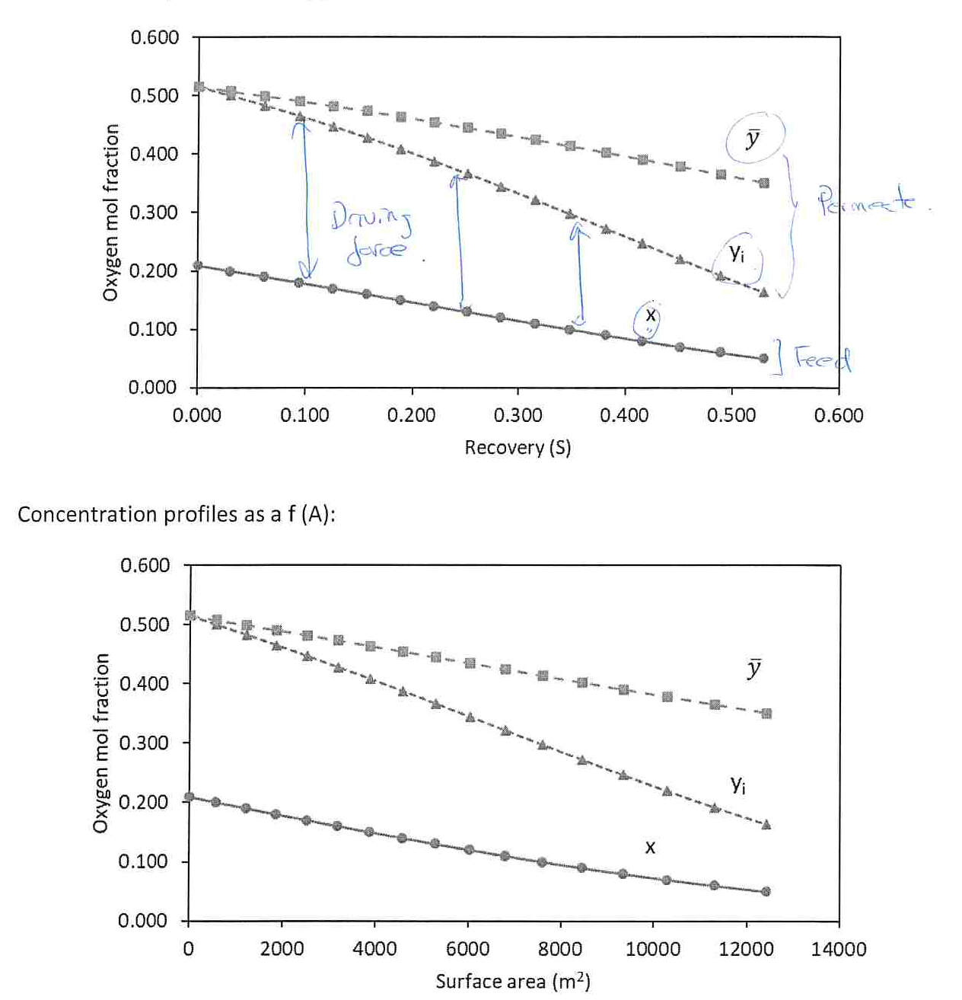

[Previous](<SEP-27 - Estimating gas membrane area.md>) · [Subject index](../README.md) · [Topic overview](README.md) · [Next](<SEP-29 - Solute rejection in liquid membranes.md>)

<!-- note-content:start -->
# SEP-28: Differential gas membrane design

## Overview

Assumed knowledge: binary local membrane transport and differential material balances.

This note derives a numerical design procedure for a gas membrane as feed flow and composition change. The calculation distinguishes newly permeated gas from all permeate collected upstream and replaces guessed averages with an area integral.

## Intuition

Each small patch removes gas of composition $y_i$, leaving a slightly smaller, less oxygen-rich retentate. Adding those small changes gives the final retentate and the mixture of gas collected as permeate. The distinction matters because downstream gas mixes with an inventory of richer gas generated earlier.

## Derivation

Assume steady, isothermal binary gas separation, constant permeances and pressures, negligible film resistance and no sweep. Feed moves in plug flow. In the asymmetric-membrane model used here, each local emerging flux remains compositionally isolated in the porous support until collection; the support has negligible hydraulic resistance. Its interface composition is therefore $y_i(x)$, given by the local binary quadratic. Let $Q_1$ be inlet reference-volume flow, $Q_p$ cumulative permeate flow and $Q$ remaining feed-side flow.

Define $S=Q_p/Q_1$. The overall flow balance gives

$$
Q=Q_1(1-S),\qquad dQ_p=Q_1\,dS. \tag{118}
$$

Let $x_1$ be inlet composition, $x$ local retentate composition and $\bar y$ composition of the collected permeate up to that position. An overall component balance gives

$$
Q_1x_1=Q_1(1-S)x+Q_1S\bar y,
$$

so cancellation and rearrangement yield

$$
\bar y=\frac{x_1-(1-S)x}{S}. \tag{119}
$$

This is defined for $S>0$; as $S\to0$, the collected composition tends to the first local flux composition.

For a differential patch, the component amount lost from retentate is the amount newly permeated:

$$
d(Qx)=-y_i\,dQ_p.
$$

Expand the derivative, substitute $Q=Q_1(1-S)$ and $dQ=-Q_1dS$, then divide by $Q_1$:

$$
(1-S)\,dx-x\,dS=-y_i\,dS.
$$

Hence

$$
\frac{dS}{1-S}=\frac{dx}{x-y_i(x)}. \tag{120}
$$

For the preferentially permeating component, $y_i>x$ and $dx<0$, so $dS>0$, as required. Integrating from inlet $(S=0,x=x_1)$ gives

$$
-\ln(1-S)=\int_{x_1}^{x}\frac{d\xi}{\xi-y_i(\xi)}. \tag{121}
$$

Here $\xi$ is only an integration variable. Evaluate the positive integral numerically, then obtain $S=1-e^{-I}$, where $I$ denotes that integral.

The component flux $J_A$ over area $dA$ transfers the same amount as $y_i\,dQ_p$. Thus

$$
J_A\,dA=Q_1y_i\,dS,
\qquad
A=Q_1\int_0^{S_2}\frac{y_i}{J_A}\,dS. \tag{122}
$$

Use a common reference-volume basis for $Q_1$ and $J_A$, or consistently use molar flow and molar flux.

The product derivative $d(Qx)=Q\,dx+x\,dQ$ retains both ways the feed-side oxygen inventory decreases: its concentration falls and the total flow carrying it shrinks. Omitting the second term would treat the membrane like a dilute absorber with constant total gas flow, although a substantial fraction of the whole gas stream is being removed.

The collected-composition balance is an inventory sum over all preceding patches, whereas the local composition controls the next transported increment under the stated support-mixing model. Keeping those roles distinct explains why the collected curve lies above the downstream local curve and why neither curve can simply replace the other in a partial-pressure law.

## Motivation and explanation

The integration procedure is:

1. Select a decreasing mesh of $x$ values from the inlet to the target retentate. This makes the known local-composition relation convenient to evaluate.
2. Solve the physical quadratic root for $y_i$ at each mesh point and verify positive component driving forces.
3. Integrate Equation (121) to each position and calculate $S$. A trapezium rule averages reciprocal denominators; evaluating the reciprocal of averaged endpoint denominators is a different, also convergent approximation.
4. Calculate $\bar y$ from Equation (119), so collected composition satisfies the overall balance.
5. Integrate Equation (122) with local fluxes, then refine the mesh until the area and recovery stop changing materially.

For a membrane directly contacting a common co-current permeate channel, use that channel's actual composition $\bar y$ in the partial-pressure driving forces. The newly transported gas then has composition $Y=N_A/(N_A+N_B)$, which generally differs from $\bar y$. Equation (120) uses $Y$ in that model and must be solved together with the collected-permeate balance. The closed local quadratic $y_i(x)$ alone no longer supplies the whole solution.

Take $x_1=0.209$, target $x_3=0.05$, $Q_1=1\,\mathrm{Nm^3\,s^{-1}}$ at $1\,\mathrm{bar(a)}$ and $25^\circ\mathrm C$, $\alpha=5$, $\gamma=0.1$, $P_f=10\,\mathrm{bar(a)}$, and oxygen permeance $1.7\times10^{-5}\,\mathrm{Nm^3\,m^{-2}\,s^{-1}\,bar^{-1}}$.

For the first interval $x_a=0.209$ to $x_b=0.200$, the local fractions are $y_{i,a}=0.514753$ and $y_{i,b}=0.500000$. Approximate the integrand by the reciprocal of the average denominator:

$$
\Delta I\approx\frac{x_b-x_a}{(x_a+x_b)/2-(y_{i,a}+y_{i,b})/2}.
$$

This gives $S_b=0.0292779$. The mean oxygen flux over the interval is $2.61396\times10^{-5}\,\mathrm{Nm^3\,m^{-2}\,s^{-1}}$. Equation (119) gives collected composition $\bar y_b=0.507399$, and the first area increment is approximately $568.29\,\mathrm{m^2}$.

Repeating with $0.01$ composition increments after that first interval gives approximately $12\,433\,\mathrm{m^2}$. Refining to $20\,000$ equal intervals over the full composition range gives

$$
S_2=0.529133,\qquad \bar y_2=0.350491,\qquad
A\approx12\,443\,\mathrm{m^2}.
$$

The small mesh change supports reporting about $1.24\times10^4\,\mathrm{m^2}$ rather than excessive precision. The total stage cut is about $52.9\%$. Oxygen component recovery is $S_2\bar y_2/x_1$, about $88.7\%$, which differs from stage cut.

The upper plot uses total stage cut $S$ on its horizontal axis; the lower uses accumulated membrane area. Both show oxygen mole fractions. Starting from $x_1=0.209$, the retentate and emerging permeate decline while the collected permeate retains the influence of richer upstream gas. The collected composition lies above the newly emerging composition downstream because it includes oxygen-rich upstream gas. The drawn vertical gaps are composition differences; the oxygen pressure driving force is $P_f(x-\gamma y_i)$, not simply the gap between $x$ and $y_i$.

## Link to other topics

Changing flow and composition must be tracked together in both membrane and packed-column design. Liquid reverse-osmosis balances use the same differential structure but require solvent flux, concentration polarisation and osmotic pressure in place of gas enrichment alone.

## Conclusion

A consistent differential design calculates recovery, collected composition and area together. Its validity depends as much on the permeate mixing model as on the numerical integration.
<!-- note-content:end -->

[Previous](<SEP-27 - Estimating gas membrane area.md>) · [Subject index](../README.md) · [Topic overview](README.md) · [Next](<SEP-29 - Solute rejection in liquid membranes.md>)
