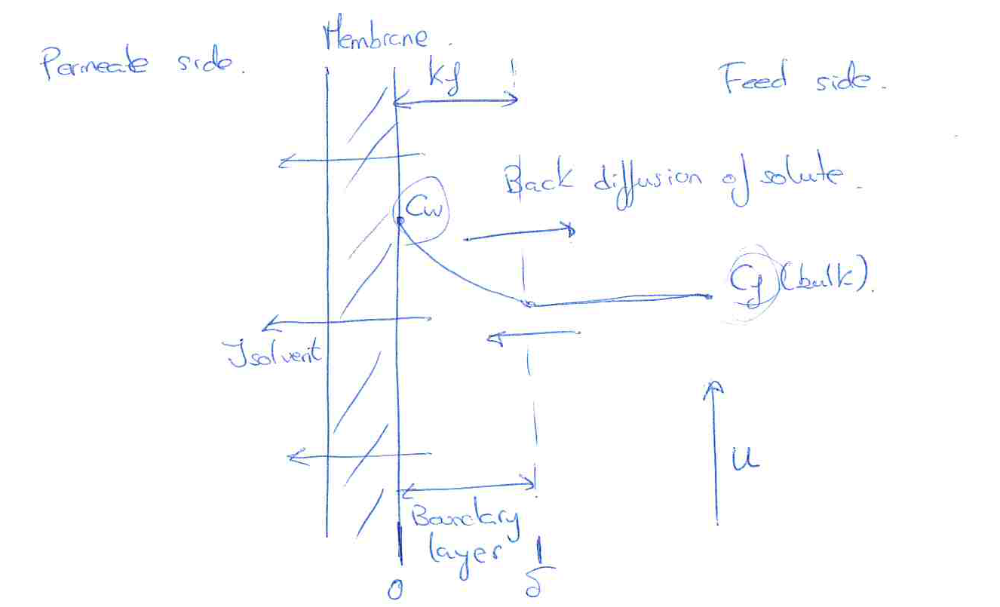

[Previous](<SEP-29 - Solute rejection in liquid membranes.md>) · [Subject index](../README.md) · [Topic overview](README.md) · [Next](<SEP-31 - Osmotic pressure and reverse solvent flow.md>)

<!-- note-content:start -->
# SEP-30: Concentration polarisation and limiting flux

## Overview

Assumed knowledge: Fick's law and liquid membrane flux and rejection.

Retained solute accumulates near a membrane because solvent convection carries it towards the surface faster than it can cross. This note derives the film model, uses it to quantify salt accumulation, and shows how a gel concentration creates a limiting flux.

## Intuition

The membrane removes solvent while holding back solute. Solute concentration therefore rises at the wall until diffusion back into the bulk balances the retained fraction arriving by convection. Increasing tangential flow improves that back transport by thinning the boundary layer. Increasing transmembrane pressure can instead intensify accumulation.

Concentration polarisation is a concentration profile in the adjacent liquid. It can be reversible when permeation stops. Deposits or pore blockage that persist and require cleaning are fouling; a concentrated layer can also lead to those more persistent effects.

## Derivation

Let $z$ increase from the membrane surface into the feed liquid, with $z=0$ at the wall and $z=\delta$ at the bulk. Let $C(z)$ be solute concentration, $D_B$ its diffusivity and $J_V>0$ solvent volume flux towards the membrane. Assume steady one-dimensional transport, constant properties, no reaction and dilute solution. Convective velocity in the positive $z$ direction is $-J_V$.

The solute flux in that direction is the sum of convection and diffusion:

$$
N_{B,z}=-J_VC-D_B\frac{dC}{dz}.
$$

At steady state it equals the solute carried into the permeate, expressed in the same outward coordinate: $N_{B,z}=-J_VC_p$. Equating and rearranging gives

$$
J_V(C-C_p)=-D_B\frac{dC}{dz}.
$$

Separate variables and integrate from $C_w$ at $z=0$ to $C_f$ at $z=\delta$:

$$
J_V\int_0^\delta dz=-D_B\int_{C_w}^{C_f}\frac{dC}{C-C_p}.
$$

The logarithm and the definition $k_f=D_B/\delta$ give

$$
J_V=k_f\ln\left(\frac{C_w-C_p}{C_f-C_p}\right). \tag{128}
$$

Exponentiating yields a convenient design form:

$$
C_w=C_p+(C_f-C_p)e^{J_V/k_f}. \tag{129}
$$

The exponent is dimensionless because both $J_V$ and $k_f$ are velocities. As $J_V\to0$, $C_w\to C_f$; as $k_f$ increases at fixed flux, polarisation decreases.

If a fully rejected macromolecule gels at concentration $C_G$, set $C_p=0$ and $C_w=C_G$ in Equation (128):

$$
J_V^*=k_f\ln\left(\frac{C_G}{C_f}\right). \tag{130}
$$

This is the ideal film/gel limiting flux. A further pressure increase can thicken or compact the layer rather than sustain a larger flux. Hydraulic and osmotic effects must still be included to find the pressure needed to reach the limit.

At complete rejection, solvent convection still carries solute towards the wall even though no solute can leave through it. Steady operation requires an equal diffusive return flux. A steeper concentration profile supplies that return flux, so wall enrichment is the mechanism that establishes the steady film balance, rather than evidence that the membrane has started passing all the retained material.

The exponential appears because convection is proportional to the local concentration while diffusion is proportional to its gradient. Increasing flux at fixed film coefficient therefore increases wall concentration multiplicatively. Raising crossflow instead increases the film coefficient, so a smaller wall-to-bulk concentration difference can return the same retained-solute load.

## Motivation and explanation

The ratio $J_V/k_f$ compares convective delivery with diffusive removal. A highly permeable membrane can consequently be limited by its adjacent fluid rather than by the selective material.

Define Reynolds, Schmidt and Sherwood numbers as

$$
\mathrm{Re}=\frac{\rho ud}{\mu},\qquad
\mathrm{Sc}=\frac{\mu}{\rho D_B},\qquad
\mathrm{Sh}=\frac{k_fd}{D_B}. \tag{131}
$$

Here $u$ is the relevant flow velocity, $d$ the geometry's characteristic diameter, $\rho$ density and $\mu$ dynamic viscosity. A correlation must match the geometry and regime. For example, an illustrative turbulent internal-tube correlation is $\mathrm{Sh}=0.023\mathrm{Re}^{0.8}\mathrm{Sc}^{0.4}$. External crossflow over a fibre uses a different correlation and the outside diameter.

High $C_w$ increases osmotic opposition to **solvent** flux. It can also increase solute passage by increasing the membrane solute concentration difference. Constant diffusivity and viscosity become poorer assumptions in strongly concentrated macromolecular layers.

A hollow-fibre desalination membrane has outside diameter $d_o=300\,\mu\mathrm m$ and inside diameter $d_i=200\,\mu\mathrm m$. The feed flows across the outside at $u=0.005\,\mathrm{m\,s^{-1}}$. For this specified $20^\circ\mathrm C$ state, $C_f=0.1\,\mathrm M$ NaCl, $J_V=4.71\times10^{-6}\,\mathrm{m\,s^{-1}}$, $R_{\mathrm{app}}=0.97$, $D_B=1.6\times10^{-9}\,\mathrm{m^2\,s^{-1}}$, $\rho=1000\,\mathrm{kg\,m^{-3}}$ and $\mu=0.001\,\mathrm{Pa\,s}$. The specified external-cylinder correlation is $\mathrm{Sh}=0.61\mathrm{Re}^{1/2}\mathrm{Sc}^{1/3}$.

The feed film is outside the fibre, so its characteristic diameter is $d_o$. Equation (131) gives $\mathrm{Re}=1.50$ and $\mathrm{Sc}=625$.
The matched external-flow correlation gives $\mathrm{Sh}=6.38757$. Therefore $k_f=\mathrm{Sh}D_B/d_o=3.40670\times10^{-5}\,\mathrm{m\,s^{-1}}$.
Measured apparent rejection fixes the permeate concentration: $C_p=C_f(1-R_{\mathrm{app}})=0.00300\,\mathrm M$.
The polarisation film relation in Equation (129) then gives $C_w=0.114382\,\mathrm M$.
The comparison of wall and bulk is $(C_w-C_f)/C_f=0.143822$, a wall increase of about $14.4\%$. This is appreciable even though the rejection remains high.
Using wall concentration instead of bulk gives true rejection $R_{\mathrm{true}}=1-C_p/C_w=0.973772$, or about $0.974$.

All concentration ratios use a common molarity basis. The wall increase would affect osmotic pressure; the film calculation establishes the need to check that effect rather than assuming it away.

## Link to other topics

The convection–diffusion balance resembles transport to reacting catalyst surfaces, but retained solute accumulates instead of being consumed. Osmotic pressure supplies the thermodynamic consequence of that accumulation for water removal.

## Conclusion

The film model quantifies wall concentration from flux and hydrodynamics. Once a gel concentration is reached, improving mass transfer can raise the limiting flux; pressure alone cannot produce indefinitely increasing throughput.
<!-- note-content:end -->

[Previous](<SEP-29 - Solute rejection in liquid membranes.md>) · [Subject index](../README.md) · [Topic overview](README.md) · [Next](<SEP-31 - Osmotic pressure and reverse solvent flow.md>)
