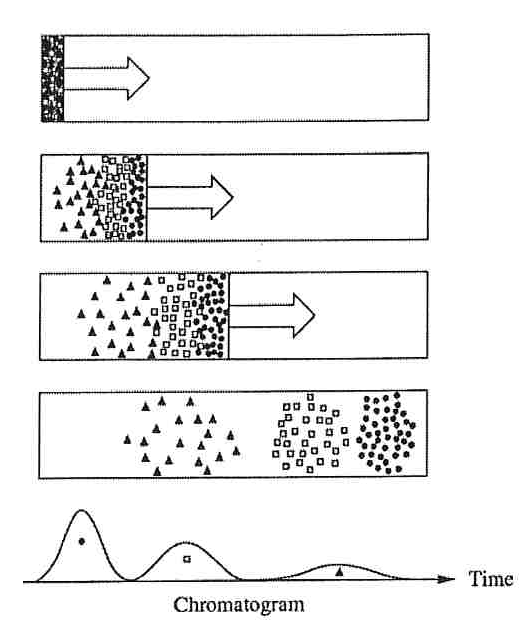

[Previous](<SEP-40 - Thermal and pressure swing regeneration.md>) · [Subject index](../README.md) · [Topic overview](README.md) · [Next](<SEP-42 - Column efficiency and band broadening.md>)

<!-- note-content:start -->
# SEP-41: Chromatographic migration, retention and calibration

## Overview

Assumed: equilibrium partitioning and flow through a packed bed.

Chromatography separates species because they spend different fractions of time in a stationary phase. Retention measures migration delay; calibration relates detector response to amount. These measurements answer different questions.

## Intuition

The mobile phase carries a molecule forward only while it is mobile. Reversible adsorption repeatedly pauses its progress. Two species can therefore leave at different times even when the liquid follows the same path.

## Derivation

**Step 1: connect concentration partitioning to inventory.** Let $K=C_s/C_m$ be the equilibrium partition coefficient, with consistent concentrations in stationary and mobile phase volumes $V_s,V_m$. The retention factor, also called capacity factor, is

$$k'=\frac{m_s}{m_m}=\frac{C_sV_s}{C_mV_m}=K\frac{V_s}{V_m}.\tag{168}$$

*Reason:* inventory depends on phase volume as well as concentration affinity. $K=1$ means equal concentrations, not equal total amounts unless volumes also match.

**Step 2: find the mobile fraction.** The fraction of solute in the mobile phase is $m_m/(m_s+m_m)=1/(1+k')$. Under local linear equilibrium and constant conditions, its average migration velocity is therefore the mobile-phase velocity multiplied by this fraction. If $t_m$ is the hold-up time of an unretained marker,

$$t_r=t_m(1+k'),\qquad k'=\frac{t_r-t_m}{t_m}=\frac{t'_r}{t_m}.\tag{169}$$

*Reason:* transit time is inversely proportional to migration velocity. Here $t_r$ is peak retention time and $t'_r$ adjusted retention time. This simple interpretation requires small loading and negligible changes in equilibrium along the run.

**Step 3: connect detector area to amount.** At fixed detector sensitivity $s_D$, integrated peak area $\mathcal A_D=s_Dm_{\mathrm{eluted}}$ within a calibrated linear range. An external standard establishes that relationship. With an internal standard I added in known amount, a response ratio can be calibrated as

$$\frac{\mathcal A_A}{\mathcal A_I}=F\frac{m_A}{m_I},\tag{170}$$

where $F$ is a measured relative response factor.

*Reason:* taking a ratio can reduce common injection or handling variations. An internal calibration standard need not be unretained and should not automatically be used to measure $t_m$.

## Motivation and explanation

Adsorption, partition, ion exchange, affinity and size exclusion generate different retention mechanisms. A chromatography separation need not be caused by surface adsorption alone. Adjusting mobile-phase composition or temperature changes equilibrium and hence retention.

Peak identity requires suitable standards and supporting evidence: retention time alone can coincide for different compounds. Quantitation also requires recovered material, appropriate calibration and separation from interfering peaks. Peak height changes when width changes; area is usually the more direct inventory measure.

## Worked example

For illustrative $K=5.00$ and $V_s/V_m=0.400$, Equation (168) gives $k'=2.00$. With $t_m=2.00\ \mathrm{min}$, Equation (169) predicts $t_r=6.00\ \mathrm{min}$. Stronger retention has delayed the mean migration, but has not yet established that its peak is distinguishable from a neighbour.

## Link to other topics

Chromatographic retention uses the equilibrium partitioning introduced for other separations. Finite transport and dispersion broaden the migrating bands, linking retention to the bed-transport problem.

## Conclusion

Retention locates a peak and calibration quantifies its recovered solute. Peak width is the next measure needed to assess separation.
<!-- note-content:end -->

[Previous](<SEP-40 - Thermal and pressure swing regeneration.md>) · [Subject index](../README.md) · [Topic overview](README.md) · [Next](<SEP-42 - Column efficiency and band broadening.md>)
