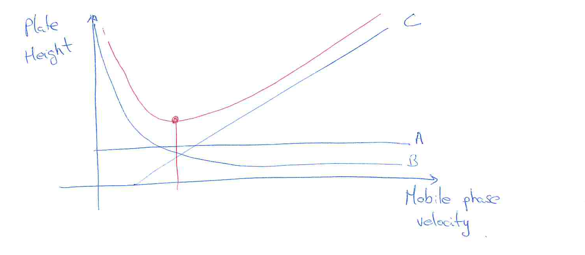

[Previous](<SEP-41 - Chromatographic migration, retention and calibration.md>) · [Subject index](../README.md) · [Topic overview](README.md) · [Next](<SEP-43 - Chromatographic resolution and design tradeoffs.md>)

<!-- note-content:start -->
# SEP-42: Column efficiency and band broadening

## Overview

Assumed: chromatographic retention and Gaussian distributions.

Column efficiency measures band spreading relative to travel time. Plate numbers describe observed width, while a transport model explains why both very slow and very fast flow can broaden a peak.

## Intuition

Particles take different paths and diffuse along the column. They also need finite time to exchange between phases. Slow flow gives longitudinal diffusion more time; fast flow leaves less time for local equilibration. A useful velocity balances these mechanisms.

## Derivation

**Step 1: define plate number from variance.** Let a Gaussian peak have retention time $t_r$ and temporal standard deviation $\sigma_t$. The theoretical plate number is $n=(t_r/\sigma_t)^2$. Gaussian half-height satisfies $\exp[-(t-t_r)^2/(2\sigma_t^2)]=1/2$, so full half-height width is $w_{1/2}=2\sqrt{2\ln2}\,\sigma_t$. Tangents at Gaussian inflection points define baseline width $w_b=4\sigma_t$. Hence

$$n=8\ln2\left(\frac{t_r}{w_{1/2}}\right)^2=16\left(\frac{t_r}{w_b}\right)^2.\tag{171}$$

*Reason:* both width conventions measure the same variance. The half-height coefficient is $5.545\ldots$, often rounded to $5.54$.

**Step 2: distinguish effective plates.** Replacing total transit time by adjusted retention time $t'_r=t_r-t_m$ gives

$$n_{\mathrm{eff}}=8\ln2\left(\frac{t'_r}{w_{1/2}}\right)^2.\tag{172}$$

*Reason:* this convention removes unretained transit from the numerator. It is not interchangeable with $n$ in formulas derived using total retention time.

For a non-Gaussian peak, an empirical asymmetric-peak estimate sometimes used is $n_{\mathrm{emp}}=41.7(t_r/w_{0.1})^2/(A_s+1.25)$, where $w_{0.1}$ is full width at tenth height and $A_s$ is trailing/front half-width ratio at that height. This is an empirical estimate, not a Gaussian identity; use a consistent measurement convention and recognise that tailing carries additional information.

**Step 3: express transport contributions.** Plate height $H_p=L/n$ is a length, with column length $L$. A conventional van Deemter model is

$$H_p=A_D+\frac{B_D}{u}+C_Du.\tag{173}$$

Here $u$ is mean mobile-phase linear velocity, distinct from packed-bed superficial velocity. $A_D$ has length units, $B_D$ length squared per time and $C_D$ time.

*Reason:* different-path spreading supplies a roughly velocity-independent contribution. Longitudinal diffusion spreads a band over a residence time proportional to $1/u$. Transfer lag grows with velocity, producing the last contribution. Microscopic derivation of its coefficients depends on packing and phase geometry; the additive expression is a transport approximation.

**Step 4: minimise plate height.** For positive coefficients, differentiating gives $dH_p/du=-B_D/u^2+C_D$. Setting this to zero yields

$$u_{\mathrm{opt}}=\sqrt{B_D/C_D},\qquad H_{p,\min}=A_D+2\sqrt{B_DC_D}.\tag{174}$$

*Reason:* the diffusion and transfer terms are equal at the minimum; $d^2H_p/du^2=2B_D/u^3>0$ confirms it.

## Motivation and explanation

Smaller packing particles shorten transfer paths but increase pressure drop. Thinner stationary films reduce diffusion distance. Longitudinal diffusion depends on diffusivity in the mobile phase, while the transfer term can contain both stationary-film and mobile-phase contributions. These are physical tradeoffs, not independent knobs without costs.

Plate number is a descriptive efficiency measure; a theoretical plate is not a literal tray. Similar retention times can have different widths, and increasing retention alone does not remove spreading.

## Worked example

An illustrative Gaussian peak with $t_r=6.00\ \mathrm{min}$, $t_m=2.00\ \mathrm{min}$ and $\sigma_t=0.300\ \mathrm{min}$ has $n=400$ and $n_{\mathrm{eff}}=177.78$. Its half-height width is $0.706446\ \mathrm{min}$.

For illustrative $A_D=0.00100\ \mathrm{m}$, $B_D=2.00\times10^{-6}\ \mathrm{m^2\,s^{-1}}$ and $C_D=0.500\ \mathrm{s}$, the optimum is $u=0.00200\ \mathrm{m\,s^{-1}}$ with $H_p=0.00300\ \mathrm{m}$. A $1.00\ \mathrm{m}$ column then has $n=333.33$ under this model.

## Link to other topics

The velocity tradeoff combines diffusion with residence time, as in packed-bed transport. Resolution then compares the migration difference of two species with their combined spreading.

## Conclusion

Use consistent width and plate-number conventions. The best velocity for efficiency minimises the sum of transport contributions, while the final separation criterion concerns both neighbouring peaks.
<!-- note-content:end -->

[Previous](<SEP-41 - Chromatographic migration, retention and calibration.md>) · [Subject index](../README.md) · [Topic overview](README.md) · [Next](<SEP-43 - Chromatographic resolution and design tradeoffs.md>)
