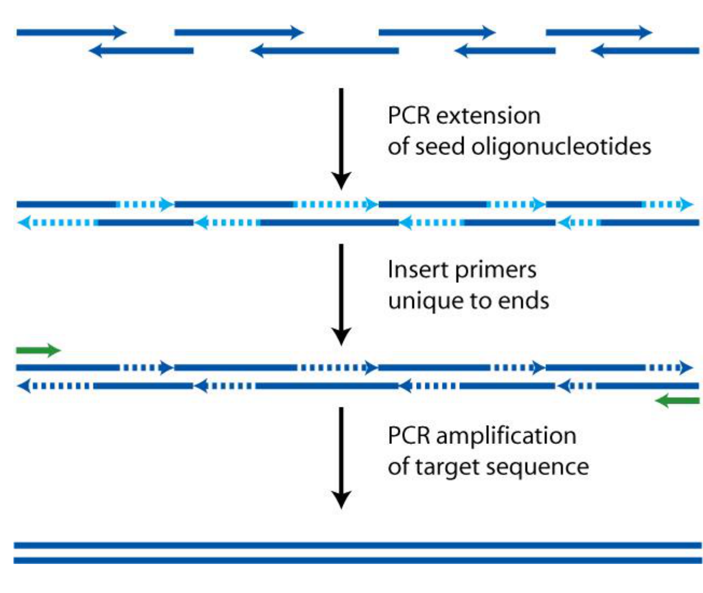

# Section 08: Assembling genes from synthetic oligonucleotides

## Overview

Chemical synthesis stops at a few hundred nucleotides (Section 07), while a gene is a kilobase or more. The gap is closed enzymatically. This note explains the single organising principle behind the standard assembly methods, *overlap-directed joining*, and works out the two quantitative constraints it imposes: the melting temperatures of the overlaps, and how sequence errors accumulate with length.

*Assumed:* PCR as a cycle of denaturation, annealing and extension; polymerases extend a base-paired 3′ end; hybridisation thermodynamics (Sections 03–04).

## Intuition

The problem is not making the bonds, since enzymes do that readily. The problem is making the pieces join *in the right order* when they are all mixed in one tube.

The answer is to let the sequence carry the ordering information. Each piece is designed so that its end is complementary to the start of the piece that should follow it. Two pieces can therefore only hybridise where they are meant to be adjacent, and enzymes then make the joint permanent. Nothing has to be added in a particular order, and nothing has to be positioned.

*Analogy:* a jigsaw in which every edge is cut to fit exactly one neighbour. You can shake the box and correct pairs will find each other. The analogy breaks down in two places. First, jigsaw edges either fit or they do not, whereas DNA overlaps bind with a *strength* that varies with sequence and temperature, so near-matches can mis-join. Second, a jigsaw piece cannot be built wrong, whereas every enzymatic copying step can introduce a sequence error.

## Mechanism

The methods differ in what the starting pieces are and in which enzymes finish the joint, but they share one logic:

**1. Design the overlaps.** Neighbouring pieces are given a shared region of sequence, typically 20–50 bases. This is the "address" that determines adjacency.

**2. Let the overlaps hybridise.** The mixture is held at a temperature at which an intended overlap is stably paired but shorter, accidental complementarity is not. This is a direct application of Section 03: the correct overlap must have a melting temperature comfortably above the working temperature, and spurious matches must have one below it.

**3. Convert the hybrid into continuous double-stranded DNA.** A polymerase extends base-paired 3′ ends to fill in single-stranded regions, and where two strands abut, a ligase closes the remaining break in the backbone.

**4. Select the full-length product.** Partial assemblies always form. They are removed either by amplifying only molecules that carry both end sequences, or by separating on size.

**Two regimes.** Starting from short synthetic oligos, the overlaps tile the whole target and the polymerase does most of the building; this reaches a few kilobases. Starting from existing double-stranded fragments, the overlaps exist only at the joints, which are exposed as single strands before annealing; this joins much larger pieces, is seamless (it leaves no scar sequence at the joint) and runs at a single temperature in one tube. The second is what makes assembly above a few kilobases practical.

## Motivation and explanation

**Why overlaps must have matched melting temperatures.** All joints are processed at the same temperature. If one overlap had a much lower $T_m$ than the others, it would be largely unpaired at the working temperature and that joint would fail; if one were much higher, it would tolerate mismatches and allow incorrect joints. Designing overlaps to a common $T_m$, rather than a common length, is therefore the central design rule, and it is why GC content matters (Section 04).

**Why secondary structure is excluded.** A piece that folds back on itself competes with the intended pairing. A hairpin is unimolecular, so unlike hybridisation its stability does not fall when the solution is diluted (Section 03). It can therefore dominate at exactly the concentrations used.

**Why errors set the real limit.** Assembly is not limited by how long a molecule can be built, but by the chance that the molecule is *correct*. Chemical synthesis introduces errors, and so does every enzymatic copying step. Errors are roughly independent per base, so the probability that a construct is error-free falls exponentially with length. This is the same compounding as Section 07, and it is why long constructs are built from verified pieces rather than in one step.

**Where the approach fails.** Repetitive sequences defeat it entirely, because an overlap is no longer unique and pieces join in the wrong order or loop out. Very GC-rich or structured regions resist both synthesis and annealing.

## Worked example

*Overlap design and error accounting.* All numbers computed in Python.

**1. How many pieces?** Tiling a 1 kb target with 60-nt oligos overlapping by 20 nt advances $60-20 = 40$ nt per oligo, so it needs $(1000-20)/40 \approx 25$ oligos.

**2. Is a 20-base overlap stable at the working temperature?** For the 20-mer of Section 05, at 0.25 µM, the nearest-neighbour model (Section 04) with the salt correction gives:

| Na⁺ | $T_m$ |
|---|---|
| 1 M | 66.2 °C |
| 0.05 M | 51.4 °C |

At a typical buffer ionic strength, a 20-base overlap melts at around 50–55 °C. That sits just above a 50 °C working temperature, which is why overlaps of this length are the shortest used, and why longer overlaps (40–50 bases) are preferred when the joint must be robust.

**3. Error-free fraction of a 1 kb construct.** With a per-base error probability $\varepsilon$, the chance that all 1000 bases are correct is $(1-\varepsilon)^{1000}$:

| $\varepsilon$ | Error-free fraction | Clones to screen for 95 % chance of one correct |
|---|---|---|
| 1 in 300 | 3.5 % | 83 |
| 1 in 600 | 18.9 % | 15 |
| 1 in 1500 | 51.3 % | 5 |

The last column is $\ln(0.05)/\ln(1-Y)$, the number of independent clones needed before the probability of finding no correct one falls below 5 %.

This is why a synthetic gene is always *sequence-verified* (Sections 10–12) rather than simply used, and why halving the error rate matters more than any improvement in assembly yield.

## Wider pathway

Assembled, verified genes are the input to everything downstream in this course: expressing an engineered protein (Section 29), building a genetic circuit (Sections 48–52), and the hierarchical construction of whole genomes (Section 09). The sequence-verification step at the end of assembly is what links this section to sequencing, which is the subject of the next three sections.

## Link to other topics

The design rule "match the $T_m$ of every joint" is the same reasoning as specifying a common operating temperature for a set of parallel units in a process: the slowest or least stable element sets the condition that all the others must tolerate.

## Conclusion

Enzymatic assembly solves ordering by writing adjacency into the sequence as overlaps, then converting hybridised overlaps into continuous duplex. The design constraints follow directly from hybridisation thermodynamics: overlaps matched in melting temperature and free of competing structure. The practical ceiling is set not by length but by error accumulation, which falls exponentially with size and forces verification. Section 09 shows how the same principle, applied in a hierarchy, reaches genome scale.
