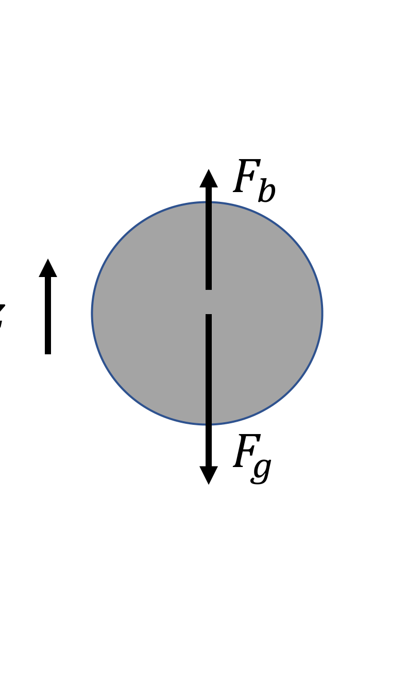
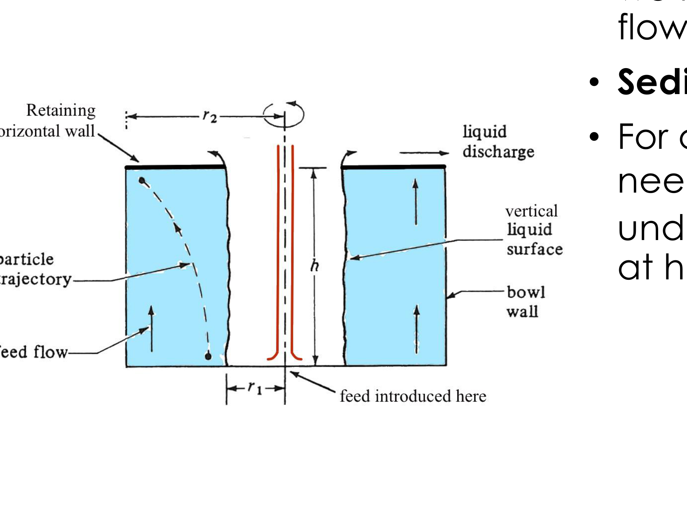

# Section 36: Stokes settling and the throughput of a tubular bowl centrifuge

## Overview

This note derives, from a force balance on a single particle, the quantities a centrifuge designer needs:
- the **sedimentation velocity** under gravity (Stokes' law) and under centrifugal acceleration;
- the **cut-off time** for a particle to reach the bowl wall;
- the **maximum volumetric throughput** $Q_{\text{cut}}$ at which a tubular bowl still captures the cells.

It closes with a worked example sizing a laboratory centrifuge.

*Assumed:* centrifuge geometry (Section 35); Stokes drag at low Reynolds number; force balance and terminal velocity.

## Intuition

A particle denser than the surrounding liquid sinks. Three forces act: gravity pulls it down, buoyancy pushes it up, and drag opposes whatever motion results. Because the particle is tiny, it reaches terminal velocity almost instantly, so the three forces balance at all times and the problem reduces to algebra rather than dynamics.

The result, Stokes' law, shows the velocity scales with the *square* of the diameter. Halving the particle size slows settling fourfold — which is why bacteria are so much harder to spin down than animal cells.

A centrifuge changes only one thing in that balance: it replaces $g$ with the much larger centrifugal acceleration $r\omega^2$. Everything else carries over unchanged.

Separation then becomes a race. A particle entering the bowl has a limited time before the flow carries it out, and it must reach the wall within that time. Capture requires **sedimentation time < residence time**, and that single inequality sets the maximum flow rate the machine can handle.

*Analogy:* crossing a moving walkway diagonally — you are captured by the far side only if you can walk across before the belt carries you off the end. The analogy breaks down because the centrifugal "walking speed" increases with radius, so the particle accelerates as it crosses, which is why the derivation produces a logarithm.

## Derivation

Notation: $D_p$ particle diameter, $\rho_p$ particle density, $\rho_l$ liquid density, $\mu$ liquid viscosity, $u$ velocity, $\omega$ angular velocity, $r$ radius, $g$ gravitational acceleration.

### Sedimentation under gravity

**Step 1: the forces.** A spherical particle moving at velocity $u$ in a Newtonian fluid at low Reynolds number experiences a **frictional (drag) force**
$$F_d = 3\pi\mu D_p u \tag{1}$$
Gravity and buoyancy act in opposite directions:
$$F_g = -m_p g = -V_p\rho_p g, \qquad F_b = V_p\rho_l g \tag{2}$$

**Step 2: terminal velocity.** At low $Re$, **inertial effects are negligible**, so the net force on the particle is always zero. Balancing drag against the net of gravity and buoyancy:
$$3\pi\mu D_p u_g = V_p(\rho_p-\rho_l)g = \frac{\pi}{6}D_p^3(\rho_p-\rho_l)g \tag{3}$$
using $V_p = \tfrac{\pi}{6}D_p^3$ for a sphere.

**Step 3: solve for $u_g$.** Dividing through by $3\pi\mu D_p$:
$$\boxed{\;u_g = \frac{D_p^2(\rho_p-\rho_l)g}{18\mu}\;}\tag{4}$$

This is **Stokes' law** for the sedimentation velocity in a gravitational field. The particle sediments only if $\rho_p > \rho_l$; if the particle is lighter it rises.

### Sedimentation in a centrifuge

**Step 4: replace the acceleration.** In a centrifuge the fluid rotates with the bowl at angular velocity $\omega$, so a particle at radius $r$ experiences a centrifugal acceleration
$$a_c = r\omega^2 \tag{5}$$
The force balance is unchanged apart from the body force, so $g$ is simply replaced by $a_c$:
$$u_c = \frac{D_p^2(\rho_p-\rho_l)r\omega^2}{18\mu} = \frac{D_p^2(\rho_p-\rho_l)Gg}{18\mu} \tag{6}$$
where the **G-factor** $G = a_c/g$ is the ratio of centrifugal to gravitational acceleration. Note that $u_c$ depends on $r$: **the particle speeds up as it moves outwards.**

### Throughput of a tubular bowl

**Step 5: the capture condition.** For a particle to be captured, it must hit the outer wall before the feed flow pushes it out of the tube:
$$t_{\text{sed}} < t_{\text{res}} \tag{7}$$

**Step 6: the cut-off time.** Define $t_{\text{cut}}$ as the time for a particle starting at the *mid-point* of the liquid layer, $r = (r_1+r_2)/2$, to reach the wall at $r_2$. Since $dr/dt = u_c(r)$ from (6), the variables separate:
$$\int_{(r_1+r_2)/2}^{r_2}\frac{dr}{r} = \frac{D_p^2(\rho_p-\rho_l)\omega^2}{18\mu}\int_0^{t_{\text{cut}}}dt$$
The left side integrates to a logarithm, giving
$$t_{\text{cut}} = \frac{18\mu}{D_p^2(\rho_p-\rho_l)\omega^2}\ln\!\left(\frac{2r_2}{r_1+r_2}\right) \tag{8}$$

The logarithm is the signature of a velocity proportional to position: the particle accelerates as it travels outwards, so the time is not simply distance over speed. The mid-point start is a convention — a particle entering at $r_1$ takes longer and one entering near $r_2$ less, so $t_{\text{cut}}$ represents an average particle.

**Step 7: the residence time.**
$$t_{\text{res}} = \frac{V_c}{Q}, \qquad V_c = \pi(r_2^2-r_1^2)h \tag{9}$$
with $Q$ the volumetric flow rate and $h$ the height of the liquid layer.

**Step 8: the maximum throughput.** Substituting (8) and (9) into the capture condition (7) gives $V_c/Q > t_{\text{cut}}$, so
$$Q < Q_{\text{cut}} = \frac{V_c}{t_{\text{cut}}} = \frac{D_p^2(\rho_p-\rho_l)\omega^2}{18\mu\,\ln\!\left(\dfrac{2r_2}{r_1+r_2}\right)}\,\pi(r_2^2-r_1^2)h \tag{10}$$

$Q_{\text{cut}}$ is the **maximum volumetric flow rate** at which the tubular bowl still separates the cells. Running faster than this lets cells escape with the clarified liquid.

## Motivation and explanation

**Reading equation (10).** Throughput rises with $\omega^2$, with $D_p^2$, with the density difference, and with the bowl volume; it falls with viscosity. Every one of these is unfavourable for a bacterial culture (Section 35), which is why such large machines are needed for such modest flows.

**Why $Q_{\text{cut}}$ is a design criterion, not a prediction.** The particle diameter in (10) is the *smallest* particle that must be captured. Choosing a smaller $D_p$ lowers $Q_{\text{cut}}$ sharply, since it enters squared. In practice a culture contains a distribution of sizes, so there is no sharp cut — larger cells are captured above $Q_{\text{cut}}$ and smaller debris escapes below it.

**Where the derivation fails.** It assumes laminar settling (low $Re$), spherical and non-interacting particles, uniform plug flow through the bowl, and no re-entrainment of deposited solids. Real feeds are concentrated enough that particles hinder one another, and flow in the bowl is not plug flow, so (10) is an optimistic estimate.

## Worked example

*A laboratory tubular bowl centrifuge.* Computed in Python.

**Given:** $r_1 = 16.5$ mm, $r_2 = 22.2$ mm, $h = 115$ mm, $\omega = 10\,000$ rpm. Bacteria of $D_p = 0.7$ µm, $\rho_p = 1.340\times10^3$ kg m⁻³, in broth of $\rho_l = 1.010\times10^3$ kg m⁻³ and $\mu = 10^{-3}$ Pa s.

**(a) Centrifugal acceleration at $r_2$.** Convert the rotation rate first: $\omega = 2\pi\times10\,000/60 = 1047$ rad s⁻¹.
$$a_c = r_2\omega^2 = 0.0222\times1047^2 = 2.43\times10^{4}\ \mathrm{m\,s^{-2}} = 2482\,g$$

**(b) Cut-off flow rate.** From (8) and (9):
$$t_{\text{cut}} = 13.9\ \mathrm{s}, \qquad V_c = \pi(0.0222^2-0.0165^2)(0.115) = 7.97\times10^{-5}\ \mathrm{m^3}$$
$$Q_{\text{cut}} = \frac{7.97\times10^{-5}}{13.9} = 5.7\times10^{-6}\ \mathrm{m^3\,s^{-1}} = 5.7\ \mathrm{mL\,s^{-1}} = 0.34\ \mathrm{L\,min^{-1}}$$

**Sense check.** This sits at the bottom of the 0.4–40 L/min range quoted for a 10 cm tubular bowl (Section 35), which is right for a laboratory machine of 4.4 cm bowl diameter separating sub-micron bacteria.

**Why centrifugation is necessary at all.** Take a larger bacterium, $D_p = 1$ µm, $\rho_p = 1.3\times10^3$ kg m⁻³, in water. From (4):
$$u_g = \frac{(10^{-6})^2(300)(9.81)}{18\times10^{-3}} = 1.6\times10^{-7}\ \mathrm{m\,s^{-1}} = 0.16\ \mathrm{\mu m\,s^{-1}}$$
Settling 0.1 m under gravity would take **7 days**. In a centrifuge at $G = 10\,000$, equation (6) gives $u_c = 1.6\times10^{-3}$ m s⁻¹, and the same 0.1 m takes **about 1 minute**. That ratio of $10^4$ is the entire justification for the equipment.

## Link to other topics

Equation (7) is a competition of timescales — a Damköhler-type comparison between the time for a process to complete and the time available in the vessel. The same reasoning sizes any flow-through separator, and the particle accelerating as it crosses is what distinguishes a centrifuge from a gravity settler.

## Conclusion

A force balance at negligible inertia gives Stokes' law, $u \propto D_p^2(\rho_p-\rho_l)/\mu$, and a centrifuge simply substitutes $r\omega^2$ for $g$ — worth a factor of $10^4$, turning a week of settling into a minute. Requiring sedimentation to beat residence time gives the maximum throughput, equation (10). Section 37 removes the particle properties from that expression to obtain a figure of merit for the machine alone.
