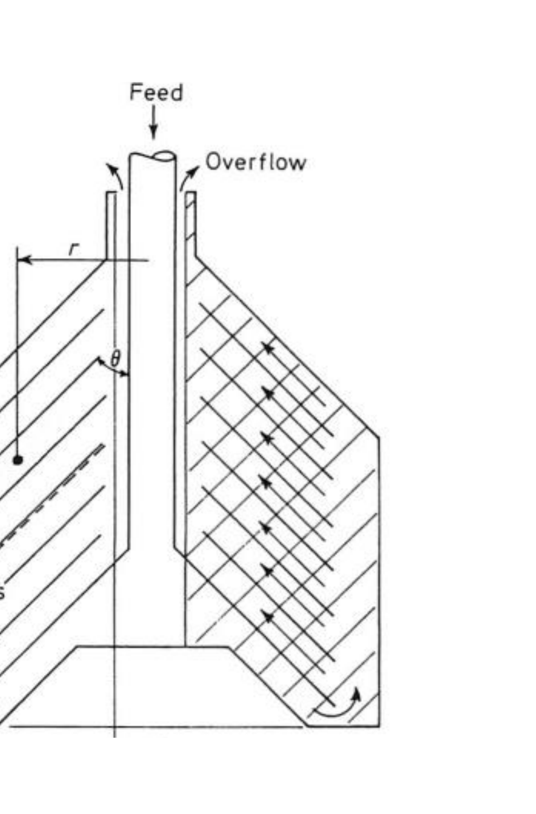

# Section 37: Sigma theory and centrifuge scale-up

## Overview

Equation (10) of Section 36 mixes two different kinds of information: properties of the **machine** ($r_1$, $r_2$, $h$, $\omega$) and properties of the **broth** ($D_p$, $\rho_p$, $\rho_l$, $\mu$). That makes it useless for comparing centrifuges, because the answer depends on what is being spun.

**Sigma theory** separates them. It factors $Q_{\text{cut}}$ into a sample term and a machine term, the latter being $\Sigma$ — a quantity with units of area that characterises the centrifuge alone. This note derives $\Sigma$, interprets it, and uses it to scale up.

*Assumed:* Stokes settling and $Q_{\text{cut}}$ (Section 36); centrifuge geometry (Section 35).

## Intuition

To compare two centrifuges fairly, they must be compared on the same feed. If a figure of merit could be found that depends only on the machine, then the ratio of throughputs of any two centrifuges on *any* common sample would equal the ratio of those figures — and scale-up would reduce to matching one number.

The trick is to notice that the sample's properties enter $Q_{\text{cut}}$ only through the combination that forms the **gravitational settling velocity** $u_g$. Multiplying and dividing by $u_g$ therefore isolates everything else, and what remains is the machine.

The quantity that remains has units of area. That is not a coincidence: it is the area of a **hypothetical gravity settler** that would do the same job. A centrifuge with $\Sigma = 65$ m² clarifies at the rate a settling tank of 65 m² surface would, using a bowl a few centimetres across. $\Sigma$ expresses the machine's performance as the area it is worth.

*Analogy:* quoting a heat exchanger's duty as an equivalent length of bare pipe. The analogy breaks down because $\Sigma$ is not merely a convenient restatement — it genuinely cancels out of a ratio, which is what makes scale-up exact rather than approximate.

## Derivation

**Step 1: start from the cut-off flow rate.** From Section 36, equation (10):
$$Q_{\text{cut}} = \frac{D_p^2(\rho_p-\rho_l)\omega^2}{18\mu\,\ln\!\left(\dfrac{2r_2}{r_1+r_2}\right)}\,\pi(r_2^2-r_1^2)h \tag{1}$$

**Step 2: multiply and divide by $u_g$.** The gravitational settling velocity of the same particle is
$$u_g = \frac{D_p^2(\rho_p-\rho_l)g}{18\mu} \tag{2}$$
Writing (1) as itself multiplied by $u_g/u_g$ and substituting (2) in the denominator, the whole group $D_p^2(\rho_p-\rho_l)/18\mu$ cancels, leaving $g$ behind:
$$Q_{\text{cut}} = \frac{\pi(r_2^2-r_1^2)h\,\omega^2}{g\,\ln\!\left(\dfrac{2r_2}{r_1+r_2}\right)}\;u_g \tag{3}$$

**Step 3: define $\Sigma$.** Writing (3) as $Q_{\text{cut}} = 2\Sigma u_g$:
$$\boxed{\;\Sigma(r_1,r_2,h,\omega) = \frac{\pi(r_2^2-r_1^2)h\,\omega^2}{2g\,\ln\!\left(\dfrac{2r_2}{r_1+r_2}\right)}\;}\tag{4}$$

Two properties follow immediately:
- **$\Sigma$ depends only on the centrifuge**, not on the sample. Every sample-dependent quantity has been collected into $u_g$.
- **$\Sigma$ has dimensions of area.** Dimensionally $Q = 2\Sigma u_g$ is (volume/time) = (area)(velocity), so $\Sigma$ is the **equivalent surface area required to achieve the same throughput $Q_{\text{cut}}$ by gravity alone**.

**Step 4: the scale-up rule.** For two centrifuges processing the **same sample**, $u_g$ is common:
$$Q_1 = 2\Sigma_1 u_g, \qquad Q_2 = 2\Sigma_2 u_g$$
Dividing, $u_g$ cancels:
$$\frac{Q_1}{Q_2} = \frac{\Sigma_1}{\Sigma_2} \tag{5}$$

**To increase the throughput of a centrifuge by a factor $X$, $\Sigma$ must increase by the same factor $X$.** This holds whatever the broth, which is what makes $\Sigma$ useful.

## Motivation and explanation

**$\Sigma$ depends on the design, not just the dimensions.** Equation (4) is specific to the tubular bowl. For a disc-stack centrifuge:
$$\Sigma = \frac{2\pi\omega^2(N-1)}{3g\tan\theta}\left(r_2^3-r_1^3\right) \tag{6}$$
with $N$ the number of discs, $r_2$ and $r_1$ the outer and inner disc radii and $\theta$ the half-cone angle.

Equation (6) explains the throughput figures in Section 35. $\Sigma$ scales with $(N-1)$, so a stack of a hundred discs has roughly a hundred times the equivalent area of a single surface, and it scales with $r^3$ rather than $r^2$. That is how a disc stack delivers 800 L/min at only 5500 g while a tubular bowl at 15 000 g manages 80 L/min — **area, not force, sets throughput.**

**$\Sigma$ is convention-dependent.** The derivation of $t_{\text{cut}}$ took a particle starting at the mid-point of the liquid layer, which is somewhat arbitrary. Different conventions give different expressions; another in common use is
$$\Sigma = \frac{\pi\omega^2 h}{2g}\left(3r_2^2+r_1^2\right) \tag{7}$$
For the example below, (7) gives 35.4 m² against 32.4 m² from (4), about 9 % higher. **The absolute value of $\Sigma$ is therefore not meaningful on its own** — only ratios are, and only when both centrifuges are evaluated with the same convention. This is the main practical trap in using Σ theory.

**Why the ratio is robust.** In (5) any constant prefactor common to both $\Sigma$ values cancels, so a consistent error in the convention does not affect scale-up. That is why Σ theory works in practice despite the ambiguity in (4).

## Worked example

*Scaling up the laboratory centrifuge of Section 36.* Computed in Python.

**(a) Calculate $\Sigma$** for $r_1 = 16.5$ mm, $r_2 = 22.2$ mm, $h = 115$ mm, $\omega = 10\,000$ rpm $= 1047$ rad s⁻¹. From (4):
$$\Sigma = \frac{\pi(0.0222^2-0.0165^2)(0.115)(1047)^2}{2\times9.81\times\ln\!\left(\dfrac{2\times0.0222}{0.0222+0.0165}\right)} = 32.4\ \mathrm{m^2}$$

**Check.** With the sample of Section 36, $u_g = 8.81\times10^{-8}$ m s⁻¹, so $2\Sigma u_g = 5.7\times10^{-6}$ m³ s⁻¹ — exactly the $Q_{\text{cut}}$ computed there. The factorisation is consistent.

**Interpretation.** A bowl 4.4 cm across does the clarification work of a **32 m² settling tank**, roughly the floor area of a small room. That is the single most useful way to read a $\Sigma$ value.

**(b) What speed does a doubled centrifuge need to match the smaller one's throughput?** The larger machine has double the physical dimensions: $r_1 = 33.0$ mm, $r_2 = 44.4$ mm, $h = 230$ mm.

Matching throughput on the same sample means $\Sigma_2 = \Sigma_1$, by (5). Write $\Sigma = f(r_1,r_2,h)\,\omega^2/2g$ with
$$f = \frac{\pi(r_2^2-r_1^2)h}{\ln\!\left(\dfrac{2r_2}{r_1+r_2}\right)}$$
The logarithm depends only on the *ratio* of radii, so it is unchanged when every dimension doubles. The numerator scales as $L^2\times L = L^3$, so
$$\frac{f_2}{f_1} = 2^3 = 8$$
Setting $f_1\omega_1^2 = f_2\omega_2^2$:
$$\omega_2 = \omega_1\sqrt{\frac{f_1}{f_2}} = \frac{\omega_1}{\sqrt 8} = \frac{10\,000}{2.83} = 3540\ \mathrm{rpm}$$

**Check:** $\Sigma_2 = 32.4$ m² $= \Sigma_1$. ✓

**Interpretation.** Doubling every dimension multiplies the geometric factor by 8, so the same $\Sigma$ is reached at $1/\sqrt8 = 35\%$ of the speed. This is the quantitative version of the trade in Section 35: **bigger bowls do the same job more slowly**, which is fortunate, because the hoop stress in the bowl wall scales as $r^2\omega^2$ and would otherwise be prohibitive. Here that product falls by a factor of $4/8 = 0.5$, so the larger bowl is *less* stressed while matching the duty.

## Link to other topics

Expressing a device's performance as an equivalent area of a simpler device is the same move as the HETP of a distillation column or the NTU of a heat exchanger: a dimensional figure of merit that separates equipment performance from the properties of what passes through it, so that scale-up becomes a matter of matching one number.

## Conclusion

Factorising $Q_{\text{cut}} = 2\Sigma u_g$ separates the machine from the broth, leaving $\Sigma$ — an equivalent gravity-settling area that depends only on the centrifuge. Throughput then scales directly with $\Sigma$, whatever the feed, so scale-up is a matter of matching it; and because $\Sigma$ grows with disc number and with $r^3$, area rather than g-force is what buys capacity. The absolute value depends on convention, so only ratios should be trusted. This completes cell removal; Section 38 turns to releasing product held inside the cells.
