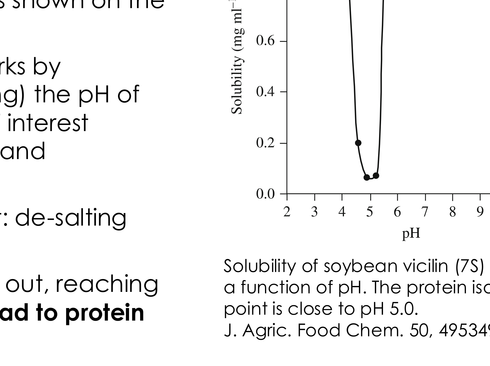
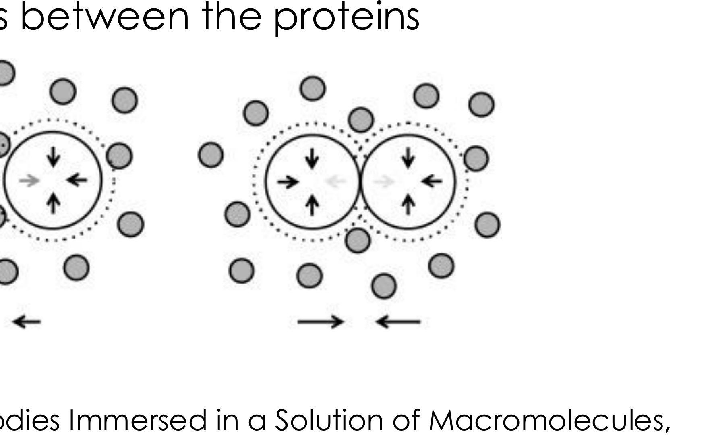

# Section 44: Isoelectric, polymer- and solvent-induced precipitation

## Overview

Section 43 removed a protein's water with salt. The three remaining precipitation methods attack the same stabilising arrangement by different routes: **isoelectric precipitation** removes the protein's charge, **polymer precipitation** excludes water sterically, and **solvent precipitation** replaces water with something less able to solvate. This note covers the mechanism of each and when it is preferred.

*Assumed:* why proteins stay dissolved and what precipitation does (Section 43); protein structure and charge (Section 23).

## Intuition

A dissolved protein is kept apart from its neighbours by two things: a **solvation shell** of water and **electrostatic repulsion** between like-charged molecules. Remove either and the proteins aggregate.

Salting out removes the water. The alternatives are:
- **Isoelectric** — remove the charge, so repulsion vanishes while the water remains.
- **Polymer** — crowd the solution so that water is excluded from the gaps between proteins, pushing them together.
- **Solvent** — replace water with a liquid that solvates the protein less well.

All four converge on the same end state, so the choice is governed by what the product tolerates and what must be removed afterwards.

*Analogy:* keeping magnets apart with both a repelling field and a layer of packing. You can remove the packing, switch off the field, or squeeze from outside. The analogy breaks down for the polymer case, where nothing is removed and nothing switched off — the aggregation is driven by the *entropy of the polymer*, not by a force between the proteins at all.

## Mechanism

### Isoelectric precipitation

Proteins most often carry a **net electric charge**, or are **zwitterionic** (net charge zero, but parts of the protein positively or negatively charged).

- **Charge stabilises proteins against aggregation**, through Coulomb repulsion that counteracts hydrophobic interactions.
- **Charge is pH dependent**, through (de)protonation of charged amino acids. At low pH a protein is more likely to be positively charged; at high pH, negatively charged.
- The **isoelectric point (pI)** is the pH at which a given protein is **neutral**.

Since charge provides the repulsion, solubility has a **minimum at the pI**. The vicilin curve shows this sharply: solubility falls by about an order of magnitude within one pH unit either side of pH 5.

Different amino acids have different pI values, so a protein's pI depends on its composition; most lie **between 4 and 6**.

**Operation.** Precipitation is achieved by changing — typically reducing — the pH of the feed until the protein of interest reaches its minimum solubility and precipitates.

- **Advantage over salting out:** no de-salting step is required afterwards, so the downstream train is shorter.
- **Drawback:** as with salting out, reaching the isoelectric point **may lead to protein denaturation**, since removing charge also destabilises the folded state.

**An industrial example: removing proteins in sugar processing.** Sugar beets are washed, ground and filtered to leave a feed rich in sugar and various proteins. The aim is to precipitate the proteins and keep the sugar. A **gradient of pH** is established along a horizontal tank with stirrers, so that **in each compartment a different protein reaches its own pI and precipitates**. A protein-free sugar solution is finally produced. The process is used at the British Sugar plant in Bury St Edmunds.

This is the key idea made into equipment: because each protein has its own pI, a *spatial* pH gradient separates a mixture into fractions in one continuous unit.

### Polymer-induced precipitation

Neutral polymers such as **PEG and dextran** cause precipitation by a principle similar to salting out: the polymers at high concentration **attract water molecules away from the solvation shell** of proteins, acting as "solvent sponges", leading to aggregation.

In addition, PEG causes aggregation of **large globular proteins** by inducing **depletion forces**, first explained by Asakura and Oosawa:
- The polymer coils are **excluded from the small gap between two adjacent large particles** (the proteins), because they do not fit.
- There is therefore a **larger osmotic pressure from the polymer outside the gap than inside it**.
- The imbalance produces a net **attractive force** pushing the proteins together.

This is a purely **entropic** effect — nothing binds to the protein. It depends on the size ratio between polymer coil and protein, which is why it works for large globular proteins and why polymer molecular weight is a design variable.

**Not to be confused with aqueous two-phase extraction** (Section 42), which also uses PEG and dextran but separates proteins *between* two liquid phases rather than precipitating them out of one.

### Solvent-induced precipitation

The feed is mixed with a **miscible solvent**, for example ethanol or methanol.

**This is distinct from solvent extraction** (Section 42), which uses **immiscible** solvents to create a second liquid phase. Here the solvent dissolves fully and changes the properties of the single phase.

Mechanism:
- In sufficiently high molar fraction, the solvent **displaces the water molecules from the solvation shell** of the proteins, disrupting it and causing the proteins to aggregate — similar to what happens with salting out and polymer-induced precipitation.
- More precisely, ethanol or methanol **decreases the dielectric constant of water**, which strengthens the electrostatic attraction between proteins. (The full treatment is beyond this course.)

It is often used for primary isolation of **antibodies**.

## Motivation and explanation

**Comparing the four methods.**

| Method | What it removes | Removal needed afterwards | Main risk |
|---|---|---|---|
| Salting out | solvation shell | **yes**, de-salting | unfolding at high salt |
| Isoelectric | net charge | **no** | denaturation at pI |
| Polymer | water, plus depletion force | yes, polymer | mild; least denaturing |
| Solvent | water, lowers dielectric | yes, solvent | denaturation; needs cold |

The column that usually decides is the third. Isoelectric precipitation's great advantage is that **changing pH leaves nothing behind** — the pH is simply adjusted back — whereas every other method adds a component that the next unit must deal with.

**Why solvent precipitation is done cold.** Organic solvents denature proteins, and the rate of denaturation rises steeply with temperature. Industrial ethanol fractionation of blood plasma is run near 0 °C for exactly this reason. The same logic as the 5 °C homogenisation in Section 40: where the method itself threatens the product, temperature is the lever that buys tolerance.

**Why none of these is very selective.** All four exploit bulk physical properties — hydrophobicity, pI, size, solvation — that many proteins share. Two proteins of similar pI precipitate together. This is why precipitation sits in **primary isolation** (Section 32), taking purity from roughly 1 % to 10 %, with the real purification left to chromatography.

**Why precipitation is used at all, given that.** It removes **large amounts of water**, so it concentrates the product substantially while also purifying it a little. Compare extraction (Section 42), where improving recovery means diluting into a larger phase. Precipitation moves *both* concentration and purity in the right direction, which is why it so often follows extraction in a real train.

## Link to other topics

The depletion force is the same mechanism that flocculates colloids with free polymer, used deliberately in water treatment and arising as an unwanted instability in formulated products. In all cases the driving force is the entropy of the excluded species, not an interaction between the particles themselves.

## Conclusion

The three non-salt precipitation routes remove a different stabilising feature each: isoelectric precipitation removes charge at the pI, polymers remove water and add an entropic depletion attraction, and miscible solvents displace the solvation shell and lower the dielectric constant. Isoelectric precipitation is distinctive in leaving nothing to remove afterwards, and a spatial pH gradient can fractionate a protein mixture in one unit. Section 45 turns to adsorption, the one primary isolation method with real selectivity.
