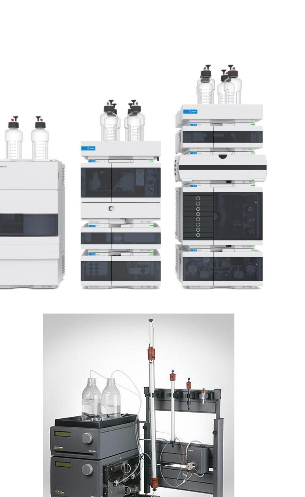
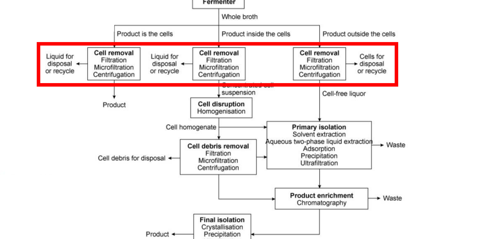

# Section 47: Quantifying differential migration, and final isolation

## Overview

Section 46 described chromatography qualitatively. This note makes it quantitative: the **capacity factor** and **retention ratio** that characterise elution, and the volume relations specific to **gel chromatography**, which predict exactly where a solute elutes from its access to the pores. It closes the bioprocessing unit with **final isolation**, the last downstream stage.

*Assumed:* the five chromatography types, especially gel chromatography (Section 46); the downstream stages (Section 32).

## Intuition

A solute's position in the chromatogram is reported as the **elution volume** $V_e$: the volume of eluent that has passed when the solute emerges at peak concentration. Volume is used rather than time because it is independent of flow rate.

A solute that never interacts with the stationary phase travels with the liquid and emerges after one **void volume** $V_0$ — the volume of liquid between the particles. Everything that *does* interact is delayed. So the natural measure of retention is not $V_e$ itself but **how much it exceeds $V_0$**, scaled by $V_0$ to make it dimensionless. That is the capacity factor.

Gel chromatography is the case where this becomes exactly predictable. There is no binding — only whether a molecule fits into the pores. A molecule too large to enter any pore is confined to the space between particles and elutes at $V_0$. A molecule small enough to enter every pore has the full internal volume available and elutes last. **Every solute lies between these two bounds**, so gel chromatography has a closed elution window, which no other type has.

*Analogy:* a crowd moving through a corridor lined with alcoves. People too large to enter any alcove pass straight through; small ones that wander into every alcove take longest. The analogy breaks down because entry here is not a choice but a geometric constraint, which is why the limits are hard.

## Derivation

Notation: $V_e$ elution volume; $V_0$ void volume (between the particles); $V_i$ volume of empty space *within* the particles; $V_s$ volume of the material (hydrogel) making up the particles; $V_t$ total column volume.

### Capacity factor and retention ratio

**Step 1: capacity factor.** The retention of a solute beyond the void volume, normalised:
$$k = \frac{V_e-V_0}{V_0} \tag{1}$$
$k = 0$ means the solute is unretained and elutes with the void. Larger $k$ means more retention. The normalisation by $V_0$ makes $k$ a property of the solute and the chemistry, not of the column size.

**Step 2: retention ratio.** Comparing two solutes 1 and 2:
$$\delta = \frac{k_1}{k_2} \tag{2}$$
This measures how well the column distinguishes them. $\delta = 1$ means they co-elute and are not separated at all; the further $\delta$ is from 1, the better the resolution.

### Gel chromatography

**Step 3: the column's volume budget.** The total column volume divides into three parts:
$$V_t = V_0 + V_i + V_s \tag{3}$$
liquid between particles, liquid inside particles, and the solid gel itself.

**Step 4: elution volume.** A solute travelling down the column has access to $V_0$ always, and to a *fraction* of $V_i$ depending on whether it fits into the pores:
$$V_e = V_0 + K_pV_i \tag{4}$$
where $K_p$ is the **partition coefficient**, defined as the fraction of the volume within the gel particles that is available to the solute.

**Step 5: rearrange for the measurable.**
$$K_p = \frac{V_e-V_0}{V_i} \tag{5}$$
So determining $K_p$ requires measuring $V_e$ and knowing $V_0$ and $V_i$.

**The two limits, which bound every solute:**
- **$K_p = 0$**: a large macromolecule that does not penetrate the gel particles at all. Then $V_e = V_0$ — it elutes in the void volume, *first*. This also gives the practical route to measuring $V_0$: run a molecule known to be excluded and record its elution volume.
- **$K_p = 1$**: a small solute with full access. Then $V_e = V_0+V_i$ — the latest anything can elute.

Hence $V_0 \le V_e \le V_0+V_i$ for every solute. Combining (1) and (4), the capacity factor is
$$k = \frac{K_pV_i}{V_0} \tag{6}$$
so $k$ ranges from 0 to $V_i/V_0$ and cannot exceed it. **Gel chromatography has a bounded retention**, unlike the binding-based methods where strong binding can retain a solute arbitrarily long.

**Step 6: measuring $V_i$.** From the gel's properties:
$$V_i = a\,W_r \tag{7}$$
where $W_r$ is the **water retention value** — the volume of water taken up when rehydrating the gel, per unit dry mass, specified by the manufacturer — and $a$ is the dry mass of gel.

Often the gel is supplied already rehydrated, so $a$ is unknown. In that case:
$$V_i = \frac{W_r\rho_g}{1+W_r\rho_w}\left(V_t-V_0\right) \tag{8}$$
with $\rho_g$ the density of the rehydrated gel and $\rho_w$ the density of water. Note $(V_t-V_0) = V_i+V_s$ from (3): equation (8) splits the non-void volume into pore space and solid in the ratio the gel's water content implies.

## Worked example

*Sizing the elution window of a gel column.* Computed in Python.

**Given.** A column of total volume $V_t = 100$ mL with void volume $V_0 = 30$ mL, packed with a hydrogel of water retention $W_r = 7.5$ mL g⁻¹ and rehydrated density $\rho_g = 1.05$ g mL⁻¹, with $\rho_w = 1.00$ g mL⁻¹.

**Step 1: internal pore volume**, from (8):
$$V_i = \frac{7.5\times1.05}{1+7.5\times1.00}(100-30) = \frac{7.875}{8.5}\times70 = 64.9\ \mathrm{mL}$$
From (3), $V_s = 100-30-64.9 = 5.1$ mL. **The gel matrix is only 5 % of the column volume** — the particles are essentially water held in a sparse polymer network, which is what a hydrogel is.

**Step 2: where solutes elute**, from (4) and (6):

| $K_p$ | $V_e$ (mL) | $k$ | Solute |
|---|---|---|---|
| 0 | 30.0 | 0 | macromolecule, fully excluded |
| 0.2 | 43.0 | 0.43 | large protein |
| 0.5 | 62.4 | 1.08 | medium protein |
| 1.0 | 94.9 | 2.16 | small solute, full access |

**Step 3: read the window.** Everything elutes between **30 and 95 mL**, a window of 64.9 mL — exactly $V_i$, as (4) requires. The last solute emerges at only 3.2 times the volume of the first.

**Step 4: resolution of two proteins.** For $K_p = 0.2$ and $0.5$, the retention ratio from (2) is
$$\delta = \frac{0.43}{1.08} = 0.40$$
and the peaks are separated by $(0.5-0.2)\times64.9 = 19.5$ mL.

**What the numbers say about the method.**
- *The sample volume must be small.* The entire separation happens within 65 mL, so injecting even 10 mL of feed would smear the peaks across a sixth of the usable window. This is the fundamental capacity limit of gel chromatography and why it is a **polishing** step, used last when the volume is already small.
- *It cannot concentrate.* Since there is no binding and no elution step, the product leaves more dilute than it entered, diluted by roughly the peak width. Every other type in Section 46 concentrates; this one does not.
- *But it is predictable.* Equation (4) is pure geometry — no affinity constants, no temperature dependence, no pH. Retention can be calculated in advance from the gel's pore size, which is why it doubles as an analytical method for measuring molecular size.

## Instrumentation

Two systems carry out chromatographic separations of biomolecules:

**HPLC (high-performance liquid chromatography)** achieves better resolution, using **small particles (2 to 5 µm)** and **high pressure (5–10 MPa)**. Throughput is low, 1 to 5 mL min⁻¹. It is used at small scale or laboratory scale, and also for valuable products — oligonucleotide purification (Section 06) is the example already met.

**FPLC (fast protein liquid chromatography)** has lower resolution, **larger particles**, lower pressure and higher throughput, and is used at larger scale.

The trade is the familiar one: smaller particles give more plates and better resolution but a far larger pressure drop, so resolution is bought with pressure and throughput.

## Final isolation

The product is already highly purified by chromatography. The objective of **final isolation** is possibly to **increase purity further**, and to **alter the physical form** of the product to make it suitable for storage and commercialisation.

Many products are packaged and sold as **solids or powders**. These go through either **precipitation or crystallisation** (Sections 43–44), followed by **filtration or centrifugation** (Sections 33–37), and the wet solids — crystals or amorphous precipitate — are then **dried**.

The operations are therefore ones already covered; what differs is the purpose. Earlier they were used to *separate*; here they are used to *formulate*.

## Link to other topics

The capacity factor is the chromatographic analogue of a retention or holdup time, and the resolution-versus-pressure trade in HPLC is the same relationship as plate count against pressure drop in a packed column: finer packing improves separation and costs pumping energy.

## Conclusion

The capacity factor $k = (V_e-V_0)/V_0$ characterises retention and the retention ratio $\delta = k_1/k_2$ the resolution of two solutes. In gel chromatography there is no binding, so $V_e = V_0 + K_pV_i$ is pure geometry: every solute elutes between $V_0$ and $V_0+V_i$, giving a bounded, predictable window but no concentration and a strict limit on sample volume. Final isolation then converts the purified product into a storable solid, reusing the precipitation, filtration and centrifugation of earlier sections for formulation rather than separation. This completes the downstream processing unit.
