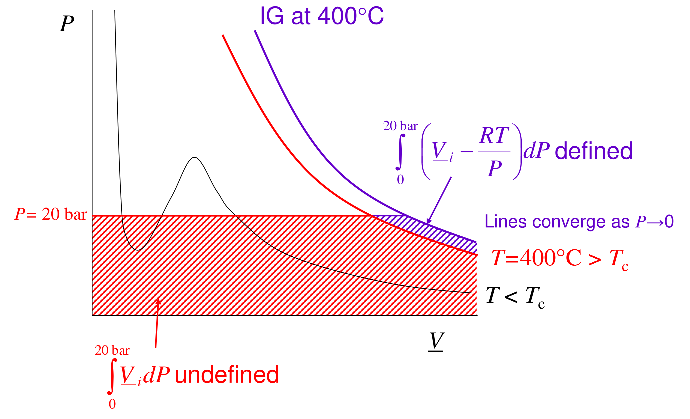

# Section 08: Fugacity from volumetric data and the fugacity coefficient

## Overview

The previous note defined fugacity and found its pressure dependence, $RT\,d\ln f_i = \underline{V}_i\,dP$ at constant $T$. This note turns that into a working formula. Integrating it directly fails, because it would start from an infinite volume at zero pressure. The fix is to integrate only the **departure from ideal-gas behaviour**. That gives the **fugacity coefficient** $\phi = f/P$ as a finite integral of $(\underline{V} - RT/P)$, which can be evaluated from steam tables, PVT data or an equation of state (EOS).

*Assumed:* the definition of fugacity and equation $RT\,d\ln f_i = \underline{V}_i\,dP$ from the previous note; $f^{\mathrm{IG}} = P$; the compressibility factor $Z = P\underline{V}/RT$; the virial equation of state.

*Notation:* $\phi_i = f_i/P$ is the fugacity coefficient of pure $i$. $\bar\phi_i = \bar f_i/P_i$ is the fugacity coefficient of $i$ in a mixture, where $P_i = y_iP$ is its partial pressure. $\underline{V}_i$ is the molar volume of pure $i$. $\bar V_i$ is the partial molar volume of $i$ in a mixture.

## Intuition

The obvious route is to start where the substance is surely ideal ($P = 0$) and integrate $\underline{V}\,dP$ up to the pressure of interest. At $P\to 0$, though, $\underline{V}\to\infty$ and $\ln f\to-\infty$, so the integral is infinite. That infinity is not caused by non-ideality: an ideal gas has it too. It is just the logarithmic dependence of $\underline{G}$ on $P$ for any gas.

So subtract what an ideal gas would do over the same path. The infinite parts cancel, and only the (finite) **gap** between the real isotherm and the ideal-gas isotherm is left. *This is like measuring the height of a building from its own ground floor rather than from the centre of the Earth.* The reference (the ideal gas) is chosen so that the large shared part drops out. The analogy breaks down because here the shared part is not just large but infinite, so the subtraction is needed for the integral to exist at all, not merely convenient.

## Derivation

**Step 1: the direct route fails.** For pure $i$ at constant $T$, integrate $RT\,d\ln f_i = \underline{V}_i\,dP$ from $P = 0$:

$$RT\ln\frac{f_i(P)}{f_i(0)} = \int_0^P \underline{V}_i\,dP \tag{1}$$

At $P\to 0$ the gas is ideal, so $f_i(0) = 0$ and the left side is infinite. On the right, $\underline{V}_i\to\infty$ as $P\to 0$ and the area under the isotherm diverges. The equation is correct, but it cannot be used.

**Step 2: write the same equation for an ideal gas.** For an ideal gas $\underline{V}^{\mathrm{IG}} = RT/P$ and $f^{\mathrm{IG}} = P$, so along the same isotherm

$$RT\,d\ln P = \frac{RT}{P}\,dP \tag{2}$$

**Step 3: subtract (2) from the differential form of (1) and integrate from 0 to $P$.**

$$RT\,d\ln\frac{f_i}{P} = \left(\underline{V}_i - \frac{RT}{P}\right)dP \;\;\Rightarrow\;\; RT\ln\frac{f_i}{P}\bigg|_P - RT\ln\frac{f_i}{P}\bigg|_{0} = \int_0^P\left(\underline{V}_i - \frac{RT}{P}\right)dP$$

*Reason:* at the lower limit the real gas is ideal, so $f_i/P\to 1$ and that term vanishes. Both divergences have cancelled.

**Step 4: define the fugacity coefficient.**

$$\phi_i \equiv \frac{f_i}{P}, \qquad RT\ln\phi_i = \int_0^P\left(\underline{V}_i - \frac{RT}{P}\right)dP \qquad (\text{constant } T) \tag{3}$$

The integrand stays finite as $P\to 0$. In the low-pressure limit it tends to the second virial coefficient $B$ (Step 6).

**Step 5: compressibility-factor form.** Write $\underline{V}_i = Z_iRT/P$. Then $\underline{V}_i - RT/P = (Z_i - 1)RT/P$, and (3) becomes

$$\ln\phi_i = \int_0^P\frac{Z_i - 1}{P}\,dP \tag{4}$$

This is the form used with EOS and generalised $Z$ charts.

**Step 6: virial gas.** Use the pressure-explicit virial equation, $Z = 1 + B'P + C'P^2 + \dots$, where $B' = B/RT$ and $C' = (C - B^2)/(RT)^2$. These follow from matching it term by term with the volume form $Z = 1 + B/\underline{V} + C/\underline{V}^2$. Then $(Z-1)/P = B' + C'P$, and (4) integrates at once:

$$\ln\phi = B'P + \tfrac{1}{2}C'P^2 \;\approx\; \frac{BP}{RT} \quad (\text{low } P) \tag{5}$$

**Step 7: physical meaning, the residual Gibbs energy.** Write the definition of fugacity for the real fluid and for an ideal gas at the *same* $T$ and $P$, then subtract. The reference terms cancel:

$$\underline{G}_i(T,P) - \underline{G}_i^{\mathrm{IG}}(T,P) = RT\ln\frac{f_i}{P} = RT\ln\phi_i \tag{6}$$

So $RT\ln\phi_i$ is the **residual Gibbs energy**: how much lower (or higher) the molar Gibbs energy of the real fluid is than that of an ideal gas at the same conditions.

**Step 8: component in a mixture.** Define $\bar\phi_i = \bar f_i/(y_iP)$. At constant $T$ and composition, $(\partial\mu_i/\partial P)_{T,n} = \bar V_i$, while for the same mixture as an ideal gas $(\partial\mu_i^{\mathrm{IG}}/\partial P)_{T,n} = RT/P$. Subtract the two and integrate from $P = 0$, where every mixture is an ideal-gas mixture and $\bar\phi_i = 1$:

$$RT\ln\bar\phi_i = \int_0^P\left(\bar V_i - \frac{RT}{P}\right)dP \qquad (\text{constant } T,\ \text{composition}) \tag{7}$$

This has the same structure as (3), with the partial molar volume in place of the pure molar volume. It needs a mixture EOS (with mixing rules), because $\bar V_i$ depends on composition.

## Motivation and explanation

**What $\phi$ measures.** By (6), $\phi$ is the residual Gibbs energy expressed as a factor on pressure.
- $\phi < 1$: the real molar volume is smaller than $RT/P$. Attractive forces pull the molecules together, lower the Gibbs energy and reduce the escaping tendency. This is typical of gases below their Boyle temperature, and of vapours.
- $\phi > 1$: repulsions dominate ($\underline{V} > RT/P$), which happens for small molecules at high temperature or very high pressure.

In the figure, the integral (3) is the thin hatched area between the real isotherm and the ideal-gas isotherm. It is finite because the two curves converge as $P\to 0$, whereas the area under the real isotherm alone is unbounded.

**Limiting cases.**
- Ideal gas: $\underline{V} = RT/P$, so the integrand is zero and $\phi = 1$.
- Low pressure: $\phi \approx 1 + BP/RT$, linear in $P$ with slope set by the second virial coefficient, which is negative below the Boyle temperature.
- $P\to 0$: $\phi\to 1$ for every substance and every mixture. This is what makes the ideal-gas reference work.

**Below the critical temperature.** If $T < T_c$, the integration path from $P = 0$ reaches the saturation pressure, where the substance condenses. To get a *liquid* fugacity:
1. integrate (3) through the vapour from 0 to $P^{\mathrm{SAT}}$, giving $\phi^{\mathrm{sat}}$;
2. cross the phase boundary, where $\underline{G}$ (and hence $f$) does not change, because liquid and vapour are in equilibrium;
3. continue up the liquid branch with the Poynting factor.

The result is $f^{l} = \phi^{\mathrm{sat}}P^{\mathrm{SAT}}\exp[\underline{V}^{l}(P-P^{\mathrm{SAT}})/RT]$. This reduces to the earlier form when the saturated vapour is ideal ($\phi^{\mathrm{sat}} = 1$). Integrating straight through the van der Waals loop would be wrong, because the loop is not a physical path.

**When the formulas fail.** Equations (3), (4) and (7) are exact. The approximations come only from the PVT information used:
- the truncated virial form (5) is good to moderate density but fails near the critical point and in liquids;
- tabulated data must reach low enough pressure for the integrand to be extrapolated to $P = 0$.

## Worked example

**Problem.** Estimate the fugacity coefficient and fugacity of nitrogen at 0 °C and 100 atm from virial coefficients, and compare with the accepted value $\phi = 0.9703$. Data, interpolated linearly to 273.15 K from recommended values at 260 K and 280 K: $B = -10.30$ cm³ mol⁻¹ and $C = 1430$ cm⁶ mol⁻².

**Second virial coefficient only.** From (5), $\ln\phi \approx BP/RT$. With $P = 1.01325\times10^{7}$ Pa and $RT = 2271$ J mol⁻¹:

$$\ln\phi = -0.0460,\qquad \phi = 0.955,\qquad f = 95.5\ \text{atm}$$

**Including the third virial coefficient.** With $B' = B/RT$ and $C' = (C - B^2)/(RT)^2$:

$$\ln\phi = B'P + \tfrac12 C'P^2 = -0.0328,\qquad \phi = 0.968,\qquad f = 96.8\ \text{atm}$$

**Comparison.** The accepted value is $\phi = 0.9703$, i.e. $f = 97.03$ atm. The $B$-only estimate overstates the non-ideality: it predicts a 4.5 % reduction against the true 3 %. Adding $C$ brings it within 0.3 %. *Physically:* at 100 atm nitrogen is dense enough that three-body (and repulsive) contributions, carried by the positive $C$, partly cancel the two-body attraction carried by the negative $B$. The real gas is "less attractive" than the low-pressure slope suggests. The sign of $\phi - 1$ matches $B < 0$: at 0 °C nitrogen is below its Boyle temperature, so attractions win and $\phi < 1$.

## Link to other topics

Equation (3) is the gas-phase counterpart of the liquid-phase activity coefficient that comes later. Both are correction factors on an ideal reference, and together they give the general vapour–liquid equilibrium relation $y_i\bar\phi_iP = x_i\gamma_if_i^{l}$. The residual-property idea in (6) is the same one used for departure enthalpies and entropies in process simulators.

## Conclusion

Integrating $\underline{V}\,dP$ from zero pressure diverges, but integrating the departure $\underline{V} - RT/P$ does not. The result is the fugacity coefficient, $RT\ln\phi = \int_0^P(\underline{V} - RT/P)\,dP$, which is the residual Gibbs energy expressed as a factor on pressure. It needs only PVT data. The next note applies it to steam-table data for water at 400 °C, integrating numerically at 20 bar and 500 bar and comparing with the Peng–Robinson EOS.
