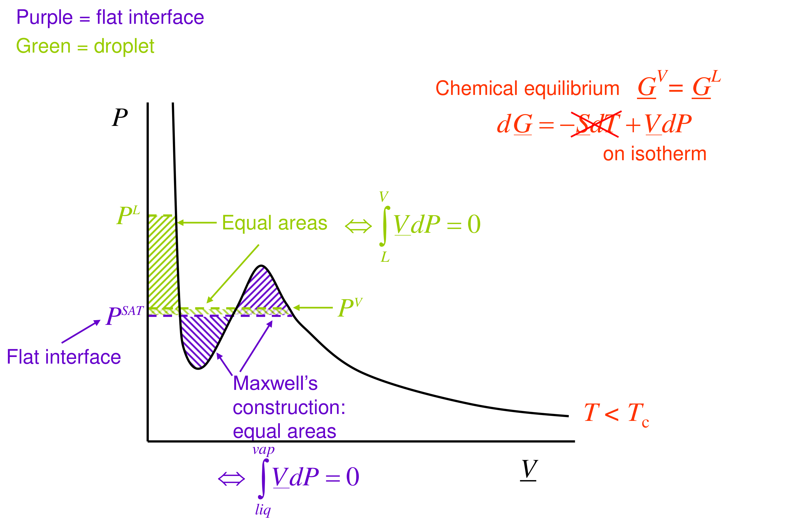

# Section 23: Droplets and the Kelvin equation

## Overview

A small liquid droplet has a higher vapour pressure than a flat surface of the same liquid. Surface tension squeezes the droplet, raising its internal pressure. By the same argument as the Poynting correction, this raises its chemical potential. This note derives the **Kelvin equation**,

$$\ln\frac{P^{V}}{P^{\mathrm{SAT}}} \approx \frac{2\sigma\underline{V}^{L}}{rRT},$$

and uses it to explain why a vapour can be supersaturated without condensing, and why clouds need dust.

*Assumed:* the Poynting result (Section 06); the phase rule (Section 21); $(\partial\underline{G}/\partial P)_T = \underline{V}$.

*Notation:* $\sigma$ is the surface tension (N m⁻¹), $r$ the droplet radius, $P^{L}$ the pressure inside the droplet, $P^{V}$ the surrounding vapour pressure, and $P^{\mathrm{SAT}}(T)$ the vapour pressure over a flat surface. Pure substance throughout.

## Intuition

Surface tension acts like a stretched skin around the droplet, pressing inwards. The smaller the droplet, the more sharply curved the skin and the harder it presses. Liquid inside is therefore compressed, and compressed liquid has a higher escaping tendency (Section 06). So a small droplet evaporates into vapour that would be exactly saturated over a flat surface.

Equilibrium with a droplet of radius $r$ needs a *supersaturated* vapour, and the equilibrium is unstable:
- a droplet slightly smaller than that $r$ has an even higher vapour pressure, so it evaporates further;
- a droplet slightly larger grows.

## Derivation

**Step 1: the phase-rule count.** One component, two phases: naively $F = 1$, one boiling point per pressure. But $P^{L}\neq P^{V}$ across a curved interface, which removes one constraint. So $F = 2$: for example the pressure *and* the droplet radius.

**Step 2: mechanical equilibrium (Young–Laplace).** Cut the droplet through its centre. The pressure excess acting on the cross-section, $(P^{L} - P^{V})\pi r^2$, is balanced by surface tension acting round the rim, $2\pi r\sigma$:

$$P^{L} - P^{V} = \frac{2\sigma}{r} \tag{1}$$

**Step 3: chemical potentials.** Reference both phases to the flat-interface saturation state, where $\underline{G}^{L} = \underline{G}^{V} = \underline{G}^{\mathrm{SAT}}(T)$ at $P^{\mathrm{SAT}}$.
- Incompressible liquid: $\mu^{L} = \underline{G}^{\mathrm{SAT}} + \underline{V}^{L}(P^{L} - P^{\mathrm{SAT}})$.
- Ideal-gas vapour: $\mu^{V} = \underline{G}^{\mathrm{SAT}} + RT\ln(P^{V}/P^{\mathrm{SAT}})$.

**Step 4: equate.** $\mu^{L} = \mu^{V}$ gives the same equation as the Poynting correction,

$$\underline{V}^{L}(P^{L} - P^{\mathrm{SAT}}) = RT\ln\frac{P^{V}}{P^{\mathrm{SAT}}}$$

but now $P^{L}$ is set by (1): $P^{L} = P^{V} + 2\sigma/r$.

**Step 5: the Kelvin equation.** Substitute:

$$\underline{V}^{L}\left(\frac{2\sigma}{r} + P^{V} - P^{\mathrm{SAT}}\right) = RT\ln\frac{P^{V}}{P^{\mathrm{SAT}}} \tag{2}$$

For droplets larger than a few nanometres, $P^{V} - P^{\mathrm{SAT}}$ is negligible compared with $2\sigma/r$, so

$$\ln\frac{P^{V}}{P^{\mathrm{SAT}}} \approx \frac{2\sigma\underline{V}^{L}}{rRT} \tag{3}$$

**Graphical form.** On the isotherm, the flat-interface case is Maxwell's equal-area construction at $P^{\mathrm{SAT}}$. For a droplet, the liquid branch is pushed up to $P^{L}$. The extra liquid-side area must be balanced by raising the vapour line slightly, to $P^{V} > P^{\mathrm{SAT}}$.

## Motivation and explanation

**Same physics as Poynting.** In Section 06 the extra pressure on the liquid came from an inert gas. Here it comes from curvature. Either way, compressing the liquid by $\Delta P$ multiplies its fugacity by $\exp(\underline{V}^{L}\Delta P/RT)$.

**Unstable equilibrium and nucleation.** In vapour at a given supersaturation $S = P^{V}/P^{\mathrm{SAT}}$, (3) defines a critical radius $r^{*} = 2\sigma\underline{V}^{L}/(RT\ln S)$. Smaller droplets evaporate; larger ones grow. Forming a droplet from scratch means passing through tiny, highly unstable sizes. So pure vapour can stay supersaturated (metastable) for a long time. Real clouds form on dust, salt or ions, which provide surfaces large enough to skip that stage. The same effect makes small crystals more soluble than large ones, which drives Ostwald ripening in crystallisers.

**Limits.**
- At radii of a few nanometres, a droplet contains only hundreds of molecules, and a bulk surface tension is no longer meaningful.
- The ideal-gas vapour assumption fails near the critical point.
- Solutes on the droplet (e.g. dissolved salt in cloud droplets) lower its vapour pressure (Raoult) and compete with the Kelvin effect.

## Worked example

**Problem.** For pure water droplets at 20 °C, find the vapour pressure enhancement $P^{V}/P^{\mathrm{SAT}}$ for radii 1 µm, 100 nm, 10 nm and 1 nm, and the critical radius at supersaturations of 0.1 %, 1 % and 10 %. Data: $\sigma = 72.7$ mN m⁻¹, $\underline{V}^{L} = 1.805\times10^{-5}$ m³ mol⁻¹, $P^{\mathrm{SAT}} = 2339$ Pa.

**Enhancement from (3)**, with $2\sigma\underline{V}^{L}/RT = 1.077$ nm:

| $r$ | $2\sigma/r$ (bar) | $P^{V}/P^{\mathrm{SAT}}$ (3) | Full (2) |
|---|---|---|---|
| 1 µm | 1.45 | 1.0011 | 1.0011 |
| 100 nm | 14.5 | 1.011 | 1.011 |
| 10 nm | 145 | 1.114 | 1.114 |
| 1 nm | 1455 | 2.94 | 2.94 |

The neglected term in (2) changes nothing to four figures, because $P^{V} - P^{\mathrm{SAT}}$ is at most kilopascals, while $2\sigma/r$ is bars to kilobars.

**Critical radii.**

| Supersaturation $S$ | 1.001 | 1.01 | 1.1 |
|---|---|---|---|
| $r^{*}$ | 1.08 µm | 108 nm | 11 nm |

**Interpretation.** Air in a real cloud is typically only slightly supersaturated (well under a few percent). There, a droplet must already be about 0.1 µm across to grow. Random clustering of water molecules cannot reach that size, so clouds form on aerosol particles of about that size or larger. Without them, vapour would need several-fold supersaturation (the 1 nm row) to condense spontaneously.

## Link to other topics

The same equation controls capillary condensation in porous adsorbents (concave menisci *lower* the vapour pressure), cavitation, and crystal size distributions in crystallisers. Section 24 applies the same mechanical-plus-chemical equilibrium to bubbles, where the curvature is reversed.

## Conclusion

Surface tension raises the pressure inside a droplet by $2\sigma/r$. By the Poynting argument, this raises its equilibrium vapour pressure, giving the Kelvin equation $\ln(P^{V}/P^{\mathrm{SAT}}) = 2\sigma\underline{V}^{L}/(rRT)$. The effect is negligible above a micrometre but dominant at nanometres. This makes droplet nucleation hard and supersaturated vapours metastable. The next section turns the geometry inside out: a vapour bubble in a liquid, superheating, and boiling.
