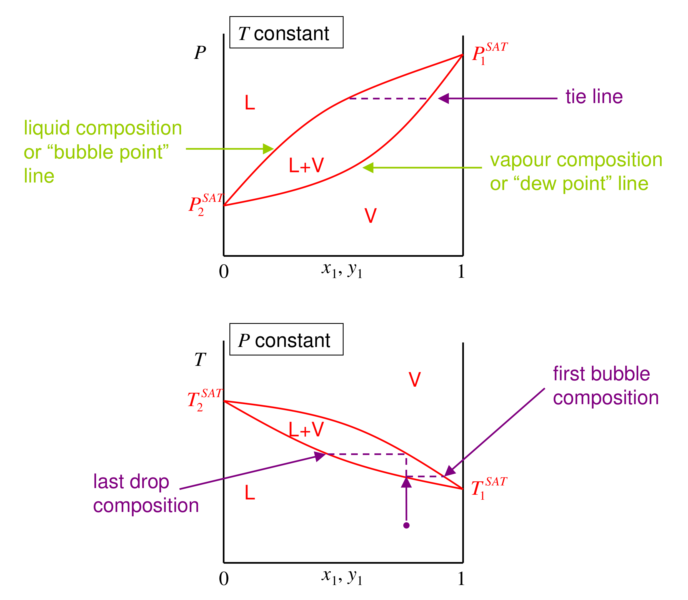

# Section 25: Binary vapour–liquid equilibrium and its phase diagrams

## Overview

This unit applies the earlier machinery (fugacity, activity coefficients, the phase rule) to vapour–liquid equilibrium (VLE) of mixtures, the thermodynamic basis of distillation. This note sets up the problem:
- the equilibrium criteria plus mass balances that define every VLE calculation;
- the three-dimensional $P$–$T$–composition surface of a binary;
- the two-dimensional slices ($P$–$x$–$y$ at constant $T$, $T$–$x$–$y$ at constant $P$) on which distillation is designed;
- how to read bubble points, dew points and tie lines from them.

Only binaries are treated. Multicomponent behaviour follows by combining binary parameters (Section 12).

*Assumed:* equilibrium means equal $T$, $P$ and $\bar f_i$ in each phase (Section 07); the phase rule (Section 21).

*Notation:* $x_i$ is the liquid mole fraction, $y_i$ the vapour mole fraction, and $z_i$ the overall (feed) mole fraction. $L$ and $V$ are the fractions of the total moles in the liquid and vapour.

## Intuition

When a liquid mixture partly boils, the vapour is richer in the more volatile component. That difference between $y$ and $x$ is what distillation exploits, stage after stage.

The phase rule says a binary in VLE has two degrees of freedom. Fix the temperature and you may still choose *either* the pressure *or* the liquid composition, but not both. Two compositions coexist at each pressure: the liquid on one curve, the vapour on another. Joining them gives a horizontal **tie line**.

## Derivation

**Step 1: the equations.** For each component $i = 1,\dots,C$:

$$T^{l} = T^{v}, \qquad P^{l} = P^{v}\ (\text{flat interface}), \qquad \bar f_i^{\,l} = \bar f_i^{\,v} \tag{1}$$

**Step 2: mass balances.** Per mole of feed of composition $z_i$:

$$Lx_i + Vy_i = z_i, \qquad \sum_i x_i = \sum_i y_i = 1, \qquad L + V = 1 \tag{2}$$

Equations (1)–(2) are the entire framework. What changes between problems is only how $\bar f_i$ is written: activity coefficients for the liquid and fugacity coefficients for the vapour (next section).

**Step 3: the lever rule.** For a binary, (2) gives

$$\frac{L}{V} = \frac{y_1 - z_1}{z_1 - x_1} \tag{3}$$

The feed point splits the tie line in inverse proportion to the amounts of the two phases. A feed close to the liquid curve is mostly liquid.

**Step 4: reduced phase diagrams.** The equilibrium states of a binary fill a 3D space ($P$, $T$, composition). The liquid and vapour surfaces bound a lens-shaped two-phase region, which ends at the critical locus joining the two pure-component critical points. Slicing it gives:
- *Constant $T$* ($P$–$x$–$y$): the upper curve is the bubble-point (liquid) line, the lower the dew-point (vapour) line, running from $P_2^{\mathrm{SAT}}$ to $P_1^{\mathrm{SAT}}$.
- *Constant $P$* ($T$–$x$–$y$): the curves are inverted. The liquid (bubble) line is now lower, running from $T_1^{\mathrm{SAT}}$ (the more volatile component boils first) to $T_2^{\mathrm{SAT}}$.

## Motivation and explanation

**Reading a $T$–$x$–$y$ diagram.** Heat a subcooled liquid of composition $z_1$ at constant $P$ (the vertical arrow).
1. It first boils where it meets the liquid line: the **bubble point**. The first bubble has the vapour composition on the same tie line, enriched in component 1.
2. On further heating, the liquid becomes poorer in 1 and both compositions slide along their curves.
3. The last drop disappears at the **dew point**, where the vapour has the feed composition.

Between the two, the lever rule (3) gives how much has vaporised.

**Why pressure-composition and temperature-composition curves differ.** At constant $T$, more volatile material raises the pressure. At constant $P$, it lowers the boiling temperature. So the diagrams are near mirror images, curved because vapour pressure depends exponentially on temperature.

**Limits.** These pictures assume a flat interface and that only two phases are present. Liquid immiscibility (a third phase) and near-critical behaviour change the topology; both are treated later.

## Worked example

**Problem.** A 50:50 benzene (1)–toluene (2) liquid is heated at 1 atm. Using Raoult's law with accurate vapour pressures, find (a) the bubble and dew temperatures, and (b) the phase compositions and fraction vaporised at 95 °C.

**(a)** The bubble point is where $\sum_i z_iP_i^{\mathrm{SAT}}(T) = P$. The dew point is where $\sum_i z_i/P_i^{\mathrm{SAT}}(T) = 1/P$. Solving numerically:
- bubble point 92.1 °C;
- dew point 98.7 °C.

Pure benzene boils at 80.1 °C and pure toluene at 110.6 °C.

**(b)** At 95 °C the equilibrium ratios are $K_i = P_i^{\mathrm{SAT}}/P$: $K_1 = 1.550$ and $K_2 = 0.628$. For a binary, $x_1 = (1 - K_2)/(K_1 - K_2) = 0.404$ and $y_1 = K_1x_1 = 0.625$. From (3), $V = (z_1 - x_1)/(y_1 - x_1) = 0.43$.

**Interpretation.** Partially vaporising the mixture at 95 °C gives a vapour of 62.5 % benzene from a 50 % feed, and the liquid that remains is 40 % benzene. Each such equilibrium stage enriches the vapour. The ratio $K_1/K_2 = 2.47$ (the relative volatility) measures how easily the pair separates, and it is what sets the number of stages in a column.

## Link to other topics

Equations (1)–(3) are exactly the "flash" calculation done by every process simulator, and the $T$–$x$–$y$ diagram is the starting point of McCabe–Thiele and other distillation design methods. Section 26 shows how the fugacities in (1) are written in practice, reducing to Raoult's law in the ideal limit.

## Conclusion

VLE of a binary is fixed by equal fugacities plus mass balances. Graphically it is a 3D surface whose constant-$T$ and constant-$P$ slices show bubble and dew curves joined by tie lines. The lever rule then gives the phase amounts, and the gap between vapour and liquid compositions is what makes distillation work. The next section turns the fugacity equality into the working equation $y_iP = x_i\gamma_iP_i^{\mathrm{SAT}}$, stating exactly what is approximated.
