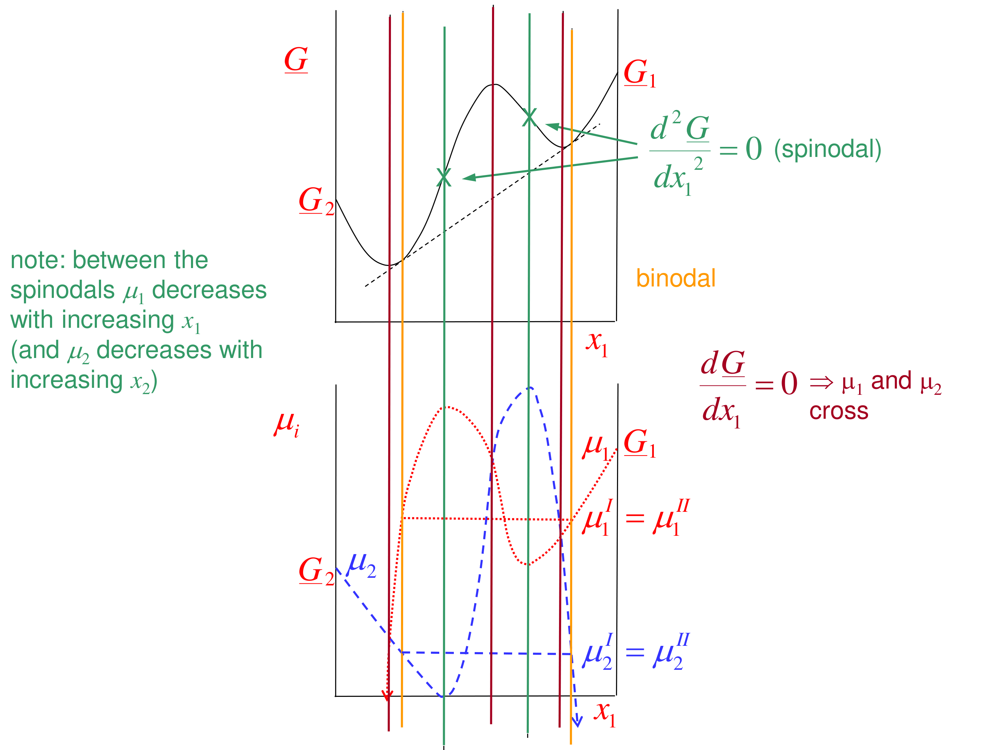

# Section 39: Binodal, spinodal and the stability of a single liquid

## Overview

Inside a miscibility gap there are two boundaries:
- the **binodal**, where two liquids become the equilibrium state;
- the **spinodal**, where a single liquid stops being even temporarily stable.

Between them, a single liquid is **metastable** and splits only after nucleation. Inside the spinodal it is **unstable** and splits spontaneously by **spinodal decomposition**. This note derives the condition from how the chemical potentials vary with composition, and follows a liquid cooled into the gap.

*Assumed:* $d\underline{G}/dx_1 = \mu_1 - \mu_2$ and the curvature of $\underline{G}$ (Section 36); material moves down gradients of $\mu$ (Section 01).

## Intuition

Normally, adding more of component 1 to a region raises $\mu_1$ there. So any local excess of component 1 pushes it away, and concentration fluctuations die out: the mixture is stable.

Inside the spinodal the opposite holds: adding component 1 *lowers* $\mu_1$. A region that happens to gain a little component 1 now attracts more, the fluctuation grows, and the liquid tears itself into two phases everywhere at once. No nucleation is needed.

Between binodal and spinodal, small fluctuations still die out, but a large enough fluctuation (a nucleus of the other phase) can grow. That is the same situation as a supersaturated vapour (Section 23).

## Derivation

**Step 1: chemical potentials from the $\underline{G}$ curve.** From $\underline{G} = x_1\mu_1 + x_2\mu_2$ and $d\underline{G}/dx_1 = \mu_1 - \mu_2$:

$$\mu_1 = \underline{G} + x_2\frac{d\underline{G}}{dx_1}, \qquad \mu_2 = \underline{G} - x_1\frac{d\underline{G}}{dx_1} \tag{1}$$

These are the tangent intercepts.

**Step 2: derivatives.** Differentiate (1); the $d\underline{G}/dx_1$ terms cancel:

$$\frac{\partial\mu_1}{\partial x_1} = x_2\frac{\partial^2\underline{G}}{\partial x_1^2}, \qquad \frac{\partial\mu_2}{\partial x_1} = -x_1\frac{\partial^2\underline{G}}{\partial x_1^2} \tag{2}$$

**Step 3: stability criterion.** Both $\partial\mu_1/\partial x_1$ and $\partial\mu_2/\partial x_2$ have the sign of $\partial^2\underline{G}/\partial x_1^2$:
- positive curvature: each component's chemical potential rises with its own concentration, so diffusion flattens composition differences (**stable**);
- zero curvature: the **spinodal**, where $\partial\mu_1/\partial x_1 = \partial\mu_2/\partial x_1 = 0$;
- negative curvature: each component moves *up* its own concentration gradient (**unstable**).

**Step 4: limiting values.** As $x_2\to 0$, $\mu_1\to\underline{G}_1$ and $\mu_2\to -\infty$, and vice versa. At a stationary point of $\underline{G}$, $\mu_1 = \mu_2 = \underline{G}$. Plotting $\mu_1$ and $\mu_2$ against $x_1$ therefore shows two S-shaped curves. At the binodal compositions each $\mu_i$ takes the same value (the horizontal lines), and between the spinodals each runs backwards.

## Motivation and explanation

**Cooling a single liquid into the gap (UCST system).**
1. Above the binodal: a single liquid is the equilibrium state.
2. Between binodal and spinodal: two liquids are the equilibrium, but the single liquid persists until a nucleus forms (on impurities, walls or stirring). The result is typically droplets of one phase growing in the other.
3. On crossing the spinodal: spontaneous separation everywhere, giving a very fine, interconnected dispersion of the two phases.

**Practical consequences.** Spinodal decomposition produces fine, co-continuous structures, the basis of porous glasses, phase-separation membranes and some alloy and polymer-blend microstructures. Metastability explains why a quickly cooled mixture can stay cloudy-free (single-phase) for a while before suddenly separating.

## Worked example

**Problem.** For the regular solution with $A/RT = 2.5$ (Section 36), classify the states at $x_1 = 0.10$, 0.20 and 0.40, and give the sign of $\partial\mu_1/\partial x_1$ at each.

**Boundaries.** Binodal $x = 0.145/0.855$; spinodal $x = 0.276/0.724$.

**Curvature.** $\frac{1}{RT}\frac{\partial^2\underline{G}}{\partial x^2} = \frac{1}{x(1-x)} - 5$:

| $x_1$ | $1/[x(1-x)] - 5$ | Region | Behaviour |
|---|---|---|---|
| 0.10 | +6.11 | outside binodal | stable single liquid |
| 0.20 | +1.25 | between binodal and spinodal | metastable; splits only after nucleation |
| 0.40 | −0.83 | inside spinodal | unstable; spinodal decomposition |

By (2), $\partial\mu_1/\partial x_1 = x_2\,\partial^2\underline{G}/\partial x_1^2$ has the same sign as the curvature: positive at 0.10 and 0.20, negative at 0.40.

**Interpretation.** A 20 % liquid quenched quickly to this temperature can stay homogeneous until nucleated. A 40 % liquid cannot: it separates immediately into a fine dispersion. Both end up as the same two equilibrium phases (14.5 % and 85.5 %). The routes, and the resulting structures, differ.

## Link to other topics

The sign of $\partial\mu_1/\partial x_1$ is exactly what controls diffusion. Section 40 shows that the ordinary Fickian diffusion coefficient is proportional to it, so it vanishes at the spinodal and turns negative inside.

## Conclusion

Single-phase stability requires each chemical potential to increase with that component's own concentration, i.e. $\partial^2\underline{G}/\partial x_1^2 > 0$. The spinodal ($\partial^2\underline{G}/\partial x_1^2 = 0$) separates metastable states, which need nucleation, from unstable ones, which decompose spontaneously. The binodal marks where two liquids become the equilibrium. Next: what this means for diffusion.
