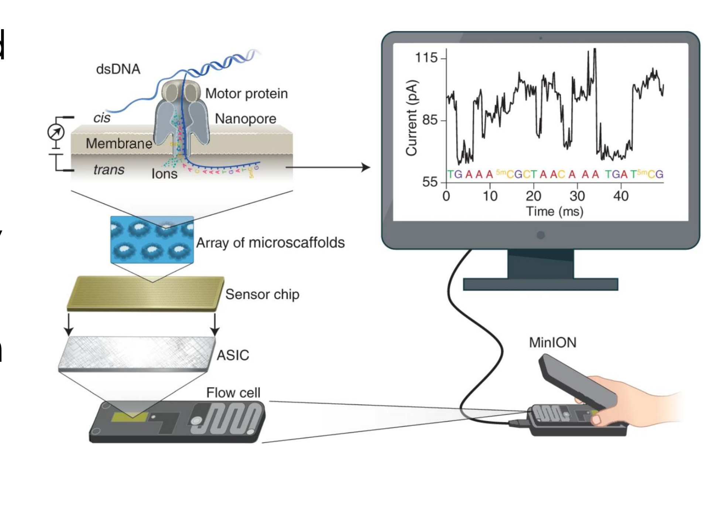
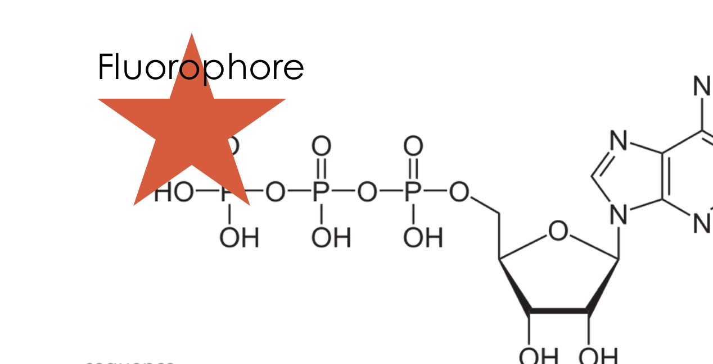
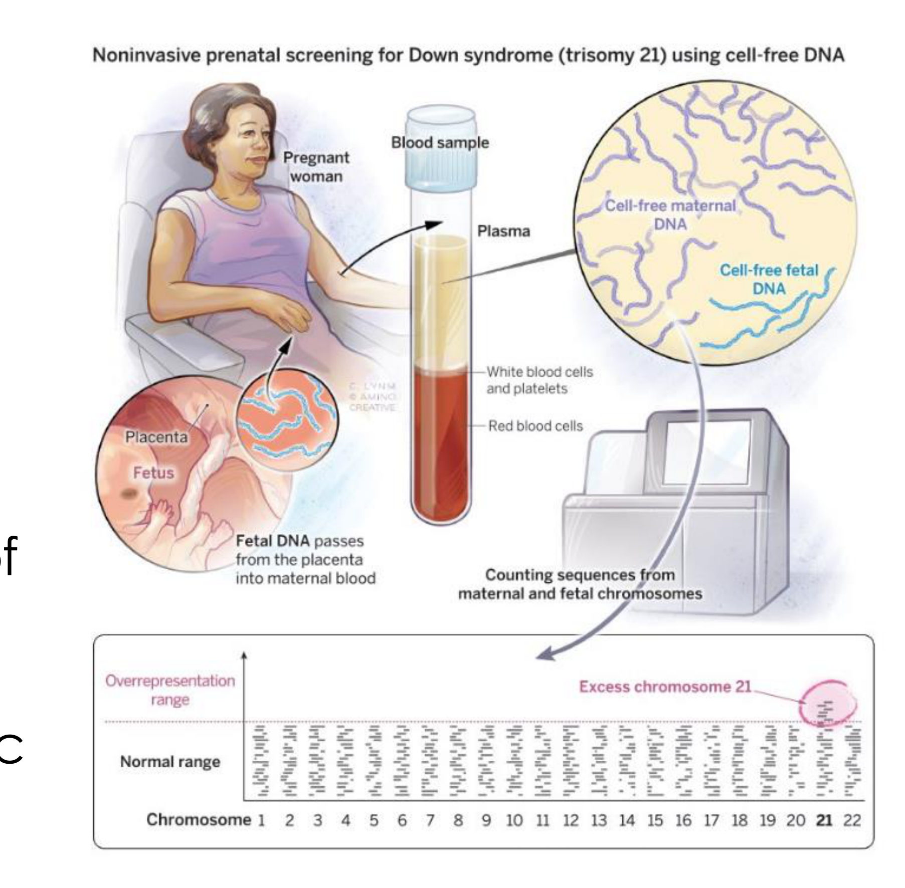

# Sequencing II - long reads and applications

## Overview

Nanopore and PacBio sequencing read individual molecules through different physical signals. Their long reads complement short-read methods by spanning repeats, resolving variants and supporting applications that depend on molecular context.

*Assumed throughout:* nucleotide polymerisation and the short-read sequencing principles.

## Section 13: Nanopore sequencing

### Intuition

Put a hole in an insulating membrane separating two salt solutions, apply a voltage, and ions flow through the hole: a measurable current. Now push something through the hole. While it is in there it occupies space that ions would otherwise use, so the current drops. How *much* it drops depends on the shape and chemistry of whatever is blocking.

DNA is a charged polymer, so the same electric field that drives the ions also drags DNA through the pore. If the hole is narrow enough that only a single strand fits, and if the four bases obstruct the opening by measurably different amounts, then the current over time is a direct transcript of the sequence passing through.

This is a fundamentally different measurement from everything before it. Sanger and Illumina both *synthesise* a copy and infer the template from what was added. Nanopore reads the original molecule itself, and never copies it. That is why there is no amplification step, and why chemical modifications on the original strand remain visible.

*Analogy:* identifying a chain of differently-shaped beads by pulling it through a hole and recording how much water still gets past. The analogy breaks down in the way that matters most: the hole is not thin enough to see one bead at a time. Several beads sit in the constriction together, so the flow reports a *combination*, which is the central difficulty of the method.

### Mechanism

**1. The pore.** A protein pore is inserted into a synthetic membrane. Its narrowest constriction is of order 1 nm, comparable to the width of single-stranded DNA, so ssDNA passes but double-stranded DNA cannot. Pores are protein-engineered variants, chosen and modified to sharpen the difference in current between sequences.

**2. The driving force.** A voltage across the membrane drives a steady ionic current through the pore, of order 100 pA, which can be measured precisely. The DNA backbone is negatively charged (Section 01), so the same field pulls DNA from the negative (*cis*) side to the positive (*trans*) side.

**3. The motor protein.** A helicase sits on top of the pore and does two jobs:
- *Unwinds* the duplex, so that only one strand enters. Without it, double-stranded DNA would simply block the pore.
- *Ratchets* the strand through one base at a time. This is the critical function. Unaided electrophoretic translocation is far too fast, of order a microsecond per base, to measure anything. The helicase slows it to roughly 2 ms per base, giving the amplifier time to average out noise.

**4. Base calling.** As the strand moves, the current traces out a series of levels.

The essential complication: the constriction is longer than one nucleotide, so roughly five bases occupy it simultaneously. The current level therefore reports a **k-mer**, not a base. With $k = 5$ there are $4^5 = 1024$ possible current levels, spread over a range of tens of picoamps, so the levels overlap heavily and cannot be read off individually.

The sequence is instead recovered computationally. As the strand advances by one base the k-mer shifts by one, so successive levels are strongly constrained by each other, and the whole current trace is decoded as a sequence using a neural network trained on known sequences. The base caller, not the hardware, is what converts signal into sequence, and improvements to it have historically raised accuracy without any change to the chemistry.

**5. The device.** A flow cell holds an array of wells, each with its own membrane, pore and amplifier, so thousands of strands are read in parallel. The instrument is a hand-held device drawing power over USB, with no optics.

### Motivation and explanation

**Why reads are so long.** Nothing in the method limits read length. There is no resolution limit as in Sanger (Section 10) and no loss of synchrony as in Illumina (Section 12), because there is only ever one molecule. The read continues until the strand finishes or breaks. Reads of 100 kb are routine, and the practical limit is how gently the DNA can be extracted without shearing it. This is the decisive advantage: reads longer than a repeat can span it, resolving the assembly problem of Section 12.

**Why homopolymers are the characteristic failure.** A run such as CCCCC gives the *same* k-mer, and so the same current level, for several successive steps. The level does not change, so the only evidence of how many C's passed is how *long* the level persisted. Translocation is stochastic, so dwell time is a noisy measure of step count, and the base caller must infer "five C's" from a duration. This produces insertions and deletions in homopolymer runs, and it is a **systematic** error: it recurs at the same place in every read of that sequence.

**Why that systematic character matters more than the raw error rate.** Raw single-read accuracy is around 95–99 %, against about 99.9 % for Illumina. Random errors average away with coverage, so a high random error rate is tolerable. Systematic errors do not: every read of a homopolymer makes the same mistake, so the consensus is confidently wrong. The worked example quantifies this.

**Other consequences of reading the native strand.**
- *Modified bases are visible.* A methylated cytosine obstructs the pore slightly differently from an unmodified one, so epigenetic marks are read directly in the same run, with no separate chemistry.
- *RNA can be sequenced directly,* without reverse transcription to cDNA, so modifications and true transcript lengths survive.
- *No amplification bias* (Section 11), because there is no amplification.
- *Minimal preparation:* minutes rather than days, since there is no library PCR or cluster generation.

**Where this leaves it.** Portability plus fast preparation makes nanopore the method of choice when the answer is needed quickly or far from a laboratory: outbreak sequencing in the field, rapid clinical identification. The accuracy deficit matters for calling single-base variants and does not matter for determining genome structure.

### Worked example

*Timing, information content and the consensus limit.* Computed in Python.

**1. Signal levels.** With five bases in the constriction, the number of distinguishable states is $4^5 = 1024$. If the full current range spanned by these states is about 60 pA, the mean spacing between adjacent levels is $60/1024 \approx 0.06$ pA, far below the noise on a single measurement. This is why no amount of care in reading one level identifies a base, and why the decoding must use the whole trace.

**2. Translocation.** At about 450 bases per second, each base occupies $1000/450 = 2.2$ ms. A 100 kb read therefore takes $10^{5}/450 = 222$ s, under four minutes. A 10-base homopolymer passes in 22 ms, and the base caller must convert that duration into a count of ten.

**3. Why coverage does not rescue a systematic error.** Suppose the single-read error probability is $p=0.05$ and observations are independent. If $K$ is the number of erroneous observations among $n$ reads, then $K$ is binomial. More than half the observations being correct guarantees a correct majority call, so a conservative error bound is
$$P_{\mathrm{error}}\leq\sum_{k=\lceil n/2\rceil}^{n}\binom{n}{k}p^k(1-p)^{n-k}.$$
For even $n$, ties are conservatively included as failures. This bound groups all wrong bases together; it is not an exact four-base consensus error model.

| Coverage | Error upper bound (independent model) | Corresponding $Q$ lower bound |
|---|---|---|
| 5 | $0.0012$ | 29 |
| 10 | $6.4e-05$ | 42 |
| 30 | $2.3e-12$ | 116 |

Even these conservative model estimates become unrealistically small. Real nanopore errors include correlated sequence-context effects, particularly at homopolymers; their probability does not shrink according to an independent binomial model. More coverage helps random error, but correlated errors require improved chemistry and base calling. These figures illustrate the statistical assumption rather than predicting real instrument accuracy.

**4. Compare with Illumina.** A 95 % raw read is $Q13$; Illumina's 99.9 % is $Q30$. In a 100 kb nanopore read, $10^{5}\times0.05 = 5000$ bases are wrong. Such a read is nevertheless useful, because its value lies in spanning a long distance and establishing structure, not in the identity of any single base.

### Wider pathway

Long reads and short reads are complementary rather than competing: a common strategy is to establish genome structure with long reads and then correct the base-level sequence with high-accuracy short reads. The same pore technology is also being developed to read protein sequence, which would do for proteomics what this did for genomics.

### Link to other topics

Measuring an analyte by its obstruction of a current through an aperture is the Coulter principle, long used for counting and sizing cells and particles. Nanopore sequencing is the same measurement taken to single-molecule resolution, where the "particle" is a few nucleotides.

### Summary

Threading a single native strand through a protein pore and recording the ionic current gives sequence without amplification, optics or copying, in a hand-held device, with reads limited only by how intact the DNA is. The costs are a lower raw accuracy and, more importantly, a systematic weakness at homopolymers that coverage cannot remove, because the signal reports a five-base window rather than one base.

## Section 14: PacBio SMRT sequencing and comparison of platforms

### Intuition

To watch one polymerase add bases in real time, two things must be solved.

**The background problem.** The reaction needs labelled nucleotides at micromolar concentrations so that the polymerase finds them quickly. But in any ordinary illuminated volume there are thousands of free labelled nucleotides diffusing about, all fluorescing. The one sitting in the polymerase is invisible against them. The fix is to make the observed volume so small that, on average, it contains almost no free nucleotides: then anything bright is almost certainly the one being incorporated.

**The persistence problem.** In Illumina, the label stays attached and must be chemically cleaved off between cycles, which stops the reaction, costs time, and leaves scars (Section 12). Here the aim is continuous operation, so the label must remove *itself* as part of the chemistry. The fix is to attach it to the part of the nucleotide that the reaction discards anyway.

*Analogy:* watching one worker on a crowded factory floor by shining a spotlight on a patch the size of a single workstation, and giving each component a tag on the packaging rather than the part, so the tag leaves with the rubbish. The analogy breaks down because the "spotlight" is not a beam that can be aimed: the confinement is a property of the aperture itself, as described below.

### Mechanism

**1. Library: circularisation.** Hairpin adapters are ligated to both ends of a double-stranded fragment. Because a hairpin joins the two strands of the duplex, the result is a closed single-stranded loop: the SMRTbell. The polymerase can therefore go round and round the same molecule indefinitely, which is the basis of the accuracy in point 6.

**2. The zero-mode waveguide (ZMW).** The chip is a metal film on glass, perforated with millions of holes about 70 nm across. This is much smaller than the wavelength of the exciting light (several hundred nm). An aperture below the cut-off size does not transmit a propagating wave: the field entering it decays exponentially within a few tens of nanometres. Illumination from below therefore penetrates only a short distance into the well, lighting an observation volume of order $10^{-20}$ litres, a few tens of zeptolitres, at the very bottom.

A single polymerase is anchored at the bottom of each well, inside this illuminated region. Free nucleotides diffusing in the bulk of the well are not excited.

**3. Phospholinked nucleotides.** The fluorophore is attached to the *terminal phosphate*, not to the base.

Recall that a polymerase forms the phosphodiester bond by attacking the α-phosphate and releasing the β and γ phosphates as pyrophosphate. A label on the terminal phosphate is therefore **cleaved off by the normal chemistry of incorporation** and diffuses away. Two consequences:
- The growing strand is left completely natural: no scar, no accumulating modification, so the polymerase runs continuously for tens of thousands of bases. This is precisely what limits Illumina to a few hundred.
- The fluorescent signal is a *pulse*, not a persistent state. It begins when the nucleotide is held in the active site and ends when it is cleaved and released.

**4. Read-out.** Each well is monitored continuously. The sequence is read as the time-ordered series of coloured pulses, with the four bases distinguished by emission wavelength. Millions of wells run in parallel.

**5. Kinetic information.** The *interval between* pulses depends on how fast the polymerase is working, and that in turn depends on the template. A methylated base slows the polymerase measurably, so modified bases are detected from the timing of the pulses, with no separate assay, in the same way nanopore detects them from current.

**6. Circular consensus (HiFi).** A single pass over the template has a raw error rate of roughly 10–15 %, which is high. But because the template is circular, the polymerase passes over the same sequence many times in one read. Each pass observes the same molecule again. Many random pulse-detection errors can be reduced by combining passes, although independence is approximate and sequence-context errors can remain. Averaging the passes therefore does reduce the error, and the result is a *HiFi read*: tens of kilobases long at better than 99.9 % accuracy.

### Motivation and explanation

**Why the errors are random here but systematic in nanopore.** This is the key distinction, and it explains the whole design. In nanopore, the signal depends on a five-base window, so a given sequence context always produces the same ambiguity (Section 13). In SMRT, each pulse is a separate physical event: a nucleotide binds, is incorporated, and is released. Errors come from missing a short pulse or registering a spurious one, which are stochastic and essentially independent between passes. Independent errors can be averaged; correlated ones cannot. That is why SMRT can reach $Q30$ by reading the same molecule repeatedly, and nanopore cannot reach it by reading the same *locus* repeatedly.

**The trade-off in read length.** The polymerase processivity is fixed, so a read of total length $L$ over an insert of length $\ell$ gives $L/\ell$ passes. Longer inserts give longer reads but fewer passes, hence lower accuracy. Shorter inserts give higher accuracy but less reach. This is a design choice made per experiment, and it has no analogue on the other platforms.

**Limitations.**
- *Cost per base* is high, above both Illumina and nanopore.
- *The instrument* is large, expensive and not portable, in contrast to the hand-held nanopore device.
- *Run time* is long, 15–30 hours.
- *Library preparation* requires circularisation, so it is more involved than nanopore's.

### Worked example

*The ZMW concentration argument, and the accuracy gained from passes.* Computed in Python.

**1. Why the small volume is necessary.** An observation volume of 20 zeptolitres ($2\times10^{-20}$ L) contains one molecule on average at a concentration of
$$c = \frac{1}{N_A V} = \frac{1}{6.022\times10^{23}\times2\times10^{-20}} = 8.3\times10^{-5}\ \text{M} \approx 83\ \mu\text{M}.$$
Labelled nucleotides are supplied at a few µM, so the observation volume contains on average well under one free nucleotide at any instant. Without this confinement the background would swamp the signal entirely: an ordinary confocal volume of about 1 femtolitre is $5\times10^{4}$ times larger and would hold thousands of labelled nucleotides.

**2. Accuracy against passes.** Taking a per-pass error probability of 12 %, assume independent observations and use the conservative binomial bound above. It counts an observation as wrong regardless of which incorrect base was called and counts an even-pass tie as a failure.

| Passes | Error upper bound | Corresponding $Q$ lower bound |
|---|---|---|
| 1 | $0.12$ | 9 |
| 3 | $0.04$ | 14 |
| 5 | $0.014$ | 18 |
| 10 | $0.0037$ | 24 |

This simplified calculation demonstrates why repeated observations improve accuracy. It does not determine how many passes an actual HiFi algorithm needs: real consensus uses pulse information, alignment and quality scores, and insertion/deletion errors do not fit this substitution-only toy model. Independence is an approximation, and residual systematic errors can remain in both long-read technologies.

**3. Choosing the insert length.** For a polymerase that reads 100 kb in total before falling off:

| Insert length | Passes | Expected quality |
|---|---|---|
| 1 kb | 100 | very high, but short reads |
| 5 kb | 20 | high |
| 10 kb | 10 | independent model: $Q\gtrsim24$ |
| 20 kb | 5 | independent model: $Q\gtrsim18$ |

Long inserts span more repeats but receive fewer passes for a fixed polymerase read budget. The practical insert length balances these competing effects and is chosen using measured HiFi performance, rather than the quality values of this toy model.

### Comparison of platforms

| | Sanger (S10) | Illumina (S11–12) | Nanopore (S13) | PacBio SMRT (S14) |
|---|---|---|---|---|
| Read length | 500–1000 nt | 50–300 nt | up to ~100 kb | 10–25 kb |
| Raw accuracy | 99.99 % | ~99.9 % | ~95–99 % | ~85–90 % per pass |
| Consensus accuracy | — | very high | limited by systematic error | >99.9 % (HiFi) |
| Error character | random | random, substitutions | **systematic**, indels at homopolymers | random |
| Amplification | cloning | PCR + bridge PCR | **none** | **none** |
| Throughput | ~96 reads | $10^{9}$–$10^{10}$ reads | moderate | moderate |
| Cost per base | very high | **lowest** | low | high |
| Preparation | per-fragment cloning | 1–2 days | minutes | circularisation |
| Run time | hours | days | real-time output | 15–30 h |
| Instrument | benchtop | large, expensive | **hand-held** | large, expensive |
| Modified bases | no | no (needs separate chemistry) | **yes, directly** | **yes, from kinetics** |
| Direct RNA | no | no | **yes** | no |

**How to choose.** Verifying one plasmid: Sanger. Counting and variant-calling at scale: Illumina. Genome structure, repeats, or an answer needed in the field: nanopore. Long reads where every base must be right: PacBio HiFi.

### Wider pathway

Sections 10–14 complete the reading side of the field. What they enable is covered in Section 15, and the methods recur throughout: sequencing verifies every construct built in Sections 06–09, quantifies transcripts alongside the amplification methods of Sections 16–18, and reads out the selections in Section 19.

### Link to other topics

The ZMW is an evanescent-field device: below the cut-off size an aperture carries no propagating mode, and the field decays exponentially. The same physics appears in waveguides below cut-off and in total internal reflection, and it is used here as a way of defining a reaction volume optically rather than physically.

### Summary

Confining the observation volume with a sub-wavelength aperture and moving the label to the leaving group together make it possible to watch one polymerase work continuously, with nothing left on the product strand. Circularising the template turns processivity into repeated independent measurements, and because the errors are random, averaging converts a 12 % raw error into HiFi accuracy.

## Section 15: Applications of nucleic acid sequencing

### Intuition

Sequencing answers three different kinds of question, and the distinction determines which platform and which depth to use.

1. **What is the sequence?** Comparing a sample against a reference to find differences. Diagnosis, variant discovery, verifying a construct. Needs accuracy at individual bases.
2. **How much of it is there?** Counting how many reads come from each source. Gene expression, chromosome dosage, species abundance. Here the read is a *counting token*: individual base accuracy barely matters, but the number of reads does.
3. **How is it arranged?** Determining structure, order and repeats. Genome assembly, structural variants. Needs read length, not base accuracy.

Most misapplications come from confusing these. Deep Illumina coverage will not resolve a repeat (question 3), and a few long nanopore reads will not establish a transcript's abundance (question 2).

### Mechanism

#### Scope: how much to sequence

| Approach | Target | Share of human genome | Trade-off |
|---|---|---|---|
| Whole genome | everything | 100 % | Most informative: finds non-coding and structural variants. Most expensive. |
| Whole exome | protein-coding regions | 1–2 % (about 47 Mb) | Roughly 50–70× less sequence for a given depth. Most known disease variants are in coding regions, so it captures most of the diagnostic yield. Blind to regulatory and structural variation. |
| Targeted panel | chosen genes | ≪1 % | Cheapest and deepest. Requires knowing in advance what to look for. |

The choice is a classic sampling decision: narrowing the target buys depth and cost at the price of only finding what was anticipated.

#### Transcriptomics (RNA-seq)

RNA cannot be read by most platforms directly, so it is reverse-transcribed into complementary DNA (cDNA) and sequenced as DNA. Nanopore is the exception (Section 13).

Counting reads per transcript measures **gene expression levels**: which genes are on, and how strongly, in this cell under these conditions. Because reads span exon junctions, it also reveals **alternative splicing**, which exons were included in a given transcript. Applications include cellular responses to drugs, cancer profiling to find biomarkers, and development and immunology.

This is question 2 above, so what matters is the number of reads per transcript, not base-level accuracy.

#### Clinical and diagnostic uses

- **Verifying engineered constructs.** Every recombinant organism or plasmid is sequenced to confirm correct insertion, absence of mutations, and no off-target changes. This closes the loop from Sections 06–09.
- **Personalised medicine.** Same disease, same symptoms, different treatment, chosen by genotype. In non-small-cell lung cancer, a tumour is tested for mutations: an *EGFR* mutation indicates an EGFR inhibitor, an *ALK* rearrangement indicates an ALK inhibitor. The sequence selects the drug.
- **Rare disease diagnosis.** Many genetic diseases are hard to diagnose by symptoms alone. Whole genome or exome sequencing of undiagnosed cases identifies the causal variant, enabling targeted therapy, carrier screening, and informed family planning. Examples include Huntington's disease (a CAG repeat expansion, and note that counting repeat length needs long reads) and Duchenne muscular dystrophy.
- **Risk prediction.** Common diseases such as type 2 diabetes and coronary artery disease are influenced by thousands of variants of individually small effect. Aggregating them gives a risk score, identifying high-risk individuals before symptoms appear, which enables earlier screening, lifestyle change and preventive therapy.
- **Non-invasive prenatal screening,** below.

#### Population and environmental uses

- **Genomic surveillance of viruses.** Sequencing viral genomes over time tracks mutations, identifies variants of concern, reconstructs transmission chains, and guides vaccine updates. SARS-CoV-2 variants were defined and tracked this way, and influenza vaccine strain selection depends on it. Nanopore's portability matters here.
- **Environmental DNA (eDNA).** All organisms shed DNA into their surroundings, so sequencing everything in a water or soil sample reveals what lives there without observing or capturing anything. It characterises microbial communities, detects whether a given species is present, and discovers new species. A survey of Loch Ness found no reptile DNA but a large amount of eel DNA.
- **Forensics.** Matching DNA from hair, blood, saliva or remains against crime-scene samples, identifying remains, and establishing kinship or paternity. Sequencing also *exonerates*, which has been its most consequential forensic use.

### Motivation and explanation

**Why cost collapsing changed what is possible.** Section 10 showed cost per base falling by about six orders of magnitude. The consequence is not that the same experiments became cheaper, but that entirely different ones became feasible. Sequencing a genome to answer one clinical question, or sequencing thousands of viral genomes a week, or sequencing a bucket of lake water, are only sensible when a genome costs a few hundred pounds. This is why the sequencing market continues to grow at roughly 15 % per year.

**Why the counting applications are the subtle ones.** Questions of type 2 have a statistical structure that the others do not. The signal is a small difference in proportion, and whether it can be detected depends on how many reads are counted, through $\sqrt{N}$. The worked example shows this.

**Limits worth stating.**
- *Risk scores are probabilistic,* and derived largely from European-ancestry cohorts, so they transfer poorly to other populations.
- *Finding a variant is not the same as interpreting it.* Most variants discovered are of unknown significance, and interpretation, not sequencing, is now the bottleneck in clinical genomics.
- *Screening is not diagnosis.* A positive non-invasive prenatal screen is confirmed by an invasive diagnostic test, for the reason the worked example makes clear.

### Worked example

*Non-invasive prenatal screening for trisomy 21.* Computed in Python.

During pregnancy, placental DNA circulates in the mother's blood, so a blood sample contains a mixture of maternal and fetal cell-free DNA. The fetal portion is typically about 10 % and it cannot be physically separated. How can an extra fetal chromosome be detected?

**The insight: do not identify, just count.** Sequence everything, map each read to a chromosome, and ask whether the *proportion* of reads from chromosome 21 is higher than expected. No read needs to be assigned to mother or fetus.

**1. Expected proportions.** Chromosome 21 is about 46.7 Mb of a 3.1 Gb genome, so a normal sample gives a chromosome 21 read fraction of
$$p_{21} = 46.7/3100 = 0.01506.$$
With a fetal fraction $f = 0.10$, and a trisomic fetus contributing 1.5 times the normal chromosome 21 dose:
$$p_{21}' = (1-f)p_{21} + f\times1.5\,p_{21} = p_{21}(1+0.5f) = 0.01582.$$
The difference is $\Delta p = 7.5\times10^{-4}$, a **5 % relative increase**, and only because the fetal fraction is 10 %. The entire measurement rests on resolving 1.582 % against 1.506 %.

**2. How many reads are needed?** Each read is a Bernoulli trial, so the standard error on the measured fraction is $\sqrt{p(1-p)/N}$:

| Reads $N$ | Standard error | $z = \Delta p/\sigma$ |
|---|---|---|
| $10^{5}$ | $3.9\times10^{-4}$ | 2.0 |
| $10^{6}$ | $1.2\times10^{-4}$ | 6.2 |
| $5\times10^{6}$ | $5.4\times10^{-5}$ | 13.8 |

For $z = 5$, $N = p(1-p)(5/\Delta p)^2 = 6.5\times10^{5}$ reads. A few million reads gives a comfortable margin, which is a small fraction of one Illumina run, and explains why the test is inexpensive enough to offer routinely.

**3. What this implies about the method.**
- *Short reads are ideal.* Each read only needs to be uniquely assignable to a chromosome, so reads of roughly 50 bases can suffice for chromosome counting. Cell-free DNA fragments are typically about 150–200 bp, with a prominent nucleosomal peak near 166 bp; using short reads is an analytical choice rather than a consequence of 50-base fragments.
- *Base accuracy barely matters.* A miscalled base rarely changes which chromosome a read maps to. This is a counting problem, not a sequence problem.
- *Fetal fraction is the critical variable.* $\Delta p \propto f$, so $N \propto 1/f^2$. At $f = 0.04$ instead of 0.10, the required read count rises by a factor of $(10/4)^2 = 6.3$. Low fetal fraction, which occurs in early gestation and with high maternal BMI, is the main cause of test failure and of false negatives.
- *It is a screen, not a diagnosis.* It measures a statistical excess in a mixture, not the fetal karyotype, so a positive result is confirmed invasively.

### Wider pathway

This closes the sequencing unit. Sections 16–19 return to nucleic acids as *reagents* rather than as information: amplifying and quantifying specific sequences by PCR, and selecting functional sequences from libraries.

### Link to other topics

The prenatal calculation is a signal-detection problem of a familiar kind: a small shift in a mean against a background whose noise falls as $1/\sqrt{N}$. The same $\sqrt{N}$ reasoning governs how long any measurement must be averaged to resolve a given difference.

### Summary

Sequencing answers three distinct questions — what the sequence is, how much of it there is, and how it is arranged — and each favours a different platform and depth. The counting applications are the ones where falling cost has changed practice most, because detection depends on read number through $\sqrt{N}$ rather than on any property of the chemistry.

## Conclusion

Long reads preserve molecular context, and the appropriate platform depends on the biological question and error tolerance. The next unit develops quantitative pcr.
