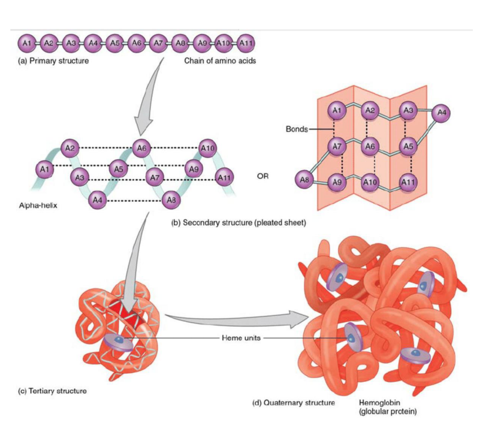
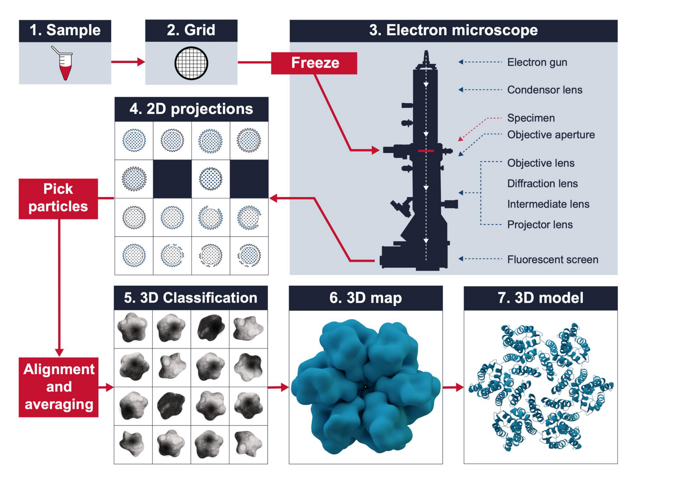
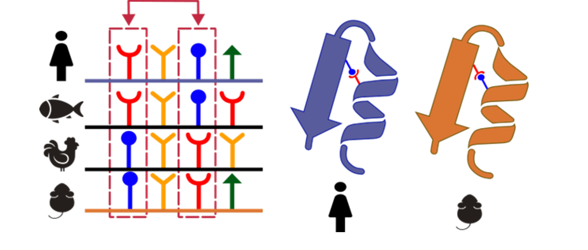
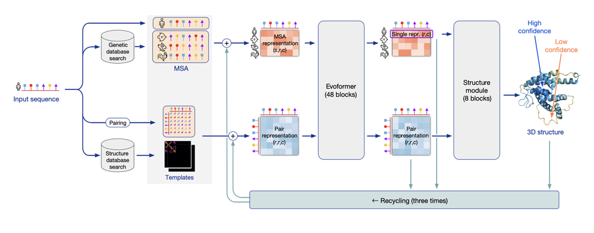

# Protein structure - determination and prediction

## Overview

Protein folding connects amino-acid sequence to molecular function. X-ray crystallography, cryo-electron microscopy and NMR infer structure from experimental signals; computational methods predict it from learned constraints, with different limitations and validation needs.

*Assumed throughout:* amino-acid chemistry, thermodynamics and molecular recognition.

## Section 23: Levels of protein structure and the folding problem

### Intuition

A protein is a chain of amino acids joined by peptide bonds, with a backbone that repeats identically and side chains that differ. All the information is in the side chains' order.

Folding is driven by a conflict. The backbone is polar and would happily hydrogen-bond to water, but burying it inside the protein means its donors and acceptors must find partners *within* the chain. The two secondary structures, the α-helix and the β-sheet, are the two ways of satisfying every backbone hydrogen bond using only the chain itself. They exist because the backbone must be neutralised before it can be buried.

What drives burial is the hydrophobic effect: non-polar side chains disrupt water's hydrogen-bond network, so water pushes them together. The protein collapses, and the backbone that comes with them must be satisfied by helices and sheets.

*Analogy:* folding a long strip of magnetic tape so that every magnet on the backing finds a partner while the oily patches end up inside. The analogy breaks down because the "magnets" here are satisfied by *two* specific geometric patterns rather than arbitrary pairings, and because the whole thing happens in water that is actively squeezing the oily patches together.

### Mechanism

**Four levels of organisation:**

1. **Primary** — the amino acid sequence.
2. **Secondary** — local structures, principally the α-helix and β-sheet, formed by backbone hydrogen bonding.
3. **Tertiary** — the folded polypeptide including any cofactors, held by *intra*molecular bonds. This is the biologically active form.
4. **Quaternary** — assembly of several discrete polypeptides (subunits) through *inter*molecular bonds, as in haemoglobin's four chains.

**The α-helix**, proposed by Astbury (from keratin fibre diffraction) and Pauling (from paper models):
- typically 10–40 residues;
- **right-handed**, with no space inside — the backbone packs against itself;
- hydrogen bonds between the carbonyl CO of residue $i$ and the amide NH of residue $i+4$;
- 100° of rotation per residue, so **3.6 residues per turn**;
- side chains extend outwards and tilt towards the N-terminus, giving the "Christmas tree" appearance.

**The β-sheet**, also proposed by Astbury:
- stretches of extended chain (**β-strands**) lying side by side;
- CO and NH hydrogen-bond to **neighbouring strands on both sides**, rather than within one strand;
- strands may be **parallel or antiparallel** depending on their relative direction;
- can close into barrels, as in green fluorescent protein;
- side chains alternate above and below the sheet along a strand, but point the same way across strands — so **every second residue sits on one face**, which lets a sheet present one hydrophobic face and one polar face.

### Derivation

**The Levinthal paradox.** Tertiary structure is determined by the sequence alone: no external template is required. But consider finding it by search.

Take a 100-residue protein. Each residue has two freely rotating backbone dihedrals ($\phi$, $\psi$), so a chain of 100 residues has about 198 of them. Allowing each only **three** stable values from the Ramachandran plot:
$$N_{\text{conf}} = 3^{198} = 3.0\times10^{94} \tag{39}$$

Sampling one conformation every 0.1 ps, an exhaustive search takes
$$t = 3.0\times10^{94}\times10^{-13}\ \text{s} = 3\times10^{81}\ \text{s} \approx 9\times10^{73}\ \text{years} \tag{40}$$
about $7\times10^{63}$ times the age of the universe. **Proteins nevertheless fold in milliseconds.** Folding cannot be a search.

**The resolution: the funnel.** The energy landscape is not flat with one narrow minimum; it is a **funnel**. Partially correct structures are already downhill, so the chain is guided towards the native state rather than sampling blindly. Folding follows a limited number of pathways, often through a collapsed intermediate (a **molten globule**) that has secondary structure but not yet fixed side-chain packing.

In 1 ms at 0.1 ps per step, a chain samples about $10^{10}$ conformations — a factor of $10^{84}$ short of (39), so the funnel must eliminate essentially the whole search space.

### Motivation and explanation

**Proteins are barely stable.** The native state is the most stable conformation, but only by **20–40 kJ/mol** over the denatured state. At 310 K that is 8–16 $k_BT$ for the whole molecule, and for a 100-residue protein about **0.1 $k_BT$ per residue** — the difference of a few hydrogen bonds. Two consequences:
- Folding is a near-cancellation of two large numbers, the enthalpy of burial and the entropy lost on ordering the chain, so modest changes in temperature, pH or a single mutation can unfold a protein.
- Marginal stability is probably functional: proteins must be degradable and must flex to work.

**Why this matters for prediction.** Equation (39) says the structure cannot be found by enumeration, and marginal stability says it cannot be found by crude energy minimisation either, since the correct fold is only slightly below many wrong ones. For fifty years this is why prediction failed, and it is the background to Section 26.

**Where the simple picture fails.** Not all proteins fold alone; many require chaperones. Some pass through no molten globule. A large fraction of eukaryotic proteins are *intrinsically disordered*, with no single native structure, and the whole framework does not apply to them.

### Link to other topics

The funnel is the same argument as nucleation in crystallisation: a process that would be impossibly slow as a random search becomes fast once partially correct states are downhill in free energy, so that the system is guided rather than searching.

### Summary

Protein structure is organised in four levels, with the α-helix and β-sheet existing to satisfy backbone hydrogen bonds so that the chain can be buried. The sequence determines the fold, but $3^{198}$ conformations rule out any search, and a funnelled landscape with marginal final stability — 20–40 kJ/mol — is what makes millisecond folding possible.

## Section 24: X-ray crystallography and the phase problem

### Intuition

To see something you must illuminate it with radiation whose wavelength is comparable to its features. Atoms are about 1.5 Å apart, so imaging them needs X-rays of about 1 Å. But there is no lens for X-rays: they cannot be focused to form an image directly.

What *can* be done is to record the scattered radiation and reconstruct the image computationally. Scattering from a single molecule is far too weak to detect, so the molecule is placed in a **crystal** — a periodic array of millions of identical copies in identical orientations. Their scattered waves then interfere constructively in specific directions, concentrating a weak signal into measurable spots.

The crystal is an amplifier, and it is also the main obstacle: proteins are large, flexible and reluctant to pack into ordered lattices.

*Analogy:* hearing one voice in a stadium by having everyone chant in unison. The analogy breaks down in exactly the way that creates the central difficulty: a detector records *intensity*, not the wave itself, and the timing information in the chant — the phase — is thrown away.

### Mechanism

**The relationship being exploited.** The electron density in the unit cell and the diffraction pattern are **Fourier transforms of each other**. Each spot corresponds to one spatial frequency component of the density. So:

- *Forward:* electron density → diffraction pattern, which the crystal does physically.
- *Reverse:* diffraction pattern → electron density, by inverse Fourier transform.

The objective is to determine the arrangement of protein atoms in space, and the electron density is what is reconstructed. A model is then built into that density.

#### The phase problem

A wave has an **amplitude** and a **phase**. The inverse Fourier transform needs both. But a detector measures only the *number of photons* arriving at each spot, which is the intensity:
$$I \propto |F|^2 \qquad\Longrightarrow\qquad |F| = \sqrt{I} \tag{41}$$

The amplitude is recoverable as the square root of the intensity. **The phase is lost entirely.** This is the phase problem, and it is not a technical limitation but a consequence of detecting intensity. Phases carry most of the structural information: a map computed from correct amplitudes with wrong phases shows the wrong molecule.

**Perutz's solution: multiple isomorphous replacement (MIR).** Soak a few **heavy atoms** (mercury, platinum) into the crystal without disturbing the lattice. The heavy atoms scatter strongly, so every spot shifts in intensity. Comparing the native and derivative datasets locates the heavy atoms, and their known positions give a reference wave against which the phases of all other reflections can be inferred. Several derivatives are needed to resolve ambiguities — hence *multiple*.

Perutz applied this to haemoglobin; his student **John Kendrew** used it to solve **myoglobin**, the first protein structure, at 6 Å, later extended to 2 Å once computation allowed.

**Molecular replacement**, the modern routine method, sidesteps MIR. If a structurally similar protein is already known, its model is positioned and oriented in the new unit cell to generate *calculated* phases, which are combined with the measured amplitudes. This works only when a sufficiently close model exists — which is why Section 26 matters so much to this field.

#### Modern workflow

1. **PCR and clone** the gene of interest.
2. **Express** the recombinant protein in *E. coli* or another system.
3. **Purify** in three stages: affinity (Ni-NTA against a His₆ tag), ion exchange, then size-exclusion chromatography. Milligram quantities of homogeneous protein are needed.
4. **Crystallise** by sitting- or hanging-drop vapour diffusion.

The drop contains protein mixed 1:1 with a *precipitant* ("mother liquor": salts, PEG or solvent at defined pH). Sealed against a more concentrated reservoir, water leaves the drop by vapour diffusion, slowly raising the protein concentration until it crystallises. The right conditions cannot be predicted, so **about 1000 conditions are screened** in nanolitre drops.

5. **Collect data.** Crystals are fished out, flash-frozen (which limits radiation damage) and taken to a synchrotron such as Diamond. The crystal is rotated to capture reflections from many angles, since a full three-dimensional density map needs reflections in all directions.
6. **Phase**, usually by molecular replacement.
7. **Build and refine** a model into the density, and deposit coordinates in the Protein Data Bank.

### Motivation and explanation

**Why a synchrotron.** An in-house rotating-anode source (Cu Kα, 1.54 Å) gives data in a few hours to about 1.8 Å. A synchrotron provides a far brighter, tunable beam, giving better resolution from smaller and weaker crystals.

**What resolution means.** Resolution is the smallest spacing distinguishable, and it is set by how far out from the centre the spots extend. From Bragg's law, $\lambda = 2d\sin\theta$ with $\lambda = 1.54$ Å: 2 Å data requires reflections out to $\theta = 23°$, while 0.8 Å requires 74°. **High-resolution information sits at high angle**, where intensities are weakest — so resolution is limited by how well-ordered the crystal is, not by the instrument.

At 2 Å, individual atoms are not separated (C–C is 1.54 Å) but the backbone and side chains are unambiguous. Below about 1.2 Å, individual atoms resolve.

**Strengths and limitations:**
- **Atomic resolution, 0.5–2 Å** — the benchmark against which other methods are judged.
- **No size limit in principle**, but larger proteins are increasingly hard to crystallise.
- *Bottlenecks:* milligrams of homogeneous protein; crystal growth and quality, which is unpredictable and often the step that fails; membrane proteins, which resist crystallisation because their hydrophobic surfaces need detergent.
- The structure is of a molecule in a **crystal lattice**, at cryogenic temperature — not necessarily its solution conformation.

### Link to other topics

Recovering an object from the magnitude of its Fourier transform while the phase is lost is a general inverse problem, and the standard solution is the one used here: supply the missing information from a known reference, whether a heavy atom or an existing model.

### Summary

A crystal turns undetectable single-molecule scattering into measurable spots, and the density is recovered by inverse Fourier transform — except that detection destroys the phases, which carry most of the information. Heavy-atom replacement and, now, molecular replacement supply them.

## Section 25: Cryo-electron microscopy and NMR

### Intuition

Both methods start from the same observation: the crystal in Section 24 served only to amplify a weak signal by adding together millions of identical, identically oriented copies. If the signal can be built up some other way, the crystal is unnecessary.

**Cryo-EM** keeps the averaging but drops the lattice. Molecules are frozen in random orientations in a thin film of ice and imaged individually. Each image is desperately noisy, but if thousands sharing an orientation are aligned and averaged, the noise falls while the signal survives. The crystal's job — adding copies together — is done in software, so the copies need not be ordered.

**NMR** abandons averaging over copies entirely and measures a different observable: distances between nearby nuclei in a molecule tumbling in solution. Enough distance constraints determine the fold.

*Analogy for cryo-EM:* recognising a statue from thousands of blurred photographs taken from unknown angles, by sorting them into groups that look alike and averaging each group. The analogy breaks down because the sorting is done on the images themselves with no prior knowledge of the statue, which is why the method needed both better detectors and better algorithms before it worked.

### Mechanism

#### Cryo-electron microscopy

**Why electrons.** Resolution requires a wavelength comparable to the features imaged. Visible light is hundreds of nanometres, far too long. Electrons accelerated through 300 kV have a de Broglie wavelength of about **0.02 Å**, roughly 80 times shorter than Cu Kα X-rays and far shorter than any atomic spacing. **Wavelength is therefore not the limiting factor.**

**What actually limits it** is the sample. Electrons deposit energy as they pass, and the resulting *beam-induced damage* destroys the molecule. A conventional transmission electron microscope avoids this by staining with heavy metals — but then one images the stain, not the protein, so resolution is limited to the stain's granularity. Molecular motion blurs images further.

Cryo-EM solves both by **vitrification**: the sample is plunge-frozen so fast (into liquid ethane at −180 °C) that water forms amorphous ice rather than crystalline ice. Crystalline ice would diffract and destroy the image. Vitrification immobilises the molecules in random orientations and limits radiation damage, so low electron doses can be used.

**The pipeline:**
1. **Vitrify** the sample on a grid in a thin film.
2. **Image** at low dose. Each molecule appears as a faint **2D projection** at an unknown orientation.
3. **Pick particles** — identify individual molecules in the micrographs, typically $10^5$ or more.
4. **Classify and average.** Particles are sorted into groups sharing an orientation and averaged, raising the signal-to-noise ratio. This is the step that replaces the crystal.
5. **Reconstruct.** Projections from many known relative orientations are combined by Fourier transform to give a 3D **density map**, in the same way a CT scan builds a volume from projections.
6. **Build** an atomic model into the map.

#### NMR

1. **Prepare** the protein with isotope labels (¹⁵N, ¹³C, ²H), since the common isotopes ¹²C and ¹⁶O have no nuclear spin and are invisible.
2. **Assign resonances** — work out which peak belongs to which backbone and side-chain nucleus. This is the laborious step and it scales badly with size.
3. **Extract restraints.** The **nuclear Overhauser effect (NOE)** couples nuclei through space and falls off as $r^{-6}$, so it reports that two nuclei are within about 5 Å. Coupling constants give backbone dihedral angles $\phi$ and $\psi$.
4. **Calculate structures** by restrained molecular dynamics with simulated annealing: find conformations consistent with all restraints.
5. The result is an **ensemble** of structures, not one. Spread within the ensemble shows where the restraints are weak — often also where the protein is genuinely flexible.

NMR works **in solution at room temperature**, so it reports conformational dynamics that crystallography cannot. But resonance overlap and faster relaxation limit it to small proteins, under roughly 30 kDa, which is why it accounts for only about 6 % of deposited structures.

### Motivation and explanation

**Choosing a method.**

| | X-ray crystallography | Cryo-EM |
|---|---|---|
| Resolution | **0.5–2 Å**, atomic | 3–4 Å, improving |
| Size | no limit in principle, but crystallisation gets harder with size | **better with large** assemblies, >100 kDa |
| Crystal | **required** | not required |
| Purity | milligrams, homogeneous | **less critical** |
| Sample state | lattice, cryogenic | vitrified, near-native |
| *In situ* | no | **yes**, by cryo-tomography |

The two are complementary in exactly the regime where each struggles: crystallography is easiest for small, well-behaved proteins and hardest for large flexible complexes, while cryo-EM is the reverse.

**Why cryo-EM does better with large particles.** Alignment in step 4 requires recognising a particle's orientation from a noisy projection. A larger particle has more distinguishing features and scatters more electrons, so its orientation is determined more reliably. Below about 100 kDa the particle is too faint to align, which sets the lower size limit. This is the opposite of the crystallographic constraint, where size hinders crystallisation.

**Why cryo-EM grew so quickly.** Of about 235 000 deposited structures, roughly 81 % are X-ray, 13 % cryo-EM and 6 % NMR, but almost all the cryo-EM entries are recent. The change came from direct electron detectors, which record individual electrons and so allow motion correction, and from improved classification algorithms — not from new physics.

**Shared limitation.** Both give a *static* structure, or in cryo-EM's case a set of discrete states from classification. Neither reports the continuous motion that biological function usually depends on, which is where NMR retains its advantage.

### Link to other topics

Cryo-EM reconstruction is computed tomography: combining projections taken at many angles into a volume. The difference is that in a CT scanner the angles are known because the source is moved, whereas here they must be inferred from the images themselves.

### Summary

Both methods remove the crystal. Cryo-EM replaces the lattice's averaging with computational classification of vitrified single particles, trading resolution for freedom from crystallisation and working best on exactly the large assemblies crystallography finds hardest.

## Section 26: AlphaFold and computational structure prediction

### Intuition

Anfinsen's dogma says the 3D structure of most natural proteins is determined only by their amino acid sequence. That makes prediction well posed, and it is why the field persisted for fifty years without success.

The breakthrough did not come from simulating physics. It came from a different source of information: **evolution has already run the experiment**. For almost any protein there are thousands of homologues across species, all with the same fold and different sequences. Those differences are not random.

If two residues touch in the folded structure, a mutation at one that disrupts the contact is tolerated only if a compensating mutation occurs at the other. Over evolutionary time, **residues in contact mutate together** — they *co-evolve*. The converse holds too: independently varying positions are probably far apart.

A multiple sequence alignment therefore carries a noisy picture of the *contact map*, and a contact map plus chain connectivity largely determines the fold. The sequence database is a record of a search already completed.

*Analogy:* inferring which parts of a machine touch by examining thousands of variants and noting which pairs of parts always change together. The analogy breaks down because co-evolution also arises indirectly — A couples to B and B to C, making A and C appear correlated — and disentangling direct from indirect coupling is much of the difficulty.

### Mechanism

**CASP.** The Critical Assessment of Structure Prediction is a biennial blind test: predictors are given sequences whose structures have been solved but not released. DeepMind's earlier AlphaFold won CASP13 (2018) but by a small margin, and the predictions were not accurate enough for the problem to be considered solved. **AlphaFold 2 at CASP14 (2020)** reached accuracy comparable to experiment, and the problem was declared largely solved.

**The AlphaFold 2 pipeline:**

**1. Inputs.** The target sequence is used to search:
- a **genetic database**, producing a **multiple sequence alignment (MSA)** of homologues — the primary input, carrying the co-evolution signal;
- a **structure database**, producing **templates** of any known similar structures.

These become two representations:
- the **MSA representation** $(s, r, c)$, indexed by sequence and residue;
- the **pair representation** $(r, r, c)$, indexed by *pairs* of residues — effectively a running hypothesis about which residues are in contact.

**2. Evoformer (48 blocks).** The core of the network. It updates both representations repeatedly, and the essential feature is the **continuous flow of information between them**: evidence of co-evolution in the MSA updates the pair representation, and geometric constraints in the pair representation inform how the MSA is read. Because the pair representation is geometric, the network can enforce consistency — if A is near B and B near C, then A and C are constrained — which is how indirect correlations are separated from direct contacts.

**3. Structure module (8 blocks).** Converts the refined representations into explicit **3D atomic coordinates**, rather than a contact map to be folded afterwards. It also outputs a **per-residue confidence score**, which is as important as the structure itself.

**4. Recycling (three times).** The outputs are fed back as inputs and the whole network is run again, each pass refining the previous hypothesis.

**AlphaFold 3** extends this beyond single proteins to **proteins, DNA, RNA, small molecules, ions, modified residues and glycosylation** in one model. Architecturally it replaces the structure module with a **diffusion module**, trained to take *noised* atomic coordinates and recover the correct ones, then applied iteratively from noise. This makes AF3 a generative model predicting raw atom coordinates directly.

### Motivation and explanation

**Why confidence scores matter.** A prediction without an error estimate cannot be used in practice. AlphaFold reports per-residue confidence, which is empirically well calibrated: high-confidence regions are usually right and low-confidence regions usually are not. Low confidence is also informative — it often marks genuinely disordered regions (Section 23), so the model reports a real property rather than simply failing.

**The effect on crystallography.** AlphaFold models are good enough to serve as search models for **molecular replacement** (Section 24), which needs a model within about 1–1.5 Å RMSD over at least 30 % of atoms. Prediction has therefore not replaced experiment; it has removed the phase problem's dependence on finding a pre-existing homologue. The two methods now feed each other.

**What AlphaFold 2 does and does not do.**

| Predicts well | Struggles | Does not predict |
|---|---|---|
| Single protein chains | Multiple conformations of one sequence | Protein–DNA and protein–RNA complexes |
| Protein multimers | Effects of point mutations | Ligand and ion binding |
| Multisubunit complexes | Nucleic acid structures | Post-translational modifications |
| | Antigen–antibody interactions | Membrane plane for transmembrane domains |

**The pattern in that table is worth seeing.** AlphaFold 2 predicts the single most likely structure of a *polypeptide in isolation*. It struggles or fails wherever the answer depends on something not in the sequence or its evolutionary record:
- *Multiple conformations* — the output is one structure, but many proteins function by switching between several.
- *Point mutations* — a single substitution barely changes the MSA, so the prediction barely changes, even when the real protein unfolds. Given the 20–40 kJ/mol marginal stability of Section 23, this is unsurprising: the model has learned which fold the sequence family adopts, not the energetics that make it marginal.
- *Ligands, ions, modifications and membranes* — context the sequence does not contain.

**The deeper limitation.** AlphaFold predicts structure, not function or mechanism, and its reliance on the MSA means it is weakest on sequences with few homologues — designed proteins, rapidly evolving ones, antibody loops. It has not solved the folding *process*: it does not say how a chain reaches its native state, only where it ends up. The Levinthal paradox of Section 23 is bypassed, not explained.

### Link to other topics

Reading structure from correlated variation across a database, rather than from a physical model, is the same inference used in any empirical correlation: a sufficiently large body of observations substitutes for a theory of the mechanism. The usual caveat applies — such models extrapolate badly outside the data they were fitted to, which here means sequences with few relatives.

### Wider pathway

Reliable structures for essentially every known protein change what is routine: enzyme engineering, binder design and drug discovery can start from a model rather than a multi-year structural project. Section 27 begins protein engineering, where knowing the structure is the precondition for deciding what to change.

### Summary

AlphaFold 2 solved prediction not by simulating folding but by extracting contacts from the co-evolutionary record in multiple sequence alignments, cycling that information against a geometric pair representation and emitting coordinates with calibrated confidence. It predicts an isolated chain's single most likely fold, and fails where the answer depends on conformational change, energetics or molecular context — gaps that AlphaFold 3 begins to close by modelling nucleic acids, ligands and modifications together.

## Conclusion

Experimental determination and computational prediction answer related structural questions, and each requires validation against its own limitations. The next unit develops protein engineering.
