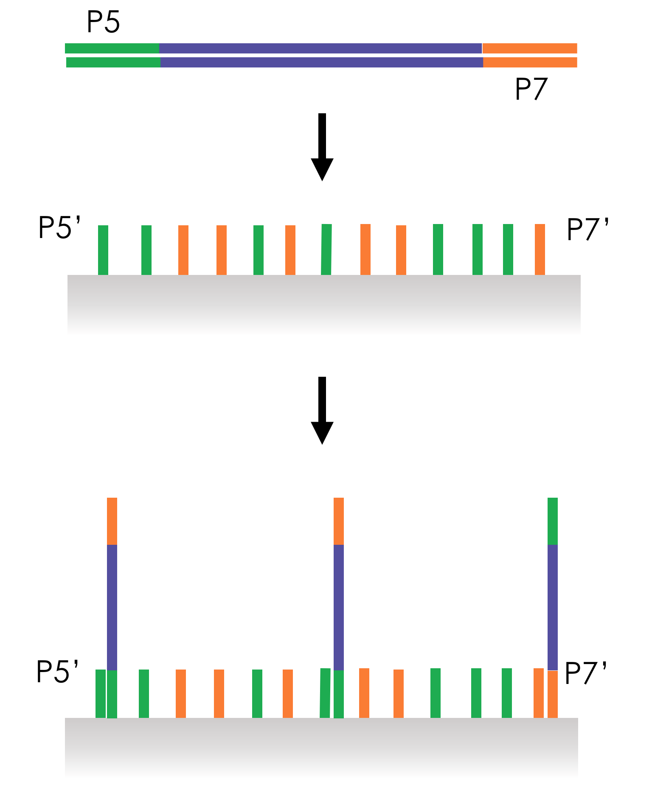
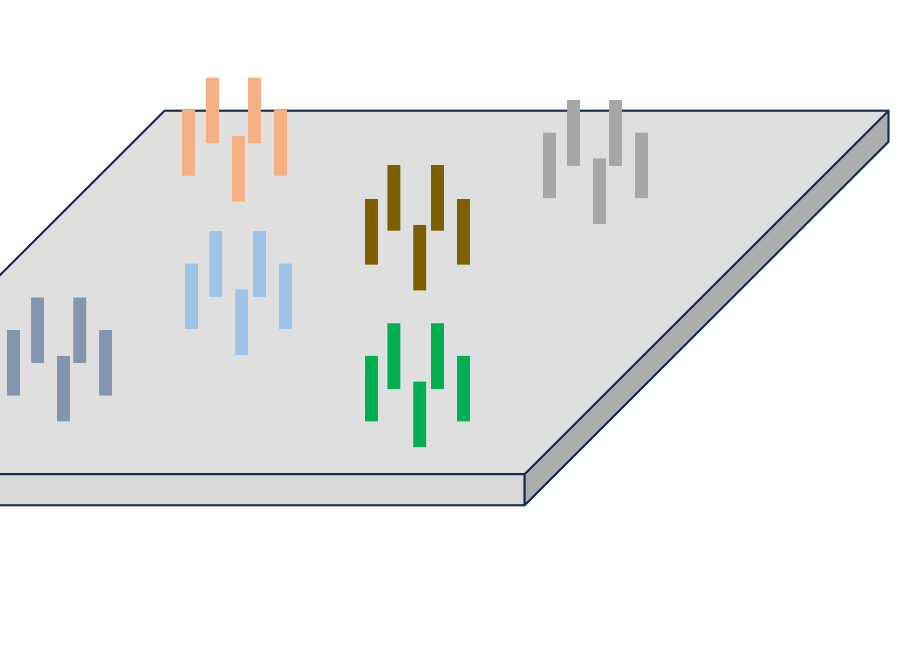

# Sequencing I - Sanger and short reads — reading 03.2

[Previous](<../../../../../notes/Advanced Biotechnology/03 - Sequencing I - Sanger and short reads/Complete section.md>) · [Subject index](<../../../../../notes/Advanced Biotechnology/README.md>) · [Next](<../../../../../notes/Advanced Biotechnology/03 - Sequencing I - Sanger and short reads/Complete section.md>)

<!-- reading-content:start -->
## Section 11: Illumina sequencing, library preparation and cluster generation

### Intuition

Parallel reading needs two things that a mixture of fragments does not have.

First, **uniformity of handles**. Every fragment must be graspable in the same way: the same primer must prime all of them, and the same surface must capture all of them. Since the fragments differ in sequence, this is achieved by *attaching* common sequences to their ends. The interior stays unknown, which is the point; only the ends are standardised.

Second, **brightness**. A single molecule adding one fluorescent nucleotide emits far too little light to image reliably. The fix is to make roughly a thousand copies of each fragment, all at the same spot and all adding the same nucleotide in step. The spot then emits a thousandfold more light while still reporting one fragment's sequence.

*Analogy:* instead of reading one book at a time, photocopy each book a thousand times, stack each set in its own pigeonhole on a huge wall, and photograph the whole wall page by page. The analogy breaks down because the copies must stay *in step*: if some copies in a pigeonhole fall a page behind, the photograph blurs between two pages, which is exactly the error mode discussed in Section 12.

### Mechanism

#### Library preparation

1. **Fragment.** Sonication breaks the DNA into 100–200 bp pieces. The size matters: fragments must be short enough that the read covers a useful proportion of each.
2. **End repair (polishing).** Shearing leaves ragged ends with random single-stranded overhangs. A 3′→5′ exonuclease removes protruding 3′ overhangs and a polymerase extends recessed 3′ ends opposite 5′ overhangs, producing *blunt* ends. Ligation requires defined ends, so this makes an inhomogeneous population uniform.
3. **A-tailing.** A polymerase adds a single, non-templated adenine to each 3′ end.
4. **Adapter ligation.** Adapters carrying a complementary single T overhang are ligated on. The A/T pair is a minimal sticky end, and its purpose is to prevent the fragments from ligating to each other: a blunt-ended population would self-ligate into chimeras, whereas A-tailed fragments can only pair with T-overhang adapters.
   - The adapters are **Y-shaped**: double-stranded near the fragment and unpaired further out. Both ends receive the same adapter, yet because the two arms of the Y have *different* sequences, the two ends of the fragment end up carrying different sequences. This is the trick that makes one adapter give two distinguishable ends.
5. **Library PCR.** Primers matching the Y arms amplify the fragments and complete the distinct terminal sequences, conventionally called **P5** and **P7**. Every fragment in the library now ends in P5 at one end and P7 at the other.
   - The primers also add a short **index** or barcode, about 6 nt. Libraries from different samples get different indices, are pooled and sequenced together, then separated computationally afterwards. This is *multiplexing*, and it is how a run large enough for a human genome is shared economically between many small samples.

#### Cluster generation by bridge amplification

6. **The flow cell.** A glass surface bearing a dense lawn of two tethered oligonucleotides, P5′ and P7′, complementary to the fragment ends. It sits in a channel through which reagents are flowed, so every step can be delivered and washed automatically.
7. **Seeding.** Denatured library is flowed in at *low concentration*, so single strands hybridise to the lawn at well-separated random positions. The dilution is deliberate: clusters must not overlap, or their fluorescence cannot be assigned to one fragment.
8. **Covalent capture.** A polymerase extends the tethered oligo using the hybridised fragment as template. The copy is now covalently attached to the surface. Denaturation washes the original strand away, leaving a sparse field of surface-bound single strands.

9. **Bridge amplification.** The tethered strand is flexible enough to bend over and hybridise its free end to a nearby complementary lawn oligo, forming a *bridge*. The polymerase copies it, giving a double-stranded bridge; denaturation gives two tethered strands, both anchored within a short distance of the original. Repeating 25–35 times generates up to a thousand copies confined to a patch a few hundred nanometres across: a **cluster**.
10. **Linearisation.** One orientation is cleaved enzymatically and washed away, leaving every strand in the cluster pointing the same way. Without this, the cluster would contain both strands and the fluorescence signals of complementary sequences would superpose.

The finished flow cell carries millions to billions of clusters, each hundreds to thousands of identical copies of one library fragment, all identically oriented and all primed by the same adapter sequence.

### Motivation and explanation

**Why amplify on the surface rather than in solution.** Amplifying first and then depositing would let copies of different fragments land together, producing mixed spots. Because each cluster grows outward from a single seeded molecule and the copies stay tethered near their origin, spatial separation is guaranteed by the geometry rather than enforced afterwards. The surface does the sorting that cloning into bacteria did in Section 10, without any cells.

**Why cluster density is the key design parameter.** Throughput scales with the number of clusters, so denser is better, but clusters that overlap cannot be resolved and are discarded. Loading concentration is therefore tuned to sit just below the density at which overlap becomes common. This is the same trade-off as colony density on an agar plate.

**Where the preparation introduces bias.**
- *PCR bias*: GC-rich and GC-poor fragments amplify with different efficiencies, in both the library PCR and bridge amplification, so coverage is uneven across a genome rather than uniformly Poisson.
- *Chimeras*: incompletely suppressed cross-ligation joins unrelated fragments, creating reads that map to two places.
- *Duplicates*: multiple clusters seeded from PCR copies of the same original molecule are not independent observations, which matters when counting.

**The cost.** This workflow is multi-step and takes a day or more before any sequence is produced, which is why the platform suits large batched jobs rather than single urgent samples.

### Worked example

*Scale of a human genome run at 30× coverage with 150-base reads.* Computed in Python, $`G = 3.1\times10^{9}`$.

- Reads required: $`cG/L = 30\times3.1\times10^{9}/150 = 6.2\times10^{8}`$, about 620 million.
- Each read is one cluster, so the flow cell needs of order $`10^{9}`$ resolvable spots. A high-output instrument producing about $`2\times10^{10}`$ reads per run therefore sequences roughly 32 human genomes per run.
- Sanger, at 96 capillaries, would need $`6.2\times10^{8}/96 = 6.5\times10^{6}`$ runs for the same data.

The throughput gain is about seven orders of magnitude, and it comes entirely from parallelism: the chemistry of adding one nucleotide is no faster than before.

### Wider pathway

Library preparation is where the sample meets the instrument, so it is also where most sample-specific design happens: the same cluster-generation and read-out chemistry serves genome sequencing, RNA sequencing (after reverse transcription), and methods that count binding sites, with only the library step changed.

### Link to other topics

Immobilising the reaction on a surface so reagents can be flowed past and washed away is the logic of solid-phase synthesis in Section 06, used here for reading instead of writing. In both cases the solid support converts a separation problem into a washing step.

### Summary

Library preparation gives every fragment identical P5 and P7 ends plus a sample index, so that one surface chemistry and one primer serve a heterogeneous mixture. Bridge amplification then converts each seeded molecule into a spatially isolated cluster of about a thousand identical copies, bright enough to image.
<!-- reading-content:end -->

[Previous](<../../../../../notes/Advanced Biotechnology/03 - Sequencing I - Sanger and short reads/Complete section.md>) · [Subject index](<../../../../../notes/Advanced Biotechnology/README.md>) · [Next](<../../../../../notes/Advanced Biotechnology/03 - Sequencing I - Sanger and short reads/Complete section.md>)
