# Advanced Biotechnology — complete Obsidian edition

All teaching units in order. Equation numbers run continuously through this subject. For GitHub, use the [linked reading sections](<../../../../../notes/Advanced Biotechnology/README.md>).

## 01. Nucleic acids - structure, thermodynamics and kinetics

### Overview

Nucleic-acid chemistry determines the structures that DNA and RNA can form. Polymer bending, two-state hybridisation and nearest-neighbour thermodynamics explain their geometry and stability; association and dissociation kinetics explain how quickly those structures assemble and rearrange.

*Assumed throughout:* ideal dilute-solution thermodynamics and mass-action kinetics.

### Section 01: Chemistry and structure of DNA and RNA

#### Intuition

A DNA strand is a charged, directional chain with a sequence of flat, aromatic "letters" sticking out of it. Two strands whose letters are complementary can line up, letter facing letter, and the flat letters then stack on top of each other like a pile of coins. That stack, twisted to fit the backbone, is the double helix. Everything else follows from three properties:
- the chain has a direction;
- the backbone repels itself;
- each letter has more than one edge that can make hydrogen bonds.

*Analogy:* a zip whose teeth come in four shapes, where each tooth fits only its partner. The analogy breaks down in two ways. First, the teeth do not just interlock, they stack, and stacking supplies most of the stability. Second, the "zip" unzips on its own when heated, because each bond is weak.

#### Mechanism

**1. Backbone.**
- Each repeat unit is a five-carbon sugar (2-deoxyribose in DNA) joined to a phosphate.
- The phosphate links the 3′ carbon of one sugar to the 5′ carbon of the next (a *phosphodiester* bond). One end of the chain therefore has a free 5′-phosphate and the other a free 3′-OH, so the strand has a direction, written 5′→3′.
- Each phosphodiester is charged −1 at physiological pH (its $\mathrm{p}K_a$ is about 1), so the backbone is a polyanion that repels itself and any partner strand.

**2. Bases and naming.**
- The four bases attach to the 1′ carbon of the sugar. The *purines* G and A have two fused rings; the *pyrimidines* C and T have one.
- Base + sugar is a *nucleoside*. Base + sugar + one or more phosphates is a *nucleotide* (nt), for example adenosine triphosphate (ATP) or guanosine monophosphate (GMP).
- A strand is a *polynucleotide*; one shorter than about 100 nt is an *oligonucleotide* ("oligo").

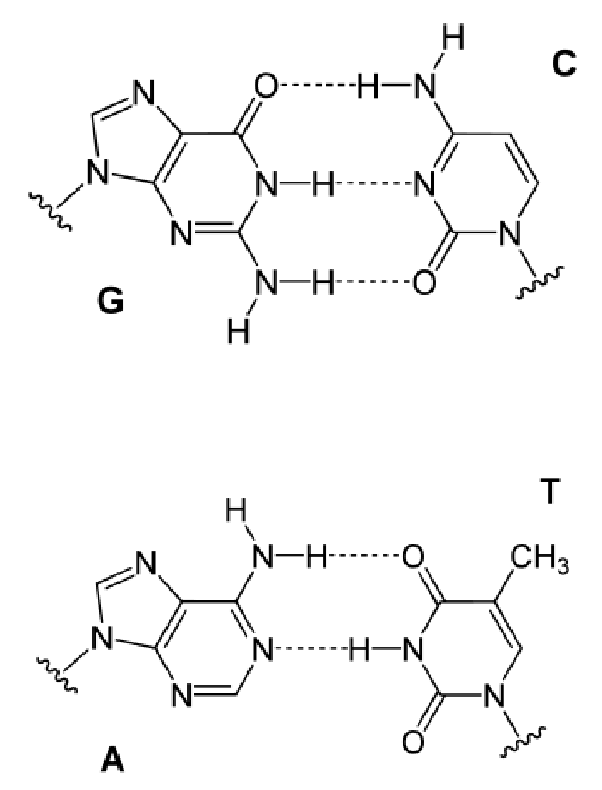

**3. Canonical (Watson–Crick) pairing.**
- A pairs with T through 2 hydrogen bonds, and G pairs with C through 3.
- Pairing is *selective* because each pair is always one purine with one pyrimidine. That keeps the sugar-to-sugar distance the same for every pair, so any sequence fits the same helix. The donor and acceptor patterns then match only for A·T and G·C.
- Hydrogen bonds are weak (a few $k_BT$ each), so pairing is thermally reversible. Biology relies on this when strands are separated for replication and transcription, and nanotechnology relies on it to make structures that assemble themselves.

**4. Hybridisation.**
- Two complementary strands bind into a *duplex* in **antiparallel** orientation: one runs 5′→3′, the other 3′→5′. Antiparallel is the only orientation in which the pairing edges and the sugar–phosphate geometry line up.
- Cations (Na⁺, Mg²⁺) are needed to *screen* the phosphate charges. Without them, electrostatic repulsion between the two backbones outweighs pairing. Section 04 shows this as a salt dependence of the hybridisation entropy.

**5. The B-form double helix** (physiological conditions):
- right-handed;
- rise about 0.34 nm per base pair, about 10.5 bp (about 3.6 nm) per turn, diameter about 2 nm;
- the sugars join their bases on one side of each pair, so the two grooves between the backbones are unequal: a **major** and a **minor groove**. Proteins read the sequence mostly through the major groove, where more of each base's edge is exposed.
- What stabilises the helix is mainly **base stacking**: van der Waals and hydrophobic attraction between neighbouring flat bases, which stack about 0.34 nm apart. Hydrogen bonds mainly provide *specificity*. This is why Section 04 assigns energies to *pairs of neighbouring base pairs*.

**6. Other helices.**
- **A-form:** right-handed, wider and more compressed (rise about 0.26 nm/bp). It is rare for DNA–DNA duplexes but is the normal form of RNA–RNA and DNA–RNA duplexes (point 8).
- **Z-form:** a *left-handed* helix favoured by alternating purine–pyrimidine sequences (such as CGCG) and stabilised by negative supercoiling, which it relieves.

**7. Non-canonical pairing and structures.**
- **Hoogsteen pairing.** A purine can rotate about its glycosidic bond from the usual *anti* to the *syn* conformation. This presents a different edge, the Hoogsteen edge (which faces the major groove), to the pyrimidine.
  - A·T works directly.
  - For G·C, cytosine has to donate an extra hydrogen bond from its N3. N3 is normally an acceptor, so C must be **protonated** (C⁺). Its $\mathrm{p}K_a$ is only about 4.5, so these structures are favoured at acidic pH.
- **Triplex.** A third strand lies in the major groove of a duplex and makes Hoogsteen bonds to the purines. It is pH-dependent when it contains C⁺.
- **G-quadruplex.** Four guanines form a planar ring (a *G-tetrad*) through Hoogsteen G·G bonds. Tetrads stack, and a monovalent cation (K⁺ fits best) sits between them and coordinates the carbonyl oxygens. Runs of G separated by short loops fold this way.
- **i-motif.** The C-rich counterpart. Hemi-protonated C·C⁺ pairs intercalate, so it is also pH-dependent.

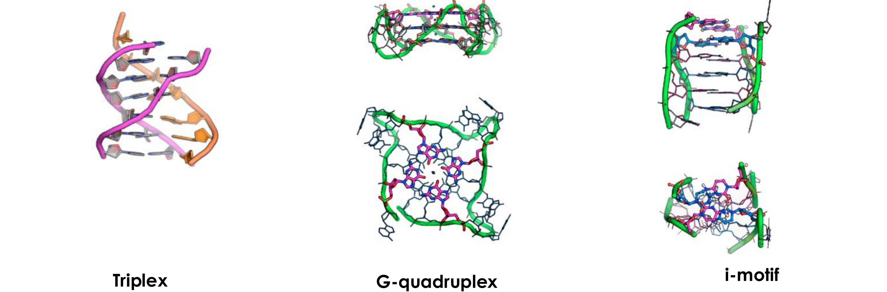

**8. RNA.** Identical in plan to DNA, except for two changes:
- **Ribose** carries a 2′-OH. This has three consequences:
  1. *Chemical instability.* At high pH or with metal ions, the 2′-oxygen attacks the neighbouring phosphorus. This cuts the backbone and leaves a 2′,3′-cyclic phosphate (self-hydrolysis). DNA lacks the 2′-OH, which is one reason it is the long-term store of genetic information.
  2. *A-form duplexes.* The 2′-OH holds the sugar in a pucker (C3′-endo) that fits only the A-form.
  3. *Richer folding.* The extra hydrogen-bonding group lets single strands fold into complex secondary and tertiary structures (tRNA, ribozymes).
- **Uracil** replaces thymine. U is T without the 5-methyl group. It pairs with A, and it also forms a **G·U wobble pair** (two hydrogen bonds, shifted geometry), which is nearly as stable as a Watson–Crick pair in RNA.

#### Motivation and explanation

- **Why directionality matters in practice.** Polymerases add nucleotides only to a free 3′-OH, so DNA is always synthesised 5′→3′. Chemical synthesis (Section 06) runs the other way, 3′→5′. Primers, probes and sequencing reads are all written 5′→3′.
- **Why G·C is "stronger".** The extra hydrogen bond helps, but the larger effect is that G·C-containing steps stack more strongly. Section 04 puts numbers on this: CG/GC steps are worth about −2 kcal/mol at 37 °C, against about −0.6 for TA/AT.
- **Where the simple picture fails.** Real duplexes breathe: ends fray, and long duplexes open transient "bubbles". The "two strands are either fully paired or fully apart" picture used in Section 03 therefore holds only for short oligos.

#### Worked example

*The duplex length and charge of a gene, and a self-complementarity check.*

- A 1000 bp B-DNA duplex is $1000 \times 0.34 = 340$ nm long and makes $1000/10.5 = 95.2$ turns. That is long compared with its 2 nm width, so it is a thin polymer rather than a rod (Section 02).
- A 20 bp duplex made of two oligos without terminal phosphates has $2\times(20-1) = 38$ phosphodiesters, so a charge of −38. This is why buffers contain millimolar Mg²⁺ or roughly 0.1–1 M Na⁺.
- Is 5′-ATCGAT-3′ self-complementary? Its complement, read 5′→3′ (reverse complement), is 5′-ATCGAT-3′, the same strand. One strand can therefore pair with a copy of itself. Section 04 shows that such palindromes need a symmetry correction.

#### Wider pathway

DNA stores the sequence. RNA polymerase copies it into mRNA (transcription), and ribosomes read the mRNA (translation), using tRNA anticodons that pair with codons by the same Watson–Crick and wobble rules. Every technology in this course (synthesis, PCR, sequencing, DNA nanotechnology) relies on the same specific, reversible pairing described here.

#### Link to other topics

The partial molar and chemical-potential framework of Equilibrium Thermodynamics carries over to hybridisation. It becomes a chemical equilibrium between strands whose standard Gibbs energy is set by stacking and salt.

#### Summary

A nucleic acid strand is a directional polyanion carrying flat bases. Complementary strands pair antiparallel, mostly stabilised by stacking.

### Section 02: Polymer physics of DNA and the worm-like chain

#### Intuition

Follow the chain along its contour. Thermal kicks bend it a little at every point. Over a short distance the bends are small and the chain still "remembers" which way it was pointing. Over a long distance the small bends add up and the direction is forgotten. The persistence length is the distance over which the memory fades. A stiff chain (dsDNA) remembers over about 50 nm; a floppy one (ssDNA) over about 1–2 nm.

*Analogy:* a cooked spaghetti strand (ssDNA) against a garden hose (dsDNA). Both are straight over short lengths and curve over long ones; the hose just needs a longer length before it turns round. The analogy breaks down because the bending here is driven by thermal motion, not gravity or handling, and the stiffness measured as $l_P$ scales with $1/T$.

#### Derivation

Notation: $s$ is the arc length along the chain, $\hat t(s)$ is the unit tangent at $s$, $L$ is the contour length, and $\vec R = \int_0^L \hat t\,ds$ is the end-to-end vector.

**Step 1: bending energy.** A rod with bending stiffness $\kappa$ (units J·m) stores energy proportional to the square of its curvature, just as a spring stores energy proportional to the square of its extension:
$$E_{\text{bend}} = \frac{\kappa}{2}\int_0^L\left|\frac{d\hat t}{ds}\right|^2 ds \tag{1}$$

**Step 2: one short segment.** Over a short length $\Delta s$, the tangent turns by a small angle $\theta$ and the curvature is $\theta/\Delta s$. From (1), the segment's energy is $E = \kappa\theta^2/(2\Delta s)$. The deflection has two independent transverse components ($\theta_x$, $\theta_y$), each a quadratic term, so equipartition gives each $\tfrac12 k_BT$:
$$\frac{\kappa}{2\Delta s}\langle\theta^2\rangle = 2\cdot\tfrac12 k_BT \;\Rightarrow\; \langle\theta^2\rangle = \frac{2\,k_BT\,\Delta s}{\kappa} \tag{2}$$

**Step 3: correlation across one segment.** For a small angle, $\cos\theta \approx 1-\theta^2/2$. Using (2):
$$\langle \hat t(s+\Delta s)\cdot\hat t(s)\rangle = \langle\cos\theta\rangle \approx 1 - \frac{k_BT}{\kappa}\Delta s = 1-\frac{\Delta s}{l_P}, \qquad l_P \equiv \frac{\kappa}{k_BT} \tag{3}$$

**Step 4: many segments.** Each segment's bend is independent of the others, and its azimuth is random. Only the component of $\hat t$ along the previous direction survives on average, so the correlations multiply. Splitting $s$ into $N = s/\Delta s$ segments and letting $\Delta s\to 0$:
$$\langle \hat t(s)\cdot\hat t(0)\rangle = \left(1-\frac{\Delta s}{l_P}\right)^{s/\Delta s} \to e^{-s/l_P} \tag{4}$$
This is the defining property of the WLC: orientation decays exponentially, and $l_P$ is the decay length.

**Step 5: end-to-end distance.** Square $\vec R$ and average. The correlation depends only on the separation $|s-s'|$:
$$\langle R^2\rangle = \int_0^L\!\!\int_0^L \langle\hat t(s)\cdot\hat t(s')\rangle\,ds\,ds' = \int_0^L\!\!\int_0^L e^{-|s-s'|/l_P}\,ds\,ds'$$
Do the inner integral for fixed $s$, splitting it at $s'=s$; this gives $l_P\left(2 - e^{-s/l_P} - e^{-(L-s)/l_P}\right)$. Then integrate over $s$:
$$\langle R^2\rangle = 2l_PL\left[1 - \frac{l_P}{L}\left(1-e^{-L/l_P}\right)\right] \tag{5}$$

**Limits (sanity checks).**
- *Rod*, $L\ll l_P$: expand $e^{-x}\approx 1-x+x^2/2$ with $x=L/l_P$. The bracket becomes $L/(2l_P)$, so $\langle R^2\rangle \to L^2$. The ends are a full contour length apart.
- *Coil*, $L\gg l_P$: the bracket tends to 1, so $\langle R^2\rangle\to 2l_PL$. This is a freely jointed chain with $N=L/b$ links of length $b = 2l_P$ (the *Kuhn length*), since $Nb^2 = 2l_PL$. Size grows as $\sqrt L$, the random-walk scaling.

#### Motivation and explanation

**Why ds and ss differ so much.**

- **dsDNA:** $l_P \approx 40$–$60$ nm, which at 0.34 nm/bp is about 120–180 bp (about 150 bp for 50 nm). Bending a duplex compresses the base stack on the inside of the bend and stretches it on the outside. It also squeezes the charged backbones together. Both cost energy, so $\kappa$ is large. The duplex also resists twisting (it "sustains torsion"), which matters for supercoiling.
- **ssDNA:** $l_P\approx 1$–$2$ nm, a few nucleotides. Without a partner strand, the backbone bonds rotate almost freely (a "free swivel"), so there is little to resist bending.
- **Salt dependence.** Part of $\kappa$ is electrostatic repulsion along the backbone. Lowering the salt concentration screens the charges less and *raises* $l_P$. This is most visible for ssDNA, where reported values range from about 1 nm to several nm depending on ionic strength.

**When the model fails.**
- It ignores the volume the chain occupies (*excluded volume*), so it underestimates the size of very long coils.
- It ignores sequence-dependent intrinsic curvature (A-tracts bend DNA).
- It does not capture sharp kinks under strong bending.
- It describes single-stranded DNA only roughly, because ssDNA also forms transient internal base pairs.

#### Worked example

$\sqrt{\langle R^2\rangle}$ for dsDNA with $l_P = 50$ nm, from (5), computed in Python:

| Length (bp) | $L$ (nm) | $R_{\text{rms}}$ (nm) | $R_{\text{rms}}/L$ |
|---|---|---|---|
| 20 | 6.8 | 6.65 | 0.98 |
| 150 | 51 | 43.6 | 0.86 |
| 1000 | 340 | 170 | 0.50 |
| 48 502 (λ phage) | 16 490 | 1282 | 0.078 |

- A 20 bp duplex is effectively a rigid rod. DNA nanotechnology (Section 21) depends on this: short duplexes act as straight struts.
- Once $L$ reaches about $l_P$ (around 150 bp), the duplex is noticeably bent.
- A whole λ genome (16.5 µm of contour) forms a coil only about 1.3 µm across.
- A 20 nt single strand ($l_P\approx 1$–$2$ nm) is already a coil. This is the source of the entropy lost on hybridisation in Section 03.

#### Link to other topics

The exponential-correlation argument is the same one used for any Markov process. Turning a stiffness into a length scale by dividing by $k_BT$ is the same move as a Debye length or a capillary length.

#### Summary

Thermal bending makes the orientation of DNA decay as $e^{-s/l_P}$, with $l_P=\kappa/k_BT$. This gives rod-like behaviour below $l_P$ and a random coil of Kuhn length $2l_P$ above it. dsDNA ($l_P\approx 50$ nm) is about 30 times stiffer than ssDNA ($\approx$1–2 nm).

### Section 03: Two-state hybridisation and DNA melting

#### Intuition

Pairing releases enthalpy: stacking and hydrogen bonds form ($\Delta H^0<0$). It also costs entropy: two floppy coils (Section 02) become one stiff duplex, and two independent molecules become one ($\Delta S^0<0$). At low $T$ the enthalpy term wins and the strands are paired. At high $T$ the $-T\Delta S^0$ penalty wins and they separate. Because $\Delta H^0$ and $-T\Delta S^0$ are both large (tens of kcal/mol) and nearly cancel near body temperature, a change of a few degrees tips the balance. That is why DNA melts over a narrow range.

Concentration matters because binding requires two strands to meet. In a more dilute solution, partners meet less often, so the duplex has to be more stable (cooler) for half the strands to be paired.

#### Derivation

Notation: $[A]$, $[B]$, $[AB]$ are equilibrium concentrations; $\rho_0 = 1$ M is the standard concentration; $\Delta G^0 = \Delta H^0 - T\Delta S^0$ is the standard Gibbs energy of hybridisation (duplex minus single strands); $f$ is the fraction of strands hybridised.

**Two-state assumption.** Each strand is either fully paired or fully free. Partially zipped states are neglected. This is reasonable for short oligos (up to about 20–30 bp), where a partly open duplex is much less stable than either end state.

**Step 1: equilibrium constant.** For an ideal dilute solution, the chemical potential of each species is $\mu_i = \mu_i^0 + RT\ln([i]/\rho_0)$. Setting $\mu_{AB} = \mu_A+\mu_B$ at equilibrium gives:
$$K = \frac{[AB]}{[A][B]} = \frac{1}{\rho_0}\exp\left(-\frac{\Delta G^0}{RT}\right) \tag{6}$$
The factor $1/\rho_0$ gives $K$ units of M⁻¹ and makes clear that $\Delta G^0$ refers to 1 M. $\Delta G^0$ alone does not decide whether strands are paired; the concentration does too.

**Step 2: mass balance.** Take equal total concentrations $[A]_0=[B]_0=c$. Each duplex uses one A and one B, so:
$$[AB]=fc,\qquad [A]=[B]=c(1-f) \tag{7}$$

**Step 3: substitute (7) into (6).**
$$\frac{f}{c(1-f)^2} = \frac{1}{\rho_0}\exp\left(-\frac{\Delta H^0 - T\Delta S^0}{RT}\right) \tag{8}$$
Writing $a = Kc$, (8) is a quadratic, $a(1-f)^2 = f$. Its physical root (the one with $0\le f\le 1$) is:
$$f = \frac{(2a+1)-\sqrt{4a+1}}{2a} \tag{9}$$
Checks: as $a\to\infty$ (cold, or concentrated) $f\to 1$; as $a\to 0$, $f\approx a\to 0$.

**Step 4: melting temperature.** Define $T_m$ by $f=\tfrac12$. Then $f/(1-f)^2 = 2$, and (8) gives $2/c = (1/\rho_0)\exp(-\Delta G^0/RT_m)$:
$$\frac{c}{2} = \rho_0\exp\left(\frac{\Delta H^0}{RT_m} - \frac{\Delta S^0}{R}\right) \tag{10}$$
Take logarithms and solve for $T_m$:
$$T_m = \frac{\Delta H^0}{\Delta S^0 + R\ln\!\left(\dfrac{c}{2\rho_0}\right)} \tag{11}$$
Both $\Delta H^0$ and the denominator are negative, so $T_m>0$.

**Step 5: self-complementary strand** ($A + A \rightleftharpoons A_2$, total strand concentration $c$). Here $[A_2] = fc/2$ and $[A] = c(1-f)$. At $f=\tfrac12$, $K = (c/4)/(c/2)^2 = 1/c$. Hence:
$$T_m^{\text{self}} = \frac{\Delta H^0}{\Delta S^0 + R\ln(c/\rho_0)} \tag{12}$$
In terms of the *total* strand concentration $C_T$, (11) uses $C_T/4$ (since $C_T = 2c$) and (12) uses $C_T$. That is the form in which the formula is usually quoted.

**Step 6: sharpness of the transition.** Take the logarithm of $f/(1-f)^2 = cK$ and differentiate with respect to $T$. On the right, $d\ln K/dT = \Delta H^0/RT^2$ (van 't Hoff). On the left, $d\ln[f/(1-f)^2]/df = 1/f + 2/(1-f) = (1+f)/[f(1-f)]$. So:
$$\frac{df}{dT} = \frac{\Delta H^0}{RT^2}\,\frac{f(1-f)}{1+f}, \qquad \left.\frac{df}{dT}\right|_{T_m} = \frac{\Delta H^0}{6RT_m^2} \tag{13}$$
A larger $|\Delta H^0|$ (a longer duplex) gives a sharper transition. Fitting the slope of a measured melting curve is therefore one way to obtain $\Delta H^0$.

#### Motivation and explanation

- **Why the temperature dependence is captured by constants.** Over the melting range, $\Delta H^0$ and $\Delta S^0$ are roughly independent of temperature: the heat-capacity change on hybridisation is small enough to neglect. All the temperature dependence then comes through $T$ in $\Delta H^0 - T\Delta S^0$.
- **Concentration dependence.** $\ln(c/2\rho_0)$ is negative and large (about −14 for µM strands). It makes the denominator of (11) more negative and so lowers $T_m$ below $\Delta H^0/\Delta S^0$. This "translational" entropy penalty for bringing two molecules together is what the $1/\rho_0$ in (6) accounts for. Unimolecular transitions, such as a hairpin closing, have no such term, and their $T_m = \Delta H^0/\Delta S^0$ does not depend on concentration.
- **How measured curves are obtained.** The curve is usually measured by UV absorbance at 260 nm, which rises about 20–40 % on melting because stacked bases absorb less (*hyperchromicity*). Absorbance therefore tracks $f$ directly.
- **Where the model fails:**
  - long duplexes melt in domains through partly open intermediates;
  - single strands with internal secondary structure (hairpins) compete with the duplex;
  - unequal strand concentrations change (7): with $[A]_0 > [B]_0$, the term $c/2$ is replaced by $[A]_0 - [B]_0/2$;
  - $\Delta S^0$ depends on salt (Section 04).

#### Worked example

A 12-mer duplex with $\Delta H^0 = -80$ kcal/mol (−334.7 kJ/mol) and $\Delta S^0 = -220$ cal K⁻¹ mol⁻¹ (−920.5 J K⁻¹ mol⁻¹). All numbers were computed in Python.

| | $c = 1$ µM | $c = 100$ µM |
|---|---|---|
| $T_m$ from (11) | 48.4 °C | 60.6 °C |
| $f$ from (9) at that $T_m$ | 0.500 | 0.500 |

- **Concentration.** A 100-fold increase in concentration raises $T_m$ by 12.3 °C. Concentration therefore has to be specified whenever a $T_m$ is quoted.
- **Stability at body temperature.** At 37 °C, $\Delta G^0 = -80 - 310.15\times(-0.220) = -11.77$ kcal/mol, so $K = 1.96\times10^{8}$ M⁻¹. At 1 µM, $Kc \approx 196$, so the duplex is almost fully formed.
- **Width.** At 1 µM, $f$ falls from 0.9 to 0.1 between 38.9 and 55.7 °C, a window of about 17 °C. The slope at $T_m$ is −0.065 K⁻¹, matching (13) exactly.

#### Link to other topics

Equation (6) is the standard-state chemical equilibrium of Equilibrium Thermodynamics, applied to a bimolecular reaction in dilute solution. The concentration term in (11) is the same $RT\ln x$ ideal-mixing entropy that lowers a freezing point.

#### Summary

Treating hybridisation as a two-state bimolecular equilibrium gives a sigmoidal melting curve, (9). The melting temperature, (11), depends on $\Delta H^0$, $\Delta S^0$ and the strand concentration, and the sharpness of the transition, (13), scales with $|\Delta H^0|$.

### Section 04: The nearest-neighbour model

#### Intuition

Most of the stability of a duplex comes from **stacking**: the attraction between one flat base pair and the next one above it. The energy of a stacking contact depends on *both* pairs in the contact, just as the strength of a joint depends on both bricks it joins. So the natural unit is a "pair of base pairs" (a *dinucleotide step*). A duplex of $N$ bp has $N-1$ steps, and its $\Delta G^0$ is the sum over these steps, plus a cost for starting the duplex at all.

*Analogy:* the energy of a brick wall made of bricks of four sizes, where the mortar strength depends on which two bricks meet. Counting bricks alone would miss this. The analogy breaks down because interactions in a real duplex reach beyond nearest neighbours (and the model has no term for this), and because the "mortar" (salt) also changes the entropy.

#### Derivation

**Step 1: decomposition.** The model assumes that a base pair's contribution depends only on its immediate neighbours. The free energy is then a sum of step terms plus ends:
$$\Delta G^0 = \sum_{i=1}^{10} n_i\,\Delta G_i^0 + \Delta G^0_{\text{init}} + \Delta G^0_{\text{sym}}, \qquad \Delta G^0_i = \Delta H^0_i - T\Delta S^0_i \tag{14}$$
where $n_i$ is the number of times step $i$ occurs. The same sum is written for $\Delta H^0$ and for $\Delta S^0$ separately.

**Step 2: why there are 10 steps.**
- There are $4\times4=16$ ordered dinucleotides on the top strand.
- A step read on the top strand, 5′-XY-3′, is the same physical stack as its reverse complement read on the bottom strand. For example, 5′-TC-3′ on top sits opposite 5′-GA-3′ on the bottom, so TC/AG ≡ GA/CT.
- Four dinucleotides are their own reverse complements (AT, TA, CG, GC). The other 12 form 6 pairs. That gives $4 + 6 = 10$ unique steps.
- *Look-up rule:* if a step is not in the table, look up its reverse complement.

**Step 3: initiation.** Bringing two strands together to form the *first* pair costs translational and rotational entropy without any stacking yet. This is the bimolecular penalty of Section 03 at the molecular level. In the "unified" parameter set, it is assigned to the two terminal pairs: a terminal G·C and a terminal A·T have different values (A·T ends also fray more).

**Step 4: symmetry.** A self-complementary strand (for example ATCGAT) pairs with an identical copy. The two strands are indistinguishable, so the duplex has a twofold rotational symmetry, which halves the number of distinguishable bound states. That is a factor of ½ in $K$, i.e. $\Delta S^0_{\text{sym}} = R\ln\tfrac12 = -1.38$ cal K⁻¹ mol⁻¹ (tabulated as −1.4), and $\Delta H^0_{\text{sym}}=0$. The correction is purely entropic.

**Step 5: salt.** Cations screen the repulsion between backbones (Section 01). Raising [Na⁺] makes the duplex more stable through the *entropy* term, since ion release and condensation are mostly entropic, while $\Delta H^0$ is nearly salt-independent. A commonly used correction from the 1 M reference is:
$$\Delta S^0[\mathrm{Na^+}] = \Delta S^0[1\,\mathrm{M}] + 0.368\,N\ln[\mathrm{Na^+}] \tag{15}$$
in cal K⁻¹ mol⁻¹, with $N$ = (number of phosphates in the duplex)/2 and [Na⁺] in M. Divalent cations (Mg²⁺) stabilise far more strongly per mole and need separate corrections.

**Parameters** (unified set, 1 M NaCl; $\Delta H^0$ in kcal/mol, $\Delta S^0$ in cal K⁻¹ mol⁻¹):

| Step | $\Delta H^0$ | $\Delta S^0$ | | Step | $\Delta H^0$ | $\Delta S^0$ |
|---|---|---|---|---|---|---|
| AA/TT | −7.9 | −22.2 | | CT/GA | −7.8 | −21.0 |
| AT/TA | −7.2 | −20.4 | | GA/CT | −8.2 | −22.2 |
| TA/AT | −7.2 | −21.3 | | CG/GC | −10.6 | −27.2 |
| CA/GT | −8.5 | −22.7 | | GC/CG | −9.8 | −24.4 |
| GT/CA | −8.4 | −22.4 | | GG/CC | −8.0 | −19.9 |
| Init. terminal G·C | 0.1 | −2.8 | | Init. terminal A·T | 2.3 | 4.1 |
| Symmetry | 0 | −1.4 | | | | |

Notation: XY/X′Y′ means 5′-XY-3′ on the top strand paired with 3′-X′Y′-5′ on the bottom.

#### Motivation and explanation

- **Why the parameters look as they do.**
  - Steps containing G·C are most stable (CG/GC: $\Delta G^0_{37} \approx -2.2$ kcal/mol), and TA/AT is least stable ($\approx -0.6$). The order is not simply "count the hydrogen bonds": CG/GC and GC/CG contain the same pairs but differ by 0.4 kcal/mol, because the bases overlap differently when stacked. This is exactly why single-pair models fail.
  - Every step has $\Delta H^0\approx -8$ kcal/mol and $\Delta S^0\approx -22$ cal K⁻¹ mol⁻¹, so $T\Delta S^0$ largely cancels $\Delta H^0$. Small errors in each partly cancel in $\Delta G^0$, which is why $\Delta G^0_{37}$ is predicted better than $\Delta H^0$ or $\Delta S^0$ alone.
- **Accuracy and limits.**
  - For short oligos at 1 M Na⁺, predicted $T_m$ values are typically within about 2 °C of measurement.
  - The parameters are fitted, and only 8 combinations of the 10 steps are independent for long polymers.
  - Separate parameter sets exist for RNA:RNA, DNA:RNA, mismatches, dangling ends and wobble pairs.
  - The two-state assumption still applies, so the model is reliable only for short duplexes.
  - Software (NUPACK, for example) applies the full model, including secondary structure in the single strands.

#### Worked example

Predict $T_m$ for 5′-GTATTTGGCTGT-3′ with its complement 5′-ACAGCCAAATAC-3′, each strand at 1 µM. Computed in Python.

**Steps** (11 for a 12-mer), with reverse complements used where needed:

GT · TA · AT · TT(=AA/TT) · TT(=AA/TT) · TG(=CA/GT) · GG · GC · CT · TG(=CA/GT) · GT

The free-energy contributions at 37 °C range from −0.59 kcal/mol (TA) to −2.23 kcal/mol (GC).

**Sums.**
- Stacks: $\Delta G^0_{37} = -14.67$ kcal/mol.
- Initiation: +0.97 (terminal G·C, 5′ end) and +1.03 (terminal A·T, 3′ end).
- The sequence is not self-complementary, so there is no symmetry term.

| Quantity | 1 M Na⁺ | 0.15 M Na⁺, from (15) with $N = 11$ |
|---|---|---|
| $\Delta H^0$ (kcal/mol) | −87.2 | −87.2 |
| $\Delta S^0$ (cal K⁻¹ mol⁻¹) | −240.3 | −248.0 |
| $\Delta G^0_{37}$ (kcal/mol) | −12.67 | −10.29 |
| $T_m$ (Section 03, eq. 11) | 50.9 °C | 41.9 °C |

- Going from 1 M to roughly physiological 0.15 M Na⁺ lowers $T_m$ by about 9 °C. The salt dependence is not a small correction.

**Self-complementary check.** For 5′-ATCGAT-3′ at 100 µM total strand concentration, $\Delta H^0 = -36.8$ kcal/mol and $\Delta S^0 = -105.6$ cal K⁻¹ mol⁻¹ (including −1.4 for symmetry). Section 03, eq. 12 then gives $T_m = 23.9$ °C. A 6-mer is barely stable at room temperature.

#### Link to other topics

The NN model is a group-contribution method, built on the same logic as UNIFAC in Equilibrium Thermodynamics: assemble a property of the molecule from tabulated contributions of its parts, with parameters fitted to data.

#### Summary

Summing tabulated stacking steps, terminal initiation terms and a symmetry correction gives $\Delta H^0$ and $\Delta S^0$ from the sequence alone. Salt enters through the entropy.

### Section 05: Hybridisation kinetics

#### Intuition

For two strands to bind, a few bases (about 2–3 bp) must first find their partners: a *nucleation* event. Once that has happened, the rest of the duplex zips up quickly. The rate-limiting nucleation step hardly depends on how long the duplex will eventually be, so $k_{\text{on}}$ is roughly the same for all sequences. Separation, by contrast, requires *every* pair to break at once (in the two-state picture). Each extra base pair adds another energetic barrier, multiplying the lifetime by roughly a constant factor. All the dependence of stability on sequence therefore appears in $k_{\text{off}}$.

*Analogy:* Velcro. Pressing two strips together takes about the same effort whatever their length, but peeling a long strip off in one go (not allowed to peel gradually) is far harder than peeling a short one. The analogy breaks down because DNA does unzip gradually by fraying and re-zipping, so real dissociation is a thermally activated escape, not a single event. The two-state rates are an effective average.

#### Derivation

**Step 1: rate law.** For $A + B \underset{k_{\text{off}}}{\overset{k_{\text{on}}}{\rightleftharpoons}} AB$:
$$\frac{d[AB]}{dt} = k_{\text{on}}[A][B] - k_{\text{off}}[AB] \tag{16}$$
with $k_{\text{on}}$ in M⁻¹ s⁻¹ (bimolecular) and $k_{\text{off}}$ in s⁻¹ (unimolecular).

**Step 2: detailed balance.** At equilibrium, $d[AB]/dt=0$. Comparing (16) with Section 03, eq. 6:
$$K = \frac{k_{\text{on}}}{k_{\text{off}}} = \frac{[AB]}{[A][B]} = \frac{1}{\rho_0}\exp\left(-\frac{\Delta G^0}{RT}\right) \tag{17}$$

**Step 3: solve for the off-rate.**
$$k_{\text{off}} = k_{\text{on}}\,\rho_0\exp\left(\frac{\Delta G^0}{RT}\right) \tag{18}$$
$\Delta G^0<0$, so $k_{\text{off}}\ll k_{\text{on}}\rho_0$. Each extra step of $\Delta G^0_i\approx -1.4$ kcal/mol (37 °C) divides $k_{\text{off}}$ by $\exp(1.4/0.616) \approx 10$, since $RT = 0.616$ kcal/mol at 310 K. So each base pair added makes the duplex about ten times longer-lived.

**Step 4: timescales.**
- *Binding* at strand concentration $c$ is pseudo-first-order with rate $k_{\text{on}}c$, so $t_{\text{on}}\sim 1/(k_{\text{on}}c)$.
- *Dissociation* is first order, with mean lifetime $1/k_{\text{off}}$ and half-life $\ln 2/k_{\text{off}}$.

#### Motivation and explanation

- **Size of $k_{\text{on}}$.** Typically $10^4$–$10^6$ M⁻¹ s⁻¹. That is far below the diffusion limit (about $10^9$), because most collisions are in the wrong register or orientation and fall apart before nucleating.
- **What changes $k_{\text{on}}$:**
  - salt (screening speeds it up);
  - secondary structure in either strand, which must unfold first and so slows binding;
  - length, only weakly.
- **Temperature.** Higher $T$ makes $\Delta G^0$ less negative and so raises $k_{\text{off}}$ steeply.
- **Where the model fails.** For mismatched or partly complementary strands, intermediate states and branch migration matter, and (18) is no longer enough. Section 22 deals with this for strand displacement.

#### Worked example

*Off-rates against duplex length,* with $k_{\text{on}} = 10^5$ M⁻¹ s⁻¹. $\Delta G^0$ comes from the nearest-neighbour model (Section 04, 1 M Na⁺) for successive prefixes of 5′-GTATTTGGCTGTACGATCAG-3′. Computed in Python.

| Length | $\Delta G^0_{37}$ (kcal/mol) | $k_{\text{off}}$ at 37 °C (s⁻¹) | $k_{\text{off}}$ at 25 °C (s⁻¹) |
|---|---|---|---|
| 5 bp | −1.94 | $4.3\times10^{3}$ | $6.8\times10^{2}$ |
| 8 bp | −6.30 | 3.6 | 0.10 |
| 12 bp | −12.67 | $1.2\times10^{-4}$ | $4.0\times10^{-7}$ |
| 20 bp | −23.19 | $4.6\times10^{-12}$ | $1.8\times10^{-16}$ |

- **12 bp.** A 12 bp duplex at 37 °C has a half-life of about 98 min.
- **20 bp.** A 20 bp duplex at 37 °C has a half-life of about 4800 years; at 25 °C, $1/k_{\text{off}} \approx 1.8\times10^{8}$ years. In practice a 20-mer never comes apart spontaneously, and has to be melted or displaced.
- **Per base pair.** From 12 to 20 bp, each extra base pair lowers $\log_{10}k_{\text{off}}$ by 0.93 at 37 °C, matching the factor of 10 estimated in Step 3.
- **Binding time.** At 1 µM, $t_{\text{on}} \sim 1/(10^5\times10^{-6}) = 10$ s, the same for all lengths.
- **Orders of magnitude only.** These numbers depend on sequence, salt and temperature. Commonly quoted round figures ($k_{\text{off}}\sim10^{-4}$ s⁻¹ for 12 bp and about $10^{-14}$ s⁻¹ for 20 bp) sit within this range.

The practical consequence: duplexes of 5–8 bp form and break within seconds or less, while those above about 15 bp are permanent on laboratory timescales. Short sticky regions therefore give reversible, dynamic binding. Long ones give fixed structures.

#### Link to other topics

$K = k_{\text{on}}/k_{\text{off}}$ is the same detailed-balance link between thermodynamics and kinetics used for any reversible reaction in Reaction Engineering. Here the thermodynamics (Section 04) predicts one rate constant from the other.

#### Summary

Hybridisation is a fast, roughly sequence-independent bimolecular association. Its stability lives almost entirely in an exponentially sensitive off-rate, (18): about one decade slower per extra base pair at 37 °C.

### Conclusion

Hybridisation thermodynamics selects stable pairings, and kinetics determines whether those pairings rearrange on the available timescale. The next unit develops dna synthesis and gene assembly.

## 02. DNA synthesis and gene assembly

### Overview

Chemical synthesis builds short oligonucleotides one nucleotide at a time, so modest losses at each coupling accumulate into a strong length limit. Overlapping fragments can then be assembled into genes and whole genomes, separating chemical manufacture from biological replication.

*Assumed throughout:* covalent bonding, nucleotide structure and PCR.

### Section 06: Solid-phase oligonucleotide synthesis by phosphoramidite chemistry

#### Intuition

Joining nucleotides in solution would give a mess: every nucleotide has several reactive groups and could add in any order. The solution is to make each step do exactly one thing:
- **anchor** the growing chain to a solid bead, so excess reagent can simply be washed away;
- **block** every reactive group except the one end that should react;
- **add** one activated, fully protected nucleotide;
- **unblock** the end ready for the next nucleotide.

Repeat $n-1$ times.

*Analogy:* building a bead necklace one bead at a time, with the string tied to the table. Each new bead has a cap on its far hole, so only one can go on per round, and you remove the cap before adding the next. The analogy breaks down because the chemistry is not perfect: about 0.5 % of chains miss a bead each round, and those failures have to be dealt with (capping).

#### Mechanism

**The monomer.** A *phosphoramidite* is a nucleoside with every unwanted reactive site blocked:
- **5′-OH → DMT (dimethoxytrityl).** Bulky and acid-labile, so it can be removed selectively each cycle. It is always used.
- **3′-O → P(III)** carrying a **2-cyanoethyl** group, which protects the phosphate oxygen until the end, and a **diisopropylamino** group, which becomes the leaving group when activated.
- **Exocyclic amines of A, C and G → acyl groups** (benzoyl, isobutyryl), so the bases do not react. T and U have no amine and need no protection.
- **RNA:** the 2′-OH is also protected (a silyl group), otherwise it would react or later attack the backbone (Section 01).

**Why 3′→5′?** The 5′-OH is a primary alcohol: less hindered and more reactive, so it is the easiest group to protect selectively with bulky DMT and to deprotect cleanly. The phosphorus is therefore placed on the 3′-oxygen. The first nucleoside is fixed to the bead through its 3′ end, and the chain grows at the free 5′ end. Polymerases do the opposite (5′→3′), so the two methods are complementary.

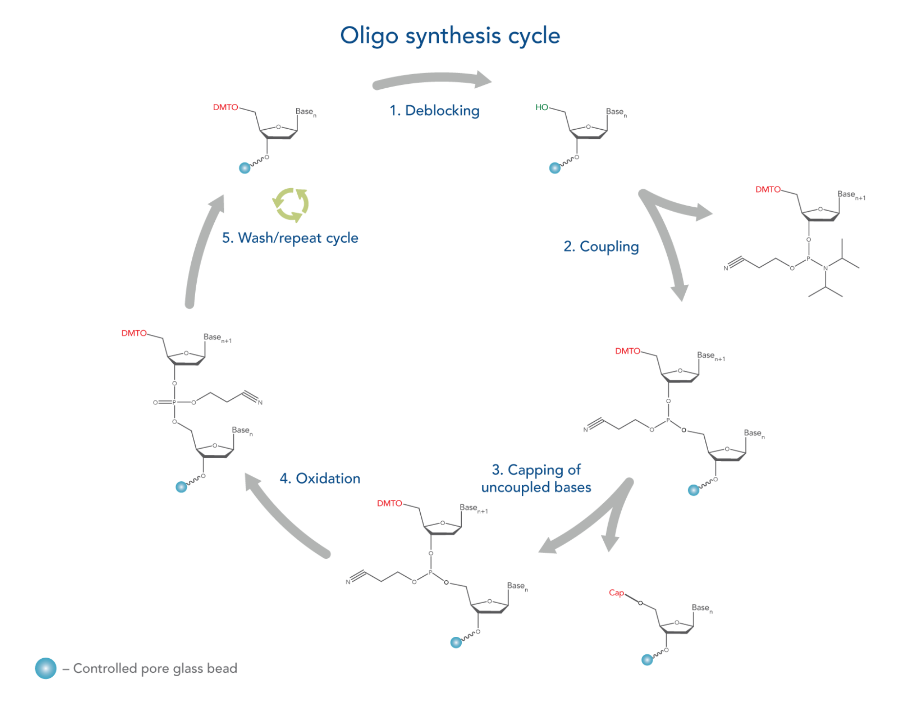

**The cycle.** One cycle adds one nucleotide. All steps run in dry organic solvent (acetonitrile), on beads (controlled-pore glass or resin) at scales from nmol to mmol (µmol is typical).

1. **Deblocking (detritylation).** Mild acid (di- or trichloroacetic acid) removes DMT and exposes the 5′-OH of the bead-bound chain.
   - The released DMT cation is bright orange. Measuring its absorbance each cycle reports how many chains coupled in the previous cycle, which is how coupling efficiency is monitored.
   - The acid must be brief: prolonged acid removes purine bases (*depurination*), and the chain later breaks at those sites.
2. **Coupling.** The next phosphoramidite is added in excess, together with an **activator** (a weakly acidic tetrazole).
   - The activator protonates the diisopropylamino nitrogen, turning it into a good leaving group.
   - The free 5′-OH attacks the phosphorus and forms a **phosphite triester** (P(III)) linkage.
   - P(III) is far more reactive than a phosphate P(V), so coupling takes only tens of seconds and exceeds 99 %.
   - Water must be excluded, because it would compete with the 5′-OH for the activated monomer.
3. **Capping.** The 0.5–1 % of chains that failed to couple still have a free 5′-OH. Acetic anhydride with N-methylimidazole acetylates these chains, so they can never react again. Without capping, they would couple in the *next* cycle and become chains missing one internal nucleotide (*deletion defects*, see Motivation).
4. **Oxidation.** Iodine in water/pyridine oxidises the unstable P(III) phosphite triester to a stable P(V) **phosphate triester**: the natural phosphodiester, still carrying its cyanoethyl group. The phosphite would not survive the acid of the next deblocking step.
5. **Wash.** Excess reagents are rinsed away; this is the advantage of working on a solid support. Then the cycle repeats.

**Finishing.**
- **Cleavage and deprotection.** Concentrated aqueous ammonia (or methylamine) cleaves the linker to the bead, removes the cyanoethyl groups (leaving the natural negatively charged phosphodiesters) and removes the base acyl groups.
- **Desalting.** Size exclusion, precipitation or diafiltration removes small molecules (salts, cleaved protecting groups), but **not truncated oligos**.
- **Removing truncations** needs HPLC or PAGE. One common trick, *DMT-on* purification, leaves the final 5′-DMT in place. Only full-length chains carry it, because capped failures were acetylated, not tritylated. The hydrophobic DMT then lets reverse-phase HPLC pull the full-length product out.

**Modifications.** Because the process is chemical, any group that can be made as a phosphoramidite (or attached to the support) can be inserted at the 5′ end, the 3′ end or internally:
- fluorophores and quenchers (used in qPCR probes, Section 18);
- reactive handles (amines, thiols, azides and alkynes for click chemistry) for attaching oligos to surfaces or proteins;
- flexible spacers;
- modified nucleotides (methylated, phosphorothioate, locked nucleic acid), which change stability or nuclease resistance.

#### Motivation and explanation

**Why capping matters.** The point is not how much product is made, but what the impurities look like. With capping, a chain that fails at coupling $k$ stops at length $k$. The impurities are spread over all shorter lengths and lack the final DMT, so they are easy to remove. Without capping, a chain that misses one coupling carries on, ending one nucleotide short with the error somewhere in the middle *and* a final DMT. It is chemically almost identical to the product, and DMT-on purification cannot separate it. The numbers are in Section 07.

**Limits.**
- Coupling is never 100 %, so full-length yield falls geometrically with length (Section 07).
- Depurination adds a further length-dependent loss.
- Together these keep practical oligos below about 200 nt. Genes have to be assembled from pieces (Section 08).
- The process uses expensive reagents in organic solvent and makes considerable chemical waste. Enzymatic (template-independent, TdT-based) synthesis in water is being developed as an alternative, but phosphoramidite chemistry remains the standard.

#### Wider pathway

Oligos made this way are the raw material for:
- PCR and qPCR primers and probes (Sections 16–18);
- gene and genome assembly (Sections 08–09);
- sequencing adapters (Section 11);
- aptamer libraries (Section 19);
- DNA nanotechnology (Sections 20–22);
- therapeutic RNAs.

#### Link to other topics

Separating the product from failure sequences by HPLC or PAGE is a downstream-processing problem of the same kind as protein purification (chromatography, Sections 46–47): the impurity closest in properties to the product sets the difficulty.

#### Summary

Phosphoramidite synthesis grows a chain 3′→5′ on a solid support through a four-step cycle: deblock, couple, cap, oxidise. Protecting groups ensure that exactly one nucleotide adds per cycle.

### Section 07: Yield against length in oligonucleotide synthesis

#### Intuition

Each coupling is a coin toss that lands "success" with probability $P$. The full-length product needs *every* toss to succeed, so the probabilities multiply and the yield decays geometrically: a fixed *fraction* is lost per nucleotide, not a fixed amount. Halving the failure rate per step roughly doubles the length that can be made at a given yield.

#### Derivation

Notation: $n$ is the oligo length (nt); $P$ is the coupling efficiency (probability that a chain adds the next monomer in one cycle); $Y(n)$ is the fraction of chains that are full length.

**Assumptions.** Every coupling succeeds independently with the same $P$, whatever the base or position. Capped failures never react again. Losses from depurination and deprotection are ignored. The first nucleoside is pre-attached to the bead, so an $n$-mer needs $n-1$ couplings.

**Step 1: full-length yield.** All $n-1$ couplings must succeed, and they are independent:
$$Y(n) = P^{\,n-1} \tag{19}$$

**Step 2: half-yield length.** Set $Y = \tfrac12$ and take logarithms. For $P$ close to 1, $\ln P\approx -(1-P)$:
$$n_{1/2} = 1+\frac{\ln 2}{-\ln P} \approx 1 + \frac{0.693}{1-P} \tag{20}$$
The usable length scales as $1/(1-P)$, the inverse of the failure rate.

**Step 3: truncation spectrum (with capping).** A chain that is length $k$ when it fails is capped and stays length $k$. That requires $k-1$ successes and then one failure:
$$\Pr(\text{length } k) = P^{\,k-1}(1-P), \qquad k = 1,\dots,n-1 \tag{21}$$
This is a geometric distribution. Summing (21) over $k$ gives $1-P^{n-1}$, so together with (19) the probabilities add up to 1.

**Step 4: deletions (without capping).** If failed chains are not capped, each continues in the next cycle. A chain then ends at full nominal length minus the number of failures. The number of failures in $n-1$ attempts is binomial, so the fraction with exactly one internal deletion is:
$$\Pr(\text{one deletion}) = (n-1)(1-P)P^{\,n-2} \tag{22}$$

#### Motivation and explanation

- **Small differences in $P$ compound.** 99.4 % against 99.1 % looks like a trivial gap, but by (20) the half-yield length is 116 nt against 78 nt.
- **Capping does not raise the yield.** Equation (19) holds either way. What capping changes is *what the impurities are*. With capping, the impurities from (21) are spread over all lengths (mean about 28 nt for a 60-mer) and lack the final DMT. Without capping, (22) gives a large population of $(n-1)$-mers with an internal error that are nearly impossible to separate from the product.
- **When (19) is optimistic.** Purine-rich sequences depurinate more. Some monomers (modified bases, RNA) couple less well. Secondary structure on the bead can hinder coupling. Purification also loses product. Real yields of long oligos are therefore lower than (19).

#### Worked example

*For coupling efficiencies of 99.4 % and 99.1 %, find the full-length yield for 20, 60, 120 and 200 nt, the half-yield length, and the impurity profile of a 60-mer.* Computed in Python.

| $n$ (nt) | $Y$ at $P=0.994$ | $Y$ at $P=0.991$ |
|---|---|---|
| 20 | 0.892 | 0.842 |
| 60 | 0.701 | 0.587 |
| 120 | 0.489 | 0.341 |
| 200 | 0.302 | 0.165 |
| $n_{1/2}$ from (20) | 116 | 78 |

The 120-nt values match the plotted curve (≈49 % and ≈34 %).

**Coupling efficiency needed for longer oligos.** For 50 % full-length yield at 200 nt, (19) needs $P = 0.5^{1/199} = 0.99652$. At 1000 nt it needs $P = 0.99931$. Each tenfold increase in length needs a tenfold smaller failure rate.

**A 60-mer at $P = 0.994$:**
- 70.1 % full length and 29.9 % truncated. The truncations have a mean length of 28.3 nt, and only 0.42 % are the $(n-1)$-mer.
- Without capping, 25.0 % of chains would be single-deletion 59-mers carrying DMT, and 4.4 % would have two deletions.

Capping therefore turns a 25 % impurity that cannot be separated into a spread of short truncations that can.

#### Link to other topics

Equation (19) is the same compounding that sets step-growth polymer chain lengths (Carothers) and the overall yield of any multi-step synthesis or separation train: overall yield is the product of the step yields.

#### Summary

Full-length yield falls as $P^{n-1}$, so the usable length scales as $1/(1-P)$: about 100–200 nt at today's 99–99.5 % coupling. Capping does not raise the yield, but it makes the failures easy to remove.

### Section 08: Assembling genes from synthetic oligonucleotides

#### Intuition

The problem is not making the bonds, since enzymes do that readily. The problem is making the pieces join *in the right order* when they are all mixed in one tube.

The answer is to let the sequence carry the ordering information. Each piece is designed so that its end is complementary to the start of the piece that should follow it. Two pieces can therefore only hybridise where they are meant to be adjacent, and enzymes then make the joint permanent. Nothing has to be added in a particular order, and nothing has to be positioned.

*Analogy:* a jigsaw in which every edge is cut to fit exactly one neighbour. You can shake the box and correct pairs will find each other. The analogy breaks down in two places. First, jigsaw edges either fit or they do not, whereas DNA overlaps bind with a *strength* that varies with sequence and temperature, so near-matches can mis-join. Second, a jigsaw piece cannot be built wrong, whereas every enzymatic copying step can introduce a sequence error.

#### Mechanism

The methods differ in what the starting pieces are and in which enzymes finish the joint, but they share one logic:

**1. Design the overlaps.** Neighbouring pieces are given a shared region of sequence, typically 20–50 bases. This is the "address" that determines adjacency.

**2. Let the overlaps hybridise.** The mixture is held at a temperature at which an intended overlap is stably paired but shorter, accidental complementarity is not. This is a direct application of Section 03: the correct overlap must have a melting temperature comfortably above the working temperature, and spurious matches must have one below it.

**3. Convert the hybrid into continuous double-stranded DNA.** A polymerase extends base-paired 3′ ends to fill in single-stranded regions, and where two strands abut, a ligase closes the remaining break in the backbone.

**4. Select the full-length product.** Partial assemblies always form. They are removed either by amplifying only molecules that carry both end sequences, or by separating on size.

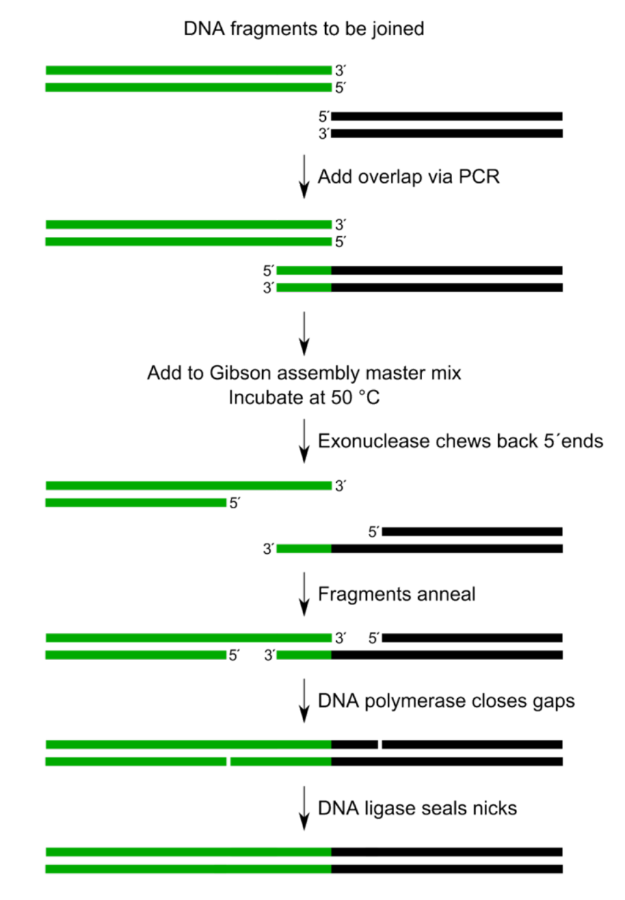

**Two regimes.** Starting from short synthetic oligos, the overlaps tile the whole target and the polymerase does most of the building; this reaches a few kilobases. Starting from existing double-stranded fragments, the overlaps exist only at the joints, which are exposed as single strands before annealing; this joins much larger pieces, is seamless (it leaves no scar sequence at the joint) and runs at a single temperature in one tube. The second is what makes assembly above a few kilobases practical.

#### Motivation and explanation

**Why overlaps must have matched melting temperatures.** All joints are processed at the same temperature. If one overlap had a much lower $T_m$ than the others, it would be largely unpaired at the working temperature and that joint would fail; if one were much higher, it would tolerate mismatches and allow incorrect joints. Designing overlaps to a common $T_m$, rather than a common length, is therefore the central design rule, and it is why GC content matters (Section 04).

**Why secondary structure is excluded.** A piece that folds back on itself competes with the intended pairing. A hairpin is unimolecular, so unlike hybridisation its stability does not fall when the solution is diluted (Section 03). It can therefore dominate at exactly the concentrations used.

**Why errors set the real limit.** Assembly is not limited by how long a molecule can be built, but by the chance that the molecule is *correct*. Chemical synthesis introduces errors, and so does every enzymatic copying step. Errors are roughly independent per base, so the probability that a construct is error-free falls exponentially with length. This is the same compounding as Section 07, and it is why long constructs are built from verified pieces rather than in one step.

**Where the approach fails.** Repetitive sequences defeat it entirely, because an overlap is no longer unique and pieces join in the wrong order or loop out. Very GC-rich or structured regions resist both synthesis and annealing.

#### Worked example

*Overlap design and error accounting.* All numbers computed in Python.

**1. How many pieces?** Tiling a 1 kb target with 60-nt oligos overlapping by 20 nt advances $60-20 = 40$ nt per oligo, so it needs $(1000-20)/40 \approx 25$ oligos.

**2. Is a 20-base overlap stable at the working temperature?** For the 20-mer of Section 05, at 0.25 µM, the nearest-neighbour model (Section 04) with the salt correction gives:

| Na⁺ | $T_m$ |
|---|---|
| 1 M | 66.2 °C |
| 0.05 M | 51.4 °C |

At a typical buffer ionic strength, a 20-base overlap melts at around 50–55 °C. That sits just above a 50 °C working temperature, which is why overlaps of this length are the shortest used, and why longer overlaps (40–50 bases) are preferred when the joint must be robust.

**3. Error-free fraction of a 1 kb construct.** With a per-base error probability $\varepsilon$, the chance that all 1000 bases are correct is $(1-\varepsilon)^{1000}$:

| $\varepsilon$ | Error-free fraction | Clones to screen for 95 % chance of one correct |
|---|---|---|
| 1 in 300 | 3.5 % | 83 |
| 1 in 600 | 18.9 % | 15 |
| 1 in 1500 | 51.3 % | 5 |

The last column is $\ln(0.05)/\ln(1-Y)$, the number of independent clones needed before the probability of finding no correct one falls below 5 %.

This is why a synthetic gene is always *sequence-verified* (Sections 10–12) rather than simply used, and why halving the error rate matters more than any improvement in assembly yield.

#### Wider pathway

Assembled, verified genes are the input to everything downstream in this course: expressing an engineered protein (Section 29), building a genetic circuit (Sections 48–52), and the hierarchical construction of whole genomes (Section 09). The sequence-verification step at the end of assembly is what links this section to sequencing, which is the subject of the next three sections.

#### Link to other topics

The design rule "match the $T_m$ of every joint" is the same reasoning as specifying a common operating temperature for a set of parallel units in a process: the slowest or least stable element sets the condition that all the others must tolerate.

#### Summary

Enzymatic assembly solves ordering by writing adjacency into the sequence as overlaps, then converting hybridised overlaps into continuous duplex. The design constraints follow directly from hybridisation thermodynamics: overlaps matched in melting temperature and free of competing structure.

### Section 09: Synthetic genomes

#### Intuition

No single method spans six orders of magnitude. What works instead is a ladder: each rung uses a method suited to its own scale, and each rung's output becomes the next rung's input. Pieces are verified before being promoted, so errors are caught while the pieces are still small and cheap to remake.

*Analogy:* building a ship from plates, then sections, then blocks, rather than welding plate to plate along the whole hull. The analogy breaks down in an important way: ship sections are inspected visually, whereas DNA must be *sequenced* to be checked, and a single wrong base out of a million can be fatal to function.

#### Mechanism

**The hierarchy.** The first complete synthetic bacterial genome, a 1.08 Mb *Mycoplasma mycoides* genome reported in 2010, was built in stages of roughly tenfold increase:

| Stage | Size | Number of pieces | Built by |
|---|---|---|---|
| Oligonucleotides | ~60 nt | thousands | chemical synthesis (Section 06) |
| Cassettes | ~1.08 kb | 1078 | enzymatic assembly (Section 08) |
| Intermediate assemblies | ~10 kb | 109 | assembly in yeast |
| Large assemblies | ~100 kb | 11 | assembly in yeast |
| Complete genome | 1.08 Mb | 1 | assembly in yeast |

**Why yeast for the top stages.** Yeast carries out homologous recombination efficiently and natively: given pieces with shared ends, the cell itself joins them in the correct order, and it will maintain a megabase construct as an artificial chromosome. Above roughly 100 kb, *in vitro* handling becomes impractical, because molecules that large shear under ordinary pipetting. Doing the final stages inside a cell avoids handling the intact molecule at all.

**Transplantation.** The assembled genome was transplanted into an intact recipient cell of a related species. Successful transplants subsequently lost the recipient chromosome and were controlled by the synthetic genome. The recipient's existing proteins and ribosomes ran the new genome until the cell had replaced its own contents through division. The result was a population whose genetic information was entirely synthetic.

**Watermarks.** Distinctive sequences were inserted at defined positions. They have no biological function and serve as unambiguous proof that the genome in the cell is the designed one rather than a contaminating natural genome. This is a control, not a decoration: without it, the claim could not be distinguished from contamination.

#### Motivation and explanation

**What this demonstrated, and what it did not.** The genome was a near-copy of an existing one, so no new biology was designed. The result was a demonstration that genetic information is *transferable as chemical information*: a sequence read from one organism, written chemically, and installed in another cell, produces that organism. The division between hardware (the cell) and software (the genome) is real and crossable.

**Why the hierarchy, in terms of Section 08.** Error probability compounds exponentially with length. A megabase assembled in one pass would essentially never be correct. By verifying at the kilobase stage, the error-free fraction at each rung stays high, and a fault requires remaking one small piece rather than the whole construct. The hierarchy converts an exponential problem into a sequence of tractable ones, which is why the work needed sequencing (Sections 10–12) as much as it needed synthesis.

**Why eukaryotes are harder.** An effort to build a synthetic yeast genome has synthesised all sixteen chromosomes individually, but combining them into a single living strain has proved to be the slow step, and strains reported so far carry only part of the genome in synthetic form. The reasons are structural rather than chemical: eukaryotic genomes are larger, distributed across multiple chromosomes, contain repetitive sequence that defeats overlap-directed assembly, and depend on chromatin organisation and regulatory context that a correct sequence alone does not guarantee. A project to synthesise a human genome has been funded, on a timescale of decades.

**Minimisation.** A genome that can be written can also be edited systematically. Removing genes and testing which the cell can survive without converts the question "what is the minimal set of genes for life?" from speculation into an experiment, which is the subject of Section 55.

#### Link to other topics

The hierarchy here is the standard engineering response to a process whose yield falls exponentially with scale: break it into stages, inspect between stages, and rework at the smallest unit possible. The same reasoning governs staged separations and multi-step reaction trains.

#### Summary

Genome-scale construction needs no new chemistry, only a hierarchy of assembly stages with verification between them, using cells for the largest steps because megabase molecules cannot be handled intact. The first synthetic bacterial genome showed that a sequence is sufficient to specify an organism, given a cell to run it in.

### Conclusion

The per-step yield limits direct synthesis length; assembly and replication extend that chemistry to larger DNA constructs. The next unit develops sequencing i - sanger and short reads.

## 03. Sequencing I - Sanger and short reads

### Overview

Sanger sequencing reads chain-terminated fragments, while Illumina reads large numbers of immobilised templates in parallel. Library preparation, cluster generation and reversible-terminator chemistry connect an original sample to short reads that must be assembled or mapped.

*Assumed throughout:* nucleotide polymerisation, PCR and sequence complementarity.

### Section 10: Sanger sequencing and the shotgun approach

#### Intuition

The difficulty in reading a sequence is that the four bases are chemically similar and a polymer of them has no outward feature that reveals the order. Sanger's idea converts the problem of *reading* into a problem of *measuring length*, which was already solvable.

Suppose you could make a copy of the template that stops at a randomly chosen position, and suppose you could tell which base it stopped on. Do this many times and you obtain a collection of fragments of every possible length, each labelled with its own final base. Sort them by length, read off the labels in order, and you have the sequence.

*Analogy:* determining the order of carriages on a train you cannot see by releasing many copies of the train from a station and stopping each at a random carriage, then sorting the pieces by length. The analogy breaks down because the stopping here is chemical rather than chosen, so the termination positions are governed by probability, and the resulting fragment populations have to be numerous enough that every length is represented.

#### Mechanism

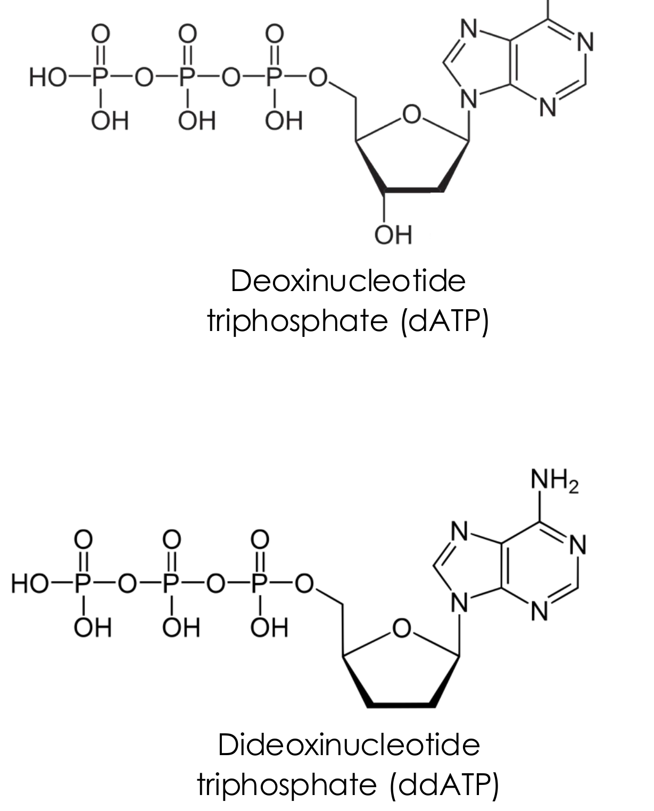

**1. The chain terminator.** A *dideoxynucleotide* triphosphate (ddNTP) is a normal dNTP missing the 3′-OH on the sugar. A polymerase incorporates it normally, because the parts it recognises (the base and the triphosphate) are unchanged. But the chain now ends in a 3′-H instead of a 3′-OH, and there is nothing to attack the next nucleotide's phosphate. Extension stops permanently.

**2. Random termination.** The reaction contains template, primer, polymerase, all four dNTPs, and a *small* proportion of ddNTPs, of order 1 %. At each position the polymerase almost always adds a normal dNTP and occasionally adds a terminator. Over a large population of template copies, termination occurs at every position in some fraction of the chains, giving a ladder of fragments differing by one nucleotide.

**3. Identifying the final base.** Two implementations:
- *Original:* four separate reactions, each containing only one of ddATP, ddTTP, ddGTP, ddCTP. All fragments in a given reaction end in the same known base. The four reactions are run in adjacent gel lanes and the sequence read across them.
- *Modern (dye terminator):* each of the four ddNTPs carries a spectrally distinct fluorophore, so all four terminators can be used in one reaction. A fragment's final base is identified by the colour it emits.

**4. Separation and read-out.** Capillary electrophoresis separates the fragments by length as they migrate through a polymer. They pass a laser and detector in order of increasing length, producing a *chromatogram*: a series of coloured peaks, one per position. The sequence is the order of peak colours.

**5. Shotgun sequencing for long targets.** A single read covers under a kilobase, so a genome is handled statistically rather than sequentially:

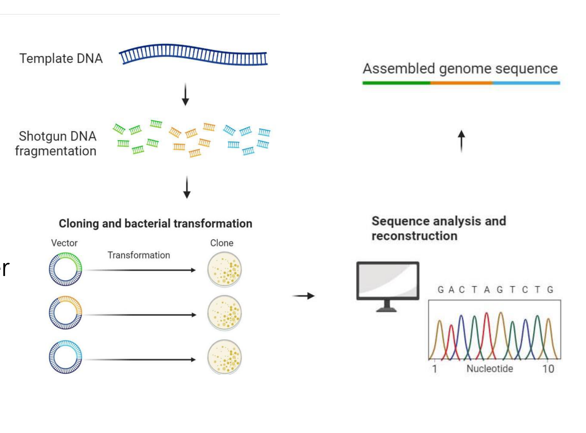

- Fragment the genome randomly by mechanical shearing (sonication).
- Clone fragments into plasmids and transform into bacteria, so that each colony carries and amplifies one fragment. This is the *sequencing library*, and it serves two purposes: it provides enough identical copies of each fragment to sequence, and it physically separates fragments from each other.
- Sequence individual clones.
- Assemble the reads computationally by finding overlaps, which works because the fragmentation was random and the reads therefore overlap.

#### Motivation and explanation

**Why about 1 % terminator.** The ratio sets a trade-off. Too much ddNTP and almost every chain terminates early, so no fragments reach the far end of the template and the read is short. Too little and terminations are so rare that short fragments are under-represented. A ratio of about 1:100 gives usable signal across several hundred bases.

**What limits the read length.** Not the chemistry, but the *separation*. Resolving fragments of length $n$ and $n+1$ requires distinguishing a relative length difference of $1/n$, which gets harder as $n$ grows. Beyond roughly 700–900 bases, adjacent peaks merge and the base calls become unreliable. This is a resolution limit, so it is not improved by running the reaction longer.

**Why the first bases are unreliable.** The primer occupies the first stretch of the template, and very short fragments run anomalously, so typically the first 15–40 bases after the primer cannot be called. Anything to be sequenced must therefore have known flanking sequence to prime from, and the region of interest must sit beyond this dead zone.

**Strengths and weaknesses.**
- *Accurate*, around 99.99 % per base, because each peak is an independent averaged measurement over many molecules.
- *Long reads* relative to short-read platforms, over 500 nt.
- *Low throughput*: the fundamental problem. One capillary sequences one fragment, and instruments run about 96 in parallel. Every fragment also needs its own cloning and purification.

It remains the method of choice when a small number of fragments must be read very accurately: verifying a synthetic gene (Section 08), checking a plasmid, or confirming a variant found by another method.

#### Worked example

*Why Sanger alone could not keep pace with genome-scale sequencing.* All numbers computed in Python, using a human genome of $G = 3.1\times10^9$ bases.

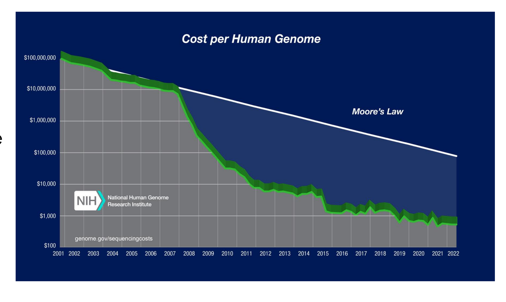

**1. Cost of the Human Genome Project.** About \$3 billion for 3 billion bases is \$0.97 per base, roughly \$1/base. Modern short-read sequencing reaches about \$1000 per genome, which is $3.2\times10^{-7}$ per base, a reduction by a factor of about $3\times10^{6}$.

**2. How many reads?** With 700-base reads, covering the genome once needs $G/L = 4.4\times10^{6}$ reads. At 8-fold redundancy, $3.5\times10^{7}$ reads, which is $3.7\times10^{5}$ plates of 96. At two hours per plate on one instrument, that is $7.4\times10^{5}$ hours, or **84 years of continuous running on a single machine**. The project took 13 years across many centres, which is consistent.

**3. Why redundancy is needed at all.** If reads land at random positions, the number covering a given base is Poisson with mean equal to the coverage $c$, so the fraction of the genome left uncovered is $e^{-c}$:

| Coverage $c$ | Uncovered fraction | Bases missed in 3.1 Gb |
|---|---|---|
| 1 | 0.368 | $1.1\times10^{9}$ |
| 5 | $6.7\times10^{-3}$ | $2.1\times10^{7}$ |
| 10 | $4.5\times10^{-5}$ | $1.4\times10^{5}$ |
| 30 | $9.4\times10^{-14}$ | $\ll 1$ |

Sequencing a genome "once over" leaves 37 % of it unread. The gaps are the reason coverage of 8–30× is specified rather than 1×, and the exponential form means each additional fold of coverage removes a *fixed fraction* of the remaining gaps.

These two results together, the cost per base and the 84-machine-years, are what motivated massively parallel sequencing.

#### Wider pathway

Reading sequence closes the design–build–test loop that Sections 06–09 opened: a construct is designed, synthesised, assembled, and then verified by sequencing before use. Beyond verification, sequencing underpins diagnostics, variant discovery and the reference genomes on which all of modern biology depends.

#### Link to other topics

Coverage statistics here are the Poisson arrival problem familiar from residence-time distributions: random independent events scattered over a domain, with $e^{-c}$ the probability of none arriving in a given interval.

#### Summary

Chain termination turns sequence reading into length measurement by exploiting a single missing hydroxyl, giving reads of several hundred bases at very high accuracy, with electrophoretic resolution setting the ceiling. Shotgun fragmentation and Poisson coverage extend it to genomes, at a redundancy cost.

### Section 11: Illumina sequencing, library preparation and cluster generation

#### Intuition

Parallel reading needs two things that a mixture of fragments does not have.

First, **uniformity of handles**. Every fragment must be graspable in the same way: the same primer must prime all of them, and the same surface must capture all of them. Since the fragments differ in sequence, this is achieved by *attaching* common sequences to their ends. The interior stays unknown, which is the point; only the ends are standardised.

Second, **brightness**. A single molecule adding one fluorescent nucleotide emits far too little light to image reliably. The fix is to make roughly a thousand copies of each fragment, all at the same spot and all adding the same nucleotide in step. The spot then emits a thousandfold more light while still reporting one fragment's sequence.

*Analogy:* instead of reading one book at a time, photocopy each book a thousand times, stack each set in its own pigeonhole on a huge wall, and photograph the whole wall page by page. The analogy breaks down because the copies must stay *in step*: if some copies in a pigeonhole fall a page behind, the photograph blurs between two pages, which is exactly the error mode discussed in Section 12.

#### Mechanism

##### Library preparation

1. **Fragment.** Sonication breaks the DNA into 100–200 bp pieces. The size matters: fragments must be short enough that the read covers a useful proportion of each.
2. **End repair (polishing).** Shearing leaves ragged ends with random single-stranded overhangs. A 3′→5′ exonuclease removes protruding 3′ overhangs and a polymerase extends recessed 3′ ends opposite 5′ overhangs, producing *blunt* ends. Ligation requires defined ends, so this makes an inhomogeneous population uniform.
3. **A-tailing.** A polymerase adds a single, non-templated adenine to each 3′ end.
4. **Adapter ligation.** Adapters carrying a complementary single T overhang are ligated on. The A/T pair is a minimal sticky end, and its purpose is to prevent the fragments from ligating to each other: a blunt-ended population would self-ligate into chimeras, whereas A-tailed fragments can only pair with T-overhang adapters.
   - The adapters are **Y-shaped**: double-stranded near the fragment and unpaired further out. Both ends receive the same adapter, yet because the two arms of the Y have *different* sequences, the two ends of the fragment end up carrying different sequences. This is the trick that makes one adapter give two distinguishable ends.
5. **Library PCR.** Primers matching the Y arms amplify the fragments and complete the distinct terminal sequences, conventionally called **P5** and **P7**. Every fragment in the library now ends in P5 at one end and P7 at the other.
   - The primers also add a short **index** or barcode, about 6 nt. Libraries from different samples get different indices, are pooled and sequenced together, then separated computationally afterwards. This is *multiplexing*, and it is how a run large enough for a human genome is shared economically between many small samples.

##### Cluster generation by bridge amplification

6. **The flow cell.** A glass surface bearing a dense lawn of two tethered oligonucleotides, P5′ and P7′, complementary to the fragment ends. It sits in a channel through which reagents are flowed, so every step can be delivered and washed automatically.
7. **Seeding.** Denatured library is flowed in at *low concentration*, so single strands hybridise to the lawn at well-separated random positions. The dilution is deliberate: clusters must not overlap, or their fluorescence cannot be assigned to one fragment.
8. **Covalent capture.** A polymerase extends the tethered oligo using the hybridised fragment as template. The copy is now covalently attached to the surface. Denaturation washes the original strand away, leaving a sparse field of surface-bound single strands.

9. **Bridge amplification.** The tethered strand is flexible enough to bend over and hybridise its free end to a nearby complementary lawn oligo, forming a *bridge*. The polymerase copies it, giving a double-stranded bridge; denaturation gives two tethered strands, both anchored within a short distance of the original. Repeating 25–35 times generates up to a thousand copies confined to a patch a few hundred nanometres across: a **cluster**.
10. **Linearisation.** One orientation is cleaved enzymatically and washed away, leaving every strand in the cluster pointing the same way. Without this, the cluster would contain both strands and the fluorescence signals of complementary sequences would superpose.

The finished flow cell carries millions to billions of clusters, each hundreds to thousands of identical copies of one library fragment, all identically oriented and all primed by the same adapter sequence.

#### Motivation and explanation

**Why amplify on the surface rather than in solution.** Amplifying first and then depositing would let copies of different fragments land together, producing mixed spots. Because each cluster grows outward from a single seeded molecule and the copies stay tethered near their origin, spatial separation is guaranteed by the geometry rather than enforced afterwards. The surface does the sorting that cloning into bacteria did in Section 10, without any cells.

**Why cluster density is the key design parameter.** Throughput scales with the number of clusters, so denser is better, but clusters that overlap cannot be resolved and are discarded. Loading concentration is therefore tuned to sit just below the density at which overlap becomes common. This is the same trade-off as colony density on an agar plate.

**Where the preparation introduces bias.**
- *PCR bias*: GC-rich and GC-poor fragments amplify with different efficiencies, in both the library PCR and bridge amplification, so coverage is uneven across a genome rather than uniformly Poisson.
- *Chimeras*: incompletely suppressed cross-ligation joins unrelated fragments, creating reads that map to two places.
- *Duplicates*: multiple clusters seeded from PCR copies of the same original molecule are not independent observations, which matters when counting.

**The cost.** This workflow is multi-step and takes a day or more before any sequence is produced, which is why the platform suits large batched jobs rather than single urgent samples.

#### Worked example

*Scale of a human genome run at 30× coverage with 150-base reads.* Computed in Python, $G = 3.1\times10^{9}$.

- Reads required: $cG/L = 30\times3.1\times10^{9}/150 = 6.2\times10^{8}$, about 620 million.
- Each read is one cluster, so the flow cell needs of order $10^{9}$ resolvable spots. A high-output instrument producing about $2\times10^{10}$ reads per run therefore sequences roughly 32 human genomes per run.
- Sanger, at 96 capillaries, would need $6.2\times10^{8}/96 = 6.5\times10^{6}$ runs for the same data.

The throughput gain is about seven orders of magnitude, and it comes entirely from parallelism: the chemistry of adding one nucleotide is no faster than before.

#### Wider pathway

Library preparation is where the sample meets the instrument, so it is also where most sample-specific design happens: the same cluster-generation and read-out chemistry serves genome sequencing, RNA sequencing (after reverse transcription), and methods that count binding sites, with only the library step changed.

#### Link to other topics

Immobilising the reaction on a surface so reagents can be flowed past and washed away is the logic of solid-phase synthesis in Section 06, used here for reading instead of writing. In both cases the solid support converts a separation problem into a washing step.

#### Summary

Library preparation gives every fragment identical P5 and P7 ends plus a sample index, so that one surface chemistry and one primer serve a heterogeneous mixture. Bridge amplification then converts each seeded molecule into a spatially isolated cluster of about a thousand identical copies, bright enough to image.

### Section 12: Sequencing by synthesis and read assembly

#### Intuition

Sanger reads a sequence by making fragments of every length and sorting them (Section 10). Sequencing by synthesis does the opposite: it keeps the molecules still and advances them all together, one base at a time, watching what is added at each step. The sequence is read in time rather than in space.

For that to work, extension must be *stoppable and restartable*. If nucleotides were added freely, a cluster would run to the end of the template in one step and a single image would show only the last base. So each nucleotide is supplied with a removable block on its 3′ position: the polymerase adds one, then cannot add another until the block is taken off. Each cycle is a controlled single step, and the fluorophore attached to that nucleotide says which base it was.

The contrast with Section 10 is worth holding onto: Sanger uses an *irreversible* terminator in a small proportion, so that chains stop at random positions. Here the terminator is *reversible* and used exclusively, so that every chain stops at the same position every cycle.

*Analogy:* a ratchet that advances one tooth per turn of a handle, with the tooth colour read off at each click. The analogy breaks down because a real ratchet cannot slip; in a cluster, a small fraction of strands fail to extend or extend twice, and those errors accumulate.

#### Mechanism

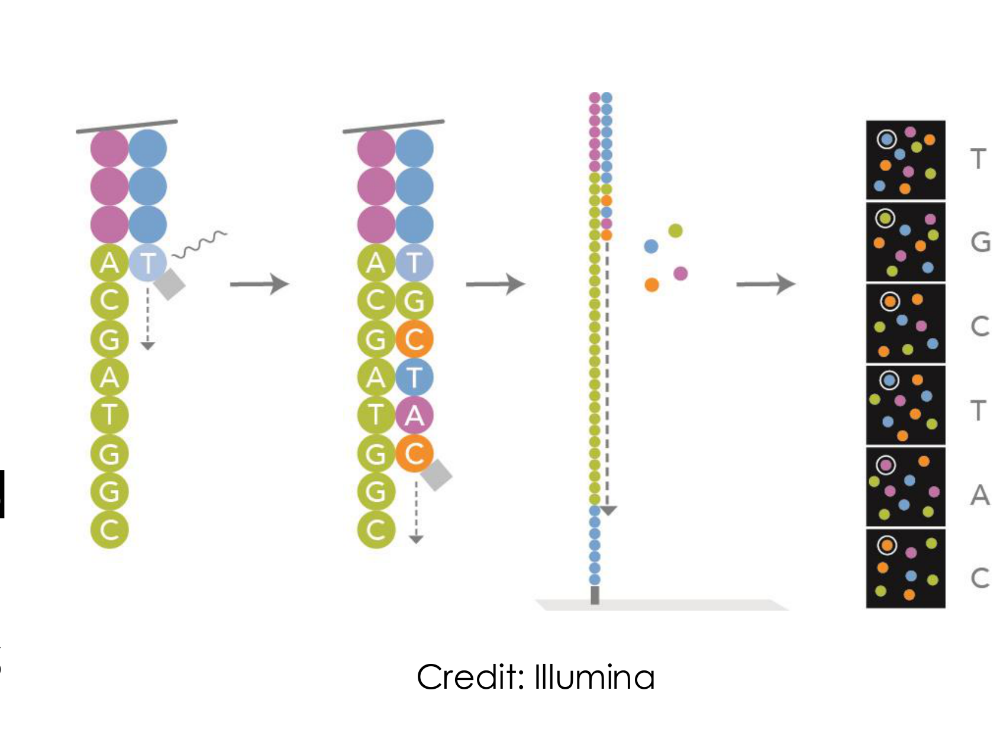

**One cycle:**

1. **Prime.** A sequencing primer anneals to the adapter sequence common to every cluster (Section 11). All clusters therefore start from the same point, which is why the fragments needed standardised ends.
2. **Extend by one.** All four nucleotides are supplied simultaneously, each carrying a spectrally distinct fluorophore and a 3′ blocking group. The polymerase incorporates whichever one is complementary at that position, and the block prevents any further addition. Supplying all four at once is what makes this different from stepwise chemistry: the *template* chooses, not the operator.
3. **Image.** The whole flow cell is scanned. Every cluster fluoresces in the colour of the single base it just added. All copies in a cluster added the same base, so their signals sum, which is what makes the spot visible.
4. **Deblock.** The fluorophore and the 3′ block are cleaved chemically and washed away, restoring a normal 3′-OH and leaving no label behind. The strand is now ready for the next cycle.

Repeating this gives, for each cluster, a sequence of colours over time: its read.

**Paired-end reading.** After the first read, one more round of bridge amplification regenerates the complementary strands on the surface, the already-read strands are cleaved away, and the process is repeated from the other end. Each fragment then yields two reads, one from each end, with a known approximate separation. This matters for assembly, below.

#### Motivation and explanation

**Why the fluorophore and the block are on the same nucleotide.** The fluorophore identifies the base; the block enforces one addition per cycle. Removing both in the same chemical step means a single reagent restores the strand to a natural state. A residue left behind by imperfect cleavage ("scar") impedes the polymerase and is one of the reasons signal degrades along a read.

**Phasing: what limits the read length.** The cluster is read as a sum over about a thousand strands, and the method assumes they are all at the same position. In each cycle a small fraction fail to extend (*phasing*, falling behind) or lose their block and extend twice (*pre-phasing*, running ahead).

These errors are cumulative and irreversible. After $n$ cycles the population has spread over a range of positions, so the image at cycle $n$ is a blend of several positions, dominated by the intended one but increasingly contaminated. The signal-to-noise ratio falls monotonically with cycle number, which is why:
- reads are limited to roughly 50–300 bases;
- quality declines along the read, with the 3′ end worst;
- base-call errors are predominantly substitutions, not insertions or deletions.

This is a different limit from Sanger's. Sanger is limited by *electrophoretic resolution* between fragments; this is limited by *loss of synchrony* within a cluster. Neither is improved by running longer.

**Why accuracy is nevertheless high.** Each base call averages a thousand molecules, and each genomic position is covered by many independent reads. Both average away random error, which is why per-base accuracy reaches about 99.9 % and consensus accuracy is far higher still.

**The trade-off against Sanger.** Illumina wins overwhelmingly on throughput and cost per base, and loses on read length and on turnaround. For verifying a single plasmid, Sanger is faster and simpler; for anything requiring millions of reads, there is no comparison.

##### Assembly

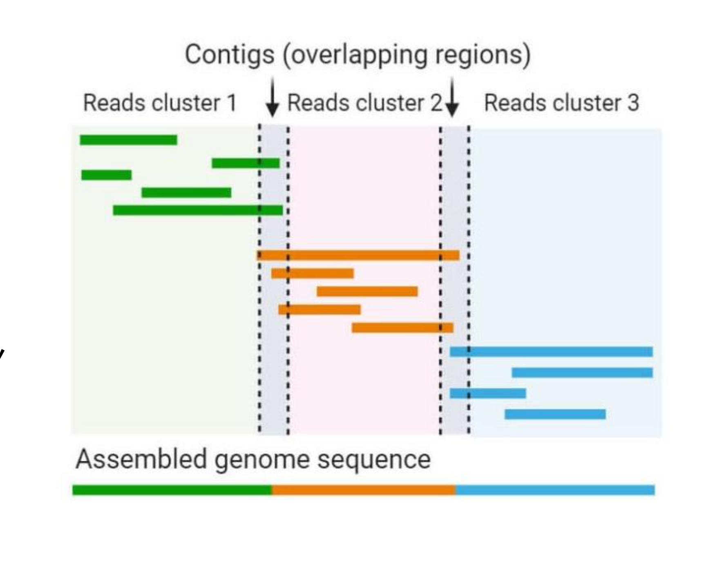

Reads carry no positional information, so position must be recovered from sequence:
- **Mapping** to a known reference: each read is aligned to the position it matches. Fast and reliable, and used whenever a reference exists.
- **De novo assembly:** reads are overlapped with each other and merged into *contigs*, contiguous stretches built from overlapping reads. Contigs are then ordered and oriented into *scaffolds* using paired-end information, since the two reads of a pair are known to lie a certain distance apart and in opposite orientations.

**Why repeats are the fundamental problem.** A read shorter than a repeated element cannot be placed: it matches every copy of the repeat equally well. The assembly then breaks at that point, or collapses the copies together and loses the true structure. This is not a defect of the chemistry but a consequence of read length, and no amount of coverage fixes it. It is the main reason long-read platforms exist alongside short-read ones.

#### Worked example

*Quality scores, coverage and consensus accuracy.* Computed in Python.

**1. Quality scores.** Base calls carry a Phred score $Q = -10\log_{10}p$, where $p$ is the probability that the call is wrong:

| $Q$ | Error probability | Meaning |
|---|---|---|
| 20 | $10^{-2}$ | 1 wrong base in 100 |
| 30 | $10^{-3}$ | 1 in 1000 |
| 40 | $10^{-4}$ | 1 in 10 000 |

At $Q30$, a 150-base read contains on average $150\times10^{-3} = 0.15$ errors, so about one read in seven has a miscalled base. Across $6.2\times10^{8}$ reads that is roughly $10^{8}$ wrong bases in a run, which only becomes acceptable because of redundancy.

**2. Why coverage rescues it.** With 30× coverage and independent errors at $p = 10^{-3}$, a consensus call at a position is wrong only if most of the 30 reads are wrong in the same way. The probability of 16 or more errors among 30 reads is $1.4\times10^{-40}$. The consensus is therefore limited by *systematic* bias (GC bias, repeats, mapping error), not by random base-call error.

**3. Coverage still has to reach every base.** From Section 10, uncovered fraction $e^{-c}$: at 30×, essentially none of the genome is missed by chance. Combined with the result above, this is why 30× is a standard specification for human genome sequencing: it is the point at which both random gaps and random miscalls stop being the limiting factor.

#### Wider pathway

Together, Sections 10–12 give the two complementary reading technologies: one accurate and long but serial, the other short but massively parallel. Their shared weakness is read length, which is what the single-molecule platforms of Sections 13–14 address by reading one long molecule directly rather than many short amplified ones.

#### Link to other topics

The cluster is a population of identical reactors intended to run in lockstep, and phasing is the gradual spread of their state distribution: the same loss of synchrony that broadens residence-time distributions, and the same reason that a signal averaged over a drifting population degrades with time.

#### Summary

Reversible terminators turn polymerisation into a stepwise, readable process, with one imaged base per cycle across the whole flow cell at once. Loss of synchrony within each cluster, not chemistry, caps the read at a few hundred bases, and that short read length is what makes repeats the hard part of assembly.

### Conclusion

Parallel readout increases throughput, while amplification and assembly introduce distinct sources of bias and uncertainty. The next unit develops sequencing ii - long reads and applications.

## 04. Sequencing II - long reads and applications

### Overview

Nanopore and PacBio sequencing read individual molecules through different physical signals. Their long reads complement short-read methods by spanning repeats, resolving variants and supporting applications that depend on molecular context.

*Assumed throughout:* nucleotide polymerisation and the short-read sequencing principles.

### Section 13: Nanopore sequencing

#### Intuition

Put a hole in an insulating membrane separating two salt solutions, apply a voltage, and ions flow through the hole: a measurable current. Now push something through the hole. While it is in there it occupies space that ions would otherwise use, so the current drops. How *much* it drops depends on the shape and chemistry of whatever is blocking.

DNA is a charged polymer, so the same electric field that drives the ions also drags DNA through the pore. If the hole is narrow enough that only a single strand fits, and if the four bases obstruct the opening by measurably different amounts, then the current over time is a direct transcript of the sequence passing through.

This is a fundamentally different measurement from everything before it. Sanger and Illumina both *synthesise* a copy and infer the template from what was added. Nanopore reads the original molecule itself, and never copies it. That is why there is no amplification step, and why chemical modifications on the original strand remain visible.

*Analogy:* identifying a chain of differently-shaped beads by pulling it through a hole and recording how much water still gets past. The analogy breaks down in the way that matters most: the hole is not thin enough to see one bead at a time. Several beads sit in the constriction together, so the flow reports a *combination*, which is the central difficulty of the method.

#### Mechanism

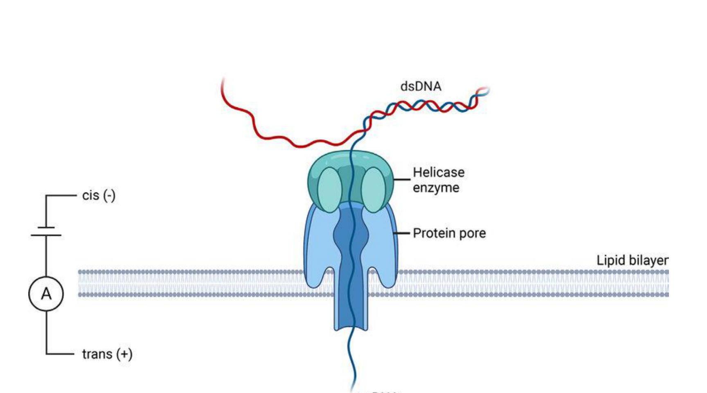

**1. The pore.** A protein pore is inserted into a synthetic membrane. Its narrowest constriction is of order 1 nm, comparable to the width of single-stranded DNA, so ssDNA passes but double-stranded DNA cannot. Pores are protein-engineered variants, chosen and modified to sharpen the difference in current between sequences.

**2. The driving force.** A voltage across the membrane drives a steady ionic current through the pore, of order 100 pA, which can be measured precisely. The DNA backbone is negatively charged (Section 01), so the same field pulls DNA from the negative (*cis*) side to the positive (*trans*) side.

**3. The motor protein.** A helicase sits on top of the pore and does two jobs:
- *Unwinds* the duplex, so that only one strand enters. Without it, double-stranded DNA would simply block the pore.
- *Ratchets* the strand through one base at a time. This is the critical function. Unaided electrophoretic translocation is far too fast, of order a microsecond per base, to measure anything. The helicase slows it to roughly 2 ms per base, giving the amplifier time to average out noise.

**4. Base calling.** As the strand moves, the current traces out a series of levels.

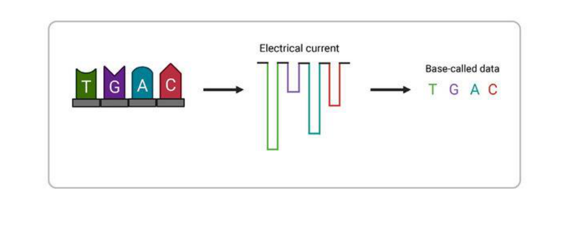

The essential complication: the constriction is longer than one nucleotide, so roughly five bases occupy it simultaneously. The current level therefore reports a **k-mer**, not a base. With $k = 5$ there are $4^5 = 1024$ possible current levels, spread over a range of tens of picoamps, so the levels overlap heavily and cannot be read off individually.

The sequence is instead recovered computationally. As the strand advances by one base the k-mer shifts by one, so successive levels are strongly constrained by each other, and the whole current trace is decoded as a sequence using a neural network trained on known sequences. The base caller, not the hardware, is what converts signal into sequence, and improvements to it have historically raised accuracy without any change to the chemistry.

**5. The device.** A flow cell holds an array of wells, each with its own membrane, pore and amplifier, so thousands of strands are read in parallel. The instrument is a hand-held device drawing power over USB, with no optics.

#### Motivation and explanation

**Why reads are so long.** Nothing in the method limits read length. There is no resolution limit as in Sanger (Section 10) and no loss of synchrony as in Illumina (Section 12), because there is only ever one molecule. The read continues until the strand finishes or breaks. Reads of 100 kb are routine, and the practical limit is how gently the DNA can be extracted without shearing it. This is the decisive advantage: reads longer than a repeat can span it, resolving the assembly problem of Section 12.

**Why homopolymers are the characteristic failure.** A run such as CCCCC gives the *same* k-mer, and so the same current level, for several successive steps. The level does not change, so the only evidence of how many C's passed is how *long* the level persisted. Translocation is stochastic, so dwell time is a noisy measure of step count, and the base caller must infer "five C's" from a duration. This produces insertions and deletions in homopolymer runs, and it is a **systematic** error: it recurs at the same place in every read of that sequence.

**Why that systematic character matters more than the raw error rate.** Raw single-read accuracy is around 95–99 %, against about 99.9 % for Illumina. Random errors average away with coverage, so a high random error rate is tolerable. Systematic errors do not: every read of a homopolymer makes the same mistake, so the consensus is confidently wrong. The worked example quantifies this.

**Other consequences of reading the native strand.**
- *Modified bases are visible.* A methylated cytosine obstructs the pore slightly differently from an unmodified one, so epigenetic marks are read directly in the same run, with no separate chemistry.
- *RNA can be sequenced directly,* without reverse transcription to cDNA, so modifications and true transcript lengths survive.
- *No amplification bias* (Section 11), because there is no amplification.
- *Minimal preparation:* minutes rather than days, since there is no library PCR or cluster generation.

**Where this leaves it.** Portability plus fast preparation makes nanopore the method of choice when the answer is needed quickly or far from a laboratory: outbreak sequencing in the field, rapid clinical identification. The accuracy deficit matters for calling single-base variants and does not matter for determining genome structure.

#### Worked example

*Timing, information content and the consensus limit.* Computed in Python.

**1. Signal levels.** With five bases in the constriction, the number of distinguishable states is $4^5 = 1024$. If the full current range spanned by these states is about 60 pA, the mean spacing between adjacent levels is $60/1024 \approx 0.06$ pA, far below the noise on a single measurement. This is why no amount of care in reading one level identifies a base, and why the decoding must use the whole trace.

**2. Translocation.** At about 450 bases per second, each base occupies $1000/450 = 2.2$ ms. A 100 kb read therefore takes $10^{5}/450 = 222$ s, under four minutes. A 10-base homopolymer passes in 22 ms, and the base caller must convert that duration into a count of ten.

**3. Why coverage does not rescue a systematic error.** Suppose the single-read error probability is $p=0.05$ and observations are independent. If $K$ is the number of erroneous observations among $n$ reads, then $K$ is binomial. More than half the observations being correct guarantees a correct majority call, so a conservative error bound is
$$P_{\mathrm{error}}\leq\sum_{k=\lceil n/2\rceil}^{n}\binom{n}{k}p^k(1-p)^{n-k}.$$
For even $n$, ties are conservatively included as failures. This bound groups all wrong bases together; it is not an exact four-base consensus error model.

| Coverage | Error upper bound (independent model) | Corresponding $Q$ lower bound |
|---|---|---|
| 5 | $0.0012$ | 29 |
| 10 | $6.4e-05$ | 42 |
| 30 | $2.3e-12$ | 116 |

Even these conservative model estimates become unrealistically small. Real nanopore errors include correlated sequence-context effects, particularly at homopolymers; their probability does not shrink according to an independent binomial model. More coverage helps random error, but correlated errors require improved chemistry and base calling. These figures illustrate the statistical assumption rather than predicting real instrument accuracy.

**4. Compare with Illumina.** A 95 % raw read is $Q13$; Illumina's 99.9 % is $Q30$. In a 100 kb nanopore read, $10^{5}\times0.05 = 5000$ bases are wrong. Such a read is nevertheless useful, because its value lies in spanning a long distance and establishing structure, not in the identity of any single base.

#### Wider pathway

Long reads and short reads are complementary rather than competing: a common strategy is to establish genome structure with long reads and then correct the base-level sequence with high-accuracy short reads. The same pore technology is also being developed to read protein sequence, which would do for proteomics what this did for genomics.

#### Link to other topics

Measuring an analyte by its obstruction of a current through an aperture is the Coulter principle, long used for counting and sizing cells and particles. Nanopore sequencing is the same measurement taken to single-molecule resolution, where the "particle" is a few nucleotides.

#### Summary

Threading a single native strand through a protein pore and recording the ionic current gives sequence without amplification, optics or copying, in a hand-held device, with reads limited only by how intact the DNA is. The costs are a lower raw accuracy and, more importantly, a systematic weakness at homopolymers that coverage cannot remove, because the signal reports a five-base window rather than one base.

### Section 14: PacBio SMRT sequencing and comparison of platforms

#### Intuition

To watch one polymerase add bases in real time, two things must be solved.

**The background problem.** The reaction needs labelled nucleotides at micromolar concentrations so that the polymerase finds them quickly. But in any ordinary illuminated volume there are thousands of free labelled nucleotides diffusing about, all fluorescing. The one sitting in the polymerase is invisible against them. The fix is to make the observed volume so small that, on average, it contains almost no free nucleotides: then anything bright is almost certainly the one being incorporated.

**The persistence problem.** In Illumina, the label stays attached and must be chemically cleaved off between cycles, which stops the reaction, costs time, and leaves scars (Section 12). Here the aim is continuous operation, so the label must remove *itself* as part of the chemistry. The fix is to attach it to the part of the nucleotide that the reaction discards anyway.

*Analogy:* watching one worker on a crowded factory floor by shining a spotlight on a patch the size of a single workstation, and giving each component a tag on the packaging rather than the part, so the tag leaves with the rubbish. The analogy breaks down because the "spotlight" is not a beam that can be aimed: the confinement is a property of the aperture itself, as described below.

#### Mechanism

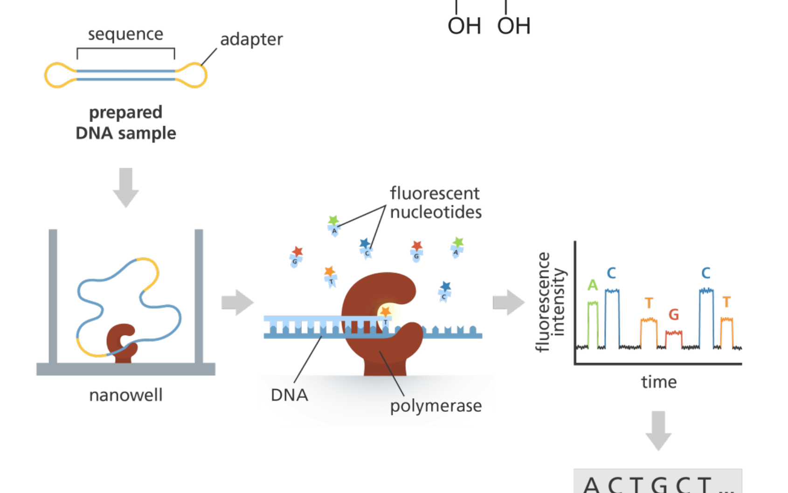

**1. Library: circularisation.** Hairpin adapters are ligated to both ends of a double-stranded fragment. Because a hairpin joins the two strands of the duplex, the result is a closed single-stranded loop: the SMRTbell. The polymerase can therefore go round and round the same molecule indefinitely, which is the basis of the accuracy in point 6.

**2. The zero-mode waveguide (ZMW).** The chip is a metal film on glass, perforated with millions of holes about 70 nm across. This is much smaller than the wavelength of the exciting light (several hundred nm). An aperture below the cut-off size does not transmit a propagating wave: the field entering it decays exponentially within a few tens of nanometres. Illumination from below therefore penetrates only a short distance into the well, lighting an observation volume of order $10^{-20}$ litres, a few tens of zeptolitres, at the very bottom.

A single polymerase is anchored at the bottom of each well, inside this illuminated region. Free nucleotides diffusing in the bulk of the well are not excited.

**3. Phospholinked nucleotides.** The fluorophore is attached to the *terminal phosphate*, not to the base.

Recall that a polymerase forms the phosphodiester bond by attacking the α-phosphate and releasing the β and γ phosphates as pyrophosphate. A label on the terminal phosphate is therefore **cleaved off by the normal chemistry of incorporation** and diffuses away. Two consequences:
- The growing strand is left completely natural: no scar, no accumulating modification, so the polymerase runs continuously for tens of thousands of bases. This is precisely what limits Illumina to a few hundred.
- The fluorescent signal is a *pulse*, not a persistent state. It begins when the nucleotide is held in the active site and ends when it is cleaved and released.

**4. Read-out.** Each well is monitored continuously. The sequence is read as the time-ordered series of coloured pulses, with the four bases distinguished by emission wavelength. Millions of wells run in parallel.

**5. Kinetic information.** The *interval between* pulses depends on how fast the polymerase is working, and that in turn depends on the template. A methylated base slows the polymerase measurably, so modified bases are detected from the timing of the pulses, with no separate assay, in the same way nanopore detects them from current.

**6. Circular consensus (HiFi).** A single pass over the template has a raw error rate of roughly 10–15 %, which is high. But because the template is circular, the polymerase passes over the same sequence many times in one read. Each pass observes the same molecule again. Many random pulse-detection errors can be reduced by combining passes, although independence is approximate and sequence-context errors can remain. Averaging the passes therefore does reduce the error, and the result is a *HiFi read*: tens of kilobases long at better than 99.9 % accuracy.

#### Motivation and explanation

**Why the errors are random here but systematic in nanopore.** This is the key distinction, and it explains the whole design. In nanopore, the signal depends on a five-base window, so a given sequence context always produces the same ambiguity (Section 13). In SMRT, each pulse is a separate physical event: a nucleotide binds, is incorporated, and is released. Errors come from missing a short pulse or registering a spurious one, which are stochastic and essentially independent between passes. Independent errors can be averaged; correlated ones cannot. That is why SMRT can reach $Q30$ by reading the same molecule repeatedly, and nanopore cannot reach it by reading the same *locus* repeatedly.

**The trade-off in read length.** The polymerase processivity is fixed, so a read of total length $L$ over an insert of length $\ell$ gives $L/\ell$ passes. Longer inserts give longer reads but fewer passes, hence lower accuracy. Shorter inserts give higher accuracy but less reach. This is a design choice made per experiment, and it has no analogue on the other platforms.

**Limitations.**
- *Cost per base* is high, above both Illumina and nanopore.
- *The instrument* is large, expensive and not portable, in contrast to the hand-held nanopore device.
- *Run time* is long, 15–30 hours.
- *Library preparation* requires circularisation, so it is more involved than nanopore's.

#### Worked example

*The ZMW concentration argument, and the accuracy gained from passes.* Computed in Python.

**1. Why the small volume is necessary.** An observation volume of 20 zeptolitres ($2\times10^{-20}$ L) contains one molecule on average at a concentration of
$$c = \frac{1}{N_A V} = \frac{1}{6.022\times10^{23}\times2\times10^{-20}} = 8.3\times10^{-5}\ \text{M} \approx 83\ \mu\text{M}.$$
Labelled nucleotides are supplied at a few µM, so the observation volume contains on average well under one free nucleotide at any instant. Without this confinement the background would swamp the signal entirely: an ordinary confocal volume of about 1 femtolitre is $5\times10^{4}$ times larger and would hold thousands of labelled nucleotides.

**2. Accuracy against passes.** Taking a per-pass error probability of 12 %, assume independent observations and use the conservative binomial bound above. It counts an observation as wrong regardless of which incorrect base was called and counts an even-pass tie as a failure.

| Passes | Error upper bound | Corresponding $Q$ lower bound |
|---|---|---|
| 1 | $0.12$ | 9 |
| 3 | $0.04$ | 14 |
| 5 | $0.014$ | 18 |
| 10 | $0.0037$ | 24 |

This simplified calculation demonstrates why repeated observations improve accuracy. It does not determine how many passes an actual HiFi algorithm needs: real consensus uses pulse information, alignment and quality scores, and insertion/deletion errors do not fit this substitution-only toy model. Independence is an approximation, and residual systematic errors can remain in both long-read technologies.

**3. Choosing the insert length.** For a polymerase that reads 100 kb in total before falling off:

| Insert length | Passes | Expected quality |
|---|---|---|
| 1 kb | 100 | very high, but short reads |
| 5 kb | 20 | high |
| 10 kb | 10 | independent model: $Q\gtrsim24$ |
| 20 kb | 5 | independent model: $Q\gtrsim18$ |

Long inserts span more repeats but receive fewer passes for a fixed polymerase read budget. The practical insert length balances these competing effects and is chosen using measured HiFi performance, rather than the quality values of this toy model.

#### Comparison of platforms

| | Sanger (S10) | Illumina (S11–12) | Nanopore (S13) | PacBio SMRT (S14) |
|---|---|---|---|---|
| Read length | 500–1000 nt | 50–300 nt | up to ~100 kb | 10–25 kb |
| Raw accuracy | 99.99 % | ~99.9 % | ~95–99 % | ~85–90 % per pass |
| Consensus accuracy | — | very high | limited by systematic error | >99.9 % (HiFi) |
| Error character | random | random, substitutions | **systematic**, indels at homopolymers | random |
| Amplification | cloning | PCR + bridge PCR | **none** | **none** |
| Throughput | ~96 reads | $10^{9}$–$10^{10}$ reads | moderate | moderate |
| Cost per base | very high | **lowest** | low | high |
| Preparation | per-fragment cloning | 1–2 days | minutes | circularisation |
| Run time | hours | days | real-time output | 15–30 h |
| Instrument | benchtop | large, expensive | **hand-held** | large, expensive |
| Modified bases | no | no (needs separate chemistry) | **yes, directly** | **yes, from kinetics** |
| Direct RNA | no | no | **yes** | no |

**How to choose.** Verifying one plasmid: Sanger. Counting and variant-calling at scale: Illumina. Genome structure, repeats, or an answer needed in the field: nanopore. Long reads where every base must be right: PacBio HiFi.

#### Wider pathway

Sections 10–14 complete the reading side of the field. What they enable is covered in Section 15, and the methods recur throughout: sequencing verifies every construct built in Sections 06–09, quantifies transcripts alongside the amplification methods of Sections 16–18, and reads out the selections in Section 19.

#### Link to other topics

The ZMW is an evanescent-field device: below the cut-off size an aperture carries no propagating mode, and the field decays exponentially. The same physics appears in waveguides below cut-off and in total internal reflection, and it is used here as a way of defining a reaction volume optically rather than physically.

#### Summary

Confining the observation volume with a sub-wavelength aperture and moving the label to the leaving group together make it possible to watch one polymerase work continuously, with nothing left on the product strand. Circularising the template turns processivity into repeated independent measurements, and because the errors are random, averaging converts a 12 % raw error into HiFi accuracy.

### Section 15: Applications of nucleic acid sequencing

#### Intuition

Sequencing answers three different kinds of question, and the distinction determines which platform and which depth to use.

1. **What is the sequence?** Comparing a sample against a reference to find differences. Diagnosis, variant discovery, verifying a construct. Needs accuracy at individual bases.
2. **How much of it is there?** Counting how many reads come from each source. Gene expression, chromosome dosage, species abundance. Here the read is a *counting token*: individual base accuracy barely matters, but the number of reads does.
3. **How is it arranged?** Determining structure, order and repeats. Genome assembly, structural variants. Needs read length, not base accuracy.

Most misapplications come from confusing these. Deep Illumina coverage will not resolve a repeat (question 3), and a few long nanopore reads will not establish a transcript's abundance (question 2).

#### Mechanism

##### Scope: how much to sequence

| Approach | Target | Share of human genome | Trade-off |
|---|---|---|---|
| Whole genome | everything | 100 % | Most informative: finds non-coding and structural variants. Most expensive. |
| Whole exome | protein-coding regions | 1–2 % (about 47 Mb) | Roughly 50–70× less sequence for a given depth. Most known disease variants are in coding regions, so it captures most of the diagnostic yield. Blind to regulatory and structural variation. |
| Targeted panel | chosen genes | ≪1 % | Cheapest and deepest. Requires knowing in advance what to look for. |

The choice is a classic sampling decision: narrowing the target buys depth and cost at the price of only finding what was anticipated.

##### Transcriptomics (RNA-seq)

RNA cannot be read by most platforms directly, so it is reverse-transcribed into complementary DNA (cDNA) and sequenced as DNA. Nanopore is the exception (Section 13).

Counting reads per transcript measures **gene expression levels**: which genes are on, and how strongly, in this cell under these conditions. Because reads span exon junctions, it also reveals **alternative splicing**, which exons were included in a given transcript. Applications include cellular responses to drugs, cancer profiling to find biomarkers, and development and immunology.

This is question 2 above, so what matters is the number of reads per transcript, not base-level accuracy.

##### Clinical and diagnostic uses

- **Verifying engineered constructs.** Every recombinant organism or plasmid is sequenced to confirm correct insertion, absence of mutations, and no off-target changes. This closes the loop from Sections 06–09.
- **Personalised medicine.** Same disease, same symptoms, different treatment, chosen by genotype. In non-small-cell lung cancer, a tumour is tested for mutations: an *EGFR* mutation indicates an EGFR inhibitor, an *ALK* rearrangement indicates an ALK inhibitor. The sequence selects the drug.
- **Rare disease diagnosis.** Many genetic diseases are hard to diagnose by symptoms alone. Whole genome or exome sequencing of undiagnosed cases identifies the causal variant, enabling targeted therapy, carrier screening, and informed family planning. Examples include Huntington's disease (a CAG repeat expansion, and note that counting repeat length needs long reads) and Duchenne muscular dystrophy.
- **Risk prediction.** Common diseases such as type 2 diabetes and coronary artery disease are influenced by thousands of variants of individually small effect. Aggregating them gives a risk score, identifying high-risk individuals before symptoms appear, which enables earlier screening, lifestyle change and preventive therapy.
- **Non-invasive prenatal screening,** below.

##### Population and environmental uses

- **Genomic surveillance of viruses.** Sequencing viral genomes over time tracks mutations, identifies variants of concern, reconstructs transmission chains, and guides vaccine updates. SARS-CoV-2 variants were defined and tracked this way, and influenza vaccine strain selection depends on it. Nanopore's portability matters here.
- **Environmental DNA (eDNA).** All organisms shed DNA into their surroundings, so sequencing everything in a water or soil sample reveals what lives there without observing or capturing anything. It characterises microbial communities, detects whether a given species is present, and discovers new species. A survey of Loch Ness found no reptile DNA but a large amount of eel DNA.
- **Forensics.** Matching DNA from hair, blood, saliva or remains against crime-scene samples, identifying remains, and establishing kinship or paternity. Sequencing also *exonerates*, which has been its most consequential forensic use.

#### Motivation and explanation

**Why cost collapsing changed what is possible.** Section 10 showed cost per base falling by about six orders of magnitude. The consequence is not that the same experiments became cheaper, but that entirely different ones became feasible. Sequencing a genome to answer one clinical question, or sequencing thousands of viral genomes a week, or sequencing a bucket of lake water, are only sensible when a genome costs a few hundred pounds. This is why the sequencing market continues to grow at roughly 15 % per year.

**Why the counting applications are the subtle ones.** Questions of type 2 have a statistical structure that the others do not. The signal is a small difference in proportion, and whether it can be detected depends on how many reads are counted, through $\sqrt{N}$. The worked example shows this.

**Limits worth stating.**
- *Risk scores are probabilistic,* and derived largely from European-ancestry cohorts, so they transfer poorly to other populations.
- *Finding a variant is not the same as interpreting it.* Most variants discovered are of unknown significance, and interpretation, not sequencing, is now the bottleneck in clinical genomics.
- *Screening is not diagnosis.* A positive non-invasive prenatal screen is confirmed by an invasive diagnostic test, for the reason the worked example makes clear.

#### Worked example

*Non-invasive prenatal screening for trisomy 21.* Computed in Python.

During pregnancy, placental DNA circulates in the mother's blood, so a blood sample contains a mixture of maternal and fetal cell-free DNA. The fetal portion is typically about 10 % and it cannot be physically separated. How can an extra fetal chromosome be detected?

**The insight: do not identify, just count.** Sequence everything, map each read to a chromosome, and ask whether the *proportion* of reads from chromosome 21 is higher than expected. No read needs to be assigned to mother or fetus.

**1. Expected proportions.** Chromosome 21 is about 46.7 Mb of a 3.1 Gb genome, so a normal sample gives a chromosome 21 read fraction of
$$p_{21} = 46.7/3100 = 0.01506.$$
With a fetal fraction $f = 0.10$, and a trisomic fetus contributing 1.5 times the normal chromosome 21 dose:
$$p_{21}' = (1-f)p_{21} + f\times1.5\,p_{21} = p_{21}(1+0.5f) = 0.01582.$$
The difference is $\Delta p = 7.5\times10^{-4}$, a **5 % relative increase**, and only because the fetal fraction is 10 %. The entire measurement rests on resolving 1.582 % against 1.506 %.

**2. How many reads are needed?** Each read is a Bernoulli trial, so the standard error on the measured fraction is $\sqrt{p(1-p)/N}$:

| Reads $N$ | Standard error | $z = \Delta p/\sigma$ |
|---|---|---|
| $10^{5}$ | $3.9\times10^{-4}$ | 2.0 |
| $10^{6}$ | $1.2\times10^{-4}$ | 6.2 |
| $5\times10^{6}$ | $5.4\times10^{-5}$ | 13.8 |

For $z = 5$, $N = p(1-p)(5/\Delta p)^2 = 6.5\times10^{5}$ reads. A few million reads gives a comfortable margin, which is a small fraction of one Illumina run, and explains why the test is inexpensive enough to offer routinely.

**3. What this implies about the method.**
- *Short reads are ideal.* Each read only needs to be uniquely assignable to a chromosome, so reads of roughly 50 bases can suffice for chromosome counting. Cell-free DNA fragments are typically about 150–200 bp, with a prominent nucleosomal peak near 166 bp; using short reads is an analytical choice rather than a consequence of 50-base fragments.
- *Base accuracy barely matters.* A miscalled base rarely changes which chromosome a read maps to. This is a counting problem, not a sequence problem.
- *Fetal fraction is the critical variable.* $\Delta p \propto f$, so $N \propto 1/f^2$. At $f = 0.04$ instead of 0.10, the required read count rises by a factor of $(10/4)^2 = 6.3$. Low fetal fraction, which occurs in early gestation and with high maternal BMI, is the main cause of test failure and of false negatives.
- *It is a screen, not a diagnosis.* It measures a statistical excess in a mixture, not the fetal karyotype, so a positive result is confirmed invasively.

#### Wider pathway

This closes the sequencing unit. Sections 16–19 return to nucleic acids as *reagents* rather than as information: amplifying and quantifying specific sequences by PCR, and selecting functional sequences from libraries.

#### Link to other topics

The prenatal calculation is a signal-detection problem of a familiar kind: a small shift in a mean against a background whose noise falls as $1/\sqrt{N}$. The same $\sqrt{N}$ reasoning governs how long any measurement must be averaged to resolve a given difference.

#### Summary

Sequencing answers three distinct questions — what the sequence is, how much of it there is, and how it is arranged — and each favours a different platform and depth. The counting applications are the ones where falling cost has changed practice most, because detection depends on read number through $\sqrt{N}$ rather than on any property of the chemistry.

### Conclusion

Long reads preserve molecular context, and the appropriate platform depends on the biological question and error tolerance. The next unit develops quantitative pcr.

## 05. Quantitative PCR

### Overview

Quantitative PCR estimates the starting abundance of a target from the cycle at which exponential amplification reaches a fluorescence threshold. Calibration, reference genes and sequence-specific detection make that estimate usable while exposing the assumptions behind absolute and relative quantification.

*Assumed throughout:* PCR, logarithms and gene expression.

### Section 16: Quantitative PCR and the cycle threshold

#### Intuition

Exponential processes destroy information about their starting point once they saturate. Watching only the endpoint of a PCR is like returning to a petri dish after a week: the plate is full whether you seeded ten bacteria or ten thousand.

The information is in the *timing*, not the final amount. A sample that starts with more template crosses any given level sooner. If you watch continuously and record *when* the product passes a fixed level, that time is a measure of the starting amount. Because growth is exponential, the relationship is logarithmic: each halving of the starting material delays the crossing by exactly one cycle.

This is the whole idea. Everything else is making the measurement work: a way to see the product as it accumulates, and a sensible choice of where to put the threshold.

*Analogy:* judging how much money someone started with by watching a compound-interest account and noting the date it passes £1000. Twice the starting capital reaches the mark one doubling-time earlier. The analogy breaks down because PCR eventually runs out of reagents and stops compounding, so only the early part of the curve carries information.

#### Mechanism

**1. Recap of PCR.** Template, forward and reverse primers, thermostable polymerase, dNTPs and Mg²⁺ are cycled between denaturation (95–98 °C), annealing (50–65 °C) and extension (72 °C), 30–40 times. Each cycle doubles the number of double-stranded products bounded by the two primers.

**2. Making the product visible: intercalating dye.** An intercalating dye such as SYBR Green is included. It fluoresces strongly when bound to double-stranded DNA and weakly when free, so the fluorescence of the tube is proportional to the amount of double-stranded product present.

Fluorescence is read once per cycle, at the end of extension when the product is double-stranded. A qPCR machine is a thermal cycler with a fluorimeter.

**3. The amplification curve.** Plotting fluorescence against cycle number gives a sigmoid with three regions:

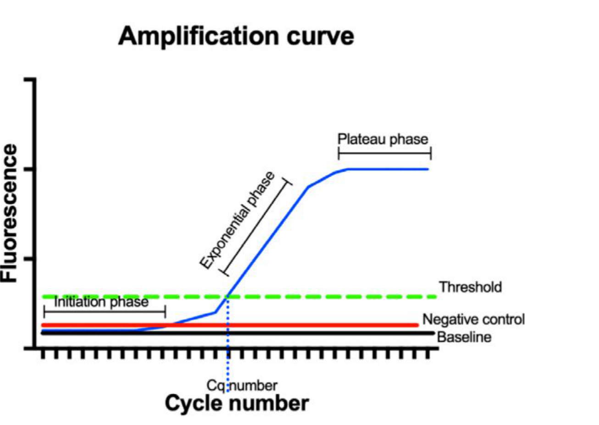

- **Initiation.** The product is doubling, but the signal is below the instrument's noise. Amplification is happening; it simply cannot be seen.
- **Exponential.** The signal rises above noise while reagents are still in excess, so doubling continues. **This is the only region that carries quantitative information.**
- **Plateau.** dNTPs and primers are depleted and the polymerase loses activity, so the curve saturates. All samples converge here, which is exactly why endpoint PCR cannot quantify.

**4. The threshold and $C_t$.** A fluorescence threshold is set above the background noise but within the exponential phase. The **cycle threshold** $C_t$ (also written $C_q$) is the cycle number at which the amplification curve crosses it. It need not be an integer, since the crossing is interpolated between cycles.

#### Derivation

Notation: $\rho_0$ is the initial concentration (or copy number) of the target; $\rho(n)$ after $n$ cycles; $F$ is fluorescence; $t$ is the threshold value of $F$; $E$ is the amplification efficiency, with $E = 1$ meaning perfect doubling.

**Step 1: growth law.** Each cycle multiplies the product by $(1+E)$. For ideal doubling, $E = 1$:
$$\rho(n) = \rho_0\,(1+E)^n \;\xrightarrow{\;E=1\;}\; \rho_0\,2^n \tag{23}$$

**Step 2: what is measured.** The intercalating dye binds in proportion to the amount of double-stranded product, so
$$F(n) \propto \rho(n) = \rho_0\,2^n \tag{24}$$

**Step 3: definition of $C_t$.** At $n = C_t$ the fluorescence equals the threshold:
$$\rho_0\,2^{C_t} \propto t \tag{25}$$

**Step 4: take logarithms.** Using $\log_{10}$ throughout:
$$\log\rho_0 + C_t\log 2 = \log t + \text{const}$$
$$\boxed{\;C_t = \frac{\log t - \log\rho_0 + \text{const}}{\log 2}\;}\tag{26}$$
so $C_t \propto \log t - \log\rho_0$. **$C_t$ is linear in $\log\rho_0$ with a negative slope**: more starting material gives a smaller $C_t$.

**Step 5: general efficiency.** Repeating steps 3–4 with $(1+E)^{C_t}$ in place of $2^{C_t}$:
$$C_t = \frac{\log t - \log\rho_0 + \text{const}}{\log(1+E)} \tag{27}$$
Differentiating with respect to $\log\rho_0$ gives the slope of a plot of $C_t$ against $\log_{10}\rho_0$:
$$\text{slope} = -\frac{1}{\log_{10}(1+E)} \qquad\Longrightarrow\qquad E = 10^{-1/\text{slope}} - 1 \tag{28}$$

**Sanity checks on (28).**
- Perfect doubling, $E=1$: slope $= -1/\log_{10}2 = -3.32$. A tenfold dilution delays $C_t$ by 3.32 cycles, because $\log_2 10 = 3.32$ doublings are needed to recover a factor of ten.
- A steeper (more negative) slope means *lower* efficiency: more cycles are needed to make up a tenfold difference.
- $E \to 0$: slope $\to -\infty$, and no amount of cycling separates the samples. Quantification fails.

#### Motivation and explanation

**Why the threshold must sit in the exponential phase.** Equation (23) holds only while reagents are in excess. In the plateau, $\rho$ no longer depends on $\rho_0$, so (26) is meaningless there. Placing the threshold too high puts $C_t$ in the saturating region and compresses the differences between samples; too low and it sits in instrument noise, making $C_t$ irreproducible. The threshold must be above the noise and below the onset of depletion.

**Why $E$ is rarely exactly 1.** Primer annealing is not instantaneous and not every template is copied each cycle, so some templates are skipped. Inhibitors carried over from the sample (haem, humic acids, ethanol) reduce polymerase activity. Long or structured amplicons extend incompletely. Typical real efficiencies are 0.9–1.0, and an assay outside about 0.9–1.1 is usually redesigned rather than corrected for.

**Why efficiency matters so much.** It enters (27) as $\log(1+E)$ in the denominator, so it sets the *scale* converting cycles to concentration. Assuming $E=1$ when it is really 0.9 misestimates every fold-change, and the error compounds with the number of cycles separating the samples. This is why a standard curve is run.

**Weaknesses of intercalating dye.** The dye binds *any* double-stranded DNA, so it reports primer dimers and mis-primed products as faithfully as the intended one. It cannot distinguish them, and since a primer dimer amplifies efficiently it can dominate the signal. This is the problem the melt curve (Section 17) and sequence-specific probes (Section 18) address.

#### Worked example

Reading $\rho_0$ off a $C_t$, and checking efficiency. Computed in Python.

**1. Cycles per decade.** From (28) with $E = 1$: a tenfold dilution series should shift $C_t$ by $\log_2 10 = 3.32$ cycles per step. Measured slopes convert to efficiency as:

| Slope | $E$ | Interpretation |
|---|---|---|
| −3.10 | 1.10 | Above 100 %: usually inhibition or pipetting error, not real |
| −3.32 | 1.00 | Perfect doubling |
| −3.60 | 0.90 | 90 %, acceptable |
| −3.92 | 0.80 | 80 %, assay needs redesign |

**2. Dynamic range.** Suppose the threshold corresponds to $10^{10}$ copies and $E = 1$. From (26):

| $\rho_0$ (copies) | $C_t$ |
|---|---|
| $10^{6}$ | 13.3 |
| $10^{3}$ | 23.3 |
| 10 | 29.9 |
| 1 | 33.2 |

Six orders of magnitude in starting material span only 20 cycles. This compression is the strength and the weakness of the method: an enormous dynamic range fits in one run, but a 1-cycle error in $C_t$ is a twofold error in $\rho_0$, so precision in $C_t$ matters a great deal.

**3. Single-copy sensitivity.** A single target molecule gives $C_t \approx 33$, comfortably within a 40-cycle run. This is why qPCR detects a handful of viral genomes in a swab. It is also why contamination is such a serious problem: a single stray amplicon molecule from a previous reaction produces a positive result indistinguishable from a true one, which is why negative controls are run on every plate.

#### Link to other topics

Equation (26) is the standard move for any exponential process: take logarithms and read the rate off a straight line, as with first-order reaction kinetics or $\ln(C/C_0)$ against time. The threshold crossing plays the role of a fixed conversion, and $C_t$ the time to reach it.

#### Summary

Measuring fluorescence every cycle converts PCR from a detection method into a quantitative one. The information lies in *when* the curve crosses a threshold, and because growth is exponential that crossing is linear in $\log\rho_0$, equation (26).

### Section 17: Absolute and relative quantification, and melt-curve control

#### Intuition

The two protocols answer different questions, and the difference is the same one that runs through all measurement: *absolute* against *comparative*.

If you need to know how many viral genomes are in a millilitre, you must compare against something of known quantity. There is no way round running standards, just as there is no way to weigh something without a calibrated balance.

If instead you only need to know whether a gene is expressed twice as strongly in treated cells as in untreated ones, calibration is unnecessary. The unknown constants in the $C_t$ relationship, the threshold, the instrument gain, the proportionality between dye and DNA, are the *same* in both reactions, so taking a difference cancels them. This is why relative quantification is the more common measurement: it is easier and it answers the question biologists usually ask.

The subtlety is that the two reactions are never quite identical. Different amounts of RNA are recovered, pipetting varies, cell numbers differ. A *reference gene* is measured alongside to absorb these differences, which is the second subtraction in $\Delta\Delta C_t$.

#### Mechanism and derivation

##### Absolute quantification

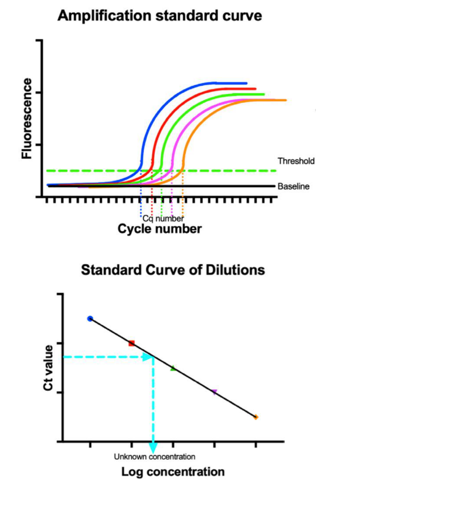

1. Prepare a **serial dilution series** of a standard of known concentration, typically tenfold steps.
2. Run qPCR on all of them, obtaining a $C_t$ for each.
3. Plot $C_t$ against $\log_{10}\rho_0$ and fit a straight line. From Section 16, equation (27), this should be linear with slope $-1/\log_{10}(1+E)$. The fit both calibrates the assay and reports its efficiency.
4. Measure $C_t$ for the unknown, and read $\log\rho_0$ off the line.

The result is an absolute copy number, but only as good as the standard: its concentration must be known independently, and it must amplify with the same efficiency as the unknown.

##### Relative quantification: the $\Delta\Delta C_t$ method

The aim is the ratio $\rho_0^{\text{sample}}/\rho_0^{\text{control}}$ for a gene of interest, between two conditions.

**Four reactions** are run: the gene of interest and a reference gene, in each of the sample and the control. The **reference gene** is one expressed at a constant level regardless of condition, a *housekeeping gene*, present at the same copy number in both.

**Step 1: first difference, within each condition.** Define
$$\Delta C_t^{\text{sample}} = C_t^{\text{sample}} - C_t^{\text{ref}}, \qquad \Delta C_t^{\text{control}} = C_t^{\text{control}} - C_t^{\text{ref}} \tag{29}$$
each using its own reaction's reference.

**Step 2: what a $\Delta C_t$ means.** At perfect amplification efficiency, each assay has its own intercept, $b_{\mathrm{target}}$ or $b_{\mathrm{ref}}$, set by its threshold and fluorescence response:
$$C_t^{\mathrm{target}}=b_{\mathrm{target}}-\log_2\rho_0^{\mathrm{target}},\qquad C_t^{\mathrm{ref}}=b_{\mathrm{ref}}-\log_2\rho_0^{\mathrm{ref}}.$$
Subtracting gives $\Delta C_t=b_{\mathrm{target}}-b_{\mathrm{ref}}-\log_2(\rho_0^{\mathrm{target}}/\rho_0^{\mathrm{ref}})$. Therefore
$$\frac{\rho_0^{\text{target}}}{\rho_0^{\text{ref}}}=A\,2^{-\Delta C_t},\qquad A=2^{b_{\mathrm{target}}-b_{\mathrm{ref}}}.\tag{30}$$
The assay factor $A$ need not equal one. A single $\Delta C_t$ therefore does not directly give an absolute target/reference abundance ratio without cross-assay calibration. Crucially, $A$ cancels when the same two assays are compared between conditions.

**Step 3: second difference, between conditions.** Dividing the two instances of (30):
$$\frac{\rho_0^{\text{sample}}/\rho_0^{\text{ref}}}{\rho_0^{\text{control}}/\rho_0^{\text{ref}}} = \frac{2^{-\Delta C_t^{\text{sample}}}}{2^{-\Delta C_t^{\text{control}}}} = 2^{-(\Delta C_t^{\text{sample}}-\Delta C_t^{\text{control}})}$$
Defining $\Delta\Delta C_t = \Delta C_t^{\text{sample}} - \Delta C_t^{\text{control}}$:
$$\boxed{\;\frac{\rho_0^{\text{sample}}}{\rho_0^{\text{control}}} = 2^{-\Delta\Delta C_t}\;}\tag{31}$$

**Step 4: with real efficiency.** Repeating with $(1+E)$ in place of 2:
$$\frac{\rho_0^{\text{sample}}}{\rho_0^{\text{control}}} = (1+E)^{-\Delta\Delta C_t} \tag{32}$$
so (31) assumes $E = 1$ *for both the target and the reference*. This is the method's main hidden assumption.

**Assumptions of (31), stated explicitly:**
1. Both amplicons amplify with efficiency $E = 1$, and with the *same* efficiency as each other.
2. The reference gene is genuinely unchanged between the conditions.
3. Each assay's threshold and response are consistent between sample and control. Target and reference may have different assay intercepts; those differences cancel in the second subtraction.

##### Melt-curve control

The intercalating dye of Section 16 reports *any* double-stranded DNA. The melt curve checks whether the signal is consistent with one dominant product at the expected melting temperature; it does not establish its sequence.

1. After the last cycle, ramp the temperature up slowly while continuously reading fluorescence.
2. As each product melts, its strands separate, the dye is released, and fluorescence falls. This is the melting transition of Section 03, read out by dye rather than by absorbance.
3. Plot $-dF/dT$. Each distinct product gives a **peak** at its own $T_m$.

**Reading the result:**
- *One sharp peak*: consistent with one dominant product. Different products can have similar melting temperatures, so this is a specificity check rather than proof of identity.
- *Multiple peaks, a shoulder, or a broad peak*: more than one product. Different amplicons have different lengths and GC contents, hence different $T_m$ (Section 04).
- A peak at *low* temperature is characteristically a **primer dimer**: two primers amplifying each other, giving a short product that melts early.

The melt curve can expose some specificity problems without running a gel. Validated high-resolution melting assays can also distinguish genotypes through melting-profile differences, including heteroduplex formation. A heterozygote does not necessarily give two resolved peaks, and routine melt analysis does not automatically identify a genotype.

#### Motivation and explanation

**Why the reference gene is the weak point.** Equation (31) is only as good as assumption 2. Genes described as "housekeeping" (GAPDH, actin, 18S rRNA) are *not* constant under all conditions; their expression changes with cell cycle, confluence, hypoxia and many treatments. If the reference shifts between conditions, that shift appears directly in $\Delta\Delta C_t$ and is misread as a change in the gene of interest. Good practice is to validate the reference for the specific conditions, or to use the geometric mean of several.

**Why the differences cancel what they cancel.** It is worth being precise about which error each subtraction removes:
- The *first* difference (target minus reference, within one sample) cancels anything affecting both reactions of that sample equally: the amount of input material, RNA recovery, reverse-transcription efficiency, pipetting of the template.
- The *second* difference (sample minus control) cancels anything that is a constant property of the *assay*: the threshold, the two amplicons' intrinsic efficiencies, the dye response.

What neither cancels is a difference in the reference gene's true expression, or a difference in amplification efficiency between the two amplicons.

**Absolute or relative?** Absolute is needed when the number itself matters: viral load, copies per genome, quantifying a standard. Relative is needed when a comparison matters: gene expression under treatment, knockdown efficiency. Relative is less work and usually more precise, because the subtractions remove systematic error that absolute quantification has to control explicitly.

#### Worked example

*A gene-expression measurement, with uncertainty.* Computed in Python.

Four reactions, all on one plate:

| | Gene of interest | Reference gene |
|---|---|---|
| Treated sample | $C_t = 22.4$ | $C_t = 18.1$ |
| Untreated control | $C_t = 25.9$ | $C_t = 18.3$ |

**Step 1.** $\Delta C_t^{\text{sample}} = 22.4 - 18.1 = 4.3$; $\Delta C_t^{\text{control}} = 25.9 - 18.3 = 7.6$.

**Step 2.** $\Delta\Delta C_t = 4.3 - 7.6 = -3.3$.

**Step 3.** Fold change $= 2^{-(-3.3)} = 2^{3.3} = 9.85$.

The treatment increases expression of the gene of interest about **tenfold**.

**Sense check.** The reference gene barely moved (18.1 against 18.3), so the two reactions were comparably loaded. The gene of interest appeared 3.5 cycles earlier in the treated sample, and $2^{3.5} = 11$, close to the answer. The reference correction of 0.2 cycles trimmed it to 9.85.

**Effect of assuming $E = 1$.** If both amplicons actually run at $E = 0.9$, equation (32) gives $1.9^{3.3} = 8.3$ rather than 9.85, an 16 % overestimate. For a tenfold change this hardly alters the conclusion; for a claimed 1.3-fold change it would.

**Propagating uncertainty.** Suppose each $C_t$ has a standard deviation of 0.15 cycles from pipetting and curve fitting. $\Delta\Delta C_t$ is a combination of four independent measurements, so
$$\sigma_{\Delta\Delta C_t} = \sqrt{4}\times0.15 = 0.30\ \text{cycles}.$$
The fold change therefore carries a multiplicative uncertainty of $2^{0.30} = 1.23$, so the result is about 9.8 with a range of roughly 8.0 to 12.1.

**The practical consequence.** A fold change is uncertain by a factor of about 1.23 even with good technique. To claim a twofold change ($\Delta\Delta C_t = -1$) reliably, the uncertainty of 0.30 cycles must be small against 1 cycle, which it is but not overwhelmingly. **Changes below about 1.5-fold are not resolvable by this method** without many replicates, which is why small fold changes in the literature should be treated with suspicion.

#### Link to other topics

Both subtractions are differential measurement: removing a common-mode error by taking a difference against a reference that experiences the same disturbance. It is the same principle as a differential pressure transducer, a Wheatstone bridge, or any tare weighing.

#### Summary

A calibration curve converts $C_t$ into an absolute copy number and simultaneously reports efficiency. Two successive subtractions give a fold change, equation (31), with no calibration at all, because the unknown constants are shared and cancel.

### Section 18: Sequence-specific probes and RT-qPCR

#### Intuition

Both designs solve the specificity problem the same way: add a *third* sequence-specific oligonucleotide besides the two primers, and arrange for it to fluoresce only when it has found its target. A primer dimer carries no probe site, so it amplifies invisibly. Specificity now rests on three independent recognition events rather than two.

The physical mechanism in both cases is **quenching**: a quencher near a fluorophore absorbs its energy and prevents emission, so fluorescence reports *distance*. The two designs differ in how the target changes that distance — TaqMan separates them irreversibly by cutting the probe in half, a beacon reversibly by unfolding.

*Analogy:* a lamp with a shade clamped over it. TaqMan smashes the clamp; a beacon swings the shade away on a hinge. Both let light out, but only one can be undone. The analogy breaks down because quenching is a distance-dependent energy transfer, not a physical blocking of light, so the signal rises smoothly as the two groups separate rather than switching on.

#### Mechanism

##### TaqMan probe (hydrolysis probe)

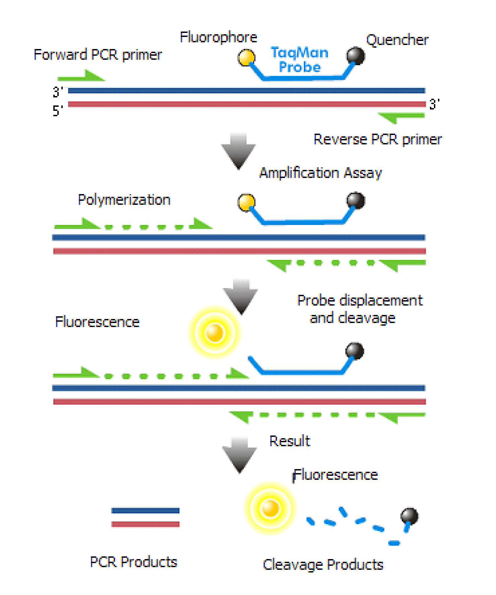

1. **The probe** is a short oligonucleotide complementary to the target *between* the two primer sites, carrying a **fluorophore at the 5′ end** and a **quencher at the 3′ end**. Intact, the two are close and fluorescence is suppressed. Its 3′ end is chemically blocked, so the polymerase cannot extend it: it is a reporter, not a primer.
2. **During annealing** the probe binds alongside the primers.
3. **During extension** the polymerase advances from the forward primer until it meets the probe. Taq has **5′→3′ exonuclease activity**, so it hydrolyses the probe as it goes, releasing the fluorophore as a free fragment that diffuses away from the quencher. **Fluorescence rises.**

Each new copy destroys one probe, so fluorescence tracks the product as the intercalating dye does — but only for the correct sequence.

**Requirements.** Probe cleavage requires a polymerase with 5′ nuclease activity, such as Taq. A proofreading enzyme's 3′→5′ exonuclease activity alone does not supply this function. The probe is a doubly modified oligonucleotide (Section 06) and so expensive, and its $T_m$ must exceed the primers' so that it is already bound when extension begins.

##### Molecular beacon

The probe carries a fluorophore at one end and a quencher at the other, with the two ends complementary to each other so that it folds into a **stem-loop (hairpin)**. The stem holds fluorophore and quencher adjacent, so the free probe is dark. The **loop** is complementary to the target; when target is present the loop hybridises to it, and because that duplex is longer and more stable than the short stem, the hairpin is forced open, separating the two labels. **Fluorescence rises.**

**Against TaqMan:** the beacon is not consumed, since binding is reversible, and it needs no exonuclease activity. But it is harder to design — the stem must be stable enough to stay shut when free yet weak enough to open on binding, a narrow window set by the competition between two $T_m$ values (Section 04).

**Multiplexing.** Because specificity now resides in the probe rather than in a generic dye, several targets can be measured in one tube using probes with spectrally distinct fluorophores. This is impossible with an intercalating dye, which gives one undifferentiated signal.

##### RT-qPCR

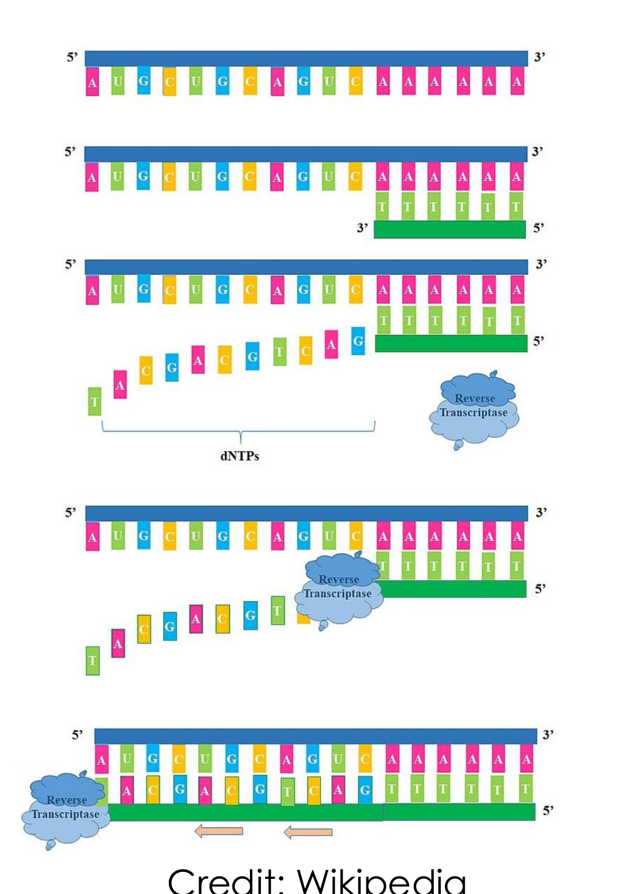

Polymerases used in PCR need a DNA template, so RNA must first be converted. **Reverse transcriptase** synthesises complementary DNA (cDNA) from an RNA template.

**Choice of priming.** **Poly-T primers** (12–18 T's) prime at the 3′ poly-A tail carried by most eukaryotic mRNAs, converting the whole messenger population in one step — what a gene-expression study needs. **Sequence-specific primers** restrict conversion to the RNA region of interest and are useful for viral assays, whether or not the genome carries a poly-A tail. Random primers offer another route for RNA without poly-A tails.

Once cDNA exists, qPCR proceeds as before. Both steps can share one tube (**one-step** RT-qPCR), reducing handling and contamination risk at the cost of control.

**Note on naming.** "RT-PCR" means *reverse transcription* PCR, not *real-time* PCR. RT-qPCR means both: reverse transcription followed by quantitative PCR.

#### Motivation and explanation

**Why the extra recognition event matters so much.** A primer dimer satisfies two recognition events (both primers) and amplifies efficiently because it is short. With an intercalating dye it is indistinguishable from product and can dominate the $C_t$. A probe adds a third requirement that a dimer cannot satisfy, because the dimer contains no internal probe site. The failure mode is removed rather than detected.

**What the probes cost in return.** Three oligonucleotides must be designed to work together at one annealing temperature: two primers and a probe with a higher $T_m$. Design is harder and the reagents are more expensive, so intercalating dye remains the default for routine work where a melt curve is adequate, and probes are used for diagnostics, multiplexing, and anything where a false positive matters.

**Where RT-qPCR adds error.** Reverse transcription is the least reproducible step in the workflow. Its efficiency varies with RNA quality, secondary structure in the transcript, and the enzyme, and it is typically well below 100 %. It therefore adds variance to every measurement, and it sits *before* the amplification, so its variability is amplified along with the template. This is why the reference gene of Section 17 is so valuable: it passes through the same reverse transcription and absorbs much of that variability in the first subtraction.

**RNA degrades.** RNA is chemically fragile (the 2′-OH, Section 01) and RNases are ubiquitous, so sample handling dominates the error budget in practice.

#### Worked example

*COVID-19 testing by RT-qPCR.* This is the canonical application and it illustrates every element of Sections 16–18.

**The workflow.**
1. **Sample.** The swab goes into a detergent buffer, which lyses the viral envelope — inactivating the virus and releasing its RNA in one step.
2. **RNA extraction** gives total RNA: viral if present, plus abundant human RNA.
3. **Reverse transcription** with primers chosen for the viral targets. SARS-CoV-2 genomic RNA does have a 3′ poly-A tail; target-specific priming is an assay-design choice.
4. **qPCR with TaqMan probes** against several viral genes independently — typically the envelope (E) gene to screen and the replicase (ORF1ab) or RdRp to confirm. Using more than one guards against a false negative from a mutation in any single primer or probe site, which matters for an evolving virus (Section 15).
5. **Controls**, which are what make the result interpretable:
   - An **internal positive control** against an abundant human RNA, usually RNase P. If it fails, the swab collected no cells or extraction failed, so the test is *invalid* rather than negative. Without it, a badly taken swab looks exactly like an uninfected patient.
   - A **no-template negative control** for contamination, essential given the single-copy sensitivity of Section 16.
6. **Interpretation.** A $C_t$ below a cutoff of 35 or 40, depending on protocol, is positive.

**Why the cutoff exists, quantitatively.** From Section 16, each cycle is a factor of two. The difference between $C_t = 20$ and $C_t = 35$ is
$$2^{15} = 32\,768,$$
so a sample at the cutoff carries roughly 30 000 times less viral RNA than a strongly positive one. Beyond about 35 cycles two things happen: the copy number approaches one molecule, so Poisson sampling noise dominates and replicates disagree; and low-level non-specific amplification begins to cross the threshold on its own. The cutoff is where the measurement stops being reliable, not where the virus stops being present.

**Why $C_t$ is only a rough viral-load measure.** Since $C_t \propto -\log\rho_0$, a low $C_t$ means a high load, and this was used during the pandemic as a crude indicator of infectiousness. It is only semi-quantitative, because it also depends on how much material the swab happened to collect — which the RNase P control confirms was non-zero but does not normalise.

#### Wider pathway

Sections 16–18 complete the quantification of a *known* sequence: design primers and a probe against something you can already name. Section 19 inverts the problem — finding a nucleic acid sequence that binds a chosen molecular target, when the sequence is not known in advance — and uses the PCR of this section as the amplification step in that search.

#### Link to other topics

Both probes convert a binding event into an optical signal through a distance-dependent interaction, which is the design pattern behind most fluorescent biosensors. The internal control in the COVID assay is the same logic as a tracer in a process measurement: a known quantity carried through the whole procedure to confirm the procedure worked.

#### Summary

Sequence-specific probes move the specificity from the primers alone to a third recognition event, so that primer dimers amplify without being seen: TaqMan by irreversible hydrolysis, beacons by reversible unfolding. Reverse transcription extends all of this to RNA, at the cost of the least reproducible step in the workflow.

### Conclusion

Threshold cycles become abundance estimates only when amplification efficiency, signal specificity and normalisation are controlled. The next unit develops aptamers and selex.

## 06. Aptamers and SELEX

### Overview

Aptamers use folded nucleic acids to recognise molecular targets. SELEX couples binding selection to amplification so that rare useful sequences become enriched, with specificity determined by the selection conditions and counter-selection.

*Assumed throughout:* nucleic-acid folding, binding equilibria and PCR.

### Section 19: Aptamers and SELEX

#### Intuition

An antibody binds its target because the protein folds into a complementary surface. Nothing in that argument requires a protein. A single strand also folds — through internal pairing, stacking and structures like G-quadruplexes — into loops, bulges and pockets, and given enough sequences some of those shapes will fit any target.

The difficulty is the search: no theory maps sequence to affinity, so a binder cannot be designed. But nucleic acids have a property no protein has — **they can be copied** — which makes an evolutionary search possible in a tube. Make every sequence you can, keep those that bind, copy them, repeat. Each round the binders take a larger share, and after enough rounds you sequence the pool to find out what you made.

*Analogy:* finding the few people in a stadium who can pick a particular lock, without knowing what makes a good lock-picker. Give everyone a go, keep whoever succeeds, let each recruit a thousand copies of themselves, and repeat. It breaks down at the crucial point: SELEX generates no new variation, only selection on what the library already contained, unless mutagenic PCR is used deliberately.

#### Mechanism

**Definition.** An aptamer is a short DNA or RNA oligonucleotide selected to bind a specific target — a small molecule, a protein, or a whole cell. Affinity is quoted as the dissociation constant $K_d$, typically nanomolar and sometimes tens of picomolar, comparable with antibodies. The name is from the Latin *aptus*, "to fit".

##### The SELEX cycle

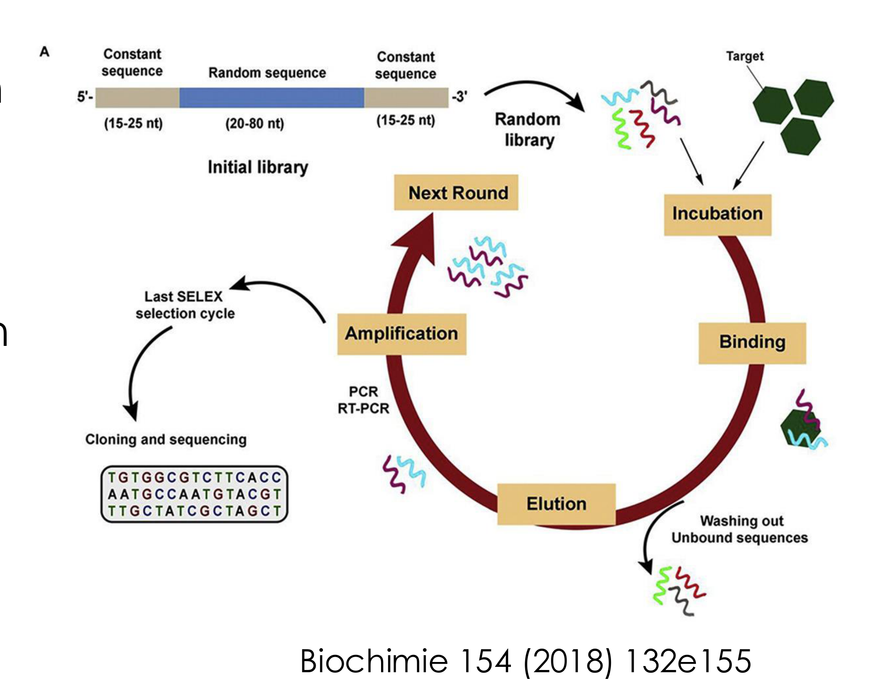

**1. The naïve library.** $10^{13}$ to $10^{15}$ distinct oligonucleotides. Each has the same three-part architecture:
$$\underbrace{\text{constant, 15–25 nt}}_{\text{primer site}} \;-\; \underbrace{\text{random, 20–80 nt}}_{\text{variable region}} \;-\; \underbrace{\text{constant, 15–25 nt}}_{\text{primer site}}$$
The **random region** supplies the diversity, since every member folds differently. The **constant flanks** are identical in every member, so one primer pair amplifies the whole library whatever lies between them — which is what makes the pool copyable, and the reason the architecture exists.

*The library is made in one synthesis:* in the random region, all four phosphoramidites are supplied together at each coupling step (Section 06), so every bead receives a random base at every position.

**2. Incubate** with the target, usually immobilised on beads or a column. Each sequence binds according to its fold.

**3. Wash** away unbound and weakly bound sequences. This is the selection: physical removal of the failures.

**4. Elute** by changing ionic strength, pH or temperature, releasing the strong binders. The recovered pool is **enriched**.

**5. Amplify** by PCR, restoring a workable quantity. For RNA aptamers the pool is reverse-transcribed (Section 18), amplified as DNA, then transcribed back.

This step is easy to overlook and is the crux of the method. After a wash only a trace of material remains, far too little to use. Amplification restores the numbers while preserving the composition, so selection can be applied again. **It is the only reason this works on nucleic acids and not on proteins** — a selected protein cannot copy itself.

**6. Repeat 10–15 times**, raising stringency in later rounds (shorter incubation, harsher washes, less target).

**7. Sequence** the final pool (Sections 10–12) and measure $K_d$ for the aptamers that emerged.

##### Cell-SELEX

Whole cells as the target, used to find aptamers for drug delivery that recognise a cell *type* rather than a purified molecule. Its distinguishing feature is **negative (counter) selection**: the library is first exposed to the wrong cells (say, healthy ones) and the sequences that **do not** bind are kept, before the remainder is exposed to the target cells. The result binds target cells and not controls — selectivity, not merely affinity. The trade-off is that the molecular target is **unknown**: the aptamer binds something on the surface, but the selection does not reveal what.

#### Motivation and explanation

**Why enrichment is exponential.** Each round multiplies the ratio of binders to non-binders by an enrichment factor $f$, the ratio of their survival probabilities through wash and elution. After $r$ rounds that ratio has grown by $f^{\,r}$ — the "exponential enrichment" of the name, and the reason a vanishingly rare binder can come to dominate.

**Aptamers against antibodies.**

| | Aptamers | Antibodies |
|---|---|---|
| Production | chemical synthesis, *in vitro* | animals or cell culture |
| Batch variation | negligible, defined sequence | significant |
| Target range | includes toxins and small molecules | needs an immune response |
| Stability | thermally stable, refolds reversibly | denatures irreversibly |
| Modification | straightforward (Section 06) | harder |
| Size | small, better tissue penetration | large |
| *In vivo* lifetime | **short**: nuclease degradation, renal clearance | long |
| Track record | one approved drug | hundreds |

The deciding weakness *in vivo* is degradation, addressed by chemical modification: 2′-fluoro or 2′-O-methyl substitutions resist nucleases, and PEGylation slows renal clearance by increasing effective size.

**Limitations of the method.**
- *PCR bias.* Some sequences amplify better than others regardless of binding, so they enrich for the wrong reason. Sequences that amplify well but bind poorly can take over the pool.
- *Affinity is not specificity.* Selecting for the tightest binding does not select against binding other things, unless counter-selection is used explicitly.
- *The constant regions participate.* The flanks can take part in folding, so an aptamer may lose activity when truncated to its random region alone.

#### Worked example

*Sequence-space coverage, and the arithmetic of enrichment.* Computed in Python.

**1. How much of sequence space does a library cover?** A library of $10^{15}$ molecules is $10^{15}/6.022\times10^{23} = 1.7$ nanomoles — a vanishingly small amount of material, and about the largest number of distinct molecules that can be handled.

| Random region $n$ | $4^n$ sequences | Fraction covered by $10^{15}$ |
|---|---|---|
| 20 | $1.1\times10^{12}$ | all of it (each present ~1000×) |
| 30 | $1.2\times10^{18}$ | $8.7\times10^{-4}$ |
| 40 | $1.2\times10^{24}$ | $8.3\times10^{-10}$ |
| 80 | $1.5\times10^{48}$ | $7\times10^{-34}$ |

At $n = 20$ the library is **complete**, with every possible sequence present a thousand times over. By $n = 40$ it samples under one in a billion. A typical 40–80 nt random region therefore means SELEX is a random sample of a space it could never enumerate — which is why the method is an evolutionary search and not a screen.

**2. How enrichment compounds.** Take an initial binder fraction of $10^{-10}$ (one good binder in ten billion) and a tenfold enrichment per round:

| Round | Fraction of pool that binds |
|---|---|
| 0 | $10^{-10}$ |
| 3 | $10^{-7}$ |
| 6 | $10^{-4}$ |
| 9 | 0.09 |
| 12 | 0.99 |
| 15 | 0.99999 |

The pool is almost pure binder by round 12. The curve is flat for many rounds and then turns over sharply, which is the signature of exponential growth from a small base: nothing appears to be happening for eight rounds, then the composition changes completely within three.

**This explains the protocol.** Fewer than about 10 rounds and the pool is still mostly junk. Beyond about 15 the gain is negligible, while PCR bias accumulates and diversity is lost. **Ten to fifteen rounds is where the enrichment has saturated but the pool has not yet degenerated.**

**3. Why stringency must rise.** Once the pool is mostly binders, a wash that removes non-binders no longer discriminates: everything survives, $f \to 1$, and enrichment stops. Harsher later conditions re-create a survival difference between good and excellent binders, keeping $f > 1$ so that *affinity* keeps improving rather than merely purity.

#### Applications

**Therapeutics.** *Pegaptanib* (Macugen), the one approved aptamer drug, is a modified RNA aptamer for macular degeneration. It antagonises VEGF, the factor driving the angiogenesis behind the disease. Two design features address the *in vivo* weakness above: it is PEGylated, and it is injected directly into the eye, a confined compartment that sidesteps systemic clearance.

**Biosensing.** The anti-thrombin aptamer is the best-studied example and folds around a **G-quadruplex** (Section 01), as many aptamers do. Others detect viral spike proteins, and small molecules such as cocaine and theophylline — targets that are hard to raise antibodies against, because small molecules are poorly immunogenic.

#### Wider pathway

SELEX is one instance of a general strategy: make a huge library, apply a physical selection, amplify the survivors, repeat. The same logic drives phage display for antibodies (Section 30) and directed evolution of enzymes. What differs is how the selected molecule is linked to a copyable sequence — here trivially, because the molecule *is* the sequence.

#### Link to other topics

The cycle is a staged separation with recycle: each round is a separation whose cut is imperfect, and feeding the product back repeatedly turns a weak single-stage separation factor into a sharp overall one. The same reasoning gives a cascade of stages its resolving power.

#### Summary

A folded single strand can bind a target as an antibody does, but no theory predicts which sequence folds the right way. SELEX replaces prediction with iterated selection and amplification, exploiting the one property that makes nucleic acids uniquely suited to directed evolution: a selected molecule can copy itself.

### Conclusion

Selection conditions determine which binding properties are enriched, so amplification alone is never evidence of useful specificity. The next unit develops dna nanotechnology.

## 07. DNA nanotechnology

### Overview

Sequence-dependent hybridisation makes DNA a programmable connector. Structural assemblies use that selectivity to organise objects, while toehold-mediated strand displacement provides controlled reactions that rearrange structures or process molecular signals.

*Assumed throughout:* hybridisation thermodynamics and nucleic-acid polymer physics.

### Section 20: DNA as a material

#### Intuition

A useful construction material needs bonds that are *specific* (part A joins only to part B) and *reversible* (a mistake can be undone rather than frozen in). Most materials offer one or the other. Covalent bonds are specific but permanent; van der Waals contacts are reversible but indiscriminate.

Base pairing gives both at once, and it adds something neither offers: the bond strength is **programmable**. Choosing a sequence sets $\Delta G^0$, and $\Delta G^0$ sets both the stability and, through Section 05, the lifetime. The designer specifies which parts stick, how strongly, and how fast, by typing letters.

*Analogy:* a construction kit where every connector is cut to a code and you can order as many distinct codes as you like. The analogy breaks down because the connectors are not rigid — the strength is statistical, set by temperature and concentration, so "will these two bind?" has no answer without saying at what temperature and how dilute.

#### Mechanism

**The properties that matter for construction:**

- **Chemically stable.** Unlike RNA, DNA has no 2′-OH to attack its own backbone (Section 01), so structures survive for months.
- **Arbitrary sequences are cheap.** Phosphoramidite synthesis (Section 06) makes any sequence to order, at steadily falling cost.
- **Easily functionalised.** Fluorophores, quenchers, thiols, biotin and click handles attach at either end or internally (Section 06), so DNA can be the connector between non-DNA components.
- **Known polymer physics.** ssDNA is flexible ($l_P \approx 1$–2 nm) and dsDNA is stiff ($l_P \approx 50$ nm, Section 02). Short duplexes act as rigid struts and single strands as hinges, and the designer chooses which by choosing where to pair.
- **Predictable thermodynamics.** $\Delta G^0$ and $T_m$ follow from the sequence (Section 04), so a design can be checked before it is made.
- **Thermally reversible near ambient conditions.** Melting temperatures sit in a convenient range, so structures can be assembled by cooling and disassembled by heating.

#### Derivation

**Selectivity.** From Section 04, a complementary 12-mer has $\Delta H^0 = -87.2$ kcal/mol and $\Delta S^0 = -240.3$ cal K⁻¹ mol⁻¹. At 20 °C:
$$\Delta G^0 = \Delta H^0 - T\Delta S^0 = -87.2 + 293.15\times0.2403 = -16.8\ \text{kcal/mol} \tag{33}$$

Two *random* 12-mers share only short accidental stretches of complementarity, giving $\Delta G^0 \approx -2.9$ kcal/mol. The gap is $\approx 14$ kcal/mol, which at $RT = 0.58$ kcal/mol is a binding-constant ratio of
$$\frac{K_{\text{complementary}}}{K_{\text{random}}} = \exp\!\left(\frac{13.9}{0.58}\right) \approx 3\times10^{10} \tag{34}$$

In temperature terms the same gap appears as $T_m = 53$ °C against $T_m = -31$ °C: the designed pair needs heating past 50 °C to separate, while the random pair would need cooling far below freezing to associate at all. **There is a wide temperature window in which intended bonds are fully formed and unintended ones are entirely absent.**

**Orthogonality.** The number of distinct $N$-mers is $4^N$. For $N = 12$:
$$4^{12} = 1.7\times10^{7} \tag{35}$$
Almost all pairs drawn from this set interact at the random level of (34) rather than the complementary level. A designer can therefore pick a large set of sequences that are mutually non-interacting — *orthogonal* — and use each as an independent, addressable bond type.

This is the property that makes complex structures possible. With one bond type you can make a polymer; with hundreds of orthogonal bond types you can specify which particular component goes in which particular position.

#### Motivation and explanation

**Why the gap in (34) is so large.** Both $\Delta H^0$ and $T\Delta S^0$ scale with the number of base pairs formed, and they nearly cancel (Section 04). A mismatched pair forms far fewer base pairs, so it loses the enthalpy but keeps most of the entropic cost of association. Selectivity is a *difference of two large numbers*, which is why it is so sharp, and also why it is sensitive to temperature.

**Why orthogonality is not simply $4^N$.** Equation (35) counts sequences, not usable ones. Sequences that are each other's partial complements must be excluded, as must those that fold on themselves, and GC content must be matched so that all pairs share a common $T_m$ (Section 04). The usable orthogonal set is far smaller than $4^N$ — but it is still in the hundreds or thousands, which is more than any structure needs.

**Where it fails.** Selectivity degrades as structures grow: with hundreds of strands in one pot, there are hundreds of thousands of pairwise combinations, so even a one-in-a-million spurious interaction becomes likely. This is why design is done computationally, by software that evaluates all pairings rather than just the intended ones.

**The limits of the material.** DNA is not strong — a duplex is held by a few tens of $k_BT$ — so DNA objects are soft, and they require salt to screen the backbone charge (Section 01). They are also expensive per unit mass. DNA is not a structural material in the engineering sense; it is a material for *arranging other things with nanometre precision*.

#### Link to other topics

The selectivity argument is the same one behind any chromatographic separation: a useful separation needs a large ratio of affinities between the wanted and unwanted species, and that ratio is exponential in the free-energy difference.

#### Summary

DNA is a good construction material because sequence sets bond strength, giving a free-energy gap of about 14 kcal/mol between designed and accidental pairing, a factor of $10^{10}$ in binding constant. With $4^{12} = 1.7\times10^7$ sequences available, many mutually orthogonal bonds can be specified at once.

### Section 21: Structural DNA nanotechnology and DNA origami

#### Intuition

Natural DNA is linear, so a duplex can only extend end to end. The founding insight of the field (Seeman, 1982) was that a *branched* junction — four strands meeting at a point, with each arm a duplex — turns DNA from a thread into a connector. Give each arm a single-stranded "sticky end" and junctions link into networks.

The design problem is then the same as any self-assembly: the target structure must be the free-energy minimum, and the system must be able to reach it. Annealing slowly from above $T_m$ does both, because every incorrect bond formed on the way down has time to melt and re-form.

*Analogy:* crystallising a solid from a hot solution. Cool slowly and you get a single good crystal; quench and you get a glassy mess. The analogy breaks down because each DNA "bond" here is *different* from every other, so the structure is not periodic by necessity — it is addressable, and every position can be unique.

#### Mechanism

**The design workflow.** Start from the target structure, use software to find a set of oligonucleotides whose minimum-free-energy configuration is that structure, synthesise them, mix, and anneal.

**Why slow annealing.** The target is designed to be the global free-energy minimum, dominated by base pairing and so predictable from Section 04. The landscape also contains shallower local minima — partially correct structures, misbonded intermediates. Cooling slowly from above $T_m$ keeps the system equilibrated, so it escapes these **kinetic traps**. Rapid cooling freezes them in.

##### Junctions and tiles

Junctions with complementary sticky ends tile into periodic networks. The intended application was to arrange *other* molecules on a lattice — scaffolding proteins into a crystal so they could be solved by diffraction (Section 24).

**It did not work, and the reason is instructive.** Simple junctions are **floppy**: the arms pivot about the branch point, so the structure has no defined geometry and cannot pack into a crystal. The assemblies form hydrogels and liquid-like materials instead of ordered solids. Crystallisation required rigid motifs — *tensegrity triangles* — and took 27 years from the original proposal.

**The fix is crossovers.** A **double crossover (DX) tile** has two duplexes joined at two points rather than one. Two crossovers fix the relative orientation of the helices, removing the pivot. DX tiles are rigid enough to sustain 2D crystallisation and to arrange nanoparticles on a surface.

**3D.** A DNA cube came early but was floppy for the same reason. Rigid polyhedra followed from crossover motifs, and the assembled shape can be selected by tuning flexibility and concentration: the same three-point-star motif gives a tetrahedron, a dodecahedron or a buckyball depending on loop length and DNA concentration.

##### DNA origami

Rothemund's method (2006) changed the scale of what could be built.

1. Take one **long single-stranded scaffold**, about 7 knt, from the M13 bacteriophage genome.
2. Route it back and forth to raster-fill the target shape.
3. Design **hundreds of short staple strands**, each complementary to two or more separated regions of the scaffold. Where a staple binds two regions, it pulls them together: a **crossover** linking adjacent helices.
4. Mix scaffold with excess staples and anneal. The structure folds in one step.

Structures are about 100 nm across with roughly 6 nm resolution. Each staple is independently addressable, so any staple can carry a modification and act as a **6 nm pixel** — which is how patterns and words are written on the surface.

Later work extended this to 3D (stacked helical bundles), to wireframe designs generated automatically from a mesh, and to gigadalton assemblies built by polymerising origami units.

#### Motivation and explanation

**Why origami beats tiles, in one idea: stoichiometry.** In a tile assembly, every component must be present in matched amounts, because the structure is built from many copies of a few species. An error in concentration leaves unincorporated tiles or truncated lattices, and yields are poor.

In origami there is **one scaffold molecule per structure**. The scaffold sets the size and the fold, and staples are supplied in excess so that every binding site is occupied. The assembly is unimolecular in the component that matters. Yields are high, the product is monodisperse, and purification is a matter of removing surplus staples.

**Why the staples need not be purified.** Each staple occupies a unique position, so a truncated staple (Section 07) simply fails to bind one site, leaving a small defect rather than a wrong structure. Origami is remarkably tolerant of the impurity profile that phosphoramidite synthesis produces.

**Limits.** Structures are soft and require millimolar Mg²⁺. They are degraded by nucleases, limiting biological use without protection. The scaffold length caps a single origami at roughly 100 nm, so larger objects must be built hierarchically. Cost scales with the number of distinct staples.

#### Worked example

*Scale of a standard origami.* Computed in Python.

- The M13 scaffold is 7249 nt. With staples of about 32 nt, the design needs $7249/32 \approx 227$ distinct strands — consistent with Rothemund's "over 200".
- Total mass is $7249\times2\times330 \approx 4.8$ MDa, about 30 times a typical protein.
- A duplex is about 2.5 nm wide including its hydration shell, so a 100 nm square packs about 40 parallel helices, each about 100 nm (294 bp) long. Total duplex length $40\times100 = 4000$ nm $\approx 11\,760$ bp, exceeding a 7249-nt scaffold. At this spacing, a fully filled square using 7249 scaffold bases would have side length $\sqrt{7249\times0.34\times2.5}\approx78$ nm. A structure about 100 nm across therefore needs a different aspect ratio, spacing or incomplete filling; the size estimate is not a 100 nm fully packed square.
- The 6 nm resolution follows from the geometry: a crossover can be placed about every 16 bp (1.5 helical turns, 5.4 nm) along a helix, and helices sit 2.5 nm apart. **The pixel size is set by the helical repeat, not by the synthesis.**

#### Link to other topics

Annealing through a rugged landscape to reach the global minimum is the same problem as crystallisation or protein folding, and the same solution — slow cooling — applies for the same reason: the system must stay equilibrated as the free-energy surface changes with temperature.

#### Summary

Branched junctions make DNA a connector rather than a thread, but simple junctions are too floppy to order, and crossovers are what supply rigidity. Origami then solves the stoichiometry problem by using a single scaffold strand per structure, giving addressable 100 nm objects at 6 nm resolution in one annealing step.

### Section 22: Toehold-mediated strand displacement

#### Intuition

To replace a strand in a duplex by thermal melting, the whole duplex must come apart first. From Section 05, a 20 bp duplex has a half-life of order a century at room temperature, so that route is unavailable.

TMSD avoids it by never letting go. The incumbent strand is displaced *one base at a time*, and at every moment the invading strand has already formed whatever pairs the incumbent has given up. The number of base pairs stays roughly constant throughout, so there is no large free-energy barrier to climb.

The only cost is getting started, and that is what the toehold is for: a short single-stranded overhang on the target duplex, complementary to part of the invader. The invader binds the toehold first, which holds it in place long enough for displacement to begin.

*Analogy:* changing a rope on a loaded pulley by splicing the new rope in strand by strand rather than cutting the old one and re-threading. The load is never released, so no lifting is needed. The analogy breaks down because the splicing here is a random walk that can run backwards as easily as forwards.

#### Mechanism

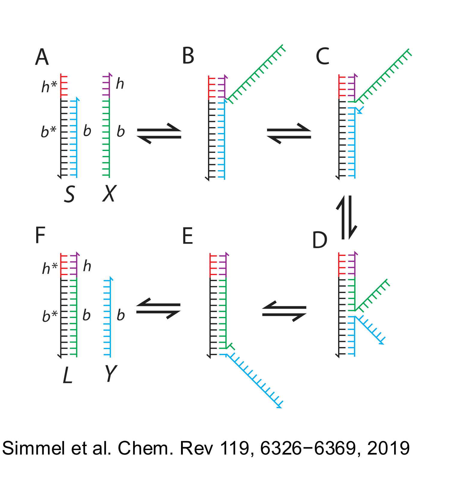

Notation: duplex **S** consists of the substrate strand (domains $h^*$ and $b^*$) paired with the **incumbent** strand **Y** (domain $b$). The **invader** strand **X** carries domains $h$ and $b$. The goal is to form duplex **L** ($h^*b^*$ paired with $hb$) and release Y.

**A.** S and X are in solution. S has a single-stranded **toehold** $h^*$, unpaired because Y has no $h$ domain.

**B.** Domain $h$ of X binds $h^*$ of S. This is ordinary hybridisation, reversible, with rate constants $k_{\text{on}}$ and $k_{\text{off}}$ set by the toehold length. Its purpose is **colocalisation**: X is now tethered beside the duplex it must invade.

**C–D.** X begins to displace Y, one base at a time. At each step one $b$–$b^*$ pair of Y breaks and one of X forms. The total number of base pairs is unchanged, so each step is roughly free-energy neutral. This is **three-way branch migration**, an unbiased random walk of the branch point that is equally likely to go either way — a *diffusive* process rather than a thermally activated one.

**E–F.** When the walk reaches the far end, Y is held by nothing and is released, completing duplex L.

**The final step is irreversible.** Y, once free, has no toehold to re-enter by: the $h^*$ domain is now occupied by X's $h$. The reverse reaction would require Y to invade from a blunt end, which has no initiation site. The random walk is reversible throughout, but its exit at one end is a trap.

**TMSD is thermodynamically downhill** because L has more base pairs than S: X pairs across both $h^*$ and $b^*$, whereas Y paired only across $b^*$. The toehold length sets both the driving force and the rate.

#### Derivation

**The rate law.** Treating the branch-migration intermediate in steady state, the overall second-order rate constant is
$$k_{\text{eff}} \approx \frac{k_{\text{on}}}{k_{\text{off}}/k_{BM} + 1} \tag{36}$$
where $k_{\text{on}}$, $k_{\text{off}}$ are for the **toehold** and $k_{BM}$ is the branch-migration rate. The structure is a competition: once X has bound the toehold, it either falls off (rate $k_{\text{off}}$) or commits to displacement (rate $k_{BM}$).

**Short toehold, $k_{\text{off}} \gg k_{BM}$.** Most binding events fail, and (36) becomes
$$k_{\text{eff}} \approx \frac{k_{BM}k_{\text{on}}}{k_{\text{off}}} = \frac{k_{BM}}{\rho_0} \exp\!\left(-\frac{\Delta G^0}{RT}\right) \tag{37}$$
using $k_{\text{off}} = k_{\text{on}}\rho_0\exp(\Delta G^0/RT)$ from Section 05. The rate rises **exponentially** with toehold binding strength, hence with toehold length.

**Long toehold, $k_{\text{off}} \ll k_{BM}$.** Every binding event proceeds, and
$$k_{\text{eff}} \approx k_{\text{on}} \tag{38}$$
The rate **plateaus**: it is limited by how fast X finds S, which no further lengthening can improve.

**Crossover.** The two regimes meet where $k_{\text{off}} = k_{BM}$.

#### Motivation and explanation

**Why this solves the original problem.** In (37) and (38), $\Delta G^0$ is that of the **toehold**, not of the $b$–$b^*$ duplex. The main duplex can be 20 bp and permanent while the toehold is 4 nt and transient. **Stability and rate are now set by different parts of the molecule and can be chosen independently** — which is exactly what Section 05 said was impossible by thermal melting.

**Why the plateau exists.** Once the toehold is strong enough that X essentially never escapes before committing, making it stronger changes nothing: the rate-limiting step has moved to diffusion. This is the same saturation seen in any mechanism where a binding step hands over to a committed step.

**What sets $k_{BM}$.** Branch migration is an unbiased random walk, so crossing $n$ steps takes a time scaling as $n^2$ rather than $n$. Longer branch-migration domains are therefore disproportionately slower, which is why displacement domains are kept short.

#### Worked example

Tuning $k_{\text{eff}}$ with toehold length. Computed in Python, taking $k_{\text{on}} = 3\times10^{6}$ M⁻¹s⁻¹, $k_{BM} = 1$ s⁻¹, and $-1.5$ kcal/mol per toehold base pair at 25 °C ($RT = 0.592$ kcal/mol).

| Toehold (nt) | $\Delta G^0$ (kcal/mol) | $k_{\text{off}}$ (s⁻¹) | $k_{\text{eff}}$ (M⁻¹s⁻¹) |
|---|---|---|---|
| 0 | 0 | $3.0\times10^{6}$ | $1.0$ |
| 2 | −3.0 | $1.9\times10^{4}$ | $1.6\times10^{2}$ |
| 4 | −6.0 | $1.2\times10^{2}$ | $2.5\times10^{4}$ |
| 6 | −9.0 | $0.76$ | $1.7\times10^{6}$ |
| 8 | −12.0 | $4.8\times10^{-3}$ | $3.0\times10^{6}$ |
| 10+ | — | — | $3.0\times10^{6}$ (plateau) |

- **Each added base multiplies $k_{\text{eff}}$ by $e^{1.5/RT} = 12.6$** while in the exponential regime, close to one order of magnitude per base.
- The **crossover is at 5.9 nt**, matching the 5–7 nt quoted from experiment.
- The total span is **6.5 orders of magnitude**, matching the measured data.
- In practical terms, at 100 nM invader a zero-toehold reaction has a half-life of months, while a 6 nt toehold completes in seconds.

#### Applications

- **DNA tweezers**, the first DNA nanomachine: a fuel strand F closes the tweezers by hybridising across the arms; an anti-fuel strand F\* removes it by TMSD, reopening them. The cycle is driven by the free energy of F–F\* hybridisation, and its by-product is F–F\* waste duplex, so the machine runs only while fuel is supplied.
- **Walkers** stepping along footholds on an origami surface, with each step a TMSD reaction.
- **Reconfigurable origami**, such as a Bennett linkage that changes conformation on addition of a strand.
- **Molecular computing**, where strand displacement cascades implement logic gates, since the output of one reaction can be the invader for the next.

#### Link to other topics

Equation (36) is a steady-state competition between an unproductive reverse step and a productive forward step — the same algebra as Michaelis–Menten, and with the same consequence: a rate that is first-order in the controlling parameter at one extreme and saturated at the other.

#### Summary

Strand displacement exchanges a bound strand without ever opening the duplex, so the free-energy barrier is small and the rate is governed by the toehold rather than by the duplex it invades. Equation (36) gives an exponential regime and a plateau, with the crossover near 6 nt and roughly 6 orders of magnitude of tunable rate — enough to make nanostructures that move, compute and respond.

### Conclusion

DNA nanotechnology combines addressable structure with programmable reaction kinetics. The next unit develops protein structure - determination and prediction.

## 08. Protein structure - determination and prediction

### Overview

Protein folding connects amino-acid sequence to molecular function. X-ray crystallography, cryo-electron microscopy and NMR infer structure from experimental signals; computational methods predict it from learned constraints, with different limitations and validation needs.

*Assumed throughout:* amino-acid chemistry, thermodynamics and molecular recognition.

### Section 23: Levels of protein structure and the folding problem

#### Intuition

A protein is a chain of amino acids joined by peptide bonds, with a backbone that repeats identically and side chains that differ. All the information is in the side chains' order.

Folding is driven by a conflict. The backbone is polar and would happily hydrogen-bond to water, but burying it inside the protein means its donors and acceptors must find partners *within* the chain. The two secondary structures, the α-helix and the β-sheet, are the two ways of satisfying every backbone hydrogen bond using only the chain itself. They exist because the backbone must be neutralised before it can be buried.

What drives burial is the hydrophobic effect: non-polar side chains disrupt water's hydrogen-bond network, so water pushes them together. The protein collapses, and the backbone that comes with them must be satisfied by helices and sheets.

*Analogy:* folding a long strip of magnetic tape so that every magnet on the backing finds a partner while the oily patches end up inside. The analogy breaks down because the "magnets" here are satisfied by *two* specific geometric patterns rather than arbitrary pairings, and because the whole thing happens in water that is actively squeezing the oily patches together.

#### Mechanism

**Four levels of organisation:**

1. **Primary** — the amino acid sequence.
2. **Secondary** — local structures, principally the α-helix and β-sheet, formed by backbone hydrogen bonding.
3. **Tertiary** — the folded polypeptide including any cofactors, held by *intra*molecular bonds. This is the biologically active form.
4. **Quaternary** — assembly of several discrete polypeptides (subunits) through *inter*molecular bonds, as in haemoglobin's four chains.

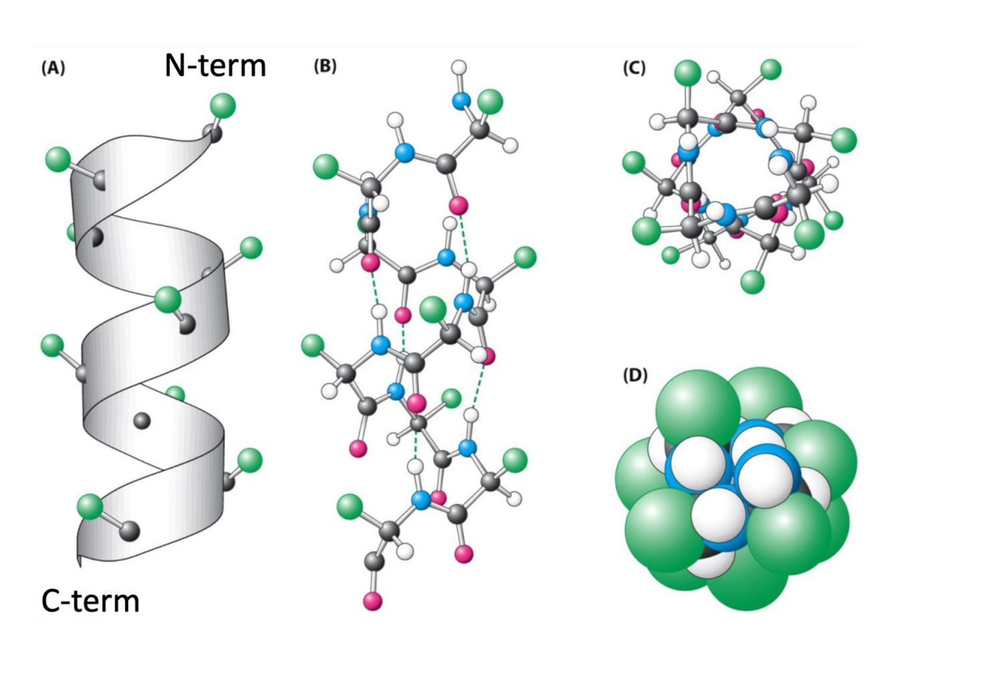

**The α-helix**, proposed by Astbury (from keratin fibre diffraction) and Pauling (from paper models):
- typically 10–40 residues;
- **right-handed**, with no space inside — the backbone packs against itself;
- hydrogen bonds between the carbonyl CO of residue $i$ and the amide NH of residue $i+4$;
- 100° of rotation per residue, so **3.6 residues per turn**;
- side chains extend outwards and tilt towards the N-terminus, giving the "Christmas tree" appearance.

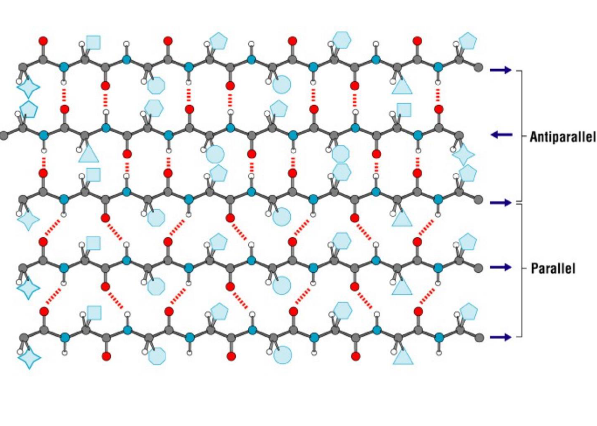

**The β-sheet**, also proposed by Astbury:
- stretches of extended chain (**β-strands**) lying side by side;
- CO and NH hydrogen-bond to **neighbouring strands on both sides**, rather than within one strand;
- strands may be **parallel or antiparallel** depending on their relative direction;
- can close into barrels, as in green fluorescent protein;
- side chains alternate above and below the sheet along a strand, but point the same way across strands — so **every second residue sits on one face**, which lets a sheet present one hydrophobic face and one polar face.

#### Derivation

**The Levinthal paradox.** Tertiary structure is determined by the sequence alone: no external template is required. But consider finding it by search.

Take a 100-residue protein. Each residue has two freely rotating backbone dihedrals ($\phi$, $\psi$), so a chain of 100 residues has about 198 of them. Allowing each only **three** stable values from the Ramachandran plot:
$$N_{\text{conf}} = 3^{198} = 3.0\times10^{94} \tag{39}$$

Sampling one conformation every 0.1 ps, an exhaustive search takes
$$t = 3.0\times10^{94}\times10^{-13}\ \text{s} = 3\times10^{81}\ \text{s} \approx 9\times10^{73}\ \text{years} \tag{40}$$
about $7\times10^{63}$ times the age of the universe. **Proteins nevertheless fold in milliseconds.** Folding cannot be a search.

**The resolution: the funnel.** The energy landscape is not flat with one narrow minimum; it is a **funnel**. Partially correct structures are already downhill, so the chain is guided towards the native state rather than sampling blindly. Folding follows a limited number of pathways, often through a collapsed intermediate (a **molten globule**) that has secondary structure but not yet fixed side-chain packing.

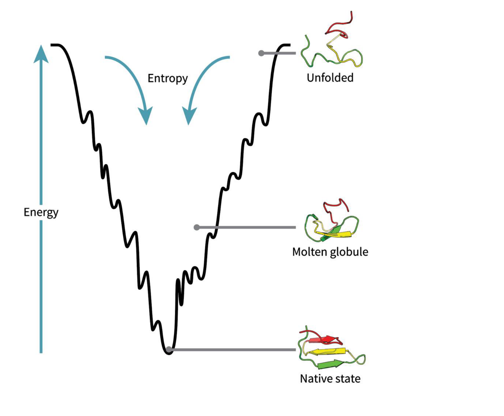

In 1 ms at 0.1 ps per step, a chain samples about $10^{10}$ conformations — a factor of $10^{84}$ short of (39), so the funnel must eliminate essentially the whole search space.

#### Motivation and explanation

**Proteins are barely stable.** The native state is the most stable conformation, but only by **20–40 kJ/mol** over the denatured state. At 310 K that is 8–16 $k_BT$ for the whole molecule, and for a 100-residue protein about **0.1 $k_BT$ per residue** — the difference of a few hydrogen bonds. Two consequences:
- Folding is a near-cancellation of two large numbers, the enthalpy of burial and the entropy lost on ordering the chain, so modest changes in temperature, pH or a single mutation can unfold a protein.
- Marginal stability is probably functional: proteins must be degradable and must flex to work.

**Why this matters for prediction.** Equation (39) says the structure cannot be found by enumeration, and marginal stability says it cannot be found by crude energy minimisation either, since the correct fold is only slightly below many wrong ones. For fifty years this is why prediction failed, and it is the background to Section 26.

**Where the simple picture fails.** Not all proteins fold alone; many require chaperones. Some pass through no molten globule. A large fraction of eukaryotic proteins are *intrinsically disordered*, with no single native structure, and the whole framework does not apply to them.

#### Link to other topics

The funnel is the same argument as nucleation in crystallisation: a process that would be impossibly slow as a random search becomes fast once partially correct states are downhill in free energy, so that the system is guided rather than searching.

#### Summary

Protein structure is organised in four levels, with the α-helix and β-sheet existing to satisfy backbone hydrogen bonds so that the chain can be buried. The sequence determines the fold, but $3^{198}$ conformations rule out any search, and a funnelled landscape with marginal final stability — 20–40 kJ/mol — is what makes millisecond folding possible.

### Section 24: X-ray crystallography and the phase problem

#### Intuition

To see something you must illuminate it with radiation whose wavelength is comparable to its features. Atoms are about 1.5 Å apart, so imaging them needs X-rays of about 1 Å. But there is no lens for X-rays: they cannot be focused to form an image directly.

What *can* be done is to record the scattered radiation and reconstruct the image computationally. Scattering from a single molecule is far too weak to detect, so the molecule is placed in a **crystal** — a periodic array of millions of identical copies in identical orientations. Their scattered waves then interfere constructively in specific directions, concentrating a weak signal into measurable spots.

The crystal is an amplifier, and it is also the main obstacle: proteins are large, flexible and reluctant to pack into ordered lattices.

*Analogy:* hearing one voice in a stadium by having everyone chant in unison. The analogy breaks down in exactly the way that creates the central difficulty: a detector records *intensity*, not the wave itself, and the timing information in the chant — the phase — is thrown away.

#### Mechanism

**The relationship being exploited.** The electron density in the unit cell and the diffraction pattern are **Fourier transforms of each other**. Each spot corresponds to one spatial frequency component of the density. So:

- *Forward:* electron density → diffraction pattern, which the crystal does physically.
- *Reverse:* diffraction pattern → electron density, by inverse Fourier transform.

The objective is to determine the arrangement of protein atoms in space, and the electron density is what is reconstructed. A model is then built into that density.

##### The phase problem

A wave has an **amplitude** and a **phase**. The inverse Fourier transform needs both. But a detector measures only the *number of photons* arriving at each spot, which is the intensity:
$$I \propto |F|^2 \qquad\Longrightarrow\qquad |F| = \sqrt{I} \tag{41}$$

The amplitude is recoverable as the square root of the intensity. **The phase is lost entirely.** This is the phase problem, and it is not a technical limitation but a consequence of detecting intensity. Phases carry most of the structural information: a map computed from correct amplitudes with wrong phases shows the wrong molecule.

**Perutz's solution: multiple isomorphous replacement (MIR).** Soak a few **heavy atoms** (mercury, platinum) into the crystal without disturbing the lattice. The heavy atoms scatter strongly, so every spot shifts in intensity. Comparing the native and derivative datasets locates the heavy atoms, and their known positions give a reference wave against which the phases of all other reflections can be inferred. Several derivatives are needed to resolve ambiguities — hence *multiple*.

Perutz applied this to haemoglobin; his student **John Kendrew** used it to solve **myoglobin**, the first protein structure, at 6 Å, later extended to 2 Å once computation allowed.

**Molecular replacement**, the modern routine method, sidesteps MIR. If a structurally similar protein is already known, its model is positioned and oriented in the new unit cell to generate *calculated* phases, which are combined with the measured amplitudes. This works only when a sufficiently close model exists — which is why Section 26 matters so much to this field.

##### Modern workflow

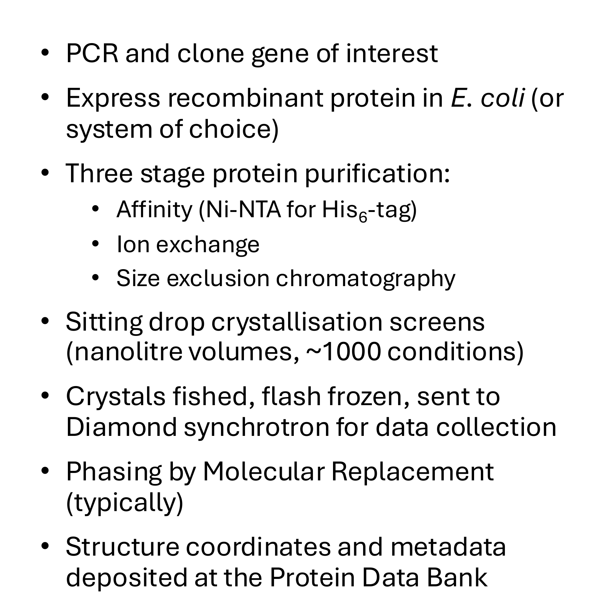

1. **PCR and clone** the gene of interest.
2. **Express** the recombinant protein in *E. coli* or another system.
3. **Purify** in three stages: affinity (Ni-NTA against a His₆ tag), ion exchange, then size-exclusion chromatography. Milligram quantities of homogeneous protein are needed.
4. **Crystallise** by sitting- or hanging-drop vapour diffusion.

The drop contains protein mixed 1:1 with a *precipitant* ("mother liquor": salts, PEG or solvent at defined pH). Sealed against a more concentrated reservoir, water leaves the drop by vapour diffusion, slowly raising the protein concentration until it crystallises. The right conditions cannot be predicted, so **about 1000 conditions are screened** in nanolitre drops.

5. **Collect data.** Crystals are fished out, flash-frozen (which limits radiation damage) and taken to a synchrotron such as Diamond. The crystal is rotated to capture reflections from many angles, since a full three-dimensional density map needs reflections in all directions.
6. **Phase**, usually by molecular replacement.
7. **Build and refine** a model into the density, and deposit coordinates in the Protein Data Bank.

#### Motivation and explanation

**Why a synchrotron.** An in-house rotating-anode source (Cu Kα, 1.54 Å) gives data in a few hours to about 1.8 Å. A synchrotron provides a far brighter, tunable beam, giving better resolution from smaller and weaker crystals.

**What resolution means.** Resolution is the smallest spacing distinguishable, and it is set by how far out from the centre the spots extend. From Bragg's law, $\lambda = 2d\sin\theta$ with $\lambda = 1.54$ Å: 2 Å data requires reflections out to $\theta = 23°$, while 0.8 Å requires 74°. **High-resolution information sits at high angle**, where intensities are weakest — so resolution is limited by how well-ordered the crystal is, not by the instrument.

At 2 Å, individual atoms are not separated (C–C is 1.54 Å) but the backbone and side chains are unambiguous. Below about 1.2 Å, individual atoms resolve.

**Strengths and limitations:**
- **Atomic resolution, 0.5–2 Å** — the benchmark against which other methods are judged.
- **No size limit in principle**, but larger proteins are increasingly hard to crystallise.
- *Bottlenecks:* milligrams of homogeneous protein; crystal growth and quality, which is unpredictable and often the step that fails; membrane proteins, which resist crystallisation because their hydrophobic surfaces need detergent.
- The structure is of a molecule in a **crystal lattice**, at cryogenic temperature — not necessarily its solution conformation.

#### Link to other topics

Recovering an object from the magnitude of its Fourier transform while the phase is lost is a general inverse problem, and the standard solution is the one used here: supply the missing information from a known reference, whether a heavy atom or an existing model.

#### Summary

A crystal turns undetectable single-molecule scattering into measurable spots, and the density is recovered by inverse Fourier transform — except that detection destroys the phases, which carry most of the information. Heavy-atom replacement and, now, molecular replacement supply them.

### Section 25: Cryo-electron microscopy and NMR

#### Intuition

Both methods start from the same observation: the crystal in Section 24 served only to amplify a weak signal by adding together millions of identical, identically oriented copies. If the signal can be built up some other way, the crystal is unnecessary.

**Cryo-EM** keeps the averaging but drops the lattice. Molecules are frozen in random orientations in a thin film of ice and imaged individually. Each image is desperately noisy, but if thousands sharing an orientation are aligned and averaged, the noise falls while the signal survives. The crystal's job — adding copies together — is done in software, so the copies need not be ordered.

**NMR** abandons averaging over copies entirely and measures a different observable: distances between nearby nuclei in a molecule tumbling in solution. Enough distance constraints determine the fold.

*Analogy for cryo-EM:* recognising a statue from thousands of blurred photographs taken from unknown angles, by sorting them into groups that look alike and averaging each group. The analogy breaks down because the sorting is done on the images themselves with no prior knowledge of the statue, which is why the method needed both better detectors and better algorithms before it worked.

#### Mechanism

##### Cryo-electron microscopy

**Why electrons.** Resolution requires a wavelength comparable to the features imaged. Visible light is hundreds of nanometres, far too long. Electrons accelerated through 300 kV have a de Broglie wavelength of about **0.02 Å**, roughly 80 times shorter than Cu Kα X-rays and far shorter than any atomic spacing. **Wavelength is therefore not the limiting factor.**

**What actually limits it** is the sample. Electrons deposit energy as they pass, and the resulting *beam-induced damage* destroys the molecule. A conventional transmission electron microscope avoids this by staining with heavy metals — but then one images the stain, not the protein, so resolution is limited to the stain's granularity. Molecular motion blurs images further.

Cryo-EM solves both by **vitrification**: the sample is plunge-frozen so fast (into liquid ethane at −180 °C) that water forms amorphous ice rather than crystalline ice. Crystalline ice would diffract and destroy the image. Vitrification immobilises the molecules in random orientations and limits radiation damage, so low electron doses can be used.

**The pipeline:**
1. **Vitrify** the sample on a grid in a thin film.
2. **Image** at low dose. Each molecule appears as a faint **2D projection** at an unknown orientation.
3. **Pick particles** — identify individual molecules in the micrographs, typically $10^5$ or more.
4. **Classify and average.** Particles are sorted into groups sharing an orientation and averaged, raising the signal-to-noise ratio. This is the step that replaces the crystal.
5. **Reconstruct.** Projections from many known relative orientations are combined by Fourier transform to give a 3D **density map**, in the same way a CT scan builds a volume from projections.
6. **Build** an atomic model into the map.

##### NMR

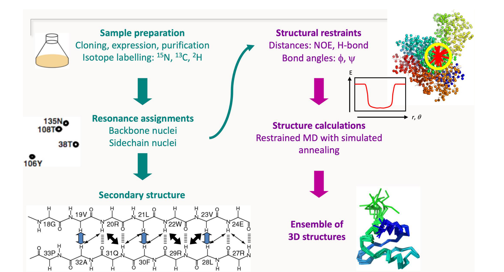

1. **Prepare** the protein with isotope labels (¹⁵N, ¹³C, ²H), since the common isotopes ¹²C and ¹⁶O have no nuclear spin and are invisible.
2. **Assign resonances** — work out which peak belongs to which backbone and side-chain nucleus. This is the laborious step and it scales badly with size.
3. **Extract restraints.** The **nuclear Overhauser effect (NOE)** couples nuclei through space and falls off as $r^{-6}$, so it reports that two nuclei are within about 5 Å. Coupling constants give backbone dihedral angles $\phi$ and $\psi$.
4. **Calculate structures** by restrained molecular dynamics with simulated annealing: find conformations consistent with all restraints.
5. The result is an **ensemble** of structures, not one. Spread within the ensemble shows where the restraints are weak — often also where the protein is genuinely flexible.

NMR works **in solution at room temperature**, so it reports conformational dynamics that crystallography cannot. But resonance overlap and faster relaxation limit it to small proteins, under roughly 30 kDa, which is why it accounts for only about 6 % of deposited structures.

#### Motivation and explanation

**Choosing a method.**

| | X-ray crystallography | Cryo-EM |
|---|---|---|
| Resolution | **0.5–2 Å**, atomic | 3–4 Å, improving |
| Size | no limit in principle, but crystallisation gets harder with size | **better with large** assemblies, >100 kDa |
| Crystal | **required** | not required |
| Purity | milligrams, homogeneous | **less critical** |
| Sample state | lattice, cryogenic | vitrified, near-native |
| *In situ* | no | **yes**, by cryo-tomography |

The two are complementary in exactly the regime where each struggles: crystallography is easiest for small, well-behaved proteins and hardest for large flexible complexes, while cryo-EM is the reverse.

**Why cryo-EM does better with large particles.** Alignment in step 4 requires recognising a particle's orientation from a noisy projection. A larger particle has more distinguishing features and scatters more electrons, so its orientation is determined more reliably. Below about 100 kDa the particle is too faint to align, which sets the lower size limit. This is the opposite of the crystallographic constraint, where size hinders crystallisation.

**Why cryo-EM grew so quickly.** Of about 235 000 deposited structures, roughly 81 % are X-ray, 13 % cryo-EM and 6 % NMR, but almost all the cryo-EM entries are recent. The change came from direct electron detectors, which record individual electrons and so allow motion correction, and from improved classification algorithms — not from new physics.

**Shared limitation.** Both give a *static* structure, or in cryo-EM's case a set of discrete states from classification. Neither reports the continuous motion that biological function usually depends on, which is where NMR retains its advantage.

#### Link to other topics

Cryo-EM reconstruction is computed tomography: combining projections taken at many angles into a volume. The difference is that in a CT scanner the angles are known because the source is moved, whereas here they must be inferred from the images themselves.

#### Summary

Both methods remove the crystal. Cryo-EM replaces the lattice's averaging with computational classification of vitrified single particles, trading resolution for freedom from crystallisation and working best on exactly the large assemblies crystallography finds hardest.

### Section 26: AlphaFold and computational structure prediction

#### Intuition

Anfinsen's dogma says the 3D structure of most natural proteins is determined only by their amino acid sequence. That makes prediction well posed, and it is why the field persisted for fifty years without success.

The breakthrough did not come from simulating physics. It came from a different source of information: **evolution has already run the experiment**. For almost any protein there are thousands of homologues across species, all with the same fold and different sequences. Those differences are not random.

If two residues touch in the folded structure, a mutation at one that disrupts the contact is tolerated only if a compensating mutation occurs at the other. Over evolutionary time, **residues in contact mutate together** — they *co-evolve*. The converse holds too: independently varying positions are probably far apart.

A multiple sequence alignment therefore carries a noisy picture of the *contact map*, and a contact map plus chain connectivity largely determines the fold. The sequence database is a record of a search already completed.

*Analogy:* inferring which parts of a machine touch by examining thousands of variants and noting which pairs of parts always change together. The analogy breaks down because co-evolution also arises indirectly — A couples to B and B to C, making A and C appear correlated — and disentangling direct from indirect coupling is much of the difficulty.

#### Mechanism

**CASP.** The Critical Assessment of Structure Prediction is a biennial blind test: predictors are given sequences whose structures have been solved but not released. DeepMind's earlier AlphaFold won CASP13 (2018) but by a small margin, and the predictions were not accurate enough for the problem to be considered solved. **AlphaFold 2 at CASP14 (2020)** reached accuracy comparable to experiment, and the problem was declared largely solved.

**The AlphaFold 2 pipeline:**

**1. Inputs.** The target sequence is used to search:
- a **genetic database**, producing a **multiple sequence alignment (MSA)** of homologues — the primary input, carrying the co-evolution signal;
- a **structure database**, producing **templates** of any known similar structures.

These become two representations:
- the **MSA representation** $(s, r, c)$, indexed by sequence and residue;
- the **pair representation** $(r, r, c)$, indexed by *pairs* of residues — effectively a running hypothesis about which residues are in contact.

**2. Evoformer (48 blocks).** The core of the network. It updates both representations repeatedly, and the essential feature is the **continuous flow of information between them**: evidence of co-evolution in the MSA updates the pair representation, and geometric constraints in the pair representation inform how the MSA is read. Because the pair representation is geometric, the network can enforce consistency — if A is near B and B near C, then A and C are constrained — which is how indirect correlations are separated from direct contacts.

**3. Structure module (8 blocks).** Converts the refined representations into explicit **3D atomic coordinates**, rather than a contact map to be folded afterwards. It also outputs a **per-residue confidence score**, which is as important as the structure itself.

**4. Recycling (three times).** The outputs are fed back as inputs and the whole network is run again, each pass refining the previous hypothesis.

**AlphaFold 3** extends this beyond single proteins to **proteins, DNA, RNA, small molecules, ions, modified residues and glycosylation** in one model. Architecturally it replaces the structure module with a **diffusion module**, trained to take *noised* atomic coordinates and recover the correct ones, then applied iteratively from noise. This makes AF3 a generative model predicting raw atom coordinates directly.

#### Motivation and explanation

**Why confidence scores matter.** A prediction without an error estimate cannot be used in practice. AlphaFold reports per-residue confidence, which is empirically well calibrated: high-confidence regions are usually right and low-confidence regions usually are not. Low confidence is also informative — it often marks genuinely disordered regions (Section 23), so the model reports a real property rather than simply failing.

**The effect on crystallography.** AlphaFold models are good enough to serve as search models for **molecular replacement** (Section 24), which needs a model within about 1–1.5 Å RMSD over at least 30 % of atoms. Prediction has therefore not replaced experiment; it has removed the phase problem's dependence on finding a pre-existing homologue. The two methods now feed each other.

**What AlphaFold 2 does and does not do.**

| Predicts well | Struggles | Does not predict |
|---|---|---|
| Single protein chains | Multiple conformations of one sequence | Protein–DNA and protein–RNA complexes |
| Protein multimers | Effects of point mutations | Ligand and ion binding |
| Multisubunit complexes | Nucleic acid structures | Post-translational modifications |
| | Antigen–antibody interactions | Membrane plane for transmembrane domains |

**The pattern in that table is worth seeing.** AlphaFold 2 predicts the single most likely structure of a *polypeptide in isolation*. It struggles or fails wherever the answer depends on something not in the sequence or its evolutionary record:
- *Multiple conformations* — the output is one structure, but many proteins function by switching between several.
- *Point mutations* — a single substitution barely changes the MSA, so the prediction barely changes, even when the real protein unfolds. Given the 20–40 kJ/mol marginal stability of Section 23, this is unsurprising: the model has learned which fold the sequence family adopts, not the energetics that make it marginal.
- *Ligands, ions, modifications and membranes* — context the sequence does not contain.

**The deeper limitation.** AlphaFold predicts structure, not function or mechanism, and its reliance on the MSA means it is weakest on sequences with few homologues — designed proteins, rapidly evolving ones, antibody loops. It has not solved the folding *process*: it does not say how a chain reaches its native state, only where it ends up. The Levinthal paradox of Section 23 is bypassed, not explained.

#### Link to other topics

Reading structure from correlated variation across a database, rather than from a physical model, is the same inference used in any empirical correlation: a sufficiently large body of observations substitutes for a theory of the mechanism. The usual caveat applies — such models extrapolate badly outside the data they were fitted to, which here means sequences with few relatives.

#### Wider pathway

Reliable structures for essentially every known protein change what is routine: enzyme engineering, binder design and drug discovery can start from a model rather than a multi-year structural project. Section 27 begins protein engineering, where knowing the structure is the precondition for deciding what to change.

#### Summary

AlphaFold 2 solved prediction not by simulating folding but by extracting contacts from the co-evolutionary record in multiple sequence alignments, cycling that information against a geometric pair representation and emitting coordinates with calibrated confidence. It predicts an isolated chain's single most likely fold, and fails where the answer depends on conformational change, energetics or molecular context — gaps that AlphaFold 3 begins to close by modelling nucleic acids, ligands and modifications together.

### Conclusion

Experimental determination and computational prediction answer related structural questions, and each requires validation against its own limitations. The next unit develops protein engineering.

## 09. Protein engineering

### Overview

Protein engineering changes function, stability or behaviour in the body by altering sequence, architecture and chemical modifications. Mutagenesis and non-canonical amino acids supply the changes, while antibody-generation and screening methods identify useful variants.

*Assumed throughout:* protein structure, genetic coding and molecular recognition.

### Section 27: What to engineer about a protein

#### Intuition

A natural protein is optimised by evolution for *its own* purpose in *its own* context. A therapeutic or reagent is used for a different purpose in a different context, so the properties evolution settled on are rarely the ones wanted. Engineering is the business of changing one property without destroying the others.

Antibodies make the point well. Evolution shaped them to find almost any target with high specificity, which is exactly what a drug needs. But they are also large, slow to clear, unable to enter cells, and carry effector functions that may be unwanted. Almost all antibody engineering is an attempt to keep the binding and change everything else.

*Analogy:* a general-purpose vehicle adapted for a specific job — the engine is what you want, so the body is cut down or extended around it. The analogy breaks down because a protein's parts are not modular in the way a vehicle's are: Section 23's marginal stability means a change intended to affect one property frequently destabilises the whole fold.

#### Mechanism

**Antibody architecture.** An IgG is roughly 150 kDa, built from two heavy and two light chains:
- the two **Fab** arms bind antigen;
- the **Fc** stem carries the functional interactions — FcγR binding (antibody-dependent cell-mediated cytotoxicity, ADCC), C1q binding (complement-dependent cytotoxicity, CDC) and FcRn binding (half-life, Section 28).

Crucially, **variation is limited to three loops at the tip of each chain**, the complementarity-determining regions (CDRs). The rest of the molecule is a near-constant scaffold. This separation is why antibodies are so engineerable: the binding site is a small, variable, structurally isolated part of a fixed framework.

##### Size

Cutting the antibody down gives a series of fragments:

| Format | Mass |
|---|---|
| IgG | 150 kDa |
| (Fab′)₂ | 110 kDa |
| Fab | 55 kDa |
| scFv (single-chain variable fragment) | 25 kDa |
| Peptide | <1 kDa |

Size controls three things at once: **clearance from blood**, **penetration into tumours** and **resistance to misfolding and proteolysis**. Smaller fragments penetrate tissue better but are cleared faster (Section 28), so the choice of format is a trade-off rather than an optimisation.

**Why the CDR loops cannot simply be used as peptides.** An obvious idea is to synthesise the binding loops alone. It fails because an isolated peptide is **too flexible**. Binding requires the loops to be held in a defined conformation; free in solution they sample many conformations, and the entropy lost on binding cancels the enthalpy gained. The framework is not inert packaging — it pays the conformational entropy cost in advance.

##### Fusions

Joining the antibody to something else gives function the antibody does not have.

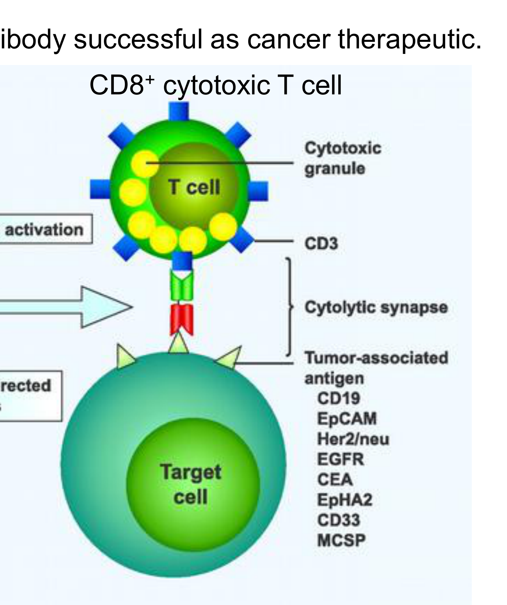

**(i) To other proteins.** A **bispecific T-cell engager (BiTE)** is two single-chain antibodies joined: one binds CD3 on a cytotoxic T cell, the other a tumour-associated antigen. The construct physically forces a synapse between T cell and tumour cell, redirecting the T cell to kill a target it would otherwise ignore. The engineered molecule supplies not binding but **proximity**.

**(ii) To other biomolecules.** Linking DNA to an antibody allows the binding event to be amplified by PCR (immuno-PCR) or by rolling-circle amplification, so a single binding event becomes an exponentially amplified signal. This gives far greater sensitivity than reading a fluorophore, and the DNA sequence also acts as a barcode for multiplexed detection.

**(iii) To non-biological molecules.** Dyes or particles for lateral-flow assays; chelated radionuclides for PET imaging; and drugs.

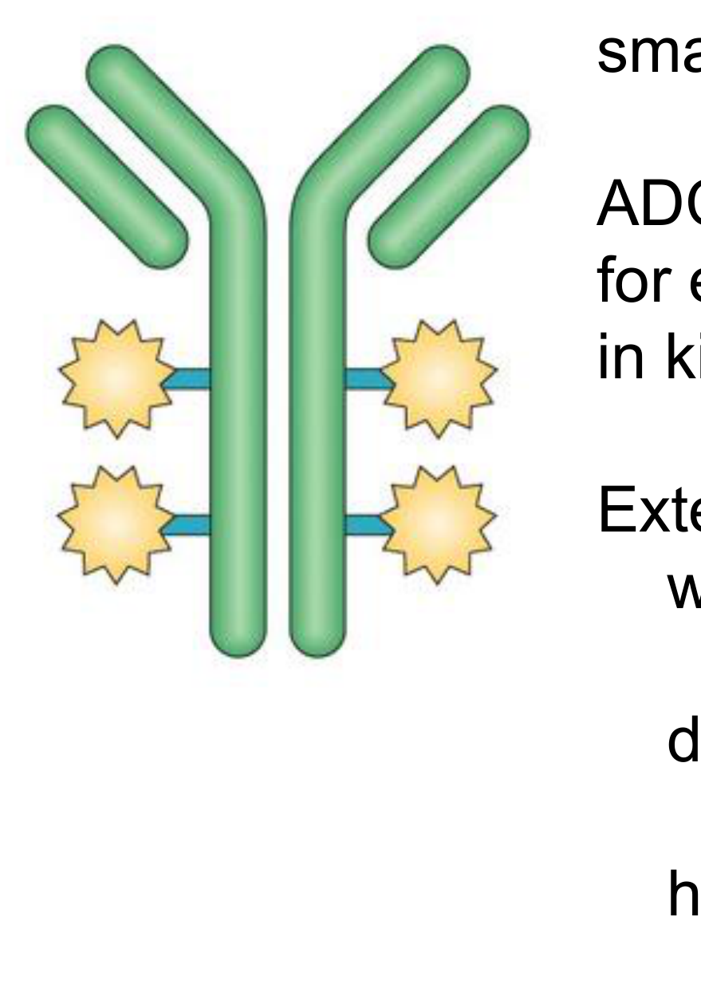

**Antibody–drug conjugates (ADCs)** combine antibody specificity with small-molecule potency. The antibody delivers a cytotoxic drug to cells carrying the target antigen, killing them by a mechanism far more potent than natural effector function. Three parameters are optimised: **where the drug attaches**, **how many copies** per antibody, and **how the linker releases** the drug — ideally only inside the target cell. ADCs are correspondingly expensive: a course of the anti-HER2 ADC Kadcyla costs of order £90 000.

#### Motivation and explanation

**Why antibodies rather than small molecules.** Small molecules are cheaper to manufacture, simpler to administer (usually oral), and can reach intracellular targets. Antibodies are limited to surface-exposed targets and must be injected. But they are **stable, well expressed, highly specific and multi-functional**, and crucially they can be raised against almost any target, whereas a small-molecule binder may not exist. In practice antibodies have a more reliable development pipeline and a higher success rate in trials.

**What makes a binder good enough.** For therapy, a dissociation constant of 1 µM is workable and 100 pM is excellent. That is a factor of $10^4$ in $K_d$, which from $\Delta G^0 = RT\ln K_d$ is only **5.7 kcal/mol at 37 °C** — a handful of hydrogen bonds. Affinity maturation is a matter of small energetic changes, which is why it is tractable but also why it is easily lost when something else is altered.

Affinity is not the whole requirement: the binder must be **tight *and* specific**, and these are improved by different means. Selecting harder for affinity does not improve specificity (Section 19).

#### Link to other topics

The size trade-off — penetration against residence time — is a transport problem of the same kind as catalyst particle sizing: smaller particles give better internal diffusion but are harder to retain in the reactor.

#### Summary

Antibodies are engineerable because binding is confined to six variable loops on an otherwise constant framework, which can be truncated for penetration or extended by fusion to add proximity, amplification or cytotoxicity. The loops cannot be used alone, because the framework pays their conformational entropy.

### Section 28: Antibody pharmacokinetics, glycosylation and switchable function

#### Intuition

Most injected proteins disappear quickly. Small ones are filtered by the kidney; larger ones are taken up by cells and digested in lysosomes. An IgG escapes both, and persists for weeks. The reason is a dedicated **recycling receptor** that rescues IgG from the degradation pathway and returns it to the surface. Long antibody half-life is not a passive property of being large and stable: it is an active salvage mechanism, and because it depends on the Fc region, it can be transferred to other proteins by fusing them to Fc.

Glycosylation raises a different issue. The sugar is added by the producing cell, not encoded in the sequence, so it varies with cell line and culture conditions. It also changes effector function. A manufacturer therefore cannot fully specify the product from its gene — a problem with no analogue in small-molecule manufacture.

*Analogy for FcRn:* a parcel sorting office where most items go to the incinerator, but parcels with the right label are picked out and returned to the sender. The analogy breaks down because the sorting signal is pH-dependent rather than fixed — which is precisely what makes it work.

#### Mechanism

##### Pharmacokinetics

After intravenous delivery, serum concentration falls in **two phases** (note the log axis, so a straight line is exponential decay):

1. **Distribution** — rapid, as antibody moves from blood into the tissue interstitial space. This is redistribution, not loss.
2. **Elimination** — slow, by lysosomal degradation after cellular uptake. Log-linear, so first order.

**There is no renal clearance.** The kidney filters below about 20 kDa; IgG is 150 kDa. This is the first reason for the long half-life, and it explains the size trade-off of Section 27 directly: an scFv at 25 kDa sits near the filtration cut-off and is cleared in hours instead of weeks.

Clearance is increased by:
- **anti-drug antibodies** — the patient's immune system recognising the therapeutic, which is why immunogenicity matters;
- **target-mediated clearance** — antibody removed along with the antigen it is bound to, so the dose is consumed by the target itself.

**The salvage pathway.** Cells continuously take up extracellular fluid by endocytosis. The endosome acidifies, and most contents pass to the lysosome and are degraded.

**FcRn** (the neonatal Fc receptor) binds IgG **at endosomal pH but not at physiological pH**. So:
- in the acidified endosome, FcRn captures IgG;
- the FcRn–IgG complex is sorted into the recycling pathway, away from the lysosome;
- at the cell surface, neutral pH releases the IgG back into circulation.

The pH dependence is what makes this a cycle rather than a one-way trap: binding must be strong where rescue is needed and weak where release is needed.

**This is transferable.** Fusing any protein to IgG Fc confers the same salvage and extends its half-life. **Etanercept** is the extracellular domain of the TNF receptor fused to Fc, used for rheumatoid arthritis: the TNFR domain neutralises TNF, and the Fc keeps it in circulation. The engineered molecule combines a binding function from one protein with a pharmacokinetic function from another.

##### Glycosylation

IgG carries a glycan on **each C_H2 domain** of the Fc. Its structure varies, and it depends on:
- the protein sequence,
- the **cell line**,
- the **growth conditions**.

For a drug one needs to know exactly what is being delivered and to deliver the same thing each time. Glycosylation makes this difficult, because the same gene in a different bioreactor gives a different product. Glycans are characterised by mass spectrometry, and glycan profile becomes a release specification.

**Glycans are not cosmetic — they switch effector function.** Different glycan structures give: no effector function; enhanced CDC and anti-inflammatory behaviour; enhanced ADCC; reduced circulation with inflammatory behaviour; or anti-inflammatory behaviour with sialic acid. **Removing a single fucose markedly increases ADCC**, which is exploited deliberately in afucosylated therapeutic antibodies. So the same polypeptide can be a cell-killing drug or an anti-inflammatory one depending on a sugar the cell line happened to add.

##### Switchable function

Many cancer targets are also expressed on normal tissue, so toxicity limits the dose rather than efficacy. The idea is a **logic gate**: an antibody that binds only if the target antigen is present **AND** a cancer-associated protease is present.

A **pro-antibody** carries a peptide mask over its binding site, tethered by a linker. The masked antibody cannot bind. Tumours over-express certain proteases; these cleave the linker, the mask is released, and the antibody becomes active — only in the tumour environment. Specificity now requires two independent conditions rather than one, which is the same strategy as the probe-plus-primers design in Section 18.

#### Motivation and explanation

**Reading the half-life from the graph.** From the elimination phase, concentration falls from about 100 to 20 µg/mL between days 5 and 50 (values read from a graph, so ≈). For first-order decay,
$$k = \frac{\ln(100/20)}{45} = 0.036\ \text{day}^{-1}, \qquad t_{1/2} = \frac{\ln 2}{k} \approx 19\ \text{days}.$$
That is consistent with the three-week dosing intervals typical of therapeutic antibodies, and it is roughly 100 times longer than a protein of similar size without FcRn binding.

**What "linear PK" means.** Dose-proportional pharmacokinetics means concentration scales with dose, with approximately dose-independent clearance; a straight elimination segment on a log plot alone does not establish dose proportionality. For antibodies with target-mediated clearance, nonlinearity is often strongest at low or intermediate concentrations. At sufficiently high concentrations, target binding and uptake saturate, so nonspecific first-order clearance can dominate and PK can approach linearity. The simple half-life estimate applies only over the approximately exponential segment used here.

**The common thread.** All three sections are about the Fc, not the binding site. Half-life, effector function and manufacturing consistency are properties of the constant region, while specificity lives in the CDRs (Section 27). This is why the two can be engineered almost independently — and why Fc engineering is a field in itself.

#### Link to other topics

The FcRn cycle is a pH-swing separation: bind the product at one pH, release it at another, and run the two conditions at different points in a loop. It is the same principle as pH elution in affinity chromatography (Section 45), operating here inside a cell.

#### Summary

Antibodies persist for weeks because they are too large to filter and because FcRn actively rescues them from lysosomal degradation by pH-dependent binding — a property transferable to any protein by Fc fusion. Glycosylation, added by the cell rather than encoded, varies with manufacturing and switches effector function.

### Section 29: Site-directed mutagenesis and non-canonical amino acids

#### Intuition

To change a protein you change its gene, and the cell does the rest. A mutagenic primer carries the desired change and is incorporated into a new copy of the plasmid, so the mutation is introduced during amplification rather than by editing an existing molecule.

The harder problem is deciding *which* residue to change. There are far too many options to test exhaustively (Section 30), so changes must be chosen rationally — which requires a structure, and is why Sections 24–26 come first.

Expanding the genetic code is a different kind of move. The twenty natural amino acids provide a limited chemical palette: no azides, no ketones, no photoreactive groups. Rather than work around this, one can reassign a codon the cell does not otherwise need and install a new amino acid at that position.

*Analogy:* mutagenesis is replacing one component with another from the same catalogue; code expansion is adding a new entry to the catalogue. The analogy breaks down because the new entry needs its own dedicated supply chain — a tRNA and a synthetase that no other machinery in the cell will touch.

#### Mechanism

##### Site-directed mutagenesis

The aim is to replace one amino acid by another to explore function or mechanism.

**The QuikChange method**, three steps:
1. **Mutant strand synthesis.** Denature the plasmid and anneal a pair of complementary primers carrying the desired mutation at their centre, flanked by matching sequence on both sides so they still hybridise. A high-fidelity polymerase extends around the whole plasmid.
2. **DpnI digestion.** The template came from *E. coli* and is therefore **methylated**; the newly synthesised strands are not. **DpnI cuts only methylated DNA**, so it destroys the parental plasmid and leaves the mutated copies. This is the clever step: it solves the problem of separating product from a template that is otherwise nearly identical.
3. **Transformation.** The nicked circular product is transformed into competent cells, which repair the nicks.

It is fast and exceeds 90 % success, but makes one change at a time and can only insert or delete a few residues.

**Which residue to change?** Five rational strategies:
1. From a **structure** with ligand bound, by X-ray or cryo-EM.
2. From an **AlphaFold prediction** of the structure or complex (Section 26) when no experimental structure exists.
3. **Conserved residues**, identified from a sequence alignment — conservation across species implies functional importance, the same co-evolutionary logic AlphaFold exploits.
4. **Alanine scanning**: replace each candidate residue in turn with alanine. Alanine removes the side chain beyond the β-carbon, so it deletes the functional group *without* adding bulk and without the flexibility of glycine. Loss of activity implicates that side chain.
5. **Stop codons** to truncate the chain or remove a domain.

**Point mutants can be products in themselves.** Subtilisin, the protease in biological laundry detergent, is inactivated by bleach, which oxidises a key methionine. Replacing that methionine with alanine gives a bleach-resistant enzyme. The same enzymes have also been improved by **directed evolution** (Section 30) for activity at low temperature — the two approaches are complementary, rational design where the mechanism is understood and evolution where it is not.

##### Non-canonical amino acids

The goal is to go beyond the natural twenty and install new chemical functionality — photocrosslinkers, photocaged side chains, click-chemistry handles — as a subtle change to a single side chain.

**The mechanism requires three parts working together:**

1. **A spare codon.** The **amber stop codon UAG** is reassigned. It is the rarest stop codon in *E. coli*, so taking it over disrupts least.
2. **A suppressor tRNA** with an anticodon complementary to UAG. Where the ribosome would normally terminate, this tRNA delivers an amino acid instead and translation continues.
3. **An engineered aminoacyl-tRNA synthetase (aaRS)** that charges the suppressor tRNA with the non-canonical amino acid **and nothing else**.

**The orthogonality requirement is the crux.** The new pair must not cross-react with the host's machinery: the engineered synthetase must not charge any natural tRNA, and no natural synthetase may charge the suppressor tRNA. Otherwise the non-canonical amino acid appears at random positions, or a natural amino acid is inserted at the UAG site, and the product is heterogeneous. The pair is usually borrowed from a distantly related organism, precisely so that it does not recognise the host's components.

The non-canonical amino acid must also be supplied in the medium and taken up by the cell, since the cell cannot synthesise it.

This works by *in vitro* translation, in *E. coli* (most common) and, more recently, in yeast and mammalian systems.

#### Motivation and explanation

**Why alanine, specifically.** The ideal probe deletes a side chain's chemistry while perturbing the backbone as little as possible. Glycine would remove the side chain entirely, but it also makes the backbone far more flexible and can disrupt the fold. Alanine keeps a methyl group, so the backbone conformational preferences are largely retained. Replacing a residue with a *smaller* one also avoids introducing steric clashes — a larger substitution might abolish activity simply by not fitting.

**Why rational design has limits.** Section 23 showed that folding stability is only 20–40 kJ/mol. A mutation intended to improve binding frequently destabilises the fold instead, and the two effects cannot be separated by inspection. Predicting the effect of a point mutation is also precisely what AlphaFold does *not* do well (Section 26), because a single substitution barely changes the sequence alignment the prediction rests on. This is why rational design is usually combined with, or replaced by, the selection methods of Section 30.

**Why code expansion is worth the trouble.** A click-chemistry handle at one defined position allows a protein to be conjugated **site-specifically** — to a drug, a surface or a fluorophore — rather than at whichever surface lysine happens to react. For an ADC (Section 27), where drug position and copy number are optimised parameters, this converts a heterogeneous mixture into a defined molecule.

#### Link to other topics

The DpnI step is a selection based on a marker that distinguishes product from feed — methylation — rather than on any difference in the product itself. The same logic recurs wherever a reaction leaves starting material nearly identical to product: tag the feed instead of purifying the product.

#### Summary

Site-directed mutagenesis introduces a defined change through a mutagenic primer, with DpnI digestion removing the methylated parental template; choosing the residue relies on structure, conservation or alanine scanning. Genetic code expansion goes further, reassigning the amber codon through an orthogonal tRNA–synthetase pair to install chemistry outside the natural twenty.

### Section 30: Generating antibodies, from animals to algorithms

#### Intuition

Section 19 established the principle for nucleic acids: make a huge library, select, amplify, repeat. Proteins cannot do this, because **a protein cannot copy itself**. Any protein selection method must therefore physically tie each protein to the gene encoding it, so that selecting the protein also recovers its sequence.

Every method below is a different solution to that one problem:
- a **cell** keeps protein and gene together naturally;
- a **phage** displays the protein on its coat while carrying the gene inside;
- a **droplet** confines both in one compartment;
- **computation** sidesteps it, since the sequence is known by construction.

*Analogy:* judging a baking competition where you must also know the recipe. You can watch each baker (cell), label each cake with its recipe (phage), keep each in its own numbered box (droplet), or compute from the recipe what the cake will be like (design). The analogy breaks down for the last one — a computed prediction is a hypothesis, not a measurement, so it still needs testing.

#### Derivation

**Why libraries, not design.** With 20 amino acids, a modest 200-residue protein has
$$20^{200} = 1.6\times10^{260} \tag{42}$$
possible sequences — against roughly $10^{80}$ atoms in the universe. Even a phage library of $10^{9}$ covers $10^{-251}$ of this.

Two conclusions follow, and they shape the whole field:
- exhaustive search is impossible by any physical means, so the library must be **designed to sample a useful region**, not sample uniformly;
- antibody libraries work because they vary only the **six CDR loops** on a fixed framework (Section 27), so the search is restricted to the part that determines binding.

#### Mechanism

**1. Polyclonal antibodies** — antiserum from an immunised animal, or human plasma. A mixture recognising many epitopes, cheap but undefined and finite.

**2. Hybridoma (monoclonal).** Immunise a mouse, collect B cells from the spleen, and fuse them with immortal lymphoma cells. **HAT medium** selects the fusions: unfused lymphoma cells die in the selection, unfused B cells die of their own accord, so only hybrids survive. Each hybridoma is cloned, giving an immortal line secreting a single antibody against **one epitope only**. Here the cell links genotype to phenotype.

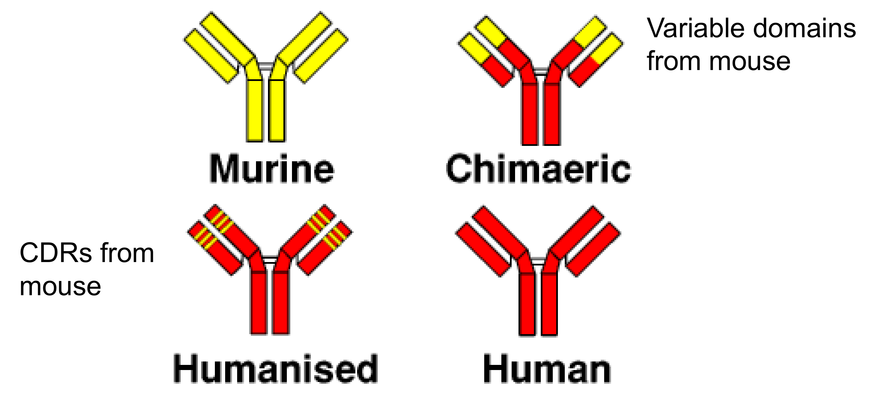

**3. Humanisation.** Mouse antibodies fail as human therapeutics: patients raise anti-mouse antibodies that block repeated dosing (the anti-drug antibodies of Section 28), and mouse Fc engages human effector machinery poorly. The fix is to replace mouse sequence progressively:
- **chimaeric** — mouse variable domains on human constant regions;
- **humanised** — only the mouse CDRs grafted onto a human framework;
- **human** — no mouse sequence at all.

This is only possible because of the modularity in Section 27: binding is confined to the CDRs, so everything else can be swapped.

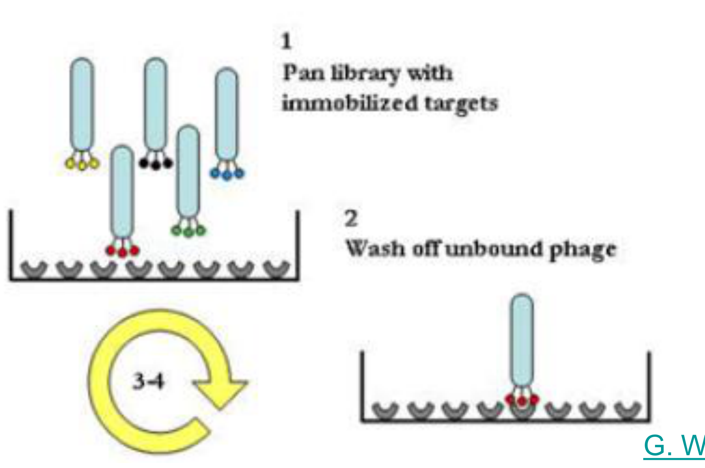

**4. Phage display.** No animals, faster, and no concern about self-reactivity.

A library of human scFv sequences is fused to a coat protein (p3) of filamentous M13 phage. Each phage **displays the antibody fragment on its surface while carrying its gene inside** — genotype linked to phenotype in one particle.

1. **Pan** a library of at least $10^{9}$ phage against immobilised target.
2. **Wash hard** and recover the good binders.
3. **Amplify** the recovered phage in *E. coli*. Repeat 3–4 cycles.
4. **Sequence** to identify good scFv.
5. **Reformat as IgG**, since the therapeutic format is a full antibody, not a fragment.

This is Section 19's cycle exactly — select, amplify, repeat — with the phage particle supplying the link that nucleic acids get for free.

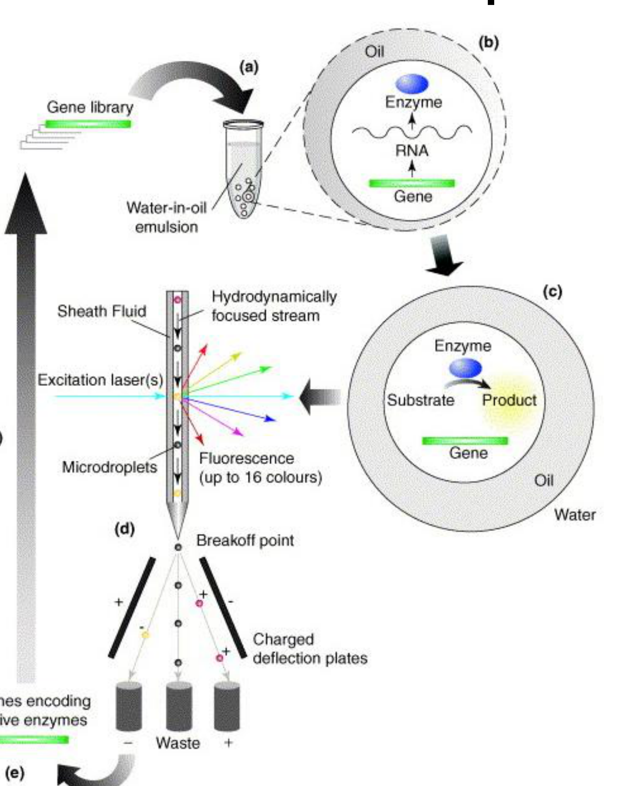

**5. In vitro compartmentalisation (IVC).** Display methods select for **binding**. Selecting for **catalysis** is harder, because the product of an enzymatic reaction diffuses away and is not attached to the gene that made it.

IVC solves this with a water-in-oil emulsion:
- **(a)** droplets contain **0 or 1 gene** each;
- **(b)** *in vitro* transcription and translation inside the droplet;
- **(c)** the enzyme turns over a **fluorogenic substrate**, so an active enzyme makes its own droplet fluoresce;
- **(d)** **FACS** sorts the brightest droplets;
- **(e)** the recovered genes are expressed at scale or re-mutated for another round.

The droplet is an artificial cell: it keeps gene, enzyme and product together so that the product reports on the gene.

**6. Transgenic mice.** Mice with the mouse immunoglobulin locus replaced by human antibody germline sequence. Conventional immunisation then produces fully human antibodies, with the animal's own affinity maturation doing the optimisation. The platform is extremely valuable commercially.

**7. Direct from people.** Isolate B cells from humans with strong immune responses and recover the sequences — no immunisation, and the antibodies are already human and already affinity-matured *in vivo*. Screening unusually resilient individuals ("élite controllers") can reveal unexpected targets and self-protein mechanisms.

**8. Computational design.** Generative models such as RFdiffusion, trained on structures in the PDB, design binders directly. Current performance: for an influenza target, roughly **1 % of designs bound, with moderate affinity** — not yet clinical, but improving quickly. Designed interfaces work better on flat surfaces than on the loop-dominated interfaces antibodies use.

#### Motivation and explanation

**The trade-off across methods.** Animal methods give affinity-matured antibodies, since evolution does the optimisation, but are slow, cannot target toxins or conserved self-proteins (the animal is tolerant to them), and need humanisation. *In vitro* methods are fast, avoid self-tolerance, and allow stringency to be set by the experimenter, but start from a naïve library with no maturation.

**Where design sits.** *De novo* design needs no existing binder and no bait, applies to difficult targets such as membrane-bound or toxic proteins, and the "library size" has no experimental limit — over $10^{18}$ sequences can be evaluated with publicly available software. Against that, it needs substantial computer time, still requires wet-lab optimisation, and struggles when substantial conformational change is involved. Accuracy requirements are severe: **1 or 2 Å out can abolish binding**, consistent with the 5.7 kcal/mol that separates a mediocre binder from an excellent one (Section 27).

**The pattern across all eight.** Each either exploits a natural compartment (cell, phage, mouse), builds an artificial one (droplet), or dispenses with physical selection entirely (computation). The trend is away from animals and towards *in vitro* and *in silico* methods — faster, more controllable, and not limited by what an immune system will tolerate.

#### Link to other topics

IVC is compartmentalisation used as a separation: confining a reaction so its product stays with its catalyst, exactly as a cell does. The same principle, in bulk, is what emulsion polymerisation uses to keep growing chains isolated.

#### Summary

Protein sequence space, $20^{200}$, cannot be searched, so every method restricts the library and links each protein to its gene — by cell, phage particle or droplet. Display selects binding, IVC selects catalysis, animals supply affinity maturation at the cost of speed and self-tolerance, and computational design is beginning to bypass selection at a current hit rate near 1 %.

### Conclusion

Sequence changes and screening connect molecular recognition to useful biological performance. The next unit develops bioprocessing overview and filtration.

## 10. Bioprocessing overview and filtration

### Overview

A bioprocess must deliver a useful product at scale, with upstream production and downstream recovery designed together. The recovery train first separates cells from liquid; filtration illustrates how equipment choice, cake growth and compressibility determine throughput and area.

*Assumed throughout:* material balances, transport and basic microbial cultivation.

### Section 31: Developing and scaling a bioprocess

#### Intuition

A bioprocess is developed in stages of increasing size, and each stage exists to answer questions the previous one could not.

The reason is that biology does not scale geometrically. Doubling the diameter of a vessel multiplies its volume by eight but its surface area only by four, so oxygen transfer, heat removal and mixing all fall behind the demand of the cells inside. A culture that thrives in a shake flask may be starved of oxygen in a stirred tank of the same nominal composition.

Each scale therefore has a purpose: the microtitre plate screens *which organism*, the flask fixes *the medium*, the bench-top bioreactor measures *what the cells need*, and the pilot plant finds out *what breaks*.

*Analogy:* a recipe scaled from a domestic kitchen to a canteen. The ingredients are unchanged, but heating, stirring and timing all behave differently, and only cooking at the intermediate scale reveals it. The analogy breaks down because the cells here are alive and respond to the physical environment by changing their metabolism, so a scale-up failure can change the product, not just the yield.

#### Mechanism

The route divides into three phases.

##### 1. Developing the microorganism (steps 1–11)

The product, if a protein, is encoded in DNA:
- the **gene of interest** is identified in a cell or tissue and extracted;
- it is **cloned into a plasmid** (Section 08);
- cells — commonly *E. coli* — are **transformed** with the plasmid, so that they express the recombinant protein;
- the host is chosen for its ability to produce the product efficiently, which depends not only on expression level but on **how easy it is to culture, harvest and process**.

That last criterion matters more than it appears: a host that expresses well but lyses easily or secretes proteases creates problems in every downstream step. Engineering considerations enter at the organism-selection stage, not after it.

Development is done in **microtitre plates**, screening a few hundred microlitre cultures in parallel, then in **shake flasks** (250 mL to 1 L). At this stage the medium composition, pH, temperature and other environmental conditions are optimised for growth and productivity.

##### 2. Scaling up (steps 12–14)

**Bench-top bioreactor (1–2 L).** The first vessel with instrumentation. Here one can control and measure stirrer speed, dissolved oxygen, pH and temperature, which a flask cannot. This allows the optimal growth conditions to be characterised properly and, importantly, reveals the culture's **shear sensitivity, oxygen requirement and foaming behaviour**. Process parameters — oxygen transfer rate, power number, Reynolds number, mixing time — can now be measured or computed.

**Pilot-scale bioreactor (100–1000 L).** Usually *geometrically similar* to the bench-top vessel, so that correlations can be carried across. Rates of air sparging and stirring must change to maintain adequate oxygen transfer, and productivity is often lost at this point and must be diagnosed.

##### 3. Industrial operation (steps 15–17)

Large-scale fermentation, then **product recovery** — the downstream processing of Sections 32–47 — then packaging and marketing.

#### Motivation and explanation

**Why geometric similarity is not enough.** Keeping the vessel's shape fixed does not keep the *physics* fixed, because different quantities scale differently with size:
- volume, hence oxygen demand, scales as $L^3$;
- surface area for heat transfer scales as $L^2$;
- impeller tip speed, hence shear, scales as $L$ at fixed stirrer speed.

No single operating rule holds all of these constant. Scale-up is therefore done by choosing **one** criterion to preserve — constant power per unit volume, constant oxygen transfer coefficient $k_La$, or constant tip speed — and accepting that the others change. Which to preserve depends on what limits the culture, which is why the bench-top stage must identify the limiting factor first.

**Why productivity falls on scale-up.** Mixing times grow with vessel size, so cells in a large fermenter experience a *fluctuating* environment, circulating between oxygen-rich regions near the sparger and oxygen-poor regions elsewhere. In a 1 L vessel the culture is effectively uniform; in a 10 m³ vessel it is not. Cells respond to these excursions by shifting metabolism, often towards by-products.

**Why the product dictates the host.** Bacteria grow fast and are cheap but cannot perform most post-translational modifications. A glycosylated therapeutic antibody (Section 28) is commonly made in mammalian cells, which grow relatively slowly, need complex media and can be shear-sensitive. The host must provide the required folding and glycosylation; alternative hosts need appropriate engineering. The choice propagates through the entire plant.

#### Wider pathway

The organism is only the first half of the problem. Whatever is made must then be separated from a dilute, complex aqueous mixture, and that separation usually dominates the cost. Section 32 sets out why.

#### Link to other topics

The scale-up problem is the familiar dimensional-analysis argument from transport processes: when several dimensionless groups cannot be matched simultaneously, one identifies the controlling mechanism and preserves the group that governs it, accepting distortion in the rest.

#### Summary

A bioprocess is built in stages — plate, flask, bench-top, pilot, industrial — because biology does not scale geometrically: oxygen transfer, heat removal and mixing all fall behind volume as size grows. Each stage answers a question the previous one could not, with the bench-top reactor identifying the limiting factor that scale-up must then preserve.

### Section 32: Downstream processing — stages, logic and cost

#### Intuition

Downstream processing is governed by one ratio: how much of the broth is product. If that fraction is $10^{-9}$, then $10^{9}$ parts of everything else must be removed, and no single operation can do it. A train of separations is needed, and the order in which they are placed decides the cost.

The ordering principle is simple: **remove the most material earliest**. Every unit downstream of a given point must be sized for the flow reaching it, so a step that cuts the volume tenfold makes everything after it ten times smaller. Cheap, crude, high-capacity operations go first; expensive, selective, low-capacity ones go last, when little is left to process.

*Analogy:* sorting a landfill for a lost ring. You do not start with tweezers and a magnifying glass; you shift the bulk mechanically first, then sieve, then inspect. The analogy breaks down because biological products are labile — they denature, they are digested by proteases released from broken cells, and they are lost at every transfer — so speed matters as much as order.

#### Mechanism

##### What makes it difficult

- **Dilute.** Products are formed in dilute solution; both the medium and the cells are mostly water.
- **Labile.** Biological products tolerate only a narrow range of temperature, pressure, solvent and salt concentration, which rules out many conventional separation techniques.
- **Contamination control.** Hygienic or aseptic operation is designed around the product and its requirements. Short residence times can limit microbial growth, but do not replace suitable closed equipment, cleaning and aseptic controls where required.
- **Similar impurities.** The broth contains cells, proteins, sugars and other macromolecules **chemically similar to the desired product** — so the separation cannot rely on gross property differences.
- The main objective is separation, concentration and formulation. Changes of pH, solvent or salt can change protonation and conformation, so product stability still needs checking.

##### The five stages

1. **Cell removal** — usually the first step after fermentation. Filtration or centrifugation, exploiting **particle size and density**. The product may be the cells themselves, inside them, or in the medium, and the flowsheet branches accordingly.
2. **Cell disruption** — only if the product is intracellular. Mechanical, physical, chemical or enzymatic (Sections 38–41). The debris released must then be removed by the same methods as step 1.
3. **Primary isolation** — removes components with **substantially different properties** from the product. Non-selective, high-capacity: solvent extraction, two-phase aqueous extraction, adsorption, precipitation (Sections 42–45).
4. **Product enrichment** — **highly selective** methods separating the product from impurities with *similar* properties. Chromatography in its various forms (Sections 46–47).
5. **Final isolation** — the finished form. Liquids may be concentrated by ultrafiltration; solids are crystallised, then centrifuged or filtered and dried.

The branching in the flowsheet is decided by one question asked at the start — *where is the product?* — because that determines whether the cells are the product, must be broken open, or can simply be discarded.

**Illustrative concentration and purity ranges through the train:** individual operations, including extraction and size-exclusion chromatography, can dilute the product.

| Step | Product concentration (g/L) | Product quality (%) |
|---|---|---|
| Harvest broth | 0.1–5 | 0.1–1 |
| Cell removal | 1–5 | 0.2–2 |
| Primary isolation | 5–50 | 1–10 |
| Product enrichment | 50–200 | 50–80 |
| Final isolation | 50–200 | 90–100 |

Two features are worth noting. **Cell removal barely improves purity** (0.1–1 % to 0.2–2 %) despite removing most of the mass — it removes bulk, not impurity. And **product enrichment does almost all the purification**, from about 10 % to 50–80 %, which is why the chromatography steps dominate cost.

#### Motivation and explanation

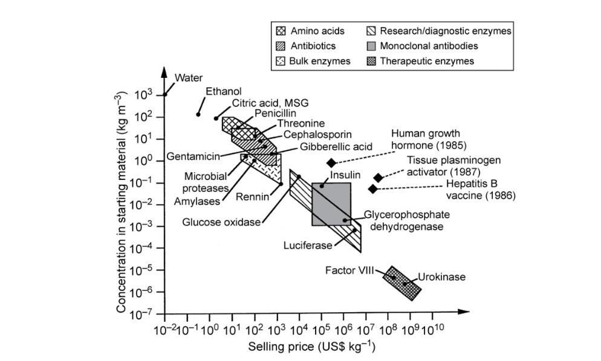

**Why price tracks dilution.** The plot spans ten orders of magnitude in both axes and shows a clear inverse trend: the more dilute a product is in the starting material, the more it sells for. Ethanol and citric acid sit at high concentration and low price; factor VIII and urokinase at $10^{-6}$ kg/m³ and very high price.

Low starting concentration means a large volume must be processed per unit of product, and losses compound through the recovery train. That can make separation a large manufacturing cost. The plot illustrates a correlation; it does not show that separation cost alone sets selling price, which also depends on demand, development costs and market conditions.

**How much of the cost.** For well-characterised antibiotics such as penicillin, the ratio of fermentation cost to recovery cost is about **60:40**. For recombinant proteins and monoclonal antibodies the ratio **reverses, and can reach 20:80** — four times as much spent recovering the product as making it.

The reason is in the purity table. A small molecule such as penicillin is chemically distinct from everything else in the broth and can be extracted and crystallised. A therapeutic protein must be separated from thousands of *other proteins* of similar size, charge and solubility, which requires several chromatography steps, each with its own yield loss.

**Where the engineering opportunity lies.** Because initial concentration is so low for high-value products, recovery costs are high and so is the selling price. That leaves considerable room for innovation: improvements in downstream processing translate directly into cost reduction, and this is where chemical engineers have the clearest contribution to make in modern biological processes.

#### Link to other topics

Placing the cheapest, least selective operation first and the most selective last is the standard ordering heuristic for any separation train, and it follows from the same argument as in distillation sequencing: each unit is sized for the flow it receives, so removing bulk early shrinks everything downstream.

#### Summary

Downstream processing takes a dilute, labile, chemically similar mixture and concentrates the product through five stages ordered cheapest-and-crudest first. Cell removal takes out bulk without improving purity; enrichment by chromatography does the purification and dominates the cost.

### Section 33: Cell removal by filtration — equipment and operation

#### Intuition

Dead-end filtration is the simplest solid–liquid separation: a barrier with openings smaller than the particles. Liquid passes, particles do not, and the two phases separate. Flow is driven by gravity or by an imposed pressure drop.

The difficulty is that the method destroys its own performance as it operates. Retained particles accumulate on the cloth as a **filter cake**, and that cake is itself a porous medium through which the liquid must now flow. Every particle removed makes the next one harder to remove. Flow declines as resistance increases. In the ideal finite-permeability Darcy model it remains positive at finite time; practical runs end when flux or capacity reaches an operating limit.

This is the defining feature of dead-end filtration and the reason for everything else in the note: filter aids exist to make the cake more porous, plate-and-frame presses are built to be opened and scraped, and rotary vacuum drums exist to remove the cake continuously.

*Analogy:* a sink strainer that slowly blocks with tea leaves. The analogy breaks down in an important way — the cake is not simply blockage. It is also an *active filter*, often finer than the cloth beneath it, so a filtration can improve in selectivity as it worsens in rate.

#### Mechanism

**Dead-end filtration.** A physical barrier with openings smaller than the suspended particles impedes their motion while liquid flows past, separating the phases. The flow is driven by gravity or by a pressure drop across the filter.

**The cake problem.** The major issue is cake formation. As the cake builds, it imposes a greater resistance to liquid flow, so the throughput deteriorates during the run. At fixed pressure difference, flux decreases towards zero asymptotically in the ideal cake-filtration model. A practical run ends earlier at a throughput or capacity limit. Section 34 makes this quantitative.

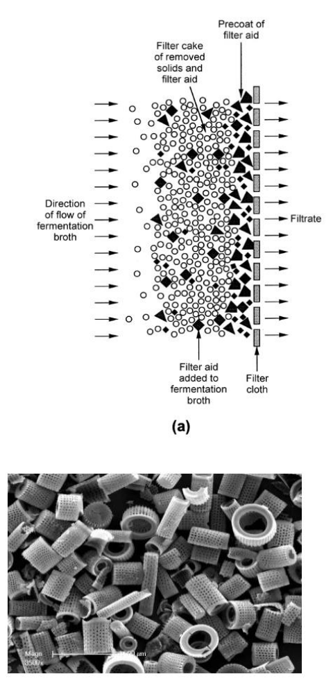

**Two fixes for the cake**, both aimed at increasing its porosity:
- **Pre-coating.** The cloth is covered with a layer of filter aid before the run. This protects the cloth from blinding and improves efficiency, though it adds its own flow resistance.
- **Filter aids** added to the broth. **Kieselguhr** (diatomaceous earth) is the usual choice: naturally occurring, highly porous, irregular particles. Mixed into the broth, they are deposited along with the cells and hold the cake open, so the cake is more porous and less resistant.

The filter cloth itself is progressively covered by the cake, so after a short time it is the cake, not the cloth, that is doing the filtration.

##### Equipment

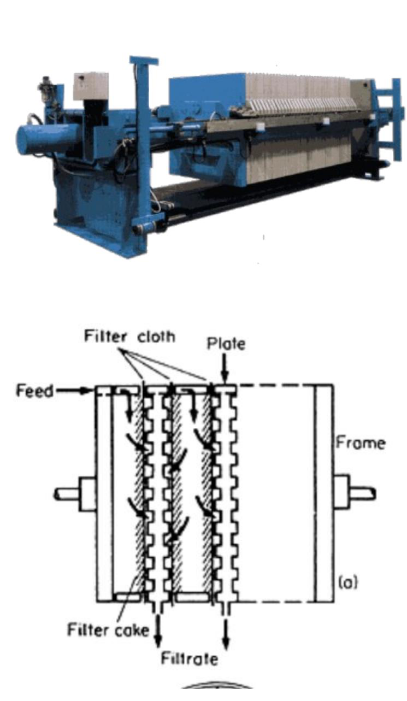

**Batch: plate-and-frame filter press.** Cloth is spread over plates and supported along ridges, which leave a free area for the filtrate to flow. Many plates in series give a large area in a compact unit, and cake builds on the upstream side of each cloth. When the space between plates is filled with cake, the press must be **dismantled and scraped**.

That is the limitation of the conventional exposed cake press: it is laborious and must be serviced frequently, and opening it makes aseptic operation difficult. It suits appropriate batch duties; enclosed sanitary filter designs require their own assessment.

**Continuous: rotary drum vacuum filter.** For large fermentations, the standard choice.

- A horizontal cylindrical drum, **0.5–3 m in diameter**, rotates slowly at **0.1–2 rpm**.
- A **vacuum is applied inside the drum**, drawing liquid from the immersed portion into the interior.
- As the drum rotates out of the reservoir, the cake on its surface is **sprayed with wash liquid**, recovering product held in the cake.
- Continued vacuum **dewaters** the washed cake.
- A **scraper** removes the cake before the surface re-enters the reservoir.

Each element of the drum therefore passes through cake formation, washing, dewatering and discharge once per revolution. The cake is removed continuously rather than accumulating, which is precisely what the batch press cannot do.

It handles large volumes, suits separation of organisms, and is cheap and easy to operate — **but it is difficult to operate aseptically**, since the drum surface is open to the atmosphere.

#### Motivation and explanation

**Why rotation speed is the key variable.** Cake thickness at the scraper is set by how long each element spends immersed, which is fixed by the rotation rate. Rotating faster gives a thinner cake and so a higher flux per unit area, but less time for washing and dewatering, so more product is lost in the wet cake and the discharged solids are wetter. Rotating slower gives better washing and drier cake at lower throughput. The 0.1–2 rpm range is the compromise, and the right value depends on whether product recovery or throughput dominates the economics.

**Why filter aids are a compromise.** Kieselguhr increases cake porosity and so raises the flow rate, but it also adds solid mass to be filtered and must be disposed of with the cells. If the product is *inside* the cells (Section 38), the filter aid ends up mixed with the material to be processed further, which is a nuisance. Filter aids are therefore used when the cells are waste, less readily when they are the product.

**Why asepsis is hard to maintain.** Both the plate-and-frame press and the rotary drum expose the cake to the atmosphere — one on dismantling, the other continuously. Where sterility matters, as in therapeutic protein manufacture, centrifugation in a closed vessel (Sections 35–37) or membrane filtration in a sealed module is used instead. The equipment described here belongs to large-volume, lower-value production such as antibiotics and enzymes.

#### Link to other topics

The cake acting as a filter finer than the cloth that supports it is the same effect as a precoat layer in water treatment or a filter-aid body feed in clarification: the medium's role is to retain the first layer of solids, after which the solids do the separating.

#### Summary

Dead-end filtration separates by size but degrades as it runs, because the retained cake becomes the dominant flow resistance. Filter aids and pre-coating keep the cake porous; plate-and-frame presses accept the cake and are dismantled to remove it; rotary drum vacuum filters remove it continuously with a scraper and so handle large volumes, at the cost of asepsis.

### Section 34: Dead-end filtration theory and filter sizing

#### Intuition

Flow through the filter is driven by the pressure drop and opposed by two resistances in series: the **filter medium** (the cloth, constant) and the **cake** (growing). Flow rate is driving force over resistance, as in any transport problem.

The crucial feature is that the cake resistance is proportional to how much cake there is, and the amount of cake is proportional to how much filtrate has already passed. So the resistance grows in proportion to the volume collected, and the flow rate falls as that volume rises. Integrating a rate that decays with the amount already produced gives a time that scales as **volume squared** — the key result.

*Analogy:* paying off a debt where each payment increases the interest rate. The analogy breaks down because the cake also compresses under pressure, so pushing harder makes the obstacle worse — an effect with no financial equivalent, and the one that produces the surprising result at the end.

#### Derivation

Notation: $A$ filter area (m²), $V_f$ filtrate volume (m³), $t$ filtration time (s), $\Delta p$ pressure drop (Pa), $\mu_f$ filtrate viscosity (Pa s), $M_c$ total mass of solids in the cake (kg), $\phi$ average specific cake resistance, $R_M$ filter medium resistance, $c$ mass of solids deposited per unit volume of filtrate (kg m⁻³).

**Step 1: the governing equation.** The filtrate flux (volumetric flow per unit area) equals the driving force divided by the total resistance:
$$\frac{1}{A}\frac{dV_f}{dt} = \frac{\Delta p}{\mu_f\left[\phi\left(\dfrac{M_c}{A}\right) + R_M\right]} \tag{43}$$
The two resistances add because they are **in series**: the liquid passes through the cake and then the medium. The cake term carries $M_c/A$, the mass of solids per unit area, because resistance scales with cake thickness.

**Step 2: relate cake mass to filtrate volume.** Every unit volume of filtrate deposits a fixed mass of solids, so
$$M_c = cV_f \tag{44}$$
This assumes the feed concentration is constant through the run. Substituting into (43):
$$\frac{1}{A}\frac{dV_f}{dt} = \frac{\Delta p}{\mu_f\left[\phi\left(\dfrac{cV_f}{A}\right) + R_M\right]} \tag{45}$$

**Step 3: separate variables.** Rearranging (45) to put $V_f$ on one side and $t$ on the other:
$$dt = \frac{\mu_f}{A\Delta p}\left(\frac{\phi c}{A}V_f + R_M\right)dV_f \tag{46}$$

**Step 4: integrate** from $t=0$, $V_f=0$ to $t$, $V_f$. The right-hand side is linear in $V_f$, so the integral gives a quadratic:
$$t = \frac{\mu_f}{A\Delta p}\left(\frac{\phi c}{2A}V_f + R_M\right)V_f \tag{47}$$
The factor of 2 arises from integrating the linear term: the *average* cake resistance over the run is half its final value.

**Step 5: neglect the medium.** Once an appreciable cake has formed, the cloth contributes very little, so $R_M \ll \dfrac{\phi c}{2A}V_f$ and
$$t = \frac{\phi\,c\,\mu_f\,V_f^{\,2}}{2A^2\Delta p} \tag{48}$$

**Checks on (48).** Time rises as $V_f^2$, not $V_f$ — doubling the volume quadruples the time, because the later filtrate passes through a thicker cake. Time falls as $A^2$: doubling the area halves the required filtrate volume per unit area *and* halves the final cake thickness, so the gain is quadratic. More viscous or more concentrated broth takes proportionally longer.

**Step 6: cake compressibility.** Biological cakes are soft, so the cake compacts under pressure and its specific resistance rises:
$$\phi = \phi'\Delta p^{\,s} \tag{49}$$
with $\phi'$ a constant set by particle size and morphology, and $s$ the **cake compressibility** ($s = 0$ incompressible, $s = 1$ fully compressible). Substituting (49) into (48):
$$\boxed{\;t = \frac{\phi'\,c\,\mu_f\,V_f^{\,2}}{2A^2\,\Delta p^{\,1-s}}\;}\tag{50}$$

Rearranged for the design variable, the area:
$$A = \sqrt{\frac{\phi'c\,\mu_f\,V_f^{\,2}}{2t}}\;\Delta p^{\,(s-1)/2} \tag{51}$$

#### Motivation and explanation

**What compressibility does to the pressure dependence.** In (50) the pressure appears as $\Delta p^{1-s}$, not $\Delta p$. The exponent on area in (51) is $(s-1)/2$:

| $s$ | Area exponent | Area increase on halving $\Delta p$ |
|---|---|---|
| 0 (incompressible) | −0.5 | ×1.41 |
| 0.5 | −0.25 | ×1.19 |
| 0.8 | −0.10 | ×1.07 |
| 1 (fully compressible) | 0 | ×1.00 |

At $s = 1$ the pressure drops out of the equation entirely: **raising the pressure gains nothing at all**, because the cake compresses in exact proportion to the extra driving force. Real biological cakes sit between these limits, and the weak dependence means pressure is a poor design variable — area is the one that matters, which is why (43) labels $A$ the key parameter.

**The physical picture.** A higher pressure drop squeezes the cake, closing the pores between particles and raising its resistance. The extra driving force is partly cancelled by the extra obstruction. For a soft mycelial or cellular cake this cancellation is substantial.

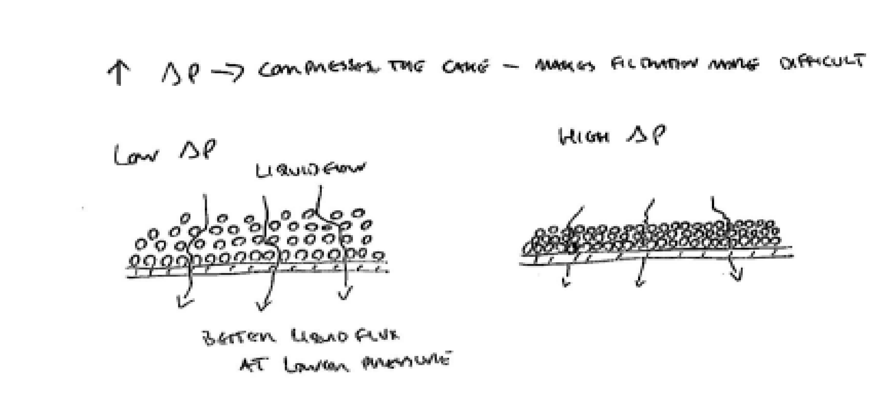

**When (50) fails.** It assumes constant $\Delta p$, constant feed concentration, a cake of uniform properties, and negligible medium resistance. The last fails at the start of a run, when there is no cake, and that is exactly when (48) predicts infinite flux. It also assumes no particles penetrate the medium; if they do, the cloth blinds and $R_M$ rises rather than staying constant.

#### Worked example

*Scaling a penicillin broth filtration from the laboratory to a pilot plant.* All numbers computed in Python.

**Given.** A 30 mL sample of *Penicillium chrysogenum* broth is filtered on a 3 cm² filter at $\Delta p = 0.35$ bar, taking 4.5 min. The cake compressibility is $s = 0.5$. Medium resistance is negligible. 500 L of broth must be filtered in 1 hour at (a) 0.7 bar and (b) 0.35 bar.

**Step 1: find the broth property group from the lab test.** The quantities $\phi'$, $c$ and $\mu_f$ are not known individually, but (50) only ever needs their product. Rearranging (50):
$$\phi'c\,\mu_f = \frac{t\,2A^2\Delta p^{\,1-s}}{V_f^{\,2}}$$
$$= \frac{(4.5\times60\ \mathrm{s})\times2\times(3\times10^{-4}\ \mathrm{m^2})^2\times(0.35\times10^5\ \mathrm{Pa})^{0.5}}{(3\times10^{-5}\ \mathrm{m^3})^2} = 1.0\times10^{7}\ \mathrm{s\,m^{-2}\,Pa^{0.5}}$$

This is the point of the lab test: a single small-scale measurement collapses three unmeasurable properties into one group that transfers to any scale.

**Step 2: size the pilot filter** from (51), with $V_f=0.5$ m³ and $t=3600$ s. Use the unrounded laboratory group, $\phi'c\mu_f=1.0102475\times10^7\ \mathrm{s\,m^{-2}\,Pa^{0.5}}$, in both calculations.

(a) At $\Delta p = 0.7\times10^5$ Pa:
$$A = \sqrt{\frac{1.0102475\times10^{7}\times(0.5)^2}{2\times3600}}\,(0.7\times10^5)^{-0.25} = 1.15\ \mathrm{m^2}$$

(b) At $\Delta p = 0.35\times10^5$ Pa:
$$A = 1.37\ \mathrm{m^2}$$

**Step 3: interpret.** Halving the pressure increases the required area by only **19 %**, not the 41 % an incompressible cake would need. The ratio is exactly $2^{0.25} = 1.189$, which is (51) with $s = 0.5$.

Two readings of the same result:
- *Mathematically*, area depends on pressure only as $\Delta p^{-0.25}$ — a weak dependence.
- *Physically*, increasing the pressure compresses the cake and makes filtration more difficult, so most of the extra driving force is wasted.

The design consequence is **diminishing benefit from pressure**. Going from 0.35 to 0.7 bar saves about 0.21 m² in this example, while changing pumping and equipment costs. More area may be preferable for a compressible cake, but the optimum requires an economic comparison. As $s \to 1$, increasing pressure gives no improvement in the cake-dominated model; more area still increases capacity.

#### Link to other topics

Equation (47) is the standard series-resistance result: a driving force divided by the sum of resistances, integrated when one resistance grows with the extent of the process. Compressibility makes the resistance depend on the driving force itself, which is the same self-limiting feedback seen in fouling and in flow through deformable porous media.

#### Summary

Filtration time rises as $V_f^2/A^2$ because cake resistance grows in proportion to the filtrate already collected, so area is the dominant design variable. Cake compressibility weakens the pressure dependence to $\Delta p^{1-s}$, and for the penicillin example at $s = 0.5$ halving the pressure costs only 19 % more area ; the economic choice still depends on area, pumping and equipment costs.

### Conclusion

Cell removal links broth properties to equipment duty, and cake compressibility makes added filtration area more reliable than added pressure. The next unit develops centrifugation.

## 11. Centrifugation

### Overview

Centrifuges accelerate density-driven settling and arrange the available separation area in compact geometries. Stokes settling and residence-time arguments give a cut-off throughput, while sigma theory separates feed properties from equipment performance for conditional scale-up.

*Assumed throughout:* force balances, low-Reynolds-number drag and residence time.

### Section 35: Centrifuge designs for cell removal

#### Intuition

Left standing, a suspension of cells will settle under gravity, because the cells are denser than the medium. The trouble is that it takes days (Section 36 puts a number on it). A centrifuge replaces gravity with a far larger artificial acceleration by spinning the sample, so the same settling happens in minutes.

The quantity being exploited is the **density difference**, and that is exactly what makes biological separations difficult: cells are mostly water, so they are only slightly denser than the medium they grow in. Bacteria compound the problem by being small, and the medium is often dense and viscous. Centrifugation is most effective for **large particles, low liquid viscosity and a large density difference**, and a bacterial culture offers none of these.

The response is to build centrifuges that spin very fast and present a short settling distance, and to accept that they are expensive and mechanically demanding.

*Analogy:* separating sand from water by swinging a bucket. The analogy breaks down because a real centrifuge cannot simply be spun faster without limit — the bowl wall must contain the hoop stress, which rises with the square of the speed, and that is the binding engineering constraint.

#### Mechanism

Centrifuges are classified by their internal geometry. Two designs matter here.

##### Tubular bowl centrifuge

- A **rotating tube** with a nozzle at the base where feed is introduced.
- As the liquid flows upwards, particles are spun outwards and collide with the wall of the bowl, where they are retained.
- Clarified liquid continues upwards and leaves over a **weir** at the top.
- Two timescales compete: the **residence time**, which decreases as the flow rate rises, and the **sedimentation time**, which is shorter for larger or denser particles, higher rotation speed and lower viscosity. **Particles are separated efficiently if the sedimentation time is shorter than the residence time** — the condition Section 36 turns into a maximum throughput.

Liquid feed and clarification can be continuous, while retained solids accumulate on the wall and require periodic shutdown for removal. A separate heavy-liquid outlet can provide continuous liquid–liquid separation; it does not by itself remove deposited solids.

Tubular bowls reach very high centrifugal forces — up to about 16 000 g — so they suit difficult separations. They are easy to clean, but foaming can be a problem.

##### Disc-stack centrifuge

- The bowl contains **conical sheets of metal (discs) stacked on top of each other**, with clearances of approximately **0.3 mm**.
- As the bowl rotates, the discs **split the liquid into thin layers**. Denser liquid containing the solids is displaced outwards along the underside of each disc, while lighter liquid remains close to the centre.
- Both streams are withdrawn continuously.
- Solids discharge depends on the design: a solids-retaining bowl is opened for manual removal; a self-cleaning bowl ejects solids intermittently through peripheral ports; a nozzle separator discharges solids continuously. A heavy-liquid outlet separates a liquid phase and is not equivalent to a solids outlet.

The discs are the whole point of the design: they reduce the distance a particle must travel before it reaches a collecting surface from the full bowl radius to the 0.3 mm gap. Section 37 shows that this is what gives the disc stack its large effective area.

Foam can be controlled, and it is easier to run continuously than a tubular bowl, but it is **harder to clean** because of the stack.

##### Comparison

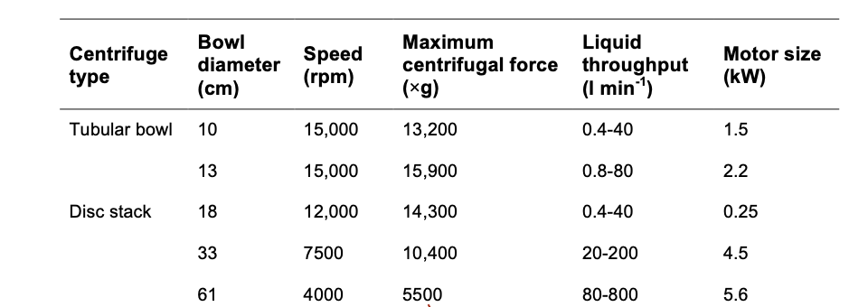

| | Bowl diameter (cm) | Speed (rpm) | Max force (×g) | Throughput (L/min) |
|---|---|---|---|---|
| Tubular bowl | 10 | 15 000 | 13 200 | 0.4–40 |
| | 13 | 15 000 | 15 900 | 0.8–80 |
| Disc stack | 18 | 12 000 | 14 300 | 0.4–40 |
| | 33 | 7 500 | 10 400 | 20–200 |
| | 61 | 4 000 | 5 500 | 80–800 |

The pattern is the important part. **Larger bowls run slower and generate less force, but handle far more throughput.** A 61 cm disc stack produces only 5 500 g — less than half the tubular bowl's force — yet processes up to 800 L/min against 80 L/min.

This is not a contradiction: throughput depends on the *total settling area* presented, not on the force alone, and a large stack of discs presents an enormous area. Section 37 makes this precise through the Σ factor.

#### Motivation and explanation

**Why speed falls as diameter rises.** The bowl wall carries a hoop stress proportional to $\rho r^2\omega^2$. For a fixed allowable stress, the maximum angular velocity scales as $1/r$, so the maximum centrifugal acceleration $r\omega^2$ scales as $1/r$ as well. At the same allowable stress and comparable construction, bigger bowls therefore have a lower maximum g-force. The gain from building larger is area, not force, and the table shows exactly that trade.

**Centrifugation against filtration.**

| | Centrifugation | Filtration |
|---|---|---|
| Sterility | closed sanitary designs can support asepsis | exposed cake filters are difficult to keep aseptic; sealed sanitary membrane systems can support asepsis |
| Continuous operation | design-dependent; liquid flow can be continuous | rotary drums and cross-flow membrane systems can run continuously |
| Consumables | seals, cleaning agents and maintenance parts; no filter medium | filters, optional filter aids and cleaning agents |
| Capital cost | higher | **lower** |
| Small cells | difficult | **easier to separate** |
| Mechanical risk | many moving parts and seals that can fail; safety | few |

The decisive factor in therapeutic protein manufacture is usually **sterility**: a closed centrifuge can be cleaned and sterilised in place, whereas the rotary drum of Section 33 is open to the atmosphere. For large-volume, lower-value products such as antibiotics, filtration's lower capital cost and ability to handle fine cells generally wins.

**Why the conditions are unfavourable for cells.** Cell cultures are a hard case because cells may not be very dense, the medium can itself be dense, and bacterial cells are small. Since Section 36 shows that settling velocity scales with $D_p^2$ and with $(\rho_p-\rho_l)$, small size and low density difference are both directly punishing. The limitations are overcome by designing large centrifuges operating at high rotational speeds — with physical and safety limits capping how far this can go.

#### Link to other topics

Replacing gravity with a much larger artificial body force to accelerate a transport process is the same device as using a pressure difference to drive filtration faster than capillarity would (Section 34), and in both cases the equipment, not the physics, sets the limit.

#### Summary

Centrifuges separate by density, which is unfavourable for cells because they are small and nearly as dense as their medium, so bioprocessing relies on high-speed designs. Tubular bowls give the highest force and are easy to clean but run batchwise; disc stacks give far higher throughput by splitting the liquid into 0.3 mm layers and run continuously.

### Section 36: Stokes settling and the throughput of a tubular bowl centrifuge

#### Intuition

A particle denser than the surrounding liquid sinks. Three forces act: gravity pulls it down, buoyancy pushes it up, and drag opposes whatever motion results. Because the particle is tiny, it reaches terminal velocity almost instantly, so the three forces balance at all times and the problem reduces to algebra rather than dynamics.

The result, Stokes' law, shows the velocity scales with the *square* of the diameter. Halving the particle size slows settling fourfold — which is why bacteria are so much harder to spin down than animal cells.

A centrifuge changes only one thing in that balance: it replaces $g$ with the much larger centrifugal acceleration $r\omega^2$. Everything else carries over unchanged.

Separation then becomes a race. A particle entering the bowl has a limited time before the flow carries it out, and it must reach the wall within that time. Capture requires **sedimentation time < residence time**, and that single inequality sets the maximum flow rate the machine can handle.

*Analogy:* crossing a moving walkway diagonally — you are captured by the far side only if you can walk across before the belt carries you off the end. The analogy breaks down because the centrifugal "walking speed" increases with radius, so the particle accelerates as it crosses, which is why the derivation produces a logarithm.

#### Derivation

Notation: $D_p$ particle diameter, $\rho_p$ particle density, $\rho_l$ liquid density, $\mu$ liquid viscosity, $u$ velocity, $\omega$ angular velocity, $r$ radius, $g$ gravitational acceleration.

##### Sedimentation under gravity

**Step 1: the forces.** A spherical particle moving at velocity $u$ in a Newtonian fluid at low Reynolds number experiences a **frictional (drag) force**
$$F_d = 3\pi\mu D_p u \tag{52}$$
Gravity and buoyancy act in opposite directions:
$$F_g = -m_p g = -V_p\rho_p g, \qquad F_b = V_p\rho_l g \tag{53}$$

**Step 2: terminal velocity.** At low $Re$, **inertial effects are negligible**, so the net force on the particle is always zero. Balancing drag against the net of gravity and buoyancy:
$$3\pi\mu D_p u_g = V_p(\rho_p-\rho_l)g = \frac{\pi}{6}D_p^3(\rho_p-\rho_l)g \tag{54}$$
using $V_p = \tfrac{\pi}{6}D_p^3$ for a sphere.

**Step 3: solve for $u_g$.** Dividing through by $3\pi\mu D_p$:
$$\boxed{\;u_g = \frac{D_p^2(\rho_p-\rho_l)g}{18\mu}\;}\tag{55}$$

This is **Stokes' law** for the sedimentation velocity in a gravitational field. The particle sediments only if $\rho_p > \rho_l$; if the particle is lighter it rises.

##### Sedimentation in a centrifuge

**Step 4: replace the acceleration.** In a centrifuge the fluid rotates with the bowl at angular velocity $\omega$, so a particle at radius $r$ experiences a centrifugal acceleration
$$a_c = r\omega^2 \tag{56}$$
The force balance is unchanged apart from the body force, so $g$ is simply replaced by $a_c$:
$$u_c = \frac{D_p^2(\rho_p-\rho_l)r\omega^2}{18\mu} = \frac{D_p^2(\rho_p-\rho_l)Gg}{18\mu} \tag{57}$$
where the **G-factor** $G = a_c/g$ is the ratio of centrifugal to gravitational acceleration. Note that $u_c$ depends on $r$: **the particle speeds up as it moves outwards.**

##### Throughput of a tubular bowl

**Step 5: the capture condition.** For a particle to be captured, it must hit the outer wall before the feed flow pushes it out of the tube:
$$t_{\text{sed}} < t_{\text{res}} \tag{58}$$

**Step 6: the cut-off time.** Define $t_{\text{cut}}$ as the time for a particle starting at the *mid-point* of the liquid layer, $r = (r_1+r_2)/2$, to reach the wall at $r_2$. Since $dr/dt = u_c(r)$ from (57), the variables separate:
$$\int_{(r_1+r_2)/2}^{r_2}\frac{dr}{r} = \frac{D_p^2(\rho_p-\rho_l)\omega^2}{18\mu}\int_0^{t_{\text{cut}}}dt$$
The left side integrates to a logarithm, giving
$$t_{\text{cut}} = \frac{18\mu}{D_p^2(\rho_p-\rho_l)\omega^2}\ln\!\left(\frac{2r_2}{r_1+r_2}\right) \tag{59}$$

The logarithm follows from radial velocity being proportional to radius. Starting at $(r_1+r_2)/2$ defines a representative radial-midpoint criterion; particles starting closer to $r_1$ take longer. With uniform concentration and axial velocity across the annulus, the midpoint criterion corresponds to about 54 % capture in this geometry, not complete clarification.

**Step 7: the residence time.**
$$t_{\text{res}} = \frac{V_c}{Q}, \qquad V_c = \pi(r_2^2-r_1^2)h \tag{60}$$
with $Q$ the volumetric flow rate and $h$ the height of the liquid layer.

**Step 8: the maximum throughput.** Substituting (59) and (60) into the capture condition (58) gives $V_c/Q > t_{\text{cut}}$, so
$$Q < Q_{\text{cut}} = \frac{V_c}{t_{\text{cut}}} = \frac{D_p^2(\rho_p-\rho_l)\omega^2}{18\mu\,\ln\!\left(\dfrac{2r_2}{r_1+r_2}\right)}\,\pi(r_2^2-r_1^2)h \tag{61}$$

$Q_{\text{cut}}$ is the throughput corresponding to the chosen radial-midpoint capture criterion, not guaranteed complete cell removal. Under the same ideal plug-flow assumptions, capture from the innermost radius requires replacing the logarithm by $\ln(r_2/r_1)$.

#### Motivation and explanation

**Reading equation (61).** Throughput rises with $\omega^2$, with $D_p^2$, with the density difference, and with the bowl volume; it falls with viscosity. Every one of these is unfavourable for a bacterial culture (Section 35), which is why such large machines are needed for such modest flows.

**What the criterion means.** Smaller particles settle more slowly, but entry radius also affects capture. Here the midpoint throughput is 0.343 L/min, whereas the innermost-radius ideal capture criterion gives 0.159 L/min. Actual recovery also depends on particle-size distribution, flow and hindered settling.

**Where the derivation fails.** It assumes laminar settling (low $Re$), spherical and non-interacting particles, uniform plug flow through the bowl, and no re-entrainment of deposited solids. Real feeds are concentrated enough that particles hinder one another, and flow in the bowl is not plug flow, so (61) is an optimistic estimate.

#### Worked example

*A laboratory tubular bowl centrifuge.* Computed in Python.

**Given:** $r_1 = 16.5$ mm, $r_2 = 22.2$ mm, $h = 115$ mm, $\omega = 10\,000$ rpm. Bacteria of $D_p = 0.7$ µm, $\rho_p = 1.340\times10^3$ kg m⁻³, in broth of $\rho_l = 1.010\times10^3$ kg m⁻³ and $\mu = 10^{-3}$ Pa s.

**(a) Centrifugal acceleration at $r_2$.** Convert the rotation rate first: $\omega = 2\pi\times10\,000/60 = 1047$ rad s⁻¹.
$$a_c = r_2\omega^2 = 0.0222\times1047^2 = 2.43\times10^{4}\ \mathrm{m\,s^{-2}} = 2482\,g$$

**(b) Cut-off flow rate.** From (59) and (60):
$$t_{\text{cut}} = 13.9\ \mathrm{s}, \qquad V_c = \pi(0.0222^2-0.0165^2)(0.115) = 7.97\times10^{-5}\ \mathrm{m^3}$$
$$Q_{\text{cut}} = \frac{7.97\times10^{-5}}{13.9} = 5.7\times10^{-6}\ \mathrm{m^3\,s^{-1}} = 5.7\ \mathrm{mL\,s^{-1}} = 0.34\ \mathrm{L\,min^{-1}}$$

**Sense check.** This sits at the bottom of the 0.4–40 L/min range quoted for a 10 cm tubular bowl (Section 35), which is right for a laboratory machine of 4.4 cm bowl diameter separating sub-micron bacteria.

**Why centrifugation is necessary at all.** Take a larger bacterium, $D_p = 1$ µm, $\rho_p = 1.3\times10^3$ kg m⁻³, in water. From (55):
$$u_g = \frac{(10^{-6})^2(300)(9.81)}{18\times10^{-3}} = 1.6\times10^{-7}\ \mathrm{m\,s^{-1}} = 0.16\ \mathrm{\mu m\,s^{-1}}$$
Settling 0.1 m under gravity would take **7 days**. In a centrifuge at $G = 10\,000$, equation (57) gives $u_c = 1.6\times10^{-3}$ m s⁻¹, and the same 0.1 m takes **about 1 minute**. That ratio of $10^4$ is the entire justification for the equipment.

#### Link to other topics

Equation (58) is a competition of timescales — a Damköhler-type comparison between the time for a process to complete and the time available in the vessel. The same reasoning sizes any flow-through separator, and the particle accelerating as it crosses is what distinguishes a centrifuge from a gravity settler.

#### Summary

A force balance at negligible inertia gives Stokes' law, $u \propto D_p^2(\rho_p-\rho_l)/\mu$, and a centrifuge simply substitutes $r\omega^2$ for $g$ — worth a factor of $10^4$, turning a week of settling into a minute. Requiring sedimentation to beat residence time gives the maximum throughput, equation (61).

### Section 37: Sigma theory and centrifuge scale-up

#### Intuition

To compare two centrifuges fairly, they must be compared on the same feed. If a figure of merit could be found that depends only on the machine, then the ratio of throughputs of any two centrifuges on *any* common sample would equal the ratio of those figures — and scale-up would reduce to matching one number.

The trick is to notice that the sample's properties enter $Q_{\text{cut}}$ only through the combination that forms the **gravitational settling velocity** $u_g$. Multiplying and dividing by $u_g$ therefore isolates everything else, and what remains is the machine.

The machine factor has units of area. With the convention used here, $Q_{\text{cut}}=2\Sigma u_g$, the corresponding ideal gravity-settler area is $A_{\mathrm{eq}}=Q_{\text{cut}}/u_g=2\Sigma$. Thus $\Sigma=32.4$ m² corresponds to about 64.8 m² of gravity-settling area for the same stated capture criterion.

*Analogy:* expressing a device's performance as the equivalent area of a simpler separator. The comparison is conditional on matching feed, capture criterion and ideal flow assumptions; it does not make real centrifuge scale-up exact.

#### Derivation

**Step 1: start from the cut-off flow rate.** From Section 36, equation (61):
$$Q_{\text{cut}} = \frac{D_p^2(\rho_p-\rho_l)\omega^2}{18\mu\,\ln\!\left(\dfrac{2r_2}{r_1+r_2}\right)}\,\pi(r_2^2-r_1^2)h \tag{62}$$

**Step 2: multiply and divide by $u_g$.** The gravitational settling velocity of the same particle is
$$u_g = \frac{D_p^2(\rho_p-\rho_l)g}{18\mu} \tag{63}$$
Writing (62) as itself multiplied by $u_g/u_g$ and substituting (63) in the denominator, the whole group $D_p^2(\rho_p-\rho_l)/18\mu$ cancels, leaving $g$ behind:
$$Q_{\text{cut}} = \frac{\pi(r_2^2-r_1^2)h\,\omega^2}{g\,\ln\!\left(\dfrac{2r_2}{r_1+r_2}\right)}\;u_g \tag{64}$$

**Step 3: define $\Sigma$.** Writing (64) as $Q_{\text{cut}} = 2\Sigma u_g$:
$$\boxed{\;\Sigma(r_1,r_2,h,\omega) = \frac{\pi(r_2^2-r_1^2)h\,\omega^2}{2g\,\ln\!\left(\dfrac{2r_2}{r_1+r_2}\right)}\;}\tag{65}$$

Two properties follow immediately:
- **$\Sigma$ depends only on the centrifuge**, not on the sample. Every sample-dependent quantity has been collected into $u_g$.
- **$\Sigma$ has dimensions of area.** Dimensionally $Q = 2\Sigma u_g$ is (volume/time) = (area)(velocity), so the equivalent ideal gravity-settler area at this throughput is **$2\Sigma$**, under the stated $Q_{\text{cut}}=2\Sigma u_g$ convention.

**Step 4: the scale-up rule.** For two centrifuges processing the **same sample**, $u_g$ is common:
$$Q_1 = 2\Sigma_1 u_g, \qquad Q_2 = 2\Sigma_2 u_g$$
Dividing, $u_g$ cancels:
$$\frac{Q_1}{Q_2} = \frac{\Sigma_1}{\Sigma_2} \tag{66}$$

**To increase the throughput of a centrifuge by a factor $X$, $\Sigma$ must increase by the same factor $X$.** This ideal ratio requires the same feed settling properties, capture criterion and flow assumptions; real machines can need empirical efficiency corrections.

#### Motivation and explanation

**The area factor depends on the design and convention.** Equation (65) uses $Q=2\Sigma u_g$. For a disc stack, state the full equivalent area $A_{\mathrm{eq,disc}}$, defined by $Q=A_{\mathrm{eq,disc}}u_g$:
$$A_{\mathrm{eq,disc}} = \frac{2\pi\omega^2(N-1)}{3g\tan\theta}\left(r_2^3-r_1^3\right) \tag{67}$$
with $N$ the number of discs, $r_2$ and $r_1$ the outer and inner disc radii and $\theta$ the disc angle to the rotation axis. Under the half-area convention of (65), use $\Sigma_{\mathrm{disc}}=A_{\mathrm{eq,disc}}/2$.

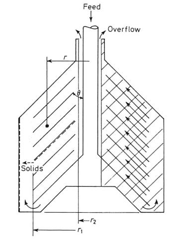

Equation (67) explains the throughput figures in Section 35. $\Sigma$ scales with $(N-1)$, so a stack of a hundred discs has roughly a hundred times the equivalent area of a single surface, and it scales with $r^3$ rather than $r^2$. That is how a disc stack delivers 800 L/min at only 5500 g while a tubular bowl at 15 000 g manages 80 L/min — **equivalent settling area, which includes the rotation speed, sets the ideal throughput for a given feed and capture criterion.**

**$\Sigma$ is convention-dependent.** The derivation of $t_{\text{cut}}$ took a particle starting at the mid-point of the liquid layer, which is somewhat arbitrary. Different conventions give different expressions; another in common use is
$$\Sigma = \frac{\pi\omega^2 h}{2g}\left(3r_2^2+r_1^2\right) \tag{68}$$
For the example below, (68) gives 35.4 m² against 32.4 m² from (65), about 9 % higher. Quote the value with its definition and capture criterion. Their difference is not merely a universal prefactor: it depends on the radius ratio, so scale-up ratios calculated from different geometric expressions need not agree for dissimilar bowls.

**When ratios are robust.** A common constant prefactor cancels from a ratio. Both tubular-bowl expressions also scale as $L^3\omega^2$ for geometrically similar bowls, so they give the same speed ratio in the doubled-size example. Dissimilar geometries require matched capture criteria, and real scale-up requires checking flow and separation-efficiency corrections.

#### Worked example

*Scaling up the laboratory centrifuge of Section 36.* Computed in Python.

**(a) Calculate $\Sigma$** for $r_1 = 16.5$ mm, $r_2 = 22.2$ mm, $h = 115$ mm, $\omega = 10\,000$ rpm $= 1047$ rad s⁻¹. From (65):
$$\Sigma = \frac{\pi(0.0222^2-0.0165^2)(0.115)(1047)^2}{2\times9.81\times\ln\!\left(\dfrac{2\times0.0222}{0.0222+0.0165}\right)} = 32.4\ \mathrm{m^2}$$

**Check.** With the sample of Section 36, $u_g = 8.81\times10^{-8}$ m s⁻¹, so $2\Sigma u_g = 5.7\times10^{-6}$ m³ s⁻¹ — exactly the $Q_{\text{cut}}$ computed there. The factorisation is consistent.

**Interpretation.** A bowl 4.4 cm across has $\Sigma=32.4$ m² in the chosen half-area convention. Its corresponding ideal gravity-settler area at the midpoint throughput is $2\Sigma=64.8$ m².

**(b) What speed does a doubled centrifuge need to match the smaller one's throughput?** The larger machine has double the physical dimensions: $r_1 = 33.0$ mm, $r_2 = 44.4$ mm, $h = 230$ mm.

Matching throughput on the same sample means $\Sigma_2 = \Sigma_1$, by (66). Write $\Sigma = f(r_1,r_2,h)\,\omega^2/2g$ with
$$f = \frac{\pi(r_2^2-r_1^2)h}{\ln\!\left(\dfrac{2r_2}{r_1+r_2}\right)}$$
The logarithm depends only on the *ratio* of radii, so it is unchanged when every dimension doubles. The numerator scales as $L^2\times L = L^3$, so
$$\frac{f_2}{f_1} = 2^3 = 8$$
Setting $f_1\omega_1^2 = f_2\omega_2^2$:
$$\omega_2 = \omega_1\sqrt{\frac{f_1}{f_2}} = \frac{\omega_1}{\sqrt 8} = \frac{10\,000}{2.83} = 3540\ \mathrm{rpm}$$

**Check:** $\Sigma_2 = 32.4$ m² $= \Sigma_1$. ✓

**Interpretation.** Doubling every dimension multiplies the geometric factor by 8, so the same $\Sigma$ is reached at $1/\sqrt8 = 35\%$ of the speed. This is the quantitative version of the trade in Section 35: **bigger bowls do the same job more slowly**, which is fortunate, because the hoop stress in the bowl wall scales as $r^2\omega^2$ and would otherwise be prohibitive. Here that product falls by a factor of $4/8 = 0.5$, so the larger bowl is *less* stressed while matching the duty.

#### Link to other topics

Expressing a device's performance as an equivalent area of a simpler device is the same move as the HETP of a distillation column or the NTU of a heat exchanger: a dimensional figure of merit that separates equipment performance from the properties of what passes through it, so that scale-up becomes a matter of matching one number.

#### Summary

Factorising $Q_{\text{cut}}=2\Sigma u_g$ separates the ideal machine factor from the feed settling velocity. In this convention the equivalent gravity-settler area is $2\Sigma$.

### Conclusion

Sigma theory supports scale-up when feed properties, separation criteria and geometric conventions remain consistent. The next unit develops cell disruption.

## 12. Cell disruption

### Overview

Intracellular products require disruption before purification, but breaking cells also releases debris, nucleic acids and degradative enzymes. Mechanical and non-mechanical methods balance release against product damage; release kinetics and a homogeniser fit make that trade quantitative.

*Assumed throughout:* cell structure, material balances and first-order kinetics.

### Section 38: Why cells must be disrupted, and what resists it

#### Intuition

Disruption is a deliberately destructive step in the middle of an otherwise careful process, and that is its difficulty. The wall must be broken thoroughly enough to release the product, but the product itself is a fragile molecule sitting in the same vessel — so every method that is good at breaking walls is also, to some degree, good at destroying what it releases.

Worse, breaking the cell releases *everything*: proteases, nucleic acids, lipids, and fragments of wall so small that they are harder to remove than the intact cells were. The step therefore makes the separation problem worse before it makes it better, which is why it is avoided wherever possible by secreting the product instead.

*Analogy:* opening a safe with explosives to recover a document inside. The analogy breaks down because a cell wall is not uniformly strong: it resists by being elastic and chemically crosslinked rather than merely hard, which is why chemical and enzymatic attack (Section 41) can succeed where force is clumsy.

#### Mechanism

**Why products are intracellular.** Many products of interest — particularly recombinant proteins — are not secreted. They accumulate in the cytoplasm, sometimes as dense **inclusion bodies** at the poles of the cell. Such a product cannot be recovered without breaking the cell, so disruption must precede any isolation or purification.

##### What has to be broken

Microorganisms used in bioprocessing are surrounded by tough **cell walls**, and their construction differs by organism:

- **Gram-positive bacteria** (for example *Lactococcus lactis*) have a **thick peptidoglycan wall** — a crosslinked mesh of sugar chains and short peptides, mechanically strong.
- **Gram-negative bacteria** (for example *E. coli*) have a **thinner peptidoglycan wall**, but it is enveloped by an **outer membrane rich in lipopolysaccharide (LPS)**. The wall is weaker but there are more layers to cross, and the LPS matters downstream because it is an endotoxin that must be removed from any injectable product.

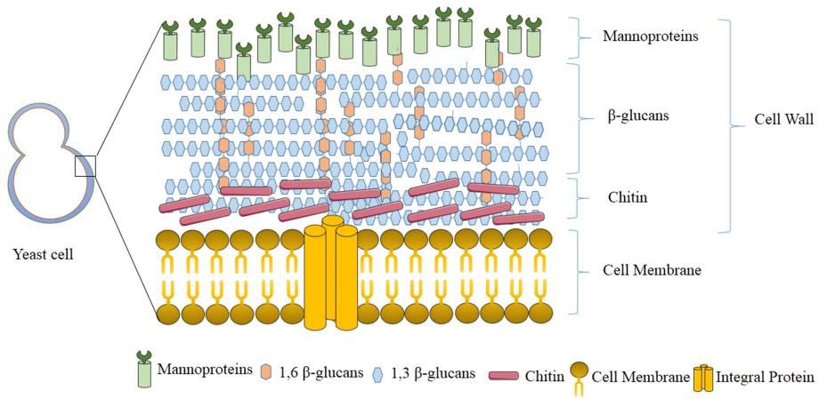

- **Yeast** (*Saccharomyces cerevisiae*) has a **thick, multi-layered wall** of polysaccharides — β-1,3 and β-1,6 glucans — together with mannoproteins and **chitin**. This makes yeast **very difficult to disrupt**, and it is the hardest of the common hosts.
- **Mammalian cells** have only a plasma membrane and **no cell wall at all**, so they are easily disrupted. The same fragility that makes them shear-sensitive in the bioreactor (Section 31) makes them trivial to break here.

##### Strategies

Four families of method, in two groups:

**Mechanical** (Section 39):
- bead mill, ultrasonication, French press, high-pressure homogeniser.

**Non-mechanical** (Section 41):
- *physical*: thermolysis, decompression, osmotic shock;
- *chemical*: detergents, solvents;
- *biological*: enzymatic digestion.

Three considerations govern the choice:
1. **Scale.** Some methods are only applicable at small or laboratory scale; others scale to production.
2. **Cell type.** Bacteria and yeast have tough walls and are **more difficult to disrupt by mechanical means only**; bacteria are also small, which makes them harder still. Mammalian cells need little.
3. **Product sensitivity.** Methods differ in how much heat and shear they impose.

**Why size can matter mechanically.** In a Newtonian flow the shear stress is $\tau=\mu\dot\gamma$, where $\dot\gamma$ is shear rate; stress itself does not grow with cell diameter. Larger cells can experience larger integrated forces and velocity differences across their extent. Rupture also depends on envelope strength, geometry and disruption mechanism, so size alone does not rank susceptibility.

#### Motivation and explanation

**Why disruption is avoided when possible.** Three costs follow from breaking cells:
- *Debris.* The fragments are far smaller than intact cells, so the cell-debris removal step that follows (by the same centrifugation or filtration of Sections 33–37) is harder than the original cell removal. Section 36's $u \propto D_p^2$ makes this quantitative — halving the fragment size quarters the settling velocity.
- *Released contaminants.* Proteases liberated from the cytoplasm begin degrading the product immediately, which is why disruption is usually done cold (the worked example in Section 40 operates at 5 °C) and why the subsequent steps must be fast.
- *Viscosity.* Released DNA raises the viscosity of the suspension substantially, which slows every downstream separation — again visible in Section 36, where $u \propto 1/\mu$.

The preferred alternative is to engineer the host to **secrete** the product, converting an intracellular recovery into a simple cell removal. Where that is not possible, inclusion bodies are sometimes an advantage: they are dense, so they can be recovered by centrifugation after disruption, though the protein must then be refolded.

**Why the wall resists.** Peptidoglycan is a covalently crosslinked network enclosing the whole cell, so it behaves as a single molecule under tension and must be *ruptured*, not merely deformed. It also bears the turgor pressure of the cytoplasm, which in bacteria is several atmospheres — the wall is a pressure vessel, and it is already pre-stressed.

#### Wider pathway

Disruption sits between cell removal (Sections 33–37) and primary isolation (Sections 42–45). Its output — a homogenate of product, debris, proteases and nucleic acids — is the feed for everything that follows, and the completeness of disruption sets the ceiling on overall yield.

#### Link to other topics

Choosing between mechanical and chemical disruption is the familiar comminution trade-off: force is cheap and indiscriminate, selective chemistry is expensive but gentle, and the right balance depends on how much the valuable component tolerates.

#### Summary

Intracellular products require the cell to be broken, but disruption releases debris, proteases and DNA that make every subsequent separation harder. Difficulty is set by the host: yeast walls of glucan and chitin are the toughest, Gram-positive bacteria have thick peptidoglycan, Gram-negative bacteria are weaker but layered, and mammalian cells have no wall at all.

### Section 39: Mechanical cell disruption and release kinetics

#### Intuition

Every mechanical method does the same thing: impose a stress on each cell large enough to rupture its wall. They differ only in how the stress is generated — grinding between beads, collapsing bubbles, or acceleration through a narrow gap.

The key to the kinetics is that **each cell is broken independently**. A pass through the equipment gives every intact cell the same probability of rupture, regardless of how many have already broken. The number of intact cells therefore falls by a constant *fraction* per pass, which is a first-order process. Release of product is the mirror image: it approaches its maximum exponentially.

In the fixed-fraction model, one pass leaves some unreleased material. A single pass can still meet a practical recovery target; the model approaches complete release only asymptotically. Real rupture probabilities and product losses can change that behaviour.

*Analogy:* radioactive decay, where each nucleus has a fixed probability of decaying per unit time independent of the others. The analogy breaks down because cells are not identical: a population has a distribution of wall strengths, so the weakest break first and the surviving population becomes progressively tougher, making the real decay slightly slower than exponential.

#### Mechanism

All mechanical methods **produce substantial heat** that can damage the product, so all of them **need cooling**.

**Bead mill.** A chamber filled with beads — typically glass, 0.2–1.0 mm diameter — packed to up to 80 % of the free volume, with impellers rotating at 1500–2250 rpm. Cells at 30–60 % volume wet solids are ground between the rolling beads. Cooling is through a jacket. Scales to industrial use.

**Ultrasonication.** Ultrasonic vibrations at about 20 kHz are produced by an immersion probe. The high-energy pressure waves create **cavitation bubbles**, whose collapse disrupts the cells — the damage is done by the implosion, not by the sound itself. Bacteria are disrupted in 30–60 s, yeast in 2–10 minutes. It works well at small and laboratory scale but is **difficult to scale up**, because of the high energy demand and safety concerns about exposure to ultrasound.

**High-pressure homogeniser.** The standard industrial method.
- Cells are put under **high pressure, 1500–2500 bar**.
- The pressure is **suddenly released** by a valve opening, forcing the cells to flow at high speed through a small gap.
- The cells then collide with an **impact ring**, causing disruption.
- Semi-continuous, usable at laboratory and industrial scale.
- **Multiple passes** are usually required. This can be done with a multi-tank arrangement, feeding from one tank, homogenising and collecting into the other. Tough cells such as *L. lactis* (ovoid, Gram-positive) need several passes.

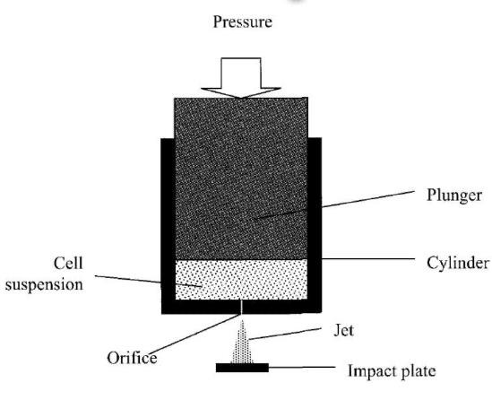

**French press.** A simpler version of the same principle, suitable for **laboratory scale only**. Pressure is applied and the cells forced through a small hole at high speed, hitting an impact plate. Its extraction efficiency is described by the **same equation** as the high-pressure homogeniser.

#### Derivation

Notation: $R$ is the protein released (kg per kg biomass), $R_{\max}$ the maximum achievable release, $N$ the number of passes, $t$ processing time, $p$ the operating pressure.

**Step 1: first-order release.** Each pass ruptures a fixed fraction of the cells that remain intact. The *unreleased* protein $(R_{\max}-R)$ therefore decays by a constant factor per pass:
$$\frac{d(R_{\max}-R)}{dN} = -k'(R_{\max}-R) \tag{69}$$

**Step 2: integrate** from $R = 0$ at $N = 0$:
$$\ln\!\left(\frac{R_{\max}}{R_{\max}-R}\right) = k'N \tag{70}$$

For a **bead mill**, where the variable is processing time rather than discrete passes, the same argument in continuous time gives
$$\ln\!\left(\frac{R_{\max}}{R_{\max}-R}\right) = kt \tag{71}$$
with $k$ a constant depending on bead size, bead packing density, rotation speed and temperature.

**Step 3: the pressure dependence.** For a homogeniser, $k'$ is not a constant: raising the pressure increases the stress on each cell and so the fraction broken per pass. Empirically the dependence is a power law, $k' = kp^{\,a}$, giving
$$\boxed{\;\ln\!\left(\frac{R_{\max}}{R_{\max}-R}\right) = kNp^{\,a}\;}\tag{72}$$
where $k$ is a constant depending on cell type and temperature, $p$ the applied pressure, and $a$ an **exponent depending on cell toughness**, ranging from about 0.9 to 2.9.

**Rearranged for release:**
$$\frac{R}{R_{\max}} = 1 - e^{-kNp^{\,a}} \tag{73}$$

**Checks.** At $N = 0$, $R = 0$. As $N\to\infty$, $R\to R_{\max}$: complete release needs infinite passes, as the intuition predicted. Release is **linear in $N$ only at small $N$**, where $e^{-x}\approx 1-x$.

#### Motivation and explanation

**What the exponent measures.** The exponent $a$ describes pressure sensitivity within the fitted range; it does not rank toughness on its own, because $k$, the release target and the envelope all matter. Since the model exponent is $kNp^a$, for $a>1$ a given proportional pressure increase changes predicted release more than the same proportional increase in passes. That mathematical comparison does not determine the best energy or product-stability trade-off.

**Why multiple passes rather than one hard pass.** Equation (72) suggests either route works, but there are limits: the equipment has a maximum rated pressure, and higher pressure means more heat, so the product suffers. Multiple passes allow cooling between treatments, which can reduce peak temperature. The total dissipated energy is not automatically the same: it depends on pressure, processed volume and pass count.

**Where the model fails.**
- $R_{\max}$ is itself an assumption: some protein is never released, remaining bound to debris.
- A real population has a **distribution of wall strengths**, so the weakest cells break first and the survivors are tougher. Observed curves therefore fall slightly below the exponential at high $N$.
- Prolonged treatment degrades the released protein, so measured $R$ can *fall* at very high $N$ — the model has no term for this.
- $k$ depends on temperature, so a run without adequate cooling does not have a single $k$.

#### Link to other topics

Equation (70) has the same exponential-survival structure as a cascade with a fixed fractional removal per stage, or the log-survival law in sterilisation: a fixed fractional reduction per unit of effort gives a logarithm of the residual, and the quantity that scales linearly is $\ln$ of what is left.

#### Summary

Mechanical methods all impose stress to rupture walls, and all generate heat that must be removed. Because each cell breaks independently with a fixed probability, release follows first-order kinetics, equation (72), with pressure entering as $p^{\,a}$ and $a$ between 0.9 and 2.9 depending on cell toughness.

### Section 40: Worked example — fitting and using homogeniser kinetics

#### Intuition

The model has two unknowns multiplied together inside an exponential, which cannot be read off directly. The standard route is to linearise twice.

First, at **fixed pressure**, equation (72) is linear in $N$ through the origin, so the slope of $\ln[R_{\max}/(R_{\max}-R)]$ against $N$ gives the product $kp^{\,a}$ for that pressure. Doing this for each pressure gives one slope per pressure.

Second, taking logarithms of those slopes, $\ln(kp^{\,a}) = \ln k + a\ln p$, which is linear in $\ln p$. The gradient is $a$ and the intercept is $\ln k$.

Two straight-line fits, each extracting one constant. This is the general recipe whenever a power law sits inside an exponential.

#### Worked example

**Problem.** A production strain of *E. coli* is disrupted at 5 °C in a Gaulin homogeniser between 200 and 550 kg$_f$ cm⁻². Percentage protein release $R/R_{\max}$ as a function of the number of passes is:

| Passes $N$ | 200 | 300 | 400 | 500 | 550 |
|---|---|---|---|---|---|
| 1 | 5.0 | 13.5 | 23.3 | 36.0 | 42.0 |
| 2 | 9.5 | 23.5 | 40.0 | 58.5 | 66.0 |
| 3 | 14.0 | 33.5 | 52.5 | 75.0 | 83.7 |
| 4 | 18.0 | 43.0 | 66.6 | 82.5 | 88.5 |
| 5 | 22.0 | 47.5 | 73.0 | 88.5 | 94.5 |
| 6 | 26.0 | 55.0 | 79.5 | 91.3 | — |

(% protein release; pressure in kg$_f$ cm⁻².)

**(a)** How many passes are required for 80 % release at 460 kg$_f$ cm⁻²?
**(b)** What pressure delivers 70 % recovery in only two passes?

All numbers below were computed in Python.

##### Step 1: convert the data

The table gives $R/R_{\max}$, but the model needs $\ln[R_{\max}/(R_{\max}-R)]$. Dividing numerator and denominator by $R_{\max}$:
$$\ln\!\left(\frac{R_{\max}}{R_{\max}-R}\right) = \ln\!\left(\frac{1}{1-R/R_{\max}}\right) \tag{74}$$

So 42.0 % becomes $\ln[1/(1-0.42)] = 0.54$.

##### Step 2: slope at each pressure

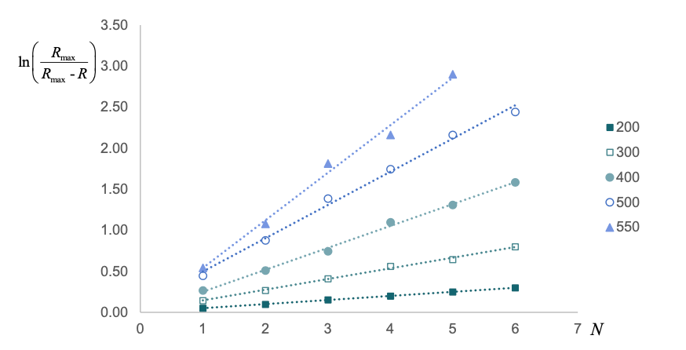

Plotting the converted data against $N$ for each pressure gives straight lines through the origin, confirming the first-order form. Their slopes are $kp^{\,a}$:

| $p$ (kg$_f$ cm⁻²) | 200 | 300 | 400 | 500 | 550 |
|---|---|---|---|---|---|
| slope $kp^{\,a}$ | 0.0500 | 0.1337 | 0.2633 | 0.4264 | 0.5691 |

##### Step 3: extract $a$ and $k$

Taking logarithms, $\ln(kp^{\,a}) = \ln k + a\ln p$. A straight-line fit of $\ln(\text{slope})$ against $\ln p$ gives
$$a = 2.37420, \qquad k = 1.73301\times10^{-7}\ (\mathrm{kg_f\,cm^{-2}})^{-a}$$
with $R^2 = 0.9994$ — the power law holds well across the range.

**Check.** Predicted release at $p = 550$, $N = 5$ is 93.8 % against 94.5 % measured; at $p = 200$, $N = 6$ it is 26.1 % against 26.0 %. The fit reproduces both ends of the data.

##### Step 4: (a) passes for 80 % at 460 kg$_f$ cm⁻²

Rearranging (72) of Section 39 for $N$:
$$N = \frac{1}{kp^{\,a}}\ln\!\left(\frac{1}{1-R/R_{\max}}\right) = \frac{1}{1.73301\times10^{-7}\times460^{2.37420}}\ln\!\left(\frac{1}{1-0.8}\right) = 4.4$$

Passes are whole numbers and 4.4 would fall short, so **$N = 5$**.

##### Step 5: (b) pressure for 70 % in two passes

Rearranging for $p$:
$$p = \left[\frac{1}{Nk}\ln\!\left(\frac{1}{1-R/R_{\max}}\right)\right]^{1/a} = \left[\frac{\ln(1/0.3)}{2\times1.73301\times10^{-7}}\right]^{1/2.37420} = 570\ \mathrm{kg_f\,cm^{-2}}$$

This is just above the 550 kg$_f$ cm⁻² at which data were taken, so it is a modest extrapolation and reasonable — but it would need checking against the machine's pressure rating.

#### Motivation and explanation

**Why the two-stage fit is the right approach.** Fitting $k$ and $a$ simultaneously to all 29 data points by non-linear regression would also work, but the staged version is better practice: the first stage *tests* the model (do the lines pass through the origin and stay straight?) before the second stage extracts parameters. A curved line at one pressure would reveal a failure of first-order kinetics that a global fit would silently absorb into the parameters.

**What $a = 2.37$ means in design terms.** Since $a > 1$, pressure is a stronger lever than passes, as Section 39 predicted. Quantitatively, from (72):
- doubling $N$ doubles $\ln[R_{\max}/(R_{\max}-R)]$;
- doubling $p$ multiplies it by $2^{2.37} = 5.2$.

**Doubling pressure multiplies the effective pass count by about 5.2** in the fitted model: one pass at doubled pressure has the same predicted release as about 5.2 passes at the original pressure. This conditional comparison does not justify extrapolating the 200–550 kg$_f$ cm⁻² fit to 1500–2500 bar.

**The trade-off that the model does not contain.** Higher pressure means more energy dissipated as heat per pass, so more cooling duty and more risk of denaturing the product — and the equipment must be rated for it. Fewer passes means less total residence time with released proteases. The model gives the disruption; the choice between the two routes depends on product stability and capital cost, which it says nothing about.

**Limits of the extrapolation.** The fit covers 200–550 kg$_f$ cm⁻² and 1–6 passes. Part (b) extrapolates slightly in pressure, which is acceptable. Extrapolating to much higher pressure would not be: cavitation and temperature rise change the mechanism, and $R_{\max}$ itself may fall as the released protein is damaged.

#### Link to other topics

The two-stage linearisation — hold one variable, fit the other, then fit the parameters of that fit — is the standard way to resolve a rate law of the form $r = kC_A^{\alpha}C_B^{\beta}$ from kinetic data, and the reasoning is identical: isolate one dependence at a time.

#### Summary

Converting the data to $\ln[R_{\max}/(R_{\max}-R)]$ linearises the release law in $N$; the slopes then linearise in $\ln p$, giving $a = 2.37$ and $k = 1.73\times10^{-7}$ with $R^2 = 0.9994$. Five passes reach 80 % release at 460 kg$_f$ cm⁻², and 570 kg$_f$ cm⁻² reaches 70 % in two.

### Section 41: Non-mechanical cell disruption

#### Intuition

A wall can be broken by overwhelming it, or by removing what holds it together. Mechanical methods do the first. The non-mechanical methods do the second, and they divide naturally by *which* component they attack:

- **Physical** methods make the cell break *itself*, by creating a pressure difference across the envelope that it cannot withstand — by heating and damaging the envelope, by expanding dissolved gas inside it, or by drawing water in osmotically.
- **Chemical** methods dissolve the lipid membrane, which is held together only by the hydrophobic effect and so is vulnerable to anything surface-active.
- **Biological** methods cleave selected covalent bonds in wall components enzymatically. For example, lysozyme cuts glycosidic bonds in the peptidoglycan backbone, rather than its peptide crosslinks. Enzyme specificity makes this attack more targeted.

The pattern across all three is **specificity bought at a price**. Each is gentler and more targeted than a homogeniser, and each introduces something that must later be removed — heat damage, added salt, detergent, solvent, or enzyme — or is simply too expensive at scale.

*Analogy:* opening a locked door by force, by removing its hinges, or with the correct key. The key is cleanest but must be obtained and accounted for afterwards. The analogy breaks down because a detergent does not unlock anything selectively — it dissolves the membrane wholesale, and it is "selective" only in the sense that it attacks lipid rather than protein.

#### Mechanism

##### Physical methods

These include thermal, decompression and osmotic shock. They are generally **costly and difficult to scale up**, so they are used mostly at laboratory rather than production scale.

**Thermolysis.** Cells are disrupted by **heating** — cytoplasmic proteins can be extracted from *E. coli* by holding at 90 °C for 10 minutes. Alternatively, **freeze–thaw cycles** disrupt cells through the formation of **ice crystals** that puncture membranes and walls. Both are **energy intensive**, and heating obviously risks denaturing the product, so thermolysis suits only thermostable products.

**Decompression.** Cells are exposed to a **high-pressure gas**, which dissolves in the medium and distributes itself inside the cells. On **rapid decompression**, the gas within the cells expands and bursts them from the inside.

The mechanism is worth noting: the disruptive force is generated *inside* the cell, so the wall fails in tension from within rather than being crushed. This is gentler than homogenisation because there is no shear field acting on the released protein.

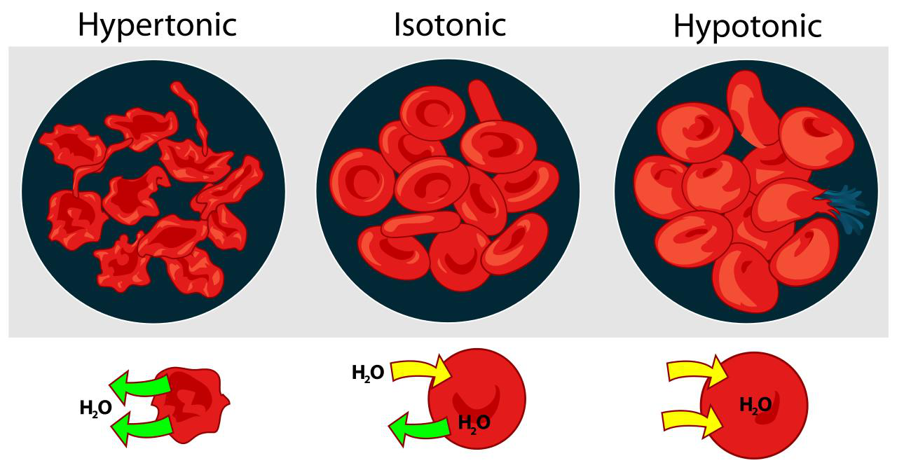

**Osmotic shock.** Cells are exposed to **hypertonic** or **hypotonic** conditions.
- *Hypertonic* conditions are obtained by adding salts at 1–3 M concentration, causing the cells to **shrink** rapidly as water leaves the cytoplasm.
- *Hypotonic* conditions draw water into cells. Wall-free cells such as red blood cells can swell and lyse, but intact bacterial and yeast walls usually resist the load. Efficient microbial release often needs envelope weakening or a specific osmotic-shock protocol.

The two are often used in sequence — shrink, then swell — since the mechanical cycling weakens the envelope. The method is **not sufficiently efficient for production scale**, and the added salt must afterwards be removed, which adds cost.

##### Chemical methods

Non-physical methods disrupt cell walls and membranes by adding chemical substances (**solvents**, **detergents**) or biological agents (**enzymes**). Several can be combined to achieve the desired efficiency. The drawback compared with physical methods is the **cost of the substances used, and that they may need to be removed**.

**Detergents.** Detergents, or **surfactants**, solubilise the phospholipid cell membrane through **micellisation** and by solubilising membrane proteins. Typical detergents are **sodium dodecyl sulfate (SDS)** and **Triton X-100**. They may need to be removed for later processing stages, adding to cost. Commonly used at laboratory scale for RNA or DNA extraction.

**Solvents.** Alcohols, dimethyl sulfoxide, methyl ethyl ketone and toluene solubilise the lipid components of the membrane, disrupting it. Like detergents, they may need removal. Solvents **may cause denaturation** of target proteins, which is often undesirable. They are sometimes combined with alkaline compounds to hydrolyse the cell wall as well as the membrane.

##### Biological methods

**Enzymes** digest cell walls. Those used include **lysozyme, cellulase, protease, chitinase and pectinase**.

The defining feature is **specificity**: different enzymes digest different parts of the wall, matched to the organism's chemistry (Section 38).
- **Lysozyme** hydrolyses the **peptidoglycan** layer in bacteria.
- **Chitinase** targets the **chitin** in yeast cell walls.
- **Pectinase** is used for plant cell walls.

Enzymes can be **combined with detergents**. For Gram-negative bacteria, lysozyme treatment follows detergent treatment, which is used to remove the outer membrane and expose the peptidoglycan layer underneath — a direct consequence of the layered architecture in Section 38: the detergent handles the lipid outer membrane, the enzyme handles the peptidoglycan.

Enzymes are **costly**, which limits their application in production-scale processes.

#### Motivation and explanation

**Why these methods do not scale.** Each has a specific obstacle:
- *Thermolysis and freeze–thaw* are energy intensive, and the energy scales with the volume processed.
- *Decompression* requires a pressure vessel large enough for the batch, and the gas must be compressed.
- *Osmotic shock* needs molar quantities of salt per batch, then needs it all removed.
- *Detergents and solvents* are consumables, and removal is a further separation step.
- *Enzymes* are the most expensive reagents of all.

Mechanical methods can offer high throughput with reusable equipment. Their energy and cooling requirements still grow with processed volume, while non-mechanical routes incur reagent, recovery and equipment costs. Production-scale choice therefore follows an engineering and economic comparison, rather than a universal claim that only mechanical methods scale.

**Where non-mechanical methods win.** Three cases:
1. *Fragile products* that cannot survive shear or heat.
2. *Selective release* — mild osmotic shock can release periplasmic contents from Gram-negative bacteria without breaking the inner membrane, so the product comes out with far fewer contaminants. This is a real purification advantage, not just a gentler disruption.
3. *Small scale*, where consumable cost is irrelevant and convenience dominates.

**Combinations are normal.** The methods are not exclusive. A common industrial compromise is a mild chemical or enzymatic pre-treatment to weaken the wall, followed by fewer homogeniser passes — reducing both reagent cost and the heat and shear load.

#### Link to other topics

The choice between a capital-intensive mechanical route and a consumable-intensive chemical one is a standard operating-cost comparison: equipment cost is largely independent of throughput once installed, while reagent cost scales linearly with it, so the crossover sits at a particular production volume.

#### Summary

Non-mechanical disruption can damage envelopes by heat or pressure changes, solubilise membranes chemically, or digest wall components enzymatically. Heating, SDS and solvents can denature products, while appropriate enzymes or controlled osmotic shock can be selective.

### Conclusion

Disruption recovery must be assessed alongside the damage and contaminants introduced by the release operation. The next unit develops primary isolation.

## 13. Primary isolation

### Overview

Primary isolation separates a product from the clarified broth using partitioning, precipitation or adsorption. Equilibrium relations and material balances connect the molecular mechanism to recovery, product concentration and the cost of pursuing very high yield.

*Assumed throughout:* phase equilibria, protein structure and material balances.

### Section 42: Primary isolation by solvent and aqueous two-phase extraction

#### Intuition

After cell removal and disruption, the feed is either a liquor with the organisms removed or a cell homogenate. The target — a protein, peptide or small molecule such as an antibiotic — sits in solution alongside a great many unwanted components.

Extraction exploits the fact that different molecules distribute differently between two immiscible liquids. Shake the feed with a second liquid in which the product is much more soluble than the impurities are, let the phases separate, and the product moves across while most contaminants stay behind.

The limitation is that one equilibration can never be complete. The product distributes according to a fixed ratio, so some always remains in the original phase. The design question is therefore not "does it partition?" but "**how much do I recover, and at what phase ratio?**" — which the derivation below answers.

*Analogy:* washing a stain with a solvent in which it dissolves better than water does. The analogy breaks down in the way that matters for proteins: an organic solvent that dissolves a protein well usually also denatures it, which is exactly why the aqueous variant exists.

#### Mechanism

##### Solvent extraction

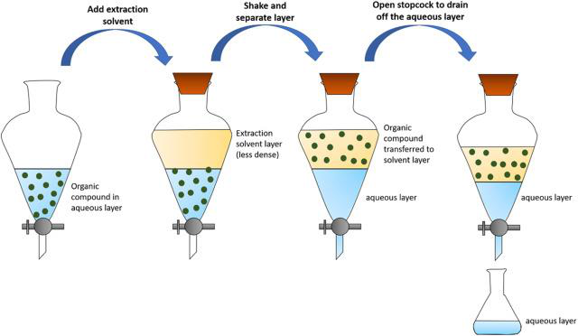

- The aqueous feed contains a target organic compound A.
- It is mixed with an **organic solvent, immiscible with the aqueous feed**, within which A preferentially partitions.
- The system is agitated to allow transfer of A to the solvent, then left to settle.
- The two phases are separated, and A is recovered from the solvent, for example by evaporation.

The solvent is chosen so that **A partitions strongly within it, but undesirable compounds in the feed (such as cell debris) do not**. Selectivity comes entirely from that choice.

Penicillin is the standard example: extracted from aqueous broths using butyl or amyl acetate.

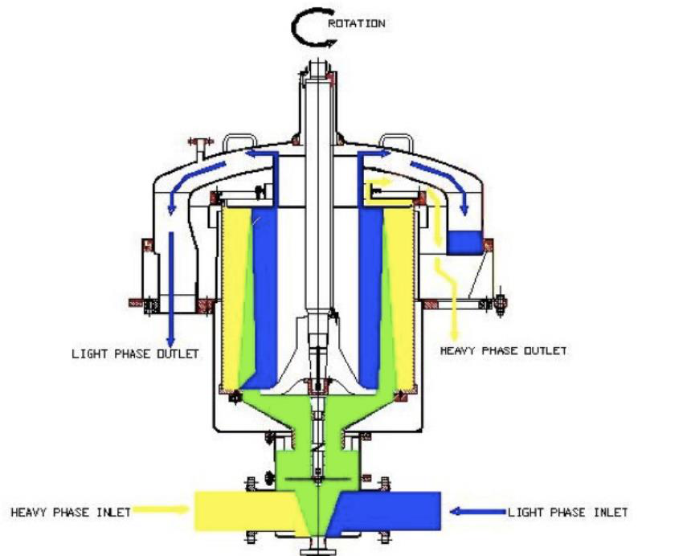

**At plant scale** the operation is continuous rather than batch. A **countercurrent centrifuge** is used: the heavy phase (typically the feed) is mixed with the light phase (typically the solvent) by agitators at the bottom, enabling transfer of the target compound from one phase to the other, and a centrifuge then separates and recovers the two phases. Countercurrent contact maintains a favourable concentration driving force. Multistage equipment or a train of centrifugal contactors can give several effective stages; a single mixing-and-separation contactor does not automatically provide many equilibrium stages.

##### Aqueous two-phase extraction

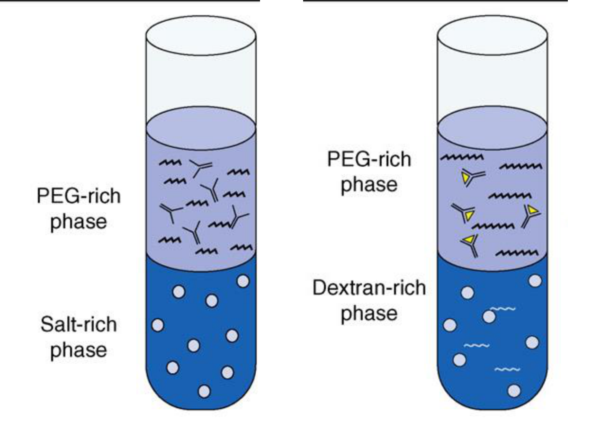

Similar in principle to solvent extraction, but the liquid–liquid phase separation is between **two aqueous phases** rather than organic phases. Both phases are mostly water, so a protein is not exposed to an organic solvent at any point.

- Phase separation is induced by adding solutes such as **polymers of different chemistry**, and salts.
- Solutions containing **polyethylene glycol (PEG) and salts** separate into salt-rich and PEG-rich phases (PEG on top).
- Solutions of **PEG and dextran** separate into PEG-rich and dextran-rich phases (dextran-rich at the bottom).
- Target compounds partition into one or the other phase depending on their physical and chemical characteristics.
- The degree of partitioning can be **finely tuned** by changing the system composition — adding salts, changing the polymer molecular weight.
- It is **easily scalable**.

It is often used in pharmaceutical processing, for example for monoclonal antibodies, growth factors and hormones.

#### Derivation

Notation: $C_{A,u}$ and $C_{A,l}$ are the equilibrium concentrations of A in the upper and lower phase; $V_u$, $V_l$ the phase volumes; $V_0 = V_u + V_l$ the total volume; $C_{A,0}$ the average concentration of A in the system.

**Step 1: the partition coefficient.** At equilibrium, A distributes between the phases in a fixed ratio:
$$K = \frac{C_{A,u}}{C_{A,l}} \tag{75}$$
This applies both to aqueous–solvent and to aqueous–aqueous systems. $K$ is set by the relative affinity of A for the two phases — in thermodynamic terms, by the ratio of its activity coefficients.

**Step 2: define the yield.** The yield in the upper phase is the fraction of all A that ends up there:
$$Y_{A,u} = \frac{V_uC_{A,u}}{V_0C_{A,0}} = \frac{V_uC_{A,u}}{V_uC_{A,u}+V_lC_{A,l}} \tag{76}$$
using a mass balance on A, since all of it is in one phase or the other.

**Step 3: eliminate $C_{A,l}$** using (75), writing $C_{A,l} = C_{A,u}/K$:
$$Y_{A,u} = \frac{V_uC_{A,u}}{V_uC_{A,u}+V_lC_{A,u}/K}$$
Cancelling $C_{A,u}$ throughout and dividing top and bottom by $V_l$:
$$\boxed{\;Y_{A,u} = \frac{\dfrac{V_u}{V_l}}{\dfrac{V_u}{V_l}+\dfrac{1}{K}}\;}\tag{77}$$

**The yield depends on only two quantities:** the **phase-volume ratio** $V_u/V_l$ and the **partition coefficient** $K$. The concentration drops out entirely.

**Checks.**
- $K\to\infty$ (A has no affinity for the lower phase): $Y\to1$, complete recovery.
- $V_u/V_l\to\infty$: $Y\to1$ — a large enough extracting phase recovers everything, whatever $K$.
- $V_u/V_l\to0$: $Y\to0$.

A similar expression can be written for the lower phase.

#### Motivation and explanation

**What (77) says about design.** A very large or very small $K$ is desirable for good separation, but if $K$ is fixed by chemistry, the **phase volume ratio can still be tuned**. The yield can be increased simply by using more of the extracting phase.

But this is a trade with concentration. Recovering into a large upper phase gives high yield and a *dilute* product, and the downstream train must then handle that volume (Section 32: every unit is sized for the flow reaching it). Recovering into a small phase concentrates the product but leaves much of it behind. The worked example makes the size of this trade explicit.

**Why ATPE is often preferred for proteins.** Many organic-solvent conditions damage protein activity or structure. Aqueous phases can provide a milder environment, but stability still depends on composition, pH and the protein. Phase-forming agents — PEG, dextran or salts — may need removal later, and dextran can be expensive.

**Where extraction sits in the train.** It is a primary isolation method, so it is **not very selective**: it removes components with substantially different properties and is expected to take the product from roughly 1 % to 10 % purity (Section 32). Fine separation from similar impurities is left to chromatography.

#### Worked example

*Enzyme recovery by aqueous two-phase extraction.* Computed in Python.

Aqueous two-phase extraction is used to recover α-amylase from solution. A PEG–dextran mixture is added and the solution separates into two phases: PEG-rich upper and dextran-rich lower. The partition coefficient is $K = C_{A,u}/C_{A,l} = 4.2$. Find the maximum possible enzyme recovery when the volume ratio of upper to lower phase is (a) 5.0 and (b) 0.5.

Using (77):

**(a)** $V_u/V_l = 5.0$:
$$Y_{A,u} = \frac{5.0}{5.0+1/4.2} = \frac{5.0}{5.238} = 0.95$$

**(b)** $V_u/V_l = 0.5$:
$$Y_{A,u} = \frac{0.5}{0.5+1/4.2} = \frac{0.5}{0.738} = 0.68$$

**Interpretation.** The yield is much higher in case (a), where the volume of the upper phase is in large excess compared with the lower phase. A tenfold change in phase ratio moves the recovery from 68 % to 95 %.

**The concentration trade needs a stated basis.** With $C_{A,0}$ defined as the average concentration in the total two-phase mixture, mass balance gives $C_{A,u}/C_{A,0}=K(1+r)/(1+Kr)$, where $r=V_u/V_l$. The two cases give 1.145 and 2.032, so case (b) has about 1.77 times the upper-phase concentration at the same $C_{A,0}$. Holding total enzyme mass and lower-phase volume fixed instead gives a ratio of about 7.10. Neither basis gives tenfold dilution; a phase ratio alone does not determine concentration relative to the original feed before additives.

**This is a central design trade:** increasing recovery by adding extracting phase can reduce product concentration. The stage ranges in Section 32 are illustrative; a dilute product can still be justified by improved recovery, impurity removal or easier downstream processing.

#### Link to other topics

Equation (75) is the distribution coefficient of liquid–liquid extraction, and from Equilibrium Thermodynamics it is the ratio of activity coefficients of the solute in the two phases. The countercurrent arrangement is the standard device for turning a modest single-stage separation factor into a high overall recovery.

#### Summary

Extraction moves the product into a second liquid phase in which it preferentially partitions, with yield set by only $K$ and the phase-volume ratio, equation (77). Aqueous two-phase systems use two aqueous phases that can preserve protein activity under suitable conditions, at the cost of phase-forming agents that may need removal.

### Section 43: Precipitation by salting out and the Cohn equation

#### Intuition

Protein solubility reflects the balance of protein–water, ion–protein and protein–protein interactions. Hydration of charged and polar surface groups contributes to favourable interactions with the solvent, while electrostatic and hydrophobic interactions influence association.

At sufficiently high concentration, suitable salts make dissolved protein less thermodynamically favourable relative to a protein-rich phase. Ion-specific interactions and preferential exclusion from protein surfaces can favour association while preserving the folded structure. This is not literal stripping of the hydration shell.

**Salting out reduces protein solubility through salt-dependent solvent and protein interactions; precipitation does not require protein unfolding.**

*Analogy:* people may cluster when their surroundings become less favourable for staying apart. The analogy does not represent literal removal of hydration water. Low salt can instead increase solubility through changes in electrostatic interactions; the balance is protein- and ion-dependent.

#### Mechanism

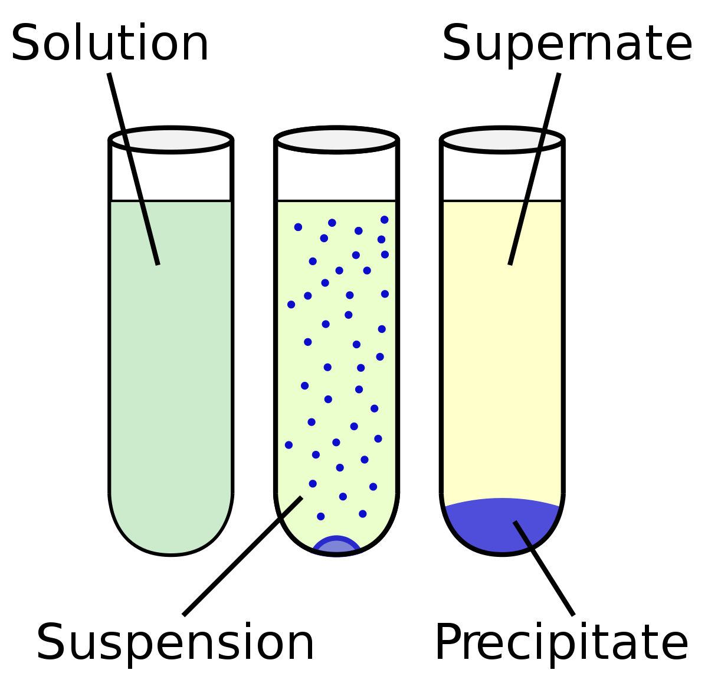

**The general principle.** Precipitation is induced by a **decrease in the solubility** of the compound on addition of **salts, solvents or polymers**, or in response to changes in **pH**. These additives, or changes in surface chemistry, make interactions with water less favourable, causing aggregation.

**Four methods** are used in bioprocessing, primarily to recover proteins:
- a) salting out (this note);
- b) isoelectric precipitation;
- c) polymer precipitation;
- d) organic solvent precipitation (Section 44).

Precipitation is often used for proteins, can **remove large amounts of water**, and the precipitate can be extracted by further filtration or centrifugation. However, only **partial purification** is achieved, since proteins of similar characteristics precipitate together — consistent with its role as a non-selective primary isolation step (Section 32).

##### Salting out

The solubility of molecules with hydrophobic regions — proteins in particular — depends on salt concentration in a non-monotonic way:
- **low at low salt concentration**;
- rising to a **peak at intermediate concentration**;
- **dropping again at high concentration**.

The rise is called **salting in**; the fall is **salting out**, and it is the regime used for protein precipitation.

**Why solubility can fall.** Ion-specific interactions change protein solvation and protein–protein association. Preferential exclusion of suitable salts from protein surfaces can favour association and the compact native state. Ammonium sulfate precipitation need not denature the protein. Other salts or unsuitable conditions can destabilise it, so precipitation and unfolding must be distinguished.

**Not all salts are equal.** Different anions have different effectiveness at inducing salting out, ranked in the **Hofmeister series**, discovered by Franz Hofmeister:
$$\mathrm{F^-} \sim \mathrm{SO_4^{2-}} > \mathrm{HPO_4^{2-}} > \mathrm{CH_3COO^-} > \mathrm{Cl^-} > \mathrm{Br^-} > \mathrm{NO_3^-} > \mathrm{ClO_3^-} > \mathrm{I^-} > \mathrm{ClO_4^-} > \mathrm{SCN^-}$$
Ions on the left are most effective at precipitating; those on the right can even increase solubility. The origin of these differences is still a matter of research. Ammonium sulfate is the standard choice in practice, because sulfate sits near the strong end and the salt is cheap and highly soluble.

Different proteins salt out at different concentrations depending on their hydrophobicity, which is what makes the method partially selective: raising the salt in steps precipitates different fractions.

#### Derivation

**The Cohn equation** describes the solubility $S$ of a protein in the salting-out regime. In the logarithms below, $S$ means the numerical concentration relative to a fixed reference, here $1\ \mathrm{\mu g\,mL^{-1}}$; equivalently use $\ln(S/S_{\mathrm{ref}})$. The fitted intercept depends on that reference:
$$\ln S = \beta_s - K_sC_s \tag{78}$$
where $C_s$ is the salt concentration, and $\beta_s$ and $K_s$ are constants that depend on the protein and the salt. $\beta_s$ is also a function of temperature and pH.

The form says that **$\ln S$ falls linearly with salt concentration** — solubility decays exponentially. With $K_s$ of order 2 M⁻¹, each additional 0.5 M of salt divides the solubility by about $e$, and about 1.1 M divides it by ten. This steepness is what makes the method practical with modest amounts of salt.

**Fitting the constants.** Two measurements of solubility at two salt concentrations suffice. Writing (78) at $(S_1,C_{s,1})$ and $(S_2,C_{s,2})$ and subtracting eliminates $\beta_s$:
$$\ln\frac{S_1}{S_2} = K_sC_{s,2}-K_sC_{s,1} \quad\Longrightarrow\quad K_s = \frac{\ln(S_1/S_2)}{C_{s,2}-C_{s,1}} \tag{79}$$
Then $\beta_s$ follows by substituting back into (78):
$$\beta_s = \ln S_1 + K_sC_{s,1} \tag{80}$$

Two equations in two unknowns, solved by elimination — the same structure as fitting any two-parameter law to two data points.

#### Worked example

*Antibody recovery by salting out.* Computed in Python.

**Given.** A pure IgA monoclonal antibody has solubility 770 µg mL⁻¹ in 1.4 M (NH₄)₂SO₄ and 29 µg mL⁻¹ in 3.0 M (NH₄)₂SO₄. A solution containing 180 g of pure antibody is treated for protein recovery using 2.5 M (NH₄)₂SO₄ in a total volume of 1000 L. What percentage of the antibody would precipitate?

**Step 1: check the regime.** Solubility *decreases* with increasing salt, so both points lie in the salting-out regime and the Cohn equation applies.

**Step 2: extract the constants.** From (79):
$$K_s = \frac{\ln(770/29)}{3.0-1.4} = \frac{3.279}{1.6} = 2.05\ \mathrm{M^{-1}}$$
From (80):
$$\beta_s = \ln 770 + 2.05\times1.4 = 6.65+2.87 = 9.52$$

**Step 3: solubility at the operating condition,** $C_s = 2.5$ M:
$$\ln S = 9.52-2.05\times2.5 = 4.39 \quad\Longrightarrow\quad S = 81\ \mathrm{\mu g\,mL^{-1}}$$

**Step 4: compare with the feed concentration.** 180 g in 1000 L is
$$\frac{180\ \mathrm{g}}{1000\ \mathrm{L}} = 180\ \mathrm{mg\,L^{-1}} = 180\ \mathrm{\mu g\,mL^{-1}}$$
Everything above the solubility limit precipitates:
$$180-81 = 99\ \mathrm{\mu g\,mL^{-1}}, \qquad \frac{99}{180} = 55\%$$

**55 % is very poor separation.** Nearly half the product is left dissolved and lost to the supernatant.

**Step 5: what would 99 % recovery require?** Only 1 % may remain dissolved, so $S = 1.8$ µg mL⁻¹. Rearranging (78):
$$C_s = \frac{\beta_s-\ln S}{K_s} = \frac{9.52-0.588}{2.05} = 4.36\ \mathrm{M}$$

**Compare with the solubility of the salt itself.** Saturated ammonium sulfate is about 4.1 M at 25 °C. The required 4.36 M exceeds the quoted saturation at 25 °C, so **99 % recovery is not predicted to be attainable at that temperature under the extrapolated fitted model**. Additional salt would remain undissolved or crystallise; protein precipitation already begins below this limit.

Intermediate targets are reachable: 90 % needs 3.2 M and 95 % needs 3.6 M, both within range.

**What this example teaches.** The exponential form cuts both ways. Solubility falls steeply with salt, which is why the method works; but recovering the last few percent requires salt concentrations that rise without bound as $S\to0$, since $C_s\propto-\ln S$. **Salting out is excellent for bulk recovery and hopeless for completeness** — which is exactly the role of a primary isolation step.

#### Link to other topics

The Cohn equation resembles a Setschenow relation: an empirical logarithmic solubility change is proportional to salt concentration over a fitted range. Both describe salt-dependent solute chemical potentials; the similarity does not establish literal removal of hydration water as a universal mechanism.

#### Summary

Salting out lowers protein solubility through ion-specific changes in solvation and association, and need not unfold the protein. The fitted Cohn equation predicts about 55 % precipitation for this IgA example at 2.5 M ammonium sulfate.

### Section 44: Isoelectric, polymer- and solvent-induced precipitation

#### Intuition

A protein remains dissolved when solvent interactions and the free energy of mixing favour dispersed molecules over a protein-rich phase. Hydration and electrostatic interactions contribute, but reducing net charge or changing the solvent does not guarantee precipitation for every protein.

The alternatives change different contributions:
- **Isoelectric** — reduce net charge near the pI; charged surface groups can remain.
- **Polymer** — preferential exclusion and, under appropriate size conditions, depletion attraction favour association.
- **Solvent** — change dielectric properties and protein–solvent interactions by mixing in an organic solvent.

All four converge on the same end state, so the choice is governed by what the product tolerates and what must be removed afterwards.

*Analogy:* keeping magnets apart with both a repelling field and a layer of packing. You can remove the packing, switch off the field, or squeeze from outside. The analogy breaks down for the polymer case, where nothing is removed and nothing switched off — the aggregation is driven by the *entropy of the polymer*, not by a force between the proteins at all.

#### Mechanism

##### Isoelectric precipitation

Proteins most often carry a **net electric charge**, or are **zwitterionic** (net charge zero, but parts of the protein positively or negatively charged).

- **Charge stabilises proteins against aggregation**, through Coulomb repulsion that counteracts hydrophobic interactions.
- **Charge is pH dependent**, through (de)protonation of charged amino acids. At low pH a protein is more likely to be positively charged; at high pH, negatively charged.
- The **isoelectric point (pI)** is the pH at which the protein has **zero net charge**; positively and negatively charged groups can still be present.

Reduced net electrostatic repulsion often gives a **solubility minimum near the pI**, although this is not universal. The vicilin curve shows this sharply: solubility falls by about an order of magnitude within one pH unit either side of pH 5.

A protein's pI depends on the ionisable groups in its sequence and their environment. Values span a wide range, so precipitation conditions must be chosen for the actual protein.

**Operation.** Precipitation is achieved by changing — typically reducing — the pH of the feed until the protein of interest reaches its minimum solubility and precipitates.

- **Potential advantage over salting out:** less added salt may be needed. Acid/base adjustment still introduces counterions, and subsequent buffer exchange depends on product requirements.
- **Drawback:** low solubility can cause irreversible aggregation; extreme pH can also denature the protein. Zero net charge alone does not imply an unfolded state.

**Conceptual example: staged pH-controlled precipitation.** If a mixture contains proteins with different solubility minima, successive compartments can adjust pH and remove precipitated fractions. Actual recovery also depends on residence time, mixing and overlapping solubility curves. Commercial beet-juice clarification uses lime treatment and removal of impurities; the schematic should not be taken as evidence that a particular sugar factory fractionates proteins one by one at their pI.

The schematic illustrates how pH-dependent solubility can guide equipment design. It does not guarantee individual protein fractions: proteins can have overlapping precipitation ranges.

##### Polymer-induced precipitation

Neutral polymers such as **PEG and dextran** can reduce protein solubility through preferential exclusion and changes in solvent interactions. They need not strip hydration water from the protein; excluded-volume effects can favour a protein-rich phase.

In addition, PEG causes aggregation of **large globular proteins** by inducing **depletion forces**, first explained by Asakura and Oosawa:
- The polymer coils are **excluded from the small gap between two adjacent large particles** (the proteins), because they do not fit.
- There is therefore a **larger osmotic pressure from the polymer outside the gap than inside it**.
- The imbalance produces a net **attractive force** pushing the proteins together.

This is a purely **entropic** effect — nothing binds to the protein. It depends on the size ratio between polymer coil and protein, which is why it works for large globular proteins and why polymer molecular weight is a design variable.

**Not to be confused with aqueous two-phase extraction** (Section 42), which also uses PEG and dextran but separates proteins *between* two liquid phases rather than precipitating them out of one.

##### Solvent-induced precipitation

The feed is mixed with a **miscible solvent**, for example ethanol or methanol.

**This is distinct from solvent extraction** (Section 42), which uses **immiscible** solvents to create a second liquid phase. Here the solvent dissolves fully and changes the properties of the single phase.

Mechanism:
- Adding sufficient organic solvent changes protein–solvent interactions and can reduce protein solubility. Preferential solvation and conformational effects depend on the protein and mixture.
- Ethanol or methanol lowers the **dielectric constant of the mixture**. This changes electrostatic interactions, including both attractions and repulsions; reduced dielectric constant alone is not a complete precipitation mechanism.

It is often used for primary isolation of **antibodies**.

#### Motivation and explanation

**Comparing the four methods.**

| Method | Main change | Removal needed afterwards | Main risk |
|---|---|---|---|
| Salting out | salt-dependent solubility | salt removal as required | aggregation or loss of activity; native structure can also be stabilised |
| Isoelectric | reduced net charge near pI | pH readjustment; counterion removal if required | irreversible aggregation or pH damage |
| Polymer | solvent interactions and depletion attraction | polymer removal as required | product-dependent stability and residual polymer |
| Solvent | mixed-solvent properties, including dielectric constant | solvent removal | denaturation; often requires cooling |

The third column matters for downstream integration. Isoelectric precipitation can require less added salt, but acid and base introduce counterions. Readjusting pH restores protonation conditions without removing those ions; buffer exchange or desalting may still be needed.

**Why solvent precipitation is done cold.** Organic solvents denature proteins, and the rate of denaturation rises steeply with temperature. Industrial ethanol fractionation of blood plasma is run near 0 °C for exactly this reason. The same logic as the 5 °C homogenisation in Section 40: where the method itself threatens the product, temperature is the lever that buys tolerance.

**Why none of these is very selective.** All four exploit bulk physical properties — hydrophobicity, pI, size, solvation — that many proteins share. Two proteins of similar pI precipitate together. This is why precipitation sits in **primary isolation** (Section 32), taking purity from roughly 1 % to 10 %, with the real purification left to chromatography.

**Why precipitation is used at all, given that.** It removes **large amounts of water**, so it concentrates the product substantially while also purifying it a little. Compare extraction (Section 42), where improving recovery means diluting into a larger phase. Precipitation moves *both* concentration and purity in the right direction, which is why it so often follows extraction in a real train.

#### Link to other topics

The depletion force is the same mechanism that flocculates colloids with free polymer, used deliberately in water treatment and arising as an unwanted instability in formulated products. In all cases the driving force is the entropy of the excluded species, not an interaction between the particles themselves.

#### Summary

The three non-salt routes change different contributions to solubility: isoelectric precipitation reduces net charge near the pI, polymers alter solvent interactions and can produce depletion attraction, and miscible solvents change the solvent environment. A pH gradient can fractionate proteins, but acid/base counterions may require removal afterwards.

### Section 45: Primary isolation by adsorption

#### Intuition

Extraction and precipitation (Sections 42–44) move the *product* into a new phase. Adsorption instead holds the product still on a solid while everything else is washed away, then releases it on demand.

That ordering is what makes it selective. Binding, washing and elution are three separate opportunities to discriminate: a molecule must bind in the first step, survive the wash in the second, and be released in the third. Methods based on a single equilibrium have only one.

The practical behaviour follows from the bed being finite. Feed entering a fresh column meets unsaturated adsorbent and is stripped completely, so the outlet is clean. As the top of the bed fills, the region doing the work — the **adsorption zone** — moves downwards. Once it reaches the bottom, unadsorbed product starts appearing in the effluent: **breakthrough**. The operation is therefore inherently cyclic, not steady.

*Analogy:* a sponge wiping a spill, saturating from one end. The analogy breaks down because the adsorbent is *selective* — it is a sponge that takes up one liquid and leaves others behind — and because it can be wrung out and reused.

#### Mechanism

**Adsorption** is a surface process where components of a gas or liquid bind to solid surfaces via physical or chemical interactions (van der Waals, electrostatic). The compound that binds is the **adsorbate**; the material to which it binds is the **adsorbent**.

Adsorption is often used as a primary isolation method, particularly in **separation of proteins, amino acids, antibodies and enzymes**, and in **treatment of waste waters**.

The adsorbent is normally **porous particles** with very high surface area, packed in a column. Materials include **activated charcoal** and **resins** made from styrene, divinylbenzene or acrylamide polymers. Porosity is the point: the usable surface is almost entirely internal.

##### The four stages

1. **Binding** — the sample is contacted with the adsorbent, and the adsorbate binds.
2. **Washing** — the adsorbent is washed to remove unbound and weakly bound compounds.
3. **Elution** — the adsorbate is made to unbind so it can be recovered, normally by flowing a different solvent that **reverses the interactions that led to adsorption** in the first place.
4. **Regeneration** — the adsorbent is brought back to its original conditions so it can be re-used, for instance by replacing the elution solvent with the original binding solvent.

##### Breakthrough

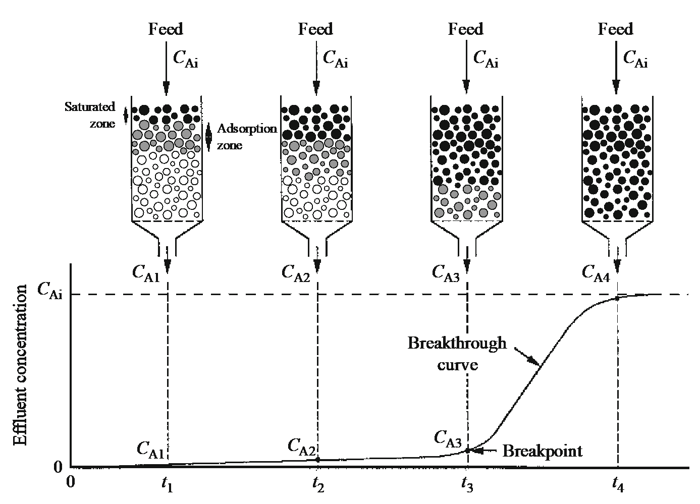

An **adsorption zone** propagates downwards at a rate much slower than the liquid flow. In this zone, adsorption is occurring and the resin is not yet saturated. Above this zone the resin is saturated. Feed comes out from the other side of the column (the **effluent**) with a time-dependent concentration $C_A$.

- **At early times**, the adsorption zone has not yet reached the bottom of the column, and $C_A$ in the effluent is low.
- **At late times**, the adsorption and saturation zones reach the bottom of the column. The column becomes saturated and $C_A$ starts increasing.
- The point at which $C_A$ starts increasing is the **breakpoint**.
- The process is **usually terminated at this stage, to avoid wasting target compound in the effluent**.

The breakthrough curve is therefore the operating signature of the column, and the breakpoint — not full saturation — sets the cycle time.

##### Isotherms

An **adsorption isotherm** describes adsorption in terms of the **fraction of adsorbate bound to the adsorbent** as a function of the **bulk concentration of adsorbate**, at constant temperature.

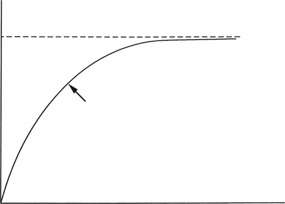

**The Langmuir isotherm**, developed by Irving Langmuir (Nobel laureate in chemistry, 1932), is the simplest form:
$$C_{AS}^* = \frac{C_{ASm}K_AC_A^*}{1+K_AC_A^*} \tag{81}$$

where $C_{AS}^*$ is the equilibrium concentration of A bound onto the adsorbent (mass or moles of adsorbate per mass or volume of solid), $C_{ASm}$ is the maximum attainable value of $C_{AS}^*$ — the **saturation level**, so that $C_{AS}^*/C_{ASm}$ is the fraction of binding sites occupied — $C_A^*$ is the equilibrium concentration of A in the fluid phase, and $K_A$ is a constant.

**Limiting cases.**
- *Low concentration*, $K_AC_A^*\ll1$: $C_{AS}^*\to C_{ASm}K_AC_A^*$, linear in $C_A^*$. The surface is nearly empty, so uptake is proportional to what is offered.
- *High concentration*, $K_AC_A^*\gg1$: $C_{AS}^*\to C_{ASm}$, the plateau. Every site is occupied.

**The Langmuir isotherm is only valid if** adsorbed molecules form a **monolayer**, **all binding sites on the surface are equivalent**, and **interactions between adsorbed molecules are negligible**. These assumptions are **often not verified in real-life scenarios** — in complex adsorption media, binding sites are rarely all equivalent.

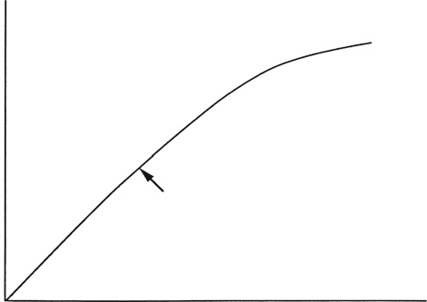

**The Freundlich isotherm** is an empirical alternative of particular interest in liquid/solid adsorption, which works well for isolation of antibiotics, hormones and steroids:
$$C_{AS}^* = K_fC_A^{*1/n} \tag{82}$$
with $n$ a constant where $n>1$, and $K_f$ a constant whose units depend on the units used for $C_{AS}^*$ and $C_A^*$.

**Note that different from the Langmuir isotherm, the Freundlich isotherm does not reach saturation.** Since $1/n<1$ the curve rises ever more slowly but without bound, which is physically impossible at very high concentration but a good description over the working range — and it accommodates a *distribution* of site energies rather than Langmuir's single type.

#### Worked example

*Antibody recovery by adsorption.* Computed in Python.

**Given.** Cell-free fermentation liquor contains $C_A = 8\times10^{-5}$ mol L⁻¹ immunoglobulin G. It is proposed to recover at least **90 %** of this antibody by adsorption on synthetic, nonpolar resin. Experimental equilibrium data are correlated as
$$C_{AS}^* = 5.5\times10^{-5}\,C_A^{*0.35}$$
where $C_{AS}^*$ is in mol per cm³ of adsorbent and $C_A^*$ in mol L⁻¹. What volume of resin is required to treat $V = 2$ m³ of fermentation liquor?

This is a Freundlich isotherm with $1/n = 0.35$.

**Step 1: the resin volume needed.** Volume of resin = (total moles to adsorb) ÷ (moles adsorbed per unit volume of resin):
$$V_{\text{res}} = \frac{N_{AS}}{C_{AS}^*}$$

**Step 2: find $C_A^*$.** The correlation needs the *equilibrium* liquid concentration, which is what remains after adsorption. Recovering 90 % leaves 10 % in solution:
$$C_A^* = \tfrac{1}{10}C_A = 8\times10^{-6}\ \mathrm{mol\,L^{-1}}$$

**Step 3: evaluate the isotherm.**
$$C_{AS}^* = 5.5\times10^{-5}\times(8\times10^{-6})^{0.35} = 9.05\times10^{-7}\ \mathrm{mol\,cm^{-3}}$$

**Step 4: total moles adsorbed.**
$$N_{AS} = 0.9\,C_AV = 0.9\times8\times10^{-5}\ \mathrm{mol\,L^{-1}}\times2\ \mathrm{m^3}\times\frac{1000\ \mathrm{L}}{\mathrm{m^3}} = 0.144\ \mathrm{mol}$$

**Step 5: resin volume.**
$$V_{\text{res}} = \frac{0.144}{9.05\times10^{-7}} = 1.59\times10^{5}\ \mathrm{cm^3} = 0.159\ \mathrm{m^3}$$

**Scope of the calculation.** About 159 L of initially unloaded resin equilibrates with 2 m³ of liquid in a single batch. The isotherm is evaluated at the final bulk liquid concentration. A flowing packed bed instead requires dynamic capacity at the chosen breakthrough criterion; this batch-equilibrium result is not a validated packed-column design.

**The cost of chasing recovery.** Repeating for higher targets, using the same isotherm:

| Recovery | $C_A^*$ (mol L⁻¹) | $C_{AS}^*$ (mol cm⁻³) | $V_{\text{res}}$ (m³) |
|---|---|---|---|
| 90 % | $8\times10^{-6}$ | $9.05\times10^{-7}$ | 0.159 |
| 95 % | $4\times10^{-6}$ | $7.10\times10^{-7}$ | 0.214 |
| 99 % | $8\times10^{-7}$ | $4.04\times10^{-7}$ | 0.392 |

Going from 90 % to 99 % recovery requires **2.5 times as much resin**, for 9 % more product. Two effects compound: more antibody must be adsorbed, *and* the lower equilibrium concentration means each cm³ of resin holds less. This is the same diminishing return seen in salting out (Section 43), and it recurs throughout downstream processing.

#### Link to other topics

Equation (81) is formally identical to Michaelis–Menten kinetics and to Langmuir–Hinshelwood surface catalysis, because binding to a finite site population can generate the same saturating algebra. Michaelis–Menten normally uses a kinetic steady-state balance; it is not generally an equilibrium adsorption model. The breakthrough curve is the same moving-front behaviour as a fixed-bed ion exchanger or a chromatographic column, which is the subject of Section 46.

#### Summary

Adsorption binds the product to a solid and recovers it by elution, with binding, washing and elution each contributing selectivity — more than any other primary isolation method. The finite bed means operation is cyclic, terminated at the breakpoint when the adsorption zone reaches the outlet.

### Conclusion

Partitioning, solubility and binding equilibria set recovery, while material balances expose the concentration and capacity trade-offs. The next unit develops chromatography and final isolation.

## 14. Chromatography and final isolation

### Overview

Chromatography separates components through differences in binding or accessible pore volume. Retention measures describe differential migration, while final isolation converts a purified stream into the physical form needed for storage and use.

*Assumed throughout:* phase partitioning, adsorption and downstream-process stages.

### Section 46: Types of liquid chromatography

#### Intuition

Section 45 bound the product to a solid and then released it. Chromatography does the same thing, but *continuously and repeatedly* as the sample travels down a column.

Each solute binds and unbinds many times on its way through. A solute that binds strongly spends more of its time stationary and so moves slowly; one that binds weakly moves quickly. After a long enough column, the difference in average speed separates components that differ only slightly in affinity.

That is the key to why chromatography achieves what a single equilibrium cannot: **a small difference in affinity, applied thousands of times in series, becomes a large difference in position.** Primary isolation methods (Sections 42–45) each give one equilibration and therefore one separation factor. A column gives the same factor repeatedly.

*Analogy:* two walkers of almost equal speed on a long road — indistinguishable over 10 m, far apart over 10 km. The analogy breaks down because the solutes do not move at steady speeds; they alternate between stopped and moving at the eluent's speed, and it is the *fraction of time stopped* that differs.

#### Mechanism

**Differential migration.** Chromatography resolves mixtures into individual components by:

1. flowing a sample through a **column packed with resin**, using an **eluent**;
2. different components moving through the resin at **different rates**;
3. components emerging at different **elution times** on the other side, enabling separation.

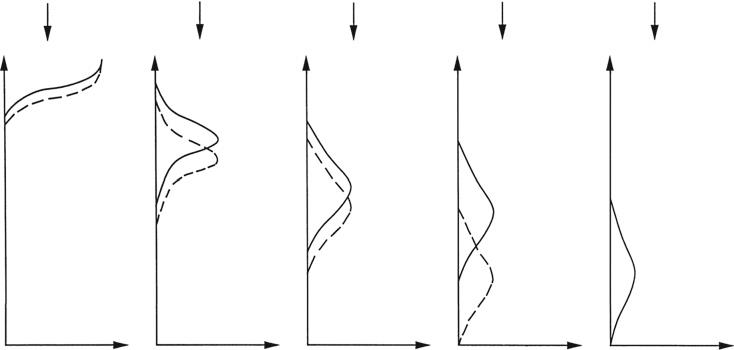

The graph of concentration of the components in the effluent against elution time is the **chromatogram**. The resin is the **stationary phase**; the liquid carrying the solutes is the **mobile phase**.

The mobile phase can also be a gas, as in gas chromatography, but **liquid chromatography** is the form relevant to bioprocessing. It achieves high purity and is therefore used for enrichment of bioproducts in the pharmaceutical industry — antibodies, recombinant proteins and nucleic acids used as therapeutics.

##### The five types

Each differs only in **what physical property drives the differential migration**.

**1. Adsorption chromatography** — uses **non-specific adsorption** of compounds against the stationary phase. The phase is typically crystals or particles of **silica gel, alumina, diatomaceous earth** or **charcoal**. Biological molecules adsorb on these materials driven mainly by **electrostatic forces**, and the order of elution depends primarily on **molecular polarity**. The polarity of the eluent (mobile phase) is also important in determining the degree of separation.

*Note:* although the principle is the same, adsorption chromatography is **different from the fixed-bed adsorption of Section 45**, which is a primary isolation method. There the aim is to capture the product and release it in bulk; here it is to resolve similar species by differential migration.

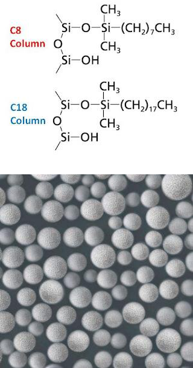

**2. Partition chromatography** — migration is driven by differential **partitioning between two "liquid" phases**. One liquid phase is immobilised onto a support such as silica, making it the stationary phase. A common stationary phase is **hydrocarbon with 8 or 18 carbons** bonded to silica gel: these are the **C8 and C18 packings**. The second liquid phase is the mobile phase, and common mobile phases are aqueous.

This is the same partition coefficient as Section 42, applied repeatedly rather than once.

**3. Gel chromatography** — also called **molecular-sieve, exclusion, gel filtration** or **gel-permeation chromatography**. The stationary phase is **hydrogel beads of defined pore size**, made of crosslinked **dextran, agarose** or **polyacrylamide**.

Migration rate depends on the **size** of the molecules. Small molecules enter the pores of the gel beads and migrate down the column slowly; large molecules flow past the beads and **leave the column fastest**. This inverts the usual expectation and is the basis of the quantitative treatment in Section 47.

**4. Ion-exchange chromatography** — differential migration is caused by **electrostatic interactions** between the stationary phase and the target molecules. For proteins, **pH needs to be kept away from the pI**, so that the proteins are charged.

If the stationary phase is negatively charged and the analyte positively charged, it is **cation-exchange chromatography**:
$$S^-C^+ + A^+B^- \rightarrow S^-A^+ + C^+ + B^- \tag{83}$$
where $S^-$ are the anionic groups on the stationary phase, $A^+$ the target analyte, and $C^+$ and $B^-$ are counterions. The target *swaps places* with the exchangeable cation $C^+$.

If the stationary phase is positively charged and the analyte negatively charged, it is **anion-exchange chromatography**:
$$S^+C^- + A^-B^+ \rightarrow S^+A^- + C^- + B^+ \tag{84}$$

**Elution is accelerated by increasing the salt concentration**, which raises the concentration of competing counterions and displaces the analyte. Ion exchange is used commercially for enrichment of proteins and antibiotics.

**5. Affinity chromatography** — the principle is **specific binding** between the target compound and the stationary phase. Ligands are chemically connected to the stationary phase and specifically bind recombinant proteins, enzymes, antibodies, hormones, nucleic acids and vitamins. It is **highly specific and often used for high-added-value products**.

*Ni-NTA.* A very common approach uses **nitrilotriacetic acid (NTA)** as ligand. NTA forms a complex with **Ni²⁺**, and the Ni-NTA complex binds strongly to **histidine residues**. Target recombinant proteins are purposefully modified to have a **6×His tag** at one end, so that they can be specifically captured by the Ni-NTA complex.

This is why the His₆ tag of Section 24's purification workflow exists: the tag is added at the gene level precisely so that one generic resin can purify any protein.

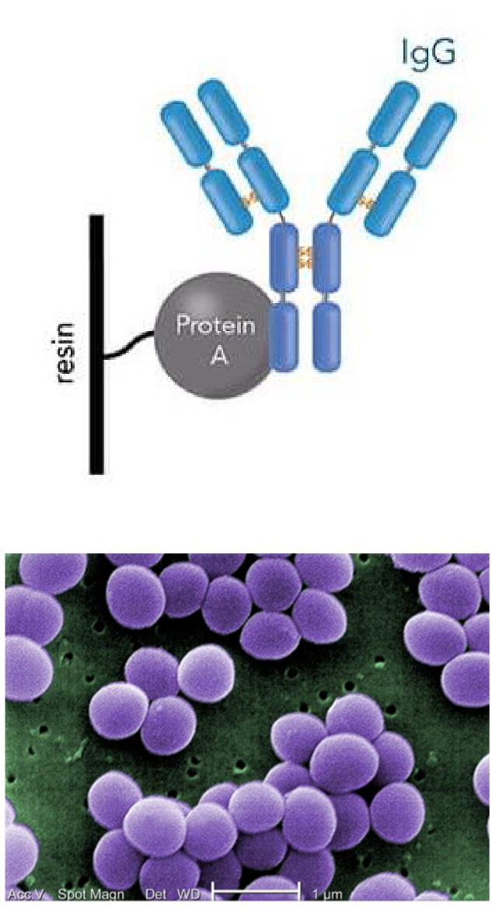

*Protein A.* Another common ligand, used for separation of immunoglobulins G. Protein A occurs naturally on the surface of *Staphylococcus aureus*, where it binds IgG from a **conserved region of the heavy chain that is not involved in antigen recognition** — the bacterium uses this to bind IgG the wrong way round, disrupting the immune response. Fc binding makes capture largely independent of antigen specificity, but affinity depends on species and IgG subclass; human IgG3 is a common weak/non-binding exception. The ligand and operating conditions must therefore be checked for the actual antibody.

#### Motivation and explanation

**Why combine types.** Each exploits a different molecular property — polarity, partition, size, charge or specific binding — so impurities that resemble the product in one property may differ in another. Antibody purification commonly uses Protein A capture followed by one or more polishing steps such as ion exchange. Size exclusion can remove aggregates, especially at laboratory scale, but its loading and dilution limits mean it is not a universal final step in manufacturing.

**The capacity/selectivity trade.** Affinity can provide strong selectivity at high resin cost. Capacity depends on ligand density, accessible pores and operating conditions; it is not necessarily low. High-resolution size exclusion has a small sample-volume limit, making it useful for polishing suitable partly purified samples. Resin cost and lifetime, loading, resolution and recovery must be compared for the actual process.

**Why gel chromatography differs.** Ideal size exclusion separates by pore access rather than binding. The sample elutes in the running buffer, without a separate change of conditions to desorb it. It generally dilutes the sample and has a bounded ideal elution window. Departures from ideal exclusion require checking for matrix interactions.

#### Link to other topics

Repeated equilibration down a column to amplify a small single-stage separation factor is precisely the logic of a distillation column's stages, and the same argument underlies the staged selection of Section 19: one weak discrimination applied many times becomes a strong one.

#### Summary

Chromatography separates by differential migration — solutes that bind more spend more time stationary and move more slowly, so a small affinity difference applied repeatedly becomes a large separation in space. The five types differ only in the property exploited: polarity, partition, size, charge or specific binding, with affinity ligands such as Ni-NTA and Protein A giving the highest selectivity.

### Section 47: Quantifying differential migration, and final isolation

#### Intuition

A solute's position in the chromatogram is reported as the **elution volume** $V_e$: the volume of eluent that has passed when the solute emerges at peak concentration. Volume is used rather than time because it is independent of flow rate.

In general chromatography the reference is the hold-up volume of an unretained marker. For the size-exclusion treatment here, $V_0$ specifically denotes the interparticle void volume, measured using a fully excluded marker. A smaller non-binding molecule can enter pores and elute later than $V_0$ without adsorbing. The dimensionless quantity $(V_e-V_0)/V_0$ below uses this stated reference.

In ideal size exclusion, pore access rather than binding determines elution. A fully excluded molecule elutes at $V_0$, while a fully permeating noninteracting molecule elutes at $V_0+V_i$. Intermediate molecules have intermediate retention. These bounds assume ideal exclusion without adsorption or other nonideal matrix interactions; real retention is not exactly predictable from nominal pore size alone.

*Analogy:* a crowd moving through a corridor lined with alcoves. People too large to enter any alcove pass straight through; small ones that wander into every alcove take longest. The analogy breaks down because entry here is not a choice but a geometric constraint, which is why the limits are hard.

#### Derivation

Notation: $V_e$ elution volume; $V_0$ void volume (between the particles); $V_i$ volume of empty space *within* the particles; $V_s$ volume of the material (hydrogel) making up the particles; $V_t$ total column volume.

##### Capacity factor and retention ratio

**Step 1: capacity factor.** The retention of a solute beyond the void volume, normalised:
$$k = \frac{V_e-V_0}{V_0} \tag{85}$$
$k = 0$ means the solute is unretained and elutes with the void. Larger $k$ means more retention. The normalisation by $V_0$ makes $k$ a property of the solute and the chemistry, not of the column size.

**Step 2: retention ratio.** Comparing two solutes 1 and 2:
$$\delta = \frac{k_1}{k_2} \tag{86}$$
This is a ratio of retention factors, not chromatographic resolution. With the later peak labelled 2, the usual separation factor is $\alpha=k_2/k_1$ for $k_1>0$. Resolution also requires peak widths: using baseline widths $w_1$ and $w_2$ in elution-volume units, $R_s=2(V_{e,2}-V_{e,1})/(w_1+w_2)$. Equal retention factors imply equal peak positions under the stated conditions, but a ratio different from one does not establish resolved peaks.

##### Gel chromatography

**Step 3: the column's volume budget.** The total column volume divides into three parts:
$$V_t = V_0 + V_i + V_s \tag{87}$$
liquid between particles, liquid inside particles, and the solid gel itself.

**Step 4: elution volume.** A solute travelling down the column has access to $V_0$ always, and to a *fraction* of $V_i$ depending on whether it fits into the pores:
$$V_e = V_0 + K_pV_i \tag{88}$$
where $K_p$ is the **partition coefficient**, defined as the fraction of the volume within the gel particles that is available to the solute.

**Step 5: rearrange for the measurable.**
$$K_p = \frac{V_e-V_0}{V_i} \tag{89}$$
So determining $K_p$ requires measuring $V_e$ and knowing $V_0$ and $V_i$.

**The two limits for ideal, noninteracting size exclusion:**
- **$K_p = 0$**: a large macromolecule that does not penetrate the gel particles at all. Then $V_e = V_0$ — it elutes in the void volume, *first*. This also gives the practical route to measuring $V_0$: run a molecule known to be excluded and record its elution volume.
- **$K_p = 1$**: a small solute with full access. Then $V_e = V_0+V_i$ — the latest anything can elute.

Hence $V_0 \le V_e \le V_0+V_i$ under ideal, noninteracting size exclusion. Combining (85) and (88), the capacity factor is
$$k = \frac{K_pV_i}{V_0} \tag{90}$$
so $k$ ranges from 0 to $V_i/V_0$ and cannot exceed it. **Gel chromatography has a bounded retention**, unlike the binding-based methods where strong binding can retain a solute arbitrarily long.

**Step 6: measuring $V_i$.** From the gel's properties:
$$V_i = a\,W_r \tag{91}$$
where $W_r$ is the **water retention value** — the volume of water taken up when rehydrating the gel, per unit dry mass, specified by the manufacturer — and $a$ is the dry mass of gel.

Often the gel is supplied already rehydrated, so $a$ is unknown. In that case:
$$V_i = \frac{W_r\rho_g}{1+W_r\rho_w}\left(V_t-V_0\right) \tag{92}$$
with $\rho_g$ the density of the rehydrated gel and $\rho_w$ the density of water. Note $(V_t-V_0) = V_i+V_s$ from (87): equation (92) splits the non-void volume into pore space and solid in the ratio the gel's water content implies.

#### Worked example

*Sizing the elution window of a gel column.* Computed in Python.

**Given.** A column of total volume $V_t = 100$ mL with void volume $V_0 = 30$ mL, packed with a hydrogel of water retention $W_r = 7.5$ mL g⁻¹ and rehydrated density $\rho_g = 1.05$ g mL⁻¹, with $\rho_w = 1.00$ g mL⁻¹.

**Step 1: internal pore volume**, from (92):
$$V_i = \frac{7.5\times1.05}{1+7.5\times1.00}(100-30) = \frac{7.875}{8.5}\times70 = 64.9\ \mathrm{mL}$$
From (87), $V_s = 100-30-64.9 = 5.1$ mL. **The gel matrix is only 5 % of the column volume** — the particles are essentially water held in a sparse polymer network, which is what a hydrogel is.

**Step 2: where solutes elute**, from (88) and (90):

| $K_p$ | $V_e$ (mL) | $k$ | Solute |
|---|---|---|---|
| 0 | 30.0 | 0 | macromolecule, fully excluded |
| 0.2 | 43.0 | 0.43 | large protein |
| 0.5 | 62.4 | 1.08 | medium protein |
| 1.0 | 94.9 | 2.16 | small solute, full access |

**Step 3: read the window.** Everything elutes between **30 and 95 mL**, a window of 64.9 mL — exactly $V_i$, as (88) requires. The last solute emerges at only 3.2 times the volume of the first.

**Step 4: relative retention of two proteins.** For $K_p = 0.2$ and $0.5$, the retention ratio from (86) is
$$\delta = \frac{0.43}{1.08} = 0.40$$
and the peak centres differ by $(0.5-0.2)\times64.9 = 19.5$ mL. The separation factor is $\alpha=1/\delta=2.5$, but $R_s$ cannot be calculated without peak widths.

**What the numbers say about the method.**
- *The sample volume must be small.* The entire separation happens within 65 mL, so injecting even 10 mL of feed would smear the peaks across a sixth of the usable window. This is the fundamental capacity limit of gel chromatography and why it is a **polishing** step, used last when the volume is already small.
- *It generally dilutes the sample.* SEC has no binding stage to accumulate product from a large feed before releasing it in a smaller volume. Band spreading usually increases the collection volume. Binding chromatography can concentrate product under suitable loading and elution conditions, but concentration is not guaranteed by chromatography type.
- *The ideal model is useful, but conditional.* Equation (88) relates retention to an effective pore-partition coefficient. This depends on solute hydrodynamic size and shape and the pore distribution. Buffer composition, pH and temperature can change solute conformation, association, gel swelling or unwanted interactions. Size calibration therefore needs standards and matched conditions.

#### Instrumentation

Two systems carry out chromatographic separations of biomolecules:

**HPLC (high-performance liquid chromatography)** often uses fine particles and sufficiently high pressure to control band spreading. Analytical systems commonly use micrometre-scale particles and low flow rates, but pressure and throughput depend on the column and duty; preparative HPLC also exists. Oligonucleotide purification (Section 06) is one application.

**FPLC (fast protein liquid chromatography)** describes systems designed for protein purification with compatible wetted materials, aqueous buffers, gradient control and fraction collection. They are used from laboratory purification to process development. Resolution depends on the resin, column and operating conditions, rather than being intrinsically lower than HPLC; pressure and flow limits depend on the particular system and column.

The trade is the familiar one: smaller particles give more plates and better resolution but a far larger pressure drop, so resolution is bought with pressure and throughput.

#### Final isolation

The product is already highly purified by chromatography. The objective of **final isolation** is possibly to **increase purity further**, and to **alter the physical form** of the product to make it suitable for storage and commercialisation.

Many products are packaged and sold as **solids or powders**. These go through either **precipitation or crystallisation** (Sections 43–44), followed by **filtration or centrifugation** (Sections 33–37), and the wet solids — crystals or amorphous precipitate — are then **dried**.

The operations are therefore ones already covered; what differs is the purpose. Earlier they were used to *separate*; here they are used to *formulate*.

#### Link to other topics

The capacity factor is the chromatographic analogue of a retention or holdup time, and the resolution-versus-pressure trade in HPLC is the same relationship as plate count against pressure drop in a packed column: finer packing improves separation and costs pumping energy.

#### Summary

The stated retention factor characterises elution relative to $V_0$, and $\delta=k_1/k_2$ compares retention rather than resolution. Ideal size exclusion gives $V_e=V_0+K_pV_i$ and a bounded elution window, governed by effective pore access under defined conditions.

### Conclusion

Retention describes migration, peak widths determine resolution, and final isolation sets the product form. The next unit develops gene regulation and synthetic circuits.

## 15. Gene regulation and synthetic circuits

### Overview

Gene expression couples transcription and translation to degradation and dilution. Regulatory proteins change synthesis rates; feedback motifs shape steady states and response times, stochastic events generate noise, and delayed cyclic repression can produce oscillations.

*Assumed throughout:* mass-action kinetics, first-order balances and DNA-to-RNA-to-protein information flow.

### Section 48: Kinetics of gene expression and steady state

#### Intuition

RNA polymerase (RNAP) repeatedly makes messenger RNA (mRNA) from a gene. Ribosomes repeatedly translate each message: translation does not consume the mRNA. Ribonucleases destroy messages, while proteins can disappear through proteolysis or become distributed among an increasing number of cells as the population grows.

*Analogy:* a workshop copies instructions, and each copy supports repeated manufacture until discarded. Keeping more copies increases production. The analogy fails at dilution: an intact protein can become less abundant per cell without being destroyed, because the workshop population grows and divides.

A steady abundance is therefore a **dynamic balance**, with continual synthesis replacing losses. It is not chemical equilibrium. Cells express different subsets of their genes because unnecessary transcription and translation consume resources; the active subset depends on the environment, not on a fixed universal fraction.

#### Derivation

##### Production and loss

Let $t$ be time in minutes, $m$ the mean number of messages for one gene per cell, and $p$ the mean number of its protein molecules per cell. Take one effective gene copy per cell, constant growth conditions, unsaturated machinery and negligible synthesis delays. Let $k_1$ be the transcription rate in messages cell$^{-1}$ min$^{-1}$, and $k_2$ the translation rate in proteins message$^{-1}$ min$^{-1}$. For one gene copy, $k_1$ is numerically the rate per gene. Let $\lambda_1$ and $\lambda_2$ be the effective message and protein loss constants, both in min$^{-1}$.

Over a short interval $dt$, synthesis adds $k_1dt$ messages and first-order loss removes $\lambda_1m\,dt$. Subtracting loss from production and dividing by $dt$ gives

$$\frac{dm}{dt}=k_1-\lambda_1m. \tag{93}$$

Each of the $m$ messages produces proteins at rate $k_2$, so total protein production is $k_2m$. Applying the same balance gives

$$\frac{dp}{dt}=k_2m-\lambda_2p. \tag{94}$$

The factor $m$ is essential: $k_2$ alone is a rate **per message**, not a rate per cell. Every term in (94) has units of proteins cell$^{-1}$ min$^{-1}$.

##### Why dilution enters a loss constant

Let $N$ be the number of cells, $P$ the total number of the protein molecules in the population, $\mu$ the exponential population growth constant, and $\delta_p$ the intrinsic protein degradation constant. Then $dN/dt=\mu N$. Production by all cells is $Nk_2m$, so $dP/dt=Nk_2m-\delta_pP$. Since $p=P/N$, the quotient rule gives

$$\frac{dp}{dt}=\frac{1}{N}\frac{dP}{dt}-\frac{P}{N^2}\frac{dN}{dt}
=k_2m-\delta_pp-\mu p
=k_2m-(\delta_p+\mu)p. \tag{95}$$

Thus $\lambda_2=\delta_p+\mu$: the last term appears because the denominator grows. Applying the identical population balance to messages gives $\lambda_1=\delta_m+\mu$, where $\delta_m$ is their intrinsic degradation constant. This is a population mean approximation; molecule numbers in a single lineage jump at division rather than undergoing smooth dilution.

##### Half-life and steady state

For a species of abundance $n$ after its production has stopped, $dn/dt=-\lambda n$. Separating variables gives $dn/n=-\lambda\,dt$. Integrating from initial abundance $n_0$ at $t=0$ yields $\ln(n/n_0)=-\lambda t$, hence $n=n_0e^{-\lambda t}$. At the half-life $t_{1/2}$, substitute $n/n_0=1/2$ and take natural logarithms:

$$-\ln2=-\lambda t_{1/2}
\quad\Rightarrow\quad \lambda=\frac{\ln2}{t_{1/2}}. \tag{96}$$

For a stable protein, $\delta_p\simeq0$, so its effective dilution half-life equals the population doubling time $T_d$: $\mu=\ln2/T_d$. This does not mean the protein is chemically degraded within that time.

At steady state, indicated by a superscript $*$, set the left-hand side of (93) to zero. Moving the loss term to the other side and dividing by $\lambda_1$ gives $m^*=k_1/\lambda_1$. Do the same in (94), then substitute this message abundance:

$$m^*=\frac{k_1}{\lambda_1},\qquad
p^*=\frac{k_2m^*}{\lambda_2}
=\frac{k_1k_2}{\lambda_1\lambda_2}. \tag{97}$$

To see how messages approach the balance, subtract $m^*$ from (93). For $u=m-m^*$, $du/dt=-\lambda_1u$, whose exponential solution above gives

$$m(t)=m^*+[m(0)-m^*]e^{-\lambda_1t}. \tag{98}$$

Starting from zero, $m(t)=m^*(1-e^{-\lambda_1t})$. At $t_{1/2}$ it has reached half its eventual value. Protein production still depends on this changing message pool, so protein accumulation is generally not a single exponential from switch-on.

#### Motivation and explanation

Longer message survival allows more templates to accumulate; longer protein survival allows more products to accumulate. This explains why the two loss constants multiply in the denominator of (97). With fixed losses, doubling transcription doubles both abundances, while changing translation affects protein abundance directly.

If production stops, abundance decays to zero when the corresponding loss constant is positive. If a species has no loss and positive production, it accumulates rather than reaching a finite steady state. The deterministic means also hide fluctuations, especially when message counts are small. Resource limitation, changing gene dosage, growth-dependent synthesis rates and feedback invalidate the constant-parameter approximation.

**Elongation speed is not initiation frequency.** A coding sequence of approximately 1,000 nucleotides takes about 33.3 s to transcribe at 30 nt s$^{-1}$; ignoring the stop codon, translation of its approximately 333 amino acids at 10 amino acids s$^{-1}$ also takes about 33.3 s. These transit times do not establish $k_1$ or $k_2$: several polymerases can occupy one gene and several ribosomes can occupy one message. Promoter initiation and the ribosome-binding site control the effective production rates.

#### Worked example

**Assume** $k_1=2$ messages cell$^{-1}$ min$^{-1}$ and $k_2=2$ proteins message$^{-1}$ min$^{-1}$ for one effective expressed gene copy. Use rounded effective loss constants $\lambda_1=0.14$ min$^{-1}$ and $\lambda_2=0.035$ min$^{-1}$, associated approximately with half-lives of 5 min and 20 min. The protein is treated as stable, with loss dominated by growth.

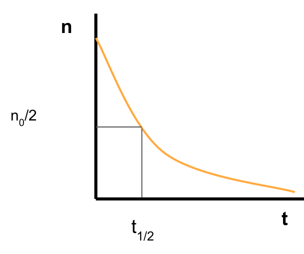

Substitute into (97), retaining unrounded intermediate values:

$$m^*=\frac{2}{0.14}\approx14.3\ \text{messages cell}^{-1},$$

$$p^*=\frac{2(2/0.14)}{0.035}\approx816\ \text{proteins cell}^{-1}.$$

The ratio $p^*/m^*=k_2/\lambda_2\approx57.1$ is the steady protein-to-message abundance ratio. It is not the number of proteins translated during one message's lifetime. At this balance, message loss is 2 messages cell$^{-1}$ min$^{-1}$ and protein loss is approximately 28.6 proteins cell$^{-1}$ min$^{-1}$, matching their respective production rates.

**What do the half-lives mean?** Using exactly $\lambda_1=\ln2/5$ and $\lambda_2=\ln2/20$ gives approximately 14.4 messages and 833 proteins per cell; the difference from 816 reflects rounding. If 5 min instead denotes the **intrinsic degradation half-life** of messages in a population doubling every 20 min, dilution must also enter their balance: $\lambda_1=\ln2/5+\ln2/20$. The effective message half-life is then 4.00 min, and (97) gives approximately 11.5 messages and 666 proteins per cell. Adding dilution to an already effective half-life would double-count it.

These are illustrative abundances for an expressed gene under specified rates, not averages that apply to every gene in a bacterial genome.

#### Link to other topics

These balances connect gene expression to the production and removal equations used in bioprocessing. Transcriptional regulation makes $k_1$ depend on signals and regulatory proteins, turning a constant-rate model into a gene regulatory network.

#### Summary

An expression level records both production and survival. Keeping transcription per gene, translation per message, intrinsic degradation and growth dilution distinct provides the basis for understanding how regulatory proteins change gene output.

### Section 49: Transcriptional regulation and the lac operon

#### Intuition

A **promoter** is a DNA region at which RNA polymerase (RNAP) initiates transcription. An **operator** is a DNA binding site for a regulatory protein; it may overlap the promoter or lie nearby. The promoter and operator are sequences, whereas the proteins that read them can change in abundance or activity.

*Analogy:* sigma factors provide RNAP with an address guide, repressors close selected doors and activators help it enter. The analogy fails because binding is reversible and probabilistic: promoters usually have graded initiation rates, not perfectly binary gates. Regulators can also affect DNA opening and promoter escape, rather than simply permitting physical access.

The pathway is **environmental signal → regulator activity → productive transcription → mRNA → protein → cellular function**. Regulation saves biosynthetic resources, supports adaptation and coordinates developmental changes where those occur. Regulatory proteins are themselves gene products, so one regulator can control the production of another and create a network.

#### Derivation

##### From DNA recognition to transcription rate

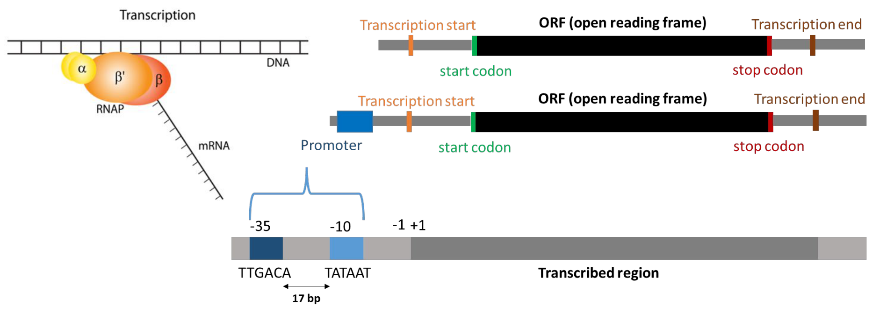

**First, assemble a promoter-recognising enzyme.** A sigma factor $\sigma$ binds the core RNAP to make the holoenzyme. For many promoters recognised by the principal bacterial factor $\sigma^{70}$, the important elements are centred near positions $-35$ and $-10$, measured upstream from the transcription start at $+1$. The consensus sequences TTGACA and TATAAT are reference patterns, not compulsory exact sequences at every promoter. Sigma contacts these elements and helps establish an open DNA complex from which RNA synthesis can begin.

**Next, select a programme.** Changing the available sigma factors changes the set of promoters efficiently recognised by RNAP. In *E. coli*, $\sigma^{70}$ supports much routine growth expression, $\sigma^{32}$ the cytoplasmic heat-shock response, and $\sigma^S$ much stationary-phase and stress expression. Such programmes overlap; a sigma factor does not guarantee expression of every compatible gene.

**Then, tune specific promoters.** A repressor bound at an operator can interfere with productive initiation. An activator bound nearby can recruit RNAP or facilitate initiation. Binding-site placement and protein interactions determine the mechanism. The ribosome-binding site (RBS) lies in the message and controls translation initiation; it is distinct from the promoter and from the start codon that defines the protein reading frame.

Let $k_1$ denote the mean transcription rate per effective gene copy in messages min$^{-1}$. For a minimal two-state promoter, let $f$ be the fraction of time in a transcription-permissive state, $k_{\mathrm{on}}$ its productive transcription rate in that state, and $k_{\mathrm{off}}$ the rate in the other state. The state fractions sum to one, so averaging the rates gives

$$k_1=fk_{\mathrm{on}}+(1-f)k_{\mathrm{off}}. \tag{99}$$

With negligible residual transcription, set $k_{\mathrm{off}}\simeq0$ to obtain $k_1\simeq fk_{\mathrm{on}}$. Regulators change $f$, and can also change the state-specific rates. Equation (99) is an illustrative average, not a complete quantitative model of a real promoter with multiple binding sites.

##### The sign of control and the sign of the signal

A transcriptional **repressor** lowers output when its active form binds DNA: its regulatory edge is drawn with a blunt end. An **activator** raises output when bound: its edge is drawn with an arrowhead. These signs describe the regulator's effect, not necessarily the effect of a signal on the gene.

**Allostery** means that binding a signal at one site changes a protein's conformational preferences and its activity at another site. A signal that weakens a repressor increases transcription by removing inhibition; a signal that activates an activator also increases transcription. Both implement an inducing response despite opposite signs of DNA-level control. Conversely, a signal can strengthen a repressor or disable an activator and thereby reduce transcription.

#### Motivation and explanation

**Why retain both positive and negative control?** The same signal–output relationship can be built with either an activator or a repressor. The **demand rule** is an evolutionary tendency: genes needed near their high expression level for much of the natural environment tend towards positive control; rarely needed genes tend towards negative control.

One proposed explanation assumes that an unoccupied regulatory site is more vulnerable to inappropriate binding than a site occupied by its intended regulator. High demand favours an activator occupying its site while output is high; low demand favours a repressor occupying its site while output is low. This protects the state most often required. It is a conditional explanation, not a universal design law: costs, binding specificity, history and multiple regulators can change the choice. In engineering, desired basal expression, response range and host compatibility matter alongside demand.

Removing a repressor therefore permits transcription without necessarily producing maximal transcription. A suitable sigma factor, accessible promoter and any required activator must still be present. Regulatory occupancy changes rapidly, but protein abundance responds with the synthesis and loss timescales of the expression balances.

#### Worked example

##### How lactose induces the lac operon

The **lac operon** is a bacterial transcription unit producing a message with several protein coding regions: **lacZ** encodes $\beta$-galactosidase, **lacY** a lactose permease, and **lacA** a thiogalactoside acetyltransferase associated with detoxification of some non-metabolised galactosides. The **lacI** gene has its own promoter and supplies the LacI repressor.

**Without lactose**, LacI binds the lac operator region and strongly represses transcription. Its ability to bind additional operators and loop DNA strengthens repression. Repression is incomplete, leaving low basal production of LacY and LacZ.

**When lactose is available**, basal LacY imports it, and LacZ both hydrolyses lactose and converts some into **allolactose**. Allolactose binds LacI away from its DNA-binding surface and reduces operator affinity through allostery. Operator occupancy falls and transcription becomes easier. The new LacY and LacZ support further uptake and processing; induction does not require a chemically impossible first step with absolutely no permease or enzyme present.

**The carbon-source context also matters.** The activator CAP, also called CRP (cAMP receptor protein), responds to cyclic AMP (cAMP). In the usual simplified glucose–lactose comparison, low glucose supports greater cAMP–CAP activation. Bound CAP helps productive initiation at the lac promoter. Thus lactose relieves negative control, while low glucose supports positive control.

| Lactose available | Glucose available | LacI repression | cAMP–CAP activation | Qualitative lac output |
|---|---|---|---|---|
| No | Yes | Strong | Weak | Very low |
| No | No | Strong | Strong | Low: activation does not remove repression |
| Yes | Yes | Relieved if intracellular inducer accumulates | Weak | Limited |
| Yes | No | Relieved | Strong | High |

The high-output response resembles “lactose present AND glucose scarce”. It is an approximate logic description: intracellular inducer, DNA looping and interactions between CAP and LacI affect the graded response. Glucose can also restrict lactose uptake through inducer exclusion, so external lactose alone does not guarantee induction.

**A conceptual perturbation.** Deleting lacI removes the lactose-sensitive brake, but the native lac promoter still responds to CAP and carbon-source conditions. Deleting crp removes CAP activation; relieving LacI alone then cannot restore the normal high-output state. The two controls answer different questions: is lactose available, and should the cell invest strongly in using it?

Signals can also reach transcription factors by phosphorylation rather than direct ligand binding. For example, extracellular glucose-6-phosphate is sensed through the Uhp membrane signalling system, activating the response regulator UhpA and transcription of the transporter gene uhpT. The same environmental-input-to-transcription logic can therefore use different molecular mechanisms.

#### Link to other topics

Promoter and RBS design connect DNA assembly to controlled protein production. Linking regulated promoters to genes encoding further regulators creates feedback, switches and oscillators, whose dynamics depend on both regulatory interactions and molecular lifetimes.

#### Summary

Sigma factors establish promoter recognition, specific transcription factors tune productive initiation, and signals change the active state of those factors. The lac operon combines relief of repression with activation to connect resource availability to enzyme production; those same components can be recombined into synthetic circuits.

### Section 50: Network motifs and autoregulation

#### Intuition

A self-repressor initially leaves its promoter free, allowing rapid production. As it accumulates, it occupies the operator and reduces further transcription. A self-activator does the reverse: initial expression is weak, but accumulated activator recruits more RNA polymerase.

*Analogy:* NAR resembles a thermostatic heater that reduces power as the room warms; PAR resembles a microphone feeding its own amplified sound back into the input. The analogy ends at the molecular mechanism: proteins arrive at DNA randomly, production takes time, and the cell shares finite resources with other genes.

A **network motif** is a small wiring pattern enriched relative to a specified random-network model. Frequency alone does not establish either enrichment or biological function. For example, in a network snapshot with 424 nodes, 519 arrows and 40 self-arrows, uniformly choosing directed connections gives self-arrow probability $1/424$ and expected count $519/424=1.224$. The observed count is 32.68 times this expectation. This simple null ignores which nodes are transcription factors and their unequal degrees; a stronger test preserves those constraints. The snapshot contains 34 negative and six positive self-arrows.

#### Derivation

**Promoter occupancy → Hill response.** Suppose an effective cooperative binding event has bound-to-free promoter probability ratio $(R/K)^n$, where $R$ is active regulator concentration, $K$ the half-occupancy concentration, and $n$ the Hill exponent. Normalising the free-state weight 1 and bound-state weight $(R/K)^n$ gives

$$P_{\mathrm{free}}=\frac{1}{1+(R/K)^n},\qquad P_{\mathrm{bound}}=\frac{(R/K)^n}{1+(R/K)^n}.\tag{100}$$

*Reason:* mutually exclusive state probabilities sum to one. For a literal all-or-none binding reaction, mass action supplies the ratio; otherwise $n$ is an effective fitted exponent, not necessarily a count of binding sites.

Let $\beta$ be the additional production rate when the promoter is fully active and $b$ its basal production rate, both in concentration/time. Production then has the forms

$$f_{\mathrm{NAR}}(x)=b+\frac{\beta}{1+(x/K)^n},\qquad f_{\mathrm{PAR}}(x)=b+\frac{\beta(x/K)^n}{1+(x/K)^n}.\tag{101}$$

*Reason:* repression permits transcription in the free state; activation permits the additional transcription in the bound state. Set $R=x$ only when concentration is proportional to active regulator abundance. Promoter equilibration and mRNA relaxation must be fast compared with changes in $x$.

For large $n$, repression approaches an ON/OFF rule: $\beta$ below $K$, zero above $K$, plus any basal rate. The finite Hill curve still has half activity at $K$; the discontinuous approximation does not specify a unique value there. It is useful for Boolean logic, but unreliable for calculating a derivative at the threshold. Two inputs that can each initiate production implement OR; allowing either input to make a common repressor gives a downstream NOR output, subject to threshold and leak limitations.

**Rate plots → stability and response.** Production minus removal gives

$$\frac{dx}{dt}=f(x)-\lambda x,\qquad f(x_{\mathrm{st}})=\lambda x_{\mathrm{st}}.\tag{102}$$

The vertical gap between the curves is the rate of movement along the concentration axis.

Put $x=x_{\mathrm{st}}+\delta x$. Taylor expansion gives $f(x)=f(x_{\mathrm{st}})+f'(x_{\mathrm{st}})\delta x+O(\delta x^2)$. Subtract the steady balance to cancel the constant terms:

$$\frac{d\delta x}{dt}\simeq-[\lambda-f'(x_{\mathrm{st}})]\delta x,
\quad \delta x(t)=\delta x(0)e^{-t/\tau_{\mathrm{eff}}},
\quad \tau_{\mathrm{eff}}=\frac{1}{\lambda-f'(x_{\mathrm{st}})}.\tag{103}$$

*Reason:* the local production slope changes how strongly a displacement restores the balance. Stability requires $f'<\lambda$. NAR has $f'<0$, giving faster local relaxation. Stable PAR with $0<f'<\lambda$ relaxes more slowly; $f'>\lambda$ makes the intersection unstable. A sufficiently sigmoid PAR curve can have two stable intersections separated by an unstable one, enabling memory and hysteresis. PAR alone does not guarantee bistability.

For constant production $k$ and $x(0)=0$, multiply $\dot x+\lambda x=k$ by $e^{\lambda t}$ and integrate:

$$e^{\lambda t}x=\frac{k}{\lambda}(e^{\lambda t}-1),\qquad
x=\frac{k}{\lambda}(1-e^{-\lambda t}),\qquad t_{1/2}=\frac{\ln2}{\lambda}.\tag{104}$$

*Reason:* the integrating factor turns the left side into one derivative; setting $x$ to half $k/\lambda$ then gives the rise-time. For dilution alone, $\lambda=\ln2/T_d$, where $T_d$ is doubling time, so this half-rise takes one generation. Comparisons of feedback circuits must match the final concentration; simply strengthening a constitutive promoter changes its endpoint.

**Rate plots → sensitivity.** Allow production to depend on a parameter $u$. Differentiate $f(x_{\mathrm{st}},u)=\lambda x_{\mathrm{st}}$ at fixed $\lambda$:

$$f_x\frac{dx_{\mathrm{st}}}{du}+f_u=\lambda\frac{dx_{\mathrm{st}}}{du},\qquad
\frac{dx_{\mathrm{st}}}{du}=\frac{f_u}{\lambda-f_x}.\tag{105}$$

*Reason:* the parameter both moves the production curve and changes the concentration at which it is evaluated. Subscripts indicate partial derivatives evaluated at the steady state. For no leak, $f=\beta h(x)$, define the dimensionless feedback strength $L=-f_x/\lambda$. Since $f_\beta=f/\beta=\lambda x_{\mathrm{st}}/\beta$,

$$\frac{d\ln x_{\mathrm{st}}}{d\ln\beta}=\frac{1}{1+L},\qquad
\frac{d\ln x_{\mathrm{st}}}{d\ln\lambda}=-\frac{1}{1+L}.\tag{106}$$

*Reason:* divide (105) by $x_{\mathrm{st}}/\beta$; for the second result differentiate the steady balance with respect to $\lambda$ instead. For no-leak NAR, differentiating (101) and using (102) gives $L=n(x_{\mathrm{st}}/K)^n/[1+(x_{\mathrm{st}}/K)^n]$.

#### Motivation and explanation

A falling production curve makes shifts in production capacity or removal rate move the intersection less. Equations (105)–(106) concern small, slow perturbations; they do not prove suppression of all intrinsic noise or rapidly fluctuating inputs. Noise in the threshold $K$, strong expression burden, saturation and delayed repression can defeat this protection. A smooth one-variable autonomous balance can relax monotonically but cannot sustain an oscillation: molecular intermediates or delayed feedback must supply additional dynamics.

#### Worked example

**Matched endpoint.** Choose $K=x_{\mathrm{st}}=100\ \mathrm{nM}$, $n=2$, $b=0$, and dilution doubling time $T_d=30\ \mathrm{min}$. Python gives $\lambda=0.0231049\ \mathrm{min^{-1}}$. At $x=K$, production is $\beta/2$, so (102) requires $\beta=2\lambda K=4.62098\ \mathrm{nM\,min^{-1}}$. Differentiating (101) at $K$ gives $f'=-\beta/(2K)=-\lambda$, hence $L=1$.

The local half-relaxation time is $\ln2/(2\lambda)=15.00\ \mathrm{min}$, versus $30.00\ \mathrm{min}$ without feedback. A slow 10% change in $\beta$ produces approximately a 5% change in $x_{\mathrm{st}}$ by (106). Integrating the full nonlinear balance from zero gives a half-rise of **13.89 min**. This differs from local half-relaxation because the initially unrepressed promoter produces faster than it does near the endpoint.

**Switching check.** For no-leak PAR with $n=2$, $K=100\ \mathrm{nM}$, $\beta=4\ \mathrm{nM\,min^{-1}}$ and $\lambda=0.01\ \mathrm{min^{-1}}$, (102) becomes $x[\beta x/(K^2+x^2)-\lambda]=0$. Nonzero roots satisfy $\lambda x^2-\beta x+\lambda K^2=0$. The quadratic formula gives $x=[\beta\pm\sqrt{\beta^2-4\lambda^2K^2}]/(2\lambda)$. Python finds stable endpoints at 0 and 373.21 nM, separated by the unstable 26.79 nM threshold. With exactly zero leak and zero protein, the deterministic circuit remains OFF; an external pulse must cross the threshold. Real basal transcription can start it spontaneously and can also remove bistability.

#### Link to other topics

The Hill response extends promoter binding into a dynamical gene-expression model. Rate-plot slopes are the biological counterpart of local feedback gains in process control, while intrinsic expression fluctuations require a discrete reaction model.

#### Summary

NAR creates a restoring production slope; PAR creates a reinforcing one. The slope at a steady balance determines local speed and sensitivity, and the shape of the full production curve determines whether switching is possible.

### Section 51: Stochastic gene expression and noise

#### Intuition

A low-copy transcription factor finds an operator by diffusion and stochastic binding. One promoter therefore switches between inactive and active states even under fixed conditions. During an active interval, several transcripts can be made; each transcript can yield several proteins before being degraded. Long-lived proteins integrate these upstream events and smooth fast fluctuations.

*Analogy:* two printers sharing a power supply can both speed up or slow down together, but their individual paper-feed events differ. Two genetic reporters similarly share cellular resources while undergoing separate expression events. The limit is that reporters can themselves compete for those resources, breaking the assumed independence.

**Intrinsic noise** is variation remaining when the relevant shared cellular state is fixed. **Extrinsic noise** is variation transmitted from that shared state, such as polymerase abundance, growth, regulator concentration or gene dosage. These labels depend on the system boundary: stochastic promoter switching is intrinsic to a complete expression model, but is an upstream fluctuating input when analysing only mRNA birth and death.

#### Derivation

**1. Birth and death set a baseline.** Let mRNA be made at constant rate $k_m$ (copies/min) and each molecule disappear at rate $\lambda_m$ (per min). A birth changes $m$ by $+1$ and a death by $-1$, with total death rate $\lambda_m m$. Taking expected changes gives

$$\frac{d\langle m\rangle}{dt}=k_m-\lambda_m\langle m\rangle,
\qquad \overline m=\frac{k_m}{\lambda_m}.\tag{107}$$

A bar denotes a stationary mean. For the second moment, the changes in $m^2$ are $(m+1)^2-m^2=2m+1$ and $(m-1)^2-m^2=-2m+1$. Multiply each by its event rate and average:

$$\frac{d\langle m^2\rangle}{dt}=k_m(2\langle m\rangle+1)
+\lambda_m[-2\langle m^2\rangle+\langle m\rangle].\tag{108}$$

At stationarity substitute $k_m=\lambda_m\overline m$, set (108) to zero, and divide by $2\lambda_m$. This gives $\langle m^2\rangle=\overline m^2+\overline m$, hence

$$V_m=\overline m,\qquad \mathrm{CV}_m^2=\frac{V_m}{\overline m^2}=\frac{1}{\overline m}.\tag{109}$$

Here $V_m$ is variance, and coefficient of variation $\mathrm{CV}=\sigma/\mu$ divides standard deviation $\sigma$ by mean $\mu$. The full stationary birth–death distribution is Poisson. This baseline requires independent single-molecule births and first-order deaths; bursts and fluctuating rates add variance.

**2. Add a switching promoter.** One promoter has $g=0$ (OFF) or $g=1$ (ON), with switching rates $k_{\mathrm{on}}$ and $k_{\mathrm{off}}$. Define $a=k_{\mathrm{on}}+k_{\mathrm{off}}$ and correlation time $\tau_g=1/a$. The mean obeys $d\langle g\rangle/dt=k_{\mathrm{on}}-a\langle g\rangle$, so

$$q\equiv P_{\mathrm{on}}=\overline g=\frac{k_{\mathrm{on}}}{a},\qquad
V_g=q(1-q),\qquad \frac{V_g}{\overline g^2}=\frac{1-q}{q}.\tag{110}$$

*Reason:* $g^2=g$ for a binary variable. For $N_g$ independent identical promoters, $\overline g=N_gq$ and $V_g=N_gq(1-q)$, giving relative variance $(1-q)/\overline g$.

Let transcription occur at rate $k_mg$ and define $\tau_m=1/\lambda_m$. Equation (107) becomes $\overline m=k_mq/\lambda_m$. Write $C_{gm}=\operatorname{Cov}(g,m)$. Promoter switching changes $gm$ through changes in $g$, and transcription changes it through changes in $m$. Specifically,

$$\frac{d\langle gm\rangle}{dt}=k_{\mathrm{on}}\langle m\rangle
-(a+\lambda_m)\langle gm\rangle+k_m\langle g^2\rangle.\tag{111}$$

*Reason:* switching contributes $k_{\mathrm{on}}\langle(1-g)m\rangle-k_{\mathrm{off}}\langle gm\rangle$; transcription contributes $k_m\langle g^2\rangle$; death contributes $-\lambda_m\langle gm\rangle$. At stationarity subtract the product of the means, use $k_{\mathrm{on}}=aq$, and obtain $C_{gm}=k_mV_g/(a+\lambda_m)$.

Applying the squared-jump calculation (108) with production $k_mg$ gives $V_m=\overline m+k_mC_{gm}/\lambda_m$. Divide by $\overline m^2$, substitute $C_{gm}$ and $\overline m$, and cancel the production rates:

$$\mathrm{CV}_m^2=\frac{1}{\overline m}
+\frac{1-q}{q}\frac{\tau_g}{\tau_g+\tau_m}.\tag{112}$$

*Reason:* $\lambda_m/(a+\lambda_m)=\tau_g/(\tau_g+\tau_m)$. The first term is transcript birth–death noise; the second is propagated promoter noise. Fast switching, $\tau_g\ll\tau_m$, is averaged away; slow switching is transmitted almost completely. For independent multiple promoters replace $(1-q)/q$ by $(1-q)/\overline g$.

**3. Add translation.** Let protein births occur at rate $k_pm$, where $k_p$ is proteins per transcript per min, and protein loss at rate $\lambda_pp$. Define $\tau_p=1/\lambda_p$, $\overline p=k_p\overline m/\lambda_p$, $C_{gp}=\operatorname{Cov}(g,p)$ and $C_{mp}=\operatorname{Cov}(m,p)$. The same event bookkeeping, after subtracting products of stationary means, gives

$$C_{gp}=\frac{k_pC_{gm}}{a+\lambda_p},\qquad
C_{mp}=\frac{k_mC_{gp}+k_pV_m}{\lambda_m+\lambda_p},\qquad
V_p=\overline p+\frac{k_pC_{mp}}{\lambda_p}.\tag{113}$$

*Reason:* promoter switching and protein loss remove $gp$ covariance, while translation supplies $k_pC_{gm}$. Transcript and protein losses remove $mp$ covariance, while transcription and translation supply $k_mC_{gp}$ and $k_pV_m$. Protein births and deaths contribute the Poisson baseline $\overline p$ to its variance. No reaction changes both $m$ and $p$ at once: translation does not consume the transcript.

Insert $V_m=\overline m+k_mC_{gm}/\lambda_m$ into (113), and divide $V_p$ by $\overline p^2$. Before changing to lifetimes the result is

$$\mathrm{CV}_p^2=\frac{1}{\overline p}
+\frac{\lambda_p}{\overline m(\lambda_m+\lambda_p)}
+\frac{1-q}{q}\frac{\lambda_m\lambda_p}{(a+\lambda_m)(\lambda_m+\lambda_p)}
\left(1+\frac{\lambda_m}{a+\lambda_p}\right).\tag{114}$$

*Reason:* the three contributions arise from protein births, transcript variance at fixed promoter input, and promoter variance. Substitute each $\lambda=1/\tau$ and $a=1/\tau_g$; combining the terms in parentheses gives the equivalent filtering form

$$\mathrm{CV}_p^2=\frac{1}{\overline p}
+\frac{1}{\overline m}\frac{\tau_m}{\tau_m+\tau_p}
+\frac{1-q}{q}\frac{\tau_m}{\tau_m+\tau_p}
\frac{\tau_g}{\tau_g+\tau_p}
\frac{\tau_g+\tau_p+\tau_g\tau_p/\tau_m}{\tau_g+\tau_m}.\tag{115}$$

All ratios are dimensionless. With a fixed ON promoter the last term vanishes. With $\tau_p\to0$ at fixed means, the transcript and promoter contributions approach those in (112); with $\tau_p\to\infty$ fast upstream fluctuations are averaged away. These limiting comparisons hold means fixed by adjusting production; changing a lifetime alone also changes the mean.

**4. Two reporters distinguish common and independent fluctuations.** Let $R$ and $G$ be background-corrected reporter signals and $\mu_R=\langle R\rangle$, $\mu_G=\langle G\rangle$ their positive means. Normalise $r=R/\mu_R$ and $s=G/\mu_G$. If $Z$ represents the shared cellular state, assume both reporters have the same conditional mean $h(Z)$ and are independent conditional on $Z$. Write $r=h+\epsilon_r$ and $s=h+\epsilon_s$, with conditional zero-mean residuals of equal average variance $v$.

Taking variances and covariance gives $\operatorname{Var}(r)=\operatorname{Var}(h)+v$ and $\operatorname{Cov}(r,s)=\operatorname{Var}(h)$. Subtraction cancels $h$, and conditional independence gives $\langle(r-s)^2\rangle=2v$. Therefore

$$\eta_{\mathrm{int}}^2=\frac{\langle(r-s)^2\rangle}{2},\qquad
\eta_{\mathrm{ext}}^2=\langle rs\rangle-1,\qquad
\eta_{\mathrm{tot}}^2=\frac{\operatorname{Var}(r)+\operatorname{Var}(s)}{2}
=\eta_{\mathrm{int}}^2+\eta_{\mathrm{ext}}^2.\tag{116}$$

Here $\eta$ denotes a dimensionless noise amplitude, equivalent to CV for a single matched reporter. For equal means $\mu$, intrinsic noise becomes $\langle(R-G)^2\rangle/(2\mu^2)$ and extrinsic noise $\operatorname{Cov}(R,G)/\mu^2$. Add **squared** amplitudes, not amplitudes.

#### Motivation and explanation

Shared inputs elongate a reporter scatter cloud along the equal-signal diagonal; independent events widen it perpendicular to that line. Parallel width contains intrinsic variation too, so it cannot all be assigned to extrinsic noise: the covariance or subtraction in (116) is needed.

Stationarity alone does not imply ergodicity. Time averages agree with ensemble averages only if the process samples the relevant states, records are long enough, and population/lineage sampling is appropriate. Slow switching, changing environments, selection of fast growers and ageing can break that equivalence. Fluorescence additionally depends on maturation, bleaching, segmentation and measurement noise. Independent measurement noise inflates the intrinsic estimate; unequal reporter dynamics and competition violate the matched-independent-reporter model.

#### Worked example

**A noisy cascade.** Choose $k_{\mathrm{on}}=0.12$, $k_{\mathrm{off}}=0.18$, $\lambda_m=0.20$ and $\lambda_p=0.020\ \mathrm{min^{-1}}$, with $k_m=10$ transcripts/min while ON and $k_p=2$ proteins per transcript per min. Python gives $q=0.40$, $\tau_g=3.333\ \mathrm{min}$, $\tau_m=5.00\ \mathrm{min}$ and $\tau_p=50.0\ \mathrm{min}$; the means are 20 transcripts and 2000 proteins.

Equation (112) gives $\mathrm{CV}_m^2=0.0500+0.6000=0.6500$, hence $\mathrm{CV}_m=0.8062$, compared with the constant-production Poisson baseline 0.2236. Equation (115) gives $\mathrm{CV}_p^2=0.000500+0.004545+0.088636=0.093682$, hence $\mathrm{CV}_p=0.3061$. Protein smooths the mRNA trajectory but retains appreciable upstream variation. Here promoter switching is part of the model's intrinsic stochasticity; its propagated term is not automatically the dual-reporter extrinsic component.

**Reporter calculation.** For a constructed population with mean signals both 100 units, variances both 225 units squared, and covariance 144 units squared, the mean squared difference is $225+225-2(144)=162$ units squared. Equation (116) gives $\eta_{\mathrm{int}}=0.0900$, $\eta_{\mathrm{ext}}=0.1200$ and $\eta_{\mathrm{tot}}=0.1500$. Extrinsic variation contributes more variance in this example. The figure's negative coordinates represent centred signal deviations, not negative molecular counts; its diagonal elongation suggests shared variation, without supplying precise numerical estimates.

#### Link to other topics

Promoter occupancy becomes a probability distribution when binding events are resolved individually. The same production–loss mechanism gives both mean expression and variance, while feedback changes how these fluctuations propagate into downstream circuits.

#### Summary

Low copy numbers make reaction timing consequential. A two-reporter experiment separates shared and independent variation only under explicit matching and independence assumptions; lifetime ratios determine which upstream fluctuations survive into protein abundance.

### Section 52: Feedback, delay and the repressilator

#### Intuition

If a promoter keeps responding to an earlier low repressor level, production continues after the present level is already high. Later, repression persists after the repressor has fallen. The result can be an overshoot, a damped oscillation, or sustained cycling if loop strength and delay destabilise the steady state.

*Analogy:* adjusting shower temperature using water that left the mixer several seconds ago can cause repeated overcorrection. The analogy has limits: gene-expression delays are distributions of molecular waiting times, and regulators are discrete molecules with noisy synthesis and loss.

The **repressilator** uses the sequence LacI represses TetR → TetR represses λ CI → λ CI represses LacI. Three inhibitions yield a negative loop; each intervening expression step adds response time. If LacI is high, TetR falls, CI rises, and CI eventually represses LacI. CI then falls after TetR recovers, allowing the cycle to restart. A TetR-controlled fluorescent reporter observes the circuit and is not one of its three core repressors.

#### Derivation

**1. Make delay explicit.** A simplified fixed delay $T$ replaces current concentration in the production term by earlier concentration:

$$\frac{dx(t)}{dt}=f[x(t-T)]-\lambda x(t).\tag{117}$$

*Reason:* loss acts on the protein present now, while newly arriving active protein reflects the promoter state earlier. A delay equation requires an initial history over $-T\leq t\leq0$, not just one initial value. It is an approximation to several finite-duration biochemical steps.

At the steady balance $f(x_{\mathrm{st}})=\lambda x_{\mathrm{st}}$, write $x=x_{\mathrm{st}}+y$ and define $a=-f'(x_{\mathrm{st}})>0$. Taylor-expand production and cancel the steady terms:

$$\dot y(t)=-\lambda y(t)-a\,y(t-T).\tag{118}$$

*Reason:* $a$ is the local restoring production slope, with units inverse time. Try $y=e^{st}$, where $s$ is a possibly complex growth rate, and divide by $e^{st}$:

$$s+\lambda+a e^{-sT}=0.\tag{119}$$

Without delay this has $s=-(\lambda+a)$ and decays. To locate the first oscillatory instability, set $s=i\omega$, where $i^2=-1$ and $\omega>0$ is angular frequency. Expand $e^{-i\omega T}=\cos(\omega T)-i\sin(\omega T)$ and equate real and imaginary parts:

$$\lambda+a\cos(\omega T)=0,\qquad
\omega-a\sin(\omega T)=0.\tag{120}$$

Square both equalities and add. Using $\sin^2+\cos^2=1$ gives $\omega^2+\lambda^2=a^2$. The first positive crossing is therefore

$$\omega_c=\sqrt{a^2-\lambda^2},\qquad
T_c=\frac{\arccos(-\lambda/a)}{\sqrt{a^2-\lambda^2}},\qquad a>\lambda.\tag{121}$$

*Reason:* the first phase angle satisfying both signs lies between $\pi/2$ and $\pi$. The linear steady state is stable below this first crossing. If $a<\lambda$, a root with $\operatorname{Re}s\geq0$ would require $|s+\lambda|=a e^{-T\operatorname{Re}s}\leq a<\lambda$, while $|s+\lambda|\geq\lambda$: a contradiction. At $a=\lambda$ equality would force $s=0$, which fails (119), so no finite-delay instability occurs there either. Strong delay alone is insufficient. Crossing (121) predicts local instability; a stable finite-amplitude limit cycle still depends on the nonlinear production response.

**2. Represent intermediate steps instead of a fixed delay.** For each of the three repressors, let $m_i$ and $p_i$ be its mRNA and protein concentrations, with the preceding protein $p_j$ repressing its promoter. Let $b_m$ and $\beta_m$ be basal and additional transcription rates, $k_p$ the translation constant, $\lambda_m$ and $\lambda_p$ the removal constants, $K$ the repression threshold, and $n$ the Hill exponent. A symmetric model is

$$\dot m_i=b_m+\frac{\beta_m}{1+(p_j/K)^n}-\lambda_m m_i,
\qquad \dot p_i=k_p m_i-\lambda_p p_i.\tag{122}$$

*Reason:* mRNA production depends on the upstream repressor, while protein production depends on the transcript pool. For $i=(\mathrm{LacI},\mathrm{TetR},\mathrm{CI})$, $j=(\mathrm{CI},\mathrm{LacI},\mathrm{TetR})$. The six state variables supply distributed response times even without an explicit $T$.

To see the roles of promoter strength and lifetime, let $u=\lambda_m t$, $P_i=p_i/K$ and $M_i=k_pm_i/(\lambda_pK)$. Divide the two balances by their concentration scales and by $\lambda_m$:

$$\frac{dM_i}{du}=\alpha_0+\frac{\alpha}{1+P_j^n}-M_i,
\qquad \frac{dP_i}{du}=B(M_i-P_i),\tag{123}$$

where $\alpha_0=k_pb_m/(\lambda_pK\lambda_m)$, $\alpha=k_p\beta_m/(\lambda_pK\lambda_m)$ and $B=\lambda_p/\lambda_m$. Each is dimensionless. At a symmetric steady state $M_i=P_i=P_*$, so $P_*=\alpha_0+\alpha/(1+P_*^n)$. Repression slope, leak and both lifetimes jointly determine whether this equilibrium is stable. An odd repression ring provides the sign of feedback, but does not guarantee sustained oscillations. Eliminating mRNA as instantaneously equilibrated removes part of the delay and can change that prediction.

#### Motivation and explanation

An alternative oscillator combines an AraC activation arm with a LacI repression arm: activation builds expression rapidly and the slower inhibitory response switches it off. Positive feedback can sharpen switching, but is not required in the three-repressor ring.

A molecular clock must be both oscillatory and reproducible. A small number of repressors near the derepression threshold can make the next transition depend on a few random loss events. Reporter plasmid fluctuations also change observed amplitude, and tagged reporter proteins can perturb the circuit through shared proteolysis. A reporter is therefore a biochemical load, not a perfectly passive measuring device.

Moving the reporter onto the circuit plasmid reduces independent copy-number variation. Removing degradation tags allows repressors to accumulate and makes dilution dominate their decline. Extra TetR-binding sites act as a titration sponge: they sequester repressor so that a larger total pool is required to sustain repression, avoiding transitions controlled by extremely few molecules. Raising peak abundance alone may leave the final low-copy threshold crossing noisy.

A mother-machine device traps cells in narrow channels while fresh medium removes newborn descendants, allowing long lineage records under steady conditions. Optical tweezers can transfer selected cells between growth and observation environments. These platforms distinguish circuit variation from changing culture conditions, but reporter maturation, phototoxicity and cell selection still affect measurement.

#### Worked example

**Delay threshold.** Choose $\lambda=0.020\ \mathrm{min^{-1}}$ and restoring slope $a=0.060\ \mathrm{min^{-1}}$. Python gives $\omega_c=0.05657\ \mathrm{min^{-1}}$, $T_c=33.78\ \mathrm{min}$ and onset period $2\pi/\omega_c=111.07\ \mathrm{min}$. A 20 min fixed delay leaves this linearised model stable; increasing it beyond the first crossing permits growing oscillatory perturbations. These are illustrative local parameters, not a fitted repressilator period.

**Why dilution gives a generation counter.** During a strongly repressed decay phase, suppose synthesis and degradation are negligible, so a concentration $x_0$ declines only through growth. With generation count $G=t/T_d$ and dilution constant $\lambda=\ln2/T_d$, integration of $\dot x=-\lambda x$ gives $x=x_0e^{-\lambda t}=x_0 2^{-G}$. At the derepression threshold $K$, take logarithms to obtain

$$G_{\mathrm{switch}}=\frac{\ln(x_0/K)}{\ln2}=\log_2(x_0/K).\tag{124}$$

*Reason:* every generation halves concentration under this idealised growth balance. For $x_0=1000\ \mathrm{nM}$ and $K=100\ \mathrm{nM}$, Python gives 3.322 generations; doubling the peak to 2000 nM gives 4.322 generations. Peak variation affects the interval only logarithmically, while randomness at a low threshold can still dominate timing. Equation (124) describes one decay segment, not the period of the full circuit.

In a calibrated dilution-dominated repressilator, phase can therefore report elapsed generations. Fluorescent rings in a colony preserve the phase of its founding cell and have been used to infer growth variability in the mouse gut. Phase is measured modulo a cycle: without adequate sampling or cycle counting it cannot reveal how many complete cycles elapsed. A generation counter is not a universal clock in minutes, because doubling time varies with environment.

#### Link to other topics

The same feedback that stabilises a steady expression level can destabilise it when biochemical steps postpone the correction. Expression noise becomes phase drift in oscillators, connecting molecular event statistics to the reliability of engineered cellular timers.

#### Summary

An oscillation needs dynamical feedback with sufficient strength and response time. Designing a useful timer additionally requires control of reporter load, molecular abundance and threshold noise, together with a clear choice of whether it measures minutes or generations.

### Conclusion

Feedback controls average behaviour, while fluctuations and delays determine how reliably a circuit achieves it. The next unit develops cell-free systems and synthetic cells.

## 16. Cell-free systems and synthetic cells

### Overview

Cell-free systems move transcription and translation into an engineered reaction mixture. In-vitro transcription enables mRNA production, while genome minimisation and bottom-up compartment construction explore complementary routes to simpler cellular systems.

*Assumed throughout:* gene expression, enzyme catalysis and membrane structure.

### Section 53: Cell-free TXTL — extracts and PURE

#### Intuition

A cell is both a production plant and a system that maintains the plant. Cell-free expression keeps the production equipment while handing maintenance to the engineer: buffers control the environment, and added substrates support biosynthesis. A toxic product can therefore be made without requiring a host to keep growing, provided it does not inhibit the extracted machinery itself.

*Analogy:* operating machinery removed from a factory. The limit is that molecular machines continually degrade and share reagents; taking away the factory also removes repair, compartmentalisation and much of metabolic regulation.

#### Derivation

The mechanism runs from DNA to mRNA to polypeptide, then folding. Each stage requires something different, so supplying DNA alone cannot sustain expression.

**Transcription.** RNA polymerase recognises a compatible promoter and uses nucleoside triphosphates (NTPs) to extend RNA. Magnesium supports catalysis. The promoter and polymerase must match; a bacterial extract can use endogenous polymerase, or a supplied polymerase such as T7 with its own promoter.

**Translation.** Aminoacyl-tRNA synthetases use ATP to attach each amino acid to its matching transfer RNA (tRNA). The ribosome recognises codon–anticodon pairs and transfers the growing peptide to the incoming aminoacyl-tRNA. Initiation, elongation, release and recycling factors coordinate the cycle; GTP supports delivery and translocation. Energy comes from activated substrates and nucleotide hydrolysis, rather than from the peptide bond spontaneously forming between free amino acids.

**Maintaining activity.** Added amino acids and NTPs supply material; energy substrates and regeneration enzymes replenish usable nucleotide triphosphates. Salt, magnesium, pH and sometimes crowding agents support the machinery. Reagent depletion, inhibitory by-products and degradation eventually stop a closed batch.

**Extract route.** Grow source cells, disrupt them, and clarify the lysate to remove intact cells and coarse debris while retaining ribosomes and soluble factors. Endogenous nucleic-acid activity is reduced by preparation-dependent treatments; clarification alone does not guarantee removal of all cellular DNA or mRNA. Add the chosen template and supplement the reaction. Bacterial, yeast, wheat-germ and rabbit-reticulocyte preparations differ in translation and processing capabilities.

**PURE route.** Protein synthesis Using Recombinant Elements combines individually purified synthetases, translation factors and energy-regeneration enzymes with ribosomes, tRNAs and small molecules. A representative formulation contains 36 non-ribosomal proteins; the exact set depends on the formulation. For TXTL from DNA, include a compatible RNA polymerase. Purified components give control over omissions and concentrations; they do not mean that every component, including the ribosome, is a single recombinant protein.

#### Motivation and explanation

| Choice | What is gained | What must be managed |
|---|---|---|
| Crude extract | Inherited cofactors, enzymes and metabolic capacity; comparatively economical preparation | Batch variation, background reactions, nucleases and proteases |
| PURE | Defined composition and targeted removal or replacement of factors | Many separate purification steps, cost and limited auxiliary functions |

Extracts often offer higher practical protein yields than a basic PURE mixture, but yield depends on the protein, formulation and operating mode. Membrane proteins need an appropriate membrane mimic or lipid compartment; folding and post-translational processing may need extra machinery.

Changing DNA avoids a new host-engineering cycle for each product. It also supports automation, linear templates and, in suitable preparations, freeze-dried storage. Linear DNA may need protection against nucleases. Cell-free production removes growth and harvest from the expression stage, but source-cell cultivation and disruption are still needed to prepare extracts. Purification must still separate product from enzymes, nucleic acids and other impurities. Product-specific quality and safety requirements remain, and oxygen transfer can still matter when energy regeneration uses respiration.

#### Worked example

Suppose a protein must contain a non-canonical amino acid at a chosen stop codon. In a defined PURE mixture, omit the release factor that normally recognises that codon and supply a suitably charged suppressor tRNA. The tRNA now competes successfully to insert the desired amino acid where termination would otherwise occur.

This works only if the remaining factors support elongation and the product has a separate, effective termination route. Removing a release factor alone supplies neither the unusual amino acid nor its correctly charged tRNA. An extract is harder to control because endogenous release factors and competing reactions remain.

#### Link to other topics

Cell-free systems reuse the transcription and translation mechanisms of gene regulation while exposing resource competition directly to experimental control. Their preparation uses cell disruption and clarification, whereas their products still need downstream purification.

#### Summary

Extracts preserve biochemical breadth; PURE trades that breadth for control. The same separation of machinery from living cells also allows RNA to be manufactured without translating it into protein.

### Section 54: Manufacturing mRNA by in vitro transcription

#### Intuition

Manufacture the instruction rather than the antigen: a recipient cell later translates the delivered mRNA into protein. The production problem therefore shifts from folding and purifying an antigen to controlling RNA sequence, integrity, end chemistry and impurities.

*Analogy:* printing an instruction sheet with protective covers and a delivery envelope. The limit is that a cap and poly(A) tail actively recruit cellular proteins; they are more than packaging, and RNA impurities can change how the immune system responds.

#### Derivation

**Template and polymerisation.** Prepare DNA containing a promoter recognised by the selected polymerase, followed by the RNA sequence. A linear template provides a defined run-off endpoint; a plasmid can be linearised or the required region amplified. T7 RNA polymerase uses ATP, CTP, GTP and UTP as building blocks, with magnesium as a catalytic cofactor. A buffer controls pH, and polyamines such as spermidine can support transcription under suitable conditions.

The RNA's terminal hydroxyl attacks the incoming NTP's phosphate, forming a phosphodiester bond and releasing pyrophosphate. Repeated template-directed addition produces RNA while leaving the DNA available for further transcription. This mixture needs no ribosomes or amino acids because it does not make protein.

**End structures.** The message comprises a cap, untranslated regions (UTRs), a coding sequence and a poly(A) tail. The UTRs affect stability and translation. The 5′ cap contains a methylated guanosine joined through an unusual 5′–5′ triphosphate linkage; it supports translation initiation and resistance to degradation. The tail recruits poly(A)-binding proteins and supports stability and translation.

Two capping routes are possible. Post-transcriptional capping treats the RNA with capping enzymes: removal of the terminal phosphate, addition of guanosine and methylation build the cap, with additional methylation where required. Co-transcriptional capping introduces a suitable cap analogue during initiation. The latter can remove the separate capping reactor, but requires compatible template and reaction design. The poly(A) tail can be encoded in the template or added afterwards by template-independent poly(A) polymerase.

**Purification and formulation.** Remove residual DNA, enzymes, unused NTPs and aberrant RNA, including truncated or double-stranded species. DNA digestion reduces the template to smaller fragments that subsequent operations can remove. Tangential-flow filtration concentrates or exchanges buffer where its membrane retains the RNA and passes smaller solutes. Chromatography adds selectivity: ion exchange exploits charge, size exclusion exploits hydrodynamic size, and oligo(dT) affinity captures a poly(A) tail through base pairing. Tail capture alone does not prove that an RNA has the correct cap or intact coding region.

Finally, formulate the purified message for delivery, for example in lipid nanoparticles. Their job includes RNA protection and cytoplasmic delivery; producing pure RNA alone does not accomplish either.

#### Motivation and explanation

The architecture makes IVT adaptable: change the coding sequence while retaining much of the manufacturing platform. However, a new sequence can change secondary structure, reaction behaviour and impurity formation, so the recipe is not automatically transferable without optimisation.

Double-stranded RNA and uncapped or damaged transcripts can alter innate sensing and reduce useful translation. Total RNA mass is therefore not the same as acceptable product mass. A selective separation train is needed even though no cells are present in the IVT reactor.

The process below includes proposed enzyme-recycling loops. These require a separation that recovers active enzyme without unacceptable product carryover. Ordinary ultrafiltration may retain both enzyme and long RNA; the presence of a filtration step does not by itself establish selective recycling. The diagram is a conceptual process, rather than a universal manufacturing recipe.

#### Worked example

Follow the stream through IVT, purification, capping and final formulation. In the diagram, VCC denotes vaccinia capping enzyme; the methyl donor supplies the cap-methylation reaction. A hypothetical batch starts with $m_0=100\,\mathrm{mg}$ of intact target RNA. Let $f_c=0.90$ be its correctly capped fraction, $y_p=0.80$ the recovery of that fraction in purification, and $y_f=0.95$ its recovery in formulation. Assume these fractions are measured for the target population, with no additional degradation; neglect the small cap mass increase.

By the definition of capped fraction, the available capped RNA is $m_c=m_0f_c$. Recovery is the fraction of the incoming target retained, so purified RNA is $m_p=m_cy_p$. Applying the same definition at formulation gives $m_f=m_py_f$. Substitution eliminates the intermediate masses:

$$m_f=m_0f_cy_py_f. \tag{125}$$

Python gives $m_c=90.0\,\mathrm{mg}$, $m_p=72.0\,\mathrm{mg}$ and $m_f=68.4\,\mathrm{mg}$: an overall recovery of $68.4\%$ relative to the initial target RNA. These are illustrative inputs, not measured process performance. All factors are dimensionless, so the final mass retains the units of $m_0$; if any factor vanishes, acceptable recovered product also vanishes.

#### Link to other topics

IVT reuses DNA assembly and transcription, but stops before the translation stage of TXTL. Its purification applies the filtration, chromatography and nucleic-acid recognition mechanisms already used elsewhere in bioprocessing.

#### Summary

mRNA manufacture couples template-directed synthesis to end processing, selective purification and delivery. Removing cells simplifies the reaction environment while leaving product quality and separation as central engineering problems.

### Section 55: Top-down synthetic biology — minimal cells

#### Intuition

A bacterium carries genes for both routine operation and coping with changing conditions. Supplying a stable, nutrient-rich environment can make some functions dispensable: the medium replaces tasks that the cell would otherwise perform itself.

*Analogy:* stripping a vehicle to essentials for one controlled track. The limit is that genes form interacting networks, so removing two individually dispensable parts can eliminate a shared function. A reduced cell also continues to maintain and reproduce its machinery rather than merely running once.

#### Derivation

There is no universal gene-count equation for life. The minimal set is inferred by a design–build–test loop that asks whether a reduced genome supports a specified phenotype.

**Define the test.** Specify growth conditions and the criterion for success. Viability, robust population growth and regular division are different endpoints. Mycoplasma already have reduced genomes and depend strongly on nutrients supplied by their surroundings. Host association can relax selection for some biosynthetic functions; it does not remove all environmental challenges or adaptation.

**Perturb genes.** Transposon insertion disrupts genes. Mutants recovered after growth show that a disruption is tolerable under those conditions; failure to recover insertions suggests essentiality, subject to insertion biases and experimental limitations. Comparing mutant abundance over passages also exposes fitness defects that a single survival test can miss. Bioinformatics identifies conserved machinery and suggests functions, but prediction alone cannot establish dispensability.

**Distinguish growth requirements.** Essential genes cannot be removed while retaining the tested viability. Quasi-essential genes permit some survival when disrupted but are needed for sufficiently robust growth. Non-essential genes can be removed under the specified conditions. These categories change with environment and with the remaining genome. Two alternative pathways can each be dispensable alone, yet deleting both is lethal: single-gene tests do not prove that all tolerated deletions can be combined.

**Build and test the combined design.** Design reduced genome segments, synthesise DNA, assemble and clone the genome, and transplant it into a recipient cell. Its existing cytoplasm supplies the initial machinery that lets the transplanted genome take control. Test outgrowth and phenotype, then restore or revise deleted regions if the design fails. Segment-level tests help locate incompatible deletions before final assembly.

JCVI-syn1.0, a synthetic genome based on Mycoplasma mycoides, provided the starting point; its faster growth made iterative testing more practical than using the much slower M. genitalium. Genome minimisation yielded JCVI-syn3.0 after repeated redesign and retention of quasi-essential functions. Chemically synthesising the genome does not change the top-down logic: its organisation is derived from a natural cell, and the experiment relies on an existing recipient cytoplasm.

#### Motivation and explanation

The retained functions must form a sustainable loop. Expression machinery produces proteins and functional RNAs; replication and maintenance preserve genetic information; cytosolic metabolism supplies usable substrates and energy; the membrane retains components and mediates exchange with the nutrient-rich medium. Simplifying biosynthesis can increase dependence on transport, so a small genome does not make the membrane unimportant.

A minimal cell exposes gaps in knowledge because genes can be necessary without their precise biological roles being known. It also offers a simpler chassis for experiments. Simplicity is not automatically industrial performance: slow growth, poor robustness and irregular morphology can offset the reduced genetic complexity.

#### Worked example

JCVI-syn3.0 contains 473 genes, comprising 438 protein-coding genes and 35 RNA genes. Python verifies that the two classes sum to 473. In the original characterisation, 149 genes lacked a specific biological function. Defining $f_u$ as the fraction of all retained genes in this class gives

$$f_u=\frac{149}{473}\approx0.315=31.5\%. \tag{126}$$

The denominator includes RNA genes as well as protein-coding genes: changing it would answer a different question. Broad functional classification can still be possible without a specific mechanistic assignment, so a chart's wholly unassigned category need not equal this fraction. The historical count is not a claim that all these functions remain unknown.

The phenotype reveals another limit. JCVI-syn3.0 has roughly a three-hour doubling time under its studied conditions and irregular, heterogeneous cell shapes. Sustained replication therefore does not imply normal morphology or an efficient, uniform division cycle. No additional numerical values are inferred from the plotted curves.

#### Link to other topics

Minimal-cell construction extends oligonucleotide synthesis and genome assembly from making DNA to testing whether a whole genome sustains a phenotype. It also shows why regulation, transport and metabolic redundancy affect the consequences of gene deletion.

#### Summary

A minimal genome is an experimentally tested set for a particular environment and growth criterion. Bottom-up synthetic cells take the complementary route: assemble selected cellular functions from components rather than reducing an inherited living system.

### Section 56: Bottom-up synthetic cells

#### Intuition

Confinement puts a biochemical programme in a defined location. It can retain expensive machinery, separate incompatible reactions and establish an inside and outside. But the same barrier that prevents machinery escaping can prevent fresh substrates entering.

*Analogy:* a miniature chemical plant with a wall, machinery and control system. The limit is that each part may be assembled rather than self-produced, and molecular fluctuations, membrane mechanics and osmotic effects become important at this scale.

#### Derivation

**Structure.** Lipid vesicles enclose aqueous reaction mixtures with a bilayer. Polymer membranes can offer different mechanical stability and permeability; protein or particle assemblies provide other boundaries. Giant unilamellar vesicles are commonly about $1$–$100\,\mu\mathrm{m}$ across, large unilamellar vesicles about $0.1$–$1\,\mu\mathrm{m}$, and small ones below about $0.1\,\mu\mathrm{m}$. These are approximate size categories; unilamellar means one bilayer. Internal compartments can organise distinct pathways as synthetic organelles.

**Machinery and information.** Encapsulated TXTL converts a DNA programme into functional proteins. Enzymes catalyse transformations; pores mediate exchange; receptors and regulatory circuits connect inputs to outputs. Synthetic nucleic-acid structures or nanomaterials can supplement biological components. A minimal sensing chain is external input, molecular recognition, changed internal reaction or gene expression, and an observable output. Each connection must be physically implemented; a compartment alone has no sensing programme.

**Exchange constraint.** Consider a spherical vesicle of fixed radius $R$ and volume $V$, with surface area $A$. Let $t$ denote elapsed time, $c_i$ and $c_o$ internal and external substrate concentrations, $\mathcal P$ its effective membrane permeability, and $q$ the positive volumetric consumption rate inside. Assume a well-mixed interior, a large external reservoir holding $c_o$ constant, passive linear transport, and a thin membrane with transport resistance included in $\mathcal P$.

The inward flux per area is $J=\mathcal P(c_o-c_i)$. Multiplying by area gives the entry rate; multiplying consumption by volume gives the removal rate. Conservation therefore gives

$$V\frac{dc_i}{dt}=A\mathcal P(c_o-c_i)-Vq. \tag{127}$$

Divide by the fixed volume. For a sphere, $A=4\pi R^2$ and $V=4\pi R^3/3$, so cancelling $4\pi R^2$ gives $A/V=3/R$. Thus

$$\frac{dc_i}{dt}=\frac{3\mathcal P}{R}(c_o-c_i)-q. \tag{128}$$

For constant $q$, set the accumulation to zero and rearrange: $(3\mathcal P/R)(c_o-c_i^*)=q$, then $c_o-c_i^*=Rq/(3\mathcal P)$. Hence

$$c_i^*=c_o-\frac{Rq}{3\mathcal P}. \tag{129}$$

The star denotes the steady concentration. A negative result means the assumed consumption cannot be sustained; it is not a physically negative concentration. With no consumption, the coefficient of concentration relaxation in equation (128) is $3\mathcal P/R$, giving an exchange time scale $\tau=R/(3\mathcal P)$. Since permeability has units of length per time, $\tau$ has units of time. A completely impermeable membrane supplies no substrate through this mechanism.

#### Motivation and explanation

Pores can admit small nutrients while retaining ribosomes and other large components, allowing an encapsulated TXTL reaction to last longer. Expression of a pore can itself improve supply, linking gene expression to boundary function. Oxygen requirements and osmotic balance still need attention; increased internal solute concentration can draw in water and rupture a vesicle.

Membrane-less compartments use selective partitioning instead of a bilayer. Liquid–liquid phase separation enriches compatible proteins or nucleic acids in a dense phase while excluding others. Molecules still exchange with the surroundings, and enrichment need not improve catalysis if substrates are excluded or enzymes become inactive. Hydrogels and cross-linked networks are other membrane-less architectures, but are not necessarily liquid condensates. Neither greater robustness nor faster dynamics is universal across these materials.

#### Worked example

Take illustrative values $c_o=1.0\,\mathrm{mM}$, $\mathcal P=10^{-8}\,\mathrm{m\,s^{-1}}$ and $q=10^{-3}\,\mathrm{mM\,s^{-1}}$. For radii of $5\,\mu\mathrm{m}$ and $10\,\mu\mathrm{m}$, Python gives exchange time scales of approximately $167\,\mathrm{s}$ and $333\,\mathrm{s}$, and steady substrate concentrations of approximately $0.833\,\mathrm{mM}$ and $0.667\,\mathrm{mM}$. Doubling the radius doubles the exchange time and increases depletion at the same volumetric demand. These are model examples, not measurements from an image; concentration-dependent consumption and changing vesicle volume require a fuller model.

The image illustrates spatial organisation within an enclosing compartment. It does not alone establish selective transport, replication or autonomous metabolism. Such functions require separate measurements: for example, substrate entry, product generation and boundary integrity over time.

#### Link to other topics

Synthetic cells combine cell-free expression, membrane transport and regulatory circuits in a confined setting. Membrane-less organelles connect their design to phase separation and programmable nucleic-acid materials.

#### Summary

Bottom-up construction tests which combinations of parts are sufficient for a chosen function. It supports studies of confined expression, signalling and membrane mechanics, and offers candidate platforms for delivery, manufacturing and remediation; these proposed applications require function-specific validation.

### Conclusion

Removing cellular complexity makes individual functions easier to control, but rebuilding autonomy requires their integration. The next unit develops synthetic biomolecular condensates.

## 17. Synthetic biomolecular condensates

### Overview

Programmable DNA and RNA interactions can organise molecules into condensates. Molecular valency, binding strength and fuel-dependent reactions connect sequence-level design to phase behaviour and dynamic organisation.

*Assumed throughout:* hybridisation, phase separation and toehold-mediated strand displacement.

### Section 57: Synthetic DNA and RNA condensates

#### Intuition

A **nanostar** is a branched nucleic-acid structure with several double-helical arms. A single bond joins two objects; several binding arms allow each object to join neighbours, building a network. If association becomes favourable enough to outweigh the entropy lost on concentrating the nanostars, a dense network-rich phase can coexist with a dilute solution.

*Analogy:* a gathering held together by people repeatedly joining and releasing hands. More hands and stronger grips favour a connected group. The analogy stops at the molecular physics: bonds fluctuate thermally, and a connected network need not be either a liquid or a separate phase. Networks can also become gels or ordered solids.

**Scaffold** molecules build the compartment; **clients** are recruited by affinity for that scaffold. A client can diffuse through a membrane-less boundary, so enrichment requires favourable interactions or sustained production, rather than an impermeable wall.

#### Derivation

##### From a sticky end to a material

For two complementary sticky ends $S$ and $S^*$, hybridisation gives $S+S^*\rightleftharpoons SS^*$. Define $\Delta G^\circ_{\mathrm{bind}}$ as the standard molar Gibbs energy change for this reaction, $R$ as the gas constant and $T$ as absolute temperature. The equilibrium constant $K$ is dimensionless because it uses activities relative to their standard states. At equilibrium, the reaction Gibbs energy vanishes:

$$
0=\Delta G^\circ_{\mathrm{bind}}+RT\ln K
\quad\Longrightarrow\quad
\ln K=-\frac{\Delta G^\circ_{\mathrm{bind}}}{RT}
\quad\Longrightarrow\quad
K=\exp\!\left(-\frac{\Delta G^\circ_{\mathrm{bind}}}{RT}\right).
\tag{130}
$$

The first rearrangement subtracts the standard free energy and divides by $RT$; exponentiating then isolates $K$. A more negative binding free energy therefore favours bonded neighbours. Sequence changes alter base pairing and stacking, while salt affects electrostatic screening.

Equation (130) describes an individual association, **not the phase boundary of the whole network**. Condensate dissolution also depends on nanostar concentration, number of arms, competing structures and whether bonds can rearrange. A duplex melting calculation alone does not predict the material's melting temperature.

##### Production versus loss of an expressed RNA scaffold

Let $N(t)$ be the mean number of counted RNA nanostars per cell, $s$ their constant production rate in nanostars per second, and $\lambda$ an effective first-order loss constant in inverse seconds. Counting arrivals and departures gives

$$
\frac{dN}{dt}=s-\lambda N.
\tag{131}
$$

Each molecule has the same instantaneous loss probability per unit time in this model. At a stationary population, $dN/dt=0$, so $s=\lambda N_{\mathrm{ss}}$. Dividing by $s\lambda$ gives

$$
\tau\equiv\frac{1}{\lambda}=\frac{N_{\mathrm{ss}}}{s},
\tag{132}
$$

where $N_{\mathrm{ss}}$ is the steady-state count and $\tau$ is the mean lifetime. The units are nanostars divided by nanostars per second, giving seconds.

To see the difference from a half-life, follow a labelled cohort after its production stops. Equation (131) becomes $dN/dt=-\lambda N$. Divide by $N$ and integrate from its initial count $N_0$ at time zero:

$$
\int_{N_0}^{N(t)}\frac{dN'}{N'}=-\lambda\int_0^t dt'
\quad\Longrightarrow\quad
\ln\!\frac{N(t)}{N_0}=-\lambda t
\quad\Longrightarrow\quad
N(t)=N_0e^{-t/\tau}.
\tag{133}
$$

Here $N'$ and $t'$ are integration variables. Setting the remaining fraction to one-half gives $-t_{1/2}/\tau=\ln(1/2)=-\ln 2$, hence

$$
t_{1/2}=\tau\ln 2.
\tag{134}
$$

For a growing culture, an effective per-cell loss can include dilution through cell division as well as degradation. In that case equation (132) is an effective residence time, rather than a pure chemical degradation lifetime.

#### Motivation and explanation

##### DNA: separate assembly, transport and function

**Sticky-end DNA nanostars** are assembled from complementary oligonucleotides into branched junctions. Short exposed ends then bind neighbouring stars. The main arms hold the building block together while the weaker terminal bonds control inter-star association. Reversible bond exchange can allow the dense phase to flow; sufficiently persistent bonds can arrest rearrangement.

**Amphiphilic DNA nanostars** use cholesterol groups at their arm tips. Hydrophobic groups gather into cholesterol-rich junctions, and DNA arms connect these junctions into a porous framework. Slow annealing can produce crystalline order; rapid annealing produces a different morphology. A spherical outline alone does not establish a liquid state. Arm length and framework geometry affect pore size, hence whether a client can enter, while affinity determines whether it remains enriched.

Structure can be made responsive by placing a strand-displacement site in a load-bearing connection, so an invading strand removes the bridge and breaks the network. G-quadruplex motifs provide a different control route through cation-dependent folding. Neither response applies to arbitrary DNA: the responsive motif must be incorporated into the relevant connection.

Two scaffold populations can also segregate into internal domains. In amphiphilic frameworks, differently sized nanostars can support compositionally distinct regions. Another route uses **reaction–diffusion patterning**: short patterning strands diffuse rapidly into a porous scaffold and occupy binding sites; slower, longer strands subsequently displace them near the outside. Competition between transport and strand displacement creates concentric functional domains, without requiring each shell to be a separate equilibrium liquid phase.

In this diagram, $B$ labels the scaffold's base binding strand, $P$ the core patterning strand, $T$ its associated transcription template, and $C$ the shell capture construct. RNA polymerase enters the framework and transcribes the core template (steps 1–2). The Broccoli RNA product diffuses outward and hybridises to capture strands in the shell (step 3). Broccoli binds the fluorogenic dye DFHBI, making the accumulated RNA visible. This spatially separates production and storage. Transcription still needs supplied ribonucleoside triphosphates, magnesium and suitable buffer ions; the scaffold itself supplies neither an enzyme nor an energy source.

##### RNA: express the building block where it is needed

A single RNA transcript can fold into a branched nanostar as it is synthesized. Hairpin tips form **kissing-loop contacts**: complementary exposed loop bases pair between different nanostars. Orthogonal loop sequences favour contacts within each designed population, supporting distinct condensates; chimeric linkers bearing both loop types tune cross-population adhesion and mixing.

In the designs illustrated, MGA is a malachite-green-binding aptamer and BrA is the Broccoli aptamer. These RNA motifs fluoresce upon binding their respective dyes. Such fluorescence reports aptamer–dye complex formation, so brightness also depends on folding and dye availability. Dye exchange can produce fluorescence recovery without rapid scaffold rearrangement.

Transcription inside water-in-oil droplets creates model organelles within synthetic cells. Protein-binding aptamers tethered to the scaffold recruit selected clients, with an aptamer-free control testing whether enrichment is specific. Genetic encoding supplies RNA synthesis; chemically installed cholesterol tags in the amphiphilic DNA platform still require external preparation.

##### Expression in living cells needs structural checks

In experimental *E. coli* designs, plasmids supply nanostar templates and T7 RNA polymerase transcribes them. Binding loops enable assembly; scrambled-loop controls test whether intracellular puncta require the intended interactions. Protein-binding aptamers can additionally recruit fluorescent protein clients. These intracellular demonstrations are preliminary research examples; they do not establish a generally transferable cellular organelle platform.

The paired gels address different questions. **Denaturing polyacrylamide gel electrophoresis (PAGE)** disrupts base pairing and exposes the lengths of covalently continuous RNA fragments. **Native PAGE** retains more structural interactions, so mobility also reflects folding and association. Cleaved pieces could remain associated through base pairing and migrate together under native conditions. The comparison therefore motivates checking processing, rather than equating a native band or fluorescent punctum with an intact full-length nanostar. These gels alone neither identify the responsible nuclease nor measure a lifetime.

#### Worked example

##### Choosing stronger sticky ends

All sequences below are written from $5'$ to $3'$. Replace the original `CGATCG` end on every otherwise identical star. The replacement must pair with **another copy of itself**, which requires equality with its reverse complement. Python verifies the sequence lengths, GC fractions and complementarity:

| Sticky end | Length (nt) | GC fraction | Self-complementary? |
|---|---:|---:|---|
| `CGATCG` | 6 | 66.7% | Yes |
| `GGGGCCCC` | 8 | 100.0% | Yes |
| `CAGATCTG` | 8 | 50.0% | Yes |
| `CCGATGCG` | 8 | 75.0% | No: reverse complement is `CGCATCGG` |
| `CGCG` | 4 | 100.0% | Yes |

**`GGGGCCCC` is the best initial choice among these options:** it is longer than the original, entirely GC and self-complementary. `CAGATCTG` preserves self-complementarity but adds AT-rich sequence; its stability should be assessed with a nearest-neighbour model. `CCGATGCG` has substantial GC content but cannot make a fully matched duplex with an identical copy. `CGCG` is self-complementary but shorter, so GC percentage alone is insufficient grounds for choosing it.

This is a design judgement at comparable salt, concentration and scaffold geometry, not a calculated melting temperature. Self-folding, alternative association and slower bond exchange could undermine the intended benefit; a measured phase diagram must confirm it.

##### Estimating the lifetime of an expressed nanostar

Take a T7 polymerase elongation speed $k=250\ \mathrm{nt\,s^{-1}}$, RNA length $L=250\ \mathrm{nt}$, plasmid copy number $n_p=25$, and stationary count $N_{\mathrm{ss}}\approx30{,}000$ nanostars per cell.

**Additional assumptions:** each plasmid has one active polymerase continuously making completed transcripts, with negligible initiation delay; each completed transcript contributes one counted nanostar; production balances first-order loss. Elongation speed and plasmid count alone do not establish the actual initiation rate or polymerase occupancy.

One transcript takes $t_{\mathrm{tx}}=L/k=1.00\ \mathrm{s}$, because its length is divided by the nucleotide addition rate. Under the assumed occupancy, production is $s=n_p/t_{\mathrm{tx}}=25.0$ nanostars per second. Substitution into equation (132) gives

$$
\tau=\frac{30{,}000\ \text{nanostars}}{25.0\ \text{nanostars}\,\mathrm{s^{-1}}}
\approx1{,}200\ \mathrm{s}=20.0\ \mathrm{min}.
$$

The Python calculation gives **20 minutes** for the mean lifetime. Equation (134) gives a half-life of approximately **13.9 minutes**, so the two quantities must not be interchanged. Reduced initiation, multiple simultaneous polymerases per template, incomplete transcripts, processing or growth dilution change the inference. Without steady state, population size divided by production is an accumulation timescale rather than a measured molecular lifetime.

#### Link to other topics

Hybridisation and strand displacement become material assembly and spatial patterning tools here, while aptamers turn sequence-defined binding into selective client recruitment. Expressed RNA scaffolds connect cell-free transcription and synthetic-cell construction to the same production–loss balance used for gene-expression kinetics.

#### Summary

The design proceeds from scaffold assembly to material state, transport and client binding. DNA offers externally prepared frameworks with programmable connections; RNA adds in situ production, alongside folding and turnover constraints.

### Conclusion

Programmable nucleic-acid interactions connect molecular structure to collective organisation. This completes Advanced Biotechnology, including the optional condensates topic.
