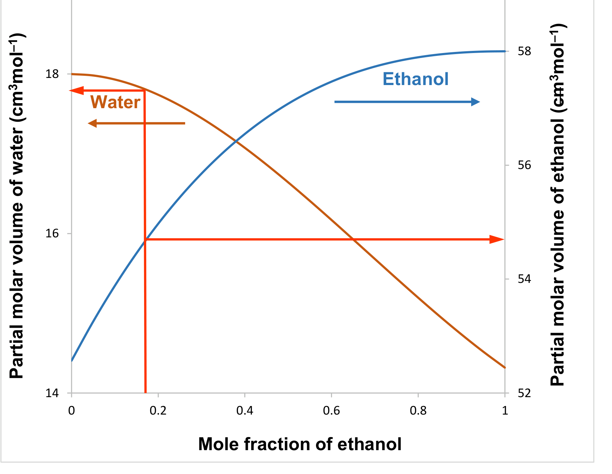

# Foundations: equilibrium, equations of state and the chemical potential — reading 01.2

[Previous](<../../../../../notes/Equilibrium Thermodynamics/01 - Foundations - equilibrium, equations of state and the chemical potential/Complete section.md>) · [Subject index](<../../../../../notes/Equilibrium Thermodynamics/README.md>) · [Next](<../../../../../notes/Equilibrium Thermodynamics/01 - Foundations - equilibrium, equations of state and the chemical potential/Complete section.md>)

<!-- reading-content:start -->
## Section 02: Equations of state and departure functions

### Intuition

An ideal gas is the easy reference: its properties are known exactly from $`P\underline{V} = RT`$ and heat-capacity data. A real fluid differs because its molecules attract one another at moderate separations and repel at short ones. At zero pressure the molecules are infinitely far apart, so every real fluid *is* an ideal gas there.

So the plan is: start at $`P = 0`$ (ideal), follow the real isotherm up to the pressure of interest, and add up how the real fluid's property changes compared with the ideal gas along the way. The EOS tells us $`\underline{V}`$ along that path, and the Maxwell relations turn $`\underline{V}`$ into everything else.

### Derivation

**Step 1: the EOS.** The ideal-gas law $`P\underline{V} = RT`$ cannot produce a liquid. The van der Waals equation,


**Equation (7)**

```math
\left(P + \frac{a}{\underline{V}^2}\right)\left(\underline{V} - b\right) = RT
```


adds two corrections: $`b`$, the volume excluded by finite molecular size, and $`a/\underline{V}^2`$, the reduction in wall pressure caused by attractions. It is cubic in $`\underline{V}`$. Below the critical temperature it has three roots, which is how it predicts a liquid and a vapour. Modern cubic EOS (Peng–Robinson and others) keep this structure with better-tuned $`a(T)`$ and $`b`$.

**Step 2: how $`\underline{H}`$ depends on pressure.** From $`d\underline{H} = T\,d\underline{S} + \underline{V}\,dP`$, at constant $`T`$:


```math
\left(\frac{\partial \underline{H}}{\partial P}\right)_T = T\left(\frac{\partial \underline{S}}{\partial P}\right)_T + \underline{V}
```


**Step 3: remove the entropy.** From $`d\underline{G} = -\underline{S}\,dT + \underline{V}\,dP`$, equality of the mixed second derivatives gives the Maxwell relation $`(\partial\underline{S}/\partial P)_T = -(\partial\underline{V}/\partial T)_P`$. Hence


**Equation (8)**

```math
\left(\frac{\partial \underline{H}}{\partial P}\right)_T = \underline{V} - T\left(\frac{\partial \underline{V}}{\partial T}\right)_P
```


*Reason:* the right side contains only $`P`$–$`\underline{V}`$–$`T`$ quantities, which the EOS provides.

**Step 4: integrate from the ideal-gas limit.** At $`P \to 0`$ the fluid is ideal, so $`\underline{H}(T, 0) = \underline{H}^{\mathrm{IG}}(T)`$. Integrating (8) along the isotherm:


**Equation (9)**

```math
\underline{H}(T,P) - \underline{H}^{\mathrm{IG}}(T) = \int_{0}^{P}\left[\underline{V} - T\left(\frac{\partial \underline{V}}{\partial T}\right)_P\right]dP
```


For an ideal gas the integrand is $`RT/P - T(R/P) = 0`$, so the departure is zero, as it must be.

**Step 5: low-pressure van der Waals.** At low density, (7) expands to $`\underline{V} \approx RT/P + b - a/RT`$, i.e. a second virial coefficient $`B = b - a/RT`$. Then $`T(\partial\underline{V}/\partial T)_P = RT/P + a/RT`$, and the integrand of (9) is constant:


**Equation (10)**

```math
\underline{H} - \underline{H}^{\mathrm{IG}} \approx \left(b - \frac{2a}{RT}\right)P
```


### Motivation and explanation

**Sign and meaning.** In (10), attractions ($`a`$) lower the enthalpy below the ideal-gas value, because the molecules sit in each other's potential wells. Repulsions ($`b`$) raise it. At ordinary temperatures attractions win for most gases. Equation (8) is then negative, so a gas throttled at constant $`H`$ to lower pressure cools (the Joule–Thomson effect). The sign changes at $`T = 2a/(Rb)`$, the van der Waals estimate of the inversion temperature.

**Why departures, not absolutes.** Equation (9) only gives *differences* from a reference that is known separately. Ideal-gas heat capacities fix $`\underline{H}^{\mathrm{IG}}(T)`$; the EOS fixes the departure. Process simulators compute every property this way. The same route applied to $`\underline{G}`$ is what defines fugacity later in the course.

**When it fails.**
- The low-pressure form (10) is only the first term of an expansion in density.
- A cubic EOS is reasonable for non-polar fluids but poor for strongly polar or hydrogen-bonding liquids.
- For mixtures the EOS needs mixing rules for $`a`$ and $`b`$, which work for "easy" mixtures (similar molecules) but not for, say, ethanol–water.

### Worked example

**Problem.** Estimate the enthalpy departure of nitrogen at 300 K and 1, 10 and 100 bar from the van der Waals EOS, with $`a = 1.370`$ L² bar mol⁻² $`= 0.1370`$ Pa m⁶ mol⁻² and $`b = 0.0387`$ L mol⁻¹ $`= 3.87\times10^{-5}`$ m³ mol⁻¹.

**Low-pressure formula (10).** $`b - 2a/RT = 3.87\times10^{-5} - 2(0.1370)/(8.314\times300) = -7.11\times10^{-5}`$ m³ mol⁻¹. Multiply by $`P`$:

| $`P`$ (bar) | (10) low-pressure (J mol⁻¹) | (9) integrated numerically with full vdW (J mol⁻¹) |
|---|---|---|
| 1 | −7.1 | −7.1 |
| 10 | −71.1 | −71.0 |
| 100 | −711 | −661 |

**Interpretation.** At 1–10 bar the linear formula is exact to the precision shown. At 100 bar it overestimates the departure by about 8 % (−711 against −661 J mol⁻¹), because higher-order density terms (repulsions becoming more important) start to matter. For comparison, heating nitrogen by 1 K raises its ideal-gas enthalpy by $`\underline{C}_P \approx 7R/2 = 29.1`$ J mol⁻¹. So at 100 bar the non-ideal correction equals about 23 K of heating, which is not negligible in a compressor or throttle energy balance. The negative sign means nitrogen at 300 K cools on throttling, since $`300\ \text{K} < 2a/(Rb) = 852`$ K, the van der Waals inversion temperature.

### Link to other topics

The Gibbs-energy departure uses the ideal-gas subtraction, $`\underline{G}-\underline{G}^{\mathrm{IG}}=\int_0^P[\underline{V}-RT/P]\,dP`$, rather than the enthalpy integrand in (9). That is the basis of chemical potentials from an EOS and of fugacity coefficients later in the course. Mixture EOS need partial molar volumes, introduced in the next two sections.

### Summary

An EOS turns the general theory into numbers. Any property is computed as an ideal-gas value plus a departure, integrated along the isotherm from $`P = 0`$, where every fluid is ideal.

## Section 03: Partial molar properties

*Notation:* $`V`$ is the total volume. $`\underline{V}`$ is the molar volume of the system (pure or mixture). $`\underline{V}_i`$ is the molar volume of pure $`i`$. $`\bar V_i`$ is the partial molar volume of $`i`$ in a mixture. $`x_i = n_i/n`$ is the mole fraction, where $`n`$ is the total amount.

### Intuition

Add one mole of water to a swimming pool of pure water and the volume rises by 18 cm³, the molar volume of water. Add the same mole of water to a swimming pool of pure ethanol and the volume rises by only about 14 cm³. The water molecules are the same; what differs is their surroundings. Hydrogen bonding with ethanol and different packing let them occupy less space.

The partial molar volume is that increase: the volume a component *effectively* occupies in a particular mixture. It is a property of the component **in that environment**, so it changes with composition. The swimming pool is large so that adding one mole does not change the composition.

*Analogy:* pouring sand into a jar of marbles. The sand fills the gaps, so the total rises by less than the sand's own volume. This breaks down for molecules. Water–ethanol contraction comes from intermolecular forces (hydrogen bonding) as well as shape, so the "gaps" depend on energetics and temperature, not just geometry.

### Derivation

**Step 1: definition.** For any extensive property, using volume as the example,


**Equation (11)**

```math
\bar V_i \equiv \left(\frac{\partial V}{\partial n_i}\right)_{T,P,n_{j\neq i}}
```


*Reason:* this is the change in total volume per mole of $`i`$ added, with $`T`$, $`P`$ and all other amounts fixed. That is the swimming-pool experiment taken to the limit of an infinitesimal addition.

**Step 2: scaling property.** At fixed $`T`$ and $`P`$, doubling every amount doubles the volume. In general, for any factor $`\lambda`$:


**Equation (12)**

```math
V(T,P,\lambda n_1,\dots,\lambda n_N) = \lambda\,V(T,P,n_1,\dots,n_N)
```


*Reason:* $`V`$ is extensive. Mathematically, it is homogeneous of degree one in the amounts.

**Step 3: differentiate (12) with respect to $`\lambda`$.** Using the chain rule on the left side:


```math
\sum_i \frac{\partial V}{\partial(\lambda n_i)}\,n_i = V
```


**Step 4: set $`\lambda = 1`$.** The derivatives become the partial molar volumes (11):


**Equation (13)**

```math
V = \sum_i n_i\,\bar V_i \qquad\Longleftrightarrow\qquad \underline{V} = \sum_i x_i\,\bar V_i
```


*Reason:* dividing by $`n`$ gives the molar form. This is Euler's theorem for homogeneous functions. It says the partial molar volumes are the right "shares" of the total: they add up exactly to the mixture volume.

**Step 5: pure-component limit.** For pure $`i`$, $`V = n_i\underline{V}_i`$, so $`\bar V_i = \underline{V}_i`$.

The same steps apply to $`U`$, $`H`$, $`S`$, $`A`$ and $`G`$. Each has partial molar properties that sum like (13).

### Motivation and explanation

**Why not just use pure volumes?** If mixing changed nothing, $`\bar V_i`$ would equal $`\underline{V}_i`$ and the mixture volume would be $`\sum n_i\underline{V}_i`$. Any difference between the two is a measure of non-ideal mixing, the subject of most of this course. Volume is the easiest place to see it because it can be measured with a measuring cylinder.

**What is held constant.** Equation (11) holds $`T`$, $`P`$ and all other $`n_j`$ fixed. It is not a derivative with respect to mole fraction, because adding $`i`$ changes all the mole fractions at once.

**Graphical meaning.** Partial molar volumes in a binary are found from plots of $`\underline{V}`$ against $`x`$ (the tangent construction), or plotted directly as below. They are intensive: they depend on composition, $`T`$ and $`P`$, not on how much mixture there is.



The curves move in opposite directions. Where ethanol's partial molar volume rises, water's falls. This is not a coincidence: it is the Gibbs–Duhem equation, derived in the next section.

### Worked example

**Problem.** A 700 cm³ bottle contains a whiskey-like ethanol–water mixture prepared from pure-liquid volumes in the ratio 40:60. Here 40 % means ethanol volume divided by the sum of the two pure-liquid volumes before mixing; it is not the usual alcohol-by-volume (ABV) label, which uses the final drink volume. How much ethanol and water does it contain, and what volume would the two pure liquids have occupied before mixing? Pure molar volumes: $`\underline{V}_{\mathrm{EtOH}} = 58`$ cm³ mol⁻¹, $`\underline{V}_{\mathrm{H_2O}} = 18`$ cm³ mol⁻¹.

**Mole fraction.** For this explicitly defined pre-mixing recipe, take 100 cm³ of separate pure liquids: $`40/58 = 0.690`$ mol ethanol and $`60/18 = 3.333`$ mol water, so $`x_{\mathrm{EtOH}} = 0.171`$, about 17 mol %. Use $`x_{\mathrm{EtOH}} \approx 0.17`$ for the graph estimates below.

**Partial molar volumes at $`x_{\mathrm{EtOH}} = 0.17`$** (read from the graph, so ≈): $`\bar V_{\mathrm{EtOH}} \approx 54.7`$ cm³ mol⁻¹, $`\bar V_{\mathrm{H_2O}} \approx 17.8`$ cm³ mol⁻¹. Both are below their pure values.

**Total amount from (13).** With $`V = n\,(x_{\mathrm{EtOH}}\bar V_{\mathrm{EtOH}} + x_{\mathrm{H_2O}}\bar V_{\mathrm{H_2O}})`$:


```math
700 = n\,(0.17\times54.7 + 0.83\times17.8) \;\Rightarrow\; n = 29.08\ \text{mol}
```


so $`n_{\mathrm{EtOH}} = 4.94`$ mol and $`n_{\mathrm{H_2O}} = 24.13`$ mol.

**Volumes before mixing.** Ethanol: $`4.94\times58 = 287`$ cm³. Water: $`24.13\times18 = 434`$ cm³. Together that is **721 cm³ of pure liquids, which make 700 cm³ of whiskey**: a contraction of 21 cm³, or 2.9 %.

**Interpretation.** Adding pure-component volumes would overfill the bottle by 3 %. Ethanol–water is a non-ideal mixture, and a model that assumes ideal mixing gets even the volume wrong. Because the volume differs from the ideal value, the Gibbs energy and chemical potentials must differ too.

### Link to other topics

The chemical potential is the partial molar property of $`G`$, so (13) becomes $`G = \sum n_i\mu_i`$: the identity that underlies the Gibbs–Duhem equation and every later model of mixture non-ideality. Excess volumes such as the 21 cm³ here are the volumetric counterpart of the excess Gibbs energy used to build activity-coefficient models.

### Summary

A partial molar property is a component's contribution to a mixture property in its actual environment. The contributions sum exactly to the total, but they differ from pure-component values whenever mixing is non-ideal, as the 3 % contraction of whiskey shows.
<!-- reading-content:end -->

[Previous](<../../../../../notes/Equilibrium Thermodynamics/01 - Foundations - equilibrium, equations of state and the chemical potential/Complete section.md>) · [Subject index](<../../../../../notes/Equilibrium Thermodynamics/README.md>) · [Next](<../../../../../notes/Equilibrium Thermodynamics/01 - Foundations - equilibrium, equations of state and the chemical potential/Complete section.md>)
