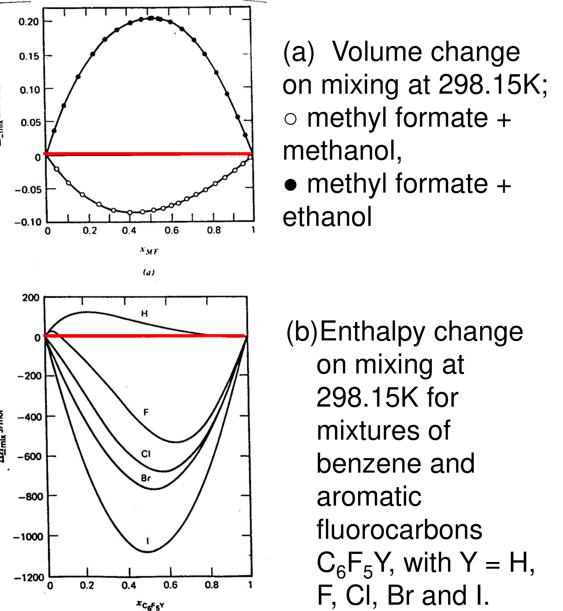

# Activity coefficients and excess Gibbs energy — reading 03.1

[Previous](<../../../../../notes/Equilibrium Thermodynamics/02 - Fugacity/Complete section.md>) · [Subject index](<../../../../../notes/Equilibrium Thermodynamics/README.md>) · [Next](<../../../../../notes/Equilibrium Thermodynamics/03 - Activity coefficients and excess Gibbs energy/Complete section.md>)

<!-- reading-content:start -->
## Overview

Real liquid mixtures are described relative to the ideal mixture, with one correction factor per component, the activity coefficient $`\gamma_i`$, collected into the excess Gibbs energy $`\underline{G}^{ex} = RT\sum x_i\ln\gamma_i`$ (Section 10). Gibbs–Duhem constrains the $`\gamma`$'s, and deriving them all from a single $`\underline{G}^{ex}`$ function satisfies that constraint automatically; the simplest choice is the one-constant Margules model (Section 11). A second constant makes the model asymmetric, parameters are fitted to measured excess Gibbs energies, and binary parameters combine pairwise for multicomponent mixtures (Section 12). A complete calculation for liquid oxygen–argon takes one model constant through to a predicted vapour pressure and derives modified Raoult's law (Section 13).

*Assumed throughout:* ideal-mixture chemical potential (Section 05); fugacity and the Lewis–Randall rule (Section 07); Gibbs–Duhem (Section 04).

## Section 10: The activity coefficient and excess Gibbs energy

*Notation:* superscript "IM" means ideal mixture. Superscript "ex" means excess, i.e. real minus ideal-mixture value at the same $`T`$, $`P`$ and composition. $`\underline{G}_i`$ is pure $`i`$ at the mixture's $`T`$, $`P`$ and phase.

### Intuition

In an ideal mixture each molecule feels the same forces whether its neighbours are its own kind or the other kind. Mixing then only adds entropy: no heat, no volume change. Real liquids are rarely like that.

The figure shows how far from ideal real mixtures are. The volume change on mixing can be positive or negative. Within one family of similar compounds (benzene with C₆F₅Y), the enthalpy of mixing ranges from slightly positive (Y = H) to about −1100 J mol⁻¹ (Y = I). Small chemical changes produce large, hard-to-predict differences.



The activity coefficient packages all this into one number per component. It says how much more ($`\gamma_i > 1`$) or less ($`\gamma_i < 1`$) a molecule "wants to leave" the mixture than it would in an ideal mixture of the same composition.

*Analogy: a guest at a party.* If the guest likes the other guests less than their own friends ($`\gamma > 1`$), they are keener to leave than an "indifferent" guest would be. If they like them more ($`\gamma < 1`$), they stay. The analogy breaks down because $`\gamma`$ is not about one pair of molecules but the average over all neighbours, and it includes entropic effects (molecular size and orientation), not just "liking".

### Derivation

**Step 1: define $`\gamma_i`$.** Write the real chemical potential as the ideal-mixture value plus a correction:


**Equation (52)**

```math
\mu_i = \underline{G}_i + RT\ln x_i + RT\ln\gamma_i
```


The correction is the **excess chemical potential**:


**Equation (53)**

```math
\mu_i^{ex} \equiv \mu_i - \mu_i^{\mathrm{IM}} = RT\ln\gamma_i
```


**Step 2: excess Gibbs energy.** Use $`\underline{G} = \sum x_i\mu_i`$ for both the real mixture and the ideal mixture, and subtract:


**Equation (54)**

```math
\underline{G}^{ex} \equiv \underline{G} - \underline{G}^{\mathrm{IM}} = \sum_i x_i\mu_i^{ex} = RT\sum_i x_i\ln\gamma_i
```


*Reason:* $`\mu_i^{ex}`$ is the partial molar property of $`G^{ex}`$, just as $`\mu_i`$ is of $`G`$. So, by Euler's theorem (Section 03), the excess Gibbs energy is the mole-fraction-weighted sum. Conversely, $`\gamma_i`$ follows from $`\underline{G}^{ex}`$ by differentiation:


**Equation (55)**

```math
RT\ln\gamma_i = \left(\frac{\partial (n\underline{G}^{ex})}{\partial n_i}\right)_{T,P,n_{j\neq i}}
```


**Step 3: mixing functions.** Subtract the pure-component terms:


**Equation (56)**

```math
\Delta\underline{G}_{\mathrm{mix}} = \underbrace{RT\sum_i x_i\ln x_i}_{\Delta\underline{G}^{\mathrm{IM}}_{\mathrm{mix}}} + \underline{G}^{ex}
```


For the ideal mixture, $`\Delta\underline{H}^{\mathrm{IM}}_{\mathrm{mix}} = \Delta\underline{V}^{\mathrm{IM}}_{\mathrm{mix}} = 0`$ and $`\Delta\underline{S}^{\mathrm{IM}}_{\mathrm{mix}} = -R\sum x_i\ln x_i`$. Every non-zero $`\Delta\underline{H}_{\mathrm{mix}}`$ or $`\Delta\underline{V}_{\mathrm{mix}}`$, like those in the figure, is therefore an excess property.

**Step 4: link to fugacity.** From the definition of fugacity, $`\mu_i - \underline{G}_i = RT\ln(\bar f_i/f_i)`$, where both terms use the same ideal-gas reference. Equating this with (52):


**Equation (57)**

```math
\gamma_i = \frac{\bar f_i}{x_if_i} \qquad\Longleftrightarrow\qquad \bar f_i = \gamma_i\,x_i\,f_i
```


So $`\gamma_i`$ is the ratio of the actual fugacity to the Lewis–Randall (ideal-mixture) fugacity. The product $`a_i = x_i\gamma_i`$ is called the **activity**.

**Step 5: pressure dependence.** Differentiate (52) with respect to $`P`$ at fixed $`T`$ and composition, using $`(\partial\mu_i/\partial P) = \bar V_i`$ and $`(\partial\underline{G}_i/\partial P) = \underline{V}_i`$:


**Equation (58)**

```math
\left(\frac{\partial\ln\gamma_i}{\partial P}\right)_{T,x} = \frac{\bar V_i - \underline{V}_i}{RT} = \frac{\bar V_i^{ex}}{RT}
```


### Motivation and explanation

**Sign of $`\gamma_i`$.**
- $`\gamma_i > 1`$: $`\mu_i > \mu_i^{\mathrm{IM}}`$, so the escaping tendency is higher than ideal. Unlike molecules attract each other less strongly than like ones. This is a **positive deviation** from ideality, and it makes the component more volatile than Raoult's law predicts.
- $`\gamma_i < 1`$: unlike molecules attract more strongly (e.g. through hydrogen bonding between the two species). This is a **negative deviation**, and the component is held in the liquid.

**Limits.**
- $`x_i\to 1`$: the molecule is surrounded by its own kind, so $`\mu_i\to\underline{G}_i`$ and $`\gamma_i\to 1`$. This is the pure-component reference state of this convention.
- $`x_i\to 0`$: the molecule is surrounded entirely by unlike neighbours, so the deviation is largest. $`\gamma_i`$ tends to its **infinite-dilution** value $`\gamma_i^{\infty}`$.

The Gibbs–Duhem equation requires that $`\gamma_i`$ approach 1 with zero slope near the pure component (next section).

**Why the pressure dependence can be dropped.** Equation (58) says $`\ln\gamma_i`$ changes with pressure only through the excess partial molar volume. For liquids this is tiny, typically a few cm³ mol⁻¹ (see the example). Activity-coefficient models are therefore functions of $`T`$ and composition only, and that is a deliberate approximation.

**Limits of the approach.** $`\gamma_i`$ is defined relative to the pure liquid at the same $`T`$ and $`P`$. If pure $`i`$ cannot exist as a liquid at those conditions (a dissolved gas above its critical temperature, or a dissolved solid), this reference is hypothetical, and other conventions (Henry's law, molality) are used later.

### Worked example

**Problem.** In the whiskey of Sections 03–04 ($`x_{\mathrm{EtOH}} = 0.17`$, 20 °C), ethanol's partial molar volume is ≈54.7 cm³ mol⁻¹ against 58 cm³ mol⁻¹ pure. (a) By how much does $`\gamma_{\mathrm{EtOH}}`$ change when the pressure rises by 9 bar (1 → 10 bar) and by 90 bar (10 → 100 bar)? (b) How large is the pressure effect on $`\underline{G}^{ex}`$, given the whiskey's excess volume of −0.73 cm³ mol⁻¹?

**(a) Use (58).** $`\bar V^{ex}_{\mathrm{EtOH}} \approx 54.7 - 58 = -3.3`$ cm³ mol⁻¹, and $`RT = 2437`$ J mol⁻¹.
- 9 bar: $`\Delta\ln\gamma = (-3.3\times10^{-6})(9\times10^{5})/2437 = -1.2\times10^{-3}`$, so $`\gamma`$ changes by 0.12 %.
- 90 bar: $`\Delta\ln\gamma = -1.2\times10^{-2}`$, so $`\gamma`$ changes by 1.2 %.

**(b) Excess Gibbs energy.** $`(\partial\underline{G}^{ex}/\partial P)_{T,x} = \underline{V}^{ex}`$, so over 100 bar $`\Delta\underline{G}^{ex} \approx (-0.73\times10^{-6})(10^{7}) = -7.3`$ J mol⁻¹. Typical values of $`\underline{G}^{ex}`$ are hundreds of J mol⁻¹ (see the data in Section 12).

**Interpretation.** Even a strongly non-ideal liquid mixture changes its activity coefficients by about 1 % per 100 bar. Ordinary pressure variations in a column or reactor are negligible, so models written as $`\gamma_i(T,x)`$ are justified. The approximation would need checking only at very high pressure, or near a critical point where excess volumes become large.

### Link to other topics

Equation (57), $`\bar f_i = \gamma_ix_if_i`$, is the liquid side of the vapour–liquid equilibrium relation used throughout the rest of the course. The fugacity coefficient corrects the vapour; the activity coefficient corrects the liquid. The excess Gibbs energy also controls whether liquids mix at all, which leads to liquid–liquid equilibrium later.

### Summary

The activity coefficient measures, for each component, the departure of its chemical potential from ideal-mixture behaviour, and $`\underline{G}^{ex} = RT\sum x_i\ln\gamma_i`$ collects these into one mixture property. $`\gamma_i > 1`$ means unlike molecules attract less than like ones, and $`\gamma_i\to 1`$ for the pure component. For liquids, $`\gamma_i`$ is effectively independent of pressure.
<!-- reading-content:end -->

[Previous](<../../../../../notes/Equilibrium Thermodynamics/02 - Fugacity/Complete section.md>) · [Subject index](<../../../../../notes/Equilibrium Thermodynamics/README.md>) · [Next](<../../../../../notes/Equilibrium Thermodynamics/03 - Activity coefficients and excess Gibbs energy/Complete section.md>)
