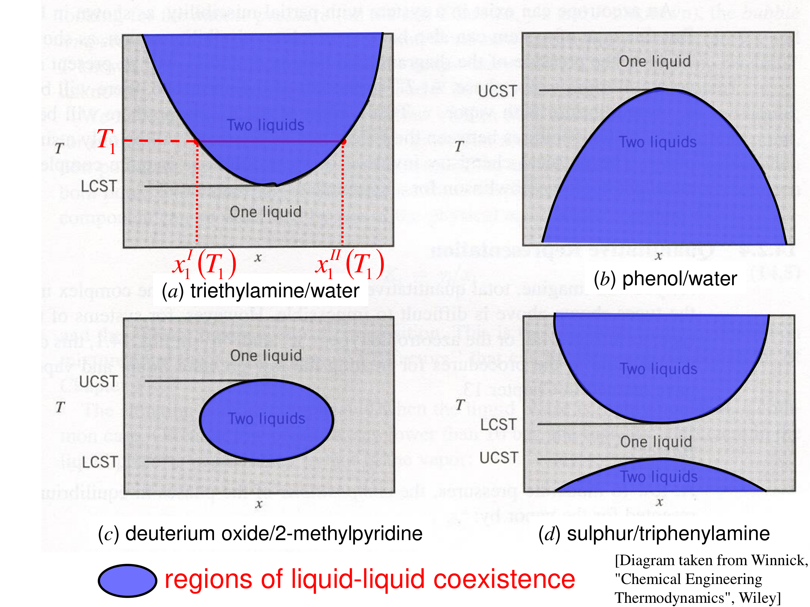

# Liquid–liquid equilibrium and diffusion — reading 11.2

[Previous](<../../../../../notes/Equilibrium Thermodynamics/11 - Liquid–liquid equilibrium and diffusion/Complete section.md>) · [Subject index](<../../../../../notes/Equilibrium Thermodynamics/README.md>) · [Next](<../../../../../notes/Equilibrium Thermodynamics/11 - Liquid–liquid equilibrium and diffusion/Complete section.md>)

<!-- reading-content:start -->
## Section 37: Temperature dependence, consolute points and the vapour–liquid analogy

### Intuition

$`\Delta\underline{G}_{\mathrm{mix}} = \underline{H}^{ex} - T\left(\Delta\underline{S}^{\mathrm{IM}}_{\mathrm{mix}} + \underline{S}^{ex}\right)`$, with $`\Delta\underline{S}^{\mathrm{IM}}_{\mathrm{mix}} = -R\sum x_i\ln x_i > 0`$.
- *UCST (normal):* unlike contacts cost energy ($`\underline{H}^{ex} > 0`$). The entropic reward for mixing grows with $`T`$, so it eventually wins and the liquids mix.
- *LCST:* unlike molecules hydrogen-bond specifically ($`\underline{H}^{ex} < 0`$), but that forces them into ordered arrangements ($`\underline{S}^{ex} < 0`$). At low $`T`$ the favourable energy wins and they mix. At high $`T`$ the $`-T\underline{S}^{ex}`$ penalty grows and they separate. Triethylamine–water is the classic example.
- *Closed loops* (both an LCST and a UCST) occur when these effects overlap.

### Derivation

**Step 1: regular solution.** Take one-constant Margules with $`A`$ independent of $`T`$ (pure energy, no excess entropy):


```math
\frac{\Delta\underline{G}_{\mathrm{mix}}}{RT} = x\ln x + (1-x)\ln(1-x) + \frac{A}{RT}x(1-x)
```


**Step 2: curvature.**


```math
\frac{1}{RT}\frac{d^2\Delta\underline{G}_{\mathrm{mix}}}{dx^2} = \frac{1}{x(1-x)} - \frac{2A}{RT}
```


The first term is smallest at $`x = \tfrac12`$, where it equals 4.

**Step 3: consolute point.** The curve first loses convexity (at $`x = \tfrac12`$) when $`2A/RT = 4`$:


**Equation (155)**

```math
T_c = \frac{A}{2R}, \qquad x_c = \tfrac12
```


At a consolute point both $`d^2\underline{G}/dx^2 = 0`$ and $`d^3\underline{G}/dx^3 = 0`$: the two spinodal points merge.

**Step 4: below $`T_c`$.**
- *Binodal* (coexistence) compositions from the common tangent. By symmetry, $`\ln[x/(1-x)] = (A/RT)(2x - 1)`$.
- *Spinodal* compositions where the curvature vanishes: $`x(1-x) = RT/(2A)`$.

**Step 5: analogy with pure-fluid VLE.**

| Pure fluid, $`P`$–$`\underline{V}`$ isotherms | Binary liquid, $`\underline{G}`$–$`x_1`$ isotherms |
|---|---|
| Van der Waals loop below $`T_c`$ | Wiggle below $`T_c`$ |
| Equal areas → coexisting $`\underline{V}^l`$, $`\underline{V}^v`$ | Common tangent → coexisting $`x_1^{\mathrm{I}}`$, $`x_1^{\mathrm{II}}`$ |
| $`dP/d\underline{V} = 0`$: limit of metastability | $`d^2\underline{G}/dx_1^2 = 0`$: spinodal |
| Critical point: $`dP/d\underline{V} = d^2P/d\underline{V}^2 = 0`$ | Consolute point: $`d^2\underline{G}/dx^2 = d^3\underline{G}/dx^3 = 0`$ |

*Where the analogy breaks down:* at a consolute point the two coexisting *liquids* become identical in composition, but the system is still liquid and is not a gas–liquid critical point. Its pressure dependence is weak, and the "order parameter" is composition, not density.




### Motivation and explanation

**Phase rule.** In the two-liquid region, $`F = 2 - 2 + 2 = 2`$. Fix $`T`$ and $`P`$ and both compositions are fixed; the feed composition only sets the amounts (lever rule). At the consolute point the extra condition $`x^{\mathrm{I}} = x^{\mathrm{II}}`$ leaves $`F = 1`$: at fixed pressure it is a single point.

**Real systems are asymmetric.** Consolute compositions are rarely 0.5 (hexane–nitrobenzene: $`x_c\approx 0.42`$ nitrobenzene). Asymmetric models (van Laar, NRTL) are needed to place them correctly. $`A`$ also usually varies with $`T`$, so a real $`\underline{S}^{ex}\neq 0`$.

### Worked example

**Problem.** Hexane–nitrobenzene has a UCST at about 19.4 °C (292.55 K). Treat it as a symmetric regular solution and estimate (a) the interaction parameter $`A`$, and (b) the coexisting and spinodal compositions at 15, 10, 0 and −10 °C.

**(a)** From (155), $`A = 2RT_c = 2\times8.314\times292.55 = 4865`$ J mol⁻¹.

**(b)** $`A/RT = 2T_c/T`$:

| $`T`$ (°C) | $`A/RT`$ | Binodal $`x`$ | Spinodal $`x`$ |
|---|---|---|---|
| 15 | 2.031 | 0.394 / 0.606 | 0.439 / 0.561 |
| 10 | 2.066 | 0.347 / 0.653 | 0.410 / 0.590 |
| 0 | 2.142 | 0.283 / 0.717 | 0.371 / 0.629 |
| −10 | 2.223 | 0.237 / 0.763 | 0.341 / 0.659 |

**Interpretation.** The two-phase region widens rapidly just below $`T_c`$ (the binodal opens roughly as $`\sqrt{T_c - T}`$), then more slowly. A 5 K drop below the UCST already gives phases differing by 0.2 in mole fraction. The symmetric model puts the consolute point at $`x = 0.5`$, whereas the real system's is at 0.42. Use these numbers for trends, not design.

### Link to other topics

Temperature-swing extraction exploits the opening and closing of the miscibility gap. Polymer solutions with an LCST (e.g. thermoresponsive hydrogels) are used in drug delivery and bioseparations. The vapour–liquid analogy returns when vapour and two liquids coexist (VLLE) in the final sections.

### Summary

Miscibility gaps open and close with temperature through the balance of $`\underline{H}^{ex}`$ and $`T\underline{S}`$. A regular solution has a UCST at $`T_c = A/2R`$, while LCSTs need favourable but ordering interactions. At a consolute point the spinodal and binodal meet, analogous to (but not the same as) a vapour–liquid critical point.

## Section 38: Worked example, isobutane–furfural liquid–liquid equilibrium

*Components:* isobutane (1), furfural (2).

### Intuition

Furfural is polar (an aldehyde on a furan ring); isobutane is a small, non-polar alkane. Large van Laar constants ($`\gamma^{\infty} = e^{2.62}\approx 14`$ and $`e^{3.02}\approx 20`$) say each strongly dislikes the other. We expect two nearly pure phases, each holding only a little of the other component. That is the situation exploited when furfural extracts aromatics from hydrocarbon oils.

### Derivation

**Step 1: equilibrium equations.** With the same pure-liquid reference in both phases, $`\mu_i^{\mathrm{I}} = \mu_i^{\mathrm{II}}`$ becomes equal activities:


**Equation (156)**

```math
x_1^{\mathrm{I}}\gamma_1^{\mathrm{I}} = x_1^{\mathrm{II}}\gamma_1^{\mathrm{II}}, \qquad x_2^{\mathrm{I}}\gamma_2^{\mathrm{I}} = x_2^{\mathrm{II}}\gamma_2^{\mathrm{II}}
```


with van Laar $`\ln\gamma_1 = \alpha/[1 + \alpha x_1/(\beta x_2)]^2`$ and $`\ln\gamma_2 = \beta/[1 + \beta x_2/(\alpha x_1)]^2`$.

**Step 2: solve.** At 37.8 °C use $`\alpha=2.62`$ and $`\beta=3.02`$ (dimensionless). Solve the two non-linear equations for two distinct compositions, $`x_1^{\mathrm{I}}<x_1^{\mathrm{II}}`$; the trivial equal-composition root is not a phase split. Equivalently, find the common tangent to

```math
\frac{\Delta\underline{G}_{\mathrm{mix}}}{RT} = \sum_i x_i\ln x_i + \sum_i x_i\ln\gamma_i.
```


**Step 3: spinodals.** Where $`d^2(\Delta\underline{G}_{\mathrm{mix}}/RT)/dx_1^2 = 0`$, located numerically.

### Worked example

**Results.**

| | Phase I (furfural-rich) | Phase II (isobutane-rich) |
|---|---|---|
| $`x_1`$ | 0.1128 | 0.9284 |
| $`x_2`$ | 0.8872 | 0.0716 |
| $`\gamma_1`$ | 8.375 | 1.018 |
| $`\gamma_2`$ | 1.030 | 12.77 |
| $`a_1 = x_1\gamma_1`$ | 0.9448 | 0.9448 |
| $`a_2 = x_2\gamma_2`$ | 0.9140 | 0.9140 |

The equal activities confirm (156). Further:
- spinodals at $`x_1 = 0.270`$ and 0.805;
- the minima of $`\Delta\underline{G}_{\mathrm{mix}}/RT`$ lie at $`x_1 = 0.107`$ and 0.924, close to but not the same as the phase compositions;
- an equimolar feed splits into 52.5 % phase I and 47.5 % phase II (lever rule).


### Motivation and explanation

**Why the tangent points are not the minima.** The model is asymmetric ($`\beta > \alpha`$), so the common tangent is tilted. A tilted line touches each dip slightly off its lowest point. Only for a symmetric curve is the tangent horizontal, with tangent points at the minima.

**Reading the activity coefficients.**
- The dilute component in each phase has a large $`\gamma`$ (8.4 for isobutane in furfural, 12.8 for furfural in isobutane), while the major component has $`\gamma\approx 1`$. This is the Gibbs–Duhem behaviour of Section 11 seen in practice.
- *A quick estimate.* From (156), $`\gamma_1^{\mathrm{I}}\approx x_1^{\mathrm{II}}/x_1^{\mathrm{I}}`$ when $`\gamma_1^{\mathrm{II}}\approx 1`$: $`0.9284/0.1128 = 8.23`$, against the exact 8.375. The solubility of a component in the "wrong" phase is roughly $`1/\gamma`$ in that phase.

**Assumptions.** The van Laar constants are taken as valid at 37.8 °C (they depend on $`T`$). Pressure (5 bar, to keep isobutane liquid) has negligible effect on liquid-phase activities (Section 10).

### Link to other topics

Equation (156) with a solute added is the basis of distribution coefficients in liquid–liquid extraction. A solute's partition between two solvents equals the ratio of its activity coefficients in them.

### Summary

Solving equal-activity conditions with van Laar gives coexisting liquids at $`x_1 = 0.1128`$ and 0.9284, with spinodals at 0.270 and 0.805. The minor component in each phase has a large activity coefficient, approximately the ratio of its mole fractions in the two phases.
<!-- reading-content:end -->

[Previous](<../../../../../notes/Equilibrium Thermodynamics/11 - Liquid–liquid equilibrium and diffusion/Complete section.md>) · [Subject index](<../../../../../notes/Equilibrium Thermodynamics/README.md>) · [Next](<../../../../../notes/Equilibrium Thermodynamics/11 - Liquid–liquid equilibrium and diffusion/Complete section.md>)
