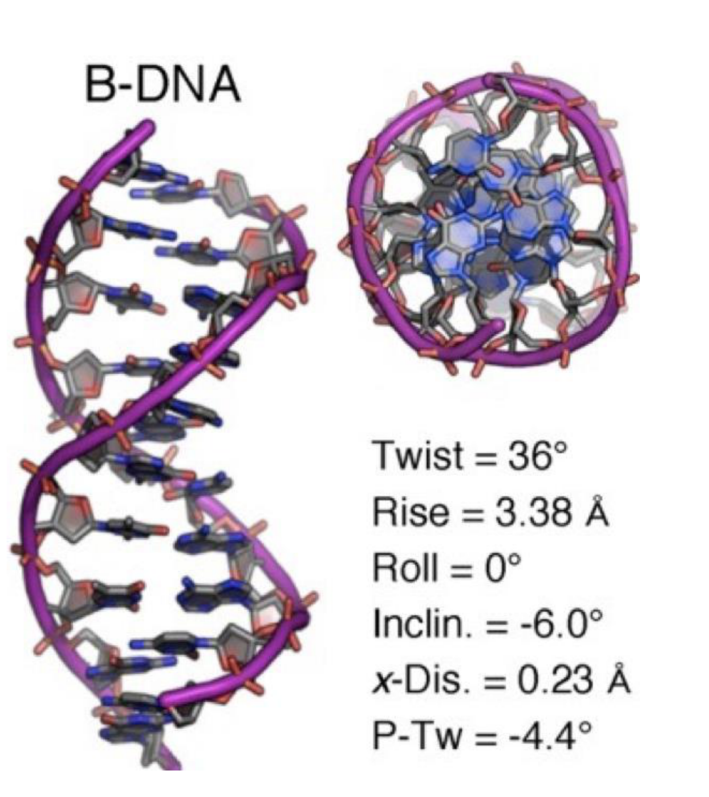

# Nucleic acids - structure, thermodynamics and kinetics

## Overview

Nucleic-acid chemistry determines the structures that DNA and RNA can form. Polymer bending, two-state hybridisation and nearest-neighbour thermodynamics explain their geometry and stability; association and dissociation kinetics explain how quickly those structures assemble and rearrange.

*Assumed throughout:* ideal dilute-solution thermodynamics and mass-action kinetics.

## Section 01: Chemistry and structure of DNA and RNA

### Intuition

A DNA strand is a charged, directional chain with a sequence of flat, aromatic "letters" sticking out of it. Two strands whose letters are complementary can line up, letter facing letter, and the flat letters then stack on top of each other like a pile of coins. That stack, twisted to fit the backbone, is the double helix. Everything else follows from three properties:
- the chain has a direction;
- the backbone repels itself;
- each letter has more than one edge that can make hydrogen bonds.

*Analogy:* a zip whose teeth come in four shapes, where each tooth fits only its partner. The analogy breaks down in two ways. First, the teeth do not just interlock, they stack, and stacking supplies most of the stability. Second, the "zip" unzips on its own when heated, because each bond is weak.

### Mechanism

**1. Backbone.**
- Each repeat unit is a five-carbon sugar (2-deoxyribose in DNA) joined to a phosphate.
- The phosphate links the 3′ carbon of one sugar to the 5′ carbon of the next (a *phosphodiester* bond). One end of the chain therefore has a free 5′-phosphate and the other a free 3′-OH, so the strand has a direction, written 5′→3′.
- Each phosphodiester is charged −1 at physiological pH (its $\mathrm{p}K_a$ is about 1), so the backbone is a polyanion that repels itself and any partner strand.

**2. Bases and naming.**
- The four bases attach to the 1′ carbon of the sugar. The *purines* G and A have two fused rings; the *pyrimidines* C and T have one.
- Base + sugar is a *nucleoside*. Base + sugar + one or more phosphates is a *nucleotide* (nt), for example adenosine triphosphate (ATP) or guanosine monophosphate (GMP).
- A strand is a *polynucleotide*; one shorter than about 100 nt is an *oligonucleotide* ("oligo").

**3. Canonical (Watson–Crick) pairing.**
- A pairs with T through 2 hydrogen bonds, and G pairs with C through 3.
- Pairing is *selective* because each pair is always one purine with one pyrimidine. That keeps the sugar-to-sugar distance the same for every pair, so any sequence fits the same helix. The donor and acceptor patterns then match only for A·T and G·C.
- Hydrogen bonds are weak (a few $k_BT$ each), so pairing is thermally reversible. Biology relies on this when strands are separated for replication and transcription, and nanotechnology relies on it to make structures that assemble themselves.

**4. Hybridisation.**
- Two complementary strands bind into a *duplex* in **antiparallel** orientation: one runs 5′→3′, the other 3′→5′. Antiparallel is the only orientation in which the pairing edges and the sugar–phosphate geometry line up.
- Cations (Na⁺, Mg²⁺) are needed to *screen* the phosphate charges. Without them, electrostatic repulsion between the two backbones outweighs pairing. Section 04 shows this as a salt dependence of the hybridisation entropy.

**5. The B-form double helix** (physiological conditions):
- right-handed;
- rise about 0.34 nm per base pair, about 10.5 bp (about 3.6 nm) per turn, diameter about 2 nm;
- the sugars join their bases on one side of each pair, so the two grooves between the backbones are unequal: a **major** and a **minor groove**. Proteins read the sequence mostly through the major groove, where more of each base's edge is exposed.
- What stabilises the helix is mainly **base stacking**: van der Waals and hydrophobic attraction between neighbouring flat bases, which stack about 0.34 nm apart. Hydrogen bonds mainly provide *specificity*. This is why Section 04 assigns energies to *pairs of neighbouring base pairs*.

**6. Other helices.**
- **A-form:** right-handed, wider and more compressed (rise about 0.26 nm/bp). It is rare for DNA–DNA duplexes but is the normal form of RNA–RNA and DNA–RNA duplexes (point 8).
- **Z-form:** a *left-handed* helix favoured by alternating purine–pyrimidine sequences (such as CGCG) and stabilised by negative supercoiling, which it relieves.

**7. Non-canonical pairing and structures.**
- **Hoogsteen pairing.** A purine can rotate about its glycosidic bond from the usual *anti* to the *syn* conformation. This presents a different edge, the Hoogsteen edge (which faces the major groove), to the pyrimidine.
  - A·T works directly.
  - For G·C, cytosine has to donate an extra hydrogen bond from its N3. N3 is normally an acceptor, so C must be **protonated** (C⁺). Its $\mathrm{p}K_a$ is only about 4.5, so these structures are favoured at acidic pH.
- **Triplex.** A third strand lies in the major groove of a duplex and makes Hoogsteen bonds to the purines. It is pH-dependent when it contains C⁺.
- **G-quadruplex.** Four guanines form a planar ring (a *G-tetrad*) through Hoogsteen G·G bonds. Tetrads stack, and a monovalent cation (K⁺ fits best) sits between them and coordinates the carbonyl oxygens. Runs of G separated by short loops fold this way.
- **i-motif.** The C-rich counterpart. Hemi-protonated C·C⁺ pairs intercalate, so it is also pH-dependent.

**8. RNA.** Identical in plan to DNA, except for two changes:
- **Ribose** carries a 2′-OH. This has three consequences:
  1. *Chemical instability.* At high pH or with metal ions, the 2′-oxygen attacks the neighbouring phosphorus. This cuts the backbone and leaves a 2′,3′-cyclic phosphate (self-hydrolysis). DNA lacks the 2′-OH, which is one reason it is the long-term store of genetic information.
  2. *A-form duplexes.* The 2′-OH holds the sugar in a pucker (C3′-endo) that fits only the A-form.
  3. *Richer folding.* The extra hydrogen-bonding group lets single strands fold into complex secondary and tertiary structures (tRNA, ribozymes).
- **Uracil** replaces thymine. U is T without the 5-methyl group. It pairs with A, and it also forms a **G·U wobble pair** (two hydrogen bonds, shifted geometry), which is nearly as stable as a Watson–Crick pair in RNA.

### Motivation and explanation

- **Why directionality matters in practice.** Polymerases add nucleotides only to a free 3′-OH, so DNA is always synthesised 5′→3′. Chemical synthesis (Section 06) runs the other way, 3′→5′. Primers, probes and sequencing reads are all written 5′→3′.
- **Why G·C is "stronger".** The extra hydrogen bond helps, but the larger effect is that G·C-containing steps stack more strongly. Section 04 puts numbers on this: CG/GC steps are worth about −2 kcal/mol at 37 °C, against about −0.6 for TA/AT.
- **Where the simple picture fails.** Real duplexes breathe: ends fray, and long duplexes open transient "bubbles". The "two strands are either fully paired or fully apart" picture used in Section 03 therefore holds only for short oligos.

A primer therefore has to bind with its 3′ end facing the region to be copied. Complementarity alone is insufficient: the two primers in PCR must lie on opposite strands with their extendable ends pointing towards one another. Writing both sequences 5′→3′ can conceal this geometry, so drawing the antiparallel template strands first prevents an otherwise plausible but non-amplifying design.

### Wider pathway

DNA stores the sequence. RNA polymerase copies it into mRNA (transcription), and ribosomes read the mRNA (translation), using tRNA anticodons that pair with codons by the same Watson–Crick and wobble rules. Every technology in this course (synthesis, PCR, sequencing, DNA nanotechnology) relies on the same specific, reversible pairing described here.

### Link to other topics

The partial molar and chemical-potential framework of Equilibrium Thermodynamics carries over to hybridisation. It becomes a chemical equilibrium between strands whose standard Gibbs energy is set by stacking and salt.

### Summary

A nucleic acid strand is a directional polyanion carrying flat bases. Complementary strands pair antiparallel, mostly stabilised by stacking.

## Section 02: Polymer physics of DNA and the worm-like chain

### Intuition

Follow the chain along its contour. Thermal kicks bend it a little at every point. Over a short distance the bends are small and the chain still "remembers" which way it was pointing. Over a long distance the small bends add up and the direction is forgotten. The persistence length is the distance over which the memory fades. A stiff chain (dsDNA) remembers over about 50 nm; a floppy one (ssDNA) over about 1–2 nm.

*Analogy:* a cooked spaghetti strand (ssDNA) against a garden hose (dsDNA). Both are straight over short lengths and curve over long ones; the hose just needs a longer length before it turns round. The analogy breaks down because the bending here is driven by thermal motion, not gravity or handling, and the stiffness measured as $l_P$ scales with $1/T$.

### Derivation

Notation: $s$ is the arc length along the chain, $\hat t(s)$ is the unit tangent at $s$, $L$ is the contour length, and $\vec R = \int_0^L \hat t\,ds$ is the end-to-end vector.

**Step 1: bending energy.** A rod with bending stiffness $\kappa$ (units J·m) stores energy proportional to the square of its curvature, just as a spring stores energy proportional to the square of its extension:
$$E_{\text{bend}} = \frac{\kappa}{2}\int_0^L\left|\frac{d\hat t}{ds}\right|^2 ds \tag{1}$$

**Step 2: one short segment.** Over a short length $\Delta s$, the tangent turns by a small angle $\theta$ and the curvature is $\theta/\Delta s$. From (1), the segment's energy is $E = \kappa\theta^2/(2\Delta s)$. The deflection has two independent transverse components ($\theta_x$, $\theta_y$), each a quadratic term, so equipartition gives each $\tfrac12 k_BT$:
$$\frac{\kappa}{2\Delta s}\langle\theta^2\rangle = 2\cdot\tfrac12 k_BT \;\Rightarrow\; \langle\theta^2\rangle = \frac{2\,k_BT\,\Delta s}{\kappa} \tag{2}$$

**Step 3: correlation across one segment.** For a small angle, $\cos\theta \approx 1-\theta^2/2$. Using (2):
$$\langle \hat t(s+\Delta s)\cdot\hat t(s)\rangle = \langle\cos\theta\rangle \approx 1 - \frac{k_BT}{\kappa}\Delta s = 1-\frac{\Delta s}{l_P}, \qquad l_P \equiv \frac{\kappa}{k_BT} \tag{3}$$

**Step 4: many segments.** Each segment's bend is independent of the others, and its azimuth is random. Only the component of $\hat t$ along the previous direction survives on average, so the correlations multiply. Splitting $s$ into $N = s/\Delta s$ segments and letting $\Delta s\to 0$:
$$\langle \hat t(s)\cdot\hat t(0)\rangle = \left(1-\frac{\Delta s}{l_P}\right)^{s/\Delta s} \to e^{-s/l_P} \tag{4}$$
This is the defining property of the WLC: orientation decays exponentially, and $l_P$ is the decay length.

This exponential describes an ensemble average, not a sharp bend at a distance $l_P$. Individual molecules fluctuate between many shapes, and different segments of one molecule point in different directions. The tangent correlation measures how much directional information remains; it does not say that the chain breaks into rigid pieces of length $l_P$. The Kuhn links introduced below are an equivalent description of large-scale size, rather than literal joints in the backbone.

**Step 5: end-to-end distance.** Square $\vec R$ and average. The correlation depends only on the separation $|s-s'|$:
$$\langle R^2\rangle = \int_0^L\!\!\int_0^L \langle\hat t(s)\cdot\hat t(s')\rangle\,ds\,ds' = \int_0^L\!\!\int_0^L e^{-|s-s'|/l_P}\,ds\,ds'$$
Do the inner integral for fixed $s$, splitting it at $s'=s$; this gives $l_P\left(2 - e^{-s/l_P} - e^{-(L-s)/l_P}\right)$. Then integrate over $s$:
$$\langle R^2\rangle = 2l_PL\left[1 - \frac{l_P}{L}\left(1-e^{-L/l_P}\right)\right] \tag{5}$$

**Limits (sanity checks).**
- *Rod*, $L\ll l_P$: expand $e^{-x}\approx 1-x+x^2/2$ with $x=L/l_P$. The bracket becomes $L/(2l_P)$, so $\langle R^2\rangle \to L^2$. The ends are a full contour length apart.
- *Coil*, $L\gg l_P$: the bracket tends to 1, so $\langle R^2\rangle\to 2l_PL$. This is a freely jointed chain with $N=L/b$ links of length $b = 2l_P$ (the *Kuhn length*), since $Nb^2 = 2l_PL$. Size grows as $\sqrt L$, the random-walk scaling.

### Motivation and explanation

**Why ds and ss differ so much.**

- **dsDNA:** $l_P \approx 40$–$60$ nm, which at 0.34 nm/bp is about 120–180 bp (about 150 bp for 50 nm). Bending a duplex compresses the base stack on the inside of the bend and stretches it on the outside. It also squeezes the charged backbones together. Both cost energy, so $\kappa$ is large. The duplex also resists twisting (it "sustains torsion"), which matters for supercoiling.
- **ssDNA:** $l_P\approx 1$–$2$ nm, a few nucleotides. Without a partner strand, the backbone bonds rotate almost freely (a "free swivel"), so there is little to resist bending.
- **Salt dependence.** Part of $\kappa$ is electrostatic repulsion along the backbone. Lowering the salt concentration screens the charges less and *raises* $l_P$. This is most visible for ssDNA, where reported values range from about 1 nm to several nm depending on ionic strength.

**When the model fails.**
- It ignores the volume the chain occupies (*excluded volume*), so it underestimates the size of very long coils.
- It ignores sequence-dependent intrinsic curvature (A-tracts bend DNA).
- It does not capture sharp kinks under strong bending.
- It describes single-stranded DNA only roughly, because ssDNA also forms transient internal base pairs.

### Link to other topics

The exponential-correlation argument is the same one used for any Markov process. Turning a stiffness into a length scale by dividing by $k_BT$ is the same move as a Debye length or a capillary length.

### Summary

Thermal bending makes the orientation of DNA decay as $e^{-s/l_P}$, with $l_P=\kappa/k_BT$. This gives rod-like behaviour below $l_P$ and a random coil of Kuhn length $2l_P$ above it. dsDNA ($l_P\approx 50$ nm) is about 30 times stiffer than ssDNA ($\approx$1–2 nm).

## Section 03: Two-state hybridisation and DNA melting

### Intuition

Pairing releases enthalpy: stacking and hydrogen bonds form ($\Delta H^0<0$). It also costs entropy: two floppy coils (Section 02) become one stiff duplex, and two independent molecules become one ($\Delta S^0<0$). At low $T$ the enthalpy term wins and the strands are paired. At high $T$ the $-T\Delta S^0$ penalty wins and they separate. Because $\Delta H^0$ and $-T\Delta S^0$ are both large (tens of kcal/mol) and nearly cancel near body temperature, a change of a few degrees tips the balance. That is why DNA melts over a narrow range.

Concentration changes the equilibrium as well as the encounter rate. Dilution lowers the chemical potentials of the two free strands relative to the single duplex, favouring dissociation by mass action. Even after waiting long enough to equilibrate, a dilute sample is less hybridised at the same temperature. Meeting less often explains slower association; the translational entropy of two independent strands explains the shifted melting temperature.

### Derivation

Notation: $[A]$, $[B]$, $[AB]$ are equilibrium concentrations; $\rho_0 = 1$ M is the standard concentration; $\Delta G^0 = \Delta H^0 - T\Delta S^0$ is the standard Gibbs energy of hybridisation (duplex minus single strands); $f$ is the fraction of strands hybridised.

**Two-state assumption.** Each strand is either fully paired or fully free. Partially zipped states are neglected. This is reasonable for short oligos (up to about 20–30 bp), where a partly open duplex is much less stable than either end state.

**Step 1: equilibrium constant.** For an ideal dilute solution, the chemical potential of each species is $\mu_i = \mu_i^0 + RT\ln([i]/\rho_0)$. Setting $\mu_{AB} = \mu_A+\mu_B$ at equilibrium gives:
$$K = \frac{[AB]}{[A][B]} = \frac{1}{\rho_0}\exp\left(-\frac{\Delta G^0}{RT}\right) \tag{6}$$
The factor $1/\rho_0$ gives $K$ units of M⁻¹ and makes clear that $\Delta G^0$ refers to 1 M. $\Delta G^0$ alone does not decide whether strands are paired; the concentration does too.

**Step 2: mass balance.** Take equal total concentrations $[A]_0=[B]_0=c$. Each duplex uses one A and one B, so:
$$[AB]=fc,\qquad [A]=[B]=c(1-f) \tag{7}$$

**Step 3: substitute (7) into (6).**
$$\frac{f}{c(1-f)^2} = \frac{1}{\rho_0}\exp\left(-\frac{\Delta H^0 - T\Delta S^0}{RT}\right) \tag{8}$$
Writing $a = Kc$, (8) is a quadratic, $a(1-f)^2 = f$. Its physical root (the one with $0\le f\le 1$) is:
$$f = \frac{(2a+1)-\sqrt{4a+1}}{2a} \tag{9}$$
Checks: as $a\to\infty$ (cold, or concentrated) $f\to 1$; as $a\to 0$, $f\approx a\to 0$.

**Step 4: melting temperature.** Define $T_m$ by $f=\tfrac12$. Then $f/(1-f)^2 = 2$, and (8) gives $2/c = (1/\rho_0)\exp(-\Delta G^0/RT_m)$:
$$\frac{c}{2} = \rho_0\exp\left(\frac{\Delta H^0}{RT_m} - \frac{\Delta S^0}{R}\right) \tag{10}$$
Take logarithms and solve for $T_m$:
$$T_m = \frac{\Delta H^0}{\Delta S^0 + R\ln\!\left(\dfrac{c}{2\rho_0}\right)} \tag{11}$$
Both $\Delta H^0$ and the denominator are negative, so $T_m>0$.

**Step 5: self-complementary strand** ($A + A \rightleftharpoons A_2$, total strand concentration $c$). Here $[A_2] = fc/2$ and $[A] = c(1-f)$. At $f=\tfrac12$, $K = (c/4)/(c/2)^2 = 1/c$. Hence:
$$T_m^{\text{self}} = \frac{\Delta H^0}{\Delta S^0 + R\ln(c/\rho_0)} \tag{12}$$
In terms of the *total* strand concentration $C_T$, (11) uses $C_T/4$ (since $C_T = 2c$) and (12) uses $C_T$. That is the form in which the formula is usually quoted.

**Step 6: sharpness of the transition.** Take the logarithm of $f/(1-f)^2 = cK$ and differentiate with respect to $T$. On the right, $d\ln K/dT = \Delta H^0/RT^2$ (van 't Hoff). On the left, $d\ln[f/(1-f)^2]/df = 1/f + 2/(1-f) = (1+f)/[f(1-f)]$. So:
$$\frac{df}{dT} = \frac{\Delta H^0}{RT^2}\,\frac{f(1-f)}{1+f}, \qquad \left.\frac{df}{dT}\right|_{T_m} = \frac{\Delta H^0}{6RT_m^2} \tag{13}$$
A larger $|\Delta H^0|$ (a longer duplex) gives a sharper transition. Fitting the slope of a measured melting curve is therefore one way to obtain $\Delta H^0$.

### Motivation and explanation

- **Why the temperature dependence is captured by constants.** Over the melting range, $\Delta H^0$ and $\Delta S^0$ are roughly independent of temperature: the heat-capacity change on hybridisation is small enough to neglect. All the temperature dependence then comes through $T$ in $\Delta H^0 - T\Delta S^0$.
- **Concentration dependence.** $\ln(c/2\rho_0)$ is negative and large (about −14 for µM strands). It makes the denominator of (11) more negative and so lowers $T_m$ below $\Delta H^0/\Delta S^0$. This "translational" entropy penalty for bringing two molecules together is what the $1/\rho_0$ in (6) accounts for. Unimolecular transitions, such as a hairpin closing, have no such term, and their $T_m = \Delta H^0/\Delta S^0$ does not depend on concentration.
- **How measured curves are obtained.** The curve is usually measured by UV absorbance at 260 nm, which rises about 20–40 % on melting because stacked bases absorb less (*hyperchromicity*). Absorbance therefore tracks $f$ directly.
- **Where the model fails:**
  - long duplexes melt in domains through partly open intermediates;
  - single strands with internal secondary structure (hairpins) compete with the duplex;
  - unequal strand concentrations change (7): with $[A]_0 > [B]_0$, the term $c/2$ is replaced by $[A]_0 - [B]_0/2$;
  - $\Delta S^0$ depends on salt (Section 04).

### Link to other topics

Equation (6) is the standard-state chemical equilibrium of Equilibrium Thermodynamics, applied to a bimolecular reaction in dilute solution. The concentration term in (11) is the same $RT\ln x$ ideal-mixing entropy that lowers a freezing point.

### Summary

Treating hybridisation as a two-state bimolecular equilibrium gives a sigmoidal melting curve, (9). The melting temperature, (11), depends on $\Delta H^0$, $\Delta S^0$ and the strand concentration, and the sharpness of the transition, (13), scales with $|\Delta H^0|$.

## Section 04: The nearest-neighbour model

### Intuition

Most of the stability of a duplex comes from **stacking**: the attraction between one flat base pair and the next one above it. The energy of a stacking contact depends on *both* pairs in the contact, just as the strength of a joint depends on both bricks it joins. So the natural unit is a "pair of base pairs" (a *dinucleotide step*). A duplex of $N$ bp has $N-1$ steps, and its $\Delta G^0$ is the sum over these steps, plus a cost for starting the duplex at all.

*Analogy:* the energy of a brick wall made of bricks of four sizes, where the mortar strength depends on which two bricks meet. Counting bricks alone would miss this. The analogy breaks down because interactions in a real duplex reach beyond nearest neighbours (and the model has no term for this), and because the "mortar" (salt) also changes the entropy.

### Derivation

**Step 1: decomposition.** The model assumes that a base pair's contribution depends only on its immediate neighbours. The free energy is then a sum of step terms plus ends:
$$\Delta G^0 = \sum_{i=1}^{10} n_i\,\Delta G_i^0 + \Delta G^0_{\text{init}} + \Delta G^0_{\text{sym}}, \qquad \Delta G^0_i = \Delta H^0_i - T\Delta S^0_i \tag{14}$$
where $n_i$ is the number of times step $i$ occurs. The same sum is written for $\Delta H^0$ and for $\Delta S^0$ separately.

Two sequences with the same length and GC content can have different melting temperatures because rearranging their bases changes which stacking contacts occur. Counting the $N-1$ adjacent steps preserves that information. Summing enthalpies and entropies separately then allows the same sequence model to be evaluated at different temperatures; a table of free energies at one temperature alone would not supply that temperature dependence.

**Step 2: why there are 10 steps.**
- There are $4\times4=16$ ordered dinucleotides on the top strand.
- A step read on the top strand, 5′-XY-3′, is the same physical stack as its reverse complement read on the bottom strand. For example, 5′-TC-3′ on top sits opposite 5′-GA-3′ on the bottom, so TC/AG ≡ GA/CT.
- Four dinucleotides are their own reverse complements (AT, TA, CG, GC). The other 12 form 6 pairs. That gives $4 + 6 = 10$ unique steps.
- *Look-up rule:* if a step is not in the table, look up its reverse complement.

**Step 3: initiation.** Bringing two strands together to form the *first* pair costs translational and rotational entropy without any stacking yet. This is the bimolecular penalty of Section 03 at the molecular level. In the "unified" parameter set, it is assigned to the two terminal pairs: a terminal G·C and a terminal A·T have different values (A·T ends also fray more).

**Step 4: symmetry.** A self-complementary strand (for example ATCGAT) pairs with an identical copy. The two strands are indistinguishable, so the duplex has a twofold rotational symmetry, which halves the number of distinguishable bound states. That is a factor of ½ in $K$, i.e. $\Delta S^0_{\text{sym}} = R\ln\tfrac12 = -1.38$ cal K⁻¹ mol⁻¹ (tabulated as −1.4), and $\Delta H^0_{\text{sym}}=0$. The correction is purely entropic.

**Step 5: salt.** Cations screen the repulsion between backbones (Section 01). Raising [Na⁺] makes the duplex more stable through the *entropy* term, since ion release and condensation are mostly entropic, while $\Delta H^0$ is nearly salt-independent. A commonly used correction from the 1 M reference is:
$$\Delta S^0[\mathrm{Na^+}] = \Delta S^0[1\,\mathrm{M}] + 0.368\,N\ln[\mathrm{Na^+}] \tag{15}$$
in cal K⁻¹ mol⁻¹, with $N$ = (number of phosphates in the duplex)/2 and [Na⁺] in M. Divalent cations (Mg²⁺) stabilise far more strongly per mole and need separate corrections.

**Parameters** (unified set, 1 M NaCl; $\Delta H^0$ in kcal/mol, $\Delta S^0$ in cal K⁻¹ mol⁻¹):

| Step | $\Delta H^0$ | $\Delta S^0$ | | Step | $\Delta H^0$ | $\Delta S^0$ |
|---|---|---|---|---|---|---|
| AA/TT | −7.9 | −22.2 | | CT/GA | −7.8 | −21.0 |
| AT/TA | −7.2 | −20.4 | | GA/CT | −8.2 | −22.2 |
| TA/AT | −7.2 | −21.3 | | CG/GC | −10.6 | −27.2 |
| CA/GT | −8.5 | −22.7 | | GC/CG | −9.8 | −24.4 |
| GT/CA | −8.4 | −22.4 | | GG/CC | −8.0 | −19.9 |
| Init. terminal G·C | 0.1 | −2.8 | | Init. terminal A·T | 2.3 | 4.1 |
| Symmetry | 0 | −1.4 | | | | |

Notation: XY/X′Y′ means 5′-XY-3′ on the top strand paired with 3′-X′Y′-5′ on the bottom.

### Motivation and explanation

- **Why the parameters look as they do.**
  - Steps containing G·C are most stable (CG/GC: $\Delta G^0_{37} \approx -2.2$ kcal/mol), and TA/AT is least stable ($\approx -0.6$). The order is not simply "count the hydrogen bonds": CG/GC and GC/CG contain the same pairs but differ by 0.4 kcal/mol, because the bases overlap differently when stacked. This is exactly why single-pair models fail.
  - Every step has $\Delta H^0\approx -8$ kcal/mol and $\Delta S^0\approx -22$ cal K⁻¹ mol⁻¹, so $T\Delta S^0$ largely cancels $\Delta H^0$. Small errors in each partly cancel in $\Delta G^0$, which is why $\Delta G^0_{37}$ is predicted better than $\Delta H^0$ or $\Delta S^0$ alone.
- **Accuracy and limits.**
  - For short oligos at 1 M Na⁺, predicted $T_m$ values are typically within about 2 °C of measurement.
  - The parameters are fitted, and only 8 combinations of the 10 steps are independent for long polymers.
  - Separate parameter sets exist for RNA:RNA, DNA:RNA, mismatches, dangling ends and wobble pairs.
  - The two-state assumption still applies, so the model is reliable only for short duplexes.
  - Software (NUPACK, for example) applies the full model, including secondary structure in the single strands.

### Link to other topics

The NN model is a group-contribution method, built on the same logic as UNIFAC in Equilibrium Thermodynamics: assemble a property of the molecule from tabulated contributions of its parts, with parameters fitted to data.

### Summary

Summing tabulated stacking steps, terminal initiation terms and a symmetry correction gives $\Delta H^0$ and $\Delta S^0$ from the sequence alone. Salt enters through the entropy.

## Section 05: Hybridisation kinetics

### Intuition

For two strands to bind, a few bases (about 2–3 bp) must first find their partners: a *nucleation* event. Once that has happened, the rest of the duplex zips up quickly. The rate-limiting nucleation step hardly depends on how long the duplex will eventually be, so $k_{\text{on}}$ is roughly the same for all sequences. Separation, by contrast, requires *every* pair to break at once (in the two-state picture). Each extra base pair adds another energetic barrier, multiplying the lifetime by roughly a constant factor. All the dependence of stability on sequence therefore appears in $k_{\text{off}}$.

*Analogy:* Velcro. Pressing two strips together takes about the same effort whatever their length, but peeling a long strip off in one go (not allowed to peel gradually) is far harder than peeling a short one. The analogy breaks down because DNA does unzip gradually by fraying and re-zipping, so real dissociation is a thermally activated escape, not a single event. The two-state rates are an effective average.

### Derivation

**Step 1: rate law.** For $A + B \underset{k_{\text{off}}}{\overset{k_{\text{on}}}{\rightleftharpoons}} AB$:
$$\frac{d[AB]}{dt} = k_{\text{on}}[A][B] - k_{\text{off}}[AB] \tag{16}$$
with $k_{\text{on}}$ in M⁻¹ s⁻¹ (bimolecular) and $k_{\text{off}}$ in s⁻¹ (unimolecular).

**Step 2: detailed balance.** At equilibrium, $d[AB]/dt=0$. Comparing (16) with Section 03, eq. 6:
$$K = \frac{k_{\text{on}}}{k_{\text{off}}} = \frac{[AB]}{[A][B]} = \frac{1}{\rho_0}\exp\left(-\frac{\Delta G^0}{RT}\right) \tag{17}$$

**Step 3: solve for the off-rate.**
$$k_{\text{off}} = k_{\text{on}}\,\rho_0\exp\left(\frac{\Delta G^0}{RT}\right) \tag{18}$$
$\Delta G^0<0$, so $k_{\text{off}}\ll k_{\text{on}}\rho_0$. Each extra step of $\Delta G^0_i\approx -1.4$ kcal/mol (37 °C) divides $k_{\text{off}}$ by $\exp(1.4/0.616) \approx 10$, since $RT = 0.616$ kcal/mol at 310 K. So each base pair added makes the duplex about ten times longer-lived.

**Step 4: timescales.**
- *Binding* at strand concentration $c$ is pseudo-first-order with rate $k_{\text{on}}c$, so $t_{\text{on}}\sim 1/(k_{\text{on}}c)$.
- *Dissociation* is first order, with mean lifetime $1/k_{\text{off}}$ and half-life $\ln 2/k_{\text{off}}$.

The pseudo-first-order description assumes that one partner's free concentration remains approximately constant, for example because it is in large excess. With equal starting amounts, both partners are depleted as duplex forms, so the association term falls during the experiment and this expression is only an encounter-timescale estimate. A large equilibrium constant alone therefore does not guarantee rapid assembly: strong binding can coexist with slow encounters or with a hairpin that hides the binding site.

### Motivation and explanation

- **Size of $k_{\text{on}}$.** Typically $10^4$–$10^6$ M⁻¹ s⁻¹. That is far below the diffusion limit (about $10^9$), because most collisions are in the wrong register or orientation and fall apart before nucleating.
- **What changes $k_{\text{on}}$:**
  - salt (screening speeds it up);
  - secondary structure in either strand, which must unfold first and so slows binding;
  - length, only weakly.
- **Temperature.** Higher $T$ makes $\Delta G^0$ less negative and so raises $k_{\text{off}}$ steeply.
- **Where the model fails.** For mismatched or partly complementary strands, intermediate states and branch migration matter, and (18) is no longer enough. Section 22 deals with this for strand displacement.

### Link to other topics

$K = k_{\text{on}}/k_{\text{off}}$ is the same detailed-balance link between thermodynamics and kinetics used for any reversible reaction in Reaction Engineering. Here the thermodynamics (Section 04) predicts one rate constant from the other.

### Summary

Hybridisation is a fast, roughly sequence-independent bimolecular association. Its stability lives almost entirely in an exponentially sensitive off-rate, (18): about one decade slower per extra base pair at 37 °C.

## Conclusion

Hybridisation thermodynamics selects stable pairings, and kinetics determines whether those pairings rearrange on the available timescale. The next unit develops dna synthesis and gene assembly.
